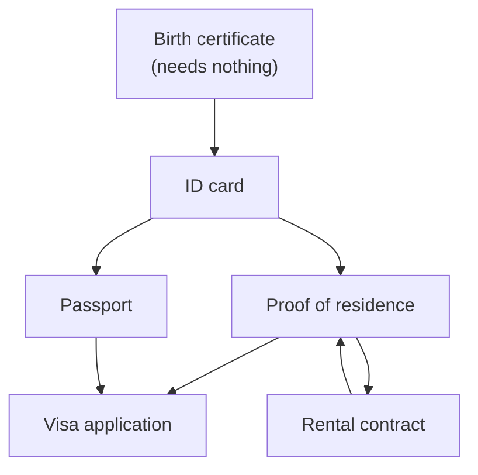
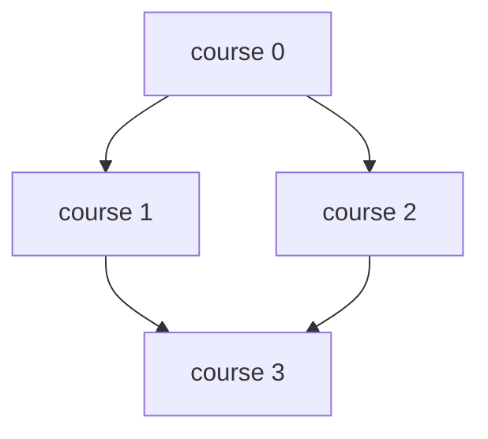

> [!tldr] Quick read
> - Each course is a vertex. The pair `[a, b]` means "take `b` first, then `a`", so draw an arrow **from `b` to `a`**. The question is: does this directed graph have a **cycle**? If not, every course can be finished.
> - [[en/concepts/in-degree|Kahn's algorithm]]: count how many courses each course is still waiting for (its in-degree). A course waiting for 0 courses can be taken now; once it is taken, decrement the count of every course after it. At the end, **count the courses taken**: any course missing is stuck in a cycle.
> - [[en/concepts/three-color-dfs|Three-color DFS]] gives the same answer: meeting a course that is **still on the current path** (gray) means a cycle. With only one "visited" set, it reports a false cycle on a diamond shape.
> - Both are O(V + E). Rescanning every course again and again is correct but slow: on a chain of 2,000 courses it looks at 2,000,999 edges, while Kahn looks at 1,999.
> - A language trap: recursive DFS in Python **breaks at 2,000 courses already** (the default recursion limit is 1,000). Kahn does not recurse, so it never hits that wall.

> [!info] Context
> LeetCode problem 207 (Medium), on [[en/posts/2026-11-26-neetcode-topological-sort|station 3: Topological Sort]] of **the NeetCode Line: Graphs**, and the anchor problem of that station. At [[en/posts/2026-11-26-neetcode-graph-bfs|station 2]], edges could be walked both ways. Here every edge has **one direction**, and that direction means "must be done first". You only need loops, arrays and queues; everything else is explained right below.

> [!abstract]- Quick glossary for this post (click to open)
> - **Vertex, directed edge**: a vertex is a course; the edge `b → a` is a one-way arrow meaning `b` must be done before `a`.
> - **Cycle**: following the arrows brings you back where you started, such as `1 → 2 → 3 → 1`. Courses on a cycle wait for each other forever, and none of them can start.
> - [[en/concepts/directed-acyclic-graph|DAG]]: a directed graph with no cycle. Every course can be finished exactly when the graph is a DAG.
> - [[en/concepts/in-degree|In-degree]]: the number of arrows pointing at a vertex, that is, how many courses this course is still waiting for.
> - [[en/concepts/queue|Queue]]: a first-in, first-out list. Kahn puts the courses that "can be taken now" here.
> - [[en/concepts/adjacency-list|Adjacency list]]: each course keeps the list of courses right after it.
> - [[en/concepts/topological-sort|Topological order]]: a way to line up every course so that every arrow points forward. This problem only asks whether such an order exists; [[en/problems/course-schedule-ii|Course Schedule II]] asks you to print it.
> - **DFS** (depth-first search): follow an arrow as far as it goes, and only turn back at a dead end.
> - **Call stack**: the memory that holds unfinished function calls. When recursion goes too deep, it fills up and the program fails with a stack overflow.

## Picture it first: paperwork at the ward office

You need a pile of documents. Some can be issued right away. Others require another document first: a passport needs an ID card, and an ID card needs a birth certificate. You keep getting whichever document **requires nothing more**, cross it off the "must bring" list of the other documents, and repeat.

Trouble only comes with a **vicious circle**: office A says "bring the paper from office B", and office B says "bring the paper from office A". Neither paper can come first, so both are stuck forever. The problem asks exactly one thing: is there any vicious circle in this pile of paperwork?

| Everyday life | Concept |
|---|---|
| One kind of document | One course, that is, a vertex |
| "To get document A you must already have document B" | The pair `[a, b]`, that is, the edge `b → a` |
| How many documents A still needs | The in-degree of A |
| A document that needs nothing more: get it now | In-degree 0, enter the queue |
| Once B is done, cross B off the other documents' lists | Decrement the in-degree of every vertex after B |
| Office A wants office B's paper, office B wants office A's | A cycle: no vertex on it ever has in-degree 0 |
| Counting the documents you got at the end of the day | Comparing the number of courses taken with `numCourses` |
| While chasing document X, you are asked for document X itself | DFS meets a gray vertex again |

Below is a set of documents with both a part that works and a vicious circle. Each arrow goes from the document needed first to the document that needs it.



The birth certificate, ID card and passport can all be issued. But "proof of residence" waits for the "rental contract", and the contract waits for the proof of residence: these two are stuck, and they drag the visa application down with them. Conclusion: **you cannot get everything**.

## The problem: can every course be finished?

There are `numCourses` courses, numbered `0` to `numCourses − 1`. The array `prerequisites` holds pairs `[a, b]`, meaning that to take course `a` you must first finish course `b`. Return `true` if there is a way to take every course, otherwise `false`. [Problem LC-0207](https://leetcode.com/problems/course-schedule/)

Limits (checked against LeetCode on 26 Nov 2026): `numCourses` is from 1 to 2,000; there are 0 to 5,000 pairs; all pairs are distinct.

Three points that are easy to miss in the statement:

| Question | Answer | Example |
|---|---|---|
| In `[a, b]`, who comes first? | `b` first, `a` after. The arrow goes **from `b` to `a`**. | `[1, 0]`: take 0, then 1 |
| A course that requires itself? | That is a cycle of length 1. Return `false`. | `2` courses, `[[1, 1]]` returns `false` |
| A course that appears in no pair? | It can be taken any time. The graph may split into several pieces. | `3` courses, no pairs, returns `true` |

## How it works

<figure class="figure-map" style="--ar: 3 / 4">
<div class="frame"><iframe data-archify="../../diagrams/neetcode-course-schedule/worked-example.en.html" title="Course Schedule: Kahn takes one course, then gets stuck" loading="lazy"></iframe></div>
<figcaption><span><b>Figure 1.</b> With 4 courses where 1, 2 and 3 wait for each other in a cycle, Kahn takes course 0 and then the queue runs dry; counting 1 &lt; 4 courses is enough to conclude there is a cycle.</span><a href="../diagrams/neetcode-course-schedule/worked-example.en.html" target="_blank" rel="noopener">Open full screen</a></figcaption>
</figure>

<details>
<summary>Read the steps</summary>
<ol>
<li>Four courses, pairs <code>[1,0] [2,1] [3,2] [1,3]</code>. Count in-degrees: course 0 waits for 0 courses, course 1 waits for 2 (0 and 3), course 2 for 1, course 3 for 1. <code>in-degree = [0, 2, 1, 1]</code></li>
<li>Course 0 waits for no one, so it enters the queue. <code>queue: [0]</code></li>
<li>Take course 0. The course after 0 is course 1, and its in-degree drops from 2 to 1. <code>taken: 1</code></li>
<li>Course 1 still waits for course 3, so nobody enters the queue. The queue is empty. <code>queue: []</code></li>
<li>The other three courses wait for each other in a cycle: 1 waits for 3, 3 for 2, 2 for 1. Their in-degrees never reach 0. <code>remaining in-degree = [0, 1, 1, 1]</code></li>
<li>Only 1 of 4 courses was taken. <code>1 &lt; 4 → false</code></li>
</ol>
</details>

### Turning the statement into a graph

Each pair `[a, b]` becomes an arrow `b → a` in the [[en/concepts/adjacency-list|adjacency list]]: `adj[b]` holds the courses right after `b`. At the same time, increase `indegree[a]`, the number of courses `a` is still waiting for.

```ts
for (const [a, b] of prerequisites) {
  adj[b].push(a) // b xong thì tới lượt a
  indegree[a]++  // a chờ thêm một môn
}
```

(The comments read "once b is done, it is a's turn" and "a waits for one more course".) The question "can everything be finished" now becomes "does the graph have a cycle". The reason: if there is a cycle, every course on it waits for another course on the same cycle, so none of them can start. If there is no cycle (a [[en/concepts/directed-acyclic-graph|DAG]]), there is always at least one course that waits for nobody; after taking it, what is left still has no cycle, and so on until everything is taken.

### Approach 1: scan again and again, O(V·(V + E))

The most natural approach, like carrying your document list around every office: on each pass, scan every course not yet taken and take any course whose prerequisites are all done. When a pass takes no new course, stop, then compare the number taken with `numCourses`.

This is correct. The problem is the **number of passes**. If course `i` needs course `i + 1` (course 1,999 is the only one available at first), the first pass scans courses 0 to 1,999 and only takes course 1,999. The second pass only takes course 1,998. It needs 2,001 passes, each rescanning almost the whole list. The runnable file counts **2,000,999 edge looks** for 1,999 edges.

### Approach 2: Kahn, count the courses taken, O(V + E)

Approach 1 wastes effort because each pass has to **search** for a course that can be taken. [[en/concepts/in-degree|Kahn's algorithm]] (A. B. Kahn, 1962) keeps a ledger so it never has to search: each course holds the number "how many courses am I still waiting for". The moment that number hits 0, the course enters the queue.

1. Count the in-degree of every course. Every course at 0 goes into the queue.
2. Take a course out of the queue and count `taken++`. For each course after it, decrement its in-degree by 1; when it hits 0, put it in the queue.
3. When the queue is empty, stop. Return `taken === numCourses`.

Running on the five-course example `[[1,0],[2,0],[3,1],[3,2],[4,3]]` (course 3 needs both 1 and 2):

| Round | Taken out | Decrement in-degree | Enqueued | Taken so far |
|---|---|---|---|---|
| start | | in-degree `[0, 1, 1, 2, 1]` | 0 | 0 |
| 1 | 0 | course 1: 1 → 0, course 2: 1 → 0 | 1, 2 | 1 |
| 2 | 1 | course 3: 2 → 1 | | 2 |
| 3 | 2 | course 3: 1 → 0 | 3 | 3 |
| 4 | 3 | course 4: 1 → 0 | 4 | 4 |
| 5 | 4 | | | 5 |

All 5 of 5 courses taken: return `true`. The order taken out, `0, 1, 2, 3, 4`, is exactly a [[en/concepts/topological-sort|topological order]]; the next problem, [[en/problems/course-schedule-ii|Course Schedule II]], only needs to return that array instead of `true`.

Why is counting enough, without finding the cycle? A course only enters the queue once every course it waits for is done. A course on a cycle always waits for another course on the same cycle, so no course on a cycle ever enters the queue. Conversely, if there is no cycle, every course eventually reaches 0. So "the count falls short" and "there is a cycle" are the same thing.

Each course enters the queue exactly once, and each edge is decremented exactly once: O(V + E) time, O(V + E) memory for the adjacency list.

### Approach 3: three-color DFS, O(V + E)

The second way to find a cycle is to follow the arrows as deep as possible, like chasing paperwork: while getting document X you have to go get document Y, while getting Y you have to get Z… If along the way you are asked for **the very document X you are still chasing**, that is a vicious circle.

To recognize "still chasing", each course carries one of three colors. This is [[en/concepts/three-color-dfs|three-color DFS]]:

| Color | Meaning | When an arrow leads to it |
|---|---|---|
| White | not touched yet | go into it |
| Gray | on the current path, not finished | **cycle**, return `false` |
| Black | every path from it explored, no cycle found | skip it, already checked |

Why three colors? Try using just one "visited" set and treating "meeting a visited vertex again" as a cycle, on a four-course diamond (course 3 needs both 1 and 2):



| Step | Walk | Three colors | One "visited" set |
|---|---|---|---|
| 1 | 0 → 1 → 3 | 0, 1, 3 gray; 3 is a dead end so it turns black, then 1 turns black | visit 0, 1, 3 |
| 2 | 0 → 2 | 2 gray | visit 2 |
| 3 | 2 → 3 | 3 is **black**: already checked, skip | 3 is **visited**: report a cycle |
| result | | `true`, correct | `false`, wrong |

Course 3 is reached by two paths, but two paths do not make a cycle. Only a **gray** vertex (one on the current path) proves you are walking back to where you started. The runnable file records exactly this bug: `wrongOneVisitedSet` fails 2/8 cases, both of them diamond-shaped.

One more benefit of black: a black vertex is never walked again. Each vertex and each edge is looked at once, so three-color DFS is O(V + E) too.

### Approach 3b: DFS with your own stack

Recursive DFS is short, but every level deeper is a function call waiting on the call stack. The chain `0 → 1 → 2 → … → 1,999` is 2,000 levels deep, and Python allows only 1,000 by default. The fix is to keep your own array as the stack: each entry is a vertex, with an index `next[u]` saying which neighbor of it to look at next. The three-color logic stays the same; only the stack is your own array instead of the system's.

### Kahn or DFS?

| | Kahn | Three-color DFS |
|---|---|---|
| Idea | take courses that wait for no one, count the courses taken | go deep, a gray vertex means a cycle |
| Extra structures | in-degree array, queue | color array, stack (recursion or your own) |
| Recursion | no | yes, unless you keep your own stack |
| Gives the study order too | yes, the order taken out | yes, take the "finished" order and reverse it |
| Stops early on a cycle | no, it runs to the end, then counts | yes, as soon as it meets a gray vertex |

I default to Kahn: no recursion, easy to explain, and the next problem reuses it almost word for word.

### Measured on 2,000 courses

The runnable file uses two inputs of 2,000 courses. **Reversed chain**: course `i` needs course `i + 1`, the worst case for Approach 1. **Random**: 5,000 pairs with no cycle, course numbers shuffled. The "edge looks" column counts how many times a method looks at one prerequisite pair; all seven languages produce exactly the same number.

| Reversed chain, 1,999 edges | Edge looks | TS | Python | Go | Java | PHP | Rust |
|---|---:|---:|---:|---:|---:|---:|---:|
| Approach 1: rescan, 2,001 passes | 2,000,999 | 29 ms | 136 ms | 3.6 ms | 5.5 ms | 59 ms | 3.1 ms |
| Approach 2: Kahn | 1,999 | 0.3 ms | 0.3 ms | 0.1 ms | 0.2 ms | 0.1 ms | 0.1 ms |
| Approach 3: recursive DFS | 1,999 | 0.1 ms | 0.3 ms | 0.1 ms | 0.1 ms | 0.2 ms | < 0.1 ms |
| Approach 3b: DFS with own stack | 1,999 | 0.1 ms | 0.5 ms | 0.1 ms | 0.4 ms | 0.3 ms | 0.1 ms |

| Random, 5,000 edges | Edge looks | TS | Python | Go | Java | PHP | Rust |
|---|---:|---:|---:|---:|---:|---:|---:|
| Approach 1: rescan, 10 passes | 12,033 | 0.4 ms | 1.1 ms | 0.3 ms | 0.2 ms | 0.6 ms | 0.1 ms |
| Approach 2: Kahn | 5,000 | 0.3 ms | 0.7 ms | 0.2 ms | 0.3 ms | 0.4 ms | 0.1 ms |
| Approach 3: recursive DFS | 5,000 | 0.3 ms | 0.6 ms | 0.2 ms | 0.2 ms | 0.5 ms | 0.1 ms |
| Approach 3b: DFS with own stack | 5,000 | 0.2 ms | 1.0 ms | 0.3 ms | 0.3 ms | 0.6 ms | 0.1 ms |

On the reversed chain, recursive DFS does not stumble, because the arrows point from larger to smaller course numbers, so a DFS starting at course 0 goes nowhere; each walk is only one level deep. The opposite direction is what makes DFS run the whole chain in one go; see the deep-recursion table below. Two things worth remembering:

- On the random graph, Approach 1 needs only 10 passes and looks harmless. On the reversed chain it looks at edges **more than a thousand times** as often as Kahn. A method that is only fast on "easy" data is a method with a bad case.
- Kahn and DFS look at each edge exactly once on both inputs. Timings change with the machine and the run; the "edge looks" column does not.

Deep recursion: the chain "course `i + 1` needs course `i`", so DFS from course 0 runs the whole chain in one go.

| Depth | TS and JS | Python | Go | Java | PHP | Rust |
|---|---|---|---|---|---|---|
| 2,000 levels, recursive DFS | correct | `RecursionError` | correct | correct | correct | correct |
| 100,000 levels, recursive DFS | `RangeError` | `RecursionError` | correct | `StackOverflowError` | correct | correct (main thread) |
| 100,000 levels, DFS with own stack and Kahn | correct | correct | correct | correct | correct | correct |

Go does not break because each goroutine's stack grows on its own, by default up to 1 GB on a 64-bit machine. The other three languages have a fixed ceiling. PHP does not break because PHP function calls live on the virtual machine's heap, not on the thread's stack; on a machine with Xdebug enabled, Xdebug stops recursion at 512 levels, so the PHP files run with `php -d xdebug.mode=off`. Rust runs 100,000 levels on the main thread (8 MB stack), but the same function on a new thread (2 MB by default) overflows and the whole process stops. The problem allows at most 2,000 courses, so on LeetCode only Python trips; but on real data (a build system with hundreds of thousands of steps), JavaScript and Java trip too.

## Runnable example

Each file runs the same 8 cases: two courses, two courses waiting for each other, a diamond, the five-course example, one course taken then stuck, a course that requires itself, no prerequisites, and two separate pieces where the second has a cycle. The file also cross-checks the four correct approaches on 2,000 small random graphs (generated by the same pseudo-random sequence in all seven languages), measures the two 2,000-course inputs and tries deep recursion. Below are the graph building, Kahn and recursive three-color DFS; Approach 1, Approach 3b and the two wrong versions are in the full file.

[TypeScript](../code/neetcode-course-schedule/course-schedule.ts) · [Python](../code/neetcode-course-schedule/course_schedule.py) · [Go](../code/neetcode-course-schedule/course_schedule.go) · [Java](../code/neetcode-course-schedule/course-schedule.java) · [JavaScript](../code/neetcode-course-schedule/course-schedule.js) · [PHP](../code/neetcode-course-schedule/course-schedule.php) · [Rust](../code/neetcode-course-schedule/course_schedule.rs)

```ts
// Cặp [a, b] nghĩa là "muốn học a phải học b trước": cạnh đi từ b sang a.
function buildGraph(n: number, prerequisites: number[][]) {
  const adj: number[][] = Array.from({ length: n }, () => [])
  const indegree = new Array<number>(n).fill(0)
  for (const [a, b] of prerequisites) {
    adj[b].push(a)
    indegree[a]++
  }
  return { adj, indegree }
}

// Cách 2: Kahn. Môn có bậc vào 0 thì học được ngay; học xong thì trừ bậc vào
// của các môn đứng sau. Đếm số môn học được. O(V + E).
function canFinishKahn(n: number, prerequisites: number[][]): boolean {
  const { adj, indegree } = buildGraph(n, prerequisites)
  const queue: number[] = []
  for (let c = 0; c < n; c++) if (indegree[c] === 0) queue.push(c)
  let taken = 0
  for (let head = 0; head < queue.length; head++) {
    const u = queue[head]
    taken++
    for (const v of adj[u]) {
      work++
      if (--indegree[v] === 0) queue.push(v)
    }
  }
  return taken === n // thiếu môn nào là môn đó kẹt trong một vòng
}

// Cách 3: DFS ba màu, đệ quy. Trắng = chưa đụng, xám = đang trên đường đi,
// đen = đã xong. Gặp lại một đỉnh xám là có vòng. O(V + E).
const WHITE = 0, GRAY = 1, BLACK = 2
function canFinishDfs(n: number, prerequisites: number[][]): boolean {
  const { adj } = buildGraph(n, prerequisites)
  const color = new Array<number>(n).fill(WHITE)
  const visit = (u: number): boolean => {
    color[u] = GRAY
    for (const v of adj[u]) {
      work++
      if (color[v] === GRAY) return false // quay về đỉnh đang trên đường: vòng
      if (color[v] === WHITE && !visit(v)) return false
    }
    color[u] = BLACK
    return true
  }
  for (let u = 0; u < n; u++) {
    if (color[u] === WHITE && !visit(u)) return false
  }
  return true
}
```
```python
def build_graph(n, prerequisites):
    # Cặp [a, b] nghĩa là "muốn học a phải học b trước": cạnh đi từ b sang a.
    adj = [[] for _ in range(n)]
    indegree = [0] * n
    for a, b in prerequisites:
        adj[b].append(a)
        indegree[a] += 1
    return adj, indegree

# Cách 2: Kahn. Môn có bậc vào 0 thì học được ngay; học xong thì trừ bậc vào
# của các môn đứng sau. Đếm số môn học được. O(V + E).
def can_finish_kahn(n, prerequisites):
    global work
    adj, indegree = build_graph(n, prerequisites)
    queue = deque(c for c in range(n) if indegree[c] == 0)
    taken = 0
    while queue:
        u = queue.popleft()
        taken += 1
        for v in adj[u]:
            work += 1
            indegree[v] -= 1
            if indegree[v] == 0:
                queue.append(v)
    return taken == n  # thiếu môn nào là môn đó kẹt trong một vòng


WHITE, GRAY, BLACK = 0, 1, 2


# Cách 3: DFS ba màu, đệ quy. Trắng = chưa đụng, xám = đang trên đường đi,
# đen = đã xong. Gặp lại một đỉnh xám là có vòng. O(V + E).
def can_finish_dfs(n, prerequisites):
    adj, _ = build_graph(n, prerequisites)
    color = [WHITE] * n

    def visit(u):
        global work
        color[u] = GRAY
        for v in adj[u]:
            work += 1
            if color[v] == GRAY:  # quay về đỉnh đang trên đường: vòng
                return False
            if color[v] == WHITE and not visit(v):
                return False
        color[u] = BLACK
        return True

    return all(color[u] != WHITE or visit(u) for u in range(n))
```
```go
// Cặp [a, b] nghĩa là "muốn học a phải học b trước": cạnh đi từ b sang a.
func buildGraph(n int, prerequisites [][]int) ([][]int, []int) {
	adj := make([][]int, n)
	indegree := make([]int, n)
	for _, p := range prerequisites {
		a, b := p[0], p[1]
		adj[b] = append(adj[b], a)
		indegree[a]++
	}
	return adj, indegree
}

// Cách 2: Kahn. Môn có bậc vào 0 thì học được ngay; học xong thì trừ bậc vào
// của các môn đứng sau. Đếm số môn học được. O(V + E).
func canFinishKahn(n int, prerequisites [][]int) bool {
	adj, indegree := buildGraph(n, prerequisites)
	queue := []int{}
	for c := 0; c < n; c++ {
		if indegree[c] == 0 {
			queue = append(queue, c)
		}
	}
	taken := 0
	for head := 0; head < len(queue); head++ {
		u := queue[head]
		taken++
		for _, v := range adj[u] {
			work++
			indegree[v]--
			if indegree[v] == 0 {
				queue = append(queue, v)
			}
		}
	}
	return taken == n // thiếu môn nào là môn đó kẹt trong một vòng
}

const (
	white = 0
	gray  = 1
	black = 2
)

// Cách 3: DFS ba màu, đệ quy. Trắng = chưa đụng, xám = đang trên đường đi,
// đen = đã xong. Gặp lại một đỉnh xám là có vòng. O(V + E).
func canFinishDfs(n int, prerequisites [][]int) bool {
	adj, _ := buildGraph(n, prerequisites)
	color := make([]int, n)
	var visit func(u int) bool
	visit = func(u int) bool {
		color[u] = gray
		for _, v := range adj[u] {
			work++
			if color[v] == gray { // quay về đỉnh đang trên đường: vòng
				return false
			}
			if color[v] == white && !visit(v) {
				return false
			}
		}
		color[u] = black
		return true
	}
	for u := 0; u < n; u++ {
		if color[u] == white && !visit(u) {
			return false
		}
	}
	return true
}
```
```java
// Cặp [a, b] nghĩa là "muốn học a phải học b trước": cạnh đi từ b sang a.
static List<List<Integer>> buildAdj(int n, int[][] prerequisites, int[] indegree) {
    List<List<Integer>> adj = new ArrayList<>();
    for (int i = 0; i < n; i++) adj.add(new ArrayList<>());
    for (int[] p : prerequisites) {
        adj.get(p[1]).add(p[0]);
        indegree[p[0]]++;
    }
    return adj;
}

// Cách 2: Kahn. Môn có bậc vào 0 thì học được ngay; học xong thì trừ bậc vào
// của các môn đứng sau. Đếm số môn học được. O(V + E).
static boolean canFinishKahn(int n, int[][] prerequisites) {
    int[] indegree = new int[n];
    List<List<Integer>> adj = buildAdj(n, prerequisites, indegree);
    ArrayDeque<Integer> queue = new ArrayDeque<>();
    for (int c = 0; c < n; c++) if (indegree[c] == 0) queue.add(c);
    int taken = 0;
    while (!queue.isEmpty()) {
        int u = queue.poll();
        taken++;
        for (int v : adj.get(u)) {
            work++;
            if (--indegree[v] == 0) queue.add(v);
        }
    }
    return taken == n; // thiếu môn nào là môn đó kẹt trong một vòng
}

static final int WHITE = 0, GRAY = 1, BLACK = 2;

// Cách 3: DFS ba màu, đệ quy. Trắng = chưa đụng, xám = đang trên đường đi,
// đen = đã xong. Gặp lại một đỉnh xám là có vòng. O(V + E).
static boolean canFinishDfs(int n, int[][] prerequisites) {
    List<List<Integer>> adj = buildAdj(n, prerequisites, new int[n]);
    int[] color = new int[n];
    for (int u = 0; u < n; u++) {
        if (color[u] == WHITE && !visit(u, adj, color)) return false;
    }
    return true;
}

static boolean visit(int u, List<List<Integer>> adj, int[] color) {
    color[u] = GRAY;
    for (int v : adj.get(u)) {
        work++;
        if (color[v] == GRAY) return false; // quay về đỉnh đang trên đường: vòng
        if (color[v] == WHITE && !visit(v, adj, color)) return false;
    }
    color[u] = BLACK;
    return true;
}
```
```js
// Cặp [a, b] nghĩa là "muốn học a phải học b trước": cạnh đi từ b sang a.
function buildGraph(n, prerequisites) {
  const adj= Array.from({ length: n }, () => [])
  const indegree = new Array(n).fill(0)
  for (const [a, b] of prerequisites) {
    adj[b].push(a)
    indegree[a]++
  }
  return { adj, indegree }
}

// Cách 2: Kahn. Môn có bậc vào 0 thì học được ngay; học xong thì trừ bậc vào
// của các môn đứng sau. Đếm số môn học được. O(V + E).
function canFinishKahn(n, prerequisites) {
  const { adj, indegree } = buildGraph(n, prerequisites)
  const queue = []
  for (let c = 0; c < n; c++) if (indegree[c] === 0) queue.push(c)
  let taken = 0
  for (let head = 0; head < queue.length; head++) {
    const u = queue[head]
    taken++
    for (const v of adj[u]) {
      work++
      if (--indegree[v] === 0) queue.push(v)
    }
  }
  return taken === n // thiếu môn nào là môn đó kẹt trong một vòng
}

// Cách 3: DFS ba màu, đệ quy. Trắng = chưa đụng, xám = đang trên đường đi,
// đen = đã xong. Gặp lại một đỉnh xám là có vòng. O(V + E).
const WHITE = 0, GRAY = 1, BLACK = 2
function canFinishDfs(n, prerequisites) {
  const { adj } = buildGraph(n, prerequisites)
  const color = new Array(n).fill(WHITE)
  const visit = (u) => {
    color[u] = GRAY
    for (const v of adj[u]) {
      work++
      if (color[v] === GRAY) return false // quay về đỉnh đang trên đường: vòng
      if (color[v] === WHITE && !visit(v)) return false
    }
    color[u] = BLACK
    return true
  }
  for (let u = 0; u < n; u++) {
    if (color[u] === WHITE && !visit(u)) return false
  }
  return true
}
```
```php
// Cặp [a, b] nghĩa là "muốn học a phải học b trước": cạnh đi từ b sang a.
function buildGraph(int $n, array $prerequisites): array
{
    $adj = array_fill(0, $n, []);
    $indegree = array_fill(0, $n, 0);
    foreach ($prerequisites as [$a, $b]) {
        $adj[$b][] = $a;
        $indegree[$a]++;
    }
    return [$adj, $indegree];
}

// Cách 2: Kahn. Môn có bậc vào 0 thì học được ngay; học xong thì trừ bậc vào
// của các môn đứng sau. Đếm số môn học được. O(V + E).
function canFinishKahn(int $n, array $prerequisites): bool
{
    global $work;
    [$adj, $indegree] = buildGraph($n, $prerequisites);
    $queue = [];
    for ($c = 0; $c < $n; $c++) if ($indegree[$c] === 0) $queue[] = $c;
    $taken = 0;
    for ($head = 0; $head < count($queue); $head++) { // giữ chỉ số đầu, không array_shift
        $u = $queue[$head];
        $taken++;
        foreach ($adj[$u] as $v) {
            $work++;
            if (--$indegree[$v] === 0) $queue[] = $v;
        }
    }
    return $taken === $n; // thiếu môn nào là môn đó kẹt trong một vòng
}

const WHITE = 0;
const GRAY = 1;
const BLACK = 2;

// Cách 3: DFS ba màu, đệ quy. Trắng = chưa đụng, xám = đang trên đường đi,
// đen = đã xong. Gặp lại một đỉnh xám là có vòng. O(V + E).
function canFinishDfs(int $n, array $prerequisites): bool
{
    [$adj] = buildGraph($n, $prerequisites);
    $color = array_fill(0, $n, WHITE);
    // $color truyền theo tham chiếu (&): mảng PHP là giá trị, không có & thì mỗi lời gọi sửa một bản sao
    $visit = function (int $u) use (&$visit, &$color, $adj): bool {
        global $work;
        $color[$u] = GRAY;
        foreach ($adj[$u] as $v) {
            $work++;
            if ($color[$v] === GRAY) return false; // quay về đỉnh đang trên đường: vòng
            if ($color[$v] === WHITE && !$visit($v)) return false;
        }
        $color[$u] = BLACK;
        return true;
    };
    for ($u = 0; $u < $n; $u++) {
        if ($color[$u] === WHITE && !$visit($u)) return false;
    }
    return true;
}
```
```rust
// Cặp [a, b] nghĩa là "muốn học a phải học b trước": cạnh đi từ b sang a.
fn build_graph(n: usize, prerequisites: &[[usize; 2]]) -> (Vec<Vec<usize>>, Vec<usize>) {
    let mut adj = vec![Vec::new(); n];
    let mut indegree = vec![0usize; n];
    for &[a, b] in prerequisites {
        adj[b].push(a);
        indegree[a] += 1;
    }
    (adj, indegree)
}

// Cách 2: Kahn. Môn có bậc vào 0 thì học được ngay; học xong thì trừ bậc vào
// của các môn đứng sau. Đếm số môn học được. O(V + E).
fn can_finish_kahn(n: usize, prerequisites: &[[usize; 2]]) -> bool {
    let (adj, mut indegree) = build_graph(n, prerequisites);
    let mut queue: VecDeque<usize> = (0..n).filter(|&c| indegree[c] == 0).collect();
    let mut taken = 0;
    while let Some(u) = queue.pop_front() {
        taken += 1;
        for &v in &adj[u] {
            tick();
            indegree[v] -= 1; // usize: chỉ trừ khi chắc > 0, nếu không bản debug panic
            if indegree[v] == 0 {
                queue.push_back(v);
            }
        }
    }
    taken == n // thiếu môn nào là môn đó kẹt trong một vòng
}

const WHITE: u8 = 0;
const GRAY: u8 = 1;
const BLACK: u8 = 2;

// Cách 3: DFS ba màu, đệ quy. Trắng = chưa đụng, xám = đang trên đường đi,
// đen = đã xong. Gặp lại một đỉnh xám là có vòng. O(V + E).
fn can_finish_dfs(n: usize, prerequisites: &[[usize; 2]]) -> bool {
    let (adj, _) = build_graph(n, prerequisites);
    let mut color = vec![WHITE; n];
    // Hàm lồng thay cho closure: closure đệ quy cần mượn &mut color hai lần, borrow checker không cho.
    fn visit(u: usize, adj: &[Vec<usize>], color: &mut [u8]) -> bool {
        color[u] = GRAY;
        for &v in &adj[u] {
            tick();
            if color[v] == GRAY {
                return false; // quay về đỉnh đang trên đường: vòng
            }
            if color[v] == WHITE && !visit(v, adj, color) {
                return false;
            }
        }
        color[u] = BLACK;
        true
    }
    for u in 0..n {
        if color[u] == WHITE && !visit(u, &adj, &mut color) {
            return false;
        }
    }
    true
}
```

Output of `node course-schedule.ts` (the other six print the same case lines and the same edge-look counts; timings and the deep-recursion lines differ as in the tables above). The lines say how many cases pass ("ca đúng"), which cases fail ("sai ở"), and for each input the answer, the edge looks ("lần nhìn cạnh"), the passes ("lượt quét") and the time; "lỗi … (tràn ngăn xếp)" means the call failed with a stack overflow:

```text
canFinishScan        8/8 ca đúng
canFinishKahn        8/8 ca đúng
canFinishDfs         8/8 ca đúng
canFinishDfsStack    8/8 ca đúng
wrongOneVisitedSet   6/8 ca đúng; sai ở kim cương → false, ví dụ năm môn → false
wrongHasStart        5/8 ca đúng; sai ở học được một môn rồi kẹt → true, môn tự cần chính nó → true, hai mảnh, mảnh sau có vòng → true
ngẫu nhiên: 2000/2000 đồ thị, bốn cách khớp nhau (637 học hết được, 1363 có vòng)
chuỗi 2000 môn, môn i cần môn i+1:
  canFinishScan      true, 2000999 lần nhìn cạnh, 2001 lượt quét, 28.8 ms
  canFinishKahn      true, 1999 lần nhìn cạnh, 0.3 ms
  canFinishDfs       true, 1999 lần nhìn cạnh, 0.1 ms
  canFinishDfsStack  true, 1999 lần nhìn cạnh, 0.1 ms
ngẫu nhiên 2000 môn, 5000 cặp, không vòng:
  canFinishScan      true, 12033 lần nhìn cạnh, 10 lượt quét, 0.4 ms
  canFinishKahn      true, 5000 lần nhìn cạnh, 0.3 ms
  canFinishDfs       true, 5000 lần nhìn cạnh, 0.3 ms
  canFinishDfsStack  true, 5000 lần nhìn cạnh, 0.2 ms
đệ quy sâu, chuỗi môn i+1 cần môn i:
  2000 môn: canFinishDfs true; canFinishDfsStack true; canFinishKahn true
  100000 môn: canFinishDfs lỗi RangeError (tràn ngăn xếp); canFinishDfsStack true; canFinishKahn true
```

## Misconceptions and common traps

- **"If there is a cycle, I have to point it out."** No need. Kahn just counts: fewer than `numCourses` courses taken means a cycle. You only need an extra "who led to whom" ledger if you want to print the cycle.
- **DFS with only one "visited" set.** Meeting a visited vertex again does not mean a cycle; that vertex may have been fully checked through another path. The `wrongOneVisitedSet` version returns `false` for the diamond and the five-course example. Only a **gray** vertex is evidence of a cycle.
- **Only asking "is there any course I can take right now".** Having a starting point does not mean you can go all the way. The `wrongHasStart` version fails 3/8 cases: one course taken then stuck, a course that requires itself, and two separate pieces where the second has a cycle.
- **Forgetting a course that requires itself.** The pair `[1, 1]` is a cycle of length 1. Kahn handles it correctly (course 1 has in-degree 1 from itself and never reaches 0); so does three-color DFS (walking from 1 meets 1 again while it is gray).
- **Running DFS only from course 0.** The graph may split into several pieces. You have to start from every course that is still white, or a cycle in another piece slips through.
- **Drawing the arrows backwards.** In this problem, backwards arrows still give the right answer, because reversing every arrow keeps a cycle a cycle. But the habit will break [[en/problems/course-schedule-ii|Course Schedule II]], where the study order comes out completely reversed. Practice drawing `b → a` correctly from this problem on.
- **Python: recursive DFS.** The default recursion limit is 1,000, so a 2,000-course chain raises `RecursionError` within the problem's own limits. Raising `sys.setrecursionlimit` too high can crash the whole interpreter (the C stack is limited too). Use Kahn with `collections.deque`, or DFS with your own stack.
- **TypeScript and JavaScript: `queue.shift()`.** Each removal from the front shifts the whole array. Keep a `head` index that walks along the array, as the file does. Recursive DFS survives 2,000 levels but breaks with `RangeError` at 100,000.
- **Java: `List<List<Integer>>` and recursion.** Each number is boxed into an `Integer`, which costs more memory than `int[]`; with 5,000 edges this does not matter. Recursive DFS throws `StackOverflowError` at 100,000 levels with the default stack.
- **Go: no overflow, but still a cost.** Goroutine stacks grow on their own, so 100,000 levels of recursion still run. Taking the front of the queue with `queue = queue[1:]` keeps the original array alive until the queue is done; a `head` index is tidier.
- **PHP: arrays are values, so the closure needs `&$color`.** With `use ($color)` the closure gets a copy taken when it is created, every recursive call sees an all-white array and never meets a gray vertex; on a graph with a cycle it recurses until PHP runs out of memory (a fatal error that cannot be caught). Write `use (&$visit, &$color)`. Also, Xdebug, if enabled, stops recursion at 512 levels even though a 2,000-course chain is perfectly valid.
- **Rust: recursive closures and spawned threads.** A closure cannot call itself while it still borrows `&mut color`, so the Rust version writes `visit` as a nested `fn` that takes `&mut [u8]`. A stack overflow in Rust is not an exception: the process is aborted. The 100,000-course chain runs on the main thread (8 MB) but overflows on a default `thread::spawn` (2 MB); Kahn with a `VecDeque` does not depend on the stack.

## Self-check questions

> [!question]- What does the pair `[3, 5]` mean, and which way does the arrow go?
> To take course 3 you must first finish course 5. The arrow goes from 5 to 3, and the in-degree of course 3 goes up by 1.

> [!question]- Kahn ends with `taken = 7` and `numCourses = 10`. What can you say about the other 3 courses?
> Those three never reach in-degree 0: each one is either on a cycle or after a course on a cycle. The answer is `false`.

> [!question]- In three-color DFS, an arrow leads to a black vertex. Why can you skip it without missing any cycle?
> Every path from a black vertex was already explored without finding a cycle, and it is not on the current path. Walking into it again would only repeat that same work and could never lead back to the current path.

> [!question]- Why does Approach 1 need 2,001 passes on the chain "course `i` needs course `i + 1`"?
> Each pass scans upward from course 0, but only the largest remaining course can be taken, and it sits at the end of the list. Each pass takes exactly one more course: 2,000 passes that take a course, plus one final pass that finds nothing left.

> [!question]- The problem has up to 2,000 courses. Does a recursive DFS in Python pass every case?
> Not necessarily. A chain of 2,000 courses makes DFS 2,000 levels deep, beyond the default recursion limit of 1,000, and it raises `RecursionError`. Kahn or DFS with your own stack passes.

## References

- [LeetCode · Course Schedule](https://leetcode.com/problems/course-schedule/): the problem and its input limits.
- [Wikipedia · Topological sorting](https://en.wikipedia.org/wiki/Topological_sorting): Kahn's algorithm (1962) and how DFS gives a topological sort.
- [Princeton · Directed graphs](https://algs4.cs.princeton.edu/42digraph/): directed graphs, cycle detection, topological order.
- [Princeton · DirectedCycle.java](https://github.com/kevin-wayne/algs4/blob/master/src/main/java/edu/princeton/cs/algs4/DirectedCycle.java): DFS with an `onStack` array, which plays exactly the role of gray.
- [Python · sys.setrecursionlimit](https://docs.python.org/3/library/sys.html#sys.setrecursionlimit): the recursion limit and the warning about raising it too high.
- [Go · debug.SetMaxStack](https://pkg.go.dev/runtime/debug#SetMaxStack): the default 1 GB stack ceiling on 64-bit systems.
