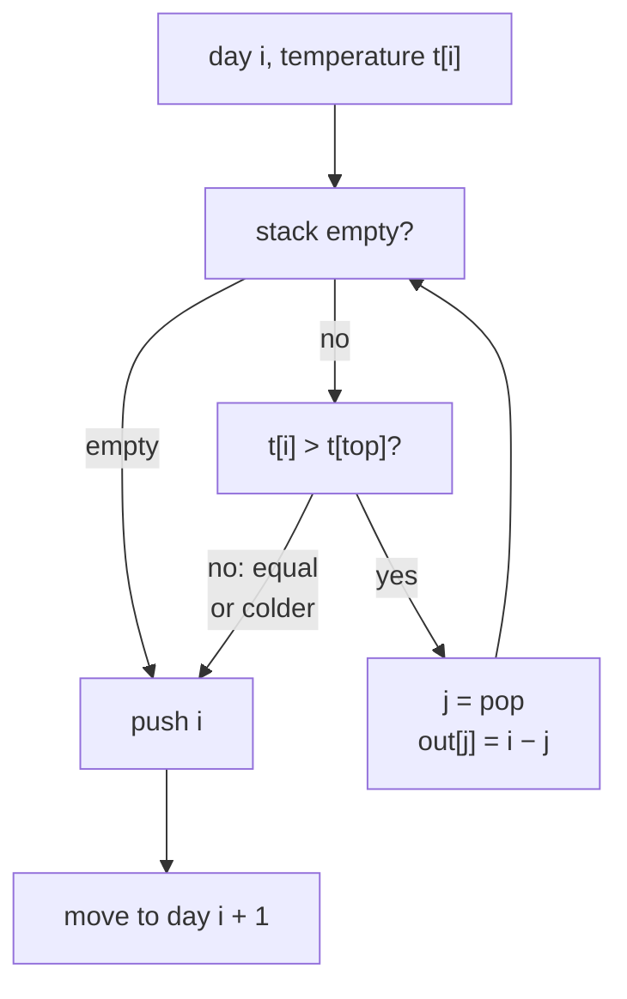

> [!tldr] Quick read
> - The problem: given each day's temperature, return for each day how many days until the first **warmer** day; 0 if there is none. This is the original "[[en/concepts/next-greater-element|next greater element]]" problem.
> - Brute force: each day searches forward. O(n²) when temperatures decrease: 309 ms at n = 40 000.
> - [[en/concepts/monotonic-stack|Monotonic stack]]: keep the indices of the days **still waiting**, temperatures decreasing from bottom to top. A new day warmer than the top pops it and records its answer. Each index goes in once and comes out at most once: O(n) even with a `while` inside a `for`.
> - Trap: `>=` instead of `>` treats a day of **equal** temperature as warmer: `[70, 70, 71]` gives `[1, 1, 0]` instead of `[2, 1, 0]`.
> - A third approach: walk from the right and **jump along answers** already computed, with no stack.

> [!info] Context
> LeetCode problem 739, the anchor problem of [[en/posts/2026-11-23-neetcode-monotonic-stack|station 7: Monotonic Stack]] on **the NeetCode line: Arrays and Strings**. It uses the [[en/concepts/stack|stack]] of [[en/posts/2026-11-23-neetcode-stack|station 6]] with one extra rule: the elements on the stack are always ordered in one direction. The solutions come in TypeScript, Python, Go, Java and JavaScript. All you need to know is loops, arrays and stacks.

> [!abstract]- Quick glossary for this post (click to open)
> - **Stack**: add and remove only at the top, last in first out. See [[en/concepts/stack|Stack]].
> - **Monotonic**: always decreasing (or always increasing) in one direction. A "monotonically decreasing stack" means that, reading from bottom to top, values never increase.
> - **Next greater element**: for each position, the first element to its right that is larger. See [[en/concepts/next-greater-element|Next Greater Element]].
> - **Aggregate analysis**: counting the total steps of the whole algorithm instead of multiplying loop counts. See [[en/concepts/aggregate-analysis|Aggregate Analysis]].

## Picture it first: a line of people waiting for the sun

Every morning one person goes out to the yard holding a card with that day's temperature. Each waits for a day **warmer** than their own, then goes home. Whoever arrives later stands **in front of** whoever came before, so only the outermost person sees the new day.

| Everyday life | Concept |
|---|---|
| The line of waiting people, the newest one outermost | the stack of days without an answer yet |
| The outermost person's card is always colder than or equal to the one behind | a monotonically decreasing stack |
| This morning beats the outermost card: that person goes home, writing "waited k days" | `pop` and record `out[j] = i − j` |
| The next person is revealed; if this morning still beats them, they leave too | the `while` loop |
| This morning doesn't beat the outermost person: then it beats nobody behind them either, so today joins the line | stop the `while`, `push` today |
| At season's end, whoever is still waiting never got a warmer day | answer 0 |



## The problem

**The problem (in my own words):** given an array `temperatures` (1 ≤ n ≤ 10⁵, each value 30..100), return an array `answer` where `answer[i]` is the number of days after day i until a **strictly** warmer day; 0 if there is no such day. Original: [LeetCode 739](https://leetcode.com/problems/daily-temperatures/).

| Input | Output |
|---|---|
| `[73, 74, 75, 71, 69, 72, 76, 73]` | `[1, 1, 4, 2, 1, 1, 0, 0]` |
| `[30, 40, 50, 60]` | `[1, 1, 1, 0]` |
| `[90, 80, 70]` | `[0, 0, 0]` |
| `[70, 70, 71]` | `[2, 1, 0]` |

I used to think each day had to "look ahead". It turns out flipping the question is neater: instead of each day searching the future, let **each new day resolve the old days** waiting for it.

## How it works

### Approach 1, brute force: O(n²) in the worst case

For each i, walk `j = i + 1, i + 2, …` until `t[j] > t[i]`. On random data you usually hit one early, so it's fast. On **decreasing** data no day ever finds one, and each day scans to the end: n²/2 comparisons.

### Approach 2, monotonic stack

Keep a stack of the **indices** of days without an answer yet. Walk each day i:
1. while the stack is non-empty and `t[i] > t[top]`: pop the top j and record `out[j] = i − j`, because day i is the **first** warmer day after j (every day between j and i already failed to resolve j);
2. push i.

After step 1, `t[i]` is not greater than the top, so pushing i keeps the decreasing (non-increasing) order from bottom to top. That order is why step 1 stops at the right moment: if day i is not warmer than the top, it is not warmer than any day below it.

Store **indices**, not temperatures: the answer is a distance, and the temperature can be looked up from the index.

### Why a `while` inside a `for` is still O(n)

Count with [[en/concepts/aggregate-analysis|aggregate analysis]]: each index is pushed exactly once and popped at most once. The total number of pops across **all** iterations of the `while` loop is at most n, so the total work is O(n). The TypeScript file counts it: on 10⁶ random days, 986 048 pops plus 13 952 indices left on the stack add up to exactly 10⁶.

### Approach 3, walk from the right and jump along answers

Walk i from right to left. To find the day warmer than i, start at `j = i + 1`. If `t[j] ≤ t[i]`, every day from j up to j's warmer day is not warmer than j, so not warmer than i either: jump straight `j += out[j]`. If `out[j] = 0`, j has no warmer day, so neither does i. No stack: O(1) extra space, and still O(n) by the same aggregate argument.

### Measured

TypeScript, median:

| n | data | brute force | stack | jump from right |
|---|---|---|---|---|
| 10 000 | decreasing | 20.6 ms | 0.12 ms | 0.05 ms |
| 20 000 | decreasing | 77.5 ms | 0.27 ms | 0.12 ms |
| 40 000 | decreasing | 308.7 ms | 0.72 ms | 0.19 ms |
| 40 000 | random 30..100 | 4.9 ms | 0.55 ms | 0.43 ms |
| 10⁶ | decreasing | (not run) | 21.10 ms | 5.64 ms |
| 10⁶ | random | (not run) | 11.85 ms | 9.78 ms |

Brute force on decreasing data follows the n² shape exactly (double n, about 4 times the time). On random data with only 71 values, a warmer day is usually very close, so brute force is only about 10 times slower: random tests don't catch the worst case. At 10⁶ decreasing days, the stack has to hold all 10⁶ indices, while the jump approach allocates nothing and is almost 4 times faster.

### Under the hood of the five languages

| | The stack | Language-specific trap |
|---|---|---|
| TypeScript / JavaScript | an array: `push`, `pop`, `stack[stack.length - 1]` or `stack.at(-1)` | `stack[-1]` is `undefined`, not the last element; `t[undefined]` is `undefined` too and `x > undefined` is `false`, so the bug never blows up |
| Python | a `list`: `append`, `pop`, `stack[-1]` | `stack[-1]` on an empty list raises `IndexError`; write `while stack and …` |
| Go | a slice: `append`, `stack[:len(stack)-1]` | preallocate capacity with `make([]int, 0, n)` so `append` never reallocates |
| Java | `ArrayDeque<Integer>`: `push`, `pop`, `peek` | boxes every index; a stack in an `int[]` with a top pointer is about 12 times faster in the measurement below. Avoid `java.util.Stack` (legacy, synchronized) |

## Runnable example

[TypeScript](../code/neetcode-daily-temperatures/daily-temperatures.ts) · [Python](../code/neetcode-daily-temperatures/daily_temperatures.py) · [Go](../code/neetcode-daily-temperatures/daily_temperatures.go) · [Java](../code/neetcode-daily-temperatures/daily-temperatures.java) · [JavaScript](../code/neetcode-daily-temperatures/daily-temperatures.js)

Each file has the brute force, the stack and the jump-from-right approach, and runs 7 cases. Below are the stack and the jump approaches.

```ts
// Approach 2, monotonic stack: keep the INDICES of days still without a warmer day, temperatures decreasing from bottom to top.
function monotonicStack(t: number[]): number[] {
  const out = new Array(t.length).fill(0);
  const stack: number[] = [];
  for (let i = 0; i < t.length; i++) {
    while (stack.length > 0 && t[i] > t[stack[stack.length - 1]]) {
      const j = stack.pop()!; // day j has just met its first warmer day: day i
      out[j] = i - j;
    }
    stack.push(i);
  }
  return out; // days left on the stack have no warmer day: keep 0
}

// Approach 3, walk from the right and jump along answers: no stack, O(1) extra space.
function jumpFromRight(t: number[]): number[] {
  const n = t.length;
  const out = new Array(n).fill(0);
  for (let i = n - 2; i >= 0; i--) {
    let j = i + 1;
    while (j < n && t[j] <= t[i]) {
      if (out[j] === 0) { j = n; break; } // j has no warmer day, so neither does i
      j += out[j]; // jump straight to the day warmer than j
    }
    if (j < n) out[i] = j - i;
  }
  return out;
}
```

```python
def monotonic_stack(t: list[int]) -> list[int]:
    out = [0] * len(t)
    stack: list[int] = []  # indices, temperatures decreasing from bottom to top
    for i, x in enumerate(t):
        while stack and x > t[stack[-1]]:  # an empty stack is falsy: check before reading stack[-1]
            j = stack.pop()
            out[j] = i - j
        stack.append(i)
    return out

def jump_from_right(t: list[int]) -> list[int]:
    n = len(t)
    out = [0] * n
    for i in range(n - 2, -1, -1):
        j = i + 1
        while j < n and t[j] <= t[i]:
            if out[j] == 0:
                j = n
                break
            j += out[j]
        if j < n:
            out[i] = j - i
    return out
```

```go
func monotonicStack(t []int) []int {
	out := make([]int, len(t))
	stack := make([]int, 0, len(t)) // preallocate capacity: append never has to reallocate
	for i, x := range t {
		for len(stack) > 0 && x > t[stack[len(stack)-1]] {
			j := stack[len(stack)-1]
			stack = stack[:len(stack)-1] // pop by reslicing
			out[j] = i - j
		}
		stack = append(stack, i)
	}
	return out
}

func jumpFromRight(t []int) []int {
	n := len(t)
	out := make([]int, n)
	for i := n - 2; i >= 0; i-- {
		j := i + 1
		for j < n && t[j] <= t[i] {
			if out[j] == 0 {
				j = n
				break
			}
			j += out[j]
		}
		if j < n {
			out[i] = j - i
		}
	}
	return out
}
```

```java
static int[] intArrayStack(int[] t) {
    int[] out = new int[t.length], stack = new int[t.length]; // a stack in an int array: no Integer boxing
    int top = 0;
    for (int i = 0; i < t.length; i++) {
        while (top > 0 && t[i] > t[stack[top - 1]]) {
            int j = stack[--top];
            out[j] = i - j;
        }
        stack[top++] = i;
    }
    return out;
}

static int[] jumpFromRight(int[] t) {
    int n = t.length;
    int[] out = new int[n];
    for (int i = n - 2; i >= 0; i--) {
        int j = i + 1;
        while (j < n && t[j] <= t[i]) {
            if (out[j] == 0) { j = n; break; }
            j += out[j];
        }
        if (j < n) out[i] = j - i;
    }
    return out;
}
```

```js
function monotonicStack(t) {
  const out = new Array(t.length).fill(0);
  const stack = [];
  for (let i = 0; i < t.length; i++) {
    while (stack.length > 0 && t[i] > t[stack.at(-1)]) { // at(-1): the last element; stack[-1] is undefined
      const j = stack.pop();
      out[j] = i - j;
    }
    stack.push(i);
  }
  return out;
}

function jumpFromRight(t) {
  const n = t.length;
  const out = new Array(n).fill(0);
  for (let i = n - 2; i >= 0; i--) {
    let j = i + 1;
    while (j < n && t[j] <= t[i]) {
      if (out[j] === 0) { j = n; break; }
      j += out[j];
    }
    if (j < n) out[i] = j - i;
  }
  return out;
}
```


```text
$ node daily-temperatures.ts
bruteForce      7/7 cases passed
monotonicStack  7/7 cases passed
jumpFromRight   7/7 cases passed
popOnEqual      6/7 cases passed; wrong on [70,70,71] → [1,1,0]

n        data         brute     stack      jump from right   (ms, median)
10000    decreasing      20.6       0.12           0.05
10000    random           0.3       0.14           0.11
20000    decreasing      77.5       0.27           0.12
20000    random           1.4       0.29           0.23
40000    decreasing     308.7       0.72           0.19
40000    random           4.9       0.55           0.43
1000000  decreasing         —      21.10           5.64
1000000  random             —      11.85           9.78

n = 1000000 random: 986048 pops, 13952 indices left on the stack (sum = n)
```

*(Output labels translated; the files themselves print Vietnamese.)*

The `popOnEqual` version uses `>=`: day 0 (70°) is popped by day 1 (also 70°) with answer 1, while the real warmer day is day 2. The other six cases have no two equal days in a row, so the wrong version passes them.

The Java file adds a stack in an `int[]` and measures both (one run after 3 JIT warm-up rounds; read it as an order of magnitude only):

```text
$ java daily-temperatures.java
bruteForce      7/7 cases passed
monotonicStack  7/7 cases passed
intArrayStack   7/7 cases passed
jumpFromRight   7/7 cases passed

n = 1000000 decreasing: ArrayDeque<Integer> 13.1 ms, int[] 1.1 ms
```

Python, Go and JavaScript print `7/7 ca đúng` ("7/7 cases passed") for all three approaches. The Python file also measures at n = 10⁵ (the problem's limit), decreasing data: stack 4.8 ms, jump 4.5 ms.

## Misconceptions and common traps

- **"A `while` inside a `for` is O(n²)."** Count the total pops: at most n. See the count above.
- **Using `>=` instead of `>`.** The problem asks for **strictly** warmer. A day of equal temperature must stay on the stack.
- **Storing temperatures instead of indices.** Then the distance `i − j` can't be computed. Store indices and look temperatures up with `t[j]`.
- **Forgetting that days left on the stack have answer 0.** Initialize the answer array with 0 and there is nothing more to do.
- **Testing with random data.** Brute force is only 10 times slower on random data but 400 times slower on decreasing data. The worst case has to be built on purpose.
- **JS: `stack[-1]`.** JS arrays have no negative indices; `stack[-1]` is `undefined` and every comparison with it is `false`, so the `while` loop never runs and every answer is 0. Use `stack.at(-1)`.

## Self-check questions

> [!question]- Run the stack on `[50, 40, 45, 60]`, writing down the stack after each day.
> Day 0: `[0]`. Day 1 (40 ≤ 50): `[0, 1]`. Day 2 (45 > 40): pop 1, `out[1] = 1`; 45 ≤ 50, stack `[0, 2]`. Day 3 (60): pop 2, `out[2] = 1`; pop 0, `out[0] = 3`; stack `[3]`. Answer `[3, 1, 1, 0]`.

> [!question]- Why, when day i is not warmer than the top, can we stop without looking at the days below?
> The stack decreases from bottom to top, so every day below is warmer than or equal to the top. Not warmer than the top means not warmer than anyone below.

> [!question]- Change the problem: find the next **colder** day. What changes?
> Flip the comparison to `t[i] < t[top]`; the stack becomes monotonically **increasing** from bottom to top.

> [!question]- In the jump-from-right approach, why does `out[j] = 0` mean i has no warmer day either?
> We only reach j when `t[j] ≤ t[i]` or while jumping over days not warmer than i. j having no warmer day means every day after j is ≤ `t[j]` ≤ `t[i]`.

## References

- [LeetCode 739: Daily Temperatures](https://leetcode.com/problems/daily-temperatures/) (the original problem)
- [Java 21 `ArrayDeque`](https://docs.oracle.com/en/java/javase/21/docs/api/java.base/java/util/ArrayDeque.html) (recommended over `Stack` when you need a stack)
- [MDN: `Array.prototype.at`](https://developer.mozilla.org/en-US/docs/Web/JavaScript/Reference/Global_Objects/Array/at) (negative indices count from the end)
- Cormen, Leiserson, Rivest, Stein, *Introduction to Algorithms*, chapter "Amortized Analysis" (the stack with `MULTIPOP`, the same aggregate argument)
