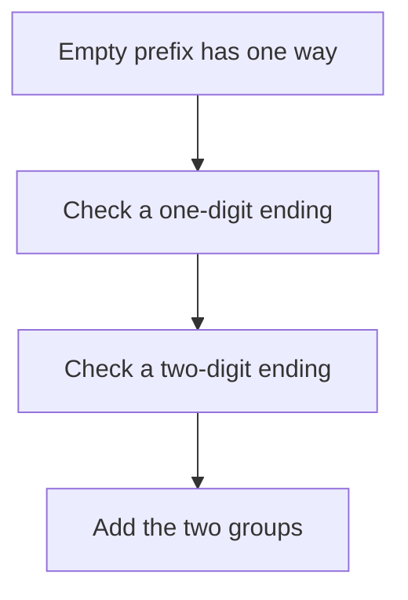

> [!tldr] Quick read
> - `dp[i]` counts the decodings of the first `i` characters. The final code can have one or two digits.
> - A zero must follow a 1 or a 2 in the same code, forming `10` or `20`.
> - Each step reads only two earlier prefixes, so two variables can replace the table.

> [!info] Context
> LeetCode 91, at [[en/posts/2026-11-27-neetcode-linear-dp|station 1: One-Dimensional Recurrences]] on the NeetCode Dynamic Programming line. Loops and arrays are enough to get started.

> [!abstract]- Quick glossary for this post (click to open)
> - A prefix is a slice starting at the beginning of the string.
> - A DP state identifies exactly what a subproblem counts.
> - A two-digit code is valid when it lies from 10 through 26.

## Picture it first: cut a numbered strip into dictionary codes

A ticket strip shows `11204`. Every piece has to be a letter code. I can cut `1 | 1 | 20 | 4` or `11 | 20 | 4`. The cut `1 | 12 | 04` is invalid because the catalog has no `04` code.

| Everyday life | Concept |
| --- | --- |
| Cut after i digits | State dp[i] |
| Final code has one digit | Extend a decoding of dp[i − 1] |
| Final code has two digits | Extend a decoding of dp[i − 2] |



## The problem: how many valid cuts are possible

The input has 1 to 100 decimal digits. Each group maps a number from 1 to 26 to a letter, with no leading zero. Return the number of ways to group the entire string. The problem guarantees the answer fits in a signed 32-bit integer.

## How it works

### Try every cut

Recursion tries cutting 1 or 2 valid digits at the start of the remaining suffix. A string of `1`s produces a Fibonacci branching tree, with O(2ⁿ) as an upper bound and O(n) stack depth. Memoizing counts by position reduces the search to O(n) time and O(n) space.

### Count from left to right

Set `dp[0] = 1` because there is exactly one way to cut an empty string into no pieces. If the final digit is nonzero, attach it to each decoding of `dp[i − 1]`. If the last two digits form a valid code, attach them to each decoding of `dp[i − 2]`. These groups are disjoint because their final codes have different lengths.

For `11204`, the table from length 0 through 5 is `1, 1, 2, 3, 2, 2`. At `0`, the one-character branch disappears and only `20` survives. When a prefix count is 0, the loop can return immediately. If we just read a nonzero digit with a valid previous prefix, the one-digit branch always exists. The remaining case is a zero that cannot pair on its left, and it cannot start a code on its right.

Keeping two earlier counts uses O(n) time and O(1) storage slots. The problem bounds only the **final answer**. A long prefix can have a huge count that vanishes at a later zero. Fixed-width implementations clamp each count to `2³¹ − 1` or use saturating addition. Applying a cap before adding nonnegative terms gives the same clamped result as adding first, so the guaranteed final value survives unchanged. Python keeps exact integers.

On 18 copies of `1`, the TypeScript file counts 10,945 recursive calls versus 18 DP updates. The two methods also agree on 200 short random strings.

## Runnable example

[TypeScript](../code/neetcode-decode-ways/decode-count.ts) · [Python](../code/neetcode-decode-ways/decode_count.py) · [Go](../code/neetcode-decode-ways/decode_count.go) · [Java](../code/neetcode-decode-ways/decode-count.java) · [JavaScript](../code/neetcode-decode-ways/decode-count.js) · [PHP](../code/neetcode-decode-ways/decode-count.php) · [Rust](../code/neetcode-decode-ways/decode_count.rs)

The tabs show the central function. The standalone files also run the comparison methods on the small cases. The TypeScript file adds randomized comparisons.

```ts
function decodeCount(s: string): number {
  let beforePrevious = 0
  let previous = 1
  for (let i = 0; i < s.length; i++) {
    let current = s[i] === "0" ? 0 : previous
    if (i > 0 && (s[i - 1] === "1" || (s[i - 1] === "2" && s[i] <= "6"))) {
      current += beforePrevious
    }
    if (current === 0) return 0
    beforePrevious = previous
    previous = Math.min(current, 2_147_483_647)
  }
  return previous
}
```

```python
def decode_count(s):
    before_previous, previous = 0, 1
    for i, digit in enumerate(s):
        current = 0 if digit == "0" else previous
        if i > 0 and (s[i - 1] == "1" or (s[i - 1] == "2" and digit <= "6")):
            current += before_previous
        if current == 0:
            return 0
        before_previous, previous = previous, current
    return previous
```

```go
func decodeCount(s string) int {
	beforePrevious, previous := int64(0), int64(1)
	for i := 0; i < len(s); i++ {
		current := int64(0)
		if s[i] != '0' {
			current = previous
		}
		if i > 0 && (s[i-1] == '1' || (s[i-1] == '2' && s[i] <= '6')) {
			current += beforePrevious
		}
		if current == 0 {
			return 0
		}
		beforePrevious, previous = previous, min(current, 2_147_483_647)
	}
	return int(previous)
}
```

```java
static int decodeCount(String digits) {
    long beforePrevious = 0, previous = 1;
    for (int i = 0; i < digits.length(); i++) {
        char digit = digits.charAt(i);
        long current = digit == '0' ? 0 : previous;
        if (i > 0 && (digits.charAt(i - 1) == '1' || (digits.charAt(i - 1) == '2' && digit <= '6'))) {
            current += beforePrevious;
        }
        if (current == 0) return 0;
        if (current > Integer.MAX_VALUE) current = Integer.MAX_VALUE;
        beforePrevious = previous;
        previous = current;
    }
    return (int) previous;
}
```

```js
function decodeCount(s) {
  let beforePrevious = 0
  let previous = 1
  for (let i = 0; i < s.length; i++) {
    let current = s[i] === "0" ? 0 : previous
    if (i > 0 && (s[i - 1] === "1" || (s[i - 1] === "2" && s[i] <= "6"))) {
      current += beforePrevious
    }
    if (current === 0) return 0
    beforePrevious = previous
    previous = Math.min(current, 2_147_483_647)
  }
  return previous
}
```

```php
function decodeCount(string $digits): int {
    $beforePrevious = 0;
    $previous = 1;
    for ($i = 0; $i < strlen($digits); $i++) {
        $digit = $digits[$i];
        $current = $digit === '0' ? 0 : $previous;
        if ($i > 0 && ($digits[$i - 1] === '1' || ($digits[$i - 1] === '2' && $digit <= '6'))) {
            $current += $beforePrevious;
        }
        if ($current === 0) {
            return 0;
        }
        $beforePrevious = $previous;
        $previous = min($current, 2147483647);
    }
    return $previous;
}
```

```rust
fn decode_count(s: &str) -> i32 {
    let bytes = s.as_bytes();
    let (mut before_previous, mut previous) = (0_i32, 1_i32);
    for (i, &digit) in bytes.iter().enumerate() {
        let mut current = if digit == b'0' { 0 } else { previous };
        if i > 0 && (bytes[i - 1] == b'1' || (bytes[i - 1] == b'2' && digit <= b'6')) {
            current = current.saturating_add(before_previous);
        }
        if current == 0 {
            return 0;
        }
        (before_previous, previous) = (previous, current);
    }
    previous
}
```

```text
10/10 cases passed
201/201 cross-checks passed; 18 copies of digit 1: DFS 10945 calls, DP 18 steps
```

*(Output labels translated; the files themselves print Vietnamese.)*

## Misconceptions and common traps

- **Read `07` as 7.** It has a leading zero even if parsing produces a number in the dictionary.
- **Use `dp[0] = 0`.** No decoding can grow from the first valid code.
- **Allow two digits after only checking `<= 26`.** There must be exactly two digits and a value of at least 10.
- **Overflow a prefix count.** Rust uses `saturating_add`. The other fixed-width implementations calculate in a wider type and clamp.

## Self-check questions

> [!question]- How many decodings does `100` have?
> 0. Cutting `10` leaves a standalone zero.

> [!question]- Why is there exactly one decoding of `27`?
> `2` and `7` are valid. `27` is outside the dictionary.

## References

- [LeetCode 91 · Decode Ways](https://leetcode.com/problems/decode-ways/)
- [MIT 6.006 · Dynamic Programming](https://ocw.mit.edu/courses/6-006-introduction-to-algorithms-spring-2020/resources/lecture-notes/)
