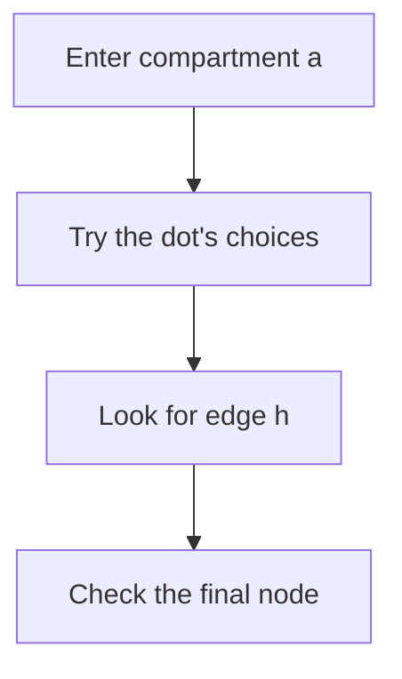

> [!tldr] Quick read
> - A dot matches exactly one letter. A matching word has the same length as the pattern.
> - The baseline groups words by length and scans the relevant bucket, comparing positions until it finds a mismatch.
> - A trie follows one edge at a literal and tries existing edges at a dot. At the end of the pattern, it checks the terminal marker.
> - With `d` dots, one depth has at most `26^d` states. The problem limits `d` to two, and the actual work also depends on the prefixes present in the tree.

> [!info] Context
> LeetCode 211 (Medium) belongs to [[en/posts/2026-11-26-neetcode-trie|station 7: Tries]] on the **NeetCode Linked Structures line**. In [[en/problems/implement-trie-prefix-tree|LeetCode 208]], every step specifies the exact letter to follow. Here the pattern may leave one letter open, so I try multiple paths and use the rest of the pattern to select one. You only need to know how to read a string left to right.

> [!abstract]- Quick glossary for this post (click to open)
> - A **prefix** is the beginning of a word, such as `ap` in `ape`.
> - A **trie** is a tree where the edges on the path from the root spell a prefix. See [[en/concepts/trie|Trie]].
> - A **terminal marker** (`terminal`) says the prefix at a node was added as a word. See [[en/concepts/terminal-marker|Terminal Marker]].
> - The **wildcard** here is a dot that matches exactly one letter. See [[en/concepts/wildcard-branching|Wildcard Branching]].
> - **Prefix pruning** stops a branch when the chosen prefix leads to no word. See [[en/concepts/trie-prefix-pruning|Trie Prefix Pruning]].

## Picture it first: following a trail through a filing cabinet

Imagine a filing cabinet with several layers. At each layer, a letter label directs me to the next compartment. A file card can sit right where I stand, while the compartment still leads to files with longer labels. I am holding a slip marked `a.h`. I follow label `a`, try the compartments in the middle layer, and look for compartment `h` in the last layer.

| Everyday life | Concept |
|---|---|
| Choose a compartment with a specified label | follow the literal's edge |
| The slip leaves one layer's label open | try every existing child edge |
| A compartment lacks a required next step | prune by prefix |
| At the end of the slip, look for a file card | check the terminal marker |



## The problem: find one word that matches the entire pattern

The dictionary starts empty and accepts two interleaved operations. `addWord(word)` stores a word, and `search(pattern)` says whether at least one stored word matches. Each word or pattern has length 1 to 25. Added words use lowercase English letters, and a pattern can contain up to two dots. There are at most 10,000 calls across both operations. [Original problem on LeetCode](https://leetcode.com/problems/design-add-and-search-words-data-structure/)

With `ape`, `ash`, `cape`, `caper`, `cave`, `dawn`, and `dusk`, the pattern `a.h` matches `ash`. The pattern `a.z` fails because neither branch has an edge to `z`. The pattern `ap` fails too, even though I can follow both edges, because the stored word is `ape`.

## How it works

<figure class="figure-map" style="--ar: 3 / 4">
<div class="frame"><iframe data-archify="../../diagrams/neetcode-design-add-and-search-words-data-structure/worked-example.en.html" title="A dot explores exactly one existing edge" loading="lazy"></iframe></div>
<figcaption><span><b>Figure 1.</b> A dot explores exactly one existing edge.</span><a href="../diagrams/neetcode-design-add-and-search-words-data-structure/worked-example.en.html" target="_blank" rel="noopener">Open full screen</a></figcaption>
</figure>

<details>
<summary>Read the steps</summary>
<ol>
<li>Store two words with the same first letter. <code>&quot;cap&quot;, &quot;cot&quot;</code></li>
<li>The literal c selects one branch. <code>pattern = &quot;c.t&quot;</code></li>
<li>The dot tries a and o. <code>ca has no t; co → t</code></li>
<li>The cot node has a terminal marker. <code>true</code></li>
</ol>
</details>

### Scan the bucket of the same length

I put words in sets by length. When a pattern of length `L` arrives, I open the bucket for `L` and compare each word with the pattern from start to finish. A dot always advances one position. A literal that differs from the word's letter ends that comparison. After checking all `L` positions, I can return `true`. A missing bucket or a bucket whose words all fail gives `false`.

Let `n_L` be the number of distinct words of length `L`. A query checks at most `n_L × L` positions, taking expected `O(1 + n_L·L)` time under `O(1)` expected access to the hash table of lengths. Stopping at the first mismatch reduces the work in practice. Adding a word of length `m` takes expected `O(m)` time including hashing the word. If `S` is the total number of letters in distinct words, storage is `O(S)` and one query uses `O(1)` auxiliary space.

### Follow each viable prefix in the trie

Each search state is `(node, index)`. The path to `node` has exactly `index` letters and matches the first `index` positions of the pattern. To add a word, follow or create one edge per letter, then set `terminal` where the path ends.

| Search condition | Next step |
|---|---|
| All `L` positions have been read | return the current node's `terminal` flag |
| A literal letter | follow that edge if it exists, or return `false` for this branch |
| A dot | try each existing child edge with `index + 1` and stop as soon as one returns `true` |

For `a.h`, I first follow edge `a`. The dot opens the paths through `p` and `s`. The path through `p` lacks edge `h`. The path through `s` has edge `h`, and node `ash` has a terminal marker. A false result from one branch reports only that this path failed, so I can try the next branch. Finding a dead end in compartment `p` tells me nothing about compartment `s`.

The invariant holds at the root because no positions have been read. Each edge adds a letter permitted by the pattern, preserving the invariant. For any matching word, each of its edges is among the choices considered during search, so the algorithm will reach its terminal node if it has not already found an answer. This is an existence check, so the first success is enough. Princeton describes the same dot rule in a search that lists every matching word. [Princeton Algorithms, TrieSET](https://algs4.cs.princeton.edu/code/javadoc/edu/princeton/cs/algs4/TrieSET.html)

### The cost of branching

Let `A = 26`, `d` be the number of dots, and `N` be the total number of trie nodes including the root. At depth `i`, each dot read so far creates at most `A` choices, while each literal creates at most one. Thus actual states visited `V` are bounded by both `N` and `(L + 1)·A^d`. With expected `O(1)` lookup in the child map and iteration over existing edges, expected time is `O(V)` for this fixed alphabet. An exact search therefore runs in `O(L)`, and two dots can produce up to 676 different paths at a depth. If both dots come late, earlier depths have less branching. If a generalization allows the number of dots to grow with the pattern length, the number of prefixes considered can grow exponentially up to the limit of stored nodes.

The trie adds a word of length `m` in expected `O(m)` time, stores `O(N)` nodes and edges, and uses `O(L)` stack space for a depth-first search. Shared prefixes reduce the number of allocated nodes, and each node and child map still has overhead. With few searches or very small length buckets, scanning keeps the structure small and can still finish quickly.

### Counting the work for an unsuccessful query

Generate 1,000 distinct four-letter words, all starting with `a`. The last three letters are a base-26 counter starting at `aaa`. Query `za..` in both structures.

| Structure | Unit counted | Result |
|---|---|---:|
| Scan the length-four bucket | one position checked in one word | 1,000 |
| Trie | one function entry with a node and index | 1 |

Both return `false`. The scan rejects each word at the first letter. The trie looks for one `z` edge at the root and stops on a missing edge before reaching either dot. The units differ, so I use the counts to see where work disappears rather than treating them as a time ratio. A pattern with early dots and many viable prefixes can give different results.

## Runnable example

The original five versions maintain two independent structures, runs the same 12 cases in sequence, and checks the measurement counts. The cases cover an empty dictionary, a prefix that is not a word, two dots, a branch that fails before a successful one in insertion order, marking a prefix after adding a longer word, and adding a duplicate.

Download [TypeScript](../code/neetcode-design-add-and-search-words-data-structure/word-dictionary.ts) · [Python](../code/neetcode-design-add-and-search-words-data-structure/word_dictionary.py) · [Go](../code/neetcode-design-add-and-search-words-data-structure/word_dictionary.go) · [Java](../code/neetcode-design-add-and-search-words-data-structure/word-dictionary.java) · [JavaScript](../code/neetcode-design-add-and-search-words-data-structure/word-dictionary.js) · [PHP](../code/neetcode-design-add-and-search-words-data-structure/word-dictionary.php) · [Rust](../code/neetcode-design-add-and-search-words-data-structure/word_dictionary.rs).

Run the first five with `node word-dictionary.ts`, `python3 word_dictionary.py`, `go run word_dictionary.go`, `java word-dictionary.java`, or `node word-dictionary.js`.

```ts
class LengthDictionary {
  private words = new Map<number, Set<string>>()
  comparisons = 0

  addWord(word: string) {
    let bucket = this.words.get(word.length)
    if (bucket === undefined) {
      bucket = new Set()
      this.words.set(word.length, bucket)
    }
    bucket.add(word)
  }

  search(pattern: string): boolean {
    this.comparisons = 0
    for (const word of this.words.get(pattern.length) ?? []) {
      let index = 0
      for (; index < pattern.length; index++) {
        this.comparisons++
        if (pattern[index] !== "." && pattern[index] !== word[index]) break
      }
      if (index === pattern.length) return true
    }
    return false
  }
}

class TrieNode {
  children = new Map<string, TrieNode>()
  terminal = false
}

class WordDictionary {
  private root = new TrieNode()
  visits = 0

  addWord(word: string) {
    let node = this.root
    for (const char of word) {
      let child = node.children.get(char)
      if (child === undefined) {
        child = new TrieNode()
        node.children.set(char, child)
      }
      node = child
    }
    node.terminal = true
  }

  search(pattern: string): boolean {
    this.visits = 0
    const match = (node: TrieNode, index: number): boolean => {
      this.visits++
      if (index === pattern.length) return node.terminal
      const char = pattern[index]
      if (char !== ".") {
        const child = node.children.get(char)
        return child !== undefined && match(child, index + 1)
      }
      for (const child of node.children.values()) {
        if (match(child, index + 1)) return true
      }
      return false
    }
    return match(this.root, 0)
  }
}

const queries = [
  ["", ".", false],
  ["ape ash cape caper cave dawn dusk", "ape", true],
  ["", "ap", false],
  ["", "a.h", true],
  ["", "a.z", false],
  ["", ".a.e", true],
  ["", "..wk", false],
  ["", "ca..r", true],
  ["", "cap.", true],
  ["", ".a", false],
  ["cap", "cap", true],
  ["cape", "cape", true],
] as const
const scan = new LengthDictionary()
const trie = new WordDictionary()
for (const [added, pattern, expected] of queries) {
  for (const dictionary of [scan, trie]) {
    if (added) for (const word of added.split(" ")) dictionary.addWord(word)
    if (dictionary.search(pattern) !== expected) throw new Error(pattern)
  }
}

const scanProbe = new LengthDictionary()
const trieProbe = new WordDictionary()
for (let value = 0; value < 1000; value++) {
  const word = "a" + String.fromCharCode(
    97 + Math.floor(value / 676),
    97 + Math.floor(value / 26) % 26,
    97 + value % 26,
  )
  scanProbe.addWord(word)
  trieProbe.addWord(word)
}
if (scanProbe.search("za..") || trieProbe.search("za..")) throw new Error("za..")
if (scanProbe.comparisons !== 1000 || trieProbe.visits !== 1) throw new Error("work")
console.log(`${queries.length}/${queries.length} ca đúng`)
console.log(`So sánh khi quét: ${scanProbe.comparisons}, trạng thái Trie: ${trieProbe.visits}`)
```
```python
class LengthDictionary:
    def __init__(self):
        self.words = {}
        self.comparisons = 0

    def add_word(self, word):
        bucket = self.words.get(len(word))
        if bucket is None:
            bucket = set()
            self.words[len(word)] = bucket
        bucket.add(word)

    def search(self, pattern):
        self.comparisons = 0
        for word in self.words.get(len(pattern), ()):
            for actual, expected in zip(word, pattern):
                self.comparisons += 1
                if expected != "." and actual != expected:
                    break
            else:
                return True
        return False


class TrieNode:
    def __init__(self):
        self.children = {}
        self.terminal = False


class WordDictionary:
    def __init__(self):
        self.root = TrieNode()
        self.visits = 0

    def add_word(self, word):
        node = self.root
        for char in word:
            child = node.children.get(char)
            if child is None:
                child = TrieNode()
                node.children[char] = child
            node = child
        node.terminal = True

    def search(self, pattern):
        self.visits = 0

        def match(node, index):
            self.visits += 1
            if index == len(pattern):
                return node.terminal
            char = pattern[index]
            if char != ".":
                child = node.children.get(char)
                return child is not None and match(child, index + 1)
            return any(match(child, index + 1) for child in node.children.values())

        return match(self.root, 0)


queries = [
    ("", ".", False),
    ("ape ash cape caper cave dawn dusk", "ape", True),
    ("", "ap", False),
    ("", "a.h", True),
    ("", "a.z", False),
    ("", ".a.e", True),
    ("", "..wk", False),
    ("", "ca..r", True),
    ("", "cap.", True),
    ("", ".a", False),
    ("cap", "cap", True),
    ("cape", "cape", True),
]
scan = LengthDictionary()
trie = WordDictionary()
for added, pattern, expected in queries:
    for dictionary in (scan, trie):
        for word in added.split():
            dictionary.add_word(word)
        if dictionary.search(pattern) != expected:
            raise AssertionError(pattern)

scan_probe = LengthDictionary()
trie_probe = WordDictionary()
for value in range(1000):
    word = "a" + "".join(chr(97 + digit) for digit in (value // 676, value // 26 % 26, value % 26))
    scan_probe.add_word(word)
    trie_probe.add_word(word)
if scan_probe.search("za..") or trie_probe.search("za.."):
    raise AssertionError("za..")
if (scan_probe.comparisons, trie_probe.visits) != (1000, 1):
    raise AssertionError("work")
print(f"{len(queries)}/{len(queries)} ca đúng")
print(f"So sánh khi quét: {scan_probe.comparisons}, trạng thái Trie: {trie_probe.visits}")
```
```go
package main

import (
	"fmt"
	"strings"
)

type lengthDictionary struct {
	words       map[int]map[string]struct{}
	comparisons int
}

func (d *lengthDictionary) addWord(word string) {
	bucket := d.words[len(word)]
	if bucket == nil {
		bucket = make(map[string]struct{})
		d.words[len(word)] = bucket
	}
	bucket[word] = struct{}{}
}

func (d *lengthDictionary) search(pattern string) bool {
	d.comparisons = 0
	for word := range d.words[len(pattern)] {
		index := 0
		for ; index < len(pattern); index++ {
			d.comparisons++
			if pattern[index] != '.' && pattern[index] != word[index] {
				break
			}
		}
		if index == len(pattern) {
			return true
		}
	}
	return false
}

type trieNode struct {
	children map[byte]*trieNode
	terminal bool
}

type wordDictionary struct {
	root   trieNode
	visits int
}

func (d *wordDictionary) addWord(word string) {
	node := &d.root
	for index := 0; index < len(word); index++ {
		char := word[index]
		child := node.children[char]
		if child == nil {
			if node.children == nil {
				node.children = make(map[byte]*trieNode)
			}
			child = &trieNode{}
			node.children[char] = child
		}
		node = child
	}
	node.terminal = true
}

func (d *wordDictionary) search(pattern string) bool {
	d.visits = 0
	var match func(*trieNode, int) bool
	match = func(node *trieNode, index int) bool {
		d.visits++
		if index == len(pattern) {
			return node.terminal
		}
		char := pattern[index]
		if char != '.' {
			child := node.children[char]
			return child != nil && match(child, index+1)
		}
		for _, child := range node.children {
			if match(child, index+1) {
				return true
			}
		}
		return false
	}
	return match(&d.root, 0)
}

func main() {
	queries := []struct {
		added    string
		pattern  string
		expected bool
	}{
		{"", ".", false},
		{"ape ash cape caper cave dawn dusk", "ape", true},
		{"", "ap", false},
		{"", "a.h", true},
		{"", "a.z", false},
		{"", ".a.e", true},
		{"", "..wk", false},
		{"", "ca..r", true},
		{"", "cap.", true},
		{"", ".a", false},
		{"cap", "cap", true},
		{"cape", "cape", true},
	}
	scan := lengthDictionary{words: make(map[int]map[string]struct{})}
	trie := wordDictionary{}
	for _, query := range queries {
		for _, word := range strings.Fields(query.added) {
			scan.addWord(word)
			trie.addWord(word)
		}
		if scan.search(query.pattern) != query.expected || trie.search(query.pattern) != query.expected {
			panic(query.pattern)
		}
	}

	scanProbe := lengthDictionary{words: make(map[int]map[string]struct{})}
	trieProbe := wordDictionary{}
	for value := 0; value < 1000; value++ {
		word := string([]byte{'a', byte(97 + value/676), byte(97 + value/26%26), byte(97 + value%26)})
		scanProbe.addWord(word)
		trieProbe.addWord(word)
	}
	if scanProbe.search("za..") || trieProbe.search("za..") {
		panic("za..")
	}
	if scanProbe.comparisons != 1000 || trieProbe.visits != 1 {
		panic("work")
	}
	fmt.Printf("%d/%d ca đúng\n", len(queries), len(queries))
	fmt.Printf("So sánh khi quét: %d, trạng thái Trie: %d\n", scanProbe.comparisons, trieProbe.visits)
}
```
```java
import java.util.HashMap;
import java.util.HashSet;
import java.util.Map;
import java.util.Set;

class DictionaryExample {
    static final class LengthDictionary {
        private final Map<Integer, Set<String>> words = new HashMap<>();
        int comparisons;

        void addWord(String word) {
            words.computeIfAbsent(word.length(), length -> new HashSet<>()).add(word);
        }

        boolean search(String pattern) {
            comparisons = 0;
            for (String word : words.getOrDefault(pattern.length(), Set.of())) {
                int index = 0;
                for (; index < pattern.length(); index++) {
                    comparisons++;
                    char expected = pattern.charAt(index);
                    if (expected != '.' && expected != word.charAt(index)) break;
                }
                if (index == pattern.length()) return true;
            }
            return false;
        }
    }

    static final class TrieNode {
        final Map<Character, TrieNode> children = new HashMap<>();
        boolean terminal;
    }

    static final class WordDictionary {
        private final TrieNode root = new TrieNode();
        int visits;

        void addWord(String word) {
            TrieNode node = root;
            for (int index = 0; index < word.length(); index++) {
                node = node.children.computeIfAbsent(word.charAt(index), key -> new TrieNode());
            }
            node.terminal = true;
        }

        boolean search(String pattern) {
            visits = 0;
            return match(root, pattern, 0);
        }

        private boolean match(TrieNode node, String pattern, int index) {
            visits++;
            if (index == pattern.length()) return node.terminal;
            char expected = pattern.charAt(index);
            if (expected != '.') {
                TrieNode child = node.children.get(expected);
                return child != null && match(child, pattern, index + 1);
            }
            for (TrieNode child : node.children.values()) {
                if (match(child, pattern, index + 1)) return true;
            }
            return false;
        }
    }

    record Query(String added, String pattern, boolean expected) {}

    public static void main(String[] args) {
        Query[] queries = {
            new Query("", ".", false),
            new Query("ape ash cape caper cave dawn dusk", "ape", true),
            new Query("", "ap", false),
            new Query("", "a.h", true),
            new Query("", "a.z", false),
            new Query("", ".a.e", true),
            new Query("", "..wk", false),
            new Query("", "ca..r", true),
            new Query("", "cap.", true),
            new Query("", ".a", false),
            new Query("cap", "cap", true),
            new Query("cape", "cape", true),
        };
        LengthDictionary scan = new LengthDictionary();
        WordDictionary trie = new WordDictionary();
        for (Query query : queries) {
            if (!query.added().isEmpty()) {
                for (String word : query.added().split(" ")) {
                    scan.addWord(word);
                    trie.addWord(word);
                }
            }
            if (scan.search(query.pattern()) != query.expected() || trie.search(query.pattern()) != query.expected()) {
                throw new AssertionError(query.pattern());
            }
        }

        LengthDictionary scanProbe = new LengthDictionary();
        WordDictionary trieProbe = new WordDictionary();
        for (int value = 0; value < 1000; value++) {
            String word = new String(new char[] {
                'a',
                (char) ('a' + value / 676),
                (char) ('a' + value / 26 % 26),
                (char) ('a' + value % 26),
            });
            scanProbe.addWord(word);
            trieProbe.addWord(word);
        }
        if (scanProbe.search("za..") || trieProbe.search("za..")) throw new AssertionError("za..");
        if (scanProbe.comparisons != 1000 || trieProbe.visits != 1) throw new AssertionError("work");
        System.out.printf("%d/%d ca đúng%n", queries.length, queries.length);
        System.out.printf("So sánh khi quét: %d, trạng thái Trie: %d%n", scanProbe.comparisons, trieProbe.visits);
    }
}
```
```js
class LengthDictionary {
  words = new Map()
  comparisons = 0

  addWord(word) {
    let bucket = this.words.get(word.length)
    if (bucket === undefined) {
      bucket = new Set()
      this.words.set(word.length, bucket)
    }
    bucket.add(word)
  }

  search(pattern) {
    this.comparisons = 0
    for (const word of this.words.get(pattern.length) ?? []) {
      let index = 0
      for (; index < pattern.length; index++) {
        this.comparisons++
        if (pattern[index] !== "." && pattern[index] !== word[index]) break
      }
      if (index === pattern.length) return true
    }
    return false
  }
}

class TrieNode {
  children = new Map()
  terminal = false
}

class WordDictionary {
  root = new TrieNode()
  visits = 0

  addWord(word) {
    let node = this.root
    for (const char of word) {
      let child = node.children.get(char)
      if (child === undefined) {
        child = new TrieNode()
        node.children.set(char, child)
      }
      node = child
    }
    node.terminal = true
  }

  search(pattern) {
    this.visits = 0
    const match = (node, index) => {
      this.visits++
      if (index === pattern.length) return node.terminal
      const char = pattern[index]
      if (char !== ".") {
        const child = node.children.get(char)
        return child !== undefined && match(child, index + 1)
      }
      for (const child of node.children.values()) {
        if (match(child, index + 1)) return true
      }
      return false
    }
    return match(this.root, 0)
  }
}

const queries = [
  ["", ".", false],
  ["ape ash cape caper cave dawn dusk", "ape", true],
  ["", "ap", false],
  ["", "a.h", true],
  ["", "a.z", false],
  ["", ".a.e", true],
  ["", "..wk", false],
  ["", "ca..r", true],
  ["", "cap.", true],
  ["", ".a", false],
  ["cap", "cap", true],
  ["cape", "cape", true],
]
const scan = new LengthDictionary()
const trie = new WordDictionary()
for (const [added, pattern, expected] of queries) {
  for (const dictionary of [scan, trie]) {
    if (added) for (const word of added.split(" ")) dictionary.addWord(word)
    if (dictionary.search(pattern) !== expected) throw new Error(pattern)
  }
}

const scanProbe = new LengthDictionary()
const trieProbe = new WordDictionary()
for (let value = 0; value < 1000; value++) {
  const word = "a" + String.fromCharCode(
    97 + Math.floor(value / 676),
    97 + Math.floor(value / 26) % 26,
    97 + value % 26,
  )
  scanProbe.addWord(word)
  trieProbe.addWord(word)
}
if (scanProbe.search("za..") || trieProbe.search("za..")) throw new Error("za..")
if (scanProbe.comparisons !== 1000 || trieProbe.visits !== 1) throw new Error("work")
console.log(`${queries.length}/${queries.length} ca đúng`)
console.log(`So sánh khi quét: ${scanProbe.comparisons}, trạng thái Trie: ${trieProbe.visits}`)
```

```php
<?php
declare(strict_types=1);

final class TrieNode
{
    public array $children = [];
    public bool $terminal = false;
}

final class WordDictionary
{
    private TrieNode $root;

    public function __construct()
    {
        $this->root = new TrieNode();
    }

    public function addWord(string $word): void
    {
        $node = $this->root;
        for ($i = 0, $length = strlen($word); $i < $length; $i++) {
            $node = $node->children[$word[$i]] ??= new TrieNode();
        }
        $node->terminal = true;
    }

    public function search(string $pattern): bool
    {
        return $this->matches($this->root, $pattern, 0);
    }

    private function matches(TrieNode $node, string $pattern, int $offset): bool
    {
        if ($offset === strlen($pattern)) {
            return $node->terminal;
        }

        $letter = $pattern[$offset];
        if ($letter !== '.') {
            $child = $node->children[$letter] ?? null;
            return $child !== null && $this->matches($child, $pattern, $offset + 1);
        }

        foreach ($node->children as $child) {
            if ($this->matches($child, $pattern, $offset + 1)) {
                return true;
            }
        }
        return false;
    }
}
```

```rust
use std::collections::HashMap;

#[derive(Default)]
struct TrieNode {
    children: HashMap<u8, TrieNode>,
    terminal: bool,
}

#[derive(Default)]
struct WordDictionary {
    root: TrieNode,
}

impl WordDictionary {
    fn add_word(&mut self, word: &str) {
        let mut node = &mut self.root;
        for letter in word.bytes() {
            node = node.children.entry(letter).or_default();
        }
        node.terminal = true;
    }

    fn search(&self, pattern: &str) -> bool {
        Self::matches(&self.root, pattern.as_bytes())
    }

    fn matches(node: &TrieNode, pattern: &[u8]) -> bool {
        let Some((&letter, rest)) = pattern.split_first() else {
            return node.terminal;
        };
        if letter == b'.' {
            return node
                .children
                .values()
                .any(|child| Self::matches(child, rest));
        }
        node.children
            .get(&letter)
            .is_some_and(|child| Self::matches(child, rest))
    }
}
```

All five programs print the same result:

```text
12/12 cases passed
Scan comparisons: 1000, trie states: 1
```

Run the added files with `php word-dictionary.php` and `rustc --edition 2021 -O word_dictionary.rs -o /tmp/word-dictionary && /tmp/word-dictionary`.

The PHP and Rust versions use a sparse trie. Each dot tries the existing edges and consumes one step. PHP passes an offset into the pattern and Rust borrows a byte slice of the remaining pattern. PHP `12/12 ca đúng` · Rust `12/12 ca đúng`.

## Misconceptions and common traps

- **Finding a prefix means finding a word.** `ap` is a viable path after adding `ape`. Only setting `terminal` at node `ap` can make `search("ap")` return `true`.
- **A dot can match arbitrarily many letters.** Each edge consumes one letter, including at a dot. The pattern `ca.` has three positions, so the presence of `cape` is insufficient.
- **Try one edge at a dot and stop.** End the whole search early only when a branch returns `true`. A dead end through `p` can still leave a match through `s` for `a.h`.
- **Python:** `setdefault(char, TrieNode())` constructs the `TrieNode()` argument before the call, even if the edge already exists. This version allocates a node only after a lookup misses.
- **Go:** reading a key from a nil map gives the zero value, while writing requires initialization. I create a child map when its first edge needs to be stored.
- **Java:** `HashMap` gives no iteration-order guarantee. Branches may be tried in a different order, and the answer is still the OR of the branches.
- **TypeScript and JavaScript:** `word[index]` reads a UTF-16 code unit, while `for…of` walks code points. Those counts agree for this problem's ASCII input. For another alphabet, choose a consistent character unit for traversal and the dot's definition.

## Self-check questions

> [!question]- After adding `cape` and `caper`, what do patterns `cap` and `cap.` return?
> `cap` returns false if that word has not been added. `cap.` returns true because `cape` has four letters.

> [!question]- For pattern `a..`, which branches can I skip immediately at the root?
> Every branch except `a`. The two dots start branching after the `a` edge.

> [!question]- A six-letter pattern starts with two dots. At depth 4, how many distinct prefixes can match?
> At most `26² = 676`. Each later literal gives each prefix at most one edge. The trie considers only stored prefixes and can stop as soon as it finds a true result.

## References

- [LeetCode 211](https://leetcode.com/problems/design-add-and-search-words-data-structure/) specifies the operations, alphabet, and dot limit.
- [Princeton Algorithms, TrieSET](https://algs4.cs.princeton.edu/code/javadoc/edu/princeton/cs/algs4/TrieSET.html) describes a trie search for patterns containing dots.
- [Python, argument evaluation order](https://docs.python.org/3/reference/expressions.html#calls), [Go, index expressions](https://go.dev/ref/spec#Index_expressions), [Java, HashMap](https://docs.oracle.com/en/java/javase/21/docs/api/java.base/java/util/HashMap.html), and [ECMAScript, the String type](https://tc39.es/ecma262/multipage/ecmascript-data-types-and-values.html#sec-ecmascript-language-types-string-type) document the data structure and string behaviors used in the code.
