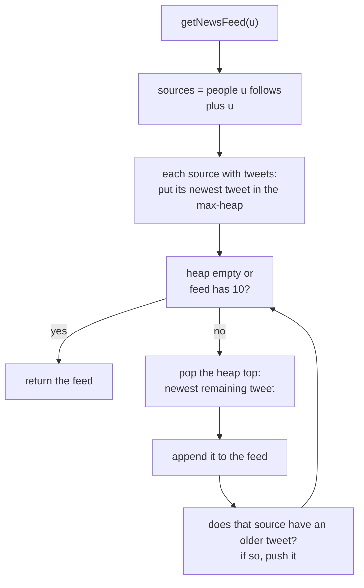

> [!tldr] Quick read
> - The problem: design a `Twitter` class with `postTweet`, `follow`, `unfollow` and `getNewsFeed(userId)`: the 10 **newest** tweets from that user and the people they follow, newest first.
> - Each user keeps a list of tweets in posting order, so every list is already sorted. The feed is a **merge of k sorted lists** ([[en/concepts/k-way-merge|K-way Merge]]): put each source's newest tweet into a max-heap, pop the top, then push the previous tweet of that same source. Each read costs O(F + 10 log F), with F the number of sources.
> - Time is a **global clock** that goes up by 1 on every post, not the system clock. With `Date.now()` as time, tweets posted within the same 1 ms share a time, and the feed comes out in the wrong order in 5/9 cases.
> - Three more broken versions are run: forgetting the user's own tweets (4/9), letting each user follow themselves and then `unfollow(u, u)` removing that (8/9), and no cut at 10 (8/9).
> - Measured: 1,000 feed reads from 500 sources with 100 tweets each take 3,592 ms with collect-then-sort and 22 ms with the heap merge. Real systems such as Twitter do the opposite for most users: they **push tweets into feeds at write time**, at the price of 73 ms for one post by an account with 10⁶ followers.

> [!info] Context
> LeetCode problem 355, part of [[en/posts/2026-11-24-neetcode-two-heaps|station 4: Two Heaps and Scheduling]] on **the NeetCode Line: Search and Heaps**. It is a *design* problem like [[en/problems/time-based-key-value-store|Time Based Key-Value Store]]: not a single function but a class, and LeetCode calls the methods in any interleaving. The heap part reuses what [[en/posts/2026-11-23-neetcode-heap-top-k|station 3: Heaps and Top K]] built. The solutions come in TypeScript, Python, Go, Java and JavaScript. All you need is arrays, a hash map and a heap.

> [!abstract]- Quick glossary for this post (click to open)
> - **Heap**: a binary tree stored in an array, with the largest (max-heap) or smallest (min-heap) element always on top; push and pop-top are O(log n). See [[en/concepts/heap|Heap]].
> - **Hash map** and **hash set**: lookup and insert in O(1) on average. Here the hash map looks up `userId → list of tweets`, and the hash set holds the people a user follows. See [[en/concepts/hash-map|Hash Map]], [[en/concepts/hash-set|Hash Set]].
> - **K-way merge**: you have k sorted lists and want one sorted sequence. Each list puts its front element into a heap; the heap tells which element comes next. See [[en/concepts/k-way-merge|K-way Merge]].
> - **News feed (timeline)**: the list of tweets a user sees when opening the app.
> - **Fan-out on write**: when someone posts, copy the tweet into the feed of every follower. The opposite is **fan-out on read**: the feed is merged every time it is opened. See [[en/concepts/fan-out-on-write|Fan-out on Write]].

## Picture it first: piles of letters on a desk

Each friend you follow has their own pile of letters on the desk, newest letter on top. You want to read the 10 newest letters across all piles. You do not tip every letter onto the floor and re-sort them by date; you look only at the **top** letter of each pile, take the newest of those, and the pile you took from shows its next letter.

| Everyday | Concept |
|---|---|
| One pile per person, newest letter on top | `userId → list of tweets`, oldest first |
| Your own pile is on the desk too | the feed always includes the user's own tweets |
| A postmark stamp numbered in increasing order | global clock, one unique number per tweet |
| Look at the top of each pile, take the newest | a max-heap holding each source's newest tweet |
| Taking a letter reveals the one under it | pop the heap top, push the previous tweet of the same source |
| Stop after 10 letters | stop when the feed has 10 tweets |
| Tip everything onto the floor and re-sort | collect then sort: O(T log T) |
| The mail carrier drops a copy in every follower's mailbox | fan-out on write |



## The problem

**The problem (in my own words):** implement a `Twitter` class:

- `postTweet(userId, tweetId)`: user `userId` posts a tweet with id `tweetId`. Each call is a new tweet with a unique id.
- `getNewsFeed(userId)`: return at most 10 tweet ids, the newest among the tweets of `userId` and of the people `userId` follows, newest first.
- `follow(followerId, followeeId)`: `followerId` starts following `followeeId`.
- `unfollow(followerId, followeeId)`: stop following.

Constraints: user ids from 1 to 500, tweet ids from 0 to 10⁴, at most 3·10⁴ calls in total. Original problem: [LeetCode 355](https://leetcode.com/problems/design-twitter/).

| Call | Result |
|---|---|
| `postTweet(1, 5)` | |
| `getNewsFeed(1)` | `[5]` |
| `follow(1, 2)` | |
| `postTweet(2, 6)` | |
| `getNewsFeed(1)` | `[6, 5]`: tweet 6 was posted later, so it comes first |
| `unfollow(1, 2)` | |
| `getNewsFeed(1)` | `[5]` |

I used to think the hard part was the data structure for who follows whom. It turns out that part is just a hash map of sets. The part worth thinking about is `getNewsFeed`: it asks for the 10 largest elements (by time) in the union of several lists, and each list is **already sorted** because tweets are appended in posting order. That is a k-way merge that stops early after 10 elements.

## How it works

<figure class="figure-map" style="--ar: 3 / 4">
<div class="frame"><iframe data-archify="../../diagrams/neetcode-design-twitter/worked-example.en.html" title="Merge the heads of post streams" loading="lazy"></iframe></div>
<figcaption><span><b>Figure 1.</b> Merge the heads of post streams.</span><a href="../diagrams/neetcode-design-twitter/worked-example.en.html" target="_blank" rel="noopener">Open full screen</a></figcaption>
</figure>

<details>
<summary>Read the steps</summary>
<ol>
<li>Take the latest post from each user. <code>A: [9, 4]; B: [8, 6]</code></li>
<li>Pop 9, then queue A’s next post 4. <code>heap = {8, 4}</code></li>
<li>Pop 8, then queue B’s next post 6. <code>heap = {6, 4}</code></li>
<li>The newest-first order emerges. <code>[9, 8, 6, 4]</code></li>
</ol>
</details>

### The data

- An integer `time` that goes up by 1 after each post. A later tweet has a larger number, never a repeated one.
- `tweets`: a hash map `userId → [(time, tweetId), …]`. Appended at the end, so the list increases in `time`.
- `follows`: a hash map `followerId → set of followeeId`. A set makes a second `follow` add nothing and makes `unfollow` O(1).

The user themselves is **not** in the `follows` set. At read time, `userId` is added to the list of sources. That sidesteps the self-follow case entirely: `follow(u, u)` is ignored, `unfollow(u, u)` has nothing to remove, and u always sees u's own tweets.

### Approach 1, collect then sort: O(T log T) per read

Concatenate the tweet lists of every source, sort by `time` descending, cut at 10. Correct, short, and enough for LeetCode. But it sorts **all** T tweets of the sources to get 10 of them, and T keeps growing over time.

### Approach 2, k-way merge with a heap: O(F + 10 log F) per read

Each tweet list is already increasing in `time`, so the newest tweet sits at the **end**. The idea of a [[en/concepts/k-way-merge|k-way merge]]:

1. For each source with tweets, put its last element (newest tweet) into a **max-heap** on `time`, together with the source and its position.
2. Pop the heap top: that is the newest of all tweets not yet taken. Append it to the feed.
3. If its source has an older tweet (position > 0), push the tweet just before it into the heap.
4. Repeat until the feed has 10 tweets or the heap is empty.

[[en/concepts/loop-invariant|Invariant]]: the heap holds exactly one tweet for each source that is not exhausted, and it is that source's newest **not-yet-taken** tweet. The newest not-yet-taken tweet of the whole system must be the newest not-yet-taken tweet of some source, so it is in the heap, and it is the top.

Cost: building a heap from F elements is O(F) with [[en/concepts/heapify|heapify]] (Python), or O(F log F) when pushing one at a time. Then at most 10 pops and 10 pushes, each O(log F). Nothing depends on T: a source with 10⁶ tweets still contributes at most 10 reads.

This heap differs from the [[en/concepts/size-k-heap|size-k heap]] of [[en/problems/kth-largest-element-in-a-stream|Kth Largest Element in a Stream]]. There, the heap keeps the k best candidates of a stream, and the top is the **weakest** candidate (min-heap). Here, the heap keeps a "front" of each list, the top is the **strongest** element to take next (max-heap), and the heap's size is the number of sources, not 10.

### Broken version 1: forgetting yourself

Read only from the `follows` set. The problem's example asks for `getNewsFeed(1)` right after user 1 posts tweet 5 and before following anyone: the broken version returns `[]`. It passes 4/9 cases.

### Broken version 2: following yourself, then unfollowing yourself

A "neat" trick is to put every user in their own follow set from the start, then read that set directly. Everything works until `follow(1, 1)` and then `unfollow(1, 1)`: the unfollow removes 1 from the set, and 1 no longer sees their own tweets. It passes 8/9 cases, failing exactly that one. Whether or not the problem allows following yourself, the safe implementation ignores `follow(u, u)` and `unfollow(u, u)`.

### Broken version 3: the system clock as time

`Date.now()` returns milliseconds. The calls in a test case run a few microseconds apart, so many tweets get the **same** time. The order in the feed is then decided by the sort: JS's `Array.prototype.sort` is stable and keeps the collection order, so **older** tweets come first, and one person's tweets all come before the other's. The problem's example comes out as `[5, 6]` instead of `[6, 5]`. It passes 4/9 cases. The global clock has no such problem, because each post adds 1.

### Broken version 4: no cut at 10

The case with 12 tweets returns all 12. It passes 8/9 cases.

### Measurements

TypeScript, one user following F sources, each with P tweets posted in interleaved order, 1,000 calls to `getNewsFeed`, median of 5 runs, ms:

| F sources | P tweets per source | T total | collect then sort | heap merge |
|---|---|---|---|---|
| 10 | 100 | 1,000 | 40.4 | 1.08 |
| 100 | 100 | 10,000 | 558.5 | 4.90 |
| 500 | 100 | 50,000 | 3,592.2 | 22.35 |
| 500 | 1,000 | 500,000 | (not run) | 26.63 |

- Collect-then-sort grows with T: from T = 10⁴ to 5·10⁴ it takes about 6.4 times as long (T log T).
- The heap merge grows with F and hardly with T: the last two rows both have F = 500, T is 10 times larger, and the time only goes from 22.4 to 26.6 ms.
- Cross-check over 2,000 random command sequences (6 users, 60 commands each): the heap and collect-then-sort return the same feed on every read.

### Beyond LeetCode: fan-out on write or on read

The solution above is **fan-out on read**: every time the feed is opened, it is merged again. Writes are cheap (append one element), reads cost O(F + 10 log F). The opposite is **fan-out on write**: every user has a ready-made sorted feed, and when someone posts, the tweet is copied into the feed of each of their followers. A read just takes the last 10 elements; a write costs in proportion to the number of followers.

| followers | 1 post, fan-out on write | 1 post, fan-out on read |
|---|---|---|
| 100 | 0.011 ms | 0.0002 ms |
| 10,000 | 0.397 ms | 0.0006 ms |
| 1,000,000 | 72.854 ms | 0.0002 ms |

Martin Kleppmann opens *Designing Data-Intensive Applications* with exactly this problem (chapter 1, section "Describing Load"): Twitter first merged the home timeline at read time, then switched to pushing tweets at write time into a per-user timeline cache, because home-timeline reads far outnumber tweet posts. For accounts with very many followers, fan-out on write is too expensive (the third row of the table above), so their tweets are fetched separately and merged in at read time: a hybrid of the two. Raffi Krikorian of Twitter presented this architecture in the talk *Timelines at Scale* (QCon San Francisco 2012).

### Under the five languages

| | Built-in heap | Language-specific trap |
|---|---|---|
| TypeScript / JavaScript | none: write a max-heap | storing follows in a plain object: number keys become strings, `Object.keys({2: true})` is `["2"]`, and `map.get("2")` misses user 2 (4/9 cases) |
| Python | `heapq` (min-heap: key `-time`), `heapq.merge(..., reverse=True)` | heapq compares tuples element by element: two entries with the same key compare their second element, and an object without `<` makes `heappush` raise `TypeError`; the global clock makes keys never collide |
| Go | `container/heap`: implement `Len`, `Less`, `Swap`, `Push`, `Pop` yourself | `map[int]map[int]struct{}`: reading and `delete` on a nil inner map are fine, **writing** panics with `assignment to entry in nil map` |
| Java | `PriorityQueue` with a comparator | iterating a `PriorityQueue` with for-each or printing it does **not** follow priority order (`[9, 7, 8, 3, 5, 1]`); only repeated `poll()` does; use `Integer.compare` instead of `b[0] - a[0]` |

## Runnable example

The heap-merge solution ([TypeScript](../code/neetcode-design-twitter/design-twitter.ts) · [Python](../code/neetcode-design-twitter/design_twitter.py) · [Go](../code/neetcode-design-twitter/design_twitter.go) · [Java](../code/neetcode-design-twitter/design-twitter.java) · [JavaScript](../code/neetcode-design-twitter/design-twitter.js) · [PHP](../code/neetcode-design-twitter/design-twitter.php) · [Rust](../code/neetcode-design-twitter/design_twitter.rs)). The TypeScript version inherits its storage from the collect-then-sort approach, so both are shown:

```ts
// A small max-heap on a numeric key: JS/TS has no built-in heap.
class MaxHeap<T> {
  private a: T[] = [];
  private key: (x: T) => number;
  constructor(key: (x: T) => number) { this.key = key; }
  get size(): number { return this.a.length; }
  push(x: T): void {
    const a = this.a; a.push(x);
    let i = a.length - 1;
    while (i > 0) { // sift up
      const p = (i - 1) >> 1;
      if (this.key(a[p]) >= this.key(a[i])) break;
      [a[p], a[i]] = [a[i], a[p]]; i = p;
    }
  }
  pop(): T {
    const a = this.a, top = a[0], last = a.pop()!;
    if (a.length) {
      a[0] = last;
      let i = 0;
      for (;;) { // sift down
        const l = 2 * i + 1, r = l + 1;
        let m = i;
        if (l < a.length && this.key(a[l]) > this.key(a[m])) m = l;
        if (r < a.length && this.key(a[r]) > this.key(a[m])) m = r;
        if (m === i) break;
        [a[m], a[i]] = [a[i], a[m]]; i = m;
      }
    }
    return top;
  }
}

// Approach 1, collect then sort: take every tweet of the user and of the people they follow, sort by time descending, cut at 10.
// O(T log T) per read, where T is the total number of tweets of those people.
class SortAllTwitter implements TwitterLike {
  protected time = 0; // global clock: one number per tweet, never repeated
  protected tweets = new Map<number, [number, number][]>(); // userId → [[time, tweetId], …], oldest first
  protected follows = new Map<number, Set<number>>(); // followerId → set of followeeId (never the user themselves)
  postTweet(userId: number, tweetId: number): void {
    if (!this.tweets.has(userId)) this.tweets.set(userId, []);
    this.tweets.get(userId)!.push([this.time++, tweetId]);
  }
  protected sources(userId: number): number[] {
    return [userId, ...(this.follows.get(userId) ?? [])]; // always includes the user
  }
  getNewsFeed(userId: number): number[] {
    const all: [number, number][] = [];
    for (const u of this.sources(userId)) all.push(...(this.tweets.get(u) ?? []));
    all.sort((x, y) => y[0] - x[0]);
    return all.slice(0, 10).map((t) => t[1]);
  }
  follow(followerId: number, followeeId: number): void {
    if (followerId === followeeId) return; // following yourself: ignore it, you already see your own tweets
    if (!this.follows.has(followerId)) this.follows.set(followerId, new Set());
    this.follows.get(followerId)!.add(followeeId);
  }
  unfollow(followerId: number, followeeId: number): void {
    this.follows.get(followerId)?.delete(followeeId); // not followed yet: delete does nothing
  }
}

// Approach 2, k-way merge with a heap: each source puts its newest tweet into a max-heap.
// Pop the top, push the previous tweet of the same source. O(F + 10 log F) per read, F = number of sources.
class HeapMergeTwitter extends SortAllTwitter {
  getNewsFeed(userId: number): number[] {
    // heap element: [time, tweetId, userId, index in userId's list]
    const heap = new MaxHeap<[number, number, number, number]>((e) => e[0]);
    for (const u of this.sources(userId)) {
      const list = this.tweets.get(u);
      if (list && list.length) { const i = list.length - 1; heap.push([list[i][0], list[i][1], u, i]); }
    }
    const feed: number[] = [];
    while (heap.size && feed.length < 10) {
      const [, tweetId, u, i] = heap.pop();
      feed.push(tweetId);
      if (i > 0) { const prev = this.tweets.get(u)![i - 1]; heap.push([prev[0], prev[1], u, i - 1]); }
    }
    return feed;
  }
}
```

```python
class Twitter:
    """K-way merge with a heap. heapq is a min-heap, so the key is -time."""

    def __init__(self):
        self.time = 0                       # global clock: never repeated
        self.tweets = defaultdict(list)     # userId → [(time, tweetId), …], oldest first
        self.follows = defaultdict(set)     # followerId → set of followeeId, never the user themselves

    def postTweet(self, userId: int, tweetId: int) -> None:
        self.tweets[userId].append((self.time, tweetId))
        self.time += 1

    def getNewsFeed(self, userId: int) -> list[int]:
        heap = []
        for u in self.follows.get(userId, set()) | {userId}:
            lst = self.tweets.get(u)  # .get: reading a defaultdict with [] would create an empty key
            if lst:
                t, tid = lst[-1]
                heap.append((-t, tid, u, len(lst) - 1))
        heapq.heapify(heap)
        feed = []
        while heap and len(feed) < 10:
            _, tid, u, i = heapq.heappop(heap)
            feed.append(tid)
            if i > 0:
                t, prev = self.tweets[u][i - 1]
                heapq.heappush(heap, (-t, prev, u, i - 1))
        return feed

    def follow(self, followerId: int, followeeId: int) -> None:
        if followerId != followeeId:  # following yourself: ignore it
            self.follows[followerId].add(followeeId)

    def unfollow(self, followerId: int, followeeId: int) -> None:
        self.follows[followerId].discard(followeeId)  # discard: no-op when absent, remove would raise KeyError
```

```go
type tweet struct{ time, id int }

// heap item: the newest not-yet-taken tweet of a source, and its position in that source's list.
type item struct{ time, id, user, idx int }

// feedHeap is a max-heap on time: Less returns a > b. container/heap calls Push/Pop through a pointer.
type feedHeap []item

func (h feedHeap) Len() int           { return len(h) }

func (h feedHeap) Less(i, j int) bool { return h[i].time > h[j].time }

func (h feedHeap) Swap(i, j int)      { h[i], h[j] = h[j], h[i] }

func (h *feedHeap) Push(x any)        { *h = append(*h, x.(item)) }

func (h *feedHeap) Pop() any {
	old := *h
	x := old[len(old)-1]
	*h = old[:len(old)-1]
	return x
}

type Twitter struct {
	time    int
	tweets  map[int][]tweet          // userId → tweets, oldest first
	follows map[int]map[int]struct{} // followerId → set of followeeId
}

func Constructor() Twitter {
	return Twitter{tweets: map[int][]tweet{}, follows: map[int]map[int]struct{}{}}
}

func (t *Twitter) PostTweet(userId, tweetId int) {
	t.tweets[userId] = append(t.tweets[userId], tweet{t.time, tweetId})
	t.time++
}

func (t *Twitter) GetNewsFeed(userId int) []int {
	h := &feedHeap{}
	add := func(u int) {
		if lst := t.tweets[u]; len(lst) > 0 {
			i := len(lst) - 1
			*h = append(*h, item{lst[i].time, lst[i].id, u, i})
		}
	}
	add(userId)
	for u := range t.follows[userId] { // reading a nil map is safe: the loop does not run
		add(u)
	}
	heap.Init(h)
	feed := []int{}
	for h.Len() > 0 && len(feed) < 10 {
		top := heap.Pop(h).(item) // the package's heap.Pop, not h.Pop
		feed = append(feed, top.id)
		if top.idx > 0 {
			p := t.tweets[top.user][top.idx-1]
			heap.Push(h, item{p.time, p.id, top.user, top.idx - 1})
		}
	}
	return feed
}

func (t *Twitter) Follow(followerId, followeeId int) {
	if followerId == followeeId {
		return
	}
	if t.follows[followerId] == nil { // writing to a nil inner map panics: create it first
		t.follows[followerId] = map[int]struct{}{}
	}
	t.follows[followerId][followeeId] = struct{}{}
}

func (t *Twitter) Unfollow(followerId, followeeId int) {
	delete(t.follows[followerId], followeeId) // delete on a nil map does nothing
}
```

```java
// K-way merge with a PriorityQueue. Each heap element: {time, tweetId, userId, index}.
static class Twitter {
    private int time = 0; // global clock
    private final Map<Integer, List<int[]>> tweets = new HashMap<>(); // userId → [{time, tweetId}], oldest first
    private final Map<Integer, Set<Integer>> follows = new HashMap<>();

    public void postTweet(int userId, int tweetId) {
        tweets.computeIfAbsent(userId, k -> new ArrayList<>()).add(new int[]{time++, tweetId});
    }

    public List<Integer> getNewsFeed(int userId) {
        // max-heap on time; Integer.compare instead of b[0] - a[0] so it can never overflow
        PriorityQueue<int[]> heap = new PriorityQueue<>((a, b) -> Integer.compare(b[0], a[0]));
        Set<Integer> sources = new HashSet<>(follows.getOrDefault(userId, Set.of()));
        sources.add(userId);
        for (int u : sources) {
            List<int[]> lst = tweets.get(u);
            if (lst != null && !lst.isEmpty()) {
                int i = lst.size() - 1;
                heap.add(new int[]{lst.get(i)[0], lst.get(i)[1], u, i});
            }
        }
        List<Integer> feed = new ArrayList<>();
        while (!heap.isEmpty() && feed.size() < 10) {
            int[] top = heap.poll();
            feed.add(top[1]);
            if (top[3] > 0) {
                int[] p = tweets.get(top[2]).get(top[3] - 1);
                heap.add(new int[]{p[0], p[1], top[2], top[3] - 1});
            }
        }
        return feed;
    }

    public void follow(int followerId, int followeeId) {
        if (followerId != followeeId) follows.computeIfAbsent(followerId, k -> new HashSet<>()).add(followeeId);
    }

    public void unfollow(int followerId, int followeeId) {
        Set<Integer> s = follows.get(followerId);
        if (s != null) s.remove(followeeId);
    }
}
```

```js
// Max-heap on the first element of the array [time, …].
class MaxHeap {
  constructor() { this.a = []; }
  get size() { return this.a.length; }
  push(x) {
    const a = this.a; a.push(x);
    let i = a.length - 1;
    while (i > 0) {
      const p = (i - 1) >> 1;
      if (a[p][0] >= a[i][0]) break;
      [a[p], a[i]] = [a[i], a[p]]; i = p;
    }
  }
  pop() {
    const a = this.a, top = a[0], last = a.pop();
    if (a.length) {
      a[0] = last;
      let i = 0;
      for (;;) {
        const l = 2 * i + 1, r = l + 1;
        let m = i;
        if (l < a.length && a[l][0] > a[m][0]) m = l;
        if (r < a.length && a[r][0] > a[m][0]) m = r;
        if (m === i) break;
        [a[m], a[i]] = [a[i], a[m]]; i = m;
      }
    }
    return top;
  }
}

// Map and Set keep number keys. A plain object turns keys into strings (see the trap at the end of the file).
class Twitter {
  constructor() {
    this.time = 0;
    this.tweets = new Map();  // userId → [[time, tweetId], …], oldest first
    this.follows = new Map(); // followerId → Set followeeId
  }
  postTweet(userId, tweetId) {
    if (!this.tweets.has(userId)) this.tweets.set(userId, []);
    this.tweets.get(userId).push([this.time++, tweetId]);
  }
  getNewsFeed(userId) {
    const heap = new MaxHeap();
    for (const u of [userId, ...(this.follows.get(userId) ?? [])]) {
      const lst = this.tweets.get(u);
      if (lst && lst.length) { const i = lst.length - 1; heap.push([lst[i][0], lst[i][1], u, i]); }
    }
    const feed = [];
    while (heap.size && feed.length < 10) {
      const [, id, u, i] = heap.pop();
      feed.push(id);
      if (i > 0) { const p = this.tweets.get(u)[i - 1]; heap.push([p[0], p[1], u, i - 1]); }
    }
    return feed;
  }
  follow(a, b) {
    if (a === b) return;
    if (!this.follows.has(a)) this.follows.set(a, new Set());
    this.follows.get(a).add(b);
  }
  unfollow(a, b) { this.follows.get(a)?.delete(b); }
}
```

```php
<?php
declare(strict_types=1);

final class Twitter
{
    private int $clock = 0;
    private array $tweets = [];
    private array $following = [];

    public function postTweet(int $userId, int $tweetId): void
    {
        $this->tweets[$userId][] = [$this->clock++, $tweetId];
    }

    public function getNewsFeed(int $userId): array
    {
        $sources = [$userId => true] + ($this->following[$userId] ?? []);
        $ready = new SplPriorityQueue();
        foreach ($sources as $author => $_) {
            $index = count($this->tweets[$author] ?? []) - 1;
            if ($index >= 0) {
                $ready->insert([$author, $index], $this->tweets[$author][$index][0]);
            }
        }

        $feed = [];
        while (!$ready->isEmpty() && count($feed) < 10) {
            [$author, $index] = $ready->extract();
            $feed[] = $this->tweets[$author][$index][1];
            if ($index > 0) {
                $previous = $index - 1;
                $ready->insert([$author, $previous], $this->tweets[$author][$previous][0]);
            }
        }
        return $feed;
    }

    public function follow(int $followerId, int $followeeId): void
    {
        if ($followerId !== $followeeId) {
            $this->following[$followerId][$followeeId] = true;
        }
    }

    public function unfollow(int $followerId, int $followeeId): void
    {
        unset($this->following[$followerId][$followeeId]);
    }
}
```

```rust
use std::collections::{BinaryHeap, HashMap, HashSet};
use std::iter;

#[derive(Default)]
struct Twitter {
    clock: usize,
    tweets: HashMap<i32, Vec<(usize, i32)>>,
    following: HashMap<i32, HashSet<i32>>,
}

impl Twitter {
    fn post_tweet(&mut self, user_id: i32, tweet_id: i32) {
        self.tweets
            .entry(user_id)
            .or_default()
            .push((self.clock, tweet_id));
        self.clock += 1;
    }

    fn get_news_feed(&self, user_id: i32) -> Vec<i32> {
        let followed = self.following.get(&user_id).into_iter().flatten().copied();
        let sources = iter::once(user_id).chain(followed);
        let newest: Vec<_> = sources
            .filter_map(|author| {
                let history = self.tweets.get(&author)?;
                let &(time, _) = history.last()?;
                Some((time, author, history.len() - 1))
            })
            .collect();
        let mut ready = BinaryHeap::from(newest);

        let mut feed = Vec::new();
        while feed.len() < 10 {
            let Some((_, author, index)) = ready.pop() else {
                break;
            };
            let history = &self.tweets[&author];
            feed.push(history[index].1);
            if index > 0 {
                ready.push((history[index - 1].0, author, index - 1));
            }
        }
        feed
    }

    fn follow(&mut self, follower_id: i32, followee_id: i32) {
        if follower_id != followee_id {
            self.following
                .entry(follower_id)
                .or_default()
                .insert(followee_id);
        }
    }

    fn unfollow(&mut self, follower_id: i32, followee_id: i32) {
        if let Some(followed) = self.following.get_mut(&follower_id) {
            followed.remove(&followee_id);
        }
    }
}
```


Python has `heapq.merge` built in: it takes several sorted sequences and returns a lazily merged one. Each list runs from newest to oldest (`reversed`), so it needs `reverse=True`; `islice` stops after 10 elements, and the rest is never merged:

```python
class MergeTwitter(Twitter):
    """heapq.merge merges sorted sequences; reverse=True because each sequence runs from newest to oldest."""

    def getNewsFeed(self, userId: int) -> list[int]:
        sources = self.follows.get(userId, set()) | {userId}
        streams = [reversed(self.tweets[u]) for u in sources if u in self.tweets]
        merged = heapq.merge(*streams, key=lambda p: p[0], reverse=True)
        return [tid for _, tid in islice(merged, 10)]
```


The broken version that uses the system clock as time:

```ts
// WRONG: uses the system clock (milliseconds) as time. Tweets posted within the same 1 ms get the same time,
// and the stable sort keeps the collection order: all of one person's tweets, then the next person's.
class DateNowTwitter extends SortAllTwitter {
  postTweet(userId: number, tweetId: number): void {
    if (!this.tweets.has(userId)) this.tweets.set(userId, []);
    this.tweets.get(userId)!.push([Date.now(), tweetId]);
  }
}
```


The TypeScript file runs six approaches on nine cases, cross-checks at random, then measures:

```text
$ node design-twitter.ts
SortAllTwitter    9/9 cases correct
HeapMergeTwitter  9/9 cases correct
NoSelfTwitter     4/9 cases correct; wrong on: problem example → [] [6] []; sees own tweets → []; two people interleaved → [21,20]; more than 10 tweets → [111,109,107,105,103,101]; follow self then unfollow self → []
SelfInSetTwitter  8/9 cases correct; wrong on: follow self then unfollow self → []
DateNowTwitter    4/9 cases correct; wrong on: problem example → [5] [5,6] [5]; sees own tweets → [1,2]; two people interleaved → [10,11,20,21]; more than 10 tweets → [100,102,104,106,108,110,101,103,105,107]; tweets posted before follow still show → [1,2]
NoLimitTwitter    8/9 cases correct; wrong on: more than 10 tweets → [111,110,109,108,107,106,105,104,103,102,101,100]

Cross-check of 2,000 random command sequences (6 users, 60 commands each): 0 reads where the heap differs from collect-then-sort

F sources P tweets/source T total   collect+sort   heap merge       (ms for 1,000 feed reads, median of 5)
10        100             1000             40.4             1.08
100       100             10000           558.5             4.90
500       100             50000          3592.2            22.35
500       1000            500000              —            26.63

followers        1 post, fan-out on write   1 post, fan-out on read   (ms, median of 5)
100                               0.011                   0.0002
10000                             0.397                   0.0006
1000000                          72.854                   0.0002
```

*(Output labels translated; the files themselves print Vietnamese.)*

`DateNowTwitter` depends on the clock: the result above repeated on all three of my runs, because each whole test case ran within one millisecond. If a case lands exactly on the boundary between two milliseconds, some tweets get different times and the number of failing cases may change; the broken version stays broken.

```text
$ python3 design_twitter.py
Twitter       9/9 cases correct
MergeTwitter  9/9 cases correct

two tweets with the same time, second element an object: TypeError: '<' not supported between instances of 'Tweet' and 'Tweet'
```

```text
$ go run design_twitter.go
Twitter  9/9 cases correct

reading a nil inner map: false
writing to a nil inner map: assignment to entry in nil map
```

```text
$ java design-twitter.java
Twitter  9/9 cases correct

iterating the PriorityQueue: [9, 7, 8, 3, 5, 1]
poll one by one:             [9, 8, 7, 5, 3, 1]
```

```text
$ node design-twitter.js
Twitter              9/9 cases correct
ObjectFollowsTwitter 4/9 cases correct; wrong on: problem example → [5] [5] [5]; two people interleaved → [11,10]; more than 10 tweets → [110,108,106,104,102,100]; follow twice → [] []; tweets posted before follow still show → []

Object.keys({ 2: true }) = ["2"]
new Map([[2, "x"]]).get("2") = undefined
```

PHP inserts each author into `SplPriorityQueue`. Rust uses `BinaryHeap::from` to build the initial heap in linear time. Both versions check self-follow followed by self-unfollow and the 10-tweet limit. PHP prints `6/6 ca đúng` and Rust prints `6/6 ca đúng`.

## Misconceptions and common traps

- **"The feed only has people I follow."** The problem includes the user's own tweets. Add `userId` to the sources at read time; do not put it in the follow set.
- **Following yourself, then unfollowing yourself.** If the user is in their own follow set, `unfollow(u, u)` removes them. Ignore `follow`/`unfollow` when the two ids are equal.
- **The system clock as time.** Many tweets in the same 1 ms share a time, and the order comes out wrong. Use an increasing counter.
- **Sorting everything on every read.** Correct, but the cost grows with the total number of tweets. The lists are already sorted; merging is enough.
- **Max-heap or min-heap.** Here the *newest* tweet comes first, so it is a max-heap on time (Python: a min-heap on `-time`).
- **No cut at 10**, or stopping at 10 but forgetting the case with fewer than 10 tweets: the loop must also stop when the heap is empty.
- **Unfollowing someone you do not follow.** It must be a no-op: Python `discard`, not `remove` (raises `KeyError`); Java checks for `null` before `remove`; Go's `delete` on a nil map is safe.
- **Java: printing a `PriorityQueue` to see the order.** The internal array is a heap, not a sorted sequence.

## Self-check questions

> [!question]- Why is each user's tweet list always sorted, and what does that allow?
> Each new tweet gets a `time` larger than every earlier tweet and is appended at the end, so the list increases in `time` without any re-sorting. With k sorted lists, getting the 10 largest elements of the union only needs a merge from the large end of each list, without looking at older elements.

> [!question]- How many elements does the heap in `getNewsFeed` hold, and why does it never exceed the number of sources?
> At the start, each source with tweets contributes exactly one element. Each pop pushes at most one element (the previous tweet of the **same** source). So each source always has at most one representative in the heap: size ≤ F.

> [!question]- A user follows 500 people, each of whom has posted 10⁴ tweets. Roughly how many comparisons per read do collect-then-sort and the heap merge make?
> Collect then sort: T = 5·10⁶ tweets, sorting takes about T log₂ T ≈ 5·10⁶ × 22 ≈ 10⁸ comparisons. Heap merge: building a 500-element heap (about 500 to 4,500 comparisons) plus 10 pops and pushes of about 2 log₂ 500 ≈ 18 each: a few thousand in total.

> [!question]- Why does `Date.now()` put the feed in the wrong order, and in which direction?
> Many tweets posted within the same millisecond share a time. A stable sort keeps the collection order: older tweets before newer ones, and all tweets of the person collected first before the others. So within one millisecond the feed comes out oldest first, the opposite of what is asked.

> [!question]- An account with 10⁷ followers posts a tweet. What does fan-out on write cost, and what do real systems do?
> Fan-out on write must copy the tweet into 10⁷ feeds: going by the measurement above (73 ms for 10⁶ in the memory of one process), close to a second for a single tweet, before counting network and storage. The hybrid: do not push tweets from accounts with very many followers; fetch them separately and merge them in at read time, just like the k-way merge solution above.

## References

- [LeetCode 355: Design Twitter](https://leetcode.com/problems/design-twitter/) (original problem)
- [Python: the `heapq` module](https://docs.python.org/3/library/heapq.html) (`heapify`, `heappush`, `merge(..., key=, reverse=)`) and [Comparing sequences](https://docs.python.org/3/tutorial/datastructures.html#comparing-sequences-and-other-types) (tuples compare element by element)
- [Go: `container/heap`](https://pkg.go.dev/container/heap) and [Go spec: Map types](https://go.dev/ref/spec#Map_types) (a nil map can be read, writing panics)
- [Java 21 `PriorityQueue`](https://docs.oracle.com/en/java/javase/21/docs/api/java.base/java/util/PriorityQueue.html) (the iterator "is not guaranteed to traverse the elements … in any particular order")
- [MDN: `Map` compared with `Object`](https://developer.mozilla.org/en-US/docs/Web/JavaScript/Reference/Global_Objects/Map#objects_vs._maps) and [`Array.prototype.sort`](https://developer.mozilla.org/en-US/docs/Web/JavaScript/Reference/Global_Objects/Array/sort) (stable since ES2019)
- Martin Kleppmann, [*Designing Data-Intensive Applications*](https://dataintensive.net/), O'Reilly 2017, chapter 1, section "Describing Load" (Twitter's home timeline: merge at read, fan-out on write, and the hybrid for accounts with many followers)
- Raffi Krikorian, [*Timelines at Scale*](https://www.infoq.com/presentations/Twitter-Timeline-Scalability/), QCon San Francisco 2012
