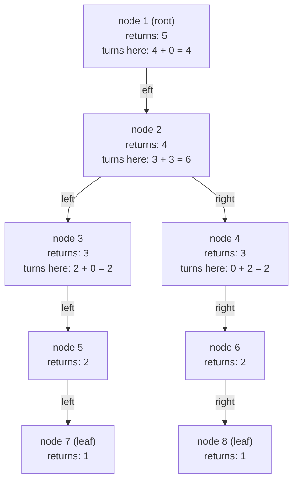
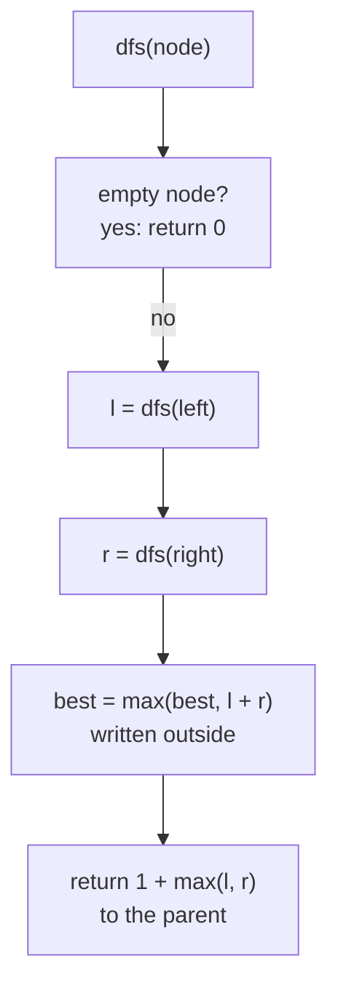

> [!tldr] Quick read
> - The problem: given a binary tree, find the number of **edges** on the longest path between any two nodes. That path does not have to pass through the root.
> - The longest path always "turns" at some node: it goes down the left side for the full height of the left subtree and down the right side for the full height of the right subtree. So the answer is the maximum of `height(left) + height(right)` over **every** node, with height counted in nodes.
> - The O(n) approach: one [[en/concepts/post-order-traversal|post-order]] pass. The recursive function **returns the height** to its parent, while the best diameter is **written to an outside variable**. Recomputing the height at every node is also correct, but it is O(n²) on a skewed tree: 8,000 nodes take 32 million node visits (489 ms) against 8,000 visits (0.15 ms).
> - The problem allows up to 10⁴ nodes, and a skewed chain of 10⁴ nodes overflows the stack of the recursive version in Node (at most 8,939 levels), Python (996) and Java before the JIT kicks in. The iterative version has no such limit.
> - Traps that actually run: counting nodes instead of edges (off by one in every case), only considering the path through the root, a missing `nonlocal` in Python (`UnboundLocalError`), passing `best` as an `int` by value in Go and Java (always 0), a module-level variable in JavaScript that is never reset between cases.

> [!info] Context
> LeetCode problem 543 (Easy), on [[en/posts/2026-11-25-neetcode-tree-recursion|station 3: Tree Recursion]] of **the NeetCode Line: Linked Structures**. This is the station's anchor problem: it uses the height function from [[en/problems/maximum-depth-of-binary-tree|Maximum Depth of Binary Tree]], but at every node it must also record a second piece of information that cannot be returned to the parent. Its station neighbour [[en/problems/balanced-binary-tree|Balanced Binary Tree]] uses the same frame and only swaps the second piece of information. Solutions come in TypeScript, Python, Go, Java and JavaScript. You need to know what recursion is; binary trees are explained right below.

> [!abstract]- Quick glossary for this post (click to open)
> - **Binary tree**: every node has at most two children, left and right. See [[en/concepts/binary-tree|Binary Tree]].
> - **Height** (on this page): the number of nodes on the longest path from a node straight down to a leaf. An empty tree has height 0, a single node height 1.
> - **Diameter**: the number of edges on the longest path between any two nodes. A path through k nodes has k − 1 edges.
> - **Post-order**: handle both subtrees first, then the node. It is the only order in which a node can use its children's results. See [[en/concepts/post-order-traversal|Post-order Traversal]].
> - **Call stack**: every call that has not returned holds a frame; recursion on a tree of height h holds h frames at once. When it is full you get `RangeError`, `RecursionError` or `StackOverflowError`. See [[en/concepts/recursion-depth-limit|Recursion Depth Limit]].
> - **Skewed chain**: a tree where every node has only a left child; n nodes give height n. It is the deepest tree possible.

## Picture it first: passing a message through an org chart

A company has a tree-shaped org chart: every manager has at most two direct reports. A message can only be passed between a boss and a direct report. The question: which two people in the company are the most hand-offs apart?

The longest relay goes up to some manager and then turns down the other branch. So each manager needs only one number from each team below: "how many levels deep my branch goes". With those two numbers the manager can work out the longest relay that turns at them, write it on a shared board if it beats the number already there, and then report **one** number to their own boss: the deepest level of their team. The boss does not need to know how long the relay turning at a subordinate is, because that relay is already on the board.

| Everyday life | Concept |
|---|---|
| Org chart, everyone has at most two reports | binary tree |
| One hand-off of the message | one edge |
| "My team goes this many levels deep", reported up | return value: the height |
| A relay that turns at one manager | `height(left) + height(right)` at that node |
| The shared board holding the longest relay | the variable `best` outside the recursive function |
| A manager computes only after the teams have reported | post-order |
| Every manager recounts the whole team below them | approach 1, recomputing heights: O(n²) |

The tree below is one of the cases in the runnable files. Each box shows the height the node returns to its parent and the longest path that turns at that node:



The longest path is 7 → 5 → 3 → 2 → 4 → 6 → 8, six edges, turning at node 2. The longest path through the root has only four edges, because the root has no right child.

## The problem

The input is the root of a binary tree with 1 to 10⁴ nodes, each value in [−100, 100] (the values do not affect the answer). Return the length, in edges, of the longest path between any two nodes. A single node gives 0. Original problem: [LeetCode 543](https://leetcode.com/problems/diameter-of-binary-tree/).

I used to think the longest path had to go from the deepest leaf on the left, through the root, to the deepest leaf on the right. The case in the figure above disproves that: the root has only one child, so every path through the root is "cut off" on one side. So the turn has to be considered at **every** node, and the question is how to consider all of them without walking the tree many times.

## How it works

### Why the two heights are enough

Take any longest path and call v its highest node (the one closest to the root). From v the path goes down at most two branches: one into the left subtree, one into the right subtree (it cannot go up, because v is the highest node). The longest each branch can be is straight down to the deepest leaf of that subtree, which is exactly `height(child)` edges counted from v (one edge from v to the child, plus the child's height minus 1). So the longest path turning at v has `height(left) + height(right)` edges, and the answer is the maximum of that quantity over every v.

With height counted in **nodes**, the sum `height(left) + height(right)` comes out directly in **edges**. This is the most common off-by-one spot of the problem: adding 1 for v itself means counting nodes.

### Approach 1: recompute the height at every node

Write it straight from the definition: the diameter of a tree is the maximum of three things, the path turning at the root, the diameter of the left subtree, the diameter of the right subtree.

```ts
// Approach 1: diameter = max(through this node, diameter of the left tree, diameter of the right tree).
// height() walks the whole subtree again at every node: O(n log n) for a balanced tree, O(n²) for a skewed chain.
function diameterNaive(root: TreeNode | null): number {
  if (root === null) return 0;
  const through = height(root.left) + height(root.right);
  return Math.max(through, diameterNaive(root.left), diameterNaive(root.right));
}
```

Correct, but every node calls `height` on both subtrees, and `height` walks the whole subtree. A node at depth d is visited again d times (once per ancestor). The total number of visits is the sum of all node depths: about n log n for a balanced tree, n(n − 1)/2 for a skewed chain. Extra memory is O(h) for the call stack, where h is the tree height.

### Approach 2: one post-order pass

The height function already computes `height(left)` and `height(right)` at every node before returning. All it takes is to update the best diameter while those two numbers are at hand:

```ts
// Approach 2: one post-order pass. dfs returns the height to the parent; the best diameter goes into an outside variable. O(n).
function diameterOnePass(root: TreeNode | null): number {
  let best = 0;
  const dfs = (node: TreeNode | null): number => {
    if (node === null) return 0;
    const l = dfs(node.left);
    const r = dfs(node.right);
    best = Math.max(best, l + r); // the path turning at node: l edges down the left + r edges down the right
    return 1 + Math.max(l, r);
  };
  dfs(root);
  return best;
}
```

The function has two different outputs, and that is the core idea of the whole station:

- the **return value** is what the parent needs for its own computation: the height. The parent can only attach **one** of the child's branches to its own path, so the function returns `1 + max(l, r)`, not `l + r`;
- the **outside variable `best`** holds what the parent cannot use but the answer needs: the path turning at the child.

Every node is visited exactly once: O(n) time, O(h) memory for the call stack.



### Approach 3: iterative, no recursion

Approach 2 recurses as deep as the tree is tall, and the problem allows a tree of height 10⁴. The iterative version does the same computation in the same children-before-parent order, but keeps the order in an array itself:

1. walk the tree in pre-order with an [[en/concepts/stack|explicit stack]], recording nodes in the order they are popped; each node is recorded before all of its descendants;
2. process that array in **reverse** order: now each node comes after all of its descendants, so when a node is reached, the heights of both children are already in the table.

```ts
// Approach 3: the same computation without recursion. Walk pre-order with a stack, then process in reverse:
// every node is processed after all of its descendants. No depth limit.
function diameterIterative(root: TreeNode | null): number {
  if (root === null) return 0;
  const order: TreeNode[] = [];
  const stack: TreeNode[] = [root];
  while (stack.length > 0) {
    const node = stack.pop()!;
    order.push(node);
    if (node.left !== null) stack.push(node.left);
    if (node.right !== null) stack.push(node.right);
  }
  const h = new Map<TreeNode, number>();
  let best = 0;
  for (let i = order.length - 1; i >= 0; i--) {
    const node = order[i];
    const l = node.left === null ? 0 : h.get(node.left)!;
    const r = node.right === null ? 0 : h.get(node.right)!;
    best = Math.max(best, l + r);
    h.set(node, 1 + Math.max(l, r));
  }
  return best;
}
```

O(n) time, O(n) memory (the order array and the height table), independent of the tree height. The price is the node → height hash table, which is slower than a local variable on the stack (see the measurements).

| Approach | Time | Extra memory | Notes |
|---|---|---|---|
| Recompute heights | O(n log n) balanced, O(n²) skewed chain | O(h) | straight from the definition, easy to write |
| One post-order pass | O(n) | O(h) | recursion h levels deep |
| Iterative | O(n) | O(n) | no depth limit, needs a height table |

There is another O(n) approach that needs no heights: treat the tree as an undirected graph, BFS from any node to the farthest node u, then BFS from u to the farthest node; the second distance is the diameter. It needs parent pointers or an adjacency list, so on a binary tree that only points down, the two approaches above are simpler. The TypeScript file uses BFS from **every** node (O(n²), straight from the definition) as the reference answer for cross-checking.

### Measurements

TypeScript, Node 24, median of 5 runs. "Visits" is the number of times the height function touches a real node.

| Tree | n | Recompute: visits | Recompute | One pass: visits | One pass | Iterative |
|---|---|---|---|---|---|---|
| skewed chain | 1,000 | 499,500 | 6.54 ms | 1,000 | 0.02 ms | |
| skewed chain | 2,000 | 1,999,000 | 27.9 ms | 2,000 | 0.04 ms | |
| skewed chain | 4,000 | 7,998,000 | 118 ms | 4,000 | 0.07 ms | |
| skewed chain | 8,000 | 31,996,000 | 489 ms | 8,000 | 0.15 ms | |
| random | 10⁴ | 153,437 | 1.96 ms | 10⁴ | 0.18 ms | 0.91 ms |
| random | 10⁵ | 2,085,711 | 33.9 ms | 10⁵ | 2.19 ms | 10.5 ms |
| random | 10⁶ | 24,767,748 | 829 ms | 10⁶ | 83.8 ms | 320 ms |

- On the skewed chain, approach 1's visit count is exactly n(n − 1)/2: doubling n quadruples the time.
- On random trees (each new node attached at a random free slot), visits divided by n are 15, 21 and 25: the n log n shape, because the average depth grows with log n.
- The iterative version is 4 to 5 times slower than the recursive one on random trees: every node writes and reads a `Map`.

Maximum recursion depth of approach 2 on a skewed chain, found by binary search on n:

| Runtime | Maximum depth | 10⁴-node chain (the problem's limit) |
|---|---|---|
| Node 24 (TypeScript, JavaScript) | 8,939 nodes | `RangeError` |
| Python 3.12 | 996 nodes (default limit 1,000) | `RecursionError`; runs after `sys.setrecursionlimit(20000)` |
| Java 21 | 19,531 on the first measurement, 29,466 on the next two | `StackOverflowError` while the code still runs interpreted, before the JIT has compiled it |
| Go 1.25 | a 10⁶-node chain still runs: goroutine stacks grow | runs |

The Java number changes from run to run because frames of interpreted code are larger than frames of JIT-compiled code: in the case loop the function has run only a few times, so it overflows at 10⁴, while after dozens of calls in the binary-search loop it survives almost 30,000. I could not check what stack size LeetCode runs with, so I do not know whether its test set includes a 10⁴-node chain; on my machine, a recursive version with a correct algorithm can still fail at the problem's own limit.

The iterative version on a 10⁶-node chain: 131 ms in TypeScript, 317 ms in Python. Go is the other way round: recursion 19.4 ms, iterative 146 ms, because goroutine stacks can grow while `map[*TreeNode]int` costs far more than a local variable.

### Under the five languages

The common difficulty: the inner recursive function has to **write** to the outer function's `best`. Each language has its own way to do that, and its own way to get it wrong.

| | How `best` is kept | Trap |
|---|---|---|
| TypeScript / JavaScript | closure: `let best` in the outer function, an arrow function inside writes to it directly | putting `best` at module level and forgetting to reset it: each case gets the maximum of the earlier cases |
| Python | nested function + `nonlocal best` | without `nonlocal`, the assignment makes `best` a local variable of the inner function, and reading it before assignment throws `UnboundLocalError` |
| Go | a closure declared first as `var dfs func(*TreeNode) int` and assigned afterwards; or pass a `*int` | passing `best int`: every call gets a copy and the result is always 0. Writing `dfs := func…` and calling `dfs` inside does not compile |
| Java | an array `int[] best = {0}` (or a field) passed to a helper | passing `int best`: Java passes by value, always 0. A lambda may not assign a local variable from outside (compile error "effectively final") |

Number types are not an issue here: the diameter never exceeds 10⁴ − 1, which fits every integer type.

## Runnable example

[TypeScript](../code/neetcode-diameter-of-binary-tree/diameter.ts) · [Python](../code/neetcode-diameter-of-binary-tree/diameter.py) · [Go](../code/neetcode-diameter-of-binary-tree/diameter.go) · [Java](../code/neetcode-diameter-of-binary-tree/diameter.java) · [JavaScript](../code/neetcode-diameter-of-binary-tree/diameter.js)

Every file builds trees from a LeetCode-style level-order array (`null` marks an empty slot) and runs 7 shared cases: one node, two nodes, a path turning at the root, a path not through the root (the tree in the figure above), a full 15-node tree, negative values, and a 10⁴-node skewed chain (the problem's limit). The TypeScript file also cross-checks 2,000 random trees (generated with mulberry32) against BFS from every node.

One post-order pass:

```ts
// Approach 2: one post-order pass. dfs returns the height to the parent; the best diameter goes into an outside variable. O(n).
function diameterOnePass(root: TreeNode | null): number {
  let best = 0;
  const dfs = (node: TreeNode | null): number => {
    if (node === null) return 0;
    const l = dfs(node.left);
    const r = dfs(node.right);
    best = Math.max(best, l + r); // the path turning at node: l edges down the left + r edges down the right
    return 1 + Math.max(l, r);
  };
  dfs(root);
  return best;
}
```

```python
def diameter_one_pass(root):
    """Approach 2: dfs returns the height; best belongs to the outer function, so the inner one must declare it nonlocal."""
    best = 0

    def dfs(node):
        nonlocal best
        if node is None:
            return 0
        l, r = dfs(node.left), dfs(node.right)
        best = max(best, l + r)
        return 1 + max(l, r)

    dfs(root)
    return best
```

```go
// Approach 2: a recursive closure must be declared first (var dfs func...) and assigned afterwards, so its body can call itself.
func diameterOnePass(root *TreeNode) int {
	best := 0
	var dfs func(*TreeNode) int
	dfs = func(node *TreeNode) int {
		if node == nil {
			return 0
		}
		l, r := dfs(node.Left), dfs(node.Right)
		best = max(best, l+r) // the closure refers to the outer function's best
		return 1 + max(l, r)
	}
	dfs(root)
	return best
}
```

```java
// Approach 2: one pass. Java passes int by value, so best lives in a one-element array (or a field).
static int diameterOnePass(TreeNode root) {
    int[] best = {0};
    dfs(root, best);
    return best[0];
}

static int dfs(TreeNode node, int[] best) {
    if (node == null) return 0;
    int l = dfs(node.left, best), r = dfs(node.right, best);
    best[0] = Math.max(best[0], l + r);
    return 1 + Math.max(l, r);
}
```

```js
// Approach 2: one pass; best lives in the closure, and every call of the outer function gets a fresh best.
function diameterOnePass(root) {
  let best = 0;
  const dfs = (node) => {
    if (node === null) return 0;
    const l = dfs(node.left), r = dfs(node.right);
    best = Math.max(best, l + r);
    return 1 + Math.max(l, r);
  };
  dfs(root);
  return best;
}
```

The iterative version, which handles the 10⁴-node chain in every language:

```ts
function diameterIterative(root: TreeNode | null): number {
  if (root === null) return 0;
  const order: TreeNode[] = [];
  const stack: TreeNode[] = [root];
  while (stack.length > 0) {
    const node = stack.pop()!;
    order.push(node);
    if (node.left !== null) stack.push(node.left);
    if (node.right !== null) stack.push(node.right);
  }
  const h = new Map<TreeNode, number>();
  let best = 0;
  for (let i = order.length - 1; i >= 0; i--) {
    const node = order[i];
    const l = node.left === null ? 0 : h.get(node.left)!;
    const r = node.right === null ? 0 : h.get(node.right)!;
    best = Math.max(best, l + r);
    h.set(node, 1 + Math.max(l, r));
  }
  return best;
}
```

```python
def diameter_iterative(root):
    """Approach 3: pre-order with a stack, processed in reverse: children always finish before their parent."""
    if root is None:
        return 0
    order, stack = [], [root]
    while stack:
        node = stack.pop()
        order.append(node)
        if node.left:
            stack.append(node.left)
        if node.right:
            stack.append(node.right)
    h, best = {None: 0}, 0
    for node in reversed(order):
        l, r = h[node.left], h[node.right]
        best = max(best, l + r)
        h[node] = 1 + max(l, r)
    return best
```

```go
// Approach 3: pre-order with a stack, processed in reverse. Heights live in a map keyed by node pointer.
func diameterIterative(root *TreeNode) int {
	if root == nil {
		return 0
	}
	order := []*TreeNode{}
	stack := []*TreeNode{root}
	for len(stack) > 0 {
		node := stack[len(stack)-1]
		stack = stack[:len(stack)-1]
		order = append(order, node)
		if node.Left != nil {
			stack = append(stack, node.Left)
		}
		if node.Right != nil {
			stack = append(stack, node.Right)
		}
	}
	h := make(map[*TreeNode]int, len(order)+1) // h[nil] reads 0, the height of an empty tree
	best := 0
	for i := len(order) - 1; i >= 0; i-- {
		node := order[i]
		l, r := h[node.Left], h[node.Right]
		best = max(best, l+r)
		h[node] = 1 + max(l, r)
	}
	return best
}
```

```java
// Approach 3: pre-order with a stack, processed in reverse; heights in an IdentityHashMap keyed by node.
static int diameterIterative(TreeNode root) {
    if (root == null) return 0;
    List<TreeNode> order = new ArrayList<>();
    Deque<TreeNode> stack = new ArrayDeque<>();
    stack.push(root);
    while (!stack.isEmpty()) {
        TreeNode node = stack.pop();
        order.add(node);
        if (node.left != null) stack.push(node.left);
        if (node.right != null) stack.push(node.right);
    }
    Map<TreeNode, Integer> h = new IdentityHashMap<>();
    int best = 0;
    for (int i = order.size() - 1; i >= 0; i--) {
        TreeNode node = order.get(i);
        int l = node.left == null ? 0 : h.get(node.left);
        int r = node.right == null ? 0 : h.get(node.right);
        best = Math.max(best, l + r);
        h.put(node, 1 + Math.max(l, r));
    }
    return best;
}
```

```js
// Approach 3: pre-order with a stack, processed in reverse; no depth limit.
function diameterIterative(root) {
  if (root === null) return 0;
  const order = [], stack = [root];
  while (stack.length > 0) {
    const node = stack.pop();
    order.push(node);
    if (node.left !== null) stack.push(node.left);
    if (node.right !== null) stack.push(node.right);
  }
  const h = new Map([[null, 0]]);
  let best = 0;
  for (let i = order.length - 1; i >= 0; i--) {
    const node = order[i];
    const l = h.get(node.left), r = h.get(node.right);
    best = Math.max(best, l + r);
    h.set(node, 1 + Math.max(l, r));
  }
  return best;
}
```

Output of `node diameter.ts`:

```text
diameterNaive       6/7 cases passed; wrong on 10⁴-node skewed chain (problem limit) → throws RangeError
diameterOnePass     6/7 cases passed; wrong on 10⁴-node skewed chain (problem limit) → throws RangeError
diameterIterative   7/7 cases passed
wrongCountNodes     0/7 cases passed; wrong on one node → 1, two nodes → 2, turns at root → 5, not through root → 7, full 15-node tree → 7, negative values → 5, 10⁴-node skewed chain (problem limit) → throws RangeError
wrongThroughRoot    5/7 cases passed; wrong on not through root → 4, 10⁴-node skewed chain (problem limit) → throws RangeError
wrongGlobalNoReset  5/7 cases passed; wrong on negative values → 6, 10⁴-node skewed chain (problem limit) → throws RangeError

checked against the definition (BFS from every node): diameterNaive 2000/2000, diameterOnePass 2000/2000, diameterIterative 2000/2000

skewed chain of n nodes: node visits and median time (ms)
n        recompute: visits     ms   one pass: visits     ms
1000             499500     6.54           1000    0.02
2000            1999000    27.92           2000    0.04
4000            7998000   118.17           4000    0.07
8000           31996000   489.29           8000    0.15

random tree of n nodes: node visits and median time (ms)
n        recompute: visits     ms   one pass: visits     ms    iterative ms
10000            153437     1.96          10000    0.18          0.91
100000          2085711    33.90         100000    2.19         10.50
1000000        24767748   829.48        1000000   83.79        320.16

maximum depth of the one-pass recursion: 8939 nodes
iterative, 10⁶-node skewed chain: 999999 edges, 131.45 ms
```

*(Output labels translated; the files themselves print Vietnamese.)*

`wrongGlobalNoReset` passes the first five cases only because their answers never go down; at "negative values" (answer 4) it still holds the 6 from the full 15-node tree that ran just before.

`python3 diameter.py`:

```text
diameter_naive       6/7 cases passed; wrong on 10⁴-node skewed chain (problem limit) → throws RecursionError
diameter_one_pass    6/7 cases passed; wrong on 10⁴-node skewed chain (problem limit) → throws RecursionError
diameter_iterative   7/7 cases passed
wrong_no_nonlocal    0/7 cases passed; wrong on one node → throws UnboundLocalError, two nodes → throws UnboundLocalError, turns at root → throws UnboundLocalError, not through root → throws UnboundLocalError, full 15-node tree → throws UnboundLocalError, negative values → throws UnboundLocalError, 10⁴-node skewed chain (problem limit) → throws RecursionError

default recursion limit 1000: diameter_one_pass reaches at most 996 nodes
after setrecursionlimit(20000): 10⁴-node chain → 9999 edges
iterative, 10⁶-node skewed chain: 999999 edges, 317 ms
```

`go run diameter.go`:

```text
diameterNaive      7/7 cases passed
diameterOnePass    7/7 cases passed
diameterIterative  7/7 cases passed
diameterPointer    7/7 cases passed
wrongByValue       1/7 cases passed; wrong on two nodes → 0, turns at root → 0, not through root → 0, full 15-node tree → 0, negative values → 0, 10⁴-node skewed chain (problem limit) → 0

10⁶-node skewed chain, median of 5 runs (ms)
recursive one pass     19.38  (result 999999)
iterative             145.62  (result 999999)
```

`java diameter.java`:

```text
diameterNaive      6/7 cases passed; wrong on 10⁴-node skewed chain (problem limit) → throws StackOverflowError
diameterOnePass    6/7 cases passed; wrong on 10⁴-node skewed chain (problem limit) → throws StackOverflowError
diameterIterative  7/7 cases passed
wrongByValue       1/7 cases passed; wrong on two nodes → 0, turns at root → 0, not through root → 0, full 15-node tree → 0, negative values → 0, 10⁴-node skewed chain (problem limit) → throws StackOverflowError

maximum depth of the one-pass recursion, run 1: 19531 nodes
maximum depth of the one-pass recursion, run 2: 29466 nodes
maximum depth of the one-pass recursion, run 3: 29466 nodes
```

`node diameter.js`:

```text
diameterNaive       6/7 cases passed; wrong on 10⁴-node skewed chain (problem limit) → throws RangeError
diameterOnePass     6/7 cases passed; wrong on 10⁴-node skewed chain (problem limit) → throws RangeError
diameterIterative   7/7 cases passed
wrongGlobalNoReset  5/7 cases passed; wrong on negative values → 6, 10⁴-node skewed chain (problem limit) → throws RangeError
```

## Misconceptions and common traps

- **"The diameter passes through the root."** Only when the root is the highest node of the longest path. The tree in the figure above has its longest path turning at node 2; looking only at the root gives 4 instead of 6.
- **Counting nodes instead of edges.** With height counted in nodes, `l + r` is already the number of edges. Adding 1 is wrong in **every** case, even a single-node tree (1 instead of 0).
- **Returning `l + r` to the parent.** The parent can attach only one of the child's branches to its own path. The return value must be the height `1 + max(l, r)`; `l + r` only goes into `best`.
- **"Recomputing the height is still O(n), since each call walks only one subtree."** Every node is walked again once per ancestor: O(n²) on a skewed chain, measured at 32 million visits for 8,000 nodes.
- **"A correct algorithm passes the problem's limits."** A 10⁴-node chain is within the limits, and it overflows the recursive version's stack in Node, Python and Java (before the JIT) on my machine. Only the iterative version or a raised limit is safe.
- **Python without `nonlocal`.** Any assignment `best = …` in the inner function makes Python treat `best` as the inner function's variable, so reading `best` on the right-hand side throws `UnboundLocalError`. Reading without assigning needs no `nonlocal`, so the error only shows up once you start updating.
- **Go and Java pass `int` by value.** A helper taking `best int` updates a copy; the outer function always sees 0. Use a closure, `*int`, `int[]` or a field.
- **JavaScript and module-level variables.** LeetCode calls the function many times in the same process. A `best` declared outside the function and never reset hands the next case the maximum of the previous one.

## Self-check questions

> [!question]- Why does the recursive function return the height rather than the diameter of the subtree?
> The parent needs the longest branch going down from each child, to join it with the branch on the other side; a subtree's diameter cannot be extended, because it may turn at some deep node and never touch the child. The subtree's diameter is still needed for the answer, so it is written into `best` right where the path turns.

> [!question]- With height counted in nodes, at a node with `l = 3` and `r = 2`, how many edges does the path turning there have, and what does the node return to its parent?
> The path turning there has 3 + 2 = 5 edges (3 edges down to the deepest leaf on the left, 2 on the right). The node returns 1 + max(3, 2) = 4 to its parent.

> [!question]- How many node visits does recomputing the height make on a skewed chain of n nodes?
> A node at depth d is visited once per ancestor, d times. The total is 0 + 1 + … + (n − 1) = n(n − 1)/2. For n = 8,000 that is 31,996,000, matching the TypeScript file's count.

> [!question]- The iterative version processes nodes in reverse pre-order. Why does that order guarantee that both children already have heights when the parent is reached?
> In pre-order (with a stack), a node is popped and recorded before any of its descendants are pushed, so it comes before all of its descendants. Reversing the array puts it after all of them.

> [!question]- Can the diameter be found with BFS, and why does this page not use it?
> Yes: BFS from any node to the farthest node u, then BFS from u; the farthest distance in the second run is the diameter. But BFS on a tree must be able to go up to the parent, and binary tree nodes only point down, so an extra O(n) adjacency list is needed. One post-order pass needs nothing extra.

## References

- [LeetCode 543: Diameter of Binary Tree](https://leetcode.com/problems/diameter-of-binary-tree/) (original problem: 1 to 10⁴ nodes, values in [−100, 100])
- [Python: the `nonlocal` statement](https://docs.python.org/3/reference/simple_stmts.html#the-nonlocal-statement) and [`sys.setrecursionlimit`](https://docs.python.org/3/library/sys.html#sys.setrecursionlimit)
- [Go spec: Function literals](https://go.dev/ref/spec#Function_literals) (closures share the variables of the surrounding function)
- [Java Language Specification SE 21, §15.27.2](https://docs.oracle.com/javase/specs/jls/se21/html/jls-15.html#jls-15.27.2) (a local variable used in a lambda must be final or effectively final)
- Cormen, Leiserson, Rivest, Stein, *Introduction to Algorithms*, 3rd edition, exercise 22.2-8 (the diameter of a tree, solved in O(n))
