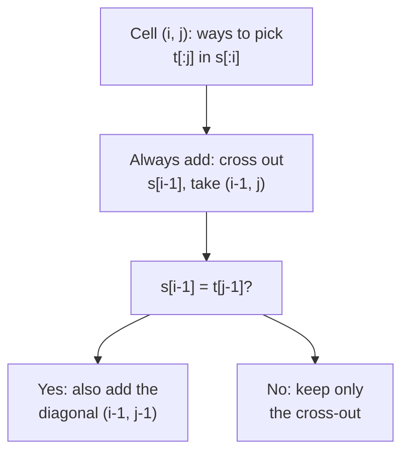

> [!tldr] Quick read
> - Count the sets of positions in `s` that, read in order, spell exactly `t`. Two sets that differ in any position count as two ways.
> - Cell `ways[i][j]` counts the ways to pick `t[:j]` inside `s[:i]`. Character `s[i-1]` is either skipped or, if it equals `t[j-1]`, used as the last character of `t[:j]`. The two cases are disjoint, so they add up.
> - It is the same [[en/concepts/two-sequence-dp|two-sequence DP]] template as LCS, but each cell counts ways instead of taking a maximum length.
> - One row is enough if j walks **downward**. Middle cells can grow far past 2^63 even when the answer is small, so I clamp every cell at 2^31.

> [!info] Context
> This is LeetCode 115 at [[en/posts/2026-11-27-neetcode-grid-two-strings|station DP-05: Grids and Two Strings]] on **the NeetCode Line: Dynamic Programming**. I picture a long shop sign, and crossing out letters so that what remains spells a given word. You only need to read strings by index and run nested loops.

> [!abstract]- Quick glossary for this post (click to open)
> - A subsequence keeps the order but may skip positions, unlike a substring, which must be contiguous.
> - `s[:i]` is the prefix made of the first i characters of `s`.
> - A [[en/concepts/recurrence-relation|recurrence relation]] says which cells the current cell is computed from.
> - [[en/concepts/rolling-state|Rolling state]] keeps only the table row the next step still reads.
> - Overflow happens when the result of an addition is larger than the number type can hold. Languages handle it differently: wrap around, switch type, or stop the program.
> - Saturating addition adds, then clamps the result at a ceiling.

## Picture it first: crossing out letters on a sign

The sign says `banana`. I want to cross out letters so that `ban` remains. `b` appears once, `a` three times, `n` twice. Count every way to keep three letters in order: keeping the `a` at position 1 leaves two `n` positions after it, keeping the `a` at position 3 leaves one, and keeping the `a` at position 5 leaves none. The total is 3 ways.

| Everyday life | Concept |
|---|---|
| The long sign | String `s` |
| The word to keep | String `t` |
| Read the first i letters of the sign, matched the first j letters of the word | Cell `ways[i][j]` |
| Cross out the current letter | Skip `s[i-1]`: take `ways[i-1][j]` |
| Keep the current letter as letter j of the word | Use `s[i-1] = t[j-1]`: add `ways[i-1][j-1]` |
| The empty word can be kept in exactly one way: cross out everything | `ways[i][0] = 1` |



## The problem: count the ways to spell a string

You get two strings `s` and `t`, each 1–1,000 characters long, made of English letters (case-sensitive). Count the sets of positions in `s` that, read in increasing order, spell exactly `t`. The problem guarantees the answer fits in a signed 32-bit integer. For example, `aaa` and `aa` give 3 ways: keep positions (0, 1), (0, 2) or (1, 2). [Original problem, LeetCode 115](https://leetcode.com/problems/distinct-subsequences/)

## How it works

### Brute force: keep or cross out each letter of s

`search(i, j)` counts the ways to match `t[j:]` inside `s[i:]`. Matching all of `t` (j = n) is one way. If what is left of `s` is shorter than what is left of `t`, there is no way. Otherwise, always try crossing out `s[i]`, and if `s[i] == t[j]`, also try keeping it. The two branches yield position sets that differ at `i`, so adding them never double-counts.

With m = `len(s)` and n = `len(t)`, brute force may visit every subset of positions of `s`: O(2^m) time and O(m) stack.

### Memoization and the table

`search(i, j)` depends only on the two suffixes `s[i:]` and `t[j:]`, so there are (m + 1)(n + 1) states. Storing answers by (i, j) gives O(mn) time and memory.

Written bottom-up over prefixes: `ways[i][0] = 1` for every i (the empty word), `ways[0][j] = 0` for j > 0, and

```text
ways[i][j] = ways[i-1][j] + (s[i-1] == t[j-1] ? ways[i-1][j-1] : 0)
```

It differs from the [[en/concepts/lcs-table|LCS table]] in two ways. LCS takes a maximum and treats both strings alike; here the count is one-sided: only `s` may drop characters, and `t` must match in full. So when the characters differ, the cell takes only the cell above, never the cell to the left.

### One row, walked backward

Cell (i, j) reads the cell above (i − 1, j) and the diagonal (i − 1, j − 1), both in the previous row. Keep one array `row` of length n + 1. For each character of `s`, walk j from n down to 1: when `row[j]` is updated, `row[j-1]` has not been written in this pass yet, so it still holds the previous row. Walking upward would make `row[j-1]` the new row already, and one character of `s` would be used twice. It is the same reason as the 0/1 knapsack at [[en/posts/2026-11-27-neetcode-knapsack|station DP-03]]. Extra memory drops to O(n).

### Middle cells get much larger than the answer

The problem only guarantees that the **answer** fits in 32 bits, not the middle cells. With `s` as 1,000 `a` characters and `t` as 499 `a` characters followed by one `b`, the answer is 0, yet cell `row[100]` after reading all of `s` equals C(1000, 100) ≈ 6.4·10^139. No fixed-size integer type can hold that.

So why does the answer still come out right? Every cell is non-negative, and along any path by which a cell feeds into the answer, values only grow. Cell (i, j) feeds cell (i + 1, j) through the cross-out branch and cell (i + 1, j + 1) through the keep branch. Each contribution adds a non-negative number to the later cell. So a cell that affects the answer can never exceed the answer. Any cell above 2^31 certainly does not feed the answer. I clamp every cell at the ceiling `CAP = 2^31`: the clamped value always equals min(true value, CAP), and the true answer is below CAP, so it does not change. Each file checks exactly this property with a small ceiling of 3 on every enumerated case.

Without a ceiling, each language reacts differently in the cells that do not feed the answer:

| Language | What a large cell becomes without a ceiling |
|---|---|
| Python | an arbitrary-size integer, correct but heavier on memory |
| TypeScript, JavaScript | a floating-point number that loses precision past 2^53 |
| Go (`int`), Java (`int`, `long`) | wraps around modulo 2^64 or 2^32, with no error |
| PHP | silently becomes a `float` |
| Rust | a debug build stops with `attempt to add with overflow`; an `-O` build wraps |

All the versions here give the right answer even without a ceiling, except the Rust debug build. But they are right because each language happens not to break the irrelevant cells, not because I reasoned about it. The 2^31 ceiling makes the argument explicit and identical in all seven languages.

| Approach | Time | Auxiliary space |
|---|---|---|
| Brute force | O(2^m) | O(m) stack |
| Memoization on (i, j) | O(mn) | O(mn) |
| Two-dimensional table | O(mn) | O(mn) |
| One row walked backward | O(mn) | O(n) |

## Runnable example

[TypeScript](../code/neetcode-distinct-subsequences/ways.ts) · [Python](../code/neetcode-distinct-subsequences/ways.py) · [Go](../code/neetcode-distinct-subsequences/ways.go) · [Java](../code/neetcode-distinct-subsequences/ways.java) · [JavaScript](../code/neetcode-distinct-subsequences/ways.js) · [PHP](../code/neetcode-distinct-subsequences/ways.php) · [Rust](../code/neetcode-distinct-subsequences/ways.rs)

```ts
function fillRow(s: string, t: string, cap: number) {
    const row: number[] = [1, ...Array(t.length).fill(0)]
    for (const ch of s) {
        // walk backward so row[j - 1] still holds the previous row
        for (let j = t.length; j >= 1; j--) {
            if (ch === t[j - 1]) row[j] = Math.min(row[j] + row[j - 1], cap)
        }
    }
    return row
}
```

```python
def fill_row(s, t, cap):
    row = [1] + [0] * len(t)
    for ch in s:
        # walk backward so row[j - 1] still holds the previous row
        for j in range(len(t), 0, -1):
            if ch == t[j - 1]:
                row[j] = min(row[j] + row[j - 1], cap)
    return row
```

```go
func fillRow(s, t string, limit int) []int {
	row := make([]int, len(t)+1)
	row[0] = 1
	for i := 0; i < len(s); i++ {
		// walk backward so row[j - 1] still holds the previous row
		for j := len(t); j >= 1; j-- {
			if s[i] == t[j-1] {
				row[j] = min(row[j]+row[j-1], limit)
			}
		}
	}
	return row
}
```

```java
static long[] fillRow(String s, String t, long cap) {
    long[] row = new long[t.length() + 1];
    row[0] = 1;
    for (int i = 0; i < s.length(); i++) {
        // walk backward so row[j - 1] still holds the previous row
        for (int j = t.length(); j >= 1; j--) {
            if (s.charAt(i) == t.charAt(j - 1)) row[j] = Math.min(row[j] + row[j - 1], cap);
        }
    }
    return row;
}
```

```js
function fillRow(s, t, cap) {
    const row = [1, ...Array(t.length).fill(0)]
    for (const ch of s) {
        // walk backward so row[j - 1] still holds the previous row
        for (let j = t.length; j >= 1; j--) {
            if (ch === t[j - 1]) row[j] = Math.min(row[j] + row[j - 1], cap)
        }
    }
    return row
}
```

```php
function fillRow(string $s, string $t, int $cap): array {
    $n = strlen($t);
    $row = array_fill(0, $n + 1, 0);
    $row[0] = 1;
    for ($i = 0; $i < strlen($s); $i++) {
        // walk backward so row[j - 1] still holds the previous row
        for ($j = $n; $j >= 1; $j--) {
            if ($s[$i] === $t[$j - 1]) $row[$j] = min($row[$j] + $row[$j - 1], $cap);
        }
    }
    return $row;
}
```

```rust
fn fill_row(s: &str, t: &str, cap: u64) -> Vec<u64> {
    let t = t.as_bytes();
    let mut row = vec![0u64; t.len() + 1];
    row[0] = 1;
    for &ch in s.as_bytes() {
        // walk backward so row[j - 1] still holds the previous row
        for j in (1..=t.len()).rev() {
            if ch == t[j - 1] {
                row[j] = (row[j] + row[j - 1]).min(cap);
            }
        }
    }
    row
}
```

The tabs show the one-row fill. The answer is `row[len(t)]` with `cap = CAP`. The downloadable files also contain brute force, memoization and the two-dimensional table. The 11 cases include uppercase versus lowercase, `t` longer than `s`, `s` and `t` both 1,000 long, and the `a…ab` case above. Each file also checks all four approaches against an enumerator of every position set, over every `s` of `a/b` with length 0–7 and every `t` with length 1–3, then checks the version clamped at 3 against min(true answer, 3). The last line counts how many cells of the final row hit the ceiling in the `a…ab` case.

The Python file keeps the table and memoized versions unclamped, because Python integers do not overflow. The other six languages clamp in all three versions.

```text
11/11 cases passed
3570/3570 cases passed (every position set enumerated)
Final row: 496/501 cells hit 2^31, answer 0
```

*(Output labels translated; the files themselves print Vietnamese.)*

Run with `node ways.ts`, `python3 ways.py`, `go run ways.go`, `java ways.java`, `node ways.js`, `php ways.php` or `rustc --edition 2021 -O ways.rs -o /tmp/ways && /tmp/ways`.

## Misconceptions and common traps

- I used to think "the answer fits in 32 bits, so `int` is enough, and `long` to be safe". Middle cells can exceed even 2^63. Java or Go code still comes out right because addition wraps and the overflowing cells never feed the answer, but that is luck. In C++, signed integer overflow is undefined behavior.
- Walking j upward in the one-row version. With `s = "a"` and `t = "aa"`, walking upward gives `row[2] = 1`, because the same `a` is used twice. The correct answer is 0.
- Forgetting `ways[i][0] = 1`. The empty word always has exactly one way (cross out everything), and every count starts from that column.
- Also taking the cell to the left when the characters differ, as in LCS. The cell to the left means dropping a character of `t`, which the problem does not allow.
- Python: the recursive memoized version goes 1,000 levels deep, past CPython's default limit, so the file calls `sys.setrecursionlimit`. PHP with Xdebug enabled stops recursion deeper than 512 levels, so run it with `-d xdebug.mode=off`.
- Rust: compiling without `-O` and without the ceiling makes the program stop midway. Use `.min(CAP)` (or `saturating_add`) so it behaves the same in every build mode.

## Self-check questions

> [!question]- Why does adding the "cross out" and "keep" branches not double-count?
> The two branches differ in whether position `i - 1` is in the chosen set, so no position set belongs to both.

> [!question]- Why can a cell larger than the answer not affect the answer?
> Every cell is non-negative, and a cell that feeds a later cell makes that later cell at least as large. Along any path to the answer, values never decrease.

> [!question]- Is the problem symmetric if s and t swap roles?
> No. Only `s` may drop characters. If `len(t) > len(s)`, the answer is 0.

## References

- [LeetCode 115](https://leetcode.com/problems/distinct-subsequences/)
- [Jeff Erickson, Algorithms, dynamic programming chapter](https://jeffe.cs.illinois.edu/teaching/algorithms/book/03-dynprog.pdf)
- [MIT 6.006 (2020), lecture 16: DP subproblems, including LCS on two strings](https://ocw.mit.edu/courses/6-006-introduction-to-algorithms-spring-2020/resources/mit6_006s20_lec16/)
- [Go spec, integer overflow](https://go.dev/ref/spec#Integer_overflow) · [Java JLS 15.18.2](https://docs.oracle.com/javase/specs/jls/se21/html/jls-15.html#jls-15.18.2) · [PHP integer overflow](https://www.php.net/manual/en/language.types.integer.php) · [Rust Book, integer overflow](https://doc.rust-lang.org/book/ch03-02-data-types.html#integer-overflow)
