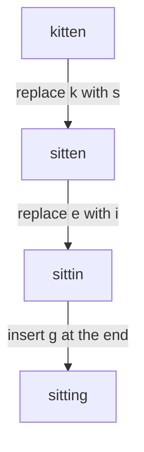
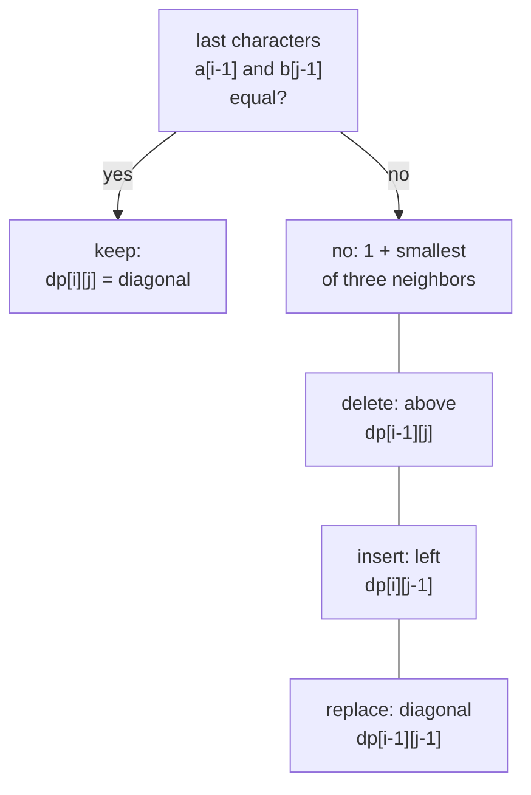

> [!tldr] Quick read
> - Let `dp[i][j]` be the fewest steps that turn the prefix `a[0:i]` into `b[0:j]`. It is a [[en/concepts/two-sequence-dp|table over two prefixes]].
> - Look at the last character of both prefixes. If they match, keep it and take the diagonal cell. If not, the three [[en/concepts/edit-operations|edit operations]] map to three neighboring cells: delete is the cell above, insert is the cell to the left, replace is the diagonal.
> - Row 0 and column 0 are not zeros: turning the empty string into `b[0:j]` takes j insertions.
> - One row plus a variable that holds the old diagonal cell is enough, which brings memory down to O(min(m, n)). To print the edit script, keep the whole table.

> [!info] Context
> This is LeetCode 72 at [[en/posts/2026-11-27-neetcode-grid-two-strings|station DP-05: Grids and Two Strings]] on **the NeetCode Line: Dynamic Programming**. I picture a shop sign made of loose letter tiles that has to be changed into a new name with as few moves as possible. All you need is strings, 2D arrays and nested loops.

> [!abstract]- Quick glossary for this post (click to open)
> - The prefix `a[0:i]` is the first i characters of `a`; `a[0:0]` is the empty string.
> - A [[en/concepts/dp-state|DP state]] specifies what one cell of the table stores.
> - A [[en/concepts/recurrence-relation|recurrence relation]] says which cells the current cell reads.
> - [[en/concepts/memoization|Memoization]] saves a state's answer the first time it is computed.
> - [[en/concepts/rolling-state|Rolling State]] reuses the storage of an old row once the next pass no longer reads it.
> - Levenshtein distance is the original name of the number this problem asks for: the fewest insertions, deletions and replacements.

## Picture it first: fixing a sign made of letter tiles

The sign reads `kitten` and has to become `sitting`. I have three moves, each costing one turn: take a tile down, put an extra tile up, or swap a tile for a different letter. A tile that is already right stays put for free. The cheapest way here takes three turns.

| Everyday life | Concept |
|---|---|
| The tiles currently hanging | Source string `word1` |
| The new name to spell | Target string `word2` |
| Take a tile down | Delete, read the cell above `dp[i-1][j]` |
| Put an extra tile up | Insert, read the cell to the left `dp[i][j-1]` |
| Swap a tile | Replace, read the diagonal cell `dp[i-1][j-1]` |
| A tile with the right letter | Keep, diagonal cell with nothing added |
| Fewest turns for the start of the sign | `dp[i][j]` |



## The problem: turn one string into another in the fewest steps

You get two strings `word1` and `word2`, each 0 to 500 characters long, made of lowercase English letters only. Each step may insert one character anywhere, delete one character, or replace one character with another. Return the fewest steps that turn `word1` into `word2`. For example, `flaw` becomes `lawn` in 2 steps: delete `f`, then insert `n` at the end. [Original problem, LeetCode 72](https://leetcode.com/problems/edit-distance/)

I used to think comparing position by position and counting the differences was enough. That only works when both strings have the same length and neither is shifted against the other. `pqrst` and `qrstu` differ at all five positions, yet it only takes deleting `p` at the front and inserting `u` at the end. One insertion or deletion shifts every character after it, so shifted alignments have to be tried too.

## How it works

### Brute force: try three moves at the first mismatch

Let `solve(i, j)` be the fewest steps that turn the suffix `a[i:]` into `b[j:]`. If `a` has run out, every remaining character of `b` must be inserted. If `b` has run out, the rest of `a` must be deleted. If `a[i] == b[j]`, keep that character and move on to `solve(i+1, j+1)`. Otherwise, try all three:

- insert `b[j]` before `a[i]`, then solve `solve(i, j+1)`;
- delete `a[i]`, then solve `solve(i+1, j)`;
- replace `a[i]` with `b[j]`, then solve `solve(i+1, j+1)`.

Each call splits into at most three branches and the depth is at most m + n, so the time has an upper bound of O(3^(m+n)) with an O(m + n) stack. For two 8-letter strings with nothing in common, the function is called 398,593 times.

### Memoization: there are only (m+1)(n+1) pairs

Different branches keep coming back to the same pair (i, j). "Delete then insert" and "insert then delete" both land on `(i+1, j+1)`. The result of `solve(i, j)` depends only on i and j, so I store it the first time it is computed. There are (m+1)(n+1) pairs, and each does O(1) work apart from its child calls. Time and memory are O(mn), and the stack still goes m + n deep. With the same pair of 8-letter strings, the call count drops to 193, counting calls answered straight from the cache.

### A table over two prefixes

Flip the direction: `dp[i][j]` is the fewest steps that turn the prefix `a[0:i]` into `b[0:j]`. The borders are `dp[i][0] = i` (delete everything) and `dp[0][j] = j` (insert everything). For an inner cell, I look at the last character of both prefixes. In an optimal edit, the last character `a[i-1]` is either deleted, or becomes the last character `b[j-1]` (kept or replaced), or `b[j-1]` is a newly inserted letter. Those three cases cover every possible edit:

| Move | Cell read | What is left to solve |
|---|---|---|
| Delete `a[i-1]` | above `dp[i-1][j]` | `a[0:i-1]` into `b[0:j]` |
| Insert `b[j-1]` | left `dp[i][j-1]` | `a[0:i]` into `b[0:j-1]` |
| Replace `a[i-1]` with `b[j-1]` | diagonal `dp[i-1][j-1]` | `a[0:i-1]` into `b[0:j-1]` |
| Keep when `a[i-1] == b[j-1]` | diagonal, no +1 | same as above |

When the two last characters match, taking the diagonal cell directly is enough. Neighboring cells differ by at most 1, because adding exactly one insertion or deletion to a solution for one cell gives a solution for the other. So `dp[i-1][j-1]` is never larger than `dp[i-1][j] + 1` or `dp[i][j-1] + 1`.



Each cell reads the cell above, the cell to the left and the upper-left diagonal, so filling row by row from the top, left to right within a row, respects the order. It is the same shape as the [[en/concepts/lcs-table|LCS table]]; only the formula in each cell changes. Time is O(mn), memory O(mn). The full table lets me trace back from corner `(m, n)` to `(0, 0)` and print a script. For `kitten` and `sitting` the script is: replace k→s, keep i, keep t, keep t, replace e→i, keep n, insert g.

### One row and one diagonal variable

Row i only reads row i − 1, so I use a single array `row` of length n + 1 and overwrite it left to right. At column j, `row[j]` still holds the cell above (old row) and `row[j-1]` already holds the cell to the left (new row). The diagonal cell `dp[i-1][j-1]` was overwritten on the previous step, so I save it in a `diagonal` variable before writing. Swapping the strings so the row follows the shorter one gives O(min(m, n)) memory; the distance does not change when the strings swap, because insertion and deletion undo each other. Time stays O(mn). The price is losing the table, so the script can no longer be traced back.

## Runnable example

[TypeScript](../code/neetcode-edit-distance/operations.ts) · [Python](../code/neetcode-edit-distance/operations.py) · [Go](../code/neetcode-edit-distance/operations.go) · [Java](../code/neetcode-edit-distance/operations.java) · [JavaScript](../code/neetcode-edit-distance/operations.js) · [PHP](../code/neetcode-edit-distance/operations.php) · [Rust](../code/neetcode-edit-distance/operations.rs)

```ts
function minDistance(a: string, b: string): number {
    if (b.length > a.length) [a, b] = [b, a] // the row follows the shorter string
    const row = Array.from({ length: b.length + 1 }, (_, j) => j)
    for (let i = 1; i <= a.length; i++) {
        let diagonal = row[0] // dp[i-1][j-1]
        row[0] = i
        for (let j = 1; j <= b.length; j++) {
            const above = row[j] // dp[i-1][j], about to be overwritten
            row[j] = a[i - 1] === b[j - 1]
                ? diagonal
                : 1 + Math.min(above, row[j - 1], diagonal)
            diagonal = above
        }
    }
    return row[b.length]
}
```

```python
def min_distance(a, b):
    if len(b) > len(a):
        a, b = b, a  # the row follows the shorter string
    row = list(range(len(b) + 1))
    for i in range(1, len(a) + 1):
        diagonal = row[0]  # dp[i-1][j-1]
        row[0] = i
        for j in range(1, len(b) + 1):
            above = row[j]  # dp[i-1][j], about to be overwritten
            if a[i - 1] == b[j - 1]:
                row[j] = diagonal
            else:
                row[j] = 1 + min(above, row[j - 1], diagonal)
            diagonal = above
    return row[len(b)]
```

```go
func minDistance(a, b string) int {
	if len(b) > len(a) {
		a, b = b, a // the row follows the shorter string
	}
	row := make([]int, len(b)+1)
	for j := range row {
		row[j] = j
	}
	for i := 1; i <= len(a); i++ {
		diagonal := row[0] // dp[i-1][j-1]
		row[0] = i
		for j := 1; j <= len(b); j++ {
			above := row[j] // dp[i-1][j], about to be overwritten
			if a[i-1] == b[j-1] {
				row[j] = diagonal
			} else {
				row[j] = 1 + min(above, row[j-1], diagonal)
			}
			diagonal = above
		}
	}
	return row[len(b)]
}
```

```java
static int minDistance(String a, String b) {
    if (b.length() > a.length()) { String t = a; a = b; b = t; } // the row follows the shorter string
    int[] row = new int[b.length() + 1];
    for (int j = 0; j <= b.length(); j++) row[j] = j;
    for (int i = 1; i <= a.length(); i++) {
        int diagonal = row[0]; // dp[i-1][j-1]
        row[0] = i;
        for (int j = 1; j <= b.length(); j++) {
            int above = row[j]; // dp[i-1][j], about to be overwritten
            row[j] = a.charAt(i - 1) == b.charAt(j - 1)
                    ? diagonal
                    : 1 + Math.min(above, Math.min(row[j - 1], diagonal));
            diagonal = above;
        }
    }
    return row[b.length()];
}
```

```js
function minDistance(a, b) {
    if (b.length > a.length) [a, b] = [b, a] // the row follows the shorter string
    const row = Array.from({ length: b.length + 1 }, (_, j) => j)
    for (let i = 1; i <= a.length; i++) {
        let diagonal = row[0] // dp[i-1][j-1]
        row[0] = i
        for (let j = 1; j <= b.length; j++) {
            const above = row[j] // dp[i-1][j], about to be overwritten
            row[j] = a[i - 1] === b[j - 1]
                ? diagonal
                : 1 + Math.min(above, row[j - 1], diagonal)
            diagonal = above
        }
    }
    return row[b.length]
}
```

```php
function minDistance(string $a, string $b): int {
    if (strlen($b) > strlen($a)) [$a, $b] = [$b, $a]; // the row follows the shorter string
    $n = strlen($b);
    $row = range(0, $n);
    for ($i = 1; $i <= strlen($a); $i++) {
        $diagonal = $row[0]; // dp[i-1][j-1]
        $row[0] = $i;
        for ($j = 1; $j <= $n; $j++) {
            $above = $row[$j]; // dp[i-1][j], about to be overwritten
            $row[$j] = $a[$i - 1] === $b[$j - 1]
                ? $diagonal
                : 1 + min($above, $row[$j - 1], $diagonal);
            $diagonal = $above;
        }
    }
    return $row[$n];
}
```

```rust
fn min_distance(word1: String, word2: String) -> i32 {
    let (mut a, mut b) = (word1.as_bytes(), word2.as_bytes());
    if b.len() > a.len() {
        std::mem::swap(&mut a, &mut b); // the row follows the shorter string
    }
    let mut row: Vec<usize> = (0..=b.len()).collect();
    for i in 1..=a.len() {
        let mut diagonal = row[0]; // dp[i-1][j-1]
        row[0] = i;
        for j in 1..=b.len() {
            let above = row[j]; // dp[i-1][j], about to be overwritten
            row[j] = if a[i - 1] == b[j - 1] {
                diagonal
            } else {
                1 + above.min(row[j - 1]).min(diagonal)
            };
            diagonal = above;
        }
    }
    row[b.len()] as i32
}
```

The tabs show the one-row version. The downloadable files also hold brute force, memoization, the full table and a trace-back function that prints the edit script. The 13 cases cover an empty string on one or both sides, two swapped letters, two strings shifted by one position, and two strings of exactly 500 characters. In every case the traced script is checked again: the characters it reads must spell the source string, the characters it writes must spell the target string, and the number of non-"keep" steps must equal the distance.

The second line checks all four approaches against a BFS that runs directly on the strings and uses no recurrence at all. It covers every pair of strings made only of `a` and `b`, length 0–4: 31 strings, 961 pairs. The call-count line uses `aaaaaaaa` and `bbbbbbbb`, where no character matches, so brute force has to split into all three branches at every step. It counts entries into the function, not running time.

```text
13/13 cases passed
961/961 cases passed (checked against BFS)
Brute force: 398593 calls, memo: 193 calls
kitten → sitting: replace k→s, keep i, keep t, keep t, replace e→i, keep n, insert g
```

*(Output labels translated; the files themselves print Vietnamese.)*

## Misconceptions and common traps

- Counting the positions that differ. One insertion or deletion shifts everything after it, so `pqrst` and `qrstu` are only 2 steps apart even though all five positions differ.
- Treating a swap of two adjacent letters as one step. This problem has no swap move, so `ab` into `ba` costs 2 steps. Swaps belong to a different variant (Damerau–Levenshtein).
- Deriving it from the [[en/concepts/lcs-table|LCS]] with m + n − 2·LCS. That formula only holds when insert and delete are the only moves. For `kitten` and `sitting` the LCS has length 4, so the formula gives 5, while with replacement allowed only 3 are needed.
- Initializing row 0 and column 0 with zeros. Turning `abc` into the empty string takes 3 deletions, not 0.
- In the one-row version, forgetting to save the diagonal before overwriting it, or forgetting to set `row[0] = i` for the new row. Either one corrupts every cell after it.
- Python: the recursive memoized version goes m + n = 1,000 frames deep, hitting the default limit of 1,000 from `sys.setrecursionlimit`. The file raises the limit; a submission should use the table or the one-row version.
- PHP: Xdebug stops recursion at 512 frames by default (`xdebug.max_nesting_level`), so run the file with `php -d xdebug.mode=off`.
- Java: `Math.min` takes only two arguments, so it has to be nested. Go has had a built-in `min` that takes several arguments since 1.21. Rust: the subtraction `b.len() - j` on `usize` is safe here because j never exceeds the length; LeetCode wants an `i32`, so cast at the end.

## Self-check questions

> [!question]- Why is `dp[0][j] = j` and not 0?
> Turning the empty string into the first j characters of `b` requires inserting all j characters. Nothing cheaper exists.

> [!question]- When `a[i-1] == b[j-1]`, why take the diagonal directly without comparing it with the cells above and to the left?
> Neighboring cells in the table differ by at most 1. The diagonal is never larger than the cell above + 1 or the cell to the left + 1, so keeping is always cheapest.

> [!question]- In the one-row version, why is the `diagonal` variable needed?
> The diagonal cell `dp[i-1][j-1]` lives in `row[j-1]` of the old row, but `row[j-1]` has just been overwritten with the new row's value. The `diagonal` variable keeps the old value for one more step.

> [!question]- Does swapping the two strings change the answer?
> No. Every insertion going forward is a deletion going backward, and a replacement stays a replacement. That is why I may pick the shorter string as the row.

## References

- [LeetCode 72](https://leetcode.com/problems/edit-distance/)
- [Jeff Erickson, Algorithms, chapter 3: edit distance](https://jeffe.cs.illinois.edu/teaching/algorithms/book/03-dynprog.pdf)
- [Wagner and Fischer, The String-to-String Correction Problem (1974)](https://dl.acm.org/doi/10.1145/321796.321811)
- [Python sys.setrecursionlimit](https://docs.python.org/3/library/sys.html#sys.setrecursionlimit) · [Xdebug max_nesting_level](https://xdebug.org/docs/all_settings#max_nesting_level) · [Go min and max](https://go.dev/ref/spec#Min_and_max)
