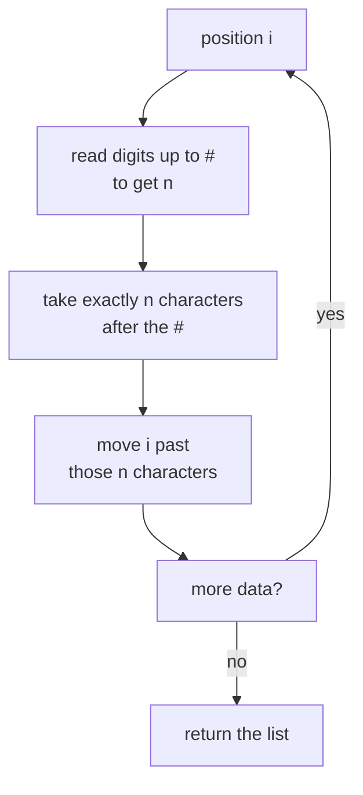

> [!tldr] Quick read
> - The problem: write `encode(list) → string` and `decode(string) → list` so that `decode(encode(x))` always gives back exactly `x`, for strings containing **any** character.
> - Joining with a delimiter breaks as soon as a string contains that delimiter, and cannot tell `[]` from `[""]`: 6/9 cases ([[en/concepts/delimiter-collision|Delimiter Collision]]).
> - [[en/concepts/escaping|Escaping]] fixes it: `,` becomes `/,`, `/` becomes `//`. Correct, but the decoder has to read every character.
> - [[en/concepts/length-prefix-encoding|Length prefix]]: each string becomes `<length>#<content>`. The decoder reads the number, then **jumps** over exactly that many characters without looking inside. This is how HTTP `Content-Length` works.
> - Language trap: the "length" of `"😀"` is 2 in JS/Java, 1 in Python and 4 in Go. Encoding and decoding must count in the same unit.

> [!info] Context
> LeetCode problem 271 (a paid problem on LeetCode, free on NeetCode), part of [[en/posts/2026-11-23-neetcode-prefix-suffix-encoding|station 3: Prefix, Suffix and Encoding]] on **the NeetCode line: Arrays and Strings**. The solutions come in TypeScript, Python, Go, Java and JavaScript. All you need to know is strings, loops and functions.

> [!abstract]- Quick glossary for this post (click to open)
> - **Encode / decode**: turn data into another form to send it, then turn it back. Here: list of strings ↔ one string.
> - **Delimiter**: a character marking where one part ends, like the comma in CSV.
> - **Escaping**: putting a special character before another to say "this is an ordinary character, don't read it as special", like `\"` in a JSON string.
> - **Code point, UTF-16 unit, byte**: three ways to count a string's length. The emoji `😀` is 1 code point, 2 UTF-16 units, 4 UTF-8 bytes.

## Picture it first: several letters in one envelope

You must send several letters in **one** envelope, and the recipient must separate them exactly. The letters can contain anything, including the very mark you planned to use as a separator.

| Everyday life | Concept |
|---|---|
| Put a blank sheet between two letters | a delimiter |
| One letter has a blank sheet inside it | a string containing the delimiter itself |
| Mark a blank sheet that belongs inside a letter with a "not a separator" stamp | escaping |
| Write on top of each letter "this letter is 3 pages long" | a length prefix |
| The recipient counts 3 pages before reading the next label | decoding jumps over the content |
| The sender counts sheets, the recipient counts sides of paper | counting length in different units |



## The problem

**The problem (in my own words):** design two functions. `encode` takes a list of strings and returns one string; `decode` takes that string and returns exactly the original list. The input strings may contain any ASCII character (the original says 256 characters). Built-in serializers such as `JSON.stringify` are not allowed. Original: [LeetCode 271](https://leetcode.com/problems/encode-and-decode-strings/).

| Input | Encoded with a length prefix |
|---|---|
| `["neet", "code"]` | `4#neet4#code` |
| `[]` | `` (empty string) |
| `[""]` | `0#` |
| `["12#ab", "#"]` | `5#12#ab1##` |

I used to think you just pick a "rare" character as the delimiter. It turns out the problem clearly says strings may contain **any** character, so no character is rare enough. You need a way for content never to be mistaken for structure.

## How it works

### Approach 1, joining with a comma: wrong in three kinds of case

`["a,b", "c"]` encodes to `a,b,c` and decodes into three strings. And `[]` and `[""]` both encode to the empty string, so the decoder cannot know which to return. Switching to a stranger character (`\x00`, `π`) only makes the bug rarer; it doesn't make it go away.

### Approach 2, escaping

Pick an escape character, here `/`. When encoding, each `/` in the content becomes `//`, each `,` becomes `/,`, and every string is followed by a **terminating** `,` (not a separator, so `[""]` becomes `,` while `[]` is the empty string). When decoding: after a `/`, the next character is a literal; a lone `,` means a string has just ended.

You must escape the escape character **too**. If you escape only commas, the string `a/` followed by its terminating `,` becomes `a/,`, and the decoder reads `/,` as a literal comma. JSON does exactly this: `"` becomes `\"`, and `\` becomes `\\`.

### Approach 3, length prefix

Each string becomes `<length>#<content>`. The decoder:
1. reads from i up to the first `#`: that is the length n (the length has only digits, so the first `#` always ends the length part);
2. takes exactly n characters after the `#` **without looking inside**, so content containing `#` or digits is fine;
3. moves i past those n characters.

It is the same idea as the station's prefixes: write the information **first**, so the next step doesn't have to search. HTTP/1.1 does this with `Content-Length`, and many binary protocols write the length as a fixed 4-byte number instead of digits and `#`.

| | joining with a comma | escaping | length prefix |
|---|---|---|---|
| Correct for every string | no | yes | yes |
| Decoding | `split` | read every character | jump over the content |
| Tells `[]` from `[""]` | no | yes | yes |
| Extra length | n − 1 characters | up to double if the content is full of special characters | digits of the length + 1, per string |

### Under the hood of the five languages: what "length" means

| | length of `"😀"` | Slicing counts |
|---|---|---|
| TypeScript / JavaScript | `length` = 2 (UTF-16 units) | UTF-16 units |
| Java | `length()` = 2 (UTF-16 units) | UTF-16 units |
| Python | `len` = 1 (code point) | code points |
| Go | `len` = 4 (UTF-8 bytes) | bytes |

Within **one** language, counting and slicing use the same unit, so the length prefix is always right. The bug appears when the two sides use two units: encoding in JS and decoding in Python, or, within JS, one side using `length` and the other `[...s]` (which counts code points). The TypeScript file reproduces exactly that case. Real protocols therefore always define the length in **bytes** after UTF-8 encoding.

## Runnable example

[TypeScript](../code/neetcode-encode-and-decode-strings/encode-decode.ts) · [Python](../code/neetcode-encode-and-decode-strings/encode_decode.py) · [Go](../code/neetcode-encode-and-decode-strings/encode_decode.go) · [Java](../code/neetcode-encode-and-decode-strings/encode-decode.java) · [JavaScript](../code/neetcode-encode-and-decode-strings/encode-decode.js)

Each file has all three approaches and runs 9 cases, including `[]`, `[""]`, and strings containing `,`, `#`, `/` and an emoji. Below is the length-prefix approach.

```ts
// Approach 3: length prefix. Each string becomes "<length>#<content>"; content with "#" or digits is fine.
function lengthEncode(strs: string[]): string {
  return strs.map((s) => `${s.length}#${s}`).join("");
}

function lengthDecode(s: string): string[] {
  const out: string[] = [];
  let i = 0;
  while (i < s.length) {
    const hash = s.indexOf("#", i); // the first "#" from i always belongs to the length part: the length has only digits
    const len = Number(s.slice(i, hash));
    out.push(s.slice(hash + 1, hash + 1 + len));
    i = hash + 1 + len; // jump over the content without reading inside it
  }
  return out;
}
```

```python
def length_encode(strs: list[str]) -> str:
    return "".join(f"{len(s)}#{s}" for s in strs)  # len of a Python str counts code points

def length_decode(s: str) -> list[str]:
    out, i = [], 0
    while i < len(s):
        h = s.index("#", i)  # the first "#" from i belongs to the length part
        n = int(s[i:h])
        out.append(s[h + 1 : h + 1 + n])
        i = h + 1 + n
    return out
```

```go
func lengthEncode(strs []string) string {
	var b strings.Builder
	for _, s := range strs {
		b.WriteString(strconv.Itoa(len(s))) // len of a Go string counts BYTES
		b.WriteByte('#')
		b.WriteString(s)
	}
	return b.String()
}

func lengthDecode(s string) []string {
	out := []string{}
	for i := 0; i < len(s); {
		h := i + strings.IndexByte(s[i:], '#')
		n, _ := strconv.Atoi(s[i:h])
		out = append(out, s[h+1:h+1+n]) // slice by bytes, matching len at encode time
		i = h + 1 + n
	}
	return out
}
```

```java
static String lengthEncode(List<String> strs) {
    StringBuilder b = new StringBuilder();
    for (String s : strs) b.append(s.length()).append('#').append(s); // length() counts UTF-16 units, like JS
    return b.toString();
}

static List<String> lengthDecode(String s) {
    List<String> out = new ArrayList<>();
    int i = 0;
    while (i < s.length()) {
        int h = s.indexOf('#', i);
        int n = Integer.parseInt(s.substring(i, h));
        out.add(s.substring(h + 1, h + 1 + n));
        i = h + 1 + n;
    }
    return out;
}
```

```js
function lengthEncode(strs) {
  return strs.map((s) => `${s.length}#${s}`).join(""); // length counts UTF-16 units
}

function lengthDecode(s) {
  const out = [];
  let i = 0;
  while (i < s.length) {
    const h = s.indexOf("#", i);
    const n = Number(s.slice(i, h));
    out.push(s.slice(h + 1, h + 1 + n)); // slice counts UTF-16 too: matches encode time
    i = h + 1 + n;
  }
  return out;
}
```


```text
$ node encode-decode.ts
join(",")           6/9 cases passed; wrong on [""] ["a,b","c"] ["a/","/,"]
escaping            9/9 cases passed
length prefix       9/9 cases passed
mismatched units    8/9 cases passed; wrong on ["😀é","x"]

example: ["12#ab","#"] → "5#12#ab1##"
"😀".length = 2, [..."😀"].length = 1
```

*(Output labels translated; the files themselves print Vietnamese.)*

The fourth line encodes with `s.length` (2 for the emoji) but decodes by counting code points (1 for the emoji), so it takes one character too many and everything after is shifted. The other files print the emoji's length the way their language counts it: Python `len("😀") = 1, len("😀".encode()) = 4`; Go `len("😀") = 4, utf8.RuneCountInString("😀") = 1`; Java `"😀".length() = 2, codePointCount = 1`. All five languages give `9/9 ca đúng` ("9/9 cases passed") for escaping and the length prefix.

## Misconceptions and common traps

- **"Picking a rare character as the delimiter is enough."** The problem allows any character. A rare character only makes the bug harder to reproduce.
- **Forgetting `[]` versus `[""]`.** Joining with a delimiter gives the same empty string for both. A length prefix gives `` and `0#`.
- **Escaping the delimiter but not the escape character.** `["a/", "/,"]` breaks that version.
- **Finding the `#` with `lastIndexOf` or `split("#")`.** The content may contain `#`. Only the **first** `#` from the current position is guaranteed to belong to the length.
- **Java: `split(",")` drops trailing empty strings.** `"a,,".split(",")` gives `[a]`. You must pass `split(",", -1)`.
- **The two sides count length in different units.** Correct within each language, wrong when two languages talk to each other. Define the length in UTF-8 bytes if the data crosses the network.

## Self-check questions

> [!question]- Encode `["", "#", "3#"]` with a length prefix.
> `0#` + `1##` + `2#3#` = `0#1##2#3#`.

> [!question]- Why is the length-prefix decoder never confused when the content contains `#` or digits?
> It only looks for `#` in the length part, then takes exactly n characters after it without reading them. The next position is always the start of a new length.

> [!question]- With escaping, why does every string **end** with `,` instead of strings being **separated** by `,`?
> To tell `[]` (no `,` at all) from `[""]` (one `,`). With separators, n strings have n − 1 commas, and both cases have 0.

> [!question]- A Go server receives a length-prefixed string from a browser (JS). The original list is `["😀"]`. What happens?
> JS writes `2#😀` (2 UTF-16 units). Go reads length 2 and slices 2 bytes, while `😀` takes 4 bytes: the result is broken UTF-8 and the rest is read shifted. Both sides must agree on the unit, usually UTF-8 bytes.

## References

- [LeetCode 271: Encode and Decode Strings](https://leetcode.com/problems/encode-and-decode-strings/) (the original problem; a free version on [NeetCode](https://neetcode.io/problems/string-encode-and-decode))
- [RFC 9110, §8.6 Content-Length](https://www.rfc-editor.org/rfc/rfc9110#section-8.6) (the length comes before the content, in bytes)
- [MDN: `String.length`](https://developer.mozilla.org/en-US/docs/Web/JavaScript/Reference/Global_Objects/String/length) (counts UTF-16 units)
- [The Go Blog: Strings, bytes, runes and characters in Go](https://go.dev/blog/strings) (`len` counts bytes)
- [Java 21 `String.split(String, int)`](https://docs.oracle.com/en/java/javase/21/docs/api/java.base/java/lang/String.html#split(java.lang.String,int)) (limit 0 drops trailing empty strings)
