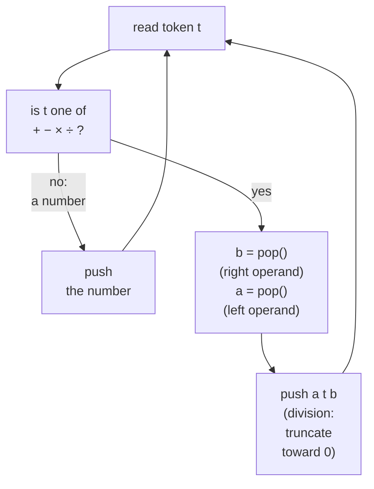

> [!tldr] Quick read
> - The problem: evaluate an integer expression written in [[en/concepts/reverse-polish-notation|reverse Polish notation]] (RPN): the operator comes **after** its two operands, so `["2", "1", "+", "3", "*"]` is `(2 + 1) × 3 = 9`. Division truncates **toward 0**.
> - A stack: on a number, push it; on an operator, pop the two numbers on top, compute, push the result back. O(n), no parentheses or precedence needed.
> - The number popped **first** is the **right** operand. Swap them and `-` and `/` go wrong: that version passes only 2/7 cases.
> - Python's `//` rounds **down** (`-7 // 2 = -4`), and so does JS `Math.floor`; the problem wants truncation toward 0 (`-3`). Java and Go integer division already truncates toward 0.
> - Spotting operators by their first character turns `"-11"` into a subtraction. Recursion from the end is also correct, but an expression 10⁵ levels deep overflows the call stack in JS, Java and Python; not in Go.

> [!info] Context
> LeetCode problem 150, part of [[en/posts/2026-11-23-neetcode-stack|station 6: Stack]] on **the NeetCode line: Arrays and Strings**. The solutions come in TypeScript, Python, Go, Java and JavaScript. You need to know a [[en/concepts/stack|stack]] and the four arithmetic operations.

> [!abstract]- Quick glossary for this post (click to open)
> - **Reverse Polish notation (RPN, postfix)**: writing the operator after its operands. `3 4 -` means `3 − 4`. No parentheses needed. See [[en/concepts/reverse-polish-notation|Reverse Polish Notation]].
> - **Token**: one element of the input array, either a number (possibly negative, such as `"-11"`) or one of `+ - * /`.
> - **Truncate toward 0**: drop the fractional part. `-3.5` becomes `-3`. **Floor (round down)**: toward negative infinity, `-3.5` becomes `-4`.
> - **Call stack**: the memory holding the function calls still waiting to finish. Recursion that goes too deep fills it: `RangeError`, `StackOverflowError`, `RecursionError`.

## Picture it first: an old pocket calculator

Some old pocket calculators have no parenthesis keys. You type a number and press Enter to put it on a pile; press an operation key and the calculator takes the two top numbers, computes, and puts the result back on the pile. To compute `(2 + 1) × 3`, you type `2 Enter 1 + 3 ×`.

| Everyday life | Concept |
|---|---|
| Type a number and press Enter | a number token: push it onto the stack |
| The pile of numbers waiting | the operand stack |
| Press `−`: the calculator takes the two top numbers | an operator token: pop twice |
| The top number is the one typed **later** | the number popped first is the right operand: `a − b` with b on top |
| Put the result back on the pile | push the result |
| No more keys to press, exactly one number left on the pile | the answer |



Out of tokens: the only element left is the result.

## The problem

**The problem (in my own words):** given an array `tokens` (1 ≤ length ≤ 10⁴) forming a valid RPN expression, where each token is `+`, `-`, `*`, `/` or an integer in −200..200, return the value of the expression. Division between two integers truncates toward 0, there is no division by 0, and every intermediate result fits in a 32-bit integer. Original: [LeetCode 150](https://leetcode.com/problems/evaluate-reverse-polish-notation/).

| Input | Output | Why |
|---|---|---|
| `["2","1","+","3","*"]` | `9` | `(2 + 1) × 3` |
| `["4","13","5","/","+"]` | `6` | `4 + 13 / 5 = 4 + 2` |
| `["10","6","9","3","+","-11","*","/","*","17","+","5","+"]` | `22` | `10 × (6 / (12 × −11)) + 17 + 5`, with `6 / −132 = 0` |
| `["7","-2","/"]` | `-3` | `−3.5` truncated toward 0 |

I used to think the hard part was parsing the expression. It turns out RPN is designed so you don't have to parse: the order of the tokens is already the order of evaluation. The real bugs hide in three small details: operand order, rounding, and negative numbers.

## How it works

<figure class="figure-map" style="--ar: 3 / 4">
<div class="frame"><iframe data-archify="../../diagrams/neetcode-evaluate-reverse-polish-notation/worked-example.en.html" title="Pop the right operand first" loading="lazy"></iframe></div>
<figcaption><span><b>Figure 1.</b> Pop the right operand first.</span><a href="../diagrams/neetcode-evaluate-reverse-polish-notation/worked-example.en.html" target="_blank" rel="noopener">Open full screen</a></figcaption>
</figure>

<details>
<summary>Read the steps</summary>
<ol>
<li>Push 9 and then 4. <code>[9, 4]</code></li>
<li>For subtraction, pop 4 first. <code>right = 4, left = 9</code></li>
<li>Push the result of 9 minus 4. <code>[5]</code></li>
<li>Push 3 and multiply it by 5. <code>[5, 3] → [15]</code></li>
</ol>
</details>

### Approach 1, a stack

Walk the tokens left to right. Push numbers. On an operator, `b = pop()`, `a = pop()`, push `a op b`. At the end exactly one number remains. Each token enters and leaves the stack at most once: O(n) time, O(n) memory in the worst case (`1 2 3 … + + +`).

Why it works: in RPN, when you meet an operator, the two **subexpressions** right before it have already been evaluated and sit on top of the stack, the left one under the right one. It is also how many virtual machines execute code: the JVM and CPython are both stack machines, pushing operands and then running an add instruction on the two top elements.

### Approach 2, recursion from the end

The last token is the **root** operator of the expression tree. Read backwards: take the last token; if it is a number, return it; if it is an operator, recurse to get the right operand (right before it), then the left one. Also O(n), but the recursion depth equals the height of the tree. The expression `1 1 + 1 + 1 + …` is a tree leaning entirely to one side, n levels tall.

### Three easy mistakes

| Mistake | Example | Consequence |
|---|---|---|
| Swapped operands: the top as the left operand | `3 4 -` gives `1` instead of `-1` | every `-` and `/` is wrong; passes only 2/7 cases |
| Division rounding down | `7 -2 /` gives `-4` instead of `-3` | wrong when the quotient is negative and inexact |
| Spotting operators by the first character | `"-11"` taken as a subtraction | pops the wrong two numbers, giving `NaN` or an error |

The second one spreads: in the long example, `6 / −132` rounded down gives −1 instead of 0, and the final result becomes 12 instead of 22.

### Measured: an explicit stack versus recursion

The expression `1 1 + 1 + …` with n operators, TypeScript, median of 5 runs:

| operators | stack | recursion |
|---|---|---|
| 1 000 | 0.29 ms | 0.09 ms |
| 5 000 | 0.22 ms | 0.18 ms |
| 100 000 | 1.32 ms | `RangeError` |
| 1 000 000 | 13.92 ms | `RangeError` |

At small depths recursion is even faster because it allocates no array. But V8's call stack is limited, and 10⁵ levels go past it. The problem caps the input at 10⁴ tokens, so recursion still passes LeetCode; on real data without that cap, only the explicit stack is safe. The other languages:

| | Deep recursion |
|---|---|
| Python | `RecursionError` already at 5 000 levels (default limit 1 000) |
| Java | `StackOverflowError` at 10⁵ levels (the thread's default stack) |
| Go | runs 10⁶ levels: a goroutine's stack grows as needed |

The maximum depth, measured with a binary search on n over the expression `1 1 + 1 + …` (n operators, n levels deep) ([JS](../code/neetcode-evaluate-reverse-polish-notation/recursion-depth.js) · [Java](../code/neetcode-evaluate-reverse-polish-notation/recursion-depth.java) · [Python](../code/neetcode-evaluate-reverse-polish-notation/recursion_depth.py)): Node 24 handles **9 765** levels on all three runs; Java 21 handles about **8 600–9 400** levels on the first measurement (it varies between runs: 8 593 and 9 375) and **29 473** on the next two, because once the code is JIT-compiled each call frame is smaller; Python 3.12 stops at **996** levels (the limit of 1 000 minus a few frames of the program itself). With 10⁴ tokens an expression can be about 5 000 levels deep: JS and Java pass, but Python does **not**, so "recursion still passes LeetCode" above holds only for JS and Java. Python needs the explicit stack or a raised `sys.setrecursionlimit`.

### Under the hood of the seven languages

| | Integer division | Reading `"-11"` as a number |
|---|---|---|
| TypeScript / JavaScript | `a / b` is floating-point division: needs `Math.trunc`. `Math.floor` is wrong for negatives | `Number(t)`; spot operators with the set `{"+","-","*","/"}` |
| Python | `//` rounds **down**; use `int(a / b)` (exact enough for 32-bit numbers) | `int(t)` |
| Go | `/` on `int` truncates toward 0 | `strconv.Atoi(t)` |
| Java | `/` on `int` truncates toward 0; `Math.floorDiv` rounds down | `Integer.parseInt(t)`; compare strings with `equals`, not `==` |
| PHP | `/` returns a **float** when the division is not exact (`-7 / 2` is `-3.5`); `intdiv` truncates toward 0 | `(int) $t`; spot operators with `isset(OPS[$t])` |
| Rust | `/` on `i32` truncates toward 0; `div_euclid` differs when the dividend is negative | `t.parse::<i32>()`; a `match` on `&str` compares the whole token |

## Runnable example

[TypeScript](../code/neetcode-evaluate-reverse-polish-notation/eval-rpn.ts) · [Python](../code/neetcode-evaluate-reverse-polish-notation/eval_rpn.py) · [Go](../code/neetcode-evaluate-reverse-polish-notation/eval_rpn.go) · [Java](../code/neetcode-evaluate-reverse-polish-notation/eval-rpn.java) · [JavaScript](../code/neetcode-evaluate-reverse-polish-notation/eval-rpn.js) · [PHP](../code/neetcode-evaluate-reverse-polish-notation/eval-rpn.php) · [Rust](../code/neetcode-evaluate-reverse-polish-notation/eval_rpn.rs)

Each file has the stack and the recursion and runs 7 cases, including `-` and `/` with negative numbers. Below is the stack approach.

```ts
function apply(op: string, a: number, b: number): number {
  switch (op) {
    case "+": return a + b;
    case "-": return a - b;
    case "*": return a * b;
    default: return Math.trunc(a / b); // the problem: division truncates toward 0. Math.floor(-7 / 2) = -4, Math.trunc = -3
  }
}

// Approach 1: a stack. Push numbers; on an operator take the two numbers on top, the one popped SECOND is the left operand.
function evalStack(tokens: string[]): number {
  const st: number[] = [];
  for (const t of tokens) {
    if (OPS.has(t)) { // compare the whole token with the operator set: "-11" is not in it
      const b = st.pop()!, a = st.pop()!;
      st.push(apply(t, a, b));
    } else st.push(Number(t));
  }
  return st[0];
}
```

```python
def apply(op: str, a: int, b: int) -> int:
    if op == "+":
        return a + b
    if op == "-":
        return a - b
    if op == "*":
        return a * b
    return int(a / b)  # truncates toward 0; a // b rounds DOWN (toward −∞)

def eval_stack(tokens: list[str]) -> int:
    st: list[int] = []
    for t in tokens:
        if t in OPS:  # compare the whole token: "-11" is not in the operator set
            b, a = st.pop(), st.pop()
            st.append(apply(t, a, b))
        else:
            st.append(int(t))
    return st[0]
```

```go
func apply(op string, a, b int) int {
	switch op {
	case "+":
		return a + b
	case "-":
		return a - b
	case "*":
		return a * b
	}
	return a / b // Go integer division truncates toward 0, exactly as the problem wants
}

func evalStack(tokens []string) int {
	st := []int{}
	for _, t := range tokens {
		if isOp(t) {
			a, b := st[len(st)-2], st[len(st)-1]
			st = st[:len(st)-2]
			st = append(st, apply(t, a, b))
		} else {
			n, _ := strconv.Atoi(t) // Atoi also parses "-11"
			st = append(st, n)
		}
	}
	return st[0]
}
```

```java
static int apply(String op, int a, int b) {
    return switch (op) {
        case "+" -> a + b;
        case "-" -> a - b;
        case "*" -> a * b;
        default -> a / b; // Java int division truncates toward 0; Math.floorDiv rounds down
    };
}

static int evalStack(String[] tokens) {
    ArrayDeque<Integer> st = new ArrayDeque<>();
    for (String t : tokens) {
        if (isOp(t)) {
            int b = st.pop(), a = st.pop();
            st.push(apply(t, a, b));
        } else st.push(Integer.parseInt(t));
    }
    return st.pop();
}
```

```js
function apply(op, a, b) {
  if (op === "+") return a + b;
  if (op === "-") return a - b;
  if (op === "*") return a * b;
  return Math.trunc(a / b); // a / b is floating-point division; | 0 also truncates toward 0 but clips to 32 bits
}

function evalStack(tokens) {
  const st = [];
  for (const t of tokens) {
    if (OPS.has(t)) {
      const b = st.pop(), a = st.pop();
      st.push(apply(t, a, b));
    } else st.push(Number(t));
  }
  return st[0];
}
```

```php
function apply(string $op, int $a, int $b): int {
    return match ($op) {
        '+' => $a + $b,
        '-' => $a - $b,
        '*' => $a * $b,
        default => intdiv($a, $b), // intdiv truncates toward 0; $a / $b returns a float when the division is not exact
    };
}

// Approach 1: a stack. The number popped SECOND is the left operand.
function evalStack(array $tokens): int {
    $st = [];
    foreach ($tokens as $t) {
        if (isset(OPS[$t])) { // compare the whole token: "-11" is not a key of OPS
            $b = array_pop($st);
            $a = array_pop($st);
            $st[] = apply($t, $a, $b);
        } else {
            $st[] = (int) $t;
        }
    }
    return $st[0];
}
```

```rust
fn apply(op: &str, a: i32, b: i32) -> i32 {
    match op {
        "+" => a + b,
        "-" => a - b,
        "*" => a * b,
        _ => a / b, // Rust's i32 division truncates toward 0; div_euclid differs for negatives
    }
}

// Approach 1: a stack. The number popped SECOND is the left operand.
fn eval_stack(tokens: &[&str]) -> i32 {
    let mut st: Vec<i32> = Vec::new();
    for &t in tokens {
        if is_op(t) {
            let b = st.pop().unwrap();
            let a = st.pop().unwrap();
            st.push(apply(t, a, b));
        } else {
            st.push(t.parse().unwrap()); // parse::<i32>() also reads "-11"
        }
    }
    st[0]
}
```

The TypeScript file also runs three wrong versions, then measures:

```text
$ node eval-rpn.ts
evalStack      7/7 cases passed
evalRecursive  7/7 cases passed
evalSwapped    2/7 cases passed; wrong on [4 13 5 / +] → 4, [10 6 9 3 + -11 * / * 17 + 5 +] → -198, [3 4 -] → 1, [7 -2 /] → 0, [-7 2 /] → 0
evalFloor      4/7 cases passed; wrong on [10 6 9 3 + -11 * / * 17 + 5 +] → 12, [7 -2 /] → -4, [-7 2 /] → -4
evalFirstChar  4/7 cases passed; wrong on [10 6 9 3 + -11 * / * 17 + 5 +] → NaN, [7 -2 /] → NaN, [-7 2 /] → NaN

operators    stack       recursion (ms, median of 5 runs)
1000             0.29        0.09
5000             0.22        0.18
100000           1.32  RangeError
1000000         13.92  RangeError
```

*(Output labels translated; the files themselves print Vietnamese.)*

The other files show division and deep recursion in each language:

```text
$ python3 eval_rpn.py
eval_stack     7/7 cases passed
eval_recursive 7/7 cases passed
eval_floor_div 4/7 cases passed; wrong on [10 6 9 3 + -11 * / * 17 + 5 +] → 12, [7 -2 /] → -4, [-7 2 /] → -4

-7 // 2 = -4, int(-7 / 2) = -3
recursion 5000 levels: RecursionError (default limit 1000)
stack 5000 levels: 5001

$ java eval-rpn.java
evalStack      7/7 cases passed
evalRecursive  7/7 cases passed
evalFloorDiv   4/7 cases passed

recursion 10⁵ levels: StackOverflowError
stack 10⁵ levels: 100001

$ go run eval_rpn.go
evalStack      7/7 cases passed
evalRecursive  7/7 cases passed

recursion 10⁶ levels: 1000001

$ php -d xdebug.mode=off eval-rpn.php
evalStack      7/7 cases passed
evalRecursive  7/7 cases passed
evalFloorDiv   4/7 cases passed; wrong on [10 6 9 3 + -11 * / * 17 + 5 +] → 12, [7 -2 /] → -4, [-7 2 /] → -4
evalSlash      3/7 cases passed; wrong on [4 13 5 / +] → TypeError, [10 6 9 3 + -11 * / * 17 + 5 +] → TypeError, [7 -2 /] → TypeError, [-7 2 /] → TypeError

-7 / 2 = -3.5, intdiv(-7, 2) = -3, (int) floor(-7 / 2) = -4
recursion 10⁵ levels: 100001
stack 10⁵ levels: 100001

$ rustc --edition 2021 -O eval_rpn.rs -o eval_rpn && ./eval_rpn
eval_stack     7/7 cases passed
eval_recursive 7/7 cases passed
eval_euclid    6/7 cases passed; wrong on [-7 2 /] → -4

-7 / 2 = -3, (-7i32).div_euclid(2) = -4, 7 / -2 = -3, 7i32.div_euclid(-2) = -3
recursion 10⁵ levels: 100001
stack 10⁵ levels: 100001
```

JavaScript prints `7/7 ca đúng` ("7/7 cases passed") for both approaches. PHP runs with `-d xdebug.mode=off` because Xdebug, when loaded, stops recursion at 512 levels.

## Misconceptions and common traps

- **Swapping the operands.** The first `pop()` returns the **right** operand. `+` and `*` are commutative, which hides the bug; only `-` and `/` expose it.
- **Python: using `//` for the problem's division.** `//` rounds down, the problem wants truncation toward 0. `int(a / b)` is right for 32-bit numbers; for very large numbers, floating-point division loses precision.
- **JS: forgetting to round.** `13 / 5` gives `2.6`, and the error spreads into later operations. `Math.trunc`, not `Math.floor`.
- **Spotting operators by the first character, or by "not a digit".** `"-11"` starts with `-`. Compare the whole token with the set of four operators.
- **Java: comparing strings with `==`.** `t == "+"` compares references; a token read from the array need not be the same object as the constant `"+"`. Use `equals` or a `switch` on the string.
- **PHP: using `/` for the division.** `13 / 5` gives `2.6` (a float), not `2`. Under `declare(strict_types=1)`, passing that float to a function that takes `int` throws `TypeError`. Use `intdiv($a, $b)`. Recursion 10⁵ levels deep still runs because PHP 8.2 allocates call frames on the heap, but if the machine loads Xdebug, it stops at 512 levels (`xdebug.max_nesting_level`).
- **Rust: assuming `div_euclid` is "proper" integer division.** `/` on `i32` already truncates toward 0, as the problem asks. `div_euclid` keeps the remainder non-negative, so `(-7).div_euclid(2)` gives `-4` while `7.div_euclid(-2)` still gives `-3`: the bug only shows when the dividend is negative. Also, `i32::MIN / -1` panics on overflow (the problem guarantees it never happens).
- **Recursion with unbounded depth.** It passes the problem's limit (≤ 10⁴ tokens) and breaks on deeper data. An explicit stack has no such limit.

## Self-check questions

> [!question]- Write the stack after each token of `["5","1","2","+","4","*","+","3","-"]`, and give the result.
> `5` → `5 1` → `5 1 2` → `+`: `5 3` → `5 3 4` → `*`: `5 12` → `+`: `17` → `17 3` → `-`: `14`. The result is 14.

> [!question]- Why does the swapped-operand version still pass `["2","1","+","3","*"]`?
> The expression has only `+` and `*`, both commutative: `a + b = b + a`. Swapping only shows up with `-` and `/`.

> [!question]- What does `-7 / 2` give in the seven languages, for each way of writing it?
> Java, Go (`int`), Rust (`i32`): −3. Python `-7 // 2`: −4, `int(-7 / 2)`: −3. JS `-7 / 2`: −3.5; `Math.trunc`: −3; `Math.floor`: −4. PHP `-7 / 2`: −3.5 (a float); `intdiv(-7, 2)`: −3. Rust `(-7).div_euclid(2)`: −4.

> [!question]- Write `(1 + 2) × (3 − 4)` in RPN.
> `1 2 + 3 4 - *`. Both subexpressions are written in full first, and the operator joining them comes last.

## References

- [LeetCode 150: Evaluate Reverse Polish Notation](https://leetcode.com/problems/evaluate-reverse-polish-notation/) (the original problem)
- [Python reference: Binary arithmetic operations](https://docs.python.org/3/reference/expressions.html#binary-arithmetic-operations) (`//` is floor division, rounding toward −∞)
- [JLS SE 21, §15.17.2 Division Operator /](https://docs.oracle.com/javase/specs/jls/se21/html/jls-15.html#jls-15.17.2) (integer division rounds toward 0)
- [Go spec: Integer operators](https://go.dev/ref/spec#Integer_operators) (the quotient is truncated toward 0)
- [Go FAQ: Why goroutines instead of threads?](https://go.dev/doc/faq#goroutines) (a goroutine's stack starts small and grows as needed)
- [MDN: `Math.trunc`](https://developer.mozilla.org/en-US/docs/Web/JavaScript/Reference/Global_Objects/Math/trunc)
- [JVM Specification SE 21, §2.6.2 Operand Stacks](https://docs.oracle.com/javase/specs/jvms/se21/html/jvms-2.html#jvms-2.6.2) and [Python: the `dis` module](https://docs.python.org/3/library/dis.html) (the JVM and CPython evaluate expressions on an operand stack)
