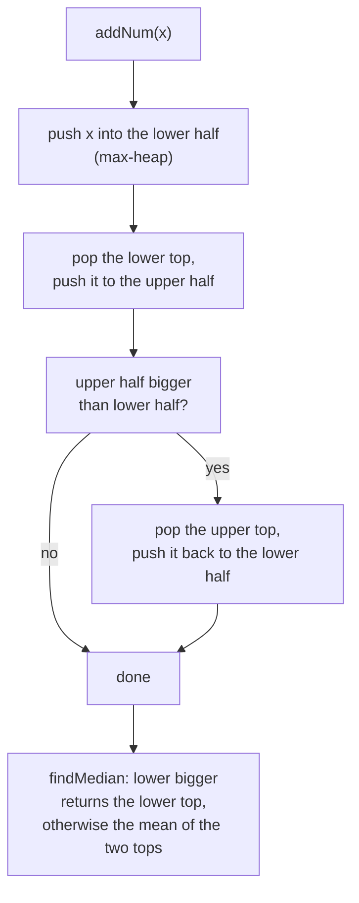

> [!tldr] Quick read
> - Problem: a stream of integers. `addNum(x)` adds a number, `findMedian()` returns the median of every number added so far (with an even count, the mean of the two middle numbers).
> - [[en/concepts/two-heaps|Two heaps]]: the lower half in a **max**-heap, the upper half in a **min**-heap. Keep two invariants: every lower number ≤ every upper number, and the lower half has as many elements as the upper half or one more. The median is the lower top, or the mean of the two tops. Insert O(log n), query O(1).
> - Inserting into a sorted array: finding the spot is O(log n), but shifting the rest is O(n). Measured in TypeScript with 2·10⁵ numbers: 1,367.6 ms against 50.8 ms for two heaps; a descending sequence (every insert goes to the front) takes 3,307.8 ms.
> - Wrong versions actually run: alternating between heaps without crossing (3/8 cases), never rebalancing (3/8), forgetting to negate in Python (3/8), integer division `(a + b) / 2` in Go and Java (3/8), and Java's `(a, b) -> b - a` comparator with numbers at the `int` bounds.
> - The problem's follow-up: if every number is in [0, 100], a 101-slot count array is enough, about 3 times faster than two heaps.

> [!info] Context
> LeetCode problem 295 (Hard), the anchor problem of [[en/posts/2026-11-24-neetcode-two-heaps|station 4: Two Heaps and Scheduling]] on **The NeetCode Line: Search and Heaps**. The previous station built the [[en/concepts/heap|heap]] and the [[en/concepts/size-k-heap|size-k heap]]; here two heaps work together to hold the **middle** of the data instead of its front. Unlike [[en/problems/median-of-two-sorted-arrays|Median of Two Sorted Arrays]] (two arrays you already have, asked once), the numbers arrive over time and the question repeats after each one. The solution comes in TypeScript, Python, Go, Java and JavaScript.

> [!abstract]- Quick glossary for this post (click to open)
> - **Median**: the middle number in ascending order. Odd n: the number at position n/2 (counting from 0, rounded down). Even n: the mean of the two middle numbers, which can be a fraction such as 3.5.
> - **Stream**: numbers arrive one at a time, and you don't know how many will come. See [[en/concepts/running-median|Running Median]].
> - **Heap, top**: a binary tree in an array with the highest-priority element in slot 0. Min-heap: smallest on top; max-heap: largest on top. See [[en/concepts/heap|Heap]].
> - **Invariant**: something that holds before and after every operation. See [[en/concepts/loop-invariant|Loop Invariant]].
> - **Integer division**: division that drops the fraction. `(2 + 3) / 2` in Go or Java (type `int`) is 2, not 2.5.

## Picture it first: splitting a class into two lines by height

A teacher wants the middle height of the class, and students come in one at a time. She doesn't re-line the whole class for every new student. She splits it into two lines: the **short line** and the **tall line**. In the short line the tallest student stands at the front; in the tall line the shortest student stands at the front. The two students at the front are the two in the middle of the class.

| Everyday | Concept |
|---|---|
| Short line, tallest student at the front | lower half, max-heap |
| Tall line, shortest student at the front | upper half, min-heap |
| Nobody in the short line is taller than anybody in the tall line | invariant 1: max(lower) ≤ min(upper) |
| The short line has as many students as the tall line, or one more | invariant 2: sizes differ by at most 1 |
| A new student joins the short line, then the tallest of the short line moves to the tall line | push into the lower half, move its top to the upper half |
| The tall line is now longer: its shortest student moves back | rebalance sizes |
| Odd class: the front of the short line; even class: the mean of the two fronts | `findMedian`, O(1) |
| Re-lining the whole class by height for every new student | inserting into a sorted array, O(n) |



## The problem

Keep every number in an array and re-sort after each insert: O(n log n) per insert, far too expensive. Better: keep the array **always sorted**, find the insert position by [[en/concepts/binary-search|binary search]] in O(log n), then insert. But inserting into the middle of an array shifts every later element by one slot, O(n) per insert, O(n²) overall. The problem allows up to 5·10⁴ calls, so this still passes LeetCode; for a longer stream it does not. Measured in TypeScript (`splice`), each insert followed by one `findMedian`:

| n | data | Sorted insert | Two heaps | Count array [0, 100] |
|---|---|---|---|---|
| 10⁴ | random ±10⁵ | 3.0 ms | 2.5 ms | 0.7 ms |
| 10⁵ | random ±10⁵ | 292.8 ms | 24.5 ms | 8.6 ms |
| 2·10⁵ | random ±10⁵ | 1,367.6 ms | 50.8 ms | 17.6 ms |
| 10⁶ | random ±10⁵ | (not run) | 281.7 ms | 87.7 ms |
| 2·10⁵ | descending | 3,307.8 ms | 53.7 ms | |

Median of 5 runs, Node 24. The count-array column uses the same numbers mapped into [0, 100]. Two things stand out. The sorted insert grows about 4.7 times when n doubles (an n² shape), while two heaps grow by about 2. And a descending sequence is the sorted insert's worst case: every number is the smallest so far, so it goes to the front and shifts the **whole** array, about 2.4 times the random case (which shifts half the array on average).

What to notice: the median only needs the two numbers in the **middle**, not the order of everything else. A heap knows the **front** of a set cheaply. So split the data into two sets so that "the middle of the sequence" becomes "the front" of each set.

## How it works

<figure class="figure-map" style="--ar: 3 / 4">
<div class="frame"><iframe data-archify="../../diagrams/neetcode-find-median-from-data-stream/worked-example.en.html" title="Balance both halves to read the median" loading="lazy"></iframe></div>
<figcaption><span><b>Figure 1.</b> Balance both halves to read the median.</span><a href="../diagrams/neetcode-find-median-from-data-stream/worked-example.en.html" target="_blank" rel="noopener">Open full screen</a></figcaption>
</figure>

<details>
<summary>Read the steps</summary>
<ol>
<li>Maintain lower and upper halves. <code>low = {1, 3}; high = {8}</code></li>
<li>The odd median is the top of the lower half. <code>median = 3</code></li>
<li>Insert 5 into the upper half. <code>low = {1, 3}; high = {5, 8}</code></li>
<li>Equal halves use the average of both tops. <code>(3 + 5) / 2 = 4</code></li>
</ol>
</details>

### Two heaps, two invariants

The lower half is a max-heap: its top is the largest number below the boundary. The upper half is a min-heap: its top is the smallest number above it. If we keep:

1. every lower number ≤ every upper number, and
2. the lower size equals the upper size or exceeds it by exactly 1,

then in the sorted sequence the lower half takes positions 0 … ⌈n/2⌉ − 1, and its top sits at position ⌈n/2⌉ − 1, right next to the upper top. Odd n: the median is the lower top. Even n: the mean of the two tops. Neither heap is sorted inside; only the two tops need to be in the right place.

Adding a number x takes three steps, each O(log n):

| Step | What | Keeps which invariant |
|---|---|---|
| 1 | push x into the lower half | (not yet) |
| 2 | pop the lower top, push it into the upper half | 1: the number moved is the largest of the lower half, so nothing left behind is larger |
| 3 | if the upper half is bigger, pop its top and push it into the lower half | 2; and still 1, because the number returned is the smallest of the upper half |

Step 2 looks redundant when x is obviously small, but it means the algorithm needs no "which half does x belong to" branch: if x is large, x itself moves up; if x is small, the old largest of the lower half moves up. Running 5, 2, 8, 1, 9:

| Add | Lower half (max-heap) | Upper half (min-heap) | Median |
|---|---|---|---|
| 5 | [5] | [] | 5 |
| 2 | [2] | [5] | (2 + 5) / 2 = 3.5 |
| 8 | [5, 2] | [8] | 5 |
| 1 | [2, 1] | [5, 8] | (2 + 5) / 2 = 3.5 |
| 9 | [5, 2, 1] | [8, 9] | 5 |

The interactive diagram in [[en/posts/2026-11-24-neetcode-two-heaps|the station post]] steps through this sequence.

### Two wrong versions, each keeping one invariant

**Alternating** (equal sizes go to the lower half, otherwise to the upper half, never crossing) keeps invariant 2 but breaks invariant 1: a large number can sit in the lower half. Sequence `1, 2, 3`: 1 goes to lower, 2 to upper, 3 to lower, so the lower top is 3 and the median comes out 3 instead of 2. Correct on 3/8 cases.

**No rebalancing** (compare x with the lower top to pick a half, then stop) keeps invariant 1 but breaks invariant 2: in a descending sequence every number goes to the lower half, and the median stays at the first number, `[5, 5, 5, 5, 5]` instead of `[5, 4.5, 4, 3.5, 3]`. Also 3/8 cases. Both versions pass the "one number", "duplicates" and "problem bounds" cases: test cases that are only duplicates or too short don't catch the bug.

### The problem's follow-up: numbers in [0, 100]

If every number is in [0, 100], no heap is needed: keep a 101-slot array `cnt`, insert is `cnt[x]++`, O(1). To find the k-th number, walk up from 0 adding `cnt` until the sum passes k, O(101). Measured above: 87.7 ms for 10⁶ numbers, about 3 times faster than two heaps. If 99% of the numbers are in [0, 100]: still use the count array for the in-range part, plus two counters (or two lists) for numbers below 0 and above 100. The median almost certainly falls in the in-range part, since each side outside it holds only about 1% of the numbers.

### Under the hood of the five languages

| | Max-heap | Mean of two numbers | Specific trap |
|---|---|---|---|
| TypeScript / JavaScript | write your own heap, push negatives | `/` always gives a float | `sort()` without a compare function compares strings: `[10, 6, 2].sort()` gives `[10, 2, 6]` |
| Python | `heapq` is min-heap only: negate | `/` gives a float, `//` rounds **down** | forget to negate and the "max-heap" is a min-heap; `(-2 + -3) // 2` is −3 |
| Go | `container/heap`, flip `Less` | `int / int` is integer division, truncating toward 0 | `(1 + 2) / 2` is 1; convert to `float64` **before** dividing |
| Java | `PriorityQueue` with `Collections.reverseOrder()` | `int / int` is integer division; `/ 2.0` gives a `double` | `(a, b) -> b - a` overflows `int`; `a + b` overflows when both are near `Integer.MAX_VALUE` |

The problem limits numbers to [−10⁵, 10⁵], so `a + b` does not overflow here. The Java version still adds in `long`, because comparators and sums tend to be copied verbatim into other problems. The Java file's "int bounds (outside the problem)" case shows both: the subtraction comparator puts `Integer.MIN_VALUE` on top of the max-heap and the median comes out −2,147,483,648 instead of 2,147,483,647, and `(a + b) / 2` with two `Integer.MAX_VALUE` gives −1.

## Runnable example

[TypeScript](../code/neetcode-find-median-from-data-stream/find-median-stream.ts) · [Python](../code/neetcode-find-median-from-data-stream/find_median_stream.py) · [Go](../code/neetcode-find-median-from-data-stream/find_median_stream.go) · [Java](../code/neetcode-find-median-from-data-stream/find-median-stream.java) · [JavaScript](../code/neetcode-find-median-from-data-stream/find-median-stream.js) · [PHP](../code/neetcode-find-median-from-data-stream/find-median-stream.php) · [Rust](../code/neetcode-find-median-from-data-stream/find_median_stream.rs)

Each of the original five files runs 8 cases (Java adds a 9th at the `int` bounds): the problem example's sequence `1, 2, 3`, one number, descending, ascending, four 7s, negatives, an interleaved sequence of 11 numbers, and four numbers at the problem bounds ±10⁵. After **every** insert, `findMedian` is compared against the median computed by re-sorting. The TypeScript version also cross-checks 2,000 random sequences (mulberry32) and measures three approaches.

```ts
// Number min-heap: parent at i, children at 2i + 1 and 2i + 2. For a max-heap, push negated numbers.
class NumHeap {
  a: number[] = [];
  get size(): number { return this.a.length; }
  peek(): number { return this.a[0]; }
  push(x: number): void {
    const a = this.a;
    a.push(x);
    let i = a.length - 1;
    while (i > 0) { // sift up
      const p = (i - 1) >> 1;
      if (a[p] <= a[i]) break;
      [a[p], a[i]] = [a[i], a[p]];
      i = p;
    }
  }
  pop(): number {
    const a = this.a, top = a[0], last = a.pop()!;
    if (a.length > 0) {
      a[0] = last;
      let i = 0; // sift down
      for (;;) {
        const l = 2 * i + 1, r = l + 1;
        let m = i;
        if (l < a.length && a[l] < a[m]) m = l;
        if (r < a.length && a[r] < a[m]) m = r;
        if (m === i) break;
        [a[m], a[i]] = [a[i], a[m]];
        i = m;
      }
    }
    return top;
  }
}

// Approach 2: two heaps. lower is a max-heap (stores negatives) holding the lower half, upper is a min-heap holding the upper half.
// Invariants: lower.size = upper.size or upper.size + 1, and max(lower) ≤ min(upper).
class TwoHeapsFinder implements Finder {
  lower = new NumHeap(); // negated
  upper = new NumHeap();
  addNum(x: number): void {
    this.lower.push(-x);                     // into the lower half first
    this.upper.push(-this.lower.pop());      // largest of the lower half moves up: keeps max(lower) ≤ min(upper)
    if (this.upper.size > this.lower.size) { // rebalance sizes: lower may have one extra
      this.lower.push(-this.upper.pop());
    }
  }
  findMedian(): number {
    if (this.lower.size > this.upper.size) return -this.lower.peek();
    return (-this.lower.peek() + this.upper.peek()) / 2;
  }
}
```

```python
class MedianFinder:
    # lower: a max-heap built with heapq on negatives; upper: a min-heap. len(lower) = len(upper) or one more.
    def __init__(self):
        self.lower = []
        self.upper = []

    def addNum(self, x):
        heapq.heappush(self.lower, -x)
        heapq.heappush(self.upper, -heapq.heappop(self.lower))  # largest of the lower half moves to the upper half
        if len(self.upper) > len(self.lower):
            heapq.heappush(self.lower, -heapq.heappop(self.upper))

    def findMedian(self):
        if len(self.lower) > len(self.upper):
            return -self.lower[0]
        return (-self.lower[0] + self.upper[0]) / 2
```

```go
// minHeap implements heap.Interface; maxHeap only changes Less.
type minHeap []int

func (h minHeap) Len() int           { return len(h) }
func (h minHeap) Less(i, j int) bool { return h[i] < h[j] }
func (h minHeap) Swap(i, j int)      { h[i], h[j] = h[j], h[i] }
func (h *minHeap) Push(x any)        { *h = append(*h, x.(int)) }
func (h *minHeap) Pop() any          { old := *h; x := old[len(old)-1]; *h = old[:len(old)-1]; return x }

type maxHeap struct{ minHeap }

func (h maxHeap) Less(i, j int) bool { return h.minHeap[i] > h.minHeap[j] }

// MedianFinder: lower is a max-heap (lower half), upper is a min-heap (upper half); lower may have one extra.
type MedianFinder struct {
	lower *maxHeap
	upper *minHeap
}

func NewMedianFinder() *MedianFinder { return &MedianFinder{&maxHeap{}, &minHeap{}} }

func (m *MedianFinder) AddNum(x int) {
	heap.Push(m.lower, x)
	heap.Push(m.upper, heap.Pop(m.lower)) // largest of the lower half moves to the upper half
	if m.upper.Len() > m.lower.Len() {
		heap.Push(m.lower, heap.Pop(m.upper))
	}
}

func (m *MedianFinder) FindMedian() float64 {
	if m.lower.Len() > m.upper.Len() {
		return float64(m.lower.minHeap[0])
	}
	return float64(m.lower.minHeap[0]+(*m.upper)[0]) / 2
}
```

```java
// lower: max-heap (lower half), upper: min-heap (upper half); lower may have one extra.
static class MedianFinder {
    PriorityQueue<Integer> lower = new PriorityQueue<>(Collections.reverseOrder());
    PriorityQueue<Integer> upper = new PriorityQueue<>();

    void addNum(int x) {
        lower.offer(x);
        upper.offer(lower.poll()); // largest of the lower half moves to the upper half
        if (upper.size() > lower.size()) lower.offer(upper.poll());
    }

    double findMedian() {
        if (lower.size() > upper.size()) return lower.peek();
        return ((long) lower.peek() + upper.peek()) / 2.0; // add in long: no overflow
    }
}
```

```js
// Number min-heap; for a max-heap, push negated numbers.
class NumHeap {
  constructor() { this.a = []; }
  get size() { return this.a.length; }
  peek() { return this.a[0]; }
  push(x) {
    const a = this.a;
    a.push(x);
    let i = a.length - 1;
    while (i > 0) { // sift up
      const p = (i - 1) >> 1;
      if (a[p] <= a[i]) break;
      [a[p], a[i]] = [a[i], a[p]];
      i = p;
    }
  }
  pop() {
    const a = this.a, top = a[0], last = a.pop();
    if (a.length > 0) {
      a[0] = last;
      let i = 0; // sift down
      for (;;) {
        const l = 2 * i + 1, r = l + 1;
        let m = i;
        if (l < a.length && a[l] < a[m]) m = l;
        if (r < a.length && a[r] < a[m]) m = r;
        if (m === i) break;
        [a[m], a[i]] = [a[i], a[m]];
        i = m;
      }
    }
    return top;
  }
}

// Two heaps: lower holds the lower half (negated), upper the upper half; lower may have one extra.
class MedianFinder {
  constructor() { this.lower = new NumHeap(); this.upper = new NumHeap(); }
  addNum(x) {
    this.lower.push(-x);
    this.upper.push(-this.lower.pop()); // largest of the lower half moves to the upper half
    if (this.upper.size > this.lower.size) this.lower.push(-this.upper.pop());
  }
  findMedian() {
    if (this.lower.size > this.upper.size) return -this.lower.peek();
    return (-this.lower.peek() + this.upper.peek()) / 2;
  }
}
```

```php
<?php
declare(strict_types=1);

final class MedianFinder
{
    private SplMaxHeap $lower;
    private SplMinHeap $upper;

    public function __construct()
    {
        $this->lower = new SplMaxHeap();
        $this->upper = new SplMinHeap();
    }

    public function addNum(int $num): void
    {
        $this->lower->insert($num);
        $this->upper->insert($this->lower->extract());
        if ($this->lower->count() < $this->upper->count()) {
            $this->lower->insert($this->upper->extract());
        }
    }

    public function findMedian(): float
    {
        if ($this->lower->count() > $this->upper->count()) {
            return (float) $this->lower->top();
        }
        return ($this->lower->top() + $this->upper->top()) / 2.0;
    }
}
```

```rust
use std::cmp::Reverse;
use std::collections::BinaryHeap;

#[derive(Default)]
struct MedianFinder {
    lower: BinaryHeap<i32>,
    upper: BinaryHeap<Reverse<i32>>,
}

impl MedianFinder {
    fn add_num(&mut self, num: i32) {
        self.lower.push(num);
        self.upper.push(Reverse(self.lower.pop().unwrap()));
        if self.lower.len() < self.upper.len() {
            self.lower.push(self.upper.pop().unwrap().0);
        }
    }

    fn find_median(&self) -> f64 {
        let lower = f64::from(*self.lower.peek().unwrap());
        if self.lower.len() > self.upper.len() {
            return lower;
        }
        let upper = f64::from(self.upper.peek().unwrap().0);
        (lower + upper) / 2.0
    }
}
```


Output of `node find-median-stream.ts`, including the sorted insert, two wrong versions, the count array, the random cross-check and the measurements:

```text
SortedInsert  8/8 cases correct
TwoHeaps      8/8 cases correct
Alternate     3/8 cases correct; wrong on: problem example → [1, 1.5, 3]; descending → [5, 4.5, 5, 3.5, 5]; ascending → [1, 1.5, 3, 2.5, 5, 3.5]; negatives → [-1, -1.5, -1, -2.5, -1]; interleaved → [6, 8, 6, 6, 6, 3, 6, 3, 6, 3, 6]
NoRebalance   3/8 cases correct; wrong on: problem example → [1, 1.5, 1.5]; descending → [5, 5, 5, 5, 5]; ascending → [1, 1.5, 1.5, 1.5, 1.5, 1.5]; negatives → [-1, -1, -1, -1, -1]; interleaved → [6, 8, 6, 6, 6, 6, 6, 6, 6, 6, 6]
Counting      6/6 cases correct (only cases with every number in [0, 100])
random cross-check: 2000 sequences (61110 findMedian calls), TwoHeaps mismatched on 0 sequences

n          data                 sorted insert   two heaps   count [0,100]   (ms, median of 5)
10000      random ±10⁵              3.0         2.5           0.7
100000     random ±10⁵            292.8        24.5           8.6
200000     random ±10⁵           1367.6        50.8          17.6
1000000    random ±10⁵                —       281.7          87.7
200000     descending           3307.8        53.7
```

Python (`bisect.insort` against two heaps, and the version that forgets to negate):

```text
MedianFinder    8/8 cases correct
InsortFinder    8/8 cases correct
NoNegateFinder  3/8 cases correct; wrong on: problem example → [1, 1.5, 1]; descending → [5, 4.5, 3, 2.5, 1]; ascending → [1, 1.5, 1, 2.0, 1, 2.5]; negatives → [-1, -1.5, -3, -3.5, -5]; interleaved → [6, 8.0, 2, 4.0, 2, 1.0, 0, 1.5, 0, 0.0, 0]
(2 + 3) / 2 = 2.5  (2 + 3) // 2 = 2  (-2 + -3) // 2 = -3

n          bisect.insort   two heaps   (ms, median of 3)
10000                5.6        4.7
100000             378.4       61.7
300000            5786.5      206.4
1000000                —      737.7
```

Go (integer division, and `int32` overflow):

```text
FindMedian       8/8 cases correct
findMedianIntDiv 3/8 cases correct; wrong on: problem example → [1 1 2]; descending → [5 4 4 3 3]; ascending → [1 1 2 2 3 3]; negatives → [-1 -1 -2 -2 -3]; interleaved → [6 8 6 6 6 5 6 5 5 4 3]
int32: (a + b) / 2 = -1  float64(a)+float64(b) / 2 = 2.147483647e+09
10⁶ AddNum + FindMedian calls: 331.5 ms (median of 3)
```

Java (subtraction comparator and integer division; the 9th case is outside the problem's limits):

```text
MedianFinder    9/9 cases correct
SubtractFinder  8/9 cases correct; wrong on: int bounds (outside the problem) → [2.147483647E9, -0.5, -2.147483648E9, -0.5]
IntDivFinder    3/9 cases correct; wrong on: problem example → [1.0, 1.0, 2.0]; descending → [5.0, 4.0, 4.0, 3.0, 3.0]; ascending → [1.0, 1.0, 2.0, 2.0, 3.0, 3.0]; negatives → [-1.0, -1.0, -2.0, -2.0, -3.0]; interleaved → [6.0, 8.0, 6.0, 6.0, 6.0, 5.0, 6.0, 5.0, 5.0, 4.0, 3.0]; int bounds (outside the problem) → [2.147483647E9, 0.0, 2.147483647E9, -1.0]
Integer.MAX_VALUE + Integer.MAX_VALUE = -2; (a, b) -> b - a with a = MIN_VALUE, b = 1: -2147483647
10⁶ addNum + findMedian calls: 280.2 ms (median of 3; boxed Integer)
```

JavaScript (`sort()` without a compare function):

```text
MedianFinder      8/8 cases correct
DefaultSortFinder 7/8 cases correct; wrong on: interleaved → [6, 8, 2, 4, 5, 3.5, 5, 4, 3, 2.5, 2]
```

*(Output labels translated; the files themselves print Vietnamese.)*

Python is slower than TypeScript in both approaches, but the shape is the same: `bisect.insort` finds the spot in C and shifts with `memmove`, still growing like n² (378.4 ms at 10⁵, 5,786.5 ms at 3·10⁵), while two heaps grow linearly (737.7 ms at 10⁶). Go and Java run 10⁶ inserts and queries in 331.5 ms and 280.2 ms.

Both files check the median after each insertion. Rust converts both heap roots to `f64` before adding to avoid `i32` overflow. PHP prints `8/8 ca đúng` and Rust prints `9/9 ca đúng`.

## Misconceptions and common traps

- **"You need a fully sorted structure."** The median needs only the two middle numbers. Two heaps sort nothing inside and still put exactly those two at their tops.
- **Balancing sizes without crossing heaps.** The sizes are right but a large number gets stuck in the lower half. The step "push into the lower half, then move its top to the upper half" is what keeps the order.
- **Which half gets the extra element.** Pick one and stay consistent. Here the lower half gets it, so with odd n the median is the lower top. Balance by one convention and read by the other, and every odd n reads the wrong top.
- **Integer division.** `(a + b) / 2` in Go and Java loses the .5; Python's `//` rounds down, so with negatives it is off in the other direction from Go.
- **Python: forgetting to negate in one place.** Push `-x` but read `lower[0]` without flipping it back, or move a number to the upper half without flipping its sign: negatives and positives get mixed up. Wrap the lower half in a few small helpers if it's easy to slip.
- **Calling `findMedian` before any number.** The problem promises at least one number. Without that promise both heaps are empty and reading a top is an error.

## Self-check questions

> [!question]- Add 4, 1, 7, 3 with the three-step algorithm. The two heaps and the median after each?
> 4: lower [4], upper []: 4. 1: 1 into lower [4, 1], top 4 to upper: lower [1], upper [4]: 2.5. 7: 7 into lower, then up: upper [4, 7] is bigger, 4 comes back: lower [4, 1], upper [7]: 4. 3: 3 into lower [4, 3, 1], top 4 to upper: lower [3, 1], upper [4, 7]: (3 + 4) / 2 = 3.5.

> [!question]- Why does "move the lower top to the upper half" keep invariant 1 however large or small x is?
> Let m be the old lower top. After pushing x, the number moved is max(m, x). Everything left in the lower half is no larger than it, since it was the top. And everything left in the lower half is ≤ m ≤ min(upper) by the old invariant (or is x itself when x ≤ m), so it is no larger than anything in the new upper half either. Invariant 1 holds whatever x is.

> [!question]- The stream gains a `removeNum(x)` operation (a sliding window, LC 480). How do two heaps handle it?
> A heap cannot remove an element from the middle in O(log n). The usual approach is **lazy deletion**: record x in a "to delete" table, adjust the size counter of the half that holds x, and actually discard x only when it reaches a top. Another approach is a balanced tree or a sorted structure with O(log n) removal.

> [!question]- With every number in [0, 100], the count array answers in O(101). How do you make it O(1)?
> Keep a pointer to the slot holding the median and the number of elements before it. On each insert, compare x with that slot and move the pointer at most one step based on the count on each side. This is the two-heap idea again, with the two heaps replaced by the two sides of a count array.

## References

- [LeetCode 295. Find Median from Data Stream](https://leetcode.com/problems/find-median-from-data-stream/) (number limits and the two follow-up questions)
- [Python `heapq`](https://docs.python.org/3/library/heapq.html) and [`bisect`](https://docs.python.org/3/library/bisect.html) (`insort`: O(log n) search, O(n) insert)
- [Go `container/heap`](https://pkg.go.dev/container/heap)
- [Java 21 `PriorityQueue`](https://docs.oracle.com/en/java/javase/21/docs/api/java.base/java/util/PriorityQueue.html) and [`Collections.reverseOrder`](https://docs.oracle.com/en/java/javase/21/docs/api/java.base/java/util/Collections.html#reverseOrder())
- [MDN `Array.prototype.splice`](https://developer.mozilla.org/en-US/docs/Web/JavaScript/Reference/Global_Objects/Array/splice)
- Cormen, Leiserson, Rivest, Stein, *Introduction to Algorithms*, chapter 6 "Heapsort" (priority queues with a heap)
