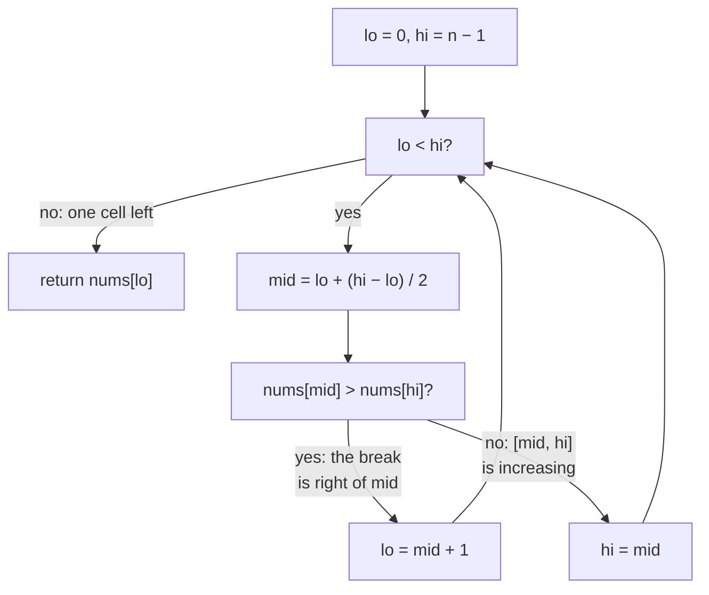

> [!tldr] Quick read
> - The problem: an increasing array of distinct numbers has been **rotated** somewhere (`[0,1,2,4,5,6,7]` becomes `[4,5,6,7,0,1,2]`). Find the minimum in O(log n).
> - A rotated array is two increasing runs back to back. The minimum is the **break**: the start of the second run.
> - [[en/concepts/binary-search|Binary search]] compares `nums[mid]` with `nums[hi]`: if larger, the break lies strictly right of mid (`lo = mid + 1`); otherwise mid is the break or lies right of it (`hi = mid`). The loop `while (lo < hi)` stops when one cell is left.
> - Traps: comparing with `nums[lo]` returns the **largest** element on an unrotated array; writing `lo <= hi` with `hi = mid` loops forever.
> - Measured: 10⁷ elements, scan 6 988 µs, binary search 0.026 µs. With duplicates (LeetCode 154) binary search is forced to drop one cell at a time: 10 015 steps at n = 10⁵.

> [!info] Context
> LeetCode problem 153, the third problem of [[en/posts/2026-11-23-neetcode-binary-search|station 1: Binary Search on Arrays]] on **the NeetCode Line: Search and Heaps**. In [[en/problems/binary-search|Binary Search]] the array is fully increasing; here it is only "increasing in pieces", so a different question decides which half to drop. The next problem, [[en/problems/search-in-rotated-sorted-array|Search in Rotated Sorted Array]], uses this one's result. The solutions come in TypeScript, Python, Go, Java and JavaScript. All you need to know is loops and arrays.

> [!abstract]- Quick glossary for this post (click to open)
> - **Binary search**: each step looks at the middle cell, then drops the half that cannot hold the answer. See [[en/concepts/binary-search|Binary Search]].
> - **Rotated sorted array**: an increasing array cut at one point, with the front part moved to the back. See [[en/concepts/rotated-sorted-array|Rotated Sorted Array]].
> - **Loop invariant**: what holds at the start of every iteration. Here: "the minimum lies in `[lo, hi]`". See [[en/concepts/loop-invariant|Loop Invariant]].
> - **O(log n)**: each step halves the remaining cells; 10⁷ cells need about 24 steps. See [[en/concepts/big-o-notation|Big-O]].

## Picture it first: a street renumbered from the middle

A street has houses numbered in increasing order. This year the ward renumbers them, but starts from a house in the middle of the street: walking from the start, you see 40, 50, 60, 70, then suddenly 0, 10, 20. You need the house with the smallest number, and you may only ask at a few doors.

| Everyday life | Concept |
|---|---|
| Increasing houses, renumbered from a house mid-street | an increasing array that has been rotated |
| The spot where numbers drop from 70 to 0 | the break, where the minimum is |
| Standing at the middle house of the stretch in doubt, reading its number | `nums[mid]` |
| Compare with the **last** house of the stretch: the middle number is larger, so the drop is still ahead | `nums[mid] > nums[hi]` gives `lo = mid + 1` |
| The middle number is smaller than the last: from here to the end it rises evenly, so the smallest is this house or behind you | `hi = mid` |
| Only one house left in doubt | `lo == hi`, return `nums[lo]` |



## The problem

**The problem (in my own words):** given an array `nums` of n **distinct** integers (1 ≤ n ≤ 5 000), originally increasing and then rotated between 1 and n times, return the minimum element with an O(log n) algorithm. Original: [LeetCode 153](https://leetcode.com/problems/find-minimum-in-rotated-sorted-array/).

| Input | Output |
|---|---|
| `[3, 4, 5, 1, 2]` | `1` |
| `[4, 5, 6, 7, 0, 1, 2]` | `0` |
| `[11, 13, 15, 17]` (rotated n times, looks unrotated) | `11` |
| `[2, 1]` | `1` |

I used to think binary search only works on a fully increasing array. It turns out binary search only needs a yes/no question whose answer **flips exactly once** along the array. Here the question is "is this cell less than or equal to the last cell?": every cell of the first run answers "no", every cell of the second run answers "yes", and the first "yes" is the answer.

## How it works

<figure class="figure-map" style="--ar: 3 / 4">
<div class="frame"><iframe data-archify="../../diagrams/neetcode-find-minimum-in-rotated-sorted-array/worked-example.en.html" title="Compare the midpoint with the right end" loading="lazy"></iframe></div>
<figcaption><span><b>Figure 1.</b> Compare the midpoint with the right end.</span><a href="../diagrams/neetcode-find-minimum-in-rotated-sorted-array/worked-example.en.html" target="_blank" rel="noopener">Open full screen</a></figcaption>
</figure>

<details>
<summary>Read the steps</summary>
<ol>
<li>Start with the rotated array. <code>[8, 12, 1, 3, 5]</code></li>
<li>The midpoint is 1 and right end is 5. <code>mid = 2, hi = 4</code></li>
<li>Keep the midpoint in the left interval. <code>hi = 2</code></li>
<li>The new midpoint is 12, discard the left half. <code>lo = 2</code></li>
<li>Both bounds meet at the minimum. <code>nums[2] = 1</code></li>
</ol>
</details>

### Approach 1, scan: O(n)

Walk the whole array keeping the smallest. Correct, but the problem asks for O(log n). A scan also uses nothing of the "two increasing runs" structure.

### Approach 2, binary search against `nums[hi]`

Keep the [[en/concepts/loop-invariant|invariant]]: **the minimum is always inside `[lo, hi]`** (both ends included). Take `mid` in the middle:

| Observation | Conclusion | Step |
|---|---|---|
| `nums[mid] > nums[hi]` | there is a drop between mid and hi, so mid belongs to the first run; the min lies strictly right of mid | `lo = mid + 1` |
| `nums[mid] < nums[hi]` | `[mid, hi]` is increasing, so nothing right of mid is smaller than mid; the min is mid or to its left | `hi = mid` |

There is no equal case: the numbers are distinct, and `mid < hi` whenever `lo < hi` (mid rounds down). Each step shrinks `[lo, hi]` by at least one cell, so the loop ends. When `lo == hi`, the invariant says the min is in that single cell.

Why `while (lo < hi)` and not `lo <= hi`? Because the second branch **keeps** mid (`hi = mid`, not `mid − 1`). With `lo <= hi`, once `lo == hi` we get `mid == hi`, the second branch sets `hi = mid` again, and nothing changes any more: an infinite loop. Rule of thumb: if a branch keeps mid, the loop must stop with one cell left.

### Approach 3, compare with `nums[0]`

The question "is this cell smaller than `nums[0]`?" also flips exactly once, from "no" to "yes", at the break. But if the array is not rotated, no cell answers "yes", so the case `nums[0] <= nums[n − 1]` must be checked first. Approach 2 needs no special case, because the last cell always answers "yes" to its question.

### Why comparing with `nums[lo]` is wrong

It sounds symmetric: "if `nums[mid] >= nums[lo]` the left half is increasing, so the min is on the right". On the unrotated array `[11, 13, 15, 17]` the left half is always increasing, so `lo` keeps moving right and returns `17`, the **largest** element. The root of the bug: `nums[lo]` is larger than every element of the second run, but when there is no second run, comparing with it says nothing about where the min is. The TypeScript file runs this wrong version: `4/8 ca đúng` ("4/8 cases passed").

### With duplicates: LeetCode 154

If duplicates are allowed, `nums[mid] == nums[hi]` cannot tell which side holds the min: `[1, 1, 1, 0, 1]` and `[1, 0, 1, 1, 1]` both have `nums[mid] == nums[hi] == 1`, yet the 0 is on opposite sides. The only safe move is that dropping `hi` still leaves a copy of its value at `mid`, so write `hi--`. In the worst case each step drops one cell: O(n).

### Measurements

TypeScript, n increasing elements rotated at position 0.37·n, median of 7 runs:

| n | scan (µs/call) | binary search (µs/call) |
|---|---|---|
| 1 000 | 6.33 | 0.014 |
| 100 000 | 58.82 | 0.020 |
| 1 000 000 | 610.65 | 0.022 |
| 10 000 000 | 6 987.76 | 0.026 |

The scan grows tenfold when n grows tenfold. Binary search barely moves: from 10³ to 10⁷ cells the step count only rises from 10 to 24. Python shows the same shape: `min()`, written in C, still takes 6 394 µs on 10⁶ elements, while the binary search loop in Python takes 0.99 µs.

Duplicates (the LeetCode 154 version, counting loop iterations):

| n | one 0 among all 1s | no duplicates |
|---|---|---|
| 1 000 | 108 steps | 10 steps |
| 10 000 | 1 012 steps | 14 steps |
| 100 000 | 10 015 steps | 17 steps |

With all 1s, almost every step lands in the `hi--` branch: the step count grows with n, not with log n.

### Under the hood in five languages

| | Computing mid | Language-specific trap |
|---|---|---|
| TypeScript / JavaScript | `lo + ((hi - lo) >> 1)` or `Math.floor((lo + hi) / 2)` | numbers are doubles, so `lo + hi` does not overflow at real array sizes; `>> 1` coerces to int32 and is only correct for indices < 2³¹. `Math.min(...nums)` throws `RangeError` when the array is too large to spread into arguments |
| Python | `(lo + hi) // 2` | ints are unbounded, no overflow; `//` rounds down, even for negatives |
| Go | `lo + (hi-lo)/2` | `int` is 64-bit on 64-bit machines, but this form is a safe habit for any type |
| Java | `(lo + hi) >>> 1` | 32-bit `int`: `(lo + hi) / 2` with lo = 1.5 billion, hi = 2 billion gives **−397 483 648**; `>>> 1` treats the sum as unsigned and gives the correct 1 750 000 000. This bug once lived in the JDK's `Arrays.binarySearch` |

## Runnable example

[TypeScript](../code/neetcode-find-minimum-in-rotated-sorted-array/find-min-rotated.ts) · [Python](../code/neetcode-find-minimum-in-rotated-sorted-array/find_min_rotated.py) · [Go](../code/neetcode-find-minimum-in-rotated-sorted-array/find_min_rotated.go) · [Java](../code/neetcode-find-minimum-in-rotated-sorted-array/find-min-rotated.java) · [JavaScript](../code/neetcode-find-minimum-in-rotated-sorted-array/find-min-rotated.js)

Each file has the scan, binary search against `nums[hi]` and binary search against `nums[0]`, run on 8 cases. The TypeScript file adds two wrong versions, the duplicates version and the measurements. Below are the two binary searches.

```ts
// Approach 2, binary search against nums[hi]. Invariant: the minimum is always inside [lo, hi].
function binaryVsHi(nums: number[]): number {
  let lo = 0, hi = nums.length - 1;
  while (lo < hi) {
    const mid = lo + ((hi - lo) >> 1);
    if (nums[mid] > nums[hi]) lo = mid + 1; // mid is in the "high" part left of the break: the min lies strictly right of mid
    else hi = mid; // nums[mid] < nums[hi]: [mid, hi] is increasing, the min is mid or to its left
  }
  return nums[lo];
}

// Approach 3, find the break by comparing with nums[0]: the first element smaller than nums[0].
function binaryVsFirst(nums: number[]): number {
  if (nums[0] <= nums[nums.length - 1]) return nums[0]; // not rotated (or rotated a full turn): the min is first
  let lo = 0, hi = nums.length - 1;
  while (lo < hi) {
    const mid = lo + ((hi - lo) >> 1);
    if (nums[mid] >= nums[0]) lo = mid + 1;
    else hi = mid;
  }
  return nums[lo];
}
```

```python
def binary_vs_hi(nums: list[int]) -> int:
    lo, hi = 0, len(nums) - 1
    while lo < hi:
        mid = (lo + hi) // 2  # Python ints do not overflow, so (lo + hi) // 2 is safe
        if nums[mid] > nums[hi]:
            lo = mid + 1
        else:
            hi = mid
    return nums[lo]

def binary_vs_first(nums: list[int]) -> int:
    if nums[0] <= nums[-1]:
        return nums[0]
    lo, hi = 0, len(nums) - 1
    while lo < hi:
        mid = (lo + hi) // 2
        if nums[mid] >= nums[0]:
            lo = mid + 1
        else:
            hi = mid
    return nums[lo]
```

```go
func binaryVsHi(nums []int) int {
	lo, hi := 0, len(nums)-1
	for lo < hi {
		mid := lo + (hi-lo)/2 // not (lo+hi)/2: with int32 or a huge array the sum can overflow
		if nums[mid] > nums[hi] {
			lo = mid + 1
		} else {
			hi = mid
		}
	}
	return nums[lo]
}

func binaryVsFirst(nums []int) int {
	if nums[0] <= nums[len(nums)-1] {
		return nums[0]
	}
	lo, hi := 0, len(nums)-1
	for lo < hi {
		mid := lo + (hi-lo)/2
		if nums[mid] >= nums[0] {
			lo = mid + 1
		} else {
			hi = mid
		}
	}
	return nums[lo]
}
```

```java
static int binaryVsHi(int[] nums) {
    int lo = 0, hi = nums.length - 1;
    while (lo < hi) {
        int mid = (lo + hi) >>> 1; // >>> 1 treats the sum as unsigned: never negative even when lo + hi overflows int
        if (nums[mid] > nums[hi]) lo = mid + 1;
        else hi = mid;
    }
    return nums[lo];
}

static int binaryVsFirst(int[] nums) {
    if (nums[0] <= nums[nums.length - 1]) return nums[0];
    int lo = 0, hi = nums.length - 1;
    while (lo < hi) {
        int mid = (lo + hi) >>> 1;
        if (nums[mid] >= nums[0]) lo = mid + 1;
        else hi = mid;
    }
    return nums[lo];
}
```

```js
function binaryVsHi(nums) {
  let lo = 0, hi = nums.length - 1;
  while (lo < hi) {
    const mid = Math.floor((lo + hi) / 2); // JS numbers are doubles, (lo + hi) cannot overflow at real array sizes
    if (nums[mid] > nums[hi]) lo = mid + 1;
    else hi = mid;
  }
  return nums[lo];
}

function binaryVsFirst(nums) {
  if (nums[0] <= nums[nums.length - 1]) return nums[0];
  let lo = 0, hi = nums.length - 1;
  while (lo < hi) {
    const mid = Math.floor((lo + hi) / 2);
    if (nums[mid] >= nums[0]) lo = mid + 1;
    else hi = mid;
  }
  return nums[lo];
}
```

Output of the TypeScript file:

```text
linearScan          8/8 cases passed
binaryVsHi          8/8 cases passed
binaryVsFirst       8/8 cases passed
wrongVsLo           4/8 cases passed; wrong on [3,4,5,1,2] → 2 [4,5,6,7,0,1,2] → 2 [11,13,15,17] → 17 [1,2] → 2
wrongLoopCondition  0/8 cases passed; wrong on [3,4,5,1,2] → infinite loop [4,5,6,7,0,1,2] → infinite loop …

n          scan (µs/call)   binary search (µs/call)
1000                6.33               0.014
100000             58.82               0.020
1000000           610.65               0.022
10000000         6987.76               0.026

LeetCode 154, loop steps
n = 1000    one different number among all 1s:    108 steps;  no duplicates: 10 steps
n = 10000   one different number among all 1s:   1012 steps;  no duplicates: 14 steps
n = 100000  one different number among all 1s:  10015 steps;  no duplicates: 17 steps
```

*(Output labels translated; the files themselves print Vietnamese.)*

`wrongLoopCondition` has a 100-step limit so it reports `lặp vô hạn` ("infinite loop") instead of hanging: it hangs on **every** case, even a one-element array, because the last iteration is always `lo == hi`. The Java file also prints the overflowing mid computation:

```text
linearScan     8/8 cases passed
binaryVsHi     8/8 cases passed
binaryVsFirst  8/8 cases passed

(lo + hi) / 2 = -397483648, (lo + hi) >>> 1 = 1750000000
```

Python, Go and JavaScript print `8/8 ca đúng` ("8/8 cases passed") for all three approaches.

## Misconceptions and common traps

- **"Binary search needs an increasing array."** Binary search needs a yes/no question whose answer flips exactly once. "`nums[i] <= nums[n − 1]`?" is such a question on a rotated array.
- **Comparing with `nums[lo]`.** Wrong on an unrotated array: it returns the largest element. Compare with `nums[hi]`, or check the unrotated case first and then compare with `nums[0]`.
- **`lo <= hi` together with `hi = mid`.** Loops forever when `lo == hi`. If a branch keeps mid, the condition is `lo < hi`.
- **Forgetting the array rotated n times.** It looks unrotated; the answer is `nums[0]`. This is the case where the `nums[lo]` version breaks.
- **Reusing this solution on an array with duplicates.** When `nums[mid] == nums[hi]` you must `hi--`, and the worst case becomes O(n).
- **Java: `(lo + hi) / 2`.** Overflows when the sum exceeds 2³¹ − 1. Use `(lo + hi) >>> 1` or `lo + (hi - lo) / 2`.

## Self-check questions

> [!question]- Run approach 2 on `[5, 6, 7, 1, 2, 3, 4]`, writing down lo, hi, mid at each step.
> lo = 0, hi = 6, mid = 3: `nums[3] = 1 < 4`, `hi = 3`. lo = 0, hi = 3, mid = 1: `6 > 1`, `lo = 2`. lo = 2, hi = 3, mid = 2: `7 > 1`, `lo = 3`. lo = hi = 3, return `1`.

> [!question]- Why does the branch `nums[mid] < nums[hi]` write `hi = mid` and not `hi = mid − 1`?
> Because mid may be the minimum itself (for example when mid sits exactly on the break). Dropping mid would break the invariant "the min lies in `[lo, hi]`".

> [!question]- Change approach 2 to return the **index** of the minimum (how many times the array was rotated). What changes?
> Return `lo` instead of `nums[lo]`. The index of the min equals how many positions the array was rotated right; [[en/problems/search-in-rotated-sorted-array|Search in Rotated Sorted Array]] uses exactly this index.

> [!question]- Change the problem: find the **largest** element. How do you write it compactly?
> The largest element sits right before the min (wrapping to the end if the min is at index 0): `nums[(lo − 1 + n) % n]` once lo is found.

## References

- [LeetCode 153: Find Minimum in Rotated Sorted Array](https://leetcode.com/problems/find-minimum-in-rotated-sorted-array/) (original problem)
- [LeetCode 154: Find Minimum in Rotated Sorted Array II](https://leetcode.com/problems/find-minimum-in-rotated-sorted-array-ii/) (the duplicates version)
- Joshua Bloch, [Extra, Extra: Read All About It: Nearly All Binary Searches and Mergesorts are Broken](https://research.google/blog/extra-extra-read-all-about-it-nearly-all-binary-searches-and-mergesorts-are-broken/) (Google Research, 2006: the `(low + high) / 2` overflow in the JDK)
