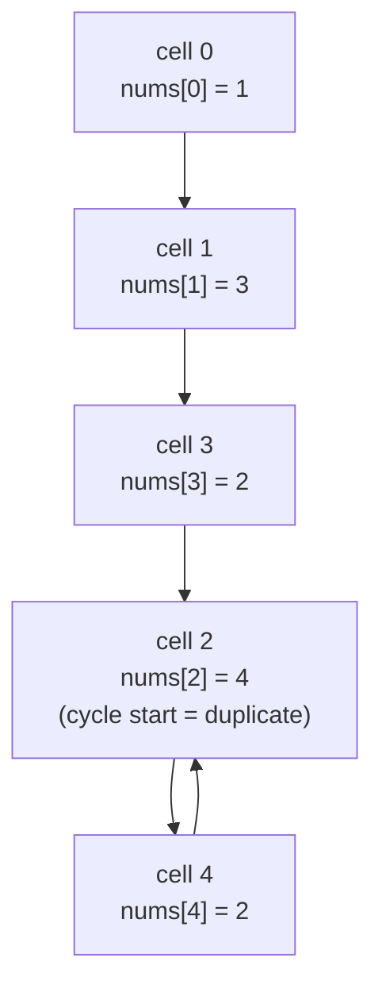

> [!tldr] Quick read
> - Problem: an array holds n + 1 numbers, each in [1, n], and exactly one value repeats (possibly many times). Find it **without modifying the array** and with only **O(1) extra memory**. Those two constraints rule out sorting, a [[en/concepts/hash-set|Set]] and the mark-negative trick.
> - [[en/concepts/search-on-the-answer|Binary search on the value]]: let cnt(m) be the number of elements ≤ m. "cnt(m) > m" is false for every m below the duplicate and true from the duplicate on, so it can be halved. O(n log n), O(1) memory.
> - Treat the array as a [[en/concepts/linked-list|linked list]]: cell i points to cell nums[i]. No cell points back to cell 0, so walking from 0 must fall into a cycle, and **the cycle start has two arrows coming in, which makes it the repeated number**. [[en/concepts/fast-slow-pointers|Tortoise and hare]] finds the cycle start in O(n) time, O(1) memory.
> - An exhaustive check of every valid array with n ≤ 6 (61,497 arrays) plus 2,000 random arrays: the six correct approaches get none wrong. Two wrong versions run for real: counting `x < mid` instead of `x ≤ mid` (5/10 cases), and starting phase 2 from `nums[0]` instead of 0 (right only when the cycle has length 1, otherwise it loops forever).
> - O(n) is not automatically faster: at 4·10⁶ numbers, Floyd on a chain of scattered cells takes about a second, slower even than the O(n log n) binary search reading the array in order (228 ms), because each Floyd step is a jump to an arbitrary place in memory.

> [!info] Context
> LeetCode 287, part of [[en/posts/2026-11-24-neetcode-advanced-linked-list|station 2: Advanced Linked Lists]] on the **NeetCode line: Linked Structures**. At [[en/posts/2026-11-24-neetcode-linked-list|station 1]], [[en/problems/linked-list-cycle|Linked List Cycle]] used tortoise and hare to detect a cycle and find where it starts (the LC 142 extension). This problem has no nodes or pointers, only an array of numbers. The trick is to see the array as a hidden linked list and reuse exactly that algorithm. The page also solves it with [[en/concepts/search-on-the-answer|search on the answer]], the technique from [[en/problems/koko-eating-bananas|Koko Eating Bananas]]. Solutions come in TypeScript, Python, Go, Java and JavaScript. All you need is loops and arrays.

> [!abstract]- Quick glossary for this post (click to open)
> - **Pigeonhole principle**: put n + 1 pigeons into n holes and at least one hole gets two. Here: n + 1 numbers, only n possible values, so some number must repeat.
> - **O(1) extra memory**: besides the given array, only a few variables, no auxiliary array or Set that grows with n.
> - **cnt(m)**: how many elements of the array are less than or equal to m.
> - **Monotonic predicate**: a true/false question that, as m grows, flips from "false" to "true" exactly once. See [[en/concepts/monotonic-predicate|Monotonic Predicate]].
> - **The graph i → nums[i]**: draw each index 0..n as a cell, and from cell i draw one arrow to cell nums[i]. Every cell has exactly one outgoing arrow, just as every list node has exactly one `next`.
> - **Cycle start**: the first cell of the cycle that the walk from cell 0 reaches. See [[en/problems/linked-list-cycle|Linked List Cycle]] for how tortoise and hare finds it.
> - **Bit**: a 0/1 digit in a number's binary form. See [[en/concepts/bitmask|Bitmask]].

## Picture it first: a treasure hunt with n + 1 slips

A game has n + 1 boxes numbered 0, 1, …, n. Each box holds a slip saying "go to box x", with x between 1 and n. You start at box 0 and keep following the slips. With n + 1 slips but only n different destinations, two slips must point to **the same box**. And since no slip points back to box 0, you walk a stretch and then fall into a loop that goes round forever. The box where you enter the loop is the box two slips point to: one slip from the stretch you just walked, one from the loop itself. That box's number is the repeated number.

| Everyday | Concept |
|---|---|
| Box number i | index i of the array |
| The slip in box i says "go to box x" | nums[i] = x, arrow i → x |
| No slip points to box 0 | every value is in [1, n], so cell 0 has no incoming arrow |
| The stretch before looping | the tail, length μ |
| Going round and round | the cycle, length λ |
| The box two slips point to | cycle start = the repeated number |
| Two walkers at different speeds | tortoise and hare (Floyd) |

With `nums = [1, 3, 4, 2, 2]`: 0 → 1 → 3 → 2 → 4 → 2 → 4 → … The tail is 0, 1, 3; the cycle is 2 → 4 → 2. Box 2 is pointed to by the slip in box 3 (on the tail) and the slip in box 4 (in the cycle), and 2 is indeed the repeated number.



## The problem

Without constraints this is easy: sort and look for two equal neighbours, or remember seen numbers in a Set. The problem forbids both:

- **Do not modify the array.** In-place sorting and the mark-negative trick both modify it.
- **Only O(1) extra memory.** Sorting a copy costs O(n), a Set costs O(n).

It also asks you to prove a duplicate always exists (the pigeonhole principle above), and whether it can be solved in linear time. Constraints: 1 ≤ n ≤ 10⁵, the array has length n + 1, every element is in [1, n], and exactly one value appears two or more times.

Watch out: "exactly one repeated value" does **not** mean it appears exactly twice. `[3, 3, 3, 3, 3]` is valid: 3 appears five times, while 1, 2 and 4 are absent. Every argument below has to hold even when the duplicate takes the place of several missing numbers.

## How it works

<figure class="figure-map" style="--ar: 3 / 4">
<div class="frame"><iframe data-archify="../../diagrams/neetcode-find-the-duplicate-number/worked-example.en.html" title="The cycle entry is the duplicate" loading="lazy"></iframe></div>
<figcaption><span><b>Figure 1.</b> The cycle entry is the duplicate.</span><a href="../diagrams/neetcode-find-the-duplicate-number/worked-example.en.html" target="_blank" rel="noopener">Open full screen</a></figcaption>
</figure>

<details>
<summary>Read the steps</summary>
<ol>
<li>Use each value as the next index. <code>[2, 1, 3, 4, 3]; 0 → 2 → 3 → 4 → 3</code></li>
<li>Find a meeting point inside the cycle. <code>slow = fast = 3</code></li>
<li>Reset one pointer to the start. <code>first = 0; second = 3</code></li>
<li>Move both two steps to reach the entry. <code>0 → 2 → 3; 3 → 4 → 3</code></li>
<li>Both paths meet at the duplicate. <code>duplicate = 3</code></li>
</ol>
</details>

### Three approaches that break the rules

Before the correct ones, three familiar approaches give the right answer but break the rules. Sorting a copy and a Set cost O(n) memory. Mark-negative uses O(1) memory, but uses the array itself as the notebook:

```ts
// Approach 3: mark negatives. On x, flip the sign of nums[x]; a cell already negative means x was seen. O(1) memory but MODIFIES the input.
function markNegative(nums: number[]): number {
  for (const v of nums) {
    const x = Math.abs(v);
    if (nums[x] < 0) return x;
    nums[x] = -nums[x];
  }
  return -1;
}
```


On value x, flip the sign of cell `nums[x]`; if that cell is already negative, x was seen before. The answer is right in every case, but after the call the caller's array has changed:

```text
markNegative([1,3,4,2,2]) = 2; array after the call: [1,-3,-4,-2,-2]
```

If the problem allowed modifying the array this would be the fastest approach (see the measurements below). It does not, and in real code a "find" function that quietly changes the caller's data is a hard bug to track down.

### Approach 4: binary search on the value

Search not for a position in the array but for a **value** in [1, n]. For each m, count cnt(m) = the number of elements ≤ m, and ask: is cnt(m) > m?

Let d be the duplicate, appearing k ≥ 2 times, and M the set of values in [1, n] that are absent. The array has n + 1 elements = (n − |M|) distinct values + (k − 1) extra copies of d, so **k − 1 = |M| + 1**.

- **m < d**: the elements ≤ m are all distinct (only d repeats) and lie in [1, m], so cnt(m) ≤ m. The answer is "false".
- **m ≥ d**: cnt(m) = (number of present values in [1, m]) + (k − 1) = (m − |M ∩ [1, m]|) + |M| + 1 ≥ m + 1. The answer is "true".

So "cnt(m) > m" is a [[en/concepts/monotonic-predicate|monotonic predicate]]: false, false, …, false, true, true, …, and the first flip is exactly d. This is the same shape of [[en/concepts/search-on-the-answer|search on the answer]] as [[en/problems/koko-eating-bananas|Koko Eating Bananas]]: there is no sorted array to search, only a true/false question that is monotonic in m.

```ts
// Approach 4: binary search on the value. cnt(m) = number of elements ≤ m; cnt(m) > m holds from the duplicate onward (pigeonhole principle).
function binaryCount(nums: number[]): number {
  let lo = 1, hi = nums.length - 1;
  while (lo < hi) {
    const mid = (lo + hi) >>> 1;
    let cnt = 0;
    for (const x of nums) if (x <= mid) cnt++;
    if (cnt > mid) hi = mid; else lo = mid + 1;
  }
  return lo;
}
```


Each question reads the whole array (O(n)), and there are about log₂ n questions, so O(n log n) in total. Memory is a few variables. The array is not changed.

### Approach 5: counting each bit

Same counting idea, but per bit. For each bit b, compare how many elements of the array have bit b set with how many values in 1..n have bit b set. The difference between those two counts is (k − 1)·[bit b of d] − (number of absent values with bit b set).

- If bit b of d is 0, the difference is ≤ 0.
- If bit b of d is 1, the difference is ≥ (k − 1) − |M| = 1 > 0.

So bit b of d is set exactly when the array has **more**. Put the bits together and you get d.

```ts
// Approach 5: count each bit. Bit b of the duplicate is set when nums has more numbers with bit b set than 1..n does.
function bitCount(nums: number[]): number {
  const n = nums.length - 1;
  let ans = 0;
  for (let b = 0; (1 << b) <= n; b++) {
    const mask = 1 << b;
    let inNums = 0, inRange = 0;
    for (const x of nums) if (x & mask) inNums++;
    for (let v = 1; v <= n; v++) if (v & mask) inRange++;
    if (inNums > inRange) ans |= mask;
  }
  return ans;
}
```


There are about log₂ n bits, each reading the array once: also O(n log n), O(1) memory.

### Approach 6: tortoise and hare on the graph i → nums[i]

Treat each index i (from 0 to n) as a node, and nums[i] as its `next`. Three facts about this graph:

1. **Walking from cell 0 must fall into a cycle.** Every cell has exactly one outgoing arrow (to nums[i], always a valid index because nums[i] ≤ n). There are only n + 1 cells, so a long enough walk must revisit one.
2. **Cell 0 is not on the cycle.** Every value is ≥ 1, so no arrow goes into cell 0. A cell on a cycle always has an incoming arrow from the cell before it on the cycle. So the walk from cell 0 has a tail of length μ ≥ 1 before it enters the cycle.
3. **The cycle start is the duplicate.** Let e be the cycle start. Since μ ≥ 1, e has a predecessor p on the tail (nums[p] = e). Since e is on the cycle, it also has a predecessor q on the cycle (nums[q] = e). p is off the cycle and q is on it, so p ≠ q. Two different indices hold the value e: e is a repeated number. The problem says only one value repeats, so e = d.

Fact 2 is why you must start from **cell 0** and not any cell: starting from a cell already on the cycle leaves no tail, and "cycle start" loses its meaning. Fact 3 turns the problem into exactly LC 142: find the cycle start. The rest comes straight from [[en/problems/linked-list-cycle|Linked List Cycle]]: phase 1 moves the tortoise 1 step and the hare 2 steps until they meet inside the cycle; phase 2 sends one back to cell 0, both move 1 step, and where they meet again is the cycle start. That page proves why phase 2 stops exactly at the cycle start.

```ts
// Approach 6: tortoise and hare on the graph i → nums[i]. Start from index 0 (no cell points to 0, so 0 is outside the cycle).
// Phase 1 finds a point in the cycle; phase 2 sends one pointer back to 0, both step 1, they meet at the cycle start, the duplicate.
function floyd(nums: number[]): number {
  let slow = 0, fast = 0;
  do {
    slow = nums[slow];
    fast = nums[nums[fast]];
  } while (slow !== fast);
  let a = 0;
  while (a !== slow) {
    a = nums[a];
    slow = nums[slow];
  }
  return a;
}
```


Phase 1 takes at most μ + λ rounds, phase 2 exactly μ, and μ + λ ≤ n + 1. So O(n) time, O(1) memory, and the array is only read.

Example `[1, 3, 4, 2, 2]` (μ = 3, λ = 2):

| Round | tortoise | hare |
|---|---|---|
| start | 0 | 0 |
| 1 | 1 | 3 |
| 2 | 3 | 4 |
| 3 | 2 | 4 |
| 4 | 4 | 4 |

They meet at cell 4 after 4 rounds (the smallest multiple of λ = 2 not less than μ = 3). Phase 2: the pointer from cell 0 goes 0 → 1 → 3 → 2, the one from cell 4 goes 4 → 2 → 4 → 2. After μ = 3 steps both are at cell 2: the answer is 2.

### Two wrong versions

Counting `x < mid` instead of `x ≤ mid`. The predicate becomes "the number of elements less than m exceeds m", which no longer flips exactly at d:

```ts
// WRONG: counts elements < mid instead of ≤ mid. The predicate is off by one, so it stops in the wrong place.
function wrongCountLess(nums: number[]): number {
  let lo = 1, hi = nums.length - 1;
  while (lo < hi) {
    const mid = (lo + hi) >>> 1;
    let cnt = 0;
    for (const x of nums) if (x < mid) cnt++;
    if (cnt > mid) hi = mid; else lo = mid + 1;
  }
  return lo;
}
```


This version gets 5/10 test cases wrong, and 51,014 of the 61,497 exhaustive arrays. On `[1, 3, 4, 2, 2]` it returns 4.

Starting phase 2 from `nums[0]` instead of 0. Many solutions start phase 1 with `slow = nums[0]`, and then phase 2 is also `slow = nums[0]`; both phases must start from **the same place**. Mix the two styles (phase 1 from 0, phase 2 from `nums[0]`) and the new pointer is one step ahead:

```ts
// WRONG: phase 2 resets the pointer to nums[0] instead of 0. It is one step ahead, so the two pointers never meet unless the cycle has length 1.
function wrongResetToFirst(nums: number[]): number {
  let slow = 0, fast = 0;
  do {
    slow = nums[slow];
    fast = nums[nums[fast]];
  } while (slow !== fast);
  let a = nums[0];
  let guard = 0;
  while (a !== slow && guard++ < 4 * nums.length) {
    a = nums[a];
    slow = nums[slow];
  }
  return a === slow ? a : -1;
}
```


After s steps the new pointer is at position 1 + s on the walk, and the other at t + s with t a multiple of λ. Once both are on the cycle, they coincide if and only if 1 ≡ t ≡ 0 (mod λ), that is **only when λ = 1**. For any longer cycle the two run round the cycle exactly one cell apart forever. The file stops it with a step limit and returns −1; a version without the limit hangs. Exactly 6/10 test cases pass, and all 6 have a cycle of length 1 (for example `[3, 3, 3, 3, 3]`: 0 → 3 → 3).

There is also a correct but slow approach: for each i, `nums.indexOf(nums[i]) !== i` means nums[i] already appeared earlier. O(1) memory, no modification, but `indexOf` scans from the start every time, so O(n²): doubling n roughly quadruples the time (35.7 → 146.5 → 588.8 ms at n = 10⁴, 2·10⁴, 4·10⁴, with the duplicate at the end of the array).

### Under the hood in five languages

| | Sorting | Language-specific trap |
|---|---|---|
| TypeScript / JavaScript | `nums.sort()` sorts in place and returns that same array | `sort()` without a comparator compares as strings: `[10, 2, 9, 10].sort()` gives `[10, 10, 2, 9]`. The order is wrong, but equal numbers still end up next to each other, so for this problem alone "sort and compare neighbours" still gets 11/11 cases right |
| Python | `nums.sort()` modifies the caller's list; `sorted(nums)` makes a copy | `binary_count` written as a Python loop is many times slower than a Set (845 ms vs 114 ms at 10⁶), because each comparison is one round of interpretation |
| Go | `sort.Ints(nums)` sorts in place | a slice passed to a function still points at the same backing array, so when the function sorts the slice the caller sees it; for safety, `slices.Clone(nums)` first |
| Java | `Arrays.sort(nums)` sorts in place | arrays are references, so the caller sees the sorted array; `HashSet<Integer>` boxes every number into an object, much slower than an `int[]` |

All four files run the "sort in place" version and print the caller's array after the call: every time it has become `[1, 2, 3, 3, 4]`. The answer is right, but it breaks exactly the rule the problem sets.

### Measurements

TypeScript, the duplicate appears twice, the array shuffled randomly, median of 5 runs (μ and λ are the tail and cycle lengths of the graph i → nums[i] for that array):

| n | μ | λ | Sort a copy | Set | Mark negative | Binary | Bit count | Floyd |
|---|---|---|---|---|---|---|---|---|
| 10⁵ | 29,655 | 22,106 | 19.03 ms | 4.46 ms | 0.56 ms | 6.33 ms | 7.27 ms | 0.59 ms |
| 10⁶ | 12,575 | 296,622 | 228.48 ms | 56.94 ms | 7.46 ms | 66.75 ms | 87.50 ms | 8.51 ms |

- On a shuffled array, Floyd is about 8–11 times faster than binary search, and close to mark-negative (that column includes the 2.31 ms spent copying the array).
- The Set stops as soon as it sees the duplicate the second time, so its time depends on where the duplicate sits. Floyd's depends on μ + λ.

But Floyd has a weakness that Big-O hides: each step reads `nums[x]` for an arbitrary x, a jump to a random place in memory. Binary search reads the array from start to end, exactly the access pattern the CPU predicts and prefetches. Try the same shape (tail of length n − 1, cycle of length 1), changing only the order of the cells in memory:

| n | Floyd, sequential chain | Floyd, scattered chain | Binary |
|---|---|---|---|
| 10⁶ | 6.72 ms | 50.74 ms | 86.62 ms |
| 4·10⁶ | 22.37 ms | 1,259.33 ms | 227.89 ms |

Same number of steps, but the scattered chain is 7 times slower than the sequential one at 10⁶ and more than 50 times slower at 4·10⁶. At 4·10⁶, O(n) Floyd loses to O(n log n) binary search. Another run gave 945.83 ms for the scattered chain at 4·10⁶: the numbers vary but the order does not. The most likely reason is the CPU cache: an array of 4·10⁶ numbers no longer fits, so each Floyd jump waits on RAM. This page did not measure cache misses directly, so that is an explanation, not a measurement.

Other languages, on shuffled arrays (different input from the TypeScript table, so μ and λ differ):

| | n | Set | Binary | Bit count | Floyd |
|---|---|---|---|---|---|
| Go | 10⁶ | 30.54 ms | 4.78 ms | 19.03 ms | 29.66 ms |
| Java | 10⁶ | 65.19 ms | 9.81 ms | 27.86 ms | 12.84 ms |
| Python | 10⁶ | 114.1 ms | 845.4 ms | 1,764.9 ms | 248.4 ms |

Go and Java compile the counting loop into machine code that runs very fast over a sequential array, so binary search beats Floyd at 10⁶. Python is the reverse: every element costs a round of interpretation, so approaches that read the array many times (binary search about 20 passes, bit counting about 20 passes × 2) lose to the ones that read it less. Within the problem's limit n ≤ 10⁵, every approach takes under 1 ms in Go and Java.

## Runnable example

[TypeScript](../code/neetcode-find-the-duplicate-number/find-duplicate.ts) · [Python](../code/neetcode-find-the-duplicate-number/find_duplicate.py) · [Go](../code/neetcode-find-the-duplicate-number/find_duplicate.go) · [Java](../code/neetcode-find-the-duplicate-number/find-duplicate.java) · [JavaScript](../code/neetcode-find-the-duplicate-number/find-duplicate.js)

Each file runs 10 shared cases: the problem's three examples, `[1, 1]`, the duplicate at the start, at the end, repeated many times (`[2, 2, 2, 2, 2]`, `[1, 4, 4, 2, 4]`), a self-loop, and a ten-element array. The JavaScript file adds `[10, 2, 9, …, 10]` to try string-order `sort()`. The TypeScript file also checks every valid array with n from 1 to 6 exhaustively plus 2,000 random arrays (mulberry32); Go, Java and Python cross-check another 2,000 or 500 random arrays.

Tortoise and hare:

```ts
// Approach 6: tortoise and hare on the graph i → nums[i]. Start from index 0 (no cell points to 0, so 0 is outside the cycle).
// Phase 1 finds a point in the cycle; phase 2 sends one pointer back to 0, both step 1, they meet at the cycle start, the duplicate.
function floyd(nums: number[]): number {
  let slow = 0, fast = 0;
  do {
    slow = nums[slow];
    fast = nums[nums[fast]];
  } while (slow !== fast);
  let a = 0;
  while (a !== slow) {
    a = nums[a];
    slow = nums[slow];
  }
  return a;
}
```

```python
# Tortoise and hare on the graph i → nums[i], starting from index 0.
def floyd(nums):
    slow = fast = 0
    while True:
        slow = nums[slow]
        fast = nums[nums[fast]]
        if slow == fast:
            break
    a = 0
    while a != slow:
        a = nums[a]
        slow = nums[slow]
    return a
```

```go
// Tortoise and hare on the graph i → nums[i], starting from index 0.
func floyd(nums []int) int {
	slow, fast := 0, 0
	for {
		slow = nums[slow]
		fast = nums[nums[fast]]
		if slow == fast {
			break
		}
	}
	a := 0
	for a != slow {
		a = nums[a]
		slow = nums[slow]
	}
	return a
}
```

```java
// Tortoise and hare on the graph i → nums[i], starting from index 0.
static int floyd(int[] nums) {
    int slow = 0, fast = 0;
    do {
        slow = nums[slow];
        fast = nums[nums[fast]];
    } while (slow != fast);
    int a = 0;
    while (a != slow) {
        a = nums[a];
        slow = nums[slow];
    }
    return a;
}
```

```js
// Tortoise and hare on the graph i → nums[i], starting from index 0.
function floyd(nums) {
  let slow = 0, fast = 0;
  do {
    slow = nums[slow];
    fast = nums[nums[fast]];
  } while (slow !== fast);
  let a = 0;
  while (a !== slow) {
    a = nums[a];
    slow = nums[slow];
  }
  return a;
}
```


Binary search on the value:

```ts
// Approach 4: binary search on the value. cnt(m) = number of elements ≤ m; cnt(m) > m holds from the duplicate onward (pigeonhole principle).
function binaryCount(nums: number[]): number {
  let lo = 1, hi = nums.length - 1;
  while (lo < hi) {
    const mid = (lo + hi) >>> 1;
    let cnt = 0;
    for (const x of nums) if (x <= mid) cnt++;
    if (cnt > mid) hi = mid; else lo = mid + 1;
  }
  return lo;
}
```

```python
# Binary search on the value: cnt(m) = number of elements ≤ m; the duplicate is the smallest m with cnt(m) > m.
def binary_count(nums):
    lo, hi = 1, len(nums) - 1
    while lo < hi:
        mid = (lo + hi) // 2
        cnt = sum(1 for x in nums if x <= mid)
        if cnt > mid:
            hi = mid
        else:
            lo = mid + 1
    return lo
```

```go
// Binary search on the value: the duplicate is the smallest m whose cnt(m) = number of elements ≤ m exceeds m.
func binaryCount(nums []int) int {
	lo, hi := 1, len(nums)-1
	for lo < hi {
		mid := int(uint(lo+hi) >> 1)
		cnt := 0
		for _, x := range nums {
			if x <= mid {
				cnt++
			}
		}
		if cnt > mid {
			hi = mid
		} else {
			lo = mid + 1
		}
	}
	return lo
}
```

```java
// Binary search on the value: the duplicate is the smallest m whose cnt(m) = number of elements ≤ m exceeds m.
static int binaryCount(int[] nums) {
    int lo = 1, hi = nums.length - 1;
    while (lo < hi) {
        int mid = (lo + hi) >>> 1;
        int cnt = 0;
        for (int x : nums) if (x <= mid) cnt++;
        if (cnt > mid) hi = mid; else lo = mid + 1;
    }
    return lo;
}
```

```js
// Binary search on the value: the duplicate is the smallest m whose cnt(m) = number of elements ≤ m exceeds m.
function binaryCount(nums) {
  let lo = 1, hi = nums.length - 1;
  while (lo < hi) {
    const mid = (lo + hi) >>> 1;
    let cnt = 0;
    for (const x of nums) if (x <= mid) cnt++;
    if (cnt > mid) hi = mid; else lo = mid + 1;
  }
  return lo;
}
```


Output:

```text
$ node find-duplicate.ts
sortCopy           10/10 cases correct
hashSet            10/10 cases correct
markNegative       10/10 cases correct
binaryCount        10/10 cases correct
bitCount           10/10 cases correct
floyd              10/10 cases correct
viaIndexOf         10/10 cases correct
wrongCountLess     5/10 cases correct; wrong on example 1 of the problem [1,3,4,2,2] → 4, example 2 of the problem [3,1,3,4,2] → 4, example 3 of the problem [3,3,3,3,3] → 4, duplicate at the start [1,1,2] → 2, all 2s [2,2,2,2,2] → 3
wrongResetToFirst  6/10 cases correct; wrong on example 1 of the problem [1,3,4,2,2] → -1, example 2 of the problem [3,1,3,4,2] → -1, repeated three times [2,5,9,6,9,3,8,9,7,1] → -1, duplicate at the end [4,3,1,4,2] → -1

markNegative([1,3,4,2,2]) = 2; array after the call: [1,-3,-4,-2,-2]
exhaustive n = 1..6: 61497 valid arrays; arrays wrong: sortCopy 0, hashSet 0, markNegative 0, binaryCount 0, bitCount 0, floyd 0, viaIndexOf 0, wrongCountLess 51014, wrongResetToFirst 34348
random 2000 arrays (n ≤ 2000): arrays wrong: sortCopy 0, hashSet 0, markNegative 0, binaryCount 0, bitCount 0, floyd 0, wrongCountLess 1993, wrongResetToFirst 1790

n          μ        λ      sortCopy   hashSet  markNeg  binaryCnt  bitCount    floyd   (ms, median of 5)
100000      29655    22106      19.03      4.46      0.56      6.33      7.27      0.59
1000000     12575   296622     228.48     56.94      7.46     66.75     87.50      8.51
copying a 10⁶-element array: 2.31 ms (included in the markNeg column)

n        viaIndexOf  floyd   (duplicate in the last two cells, ms)
10000          35.7   0.039
20000         146.5   0.084
40000         588.8   0.176

n          floyd sequential  floyd scattered  binaryCount   (μ = n − 1, λ = 1, ms)
1000000             6.72              50.74         86.62
4000000            22.37            1259.33        227.89
```

```text
$ python3 find_duplicate.py
hash_set       10/10 cases correct
binary_count   10/10 cases correct
bit_count      10/10 cases correct
floyd          10/10 cases correct
sort_in_place  10/10 cases correct

sort_in_place([3, 1, 3, 4, 2]) = 3; the caller's array is now [1, 2, 3, 3, 4]
random 500 arrays: arrays wrong: hash_set 0, binary_count 0, bit_count 0, floyd 0

n          hash_set   binary_count  bit_count     floyd   (ms, median of 5)
100000            3.6       41.5       87.2        4.7
1000000         114.1      845.4     1764.9      248.4
```

```text
$ go run find_duplicate.go
hashSet      10/10 cases correct
binaryCount  10/10 cases correct
bitCount     10/10 cases correct
floyd        10/10 cases correct
sortInPlace  10/10 cases correct

sortInPlace([3 1 3 4 2]) = 3; the caller's slice is now [1 2 3 3 4]
random 2000 arrays: arrays wrong: hashSet 0, binaryCount 0, bitCount 0, floyd 0

n            hashSet  binaryCount  bitCount    floyd   (ms, median of 5)
100000          1.50         0.40      1.59     0.33
1000000        30.54         4.78     19.03    29.66
```

```text
$ java find-duplicate.java
hashSet      10/10 cases correct
binaryCount  10/10 cases correct
bitCount     10/10 cases correct
floyd        10/10 cases correct
sortInPlace  10/10 cases correct

sortInPlace([3, 1, 3, 4, 2]) = 3; the caller's array is now [1, 2, 3, 3, 4]
random 2000 arrays: arrays wrong: binaryCount 0, bitCount 0, floyd 0 (against hashSet)

n            hashSet  binaryCount  bitCount    floyd   (ms, median of 5)
100000          3.46         0.82      2.49     0.29
1000000        65.19         9.81     27.86    12.84
```

```text
$ node find-duplicate.js
hashSet          11/11 cases correct
binaryCount      11/11 cases correct
floyd            11/11 cases correct
sortDefaultCopy  11/11 cases correct
sortInPlace      11/11 cases correct

[10, 2, 9, 10].sort() = [10,10,2,9]
sortInPlace([3, 1, 3, 4, 2]) = 3; the caller's array is now [1,2,3,3,4]
```

*(Output labels translated; the files themselves print Vietnamese.)*

## Misconceptions and common traps

- **"The duplicate appears exactly twice, so subtract 1 + 2 + … + n from the sum."** Fails immediately on `[3, 3, 3, 3, 3]`: the sum is 15, 1 + 2 + 3 + 4 = 10, and the difference 5 is not the answer. The sum trick only works when every number from 1 to n is present.
- **"Floyd only works on lists with nodes and pointers."** It works for any function f you iterate as x, f(x), f(f(x)), …; here f(i) = nums[i]. A linked list is just one case.
- **"Any starting cell will do."** It has to be cell 0, the only cell guaranteed to be off the cycle. Start on the cycle and there is no tail, and the "cycle start" is no longer the duplicate.
- **Mixing the two ways to start.** If phase 1 starts from 0, phase 2 starts from 0; if phase 1 starts from `nums[0]`, so does phase 2. One step off and it hangs whenever the cycle is longer than 1.
- **"O(n) is always faster than O(n log n)."** At 4·10⁶ scattered numbers Floyd takes about a second, binary search 228 ms. Big-O counts steps, not what each step costs.
- **Sorting "to be quick".** The answer is right, but it modifies the caller's array in all five languages, and the problem forbids that.

## Self-check questions

> [!question]- Why must the array contain a duplicate?
> n + 1 elements, each taking one of the n values 1..n. By the pigeonhole principle, at least two elements share a value.

> [!question]- For `[3, 1, 3, 4, 2]`, what are cnt(1), cnt(2), cnt(3), and where does binary search stop?
> cnt(1) = 1, cnt(2) = 2, cnt(3) = 4. "cnt(m) > m" is false at 1 and 2 and true from 3, so the answer is 3.

> [!question]- Why is cell 0 never on the cycle of the graph i → nums[i]?
> Every value is in [1, n], so no cell points to cell 0. A cell on a cycle always has the cell before it on the cycle pointing to it. Nobody points to cell 0, so it cannot be on the cycle.

> [!question]- Why is the cycle start the repeated number?
> The cycle start e has two cells pointing to it: one on the tail (the tail has length at least 1) and one on the cycle. Two different cells hold the value e, so e appears at least twice.

> [!question]- If the problem allowed modifying the array, which approach is fastest, and why be careful anyway?
> Mark-negative: one pass, O(1) memory, and nearly sequential reads. But it leaves the array full of negatives; if other code still uses that array you must flip the signs back, and in multi-threaded code nobody may read the array while it is being marked.

## References

- [LeetCode 287: Find the Duplicate Number](https://leetcode.com/problems/find-the-duplicate-number/) (original problem: 1 ≤ n ≤ 10⁵, array length n + 1, do not modify the array, O(1) extra memory)
- Donald E. Knuth, *The Art of Computer Programming*, vol. 2, section 3.1, exercise 6 (the two-pointer cycle-finding algorithm, which Knuth credits to R. W. Floyd)
- [Linked List Cycle II](https://leetcode.com/problems/linked-list-cycle-ii/) LC 142 (finding the cycle start), solved and proved on the [[en/problems/linked-list-cycle|Linked List Cycle]] page
- [Python: `list.sort`](https://docs.python.org/3/library/stdtypes.html#list.sort) (sorts in place, returns `None`)
- [Go: slices, usage and internals](https://go.dev/blog/slices-intro) (a slice is a window onto a shared backing array)
- [Java `Arrays.sort(int[])`](https://docs.oracle.com/en/java/javase/21/docs/api/java.base/java/util/Arrays.html#sort(int%5B%5D))
- [MDN: `Array.prototype.sort`](https://developer.mozilla.org/en-US/docs/Web/JavaScript/Reference/Global_Objects/Array/sort) (sorts in place; without a comparator it compares UTF-16 strings)
