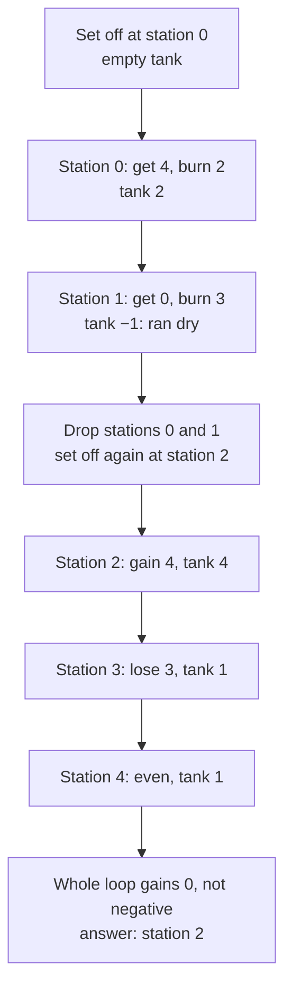
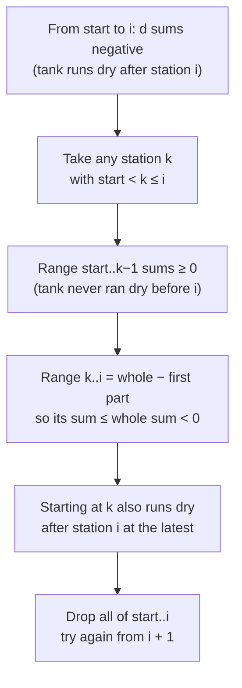
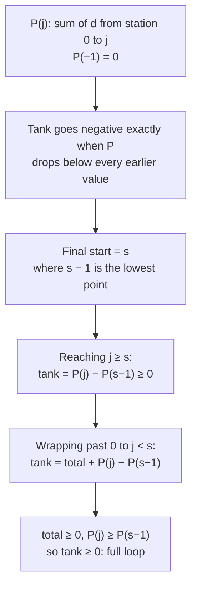

> [!tldr] Quick read
> - Each station i gives one difference `d = gas[i] − cost[i]`: how much fuel you get there minus how much it takes to reach the next station. The whole problem revolves around this sequence of differences.
> - If the differences sum to a negative number, no station can complete the loop: return −1. If the sum is non-negative, some station definitely can.
> - Make one pass from station 0, adding into the tank. If the tank goes negative at station i, no station from `start` to i can be the starting point, so jump straight to `start = i + 1`. This is the [[en/concepts/restart-argument|restart argument]], the same move as [[en/concepts/kadane-algorithm|Kadane]] in Maximum Subarray.
> - Seen through [[en/concepts/prefix-sum|prefix sums]]: the station we want sits right after the lowest prefix sum.
> - Brute force O(n²) takes 50,005,000 steps at n = 10,000; one greedy O(n) pass takes 10,000 steps.

> [!info] Context
> This is LeetCode problem 134 at [[en/posts/2026-11-28-neetcode-greedy-array|station MISC-03: Greedy on Arrays]] on **the NeetCode Line: Mixed Techniques**. I picture riding a scooter along a road that loops around a lake, with a few gas stations along the way. You only need arrays and loops; reading [[en/problems/maximum-subarray|Maximum Subarray]] first makes the familiar "drop the negative stretch" move easy to spot.

> [!abstract]- Quick glossary for this post (click to open)
> - Circular array: after the last element you wrap back to the first. The station after j has index `(j + 1) % n`.
> - [[en/concepts/greedy-choice|Greedy choice]]: at each step, make a local decision right away and never revisit it, then prove that the decision never loses the answer.
> - A [[en/concepts/prefix-sum|prefix sum]] P(j) is the sum of the elements from the start of the array up to j. The sum of a range is the difference of two prefix sums.
> - The "tank" (`tank`) is the fuel you currently have, counted from the current starting station.

## Picture it first: riding around the lake

The road around the lake has five stations, numbered 0 to 4. At each station I get a fixed amount of free fuel, and the stretch to the next station burns a fixed amount. The tank starts empty. I want to know which station to set off from so I ride one full loop back to where I began without ever having to push the scooter.

I don't try every station. I set off from station 0 and ride. Whenever I run dry on the stretch after station i, I conclude that the stretch I just rode is a "losing" stretch: no station on it can be the starting point. I walk the scooter to station i + 1 and start over with an empty tank. After one pass over all the stations, I check whether the total fuel for the loop covers the total distance.

| Everyday life | Concept |
|---|---|
| Fuel you get at station i | `gas[i]` |
| Fuel burned on the stretch from station i to the next | `cost[i]` |
| Gain or loss at station i | `d = gas[i] − cost[i]` |
| Fuel in the tank since setting off | `tank` |
| Running dry on the stretch after station i | `tank < 0` at i |
| Walk to the next station, empty tank | `start = i + 1`, `tank = 0` |
| Whether the whole loop has enough fuel | `total ≥ 0` |

With `gas = [4, 0, 5, 1, 2]` and `cost = [2, 3, 1, 4, 2]`, the differences are `[2, −3, 4, −3, 0]`:



## The problem: which station completes the loop

There are n gas stations on a circle, numbered 0 to n − 1. Two arrays of length n: `gas[i]` is the fuel you can get at station i, and `cost[i]` is the fuel needed to go from station i to station i + 1 (from station n − 1 back to station 0). The tank is unlimited and empty at the start. Return the index of the starting station from which you can drive one full loop in increasing index order, or −1 if no station works. Limits: 1 ≤ n ≤ 10⁵, each value from 0 to 10⁴. The problem promises that if an answer exists, it is unique. My own example: `gas = [1, 6, 2]`, `cost = [3, 1, 4]` gives 1. [Original LeetCode 134](https://leetcode.com/problems/gas-station/)

At first I guessed the starting station is the one with the biggest "gain", the largest `d`. With differences `[4, −5, −1, 3]` (`gas = [4, 0, 0, 3]`, `cost = [0, 5, 1, 0]`), the biggest gain is at station 0, but starting there the tank holds 4 and then drops to −1 on the very next stretch. The only answer is station 3: the tank goes 3, 7, 2, 1. A big gain is useless if a bigger loss follows right after it. What matters is the whole stretch of road, not each station on its own.

## How it works

### Brute force: try starting at every station

For each station s, simulate: the tank starts at 0, visit n stations `s, s + 1, …` (indices taken `% n`), add each station's `d` to the tank, and stop and try the next station if it runs dry. The first station that completes the loop is the answer. Each attempt takes at most n steps, so the total is O(n²) time and O(1) memory. At n = 10⁵ that is up to 5·10⁹ steps, far too slow. I keep it as the referee in the runnable file.

What brute force wastes: after starting at s and running dry at i, it goes back to try s + 1, s + 2, … even though it has already ridden past those stations and knows what the tank looked like there.

### One greedy pass: restart right after where you ran dry

Make one pass from station 0 with two running sums: `total` is the sum of every `d`, and `tank` is the fuel counted from `start`. If the tank goes negative at i, set `start = i + 1`, `tank = 0`. At the end, return −1 if `total < 0`, otherwise return `start`. Time O(n), memory O(1).

Two things need proving. First, jumping from `start` to i + 1 never skips the answer. This is the [[en/concepts/restart-argument|restart argument]]:



In scooter terms: when I reach station k, my tank is never negative. Starting at k means reaching k with an empty tank, which can only be worse or equal. If I ran dry with that tank, I would surely run dry with an empty one.

Second, if `total ≥ 0`, the final `start` definitely completes the loop, including the stretch that wraps past station 0, which the loop never simulated. The easiest way to see it is to read the [[en/concepts/prefix-sum|prefix sum]] P(j) = d[0] + … + d[j], with P(−1) = 0, as altitude along a mountain road:



The tank counted from `start` equals P(i) − P(start − 1). It goes negative exactly when P(i) drops below the mark P(start − 1), and that mark is the lowest point so far. So each restart is P hitting a new low, and the final `start` sits right after the lowest point of the whole sequence. Standing at the bottom, every other point is at the same height or higher; the stretch that wraps past station 0 also gets `total ≥ 0` added. Conversely, if `total < 0`, a full loop from anywhere uses up `total` fuel, so no station can do it.

A trace with the differences `[2, −3, 4, −3, 0]` from Picture it first:

| i | d | total | tank | start |
|---|---|---|---|---|
| 0 | 2 | 2 | 2 | 0 |
| 1 | −3 | −1 | −1, reset to 0 | 2 |
| 2 | 4 | 3 | 4 | 2 |
| 3 | −3 | 0 | 1 | 2 |
| 4 | 0 | 0 | 1 | 2 |

`total = 0` is not negative, so the answer is 2. The prefix sums are `2, −1, 3, 0, 0`; the lowest point −1 is at station 1, and station 2 comes right after it.

On uniqueness: the argument above only says that `start` is **a** starting point that works. The problem promises there is only one, so it is the answer. Without that promise (for example when every `d` is 0 and every station works), the greedy pass returns the station right after the first time it hits bottom, while brute force returns the smallest station that works; the two can differ and both be correct. That is why the cross-check in the runnable file tests "the returned station completes the loop" instead of comparing for equality.

Compared with [[en/concepts/kadane-algorithm|Kadane]] in [[en/problems/maximum-subarray|Maximum Subarray]]: both sum up a stretch and throw away the whole stretch when the running sum goes negative, because a negative prefix only drags down what follows. The difference is what they keep. Kadane keeps the largest sum seen; here you only need to remember the last restart point, and `total` answers the question "is there enough". The stretch `start..n − 1` the greedy pass keeps is exactly the suffix with the largest sum when `total ≥ 0`: that suffix equals `total − P(start − 1)` with P(start − 1) as small as possible. This is a [[en/concepts/greedy-choice|greedy choice]] in the true sense: drop a stretch as soon as you see it lose, and never go back.

### Prefix sums: find the bottom directly

From the diagram above you can write it outright: compute P(i) in turn and remember the index where P first reaches its lowest value (against the mark P(−1) = 0, using a strict `<`). If P(n − 1) = `total` is negative, return −1, otherwise return that index plus 1. Still O(n) and O(1). The runnable file checks that this approach always returns **exactly the same index** as the greedy pass, on all 7,380 cross-check loops.

| Approach | Time | Extra memory | Notes |
|---|---|---|---|
| Brute force from every station | O(n²) | O(1) | Referee; 5·10⁹ steps at n = 10⁵ |
| One greedy pass | O(n) | O(1) | Main approach; tank negative means `start = i + 1` |
| Bottom of the prefix sums | O(n) | O(1) | Same result as greedy, read as altitude |

### Measurement: brute force vs greedy

I built a loop of n = 10,000 stations that puts brute force in its worst case: every station gains 1, except station n − 2, which loses n, and the last station, which gains 2. Starting at any station s < n − 2 rides all the way to station n − 2 before running dry, so brute force takes n(n + 1)/2 = 50,005,000 steps before it finds the answer 9999. Greedy takes exactly 10,000 steps. Each language was measured once on my machine:

| Language | Brute force | Greedy |
|---|---|---|
| TypeScript (Node) | 80.3 ms | 0.02 ms |
| Python | 3,958.7 ms | 0.70 ms |
| Go | 46.3 ms | 0.01 ms |
| Java | 68.9 ms | 0.01 ms |
| JavaScript (Node) | 80.3 ms | 0.04 ms |
| PHP | 834.7 ms | 0.20 ms |
| Rust | 36.1 ms | 0.01 ms |

At n = 10⁵, the problem's limit, brute force needs about 100 times as many steps: a few seconds in Go or Rust, a few minutes in Python. Greedy is still just 10⁵ steps.

## Runnable example

[TypeScript](../code/neetcode-gas-station/circuit.ts) · [Python](../code/neetcode-gas-station/circuit.py) · [Go](../code/neetcode-gas-station/circuit.go) · [Java](../code/neetcode-gas-station/circuit.java) · [JavaScript](../code/neetcode-gas-station/circuit.js) · [PHP](../code/neetcode-gas-station/circuit.php) · [Rust](../code/neetcode-gas-station/circuit.rs)

```ts
// Main approach: one pass; if the tank goes negative at i, drop every station from start to i and set start = i + 1
function canCompleteCircuit(gas: number[], cost: number[], counter = { steps: 0 }): number {
    let total = 0 // sum of gas - cost over the whole circle
    let tank = 0 // fuel left, counted from start
    let start = 0
    for (let i = 0; i < gas.length; i++) {
        const d = gas[i] - cost[i]
        total += d
        tank += d
        counter.steps++
        if (tank < 0) {
            start = i + 1 // no station in [start, i] can get past i
            tank = 0
        }
    }
    return total < 0 ? -1 : start // a non-negative total means start surely completes the circle
}
```

```python
# Main approach: one pass; if the tank goes negative at i, drop every station from start to i and set start = i + 1
def can_complete_circuit(gas, cost, counter=None):
    total = 0  # sum of gas - cost over the whole circle
    tank = 0  # fuel left, counted from start
    start = 0
    for i in range(len(gas)):
        d = gas[i] - cost[i]
        total += d
        tank += d
        if counter is not None:
            counter["steps"] += 1
        if tank < 0:
            start = i + 1  # no station in [start, i] can get past i
            tank = 0
    return -1 if total < 0 else start  # a non-negative total means start surely completes the circle
```

```go
// Main approach: one pass; if the tank goes negative at i, drop every station from start to i and set start = i + 1
func canCompleteCircuit(gas, cost []int, steps *int64) int {
	total := 0 // sum of gas - cost over the whole circle
	tank := 0  // fuel left, counted from start
	start := 0
	for i := range gas {
		d := gas[i] - cost[i]
		total += d
		tank += d
		*steps++
		if tank < 0 {
			start = i + 1 // no station in [start, i] can get past i
			tank = 0
		}
	}
	if total < 0 {
		return -1
	}
	return start // a non-negative total means start surely completes the circle
}
```

```java
// Main approach: one pass; if the tank goes negative at i, drop every station from start to i and set start = i + 1
static int canCompleteCircuit(int[] gas, int[] cost) {
    int total = 0; // sum of gas - cost over the whole circle
    int tank = 0; // fuel left, counted from start
    int start = 0;
    for (int i = 0; i < gas.length; i++) {
        int d = gas[i] - cost[i];
        total += d;
        tank += d;
        steps++;
        if (tank < 0) {
            start = i + 1; // no station in [start, i] can get past i
            tank = 0;
        }
    }
    return total < 0 ? -1 : start; // a non-negative total means start surely completes the circle
}
```

```js
// Main approach: one pass; if the tank goes negative at i, drop every station from start to i and set start = i + 1
function canCompleteCircuit(gas, cost, counter = { steps: 0 }) {
    let total = 0 // sum of gas - cost over the whole circle
    let tank = 0 // fuel left, counted from start
    let start = 0
    for (let i = 0; i < gas.length; i++) {
        const d = gas[i] - cost[i]
        total += d
        tank += d
        counter.steps++
        if (tank < 0) {
            start = i + 1 // no station in [start, i] can get past i
            tank = 0
        }
    }
    return total < 0 ? -1 : start // a non-negative total means start surely completes the circle
}
```

```php
// Main approach: one pass; if the tank goes negative at i, drop every station from start to i and set start = i + 1
function canCompleteCircuit(array $gas, array $cost): int {
    global $steps;
    $total = 0; // sum of gas - cost over the whole circle
    $tank = 0; // fuel left, counted from start
    $start = 0;
    $n = count($gas);
    for ($i = 0; $i < $n; $i++) {
        $d = $gas[$i] - $cost[$i];
        $total += $d;
        $tank += $d;
        $steps++;
        if ($tank < 0) {
            $start = $i + 1; // no station in [start, i] can get past i
            $tank = 0;
        }
    }
    return $total < 0 ? -1 : $start; // a non-negative total means start surely completes the circle
}
```

```rust
// Main approach: one pass; if the tank goes negative at i, drop every station from start to i and set start = i + 1
fn can_complete_circuit(gas: &[i32], cost: &[i32], steps: &mut u64) -> i32 {
    let mut total = 0; // sum of gas - cost over the whole circle
    let mut tank = 0; // fuel left, counted from start
    let mut start = 0;
    for i in 0..gas.len() {
        let d = gas[i] - cost[i]; // i32, not u32: the difference can be negative
        total += d;
        tank += d;
        *steps += 1;
        if tank < 0 {
            start = i + 1; // no station in [start, i] can get past i
            tank = 0;
        }
    }
    if total < 0 { -1 } else { start as i32 } // a non-negative total means start surely completes the circle
}
```

The tabs show the one-pass greedy approach; the line that increments `steps` only counts for the measurement. The downloadable file also has brute force, the prefix-sum bottom approach, the wrong version that skips the total check, and a `completes` function that simulates one starting point. The seven hand-made test cases cover one station with just enough fuel, one station short of fuel, an answer in the middle, an answer at the last station, a total short by exactly 1, and stations with `gas = 0`. For each case, all three approaches must return the expected answer.

The second line cross-checks every loop of 1–4 stations with `gas` and `cost` taken from {0, 1, 2}: 7,380 loops. A loop counts as correct when greedy and the prefix-sum bottom return the same index, return −1 exactly when brute force returns −1, and the returned station completes the loop when simulated. The third line runs the wrong version on the same 7,380 loops. The last line is the measurement above (these are the TypeScript numbers).

```text
7/7 cases passed
7380/7380 cases passed (cross-check against brute force)
Skipping the total check: wrong on 3055/7380 cases
n = 10000, answer 9999/9999: brute force 50005000 steps (80.3 ms), greedy 10000 steps (0.02 ms)
```

*(Output labels translated; the files themselves print Vietnamese.)*

All seven languages print exactly the first three lines and the same step counts on the last line; only the timings differ, as in the table under How it works.

## Misconceptions and common traps

- Picking the station with the largest `gas[i]` or `d`. With `[4, −5, −1, 3]` the biggest gain is at station 0, yet the answer is 3.
- Thinking that running dry at i means you must retry from `start + 1`. That is still correct but falls back to O(n²). The restart argument lets you jump straight to i + 1.
- Forgetting to check `total`. Without it, the function never returns −1: the third line above shows it is wrong on exactly 3,055/7,380 loops, which is every loop short of fuel. Worse, when the tank runs dry at the last station it returns `n`, an index that does not exist: `gas = [2]`, `cost = [3]` gives 1.
- Resetting when `tank <= 0` instead of `< 0`. A tank at exactly 0 can still keep going. With `gas = [5]`, `cost = [5]`, the `<=` version sets `start = 1` and returns 1, while the answer is 0.
- Worrying that you must also simulate the stretch that wraps past station 0 (running the loop 2n times) to be sure `start` completes the loop. You don't: `total ≥ 0` and the lowest-point argument already cover that part.
- Comparing greedy and brute force with `==` on generated data. When several stations work (every `d` is 0), the two can return different stations and both be correct. The "unique" promise belongs to the problem only.
- Rust: declaring the tank as `u32` or `usize` because `gas` and `cost` are never negative. The difference `gas[i] − cost[i]` can be. A debug build panics with `attempt to subtract with overflow`; an `-O` build turns off overflow checks and wraps around: `0 + 1 − 3` becomes 4294967294, the tank is never "negative", and the function returns the wrong answer. Use `i32` or `i64`.
- Java: the largest possible fuel total is 10⁵ · 10⁴ = 10⁹, which fits in an `int`. But the brute-force step counter at n = 10⁵ is about 5·10⁹, past `Integer.MAX_VALUE` (2,147,483,647), and silently overflows to a negative number, so the file uses `long`.
- Python, PHP: brute force at only n = 10⁴ already takes 3.96 s and 0.83 s. At n = 10⁵ it is certain to time out. There is no library shortcut for this problem: you need the one-pass approach.

## Self-check questions

> [!question]- Why is `total ≥ 0` sufficient for an answer to exist, not just necessary?
> Take s right after the lowest prefix sum. From s, the tank at each station equals the current altitude minus the altitude of the bottom, plus `total` once you have wrapped past station 0. Both parts are non-negative.

> [!question]- Starting at `start`, the tank runs dry at station i. Why does starting at some station k in between also run dry?
> The range `start..k−1` has a non-negative sum (the tank never ran dry there), so the range `k..i` has a sum no larger than the whole range `start..i`, which is already negative.

> [!question]- With differences `[−1, 3, −4, 2, 1]`, what does the greedy pass return?
> `total = 1`. Tank: −1 (reset, start = 1), 3, −1 (reset, start = 3), 2, 3. The answer is 3. The prefix sums are `−1, 2, −2, 0, 1`, with the bottom −2 at station 2, which matches station 3.

> [!question]- How is the greedy pass here like Kadane, and how is it different?
> Alike: both sum up and throw away the whole stretch when the running sum goes negative. Different: Kadane keeps the largest sum seen, while here you only keep the last restart point and let `total` decide whether an answer exists.

## References

- [LeetCode 134](https://leetcode.com/problems/gas-station/)
- [Wikipedia: Maximum subarray problem (Kadane)](https://en.wikipedia.org/wiki/Maximum_subarray_problem) · [Wikipedia: Prefix sum](https://en.wikipedia.org/wiki/Prefix_sum)
- [Rust Book: Integer Overflow](https://doc.rust-lang.org/book/ch03-02-data-types.html#integer-overflow) · [Java Language Specification §4.2.2: Integer Operations](https://docs.oracle.com/javase/specs/jls/se21/html/jls-4.html#jls-4.2.2)
