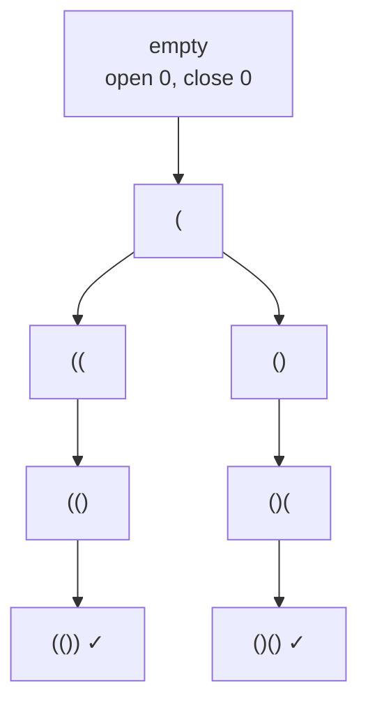

> [!tldr] Quick read
> - The problem: given n, return **every** string of n pairs of `()` that is correctly nested. n = 3 has 5 strings.
> - The number of answers is the [[en/concepts/catalan-number|Catalan number]] C(n): 1, 2, 5, 14, 42, … , 1430 at n = 8. It grows almost like 4ⁿ, so nothing can be faster than printing all the answers.
> - Generating all 2²ⁿ strings and filtering: at n = 10 only 16 796 of 1 048 576 strings are valid, so 98% of the work is wasted.
> - [[en/concepts/backtracking|Backtracking]] with two conditions: add `(` while there are fewer than n openers, add `)` while there are **fewer closers than openers**. Every branch it takes leads to at least one answer, so no step is wasted.
> - The string being built is a [[en/concepts/stack|stack]]: add a character, try, then take it off. Three traps: the condition `close < n` (0/8 cases), Go keeping a shared backing array (1/8), Java forgetting `setLength` (1/8).

> [!info] Context
> LeetCode problem 22, part of [[en/posts/2026-11-23-neetcode-stack|station 6: Stack]] on **the NeetCode line: Arrays and Strings**. The station's other three problems use a stack as a data structure; this one uses it implicitly, through the recursion's call stack. The solutions come in TypeScript, Python, Go, Java and JavaScript. All you need to know is recursive functions and strings.

> [!abstract]- Quick glossary for this post (click to open)
> - **Valid parentheses string**: reading left to right, the number of `)` never exceeds the number of `(`, and at the end the two are equal. See [[en/problems/valid-parentheses|Valid Parentheses]].
> - **Backtracking**: try a choice, go on, then **undo** that choice to try another. See [[en/concepts/backtracking|Backtracking]].
> - **Choice tree**: each node is a prefix being built, each branch is one character added.
> - **Call stack**: where the machine keeps the function calls still in progress. Recursion k levels deep uses k slots.
> - **Catalan numbers**: the sequence 1, 1, 2, 5, 14, 42, … that counts many nested structures. See [[en/concepts/catalan-number|Catalan Number]].

## Picture it first: entering a cinema with paired tickets

The cinema only lets people in by pairs: the leader holds a `(` ticket, the companion holds a `)` ticket, and a companion may not go in before their leader. There are n pairs. The usher wants to know every possible order of entry.

| Everyday life | Concept |
|---|---|
| A leader walks in (some leaders are still outside) | add `(` when `open < n` |
| A companion walks in (a leader is already waiting inside) | add `)` when `close < open` |
| A companion with no leader waiting inside | a broken string, like `")("` |
| Note an order, then have the last person step back to try someone else | backtracking: add, try, take off |
| Write every line-up of 2n people first, then cross out the bad ones | generate 2²ⁿ strings and filter |
| The number of valid orders | the Catalan number C(n) |



The tree for n = 2. The root has only a `(` branch: the `)` branch is cut because `close < open` is false (0 < 0). At `((`, the number of openers already equals n, so only the `)` branch remains. No branch leads to a dead end.

## The problem

**The problem (in my own words):** given an integer n (1 ≤ n ≤ 8), return a list of every string of length 2n with n `(` and n `)` that is correctly nested. The order of the list doesn't matter. Original: [LeetCode 22](https://leetcode.com/problems/generate-parentheses/).

| n | Output |
|---|---|
| 1 | `["()"]` |
| 2 | `["(())", "()()"]` |
| 3 | `["((()))", "(()())", "(())()", "()(())", "()()()"]` |

I used to think this was a stack problem in the "push brackets, pop them" sense. It turns out no stack is ever declared; what plays the stack is the string being built and the pile of recursive calls.

## How it works

<figure class="figure-map" style="--ar: 3 / 4">
<div class="frame"><iframe data-archify="../../diagrams/neetcode-generate-parentheses/worked-example.en.html" title="Close only when an opening bracket is unmatched" loading="lazy"></iframe></div>
<figcaption><span><b>Figure 1.</b> Close only when an opening bracket is unmatched.</span><a href="../diagrams/neetcode-generate-parentheses/worked-example.en.html" target="_blank" rel="noopener">Open full screen</a></figcaption>
</figure>

<details>
<summary>Read the steps</summary>
<ol>
<li>Start with an opening bracket. <code>n = 2, &quot;(&quot;</code></li>
<li>Closing now is one valid choice. <code>&quot;()&quot; → &quot;()()&quot;</code></li>
<li>Opening again is another choice. <code>&quot;((&quot; → &quot;(())&quot;</code></li>
<li>Both branches use exactly two pairs. <code>[&quot;(())&quot;, &quot;()()&quot;]</code></li>
</ol>
</details>

### How many answers are there

The number of valid strings of n pairs is the Catalan number `C(n) = (2n)! / ((n+1)! · n!)`, sequence [A000108](https://oeis.org/A000108) in the OEIS. The TypeScript file prints the first ten values next to the number of arbitrary strings of length 2n:

| n | 1 | 2 | 3 | 4 | 5 | 6 | 7 | 8 | 9 | 10 |
|---|---|---|---|---|---|---|---|---|---|---|
| C(n) | 1 | 2 | 5 | 14 | 42 | 132 | 429 | 1 430 | 4 862 | 16 796 |
| 2²ⁿ | 4 | 16 | 64 | 256 | 1 024 | 4 096 | 16 384 | 65 536 | 262 144 | 1 048 576 |

C(n) grows roughly like `4ⁿ / (n^1.5 · √π)`. The output is already that large, and each string is 2n characters long, so every solution costs at least O(n · C(n)). The only question is how much extra it wastes.

### Approach 1, generate everything then filter

Walk every number from 0 to 2²ⁿ − 1, read each bit as `(` or `)`, and keep the balanced strings. Correct, but the share of strings kept is C(n) / 4ⁿ: 1.6% at n = 10, and it keeps shrinking as n grows.

### Approach 2, backtracking with two conditions

Build the string left to right, choosing at each step to add `(` or `)`:
- add `(` when `open < n`: some leaders are still outside;
- add `)` when `close < open`: an opener is waiting to be closed.

These two conditions keep exactly the invariant of [[en/problems/valid-parentheses|Valid Parentheses]]: in every prefix, closers never outnumber openers. Better still, every prefix satisfying the two conditions **can still be completed** (just keep adding `)` until done), so backtracking never enters a dead branch. The tree has only a small constant times as many nodes as leaves, O(n · C(n)) in total.

The "back" in backtracking is the undo step: after trying the `(` branch, you must take the `(` off before trying the `)` branch. The string being built is therefore changed at **one end** only: it is exactly a stack.

### Approach 3, an explicit stack

Recursion uses the call stack. You can replace it with an explicit stack of triples `(string, open, close)`: pop a state, record it if it has 2n characters, otherwise push its children. Same tree, same number of nodes; only where it is remembered changes.

### Measured

TypeScript, median of 3 runs:

| n | C(n) | generate then filter | backtracking | explicit stack |
|---|---|---|---|---|
| 8 | 1 430 | 2.7 ms | 0.5 ms | 1.0 ms |
| 10 | 16 796 | 46.0 ms | 5.7 ms | 1.9 ms |
| 12 | 208 012 | 737.2 ms | 74.0 ms | 32.9 ms |
| 14 | 2 674 440 | (not run) | 1 127.2 ms | 506.7 ms |

Generating then filtering is about 10 times slower than backtracking, and the gap widens with `4ⁿ / C(n)`. The backtracking version is slower than the explicit-stack version because each leaf calls `cur.join("")` to build a string from a character array; the stack version concatenates short strings (`s + ")"`), which V8 does very cheaply. At n = 14 both spend most of their time creating 2.67 million output strings.

Python, same machine:

| n | generate then filter | backtracking, list + join | backtracking, concatenation | explicit stack |
|---|---|---|---|---|
| 8 | 9.8 ms | 0.6 ms | 0.5 ms | 0.6 ms |
| 10 | 184.0 ms | 7.4 ms | 5.7 ms | 6.9 ms |
| 12 | 3 232.2 ms | 93.5 ms | 74.2 ms | 90.8 ms |

Concatenating `s + "("` creates a new string at every step, but the string is at most 2n = 24 characters long, so it is cheaper than `"".join(cur)` at each leaf. The advice "don't concatenate strings in a loop" is right for **long** strings, not here.

### Under the hood of the five languages

| | The string being built | Language-specific trap |
|---|---|---|
| TypeScript / JavaScript | immutable strings, `s + "("` is a new string; or a character array then `join` | none: a new string doesn't affect other branches |
| Python | `str` is immutable: concatenation; or a `list` + `"".join` | default recursion limit of 1 000 levels; only 2n + 1 are needed here |
| Go | `[]byte` with `append` and reslicing `buf[:len(buf)-1]` | keeping `buf` itself instead of `string(buf)`: every result points to the same backing array |
| Java | one shared `StringBuilder`, undone with `setLength` | forgetting `setLength`: characters from the previous branch stay behind |

## Runnable example

[TypeScript](../code/neetcode-generate-parentheses/generate-parentheses.ts) · [Python](../code/neetcode-generate-parentheses/generate_parentheses.py) · [Go](../code/neetcode-generate-parentheses/generate_parentheses.go) · [Java](../code/neetcode-generate-parentheses/generate-parentheses.java) · [JavaScript](../code/neetcode-generate-parentheses/generate-parentheses.js)

Each file checks n = 1..8: exactly C(n) strings, no duplicates, each of length 2n and valid (together these three mean exactly the answer set). Below is the backtracking approach.

```ts
// Approach 2: backtracking. Add "(" only while there are fewer than n openers, add ")" only while there are fewer closers than openers.
function backtrack(n: number): string[] {
  const out: string[] = [];
  const cur: string[] = []; // the string being built is a stack: add a character, try, then remove it
  const go = (open: number, close: number) => {
    if (cur.length === 2 * n) { out.push(cur.join("")); return; }
    if (open < n) { cur.push("("); go(open + 1, close); cur.pop(); }
    if (close < open) { cur.push(")"); go(open, close + 1); cur.pop(); }
  };
  go(0, 0);
  return out;
}
```

```python
def backtrack(n: int) -> list[str]:
    out, cur = [], []  # cur is a list: append/pop are O(1); a str is immutable so it can't be "popped"
    def go(open_: int, close: int) -> None:
        if len(cur) == 2 * n:
            out.append("".join(cur))
            return
        if open_ < n:
            cur.append("(")
            go(open_ + 1, close)
            cur.pop()
        if close < open_:
            cur.append(")")
            go(open_, close + 1)
            cur.pop()
    go(0, 0)
    return out
```

```go
func backtrack(n int) []string {
	out := []string{}
	buf := make([]byte, 0, 2*n)
	var gen func(open, close int)
	gen = func(open, close int) {
		if len(buf) == 2*n {
			out = append(out, string(buf)) // string(buf) COPIES the bytes; buf keeps being modified
			return
		}
		if open < n {
			buf = append(buf, '(')
			gen(open+1, close)
			buf = buf[:len(buf)-1] // remove the character just added: reslice, no allocation
		}
		if close < open {
			buf = append(buf, ')')
			gen(open, close+1)
			buf = buf[:len(buf)-1]
		}
	}
	gen(0, 0)
	return out
}
```

```java
static List<String> backtrack(int n) {
    List<String> out = new ArrayList<>();
    go(new StringBuilder(), 0, 0, n, out);
    return out;
}

static void go(StringBuilder sb, int open, int close, int n, List<String> out) {
    if (sb.length() == 2 * n) { out.add(sb.toString()); return; } // toString copies the content
    if (open < n) {
        sb.append('(');
        go(sb, open + 1, close, n, out);
        sb.setLength(sb.length() - 1); // remove the character just added: the StringBuilder is ONE shared buffer
    }
    if (close < open) {
        sb.append(')');
        go(sb, open, close + 1, n, out);
        sb.setLength(sb.length() - 1);
    }
}
```

```js
function backtrack(n) {
  const out = [];
  const go = (s, open, close) => { // JS strings are immutable: s + "(" is a new string, other branches are unaffected
    if (s.length === 2 * n) { out.push(s); return; }
    if (open < n) go(s + "(", open + 1, close);
    if (close < open) go(s + ")", open, close + 1);
  };
  go("", 0, 0);
  return out;
}
```


The TypeScript file also runs the `close < n` version, then prints the Catalan table and measures:

```text
$ node generate-parentheses.ts
generateAllFilter  8/8 cases passed
backtrack          8/8 cases passed
explicitStack      8/8 cases passed
wrongCloseLtN      0/8 cases passed; wrong at n = 1, 2, 3, 4, 5, 6, 7, 8

wrongCloseLtN(2) = ["(())","()()","())(",")(()",")()(","))(("]
backtrack(3)     = ["((()))","(()())","(())()","()(())","()()()"]

n    C(n)      2^(2n)
1    1         4
2    2         16
3    5         64
4    14        256
5    42        1024
6    132       4096
7    429       16384
8    1430      65536
9    4862      262144
10   16796     1048576

n    generate+filter    backtrack  explicit stack     (ms, median of 3 runs)
8                 2.7        0.5                1.0
10               46.0        5.7                1.9
12              737.2       74.0               32.9
14                  —     1127.2              506.7
```

*(Output labels translated; the files themselves print Vietnamese.)*

With `close < n`, a `)` is added even when no opener is waiting. The result is every arrangement of n `(` and n `)`: 6 strings at n = 2, 4 of them broken. The wrong version fails even at n = 1 (`")("`), so the smallest test catches it.

The Go file keeps the slice `buf` itself instead of a copy:

```text
$ go run generate_parentheses.go
backtrack         8/8 cases passed
explicitStack     8/8 cases passed
backtrackAliased  1/8 cases passed

backtrackAliased(3) = ["()()()" "()()()" "()()()" "()()()" "()()()"]
```

The five results all point into one 6-byte backing array, so in the end they all hold the content of the last leaf. Exactly 5 elements, no error, no panic; only the "no duplicates" check catches it. The wrong version passes n = 1 because there is only one result then. The Java file forgets `setLength`:

```text
$ java generate-parentheses.java
backtrack      8/8 cases passed
explicitStack  8/8 cases passed
forgetUndo     1/8 cases passed

forgetUndo(2) = [(()), (()))]
```

After the `((…))` branch, the old characters are still in the buffer, so the `()…` branch starts from `(())` instead of `(`. Python prints `8/8 ca đúng` ("8/8 cases passed") for all four approaches (generate then filter, backtracking with list + join, backtracking with concatenation, explicit stack); JavaScript prints `8/8 ca đúng` for its two.

## Misconceptions and common traps

- **The closing condition is `close < n`.** It must be `close < open`. Having n `)` in total doesn't mean they are in the right order.
- **"Backtracking means trying everything and dropping the wrong ones."** That is approach 1. Good backtracking cuts a branch **before** entering it; in this problem every remaining branch leads to an answer.
- **Recording the buffer instead of a copy.** Go (`buf` instead of `string(buf)`), Java (keeping `sb` instead of `sb.toString()`), Python (keeping `cur` instead of `"".join(cur)`): every result is the same object, modified after it was recorded.
- **Forgetting to undo the choice with a shared buffer.** Java `StringBuilder`, Go `[]byte`, a character array in TS: what you add must be taken off after trying. With immutable strings (`s + "("`) there is nothing to undo.
- **"It must be optimized below O(4ⁿ)."** It can't: the output already has C(n) strings, growing like 4ⁿ / n^1.5. Optimizing only trims the waste beyond the output.

## Self-check questions

> [!question]- At the prefix `"(()"` with n = 3, which characters can be added next?
> open = 2, close = 1. `(` is allowed (2 < 3), `)` is allowed (1 < 2). Both branches lead to answers: `"(()(…"` and `"(())…"`.

> [!question]- Why does backtracking with the two conditions never enter a dead end?
> Every prefix with `close ≤ open ≤ n` can be completed: add the remaining `(`, then add `)` until done. So every branch allowed has at least one leaf that is an answer.

> [!question]- In Go, how does `out = append(out, string(buf))` differ from `saved = append(saved, buf)`?
> `string(buf)` copies the bytes into a new string. `buf` is a slice, i.e. a reference to a backing array; keeping it means every saved element sees later modifications.

> [!question]- How many answers does n = 8 have, and how many strings must generate-then-filter examine?
> C(8) = 1 430 answers; 2¹⁶ = 65 536 strings to examine, so about 2.2% are kept.

## References

- [LeetCode 22: Generate Parentheses](https://leetcode.com/problems/generate-parentheses/) (the original problem)
- [OEIS A000108: Catalan numbers](https://oeis.org/A000108) (the sequence 1, 1, 2, 5, 14, …, formulas and asymptotics)
- Donald E. Knuth, *The Art of Computer Programming*, volume 4A, section 7.2.1.6 "Generating all trees" (listing nested parentheses strings)
- [The Go Blog: Go Slices: usage and internals](https://go.dev/blog/slices-intro) (a slice is a reference to a backing array)
- [Java 21 `StringBuilder`](https://docs.oracle.com/en/java/javase/21/docs/api/java.base/java/lang/StringBuilder.html) (`setLength`, `toString` returns a new string)
- [Python: `sys.getrecursionlimit`](https://docs.python.org/3/library/sys.html#sys.getrecursionlimit) (the default recursion limit)
