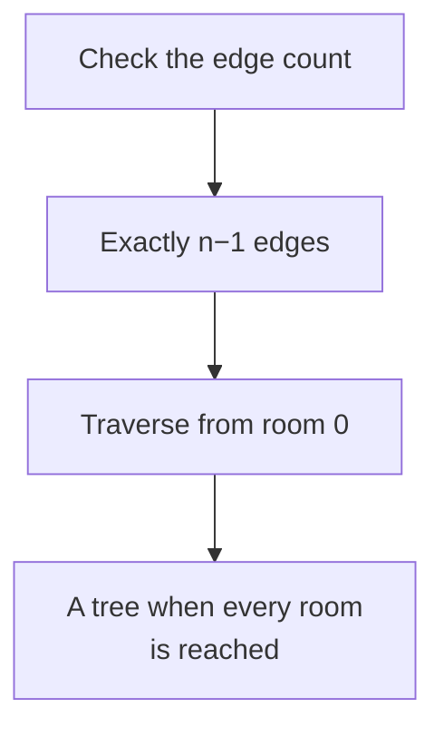

> [!tldr] Quick read
> - A tree with `n` vertices has exactly `n−1` edges. The edge count alone is insufficient.
> - With the correct edge count, DFS can check connectivity or [[en/concepts/disjoint-set-union|Union-Find]] can check that every edge merges two groups.
> - A triangle alongside a connected pair catches the bug of checking only the edge count.

> [!info] Context
> LeetCode 261, from [[en/posts/2026-11-27-neetcode-union-find|station 4: Union-Find]] on [[en/series/neetcode-grph|the NeetCode Graphs line]]. The example uses a small graph and assumes only arrays and loops.

> [!abstract]- Quick glossary for this post (click to open)
> - An undirected edge joins two vertices in both directions.
> - A [[en/concepts/connected-component|connected component]] is a maximal group whose vertices can reach one another.
> - [[en/concepts/disjoint-set-union|DSU]] maintains groups by finding roots and merging them. DFS is depth-first search.

## Picture it first: wires between rooms

I connect rooms using two-way wires. Every room must reach every other room along the wires, with exactly one simple path between each pair. Three rooms wired in a loop plus two other rooms connected by one wire still use four wires for five rooms, yet the rooms are split into groups.

| Everyday life | Concept |
|---|---|
| Room | Vertex |
| Two-way wire | Undirected edge |
| Every room is reachable | Connectivity |
| Two simple paths between some pair | Cycle |



## The problem: recognizing a tree

The graph has `n` vertices numbered 0 through `n−1`. The public NeetCode version allows `1 ≤ n ≤ 2000` and up to 5,000 undirected edges, with neither repeated edges nor self-loops.

For example, take `n=5` and `edges=[[0,1],[1,2],[0,2],[3,4]]`. There are exactly `n−1` edges, but `{0,1,2}` forms a cycle and cannot reach `{3,4}`. The answer is `false`.

## How it works

### Approach 1. Check the edge count, then traverse

A tree has `n−1` edges. In a connected graph, DFS can construct a spanning tree by retaining one edge that first discovers each new vertex. The spanning tree uses `n−1` edges. If the input also has exactly that many edges and DFS reaches every vertex, all edges are in the spanning tree, so there can be no cycle. This uses O(V + E) time and O(V + E) auxiliary space including adjacency lists.

### Approach 2. Check that each edge joins two groups

After checking `E = V−1`, try to merge each pair of endpoints. A failed merge means that edge closes a cycle. If every merge succeeds, the group count starts at `V` and drops exactly `V−1` times, leaving one group. That proves both tree properties. This uses O(V + E α(V)) amortized time and O(V) auxiliary space. Both implementations return immediately on the wrong edge count before building a data structure.

## Runnable example

[TypeScript](../code/neetcode-graph-valid-tree/solve.ts) · [Python](../code/neetcode-graph-valid-tree/solve.py) · [Go](../code/neetcode-graph-valid-tree/solve.go) · [Java](../code/neetcode-graph-valid-tree/solve.java) · [JavaScript](../code/neetcode-graph-valid-tree/solve.js) · [PHP](../code/neetcode-graph-valid-tree/solve.php) · [Rust](../code/neetcode-graph-valid-tree/solve.rs)

The tabs show the solution excerpt. The downloaded file includes every approach and its runnable checks.

```ts
import assert from "node:assert/strict";

type Edge = readonly [number, number];

class DisjointSet {
  private parent: number[];
  private size: number[];
  count: number;

  constructor(n: number) {
    this.parent = Array.from({ length: n }, (_, i) => i);
    this.size = new Array<number>(n).fill(1);
    this.count = n;
  }

  find(node: number): number {
    while (node !== this.parent[node]) {
      this.parent[node] = this.parent[this.parent[node]];
      node = this.parent[node];
    }
    return node;
  }

  union(a: number, b: number): boolean {
    let ra = this.find(a);
    let rb = this.find(b);
    if (ra === rb) return false;
    if (this.size[ra] < this.size[rb]) [ra, rb] = [rb, ra];
    this.parent[rb] = ra;
    this.size[ra] += this.size[rb];
    this.count--;
    return true;
  }
}

function treeByDsu(n: number, edges: readonly Edge[]): boolean {
  if (edges.length !== n - 1) return false;
  const ds = new DisjointSet(n);
  return edges.every(([a, b]) => ds.union(a, b));
}
```

```python
class DisjointSet:
    def __init__(self, n):
        self.parent = list(range(n))
        self.size = [1] * n
        self.count = n

    def find(self, node):
        while node != self.parent[node]:
            self.parent[node] = self.parent[self.parent[node]]
            node = self.parent[node]
        return node

    def union(self, a, b):
        ra, rb = self.find(a), self.find(b)
        if ra == rb:
            return False
        if self.size[ra] < self.size[rb]:
            ra, rb = rb, ra
        self.parent[rb] = ra
        self.size[ra] += self.size[rb]
        self.count -= 1
        return True


def tree_by_dsu(n, edges):
    if len(edges) != n - 1:
        return False
    ds = DisjointSet(n)
    return all(ds.union(a, b) for a, b in edges)
```

```go
package main

import "fmt"

type edge [2]int

type disjointSet struct {
	parent, size []int
	count        int
}

func newDisjointSet(n int) *disjointSet {
	ds := &disjointSet{make([]int, n), make([]int, n), n}
	for i := range ds.parent {
		ds.parent[i], ds.size[i] = i, 1
	}
	return ds
}

func (ds *disjointSet) find(node int) int {
	for node != ds.parent[node] {
		ds.parent[node] = ds.parent[ds.parent[node]]
		node = ds.parent[node]
	}
	return node
}

func (ds *disjointSet) union(a, b int) bool {
	ra, rb := ds.find(a), ds.find(b)
	if ra == rb {
		return false
	}
	if ds.size[ra] < ds.size[rb] {
		ra, rb = rb, ra
	}
	ds.parent[rb] = ra
	ds.size[ra] += ds.size[rb]
	ds.count--
	return true
}

func treeByDsu(n int, edges []edge) bool {
	if len(edges) != n-1 {
		return false
	}
	ds := newDisjointSet(n)
	for _, e := range edges {
		if !ds.union(e[0], e[1]) {
			return false
		}
	}
	return true
}
```

```java
class Solve {
    static final class DisjointSet {
        private final int[] parent;
        private final int[] size;
        int count;

        DisjointSet(int n) {
            parent = new int[n];
            size = new int[n];
            count = n;
            for (int i = 0; i < n; i++) {
                parent[i] = i;
                size[i] = 1;
            }
        }

        int find(int node) {
            while (node != parent[node]) {
                parent[node] = parent[parent[node]];
                node = parent[node];
            }
            return node;
        }

        boolean union(int a, int b) {
            int ra = find(a), rb = find(b);
            if (ra == rb) return false;
            if (size[ra] < size[rb]) {
                int swap = ra;
                ra = rb;
                rb = swap;
            }
            parent[rb] = ra;
            size[ra] += size[rb];
            count--;
            return true;
        }
    }

    static boolean treeByDsu(int n, int[][] edges) {
        if (edges.length != n - 1) return false;
        var ds = new DisjointSet(n);
        for (int[] e : edges) {
            if (!ds.union(e[0], e[1])) return false;
        }
        return true;
    }
}
```

```javascript
import assert from "node:assert/strict";

class DisjointSet {
  parent;
  size;
  count;

  constructor(n) {
    this.parent = Array.from({ length: n }, (_, i) => i);
    this.size = new Array(n).fill(1);
    this.count = n;
  }

  find(node) {
    while (node !== this.parent[node]) {
      this.parent[node] = this.parent[this.parent[node]];
      node = this.parent[node];
    }
    return node;
  }

  union(a, b) {
    let ra = this.find(a);
    let rb = this.find(b);
    if (ra === rb) return false;
    if (this.size[ra] < this.size[rb]) [ra, rb] = [rb, ra];
    this.parent[rb] = ra;
    this.size[ra] += this.size[rb];
    this.count--;
    return true;
  }
}

function treeByDsu(n, edges) {
  if (edges.length !== n - 1) return false;
  const ds = new DisjointSet(n);
  return edges.every(([a, b]) => ds.union(a, b));
}
```

```php
<?php
declare(strict_types=1);

final class DisjointSet
{
    private array $parent;
    private array $size;
    public int $count;

    public function __construct(int $n)
    {
        $this->parent = range(0, $n - 1);
        $this->size = array_fill(0, $n, 1);
        $this->count = $n;
    }

    public function find(int $node): int
    {
        while ($node !== $this->parent[$node]) {
            $this->parent[$node] = $this->parent[$this->parent[$node]];
            $node = $this->parent[$node];
        }
        return $node;
    }

    public function union(int $a, int $b): bool
    {
        [$ra, $rb] = [$this->find($a), $this->find($b)];
        if ($ra === $rb) {
            return false;
        }
        if ($this->size[$ra] < $this->size[$rb]) {
            [$ra, $rb] = [$rb, $ra];
        }
        $this->parent[$rb] = $ra;
        $this->size[$ra] += $this->size[$rb];
        $this->count--;
        return true;
    }
}

function treeByDsu(int $n, array $edges): bool
{
    if (count($edges) !== $n - 1) {
        return false;
    }
    $ds = new DisjointSet($n);
    foreach ($edges as [$a, $b]) {
        if (!$ds->union($a, $b)) {
            return false;
        }
    }
    return true;
}
```

```rust
type Edge = [usize; 2];

struct DisjointSet {
    parent: Vec<usize>,
    size: Vec<usize>,
    count: usize,
}

impl DisjointSet {
    fn new(n: usize) -> Self {
        Self {
            parent: (0..n).collect(),
            size: vec![1; n],
            count: n,
        }
    }

    fn find(&mut self, mut node: usize) -> usize {
        while node != self.parent[node] {
            self.parent[node] = self.parent[self.parent[node]];
            node = self.parent[node];
        }
        node
    }

    fn union(&mut self, a: usize, b: usize) -> bool {
        let mut ra = self.find(a);
        let mut rb = self.find(b);
        if ra == rb {
            return false;
        }
        if self.size[ra] < self.size[rb] {
            std::mem::swap(&mut ra, &mut rb);
        }
        self.parent[rb] = ra;
        self.size[ra] += self.size[rb];
        self.count -= 1;
        true
    }
}

fn tree_by_dsu(n: usize, edges: &[Edge]) -> bool {
    if edges.len() != n - 1 {
        return false;
    }
    let mut ds = DisjointSet::new(n);
    edges.iter().all(|&[a, b]| ds.union(a, b))
}
```

Output from each language file:

```text
10/10 cases passed
```

*(Output labels translated; the files themselves print Vietnamese.)*

## Misconceptions and common traps

- Checking the count and returning `true` accepts the triangle with a separate wire.
- Checking only for cycles lets a disconnected forest pass. The `n−1` edge requirement completes the proof here.
- With `n=1` and `edges=[]`, one vertex forms a tree. It needs no edge to connect to itself.
- Rust uses `usize` for indices and the subtraction `n−1`. The input guarantees `n≥1`, so the subtraction is safe.

## Self-check questions

> [!question]- What if the edge count matches but DFS misses a vertex?
> The graph is disconnected, so it is not a tree. The triangle and separate edge use the right number of edges but leave two groups.

> [!question]- Why can the code omit `ds.count === 1`?
> There are exactly `n−1` edges, and each edge must successfully merge groups. The count starts at `n`, drops `n−1` times, and must end at one.

## References

- [LeetCode](https://leetcode.com/problems/graph-valid-tree/)
- [NeetCode](https://neetcode.io/problems/valid-tree/question)
- [Sedgewick and Wayne, Weighted Quick Union](https://github.com/kevin-wayne/algs4/blob/master/src/main/java/edu/princeton/cs/algs4/WeightedQuickUnionUF.java)
- [Robert Tarjan, Efficiency of a Good But Not Linear Set Union Algorithm](https://doi.org/10.1145/321879.321884)
