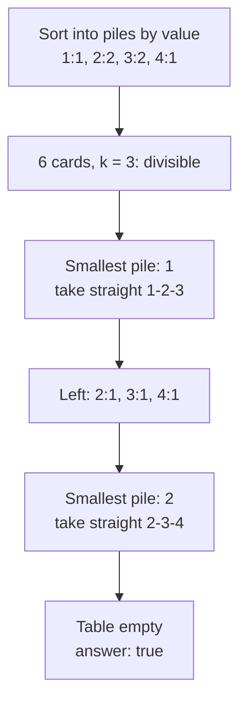
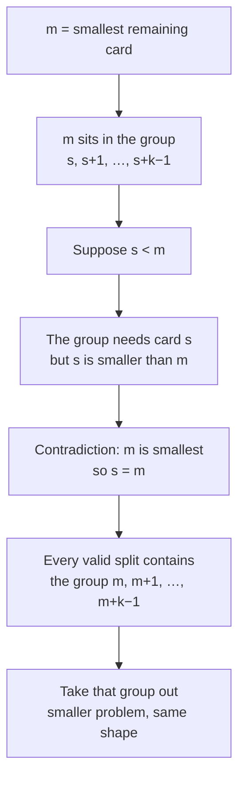

> [!tldr] Quick read
> - The question: can the hand be split into groups of exactly k cards, each group being k consecutive values? If the number of cards is not divisible by k, return `false` right away.
> - The greedy move: the smallest remaining card has no smaller card to stand in front of it, so it **can only** be the card that opens a group. Open the group `x, x+1, …, x+k−1` there, and return `false` if any card is missing. This is [[en/concepts/smallest-first-grouping|smallest-first grouping]].
> - You need a [[en/concepts/frequency-counting|frequency count]] (a [[en/concepts/hash-map|hash map]] from value to number of cards) to know which cards are left, and one sort to know which card is smallest.
> - Faster: handle each **value** once. If c cards of x are left, all c of them must open groups, so subtract c from x … x+k−1 in one pass.
> - Measured on my machine with 200,000 cards, 1,000 distinct values and k = 10: per card takes 200,000 steps, per value takes 1,000 steps; that is 4.7 times (Rust) to 16 times (PHP) faster.

> [!info] Context
> This is LeetCode problem 846, the anchor problem of [[en/posts/2026-11-28-neetcode-greedy-grouping|station MISC-04: Greedy Grouping]] on **the NeetCode Line: Mixed Techniques**. LeetCode 1296 (Divide Array in Sets of K Consecutive Numbers) is the same problem with renamed variables and looser limits. I picture tidying the cards on the table after a card game into straights. You only need arrays, loops and sorting; the previous station, [[en/posts/2026-11-28-neetcode-greedy-array|station MISC-03: Greedy on Arrays]], shows how to prove that a greedy move never loses the answer.

> [!abstract]- Quick glossary for this post (click to open)
> - Straight: in card games, a run of cards with consecutive values, for example 5-6-7. Here a "straight" is a group of exactly k consecutive values.
> - [[en/concepts/frequency-counting|Frequency counting]]: walk the array once and record how many times each value appears. Here that is `count[x]` = how many x cards are still on the table.
> - [[en/concepts/hash-map|Hash map]]: a key → value lookup table with O(1) average access. I use it instead of a counting array because card values go up to 10⁹.
> - [[en/concepts/greedy-choice|Greedy choice]]: make a local decision right away, never revisit it, then prove that the decision never loses the answer.
> - [[en/concepts/sort-then-scan|Sort then scan]]: sort first, so that a single left-to-right scan meets the values in increasing order.

## Picture it first: tidying cards into straights

A round of cards just ended, and I sweep the cards on the table together, wanting to lay all of them out as straights of exactly 3 cards with nothing left over. I don't try random combinations. I sort the cards into piles by value, then look at the pile with the **smallest** value. A card from that pile cannot sit in the middle or at the end of a straight, because that straight would need a smaller card, and there are no smaller cards left on the table. So it must be the first card of a straight. I take one card from that pile and one from each of the next piles. If any of those piles is empty, I give up: it cannot be done.

| Everyday life | Concept |
|---|---|
| A card on the table | an element of `hand` |
| The pile of cards with value x | `count[x]` |
| A straight of exactly k consecutive cards | a group `x, x+1, …, x+k−1` |
| The smallest pile that still has cards | the smallest remaining card, which must open a group |
| An empty pile in the middle of a straight | `count[v] = 0`: return `false` |
| Counting the cards and seeing they don't divide by k | `n % k ≠ 0`: early exit |
| The smallest pile has c cards, opening c straights at once | the per-value approach: subtract c from k piles |

With the hand `[3, 2, 2, 1, 4, 3]` and k = 3, the piles are 1:1, 2:2, 3:2, 4:1:



## The problem: can it be split into straights

You get an integer array `hand` (each number is a card) and a number `k` (LeetCode calls it `groupSize`). Can all the cards be rearranged into groups, each of exactly k cards carrying k consecutive values? Every card must be in exactly one group. Limits: 1 ≤ n ≤ 10⁴, 0 ≤ card value ≤ 10⁹, 1 ≤ k ≤ n. Problem 1296 allows n up to 10⁵ and values from 1. My examples: `[12, 10, 11, 13, 11, 12]` with k = 3 splits into 10-11-12 and 11-12-13; `[3, 3, 4, 4, 5, 6]` with k = 3 does not. [Original problem, LeetCode 846](https://leetcode.com/problems/hand-of-straights/)

My first idea was to follow the input order: whenever I meet a card that is still on the table, open a straight from that card upward. With `[2, 3, 1]`, k = 3, that opens a straight at 2 and asks for 2-3-4; 4 is missing, so it returns `false`. The answer is `true`: 1-2-3. Card 2 is not the first card of its straight, because card 1 is smaller. The only card that is certain to open a straight is the **smallest** one, so you have to sort first.

## How it works

### Referee: try every way to group

Take any remaining card and call it x. This card sits in some group, and that group starts at one of the k values `x−k+1, …, x`. Try each option: if all the cards are there, take the group out, recurse on the rest, and if that fails, put the cards back. This approach assumes nothing about the smallest card, so I use it as a referee to check the fast approaches. Each level has up to k branches and there are up to n/k levels, so the time is exponential; it only runs on small hands.

### Why the smallest card must open a group



In other words, there is no choice around the smallest card: its group is forced. Taking that group out never loses the answer, because every answer contains it. If any card in `m … m+k−1` is missing, no valid split exists. This is the difference from the greedy problems at [[en/posts/2026-11-28-neetcode-greedy-array|station MISC-03]]: there you have to prove that one choice is "no worse" than the others, while here the choice is the only one.

### Approach 1: per card

Build `count`, sort `hand` in increasing order, then walk each card x of the sorted array. `count[x] = 0` means this card was already taken into an earlier group, so skip it. Otherwise x is currently the smallest remaining card (every smaller card is gone), so subtract 1 at each of `x, x+1, …, x+k−1`; if you hit 0, return `false`.

The complexity is often written as O(n log n + n·k), because each card may trigger k subtractions. Counting carefully, only a card that opens a group triggers k subtractions, and each subtraction uses up exactly one card, so the whole pass does at most n subtractions. The time is O(n log n) for the sort plus O(n) hash map operations. Memory is O(n) for the sorted copy and the count table.

### Approach 2: per value

In approach 1, if pile x has c cards, the loop meets x exactly c times and does the same work each time: subtract 1 from k piles. All c cards of x must open groups (the argument above applies c times in a row), so you can subtract c from each pile `x … x+k−1` in one pass, provided that pile still has at least c cards. That is why you only need to sort the **keys** of `count`, the d distinct values, instead of all n cards.

Trace with `[1, 1, 2, 2, 2, 3, 3, 3, 4]`, k = 3:

| x | c = count[x] | Subtract c at | count after the step | Result |
|---|---|---|---|---|
| 1 | 2 | 1, 2, 3 | 1:0, 2:1, 3:1, 4:1 | two groups 1-2-3 |
| 2 | 1 | 2, 3, 4 | 1:0, 2:0, 3:0, 4:0 | one group 2-3-4 |
| 3 | 0 | (skipped) | unchanged | |
| 4 | 0 | (skipped) | unchanged | `true` |

Counting takes O(n), sorting the keys takes O(d log d), and the number of subtractions is (number of values that open groups) × k, at most n. Total O(n + d log d), memory O(d).

### Approach 3: a queue of open groups

This approach never looks up `count[x+1]`, `count[x+2]`… It just walks the values in increasing order, each value once. It keeps `open`, the number of groups waiting for their next card, and a queue recording how many new groups were opened at each value. At value x with c cards:

- if groups are open and x does not directly follow the previous value: those groups can never be completed, return `false`;
- if c < `open`: not enough x cards for every waiting group, return `false`;
- otherwise `open` cards of x extend the old groups and the c − `open` extra cards open new groups; push that number onto the queue and set `open = c`;
- once the queue holds k entries, the groups opened at value x−k+1 have just reached k cards: subtract that number from `open`.

If `open = 0` after the last value, every group has closed. On the same hand as above, the queue goes `[2]`, `[2, 1]`, `[2, 1, 0]` (3 entries: close 2 groups, `open` = 1), then `[1, 0, 0]` (close 1 group, `open` = 0). The time is still O(n + d log d), but each value costs a single step, and this approach works on a sorted stream of (value, count) pairs without looking back up.

| Approach | Time | Auxiliary space | Notes |
|---|---|---|---|
| Referee trying every group | exponential | O(n) | Assumes nothing about the smallest card; only for cross-checking |
| Approach 1: per card | O(n log n) | O(n) | Sorts all n cards; at most n subtractions |
| Approach 2: per value | O(n + d log d) | O(d) | Sorts d keys; subtracts c at once |
| Approach 3: queue of open groups | O(n + d log d) | O(d) | One step per value, no look-ups ahead |

### Measuring: per card and per value

The two approaches only differ clearly when there are many duplicate cards. I built a hand of n = 200,000 cards: card i has value `(i · 7919) % 1000`, so 1,000 distinct values with 200 cards each, shuffled. k = 10. The answer is `true` (100 bands of 10 values, 200 groups each). This size exceeds the problem's 10⁴ limit; I picked it large so the times are big enough to measure. A "step" is one subtraction in the inner loop. Each language was measured once on my machine, and the times include counting and sorting:

| Language | Per card | Per value |
|---|---|---|
| TypeScript (Node) | 31.8 ms | 2.2 ms |
| Python | 46.9 ms | 5.3 ms |
| Go | 15.7 ms | 1.3 ms |
| Java | 25.1 ms | 2.9 ms |
| JavaScript (Node) | 29.3 ms | 2.1 ms |
| PHP | 41.8 ms | 2.6 ms |
| Rust | 5.6 ms | 1.2 ms |

Per card does 200,000 subtractions and sorts 200,000 numbers; per value does 1,000 subtractions and sorts 1,000 keys. What remains of approach 2's time is almost entirely counting the 200,000 cards into the hash map, which both approaches have to do. A hand with no duplicates (d = n) makes both approaches do the same number of subtractions, and the difference comes down to constant factors; I did not measure that case.

## Runnable example

[TypeScript](../code/neetcode-hand-of-straights/straights.ts) · [Python](../code/neetcode-hand-of-straights/straights.py) · [Go](../code/neetcode-hand-of-straights/straights.go) · [Java](../code/neetcode-hand-of-straights/straights.java) · [JavaScript](../code/neetcode-hand-of-straights/straights.js) · [PHP](../code/neetcode-hand-of-straights/straights.php) · [Rust](../code/neetcode-hand-of-straights/straights.rs)

```ts
// Approach 2, per value: c cards of x open c groups together, subtract c from x..x+k-1 in one go
function isNStraightByValue(hand: number[], k: number, counter = { steps: 0 }): boolean {
    if (hand.length % k !== 0) return false
    const count = countOf(hand)
    const keys = [...count.keys()].sort((a, b) => a - b) // sort only the distinct values
    for (const x of keys) {
        const c = count.get(x)!
        if (c === 0) continue
        for (let v = x; v < x + k; v++) {
            counter.steps++
            const have = count.get(v) ?? 0
            if (have < c) return false // not enough v cards for c groups
            count.set(v, have - c)
        }
    }
    return true
}
```

```python
# Approach 2, per value: c cards of x open c groups together, subtract c from x..x+k-1 in one go
def is_n_straight_by_value(hand, k, counter=None):
    if len(hand) % k != 0:
        return False
    count = Counter(hand)
    for x in sorted(count):  # sort only the distinct values
        c = count[x]
        if c == 0:
            continue
        for v in range(x, x + k):
            if counter is not None:
                counter["steps"] += 1
            have = count[v]
            if have < c:
                return False  # not enough v cards for c groups
            count[v] = have - c
    return True
```

```go
// Approach 2, per value: c cards of x open c groups together, subtract c from x..x+k-1 in one go
func isNStraightByValue(hand []int, k int, steps *int) bool {
	if len(hand)%k != 0 {
		return false
	}
	count := countOf(hand)
	keys := make([]int, 0, len(count))
	for x := range count {
		keys = append(keys, x) // map iteration order is random, so we must sort
	}
	slices.Sort(keys) // sort only the distinct values
	for _, x := range keys {
		c := count[x]
		if c == 0 {
			continue
		}
		for v := x; v < x+k; v++ {
			*steps++
			if count[v] < c {
				return false // not enough v cards for c groups
			}
			count[v] -= c
		}
	}
	return true
}
```

```java
// Approach 2, per value: c cards of x open c groups together, subtract c from x..x+k-1 in one go
static boolean isNStraightByValue(int[] hand, int k) {
    if (hand.length % k != 0) return false;
    TreeMap<Integer, Integer> count = new TreeMap<>(countOf(hand)); // keys kept sorted, distinct values only
    for (int x : new ArrayList<>(count.keySet())) {
        int c = count.get(x);
        if (c == 0) continue;
        for (int v = x; v < x + k; v++) {
            steps++;
            int have = count.getOrDefault(v, 0);
            if (have < c) return false; // not enough v cards for c groups
            count.put(v, have - c);
        }
    }
    return true;
}
```

```js
// Approach 2, per value: c cards of x open c groups together, subtract c from x..x+k-1 in one go
function isNStraightByValue(hand, k, counter = { steps: 0 }) {
    if (hand.length % k !== 0) return false
    const count = countOf(hand)
    const keys = [...count.keys()].sort((a, b) => a - b) // sort only the distinct values
    for (const x of keys) {
        const c = count.get(x)
        if (c === 0) continue
        for (let v = x; v < x + k; v++) {
            counter.steps++
            const have = count.get(v) ?? 0
            if (have < c) return false // not enough v cards for c groups
            count.set(v, have - c)
        }
    }
    return true
}
```

```php
// Approach 2, per value: c cards of x open c groups together, subtract c from x..x+k-1 in one go
function isNStraightByValue(array $hand, int $k): bool {
    global $steps;
    if (count($hand) % $k !== 0) return false;
    $count = countOf($hand);
    $keys = array_keys($count);
    sort($keys); // sort only the distinct values
    foreach ($keys as $x) {
        $c = $count[$x];
        if ($c === 0) continue;
        for ($v = $x; $v < $x + $k; $v++) {
            $steps++;
            $have = $count[$v] ?? 0;
            if ($have < $c) return false; // not enough v cards for c groups
            $count[$v] = $have - $c;
        }
    }
    return true;
}
```

```rust
// Approach 2, per value: c cards of x open c groups together, subtract c from x..x+k-1 in one go
fn is_n_straight_by_value(hand: &[i32], k: i32, steps: &mut u64) -> bool {
    if hand.len() % k as usize != 0 {
        return false;
    }
    let mut count = count_of(hand);
    let mut keys: Vec<i32> = count.keys().copied().collect();
    keys.sort_unstable(); // sort only the distinct values
    for x in keys {
        let c = count[&x];
        if c == 0 {
            continue;
        }
        for v in x..x + k {
            *steps += 1;
            match count.get_mut(&v) {
                Some(have) if *have >= c => *have -= c,
                _ => return false, // not enough v cards for c groups
            }
        }
    }
    true
}
```

The tabs show approach 2; the line that increments `steps` is only there to count for the measurement. The downloadable files also contain the counting helper `countOf`, the referee that tries every group, approach 1, approach 3 and a wrong version that skips the sort. The ten hand-made cases cover a shuffled hand, duplicate cards, two overlapping groups (1-2-3 and 2-3-4), a card missing in the middle, n not divisible by k, k = 1, values around 10⁹ and the value 0. In every case all four functions must return the expected answer.

The second line cross-checks against the referee on every hand using values 0 … 4 with 0 … 3 cards each, for k = 1 … 5: 1,023 hands × 5 = 5,115 cases. The cards are fed in increasing order with the second half rotated to the front, so the input is not already sorted. The third line runs the no-sort version on the same 5,115 cases. The last line is the measurement above (these are the TypeScript numbers).

```text
10/10 cases passed
5115/5115 cases passed (cross-check against the referee)
No sort: wrong on 86/5115 cases
n = 200000, k = 10, results true/true: per card 200000 steps (31.8 ms), per value 1000 steps (2.2 ms)
```

*(Output labels translated; the files themselves print Vietnamese.)*

All seven languages print the same first three lines and the same step counts on the last line; only the times differ, as in the table under How it works.

## Misconceptions and common traps

- Opening groups in input order instead of from the smallest card. The no-sort version is wrong on 86/5,115 cases, all of them returning `false` when the answer is `true`: `[2, 3, 1]` with k = 3 is one example. It never returns a wrong `true`, because when it returns `true` it really has grouped every card.
- Thinking the smallest card "should" open a group because that is advantageous. It is not about advantage: it is **forced** to open a group. Once that sinks in, there is no need to try anything else.
- Forgetting the `n % k` check. The result is still correct (some group will run short of cards anyway), but you miss the chance to answer immediately without counting and sorting. The check is only a necessary condition: `[1, 2, 4, 5, 6, 7]` has 6 cards with k = 3 and is still `false`.
- In approach 2, taking c from the original count table, for example by iterating a snapshot `sorted(count.items())` in Python. You must read `count[x]` at the moment you reach x, after the earlier groups have subtracted. With `[1, 1, 2, 2, 2, 3, 3, 3, 4]`, k = 3, the snapshot gives x = 2 the old count 3 while pile 2 has only 1 card left, so the function returns `false` even though the answer is `true`.
- Treating k as the number of groups instead of the number of cards per group. The problem asks for groups of k cards; the number of groups is n / k.
- TypeScript, JavaScript: `sort()` without a compare function compares as strings. `[10, 9, 11].sort()` gives `[10, 11, 9]`, so approach 1 opens a group at 10 and asks for 10-11-12. Always use `sort((a, b) => a - b)`.
- Python: `Counter` returns 0 for a missing key without adding the key, so `count[v]` is safe. `defaultdict(int)` does add the key on read; if you read like that while iterating `count`, Python raises `dictionary changed size during iteration`. The code iterates `sorted(count)`, a copied list, so it never hits this error.
- Go: the iteration order of `range` over a map is not specified and changes between runs. After pulling out the keys you must sort them, or approach 2 may start at a value that is not the smallest.
- Java: `HashMap.get` returns `null` for a missing key, and assigning that to an `int` throws `NullPointerException`. Use `getOrDefault(v, 0)`. Comparing two `Integer`s from the map with `==` compares references and only happens to work for numbers from −128 to 127; here I compare against an `int`, so Java unboxes first.
- PHP: `sort($sorted)` sorts in place and returns `true`, not the array; writing `$sorted = sort($hand)` loses the array. PHP arrays are passed by value, so sorting a copy never touches the caller's array.
- Rust: `hand.len() % k as usize` is correct because `as` binds tighter than `%`. Using `count[&v]` on a key that may be missing panics; the code uses `get_mut` and `match` so that a missing key returns `false`.

## Self-check questions

> [!question]- Why must the smallest remaining card be the card that opens a group, not merely "should" be?
> If its group started at s < m, that group would need card s, which is smaller than the smallest remaining card: impossible. So every valid split contains the group `m … m+k−1`.

> [!question]- With `[1, 2, 2, 3, 3, 4]` and k = 3, what steps does approach 2 take?
> count = 1:1, 2:2, 3:2, 4:1. x = 1, c = 1: subtract 1 at 1, 2, 3 → 2:1, 3:1. x = 2, c = 1: subtract 1 at 2, 3, 4 → all gone. x = 3, 4: c = 0, skipped. The answer is `true`.

> [!question]- Why does approach 1 do at most n subtractions, even though each card may trigger k of them?
> Only a card that opens a group triggers k subtractions, and each subtraction takes exactly one card off the table. There are n cards, so at most n subtractions; cards already taken cost only one `count[x] = 0` check.

> [!question]- In approach 3, when must you return `false` even though the current pile has enough cards?
> When groups are still open (`open > 0`) and the current value does not directly follow the previous one. Those groups need exactly the missing value, so they can never reach k cards.

## References

- [LeetCode 846: Hand of Straights](https://leetcode.com/problems/hand-of-straights/) · [LeetCode 1296: Divide Array in Sets of K Consecutive Numbers](https://leetcode.com/problems/divide-array-in-sets-of-k-consecutive-numbers/)
- [Python docs: collections.Counter](https://docs.python.org/3/library/collections.html#collections.Counter) · [Java 21 API: HashMap](https://docs.oracle.com/en/java/javase/21/docs/api/java.base/java/util/HashMap.html)
- [The Go Programming Language Specification: For statements with range clause](https://go.dev/ref/spec#For_range) · [MDN: Array.prototype.sort()](https://developer.mozilla.org/en-US/docs/Web/JavaScript/Reference/Global_Objects/Array/sort)
- [Java SE 21 JLS §5.1.7: Boxing Conversion](https://docs.oracle.com/javase/specs/jls/se21/html/jls-5.html#jls-5.1.7)
- [PHP manual: sort](https://www.php.net/manual/en/function.sort.php)
- [The Rust Reference: expression precedence](https://doc.rust-lang.org/reference/expressions.html#expression-precedence)
