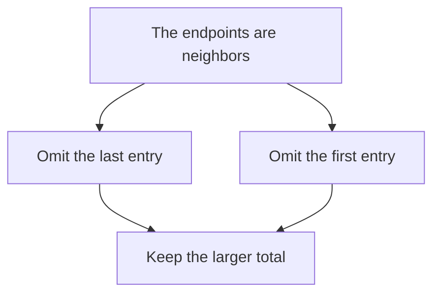

> [!tldr] Quick read
> - The array endpoints become neighbors on a circle.
> - Each valid choice omits at least one endpoint, so solve `[0,n−1)` and `[1,n)` and take their maximum.
> - Handle one entry separately. Pass index bounds to keep auxiliary space O(1) across both runs.

> [!info] Context
> LeetCode 213, from [[en/posts/2026-11-27-neetcode-linear-dp|station 1: One-Dimensional Recurrences]] on [[en/series/neetcode-dp|the NeetCode Dynamic Programming line]]. I use an array of scores to trace the state. The walkthrough assumes only array indices.

> [!abstract]- Quick glossary for this post (click to open)
> - A prefix starts at the beginning of the current range.
> - A DP state is the result of a clearly defined subproblem.
> - The exclusive bound `end` is one position past the last entry considered.

## Picture it first: choosing booths around a square

Bend the row of booths from [[en/problems/house-robber|House Robber]] around a square and its first booth becomes adjacent to its last. I can convert the circle to a row by closing a booth in two different ways. Close the last booth on the first pass. Close the first booth on the second. The best valid plan belongs to at least one pass because it already omits one endpoint.

| Everyday life | Concept |
|---|---|
| First booth next to last booth | Edge between the endpoints |
| Close the last booth | Range `[0,n−1)` |
| Close the first booth | Range `[1,n)` |
| Choose the plan worth more points | Maximum of the two results |



## The problem: maximizing the value on a circle

There are `n` positions on a circle, with `1 ≤ n ≤ 100` and each value between 0 and 1,000. Return the largest sum of a set of nonadjacent positions, including adjacency between endpoints when there are at least two positions.

The array `[9,1,1,9]` gives 10. The endpoints add to 18 but share an edge, so one valid choice is positions 0 and 2.

## How it works

### Approach 1. Cut the circle and try every choice

A valid choice never takes position 0 and `n−1` together. If it omits `n−1`, it belongs to `[0,n−1)`. If it omits 0, it belongs to `[1,n)`. A choice omitting both ends is covered twice, which is fine. Conversely, a valid choice in either subrange is valid on the circle because the other endpoint is absent. Taking the better of the two optima is therefore correct.

For each range I can recurse on taking or skipping, as in the row version. Two ranges increase the call count by a constant factor. A simple bound remains O(2ⁿ) time with an O(n) call stack. On 28 entries equal to 3, each 27-entry range makes 1,028,457 calls, for 2,056,914 total. The next two approaches perform 54 updates and return 42.

### Approach 2. Cut the circle and build tables

Within each range, scan from the first entry to the last. The recurrence `best[k] = max(best[k−1], best[k−2] + value)` chooses between skipping the new entry and taking it with a one-entry gap. Two table passes take O(n) time and O(n) auxiliary space.

### Approach 3. Cut the circle and keep two results

The compressed solution retains the last two results and shifts them after computing the new one. Pass bounds to reuse the same `nums` array. Both passes together take O(n) time and O(1) auxiliary space. With one entry, return its value before splitting.

## Runnable example

[TypeScript](../code/neetcode-house-robber-ii/solve.ts) · [Python](../code/neetcode-house-robber-ii/solve.py) · [Go](../code/neetcode-house-robber-ii/solve.go) · [Java](../code/neetcode-house-robber-ii/solve.java) · [JavaScript](../code/neetcode-house-robber-ii/solve.js) · [PHP](../code/neetcode-house-robber-ii/solve.php) · [Rust](../code/neetcode-house-robber-ii/solve.rs)

The tabs show the solution excerpt. The downloaded file includes every approach and its runnable checks.

```ts
import assert from "node:assert/strict";

type RangeSolver = (nums: number[], start: number, end: number) => number;

function rolling(nums: number[], start: number, end: number): number {
  let twoBack = 0;
  let oneBack = 0;
  for (let i = start; i < end; i++) {
    const best = Math.max(oneBack, twoBack + nums[i]);
    twoBack = oneBack;
    oneBack = best;
  }
  return oneBack;
}

function table(nums: number[], start: number, end: number): number {
  const best = new Array<number>(end - start + 2).fill(0);
  for (let i = start; i < end; i++) {
    const j = i - start;
    best[j + 2] = Math.max(best[j + 1], best[j] + nums[i]);
  }
  return best[end - start + 1];
}

function brute(nums: number[], i: number, end: number): number {
  if (i >= end) return 0;
  return Math.max(brute(nums, i + 1, end), nums[i] + brute(nums, i + 2, end));
}

function rob(nums: number[], solve: RangeSolver): number {
  if (nums.length === 1) return nums[0];
  return Math.max(solve(nums, 0, nums.length - 1), solve(nums, 1, nums.length));
}
```

```python
def rolling(nums, start, end):
    two_back = one_back = 0
    for i in range(start, end):
        two_back, one_back = one_back, max(one_back, two_back + nums[i])
    return one_back


def table(nums, start, end):
    best = [0] * (end - start + 2)
    for i in range(start, end):
        j = i - start
        best[j + 2] = max(best[j + 1], best[j] + nums[i])
    return best[-1]


def brute(nums, i, end):
    if i >= end:
        return 0
    return max(brute(nums, i + 1, end), nums[i] + brute(nums, i + 2, end))

def rob(nums, solve):
    if len(nums) == 1:
        return nums[0]
    return max(solve(nums, 0, len(nums) - 1), solve(nums, 1, len(nums)))
```

```go
package main

import "fmt"

type rangeSolver func([]int, int, int) int

func rolling(nums []int, start, end int) int {
	twoBack, oneBack := 0, 0
	for i := start; i < end; i++ {
		twoBack, oneBack = oneBack, max(oneBack, twoBack+nums[i])
	}
	return oneBack
}

func table(nums []int, start, end int) int {
	best := make([]int, end-start+2)
	for i := start; i < end; i++ {
		j := i - start
		best[j+2] = max(best[j+1], best[j]+nums[i])
	}
	return best[len(best)-1]
}

func brute(nums []int, i, end int) int {
	if i >= end {
		return 0
	}
	return max(brute(nums, i+1, end), nums[i]+brute(nums, i+2, end))
}

func rob(nums []int, solve rangeSolver) int {
	if len(nums) == 1 {
		return nums[0]
	}
	return max(solve(nums, 0, len(nums)-1), solve(nums, 1, len(nums)))
}
```

```java
class Solve {
    interface RangeSolver {
        int solve(int[] nums, int start, int end);
    }

    static int rolling(int[] nums, int start, int end) {
        int twoBack = 0;
        int oneBack = 0;
        for (int i = start; i < end; i++) {
            int best = Math.max(oneBack, twoBack + nums[i]);
            twoBack = oneBack;
            oneBack = best;
        }
        return oneBack;
    }

    static int table(int[] nums, int start, int end) {
        int[] best = new int[end - start + 2];
        for (int i = start; i < end; i++) {
            int j = i - start;
            best[j + 2] = Math.max(best[j + 1], best[j] + nums[i]);
        }
        return best[best.length - 1];
    }

    static int brute(int[] nums, int i, int end) {
        if (i >= end) return 0;
        return Math.max(brute(nums, i + 1, end), nums[i] + brute(nums, i + 2, end));
    }

    static int rob(int[] nums, RangeSolver solve) {
        if (nums.length == 1) return nums[0];
        return Math.max(solve.solve(nums, 0, nums.length - 1), solve.solve(nums, 1, nums.length));
    }
}
```

```javascript
import assert from "node:assert/strict";

function rolling(nums, start, end) {
  let twoBack = 0;
  let oneBack = 0;
  for (let i = start; i < end; i++) {
    const best = Math.max(oneBack, twoBack + nums[i]);
    twoBack = oneBack;
    oneBack = best;
  }
  return oneBack;
}

function table(nums, start, end) {
  const best = new Array(end - start + 2).fill(0);
  for (let i = start; i < end; i++) {
    const j = i - start;
    best[j + 2] = Math.max(best[j + 1], best[j] + nums[i]);
  }
  return best[end - start + 1];
}

function brute(nums, i, end) {
  if (i >= end) return 0;
  return Math.max(brute(nums, i + 1, end), nums[i] + brute(nums, i + 2, end));
}

function rob(nums, solve) {
  if (nums.length === 1) return nums[0];
  return Math.max(solve(nums, 0, nums.length - 1), solve(nums, 1, nums.length));
}
```

```php
<?php
declare(strict_types=1);

function rolling(array $nums, int $start, int $end): int
{
    $twoBack = 0;
    $oneBack = 0;
    for ($i = $start; $i < $end; $i++) {
        [$twoBack, $oneBack] = [$oneBack, max($oneBack, $twoBack + $nums[$i])];
    }
    return $oneBack;
}

function table(array $nums, int $start, int $end): int
{
    $best = array_fill(0, $end - $start + 2, 0);
    for ($i = $start; $i < $end; $i++) {
        $j = $i - $start;
        $best[$j + 2] = max($best[$j + 1], $best[$j] + $nums[$i]);
    }
    return $best[count($best) - 1];
}

function brute(array $nums, int $i, int $end): int
{
    if ($i >= $end) {
        return 0;
    }
    return max(brute($nums, $i + 1, $end), $nums[$i] + brute($nums, $i + 2, $end));
}

function rob(array $nums, callable $solve): int
{
    if (count($nums) === 1) {
        return $nums[0];
    }
    return max($solve($nums, 0, count($nums) - 1), $solve($nums, 1, count($nums)));
}
```

```rust
type RangeSolver = fn(&[i32], usize, usize) -> i32;

fn rolling(nums: &[i32], start: usize, end: usize) -> i32 {
    let (mut two_back, mut one_back) = (0, 0);
    for &value in &nums[start..end] {
        (two_back, one_back) = (one_back, one_back.max(two_back + value));
    }
    one_back
}

fn table(nums: &[i32], start: usize, end: usize) -> i32 {
    let mut best = vec![0; end - start + 2];
    for (j, &value) in nums[start..end].iter().enumerate() {
        best[j + 2] = best[j + 1].max(best[j] + value);
    }
    best[best.len() - 1]
}

fn brute(nums: &[i32], i: usize, end: usize) -> i32 {
    if i >= end {
        return 0;
    }
    brute(nums, i + 1, end).max(nums[i] + brute(nums, i + 2, end))
}

fn rob(nums: &[i32], solve: RangeSolver) -> i32 {
    if nums.len() == 1 {
        return nums[0];
    }
    solve(nums, 0, nums.len() - 1).max(solve(nums, 1, nums.len()))
}
```

Output from each language file:

```text
20/20 cases passed
```

*(Output labels translated; the files themselves print Vietnamese.)*

## Misconceptions and common traps

- The passes overlap on plans that omit both endpoints. Each pass forces one endpoint out and lets optimization decide whether to take the other.
- `n=1` needs its own case. Applying the split formula would give two empty ranges.
- JavaScript `slice` and Python list slicing make copies. Passing indices keeps auxiliary space O(1).

## Self-check questions

> [!question]- Why not run only the pass omitting the last entry?
> The best plan may need the last entry. With `[1,2,9]`, omitting it leaves a maximum of only 2.

> [!question]- Which ranges are considered with two entries?
> Each range contains one of the entries. The result is the larger of their values.

## References

- [LeetCode](https://leetcode.com/problems/house-robber-ii/)
- [MIT 6.006, Lecture 19, Memoization and Bottom-up DP](https://ocw.mit.edu/courses/6-006-introduction-to-algorithms-fall-2011/resources/mit6_006f11_lec19_orig/)
