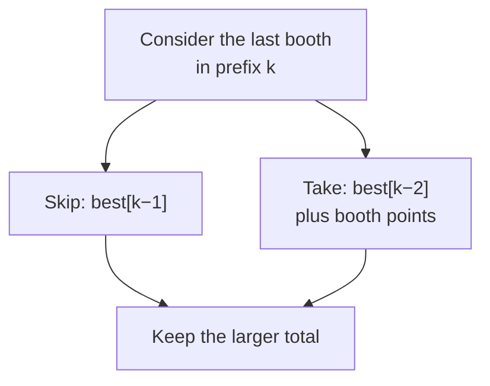

> [!tldr] Quick read
> - Each position offers two options. Skipping keeps the previous result, and taking it excludes its preceding neighbor.
> - Let `best[k]` be the highest total among the first `k` positions, then use `best[k]=max(best[k−1], best[k−2]+value)`.
> - Two prior results are enough. Greedily taking the highest-value position can lose to two positions with a higher combined value.

> [!info] Context
> LeetCode 198, from [[en/posts/2026-11-27-neetcode-linear-dp|station 1: One-Dimensional Recurrences]] on [[en/series/neetcode-dp|the NeetCode Dynamic Programming line]]. I use an array of scores to trace the state. The walkthrough assumes only array indices.

> [!abstract]- Quick glossary for this post (click to open)
> - A prefix starts at the beginning of the current range.
> - A DP state is the result of a clearly defined subproblem.
> - The exclusive bound `end` is one position past the last entry considered.

## Picture it first: choosing booths in a row

I have a row of booths offering point vouchers. Adjacent booths share a collection slot, so I can pick vouchers only at positions separated by at least one other booth. If I take the last booth, I can add its points to the best result ending before its neighbor. If I skip it, I reuse the result from the shorter row.

| Everyday life | Concept |
|---|---|
| The first k booths | State `best[k]` |
| Skip the current booth | Use `best[k−1]` |
| Take the current voucher | Add its points to `best[k−2]` |
| Choose the larger total | Recurrence |



## The problem: maximizing the value in a row

The array `nums` has between 1 and 100 entries, and each value is between 0 and 400. Choose a set of indices containing no adjacent pair and return the largest sum. For example, `[8,11,8]` gives 16 because the endpoints together beat the middle entry.

## How it works

### Approach 1. Branch in two directions

The function `brute(i)` asks about indices from `i` to the end. Skipping the position moves to `i+1`. Taking adds its value and moves to `i+2`. The two branches cover every valid choice and reach the same suffix repeatedly. A simple bound is O(2ⁿ) time with O(n) call stack space.

### Approach 2. Build a prefix table

`best[k]` is the optimum over the first `k` positions. `best[0]=0` and `best[1]=nums[0]`. For `k≥2`, an optimum either skips the new position (use `best[k−1]`) or takes it (use `best[k−2]+nums[k−1]`). These choices cover every valid solution. I use two zero entries at the front of the table in the file so the loop can use the same formula at the first position. This uses O(n) time and O(n) auxiliary space.

### Approach 3. Keep two results

Before processing the next entry, `oneBack` is the answer for the prefix already processed. `twoBack` is the answer for that prefix with its last entry excluded from the range. Compute the new result from both before shifting the variables. This uses O(n) time and O(1) auxiliary space.

On 28 entries all equal to 3, I counted 1,664,079 recursive calls, including base calls. The two-result version performs 28 updates. Both return 42.

## Runnable example

[TypeScript](../code/neetcode-house-robber/solve.ts) · [Python](../code/neetcode-house-robber/solve.py) · [Go](../code/neetcode-house-robber/solve.go) · [Java](../code/neetcode-house-robber/solve.java) · [JavaScript](../code/neetcode-house-robber/solve.js) · [PHP](../code/neetcode-house-robber/solve.php) · [Rust](../code/neetcode-house-robber/solve.rs)

The tabs show the solution excerpt. The downloaded file includes every approach and its runnable checks.

```ts
import assert from "node:assert/strict";

type RangeSolver = (nums: number[], start: number, end: number) => number;

function rolling(nums: number[], start: number, end: number): number {
  let twoBack = 0;
  let oneBack = 0;
  for (let i = start; i < end; i++) {
    const best = Math.max(oneBack, twoBack + nums[i]);
    twoBack = oneBack;
    oneBack = best;
  }
  return oneBack;
}

function table(nums: number[], start: number, end: number): number {
  const best = new Array<number>(end - start + 2).fill(0);
  for (let i = start; i < end; i++) {
    const j = i - start;
    best[j + 2] = Math.max(best[j + 1], best[j] + nums[i]);
  }
  return best[end - start + 1];
}

function brute(nums: number[], i: number, end: number): number {
  if (i >= end) return 0;
  return Math.max(brute(nums, i + 1, end), nums[i] + brute(nums, i + 2, end));
}

function rob(nums: number[], solve: RangeSolver): number {
  return solve(nums, 0, nums.length);
}
```

```python
def rolling(nums, start, end):
    two_back = one_back = 0
    for i in range(start, end):
        two_back, one_back = one_back, max(one_back, two_back + nums[i])
    return one_back


def table(nums, start, end):
    best = [0] * (end - start + 2)
    for i in range(start, end):
        j = i - start
        best[j + 2] = max(best[j + 1], best[j] + nums[i])
    return best[-1]


def brute(nums, i, end):
    if i >= end:
        return 0
    return max(brute(nums, i + 1, end), nums[i] + brute(nums, i + 2, end))

def rob(nums, solve):
    return solve(nums, 0, len(nums))
```

```go
package main

import "fmt"

type rangeSolver func([]int, int, int) int

func rolling(nums []int, start, end int) int {
	twoBack, oneBack := 0, 0
	for i := start; i < end; i++ {
		twoBack, oneBack = oneBack, max(oneBack, twoBack+nums[i])
	}
	return oneBack
}

func table(nums []int, start, end int) int {
	best := make([]int, end-start+2)
	for i := start; i < end; i++ {
		j := i - start
		best[j+2] = max(best[j+1], best[j]+nums[i])
	}
	return best[len(best)-1]
}

func brute(nums []int, i, end int) int {
	if i >= end {
		return 0
	}
	return max(brute(nums, i+1, end), nums[i]+brute(nums, i+2, end))
}

func rob(nums []int, solve rangeSolver) int {
	return solve(nums, 0, len(nums))
}
```

```java
class Solve {
    interface RangeSolver {
        int solve(int[] nums, int start, int end);
    }

    static int rolling(int[] nums, int start, int end) {
        int twoBack = 0;
        int oneBack = 0;
        for (int i = start; i < end; i++) {
            int best = Math.max(oneBack, twoBack + nums[i]);
            twoBack = oneBack;
            oneBack = best;
        }
        return oneBack;
    }

    static int table(int[] nums, int start, int end) {
        int[] best = new int[end - start + 2];
        for (int i = start; i < end; i++) {
            int j = i - start;
            best[j + 2] = Math.max(best[j + 1], best[j] + nums[i]);
        }
        return best[best.length - 1];
    }

    static int brute(int[] nums, int i, int end) {
        if (i >= end) return 0;
        return Math.max(brute(nums, i + 1, end), nums[i] + brute(nums, i + 2, end));
    }

    static int rob(int[] nums, RangeSolver solve) {
        return solve.solve(nums, 0, nums.length);
    }
}
```

```javascript
import assert from "node:assert/strict";

function rolling(nums, start, end) {
  let twoBack = 0;
  let oneBack = 0;
  for (let i = start; i < end; i++) {
    const best = Math.max(oneBack, twoBack + nums[i]);
    twoBack = oneBack;
    oneBack = best;
  }
  return oneBack;
}

function table(nums, start, end) {
  const best = new Array(end - start + 2).fill(0);
  for (let i = start; i < end; i++) {
    const j = i - start;
    best[j + 2] = Math.max(best[j + 1], best[j] + nums[i]);
  }
  return best[end - start + 1];
}

function brute(nums, i, end) {
  if (i >= end) return 0;
  return Math.max(brute(nums, i + 1, end), nums[i] + brute(nums, i + 2, end));
}

function rob(nums, solve) {
  return solve(nums, 0, nums.length);
}
```

```php
<?php
declare(strict_types=1);

function rolling(array $nums, int $start, int $end): int
{
    $twoBack = 0;
    $oneBack = 0;
    for ($i = $start; $i < $end; $i++) {
        [$twoBack, $oneBack] = [$oneBack, max($oneBack, $twoBack + $nums[$i])];
    }
    return $oneBack;
}

function table(array $nums, int $start, int $end): int
{
    $best = array_fill(0, $end - $start + 2, 0);
    for ($i = $start; $i < $end; $i++) {
        $j = $i - $start;
        $best[$j + 2] = max($best[$j + 1], $best[$j] + $nums[$i]);
    }
    return $best[count($best) - 1];
}

function brute(array $nums, int $i, int $end): int
{
    if ($i >= $end) {
        return 0;
    }
    return max(brute($nums, $i + 1, $end), $nums[$i] + brute($nums, $i + 2, $end));
}

function rob(array $nums, callable $solve): int
{
    return $solve($nums, 0, count($nums));
}
```

```rust
type RangeSolver = fn(&[i32], usize, usize) -> i32;

fn rolling(nums: &[i32], start: usize, end: usize) -> i32 {
    let (mut two_back, mut one_back) = (0, 0);
    for &value in &nums[start..end] {
        (two_back, one_back) = (one_back, one_back.max(two_back + value));
    }
    one_back
}

fn table(nums: &[i32], start: usize, end: usize) -> i32 {
    let mut best = vec![0; end - start + 2];
    for (j, &value) in nums[start..end].iter().enumerate() {
        best[j + 2] = best[j + 1].max(best[j] + value);
    }
    best[best.len() - 1]
}

fn brute(nums: &[i32], i: usize, end: usize) -> i32 {
    if i >= end {
        return 0;
    }
    brute(nums, i + 1, end).max(nums[i] + brute(nums, i + 2, end))
}

fn rob(nums: &[i32], solve: RangeSolver) -> i32 {
    solve(nums, 0, nums.len())
}
```

Output from each language file:

```text
17/17 cases passed
```

*(Output labels translated; the files themselves print Vietnamese.)*

## Misconceptions and common traps

- Compute the new total before shifting `twoBack`. Using the shifted value can count two adjacent booths.
- The array `[8,11,8]` also disproves taking the highest available entry. Taking 11 blocks both 8s.
- The `end` index in the files is exclusive. Taking an entry can jump past it, which returns 0 in the recursion.
- Python, Go, and PHP can assign the pair because the right side uses the old values. Java uses a temporary `best`.

## Self-check questions

> [!question]- For prefix [8,11,8], what are the two totals on the last step?
> Skipping the last entry keeps 11. Taking it uses 8 from the length-one prefix and adds another 8, so choose 16.

> [!question]- Are two variables enough to print the selected positions?
> They give the total. To recover the choices, one option is to keep the prefix table and backtrack through the skip and take branches.

## References

- [LeetCode](https://leetcode.com/problems/house-robber/)
- [MIT 6.006, Lecture 19, Memoization and Bottom-up DP](https://ocw.mit.edu/courses/6-006-introduction-to-algorithms-fall-2011/resources/mit6_006f11_lec19_orig/)
