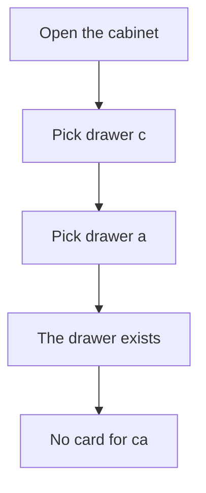
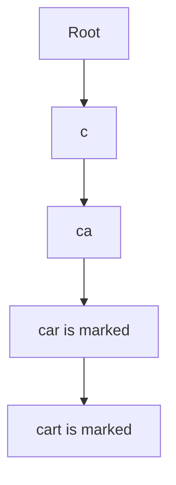

> [!tldr] Quick read
> - A word set handles exact membership. A prefix lookup may have to try many candidates without an index.
> - A trie shares the steps for words with a common prefix. One walk from the root can serve both lookups.
> - `search` requires a terminal marker at the destination. `startsWith` succeeds as soon as the whole path exists.
> - A sparse child map stores existing edges. A 26-slot array trades space for direct indexing.

> [!info] Context
> This is LeetCode 208, part of [[en/posts/2026-11-26-neetcode-trie|station 7: Tries]] on **the NeetCode Line: Linked Structures**. I'm building an index for a growing word list, with two questions: “Is this exact word here?” and “Does any word start this way?” All I need are lowercase strings and a way to step from a node to its child.

> [!abstract]- Quick glossary for this post (click to open)
> - A **prefix** is the beginning of a word, potentially as long as the word itself.
> - A [[en/concepts/trie|trie]] is a tree in which the edge labels from the root to a node spell a prefix.
> - A [[en/concepts/terminal-marker|terminal marker]] flags a node whose prefix was inserted as a word.
> - A **sparse child map** holds entries for edges that exist. A **fixed child array** reserves a slot for every possible letter.

## Picture it first: a cabinet index

I file word cards in a cabinet where every level has a drawer for one letter. Cards beginning with `ca` share the first two drawers. I can leave a complete card at `car` and still have a smaller `t` drawer for `cart`.

| Everyday life | Concept |
|---|---|
| Flip through all cards and read the start of each | A word set with a prefix scan |
| Open the same drawers for shared labels | Sharing paths in a trie |
| Leave a card in the drawer that's open | Terminal marker |
| Install all 26 slots at each level, or only the ones currently in use | Fixed array or sparse child map |



## The problem: store words and answer each lookup

A `Trie` starts empty. `insert(word)` adds a word. `search(word)` checks whether that word was inserted, and `startsWith(prefix)` checks whether any inserted word begins with the given prefix. Inputs contain 1–2,000 characters from `a` through `z`. There are at most 30,000 calls across the three operations. [LeetCode 208](https://leetcode.com/problems/implement-trie-prefix-tree/)

After inserting `cart`, `startsWith("car")` returns `true` and `search("car")` returns `false`. Inserting `car` makes both return `true`. Adding `cab` introduces a branch at `ca`, where the next edge can be `r` or `b`.

## How it works

<figure class="figure-map" style="--ar: 3 / 4">
<div class="frame"><iframe data-archify="../../diagrams/neetcode-implement-trie-prefix-tree/worked-example.en.html" title="A reachable prefix can be an unmarked word" loading="lazy"></iframe></div>
<figcaption><span><b>Figure 1.</b> A reachable prefix can be an unmarked word.</span><a href="../diagrams/neetcode-implement-trie-prefix-tree/worked-example.en.html" target="_blank" rel="noopener">Open full screen</a></figcaption>
</figure>

<details>
<summary>Read the steps</summary>
<ol>
<li>Insert the longer word first. <code>&quot;dove&quot;: d → o → v → e</code></li>
<li>Follow d and o to a reachable node. <code>startsWith(&quot;do&quot;) = true</code></li>
<li>The final node lacks a terminal marker. <code>search(&quot;do&quot;) = false</code></li>
<li>Inserting do just marks the existing node. <code>search(&quot;do&quot;) = true</code></li>
</ol>
</details>

### Word set with a scan

Keep full words in a hash set. Inserting or looking up an exact word uses one string key. For prefixes, scan the keys and stop when a word starts with the prefix. This is compact when most requests concern exact words. If every word misses, a prefix query has to check all N words.

### One walk, two success conditions

Start at the root. After consuming k characters, the current node represents exactly those first k characters. During insertion, create the next edge if it is absent. During lookup, a missing edge is enough to rule out the prefix. That is [[en/concepts/trie-prefix-pruning|trie prefix pruning]] in the case where each position offers one letter to try.

At the end of insertion, set `terminal` on the last node. Insert `cart` followed by `car`, and the second insertion follows existing edges and sets a flag at `car`. That node still has a `t` edge leading to `cart`. Inserting `car` again yields the same state.



| State after the walk | `search` | `startsWith` |
|---|---|---|
| A required edge is absent | False | False |
| The destination is unmarked | False | True |
| The destination is marked | True | True |

The invariant holds because each node has at most one child edge for any letter. With insertion only, an existing path was created as part of inserting some word. Any node reached by a nonempty prefix therefore has a stored word at that node or below it. A trie can use an associated value to flag an inserted node, as the Princeton implementation does. A Boolean flag is enough here. [Princeton Algorithms, TrieST](https://raw.githubusercontent.com/kevin-wayne/algs4/master/src/main/java/edu/princeton/cs/algs4/TrieST.java)

### Choose how to store edges

Let m be the length of the inserted word or query, N the number of distinct words, S the combined length of those distinct words, and P the number of distinct nonempty prefixes. This table counts data retained between operations, apart from input strings separately retained by the caller.

| Method | Insert and exact lookup | Prefix lookup | Retained data |
|---|---|---|---|
| Word set | Expected O(m) when counting string hashing and amortized table growth | O(N·m) worst case | O(S) for the words, plus N set entries |
| Sparse trie | O(m) with expected O(1) child-map access and insertion | O(m), with an early stop at the first missing edge | Θ(P + 1) nodes and P edges plus map overhead |
| Dense trie | O(m) for a fixed 26-letter alphabet | O(m) | 26(P + 1) child-reference slots |

For an alphabet of σ characters, each dense node takes Θ(σ) time to allocate and initialize its slots. An insertion that creates r nodes takes Θ(m + σr). A dense trie avoids hashing when it follows an edge, and most of its slots stay empty at nodes with one child or none. A sparse trie keeps entries for actual edges and pays overhead for each hash map. Slot and entry counts describe structure. Bytes and performance depend on the runtime and word distribution. ECMAScript specifies average sublinear access time for `Map` in the number of entries. The expected O(1) above uses the usual hash-table model. [ECMAScript, Map Objects](https://tc39.es/ecma262/multipage/keyed-collections.html#sec-map-objects) · [Java HashMap](https://docs.oracle.com/en/java/javase/21/docs/api/java.base/java/util/HashMap.html)

The TypeScript and JavaScript examples insert 676 words consisting of `a` followed by two lowercase letters and then query the prefix `z`. The set tests 676 candidate words. Each trie attempts one edge from the root. These counts show how much work the query does. They exclude index construction and do not directly translate to elapsed time.

## Runnable example

Each of the original five files runs 11 checks on each of the three implementations. The cases cover an empty dictionary, repeated insertion, an internal prefix, missing edges, and a 2,000-character word. TypeScript and JavaScript also verify the operation count for a miss at the root.

```typescript
import assert from "node:assert/strict"

class WordSet {
  private words = new Set<string>()
  lastChecks = 0

  insert(word: string) {
    this.words.add(word)
  }

  search(word: string) {
    return this.words.has(word)
  }

  startsWith(prefix: string) {
    this.lastChecks = 0
    for (const word of this.words) {
      this.lastChecks++
      if (word.startsWith(prefix)) return true
    }
    return false
  }
}

class TrieNode {
  private children: Map<string, TrieNode> | (TrieNode | undefined)[]
  terminal = false

  constructor(dense: boolean) {
    this.children = dense ? Array<TrieNode | undefined>(26).fill(undefined) : new Map()
  }

  get(letter: string) {
    return Array.isArray(this.children)
      ? this.children[letter.charCodeAt(0) - 97]
      : this.children.get(letter)
  }

  set(letter: string, child: TrieNode) {
    if (Array.isArray(this.children)) this.children[letter.charCodeAt(0) - 97] = child
    else this.children.set(letter, child)
  }
}

class Trie {
  private root: TrieNode
  private dense: boolean
  lastChecks = 0

  constructor(dense: boolean) {
    this.dense = dense
    this.root = new TrieNode(dense)
  }

  insert(word: string) {
    let node = this.root
    for (const letter of word) {
      let child = node.get(letter)
      if (!child) {
        child = new TrieNode(this.dense)
        node.set(letter, child)
      }
      node = child
    }
    node.terminal = true
  }

  search(word: string) {
    return this.walk(word)?.terminal === true
  }

  startsWith(prefix: string) {
    return this.walk(prefix) !== undefined
  }

  private walk(text: string) {
    this.lastChecks = 0
    let node = this.root
    for (const letter of text) {
      this.lastChecks++
      const child = node.get(letter)
      if (!child) return undefined
      node = child
    }
    return node
  }
}

const indexes = [new WordSet(), new Trie(false), new Trie(true)]
const longWord = "z".repeat(2000)
let cases = 0
for (const index of indexes) {
  const check = (actual: boolean, expected: boolean) => {
    assert.equal(actual, expected)
    cases++
  }
  check(index.startsWith("ca"), false)
  index.insert("cart")
  index.insert("car")
  index.insert("cab")
  index.insert("car")
  check(index.search("car"), true)
  check(index.search("cart"), true)
  check(index.search("cab"), true)
  check(index.search("ca"), false)
  check(index.startsWith("ca"), true)
  check(index.startsWith("cat"), false)
  check(index.startsWith("carton"), false)
  index.insert(longWord)
  check(index.search(longWord), true)
  check(index.search(longWord.slice(0, -1)), false)
  check(index.startsWith(longWord.slice(0, -1)), true)
}

const probes = [new WordSet(), new Trie(false), new Trie(true)]
const letters = "abcdefghijklmnopqrstuvwxyz"
for (const index of probes) {
  for (const second of letters) {
    for (const third of letters) index.insert("a" + second + third)
  }
  assert.equal(index.startsWith("z"), false)
}
assert.deepEqual(probes.map((index) => index.lastChecks), [676, 1, 1])
console.log(`${cases}/33 ca đúng`)
console.log(`Lượt thử tiền tố: ${probes.map((index) => index.lastChecks).join(", ")}`)
```
```python
class WordSet:
    def __init__(self):
        self.words = set()

    def insert(self, word):
        self.words.add(word)

    def search(self, word):
        return word in self.words

    def starts_with(self, prefix):
        return any(word.startswith(prefix) for word in self.words)


class TrieNode:
    def __init__(self, dense):
        self.children = [None] * 26 if dense else {}
        self.terminal = False

    def get(self, letter):
        if isinstance(self.children, list):
            return self.children[ord(letter) - ord("a")]
        return self.children.get(letter)

    def set(self, letter, child):
        key = ord(letter) - ord("a") if isinstance(self.children, list) else letter
        self.children[key] = child


class Trie:
    def __init__(self, dense):
        self.dense = dense
        self.root = TrieNode(dense)

    def insert(self, word):
        node = self.root
        for letter in word:
            child = node.get(letter)
            if child is None:
                child = TrieNode(self.dense)
                node.set(letter, child)
            node = child
        node.terminal = True

    def search(self, word):
        node = self.walk(word)
        return node is not None and node.terminal

    def starts_with(self, prefix):
        return self.walk(prefix) is not None

    def walk(self, text):
        node = self.root
        for letter in text:
            node = node.get(letter)
            if node is None:
                return None
        return node


def check_index(index):
    assert not index.starts_with("ca")
    for word in ("cart", "car", "cab", "car"):
        index.insert(word)
    assert index.search("car")
    assert index.search("cart")
    assert index.search("cab")
    assert not index.search("ca")
    assert index.starts_with("ca")
    assert not index.starts_with("cat")
    assert not index.starts_with("carton")
    long_word = "z" * 2000
    index.insert(long_word)
    assert index.search(long_word)
    assert not index.search(long_word[:-1])
    assert index.starts_with(long_word[:-1])


if __name__ == "__main__":
    for index in (WordSet(), Trie(False), Trie(True)):
        check_index(index)
    print("33/33 ca đúng")
```
```go
package main

import (
	"fmt"
	"strings"
)

type index interface {
	insert(string)
	search(string) bool
	startsWith(string) bool
}

type wordSet map[string]struct{}

func (words wordSet) insert(word string) {
	words[word] = struct{}{}
}

func (words wordSet) search(word string) bool {
	_, found := words[word]
	return found
}

func (words wordSet) startsWith(prefix string) bool {
	for word := range words {
		if strings.HasPrefix(word, prefix) {
			return true
		}
	}
	return false
}

type trieNode struct {
	sparse   map[byte]*trieNode
	dense    *[26]*trieNode
	terminal bool
}

func newNode(dense bool) *trieNode {
	if dense {
		return &trieNode{dense: new([26]*trieNode)}
	}
	return &trieNode{sparse: make(map[byte]*trieNode)}
}

func (node *trieNode) get(letter byte) *trieNode {
	if node.dense != nil {
		return node.dense[letter-'a']
	}
	return node.sparse[letter]
}

func (node *trieNode) set(letter byte, child *trieNode) {
	if node.dense != nil {
		node.dense[letter-'a'] = child
	} else {
		node.sparse[letter] = child
	}
}

type trie struct {
	root  *trieNode
	dense bool
}

func (t trie) insert(word string) {
	node := t.root
	for i := 0; i < len(word); i++ {
		letter := word[i]
		child := node.get(letter)
		if child == nil {
			child = newNode(t.dense)
			node.set(letter, child)
		}
		node = child
	}
	node.terminal = true
}

func (t trie) search(word string) bool {
	node := t.walk(word)
	return node != nil && node.terminal
}

func (t trie) startsWith(prefix string) bool {
	return t.walk(prefix) != nil
}

func (t trie) walk(text string) *trieNode {
	node := t.root
	for i := 0; i < len(text); i++ {
		node = node.get(text[i])
		if node == nil {
			return nil
		}
	}
	return node
}

func main() {
	indexes := []index{wordSet{}, trie{newNode(false), false}, trie{newNode(true), true}}
	cases := 0
	check := func(actual, expected bool) {
		cases++
		if actual != expected {
			panic(fmt.Sprintf("Sai ca %d", cases))
		}
	}
	for _, lookup := range indexes {
		check(lookup.startsWith("ca"), false)
		for _, word := range []string{"cart", "car", "cab", "car"} {
			lookup.insert(word)
		}
		check(lookup.search("car"), true)
		check(lookup.search("cart"), true)
		check(lookup.search("cab"), true)
		check(lookup.search("ca"), false)
		check(lookup.startsWith("ca"), true)
		check(lookup.startsWith("cat"), false)
		check(lookup.startsWith("carton"), false)
		longWord := strings.Repeat("z", 2000)
		lookup.insert(longWord)
		check(lookup.search(longWord), true)
		check(lookup.search(longWord[:1999]), false)
		check(lookup.startsWith(longWord[:1999]), true)
	}
	fmt.Printf("%d/33 ca đúng\n", cases)
}
```
```java
import java.util.HashMap;
import java.util.HashSet;
import java.util.Map;
import java.util.Set;

class PrefixIndex {
    interface Index {
        void insert(String word);
        boolean search(String word);
        boolean startsWith(String prefix);
    }

    static class WordSet implements Index {
        private final Set<String> words = new HashSet<>();

        public void insert(String word) {
            words.add(word);
        }

        public boolean search(String word) {
            return words.contains(word);
        }

        public boolean startsWith(String prefix) {
            for (String word : words) {
                if (word.startsWith(prefix)) return true;
            }
            return false;
        }
    }

    static class TrieNode {
        private final Map<Character, TrieNode> sparse;
        private final TrieNode[] dense;
        boolean terminal;

        TrieNode(boolean useArray) {
            sparse = useArray ? null : new HashMap<>();
            dense = useArray ? new TrieNode[26] : null;
        }

        TrieNode get(char letter) {
            return dense == null ? sparse.get(letter) : dense[letter - 'a'];
        }

        void set(char letter, TrieNode child) {
            if (dense == null) sparse.put(letter, child);
            else dense[letter - 'a'] = child;
        }
    }

    static class Trie implements Index {
        private final TrieNode root;
        private final boolean dense;

        Trie(boolean dense) {
            this.dense = dense;
            root = new TrieNode(dense);
        }

        public void insert(String word) {
            TrieNode node = root;
            for (int i = 0; i < word.length(); i++) {
                char letter = word.charAt(i);
                TrieNode child = node.get(letter);
                if (child == null) {
                    child = new TrieNode(dense);
                    node.set(letter, child);
                }
                node = child;
            }
            node.terminal = true;
        }

        public boolean search(String word) {
            TrieNode node = walk(word);
            return node != null && node.terminal;
        }

        public boolean startsWith(String prefix) {
            return walk(prefix) != null;
        }

        private TrieNode walk(String text) {
            TrieNode node = root;
            for (int i = 0; i < text.length(); i++) {
                node = node.get(text.charAt(i));
                if (node == null) return null;
            }
            return node;
        }
    }

    static int cases;
    static void check(boolean actual, boolean expected) {
        cases++;
        if (actual != expected) throw new AssertionError("Sai ca " + cases);
    }

    public static void main(String[] args) {
        Index[] indexes = {new WordSet(), new Trie(false), new Trie(true)};
        for (Index index : indexes) {
            check(index.startsWith("ca"), false);
            for (String word : new String[]{"cart", "car", "cab", "car"}) {
                index.insert(word);
            }
            check(index.search("car"), true);
            check(index.search("cart"), true);
            check(index.search("cab"), true);
            check(index.search("ca"), false);
            check(index.startsWith("ca"), true);
            check(index.startsWith("cat"), false);
            check(index.startsWith("carton"), false);
            String longWord = "z".repeat(2000);
            index.insert(longWord);
            check(index.search(longWord), true);
            check(index.search(longWord.substring(0, 1999)), false);
            check(index.startsWith(longWord.substring(0, 1999)), true);
        }
        System.out.printf("%d/33 ca đúng%n", cases);
    }
}
```
```javascript
import assert from "node:assert/strict"

class WordSet {
  words = new Set()
  lastChecks = 0

  insert(word) {
    this.words.add(word)
  }

  search(word) {
    return this.words.has(word)
  }

  startsWith(prefix) {
    this.lastChecks = 0
    for (const word of this.words) {
      this.lastChecks++
      if (word.startsWith(prefix)) return true
    }
    return false
  }
}

class TrieNode {
  children
  terminal = false

  constructor(dense) {
    this.children = dense ? Array(26).fill(undefined) : new Map()
  }

  get(letter) {
    return Array.isArray(this.children)
      ? this.children[letter.charCodeAt(0) - 97]
      : this.children.get(letter)
  }

  set(letter, child) {
    if (Array.isArray(this.children)) this.children[letter.charCodeAt(0) - 97] = child
    else this.children.set(letter, child)
  }
}

class Trie {
  root
  dense
  lastChecks = 0

  constructor(dense) {
    this.dense = dense
    this.root = new TrieNode(dense)
  }

  insert(word) {
    let node = this.root
    for (const letter of word) {
      let child = node.get(letter)
      if (!child) {
        child = new TrieNode(this.dense)
        node.set(letter, child)
      }
      node = child
    }
    node.terminal = true
  }

  search(word) {
    return this.walk(word)?.terminal === true
  }

  startsWith(prefix) {
    return this.walk(prefix) !== undefined
  }

  walk(text) {
    this.lastChecks = 0
    let node = this.root
    for (const letter of text) {
      this.lastChecks++
      const child = node.get(letter)
      if (!child) return undefined
      node = child
    }
    return node
  }
}

const indexes = [new WordSet(), new Trie(false), new Trie(true)]
const longWord = "z".repeat(2000)
let cases = 0
for (const index of indexes) {
  const check = (actual, expected) => {
    assert.equal(actual, expected)
    cases++
  }
  check(index.startsWith("ca"), false)
  index.insert("cart")
  index.insert("car")
  index.insert("cab")
  index.insert("car")
  check(index.search("car"), true)
  check(index.search("cart"), true)
  check(index.search("cab"), true)
  check(index.search("ca"), false)
  check(index.startsWith("ca"), true)
  check(index.startsWith("cat"), false)
  check(index.startsWith("carton"), false)
  index.insert(longWord)
  check(index.search(longWord), true)
  check(index.search(longWord.slice(0, -1)), false)
  check(index.startsWith(longWord.slice(0, -1)), true)
}

const probes = [new WordSet(), new Trie(false), new Trie(true)]
const letters = "abcdefghijklmnopqrstuvwxyz"
for (const index of probes) {
  for (const second of letters) {
    for (const third of letters) index.insert("a" + second + third)
  }
  assert.equal(index.startsWith("z"), false)
}
assert.deepEqual(probes.map((index) => index.lastChecks), [676, 1, 1])
console.log(`${cases}/33 ca đúng`)
console.log(`Lượt thử tiền tố: ${probes.map((index) => index.lastChecks).join(", ")}`)
```

```php
<?php
declare(strict_types=1);

final class TrieNode
{
    public array $children = [];
    public bool $terminal = false;
}

final class Trie
{
    private TrieNode $root;

    public function __construct()
    {
        $this->root = new TrieNode();
    }

    public function insert(string $word): void
    {
        $node = $this->root;
        for ($i = 0, $length = strlen($word); $i < $length; $i++) {
            $node = $node->children[$word[$i]] ??= new TrieNode();
        }
        $node->terminal = true;
    }

    private function find(string $text): ?TrieNode
    {
        $node = $this->root;
        for ($i = 0, $length = strlen($text); $i < $length; $i++) {
            $node = $node->children[$text[$i]] ?? null;
            if ($node === null) {
                return null;
            }
        }
        return $node;
    }

    public function search(string $word): bool
    {
        return $this->find($word)?->terminal ?? false;
    }

    public function startsWith(string $prefix): bool
    {
        return $this->find($prefix) !== null;
    }
}
```

```rust
use std::collections::HashMap;

#[derive(Default)]
struct Trie {
    children: HashMap<u8, Trie>,
    terminal: bool,
}

impl Trie {
    fn insert(&mut self, word: &str) {
        let mut node = self;
        for letter in word.bytes() {
            node = node.children.entry(letter).or_default();
        }
        node.terminal = true;
    }

    fn find(&self, text: &str) -> Option<&Trie> {
        let mut node = self;
        for letter in text.bytes() {
            node = node.children.get(&letter)?;
        }
        Some(node)
    }

    fn search(&self, word: &str) -> bool {
        self.find(word).is_some_and(|node| node.terminal)
    }

    fn starts_with(&self, prefix: &str) -> bool {
        self.find(prefix).is_some()
    }
}
```

```text
33/33 cases passed
Prefix probes: 676, 1, 1
```

*(Output labels translated; the files themselves print Vietnamese.)*

Only TypeScript and JavaScript print the second line. Download [TypeScript](../code/neetcode-implement-trie-prefix-tree/prefix-index.ts) · [Python](../code/neetcode-implement-trie-prefix-tree/prefix_index.py) · [Go](../code/neetcode-implement-trie-prefix-tree/prefix_index.go) · [Java](../code/neetcode-implement-trie-prefix-tree/prefix-index.java) · [JavaScript](../code/neetcode-implement-trie-prefix-tree/prefix-index.js) · [PHP](../code/neetcode-implement-trie-prefix-tree/prefix-index.php) · [Rust](../code/neetcode-implement-trie-prefix-tree/prefix_index.rs). Run the first five with `node prefix-index.ts`, `python3 prefix_index.py`, `go run prefix_index.go`, `java prefix-index.java`, and `node prefix-index.js`.

Run the added files with `php prefix-index.php` and `rustc --edition 2021 -O prefix_index.rs -o /tmp/prefix-index && /tmp/prefix-index`.

The PHP and Rust versions use a sparse trie and cover empty storage, duplicate inserts, nonterminal prefixes, and a 2,000-character word. PHP uses associative arrays and Rust uses `HashMap<u8, Trie>` for the ASCII input. PHP `15/15 ca đúng` · Rust `15/15 ca đúng`.

## Misconceptions and common traps

- **Only leaves represent complete words.** `car` and `cart` can coexist. In that case `car` carries a terminal marker and has a child.
- **Use a lookup that creates nodes for queries too.** `walk` only reads and stops at a missing edge. A missed query therefore leaves the trie unchanged.
- **Create Python children by repeating one node in a list.** `[None] * 26` works for empty slots. `[TrieNode(...)] * 26` repeats one reference into every slot, accidentally sharing a node across branches. [Python, Built-in Types](https://docs.python.org/3/library/stdtypes.html#common-sequence-operations)
- **Use byte indexes for every alphabet in Go.** `word[i]` returns a byte. This demo is valid because the problem limits input to `a`–`z`. Java and JavaScript use character codes in that same range to compute slots 0–25. Unicode text needs a definition of character boundaries and a normalization policy before indexing. [Go, Index expressions](https://go.dev/ref/spec#Index_expressions)
- **Recursion is the default for trees.** An ordinary query follows one path. A loop uses O(1) auxiliary state and avoids a depth of 2,000 call frames on the longest word.

## Self-check questions

> [!question]- Why is `startsWith("car")` true after inserting only `cart`?
> The `c`, `a`, and `r` edges exist. `search("car")` is still false because the marker at `car` is unset.

> [!question]- After inserting `cart`, how many new edges does inserting `car` create?
> Zero. It follows three existing edges and marks the `car` node.

> [!question]- Ten thousand words all start with `c`. How many edges does a trie check for `z`?
> One edge at the root. It stops when it finds no `z` edge.

> [!question]- When is a child array worth considering?
> When the alphabet is small and fixed and you want direct indexing. Base the choice on real edge counts per node and the runtime's representation costs.

## References

- [LeetCode 208](https://leetcode.com/problems/implement-trie-prefix-tree/) defines the three operations and input limits.
- [Princeton Algorithms, TrieST](https://raw.githubusercontent.com/kevin-wayne/algs4/master/src/main/java/edu/princeton/cs/algs4/TrieST.java) demonstrates alphabet-sized child arrays and values at endpoints.
- [ECMAScript, Map Objects](https://tc39.es/ecma262/multipage/keyed-collections.html#sec-map-objects) and [Java HashMap](https://docs.oracle.com/en/java/javase/21/docs/api/java.base/java/util/HashMap.html) describe map lookup behavior.
- [Python, Built-in Types](https://docs.python.org/3/library/stdtypes.html#common-sequence-operations) and [Go, Index expressions](https://go.dev/ref/spec#Index_expressions) explain repeated list references and string indexing.
