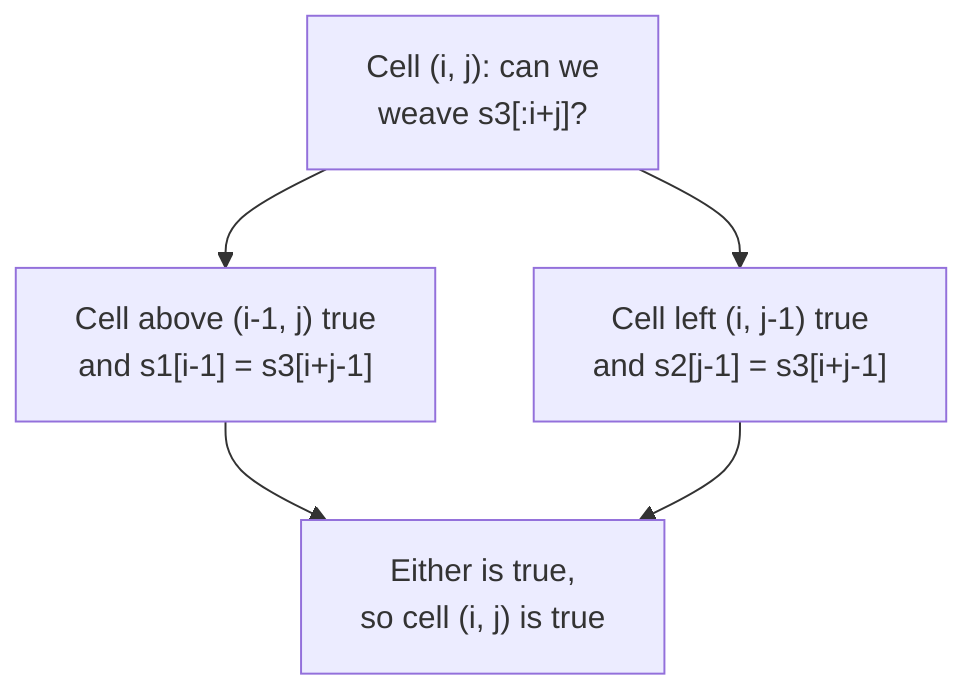

> [!tldr] Quick read
> - Every character of `s3` must come from the front of what is left of `s1` or of `s2`. After using i characters of `s1` and j of `s2`, the next position in `s3` is always i + j.
> - So the pair (i, j) is a sufficient [[en/concepts/dp-state|state]]. This is a [[en/concepts/two-sequence-dp|two-sequence DP]] table: each cell asks whether `s1[:i]` and `s2[:j]` weave into `s3[:i+j]`.
> - Cell (i, j) is true when the cell above is true and `s1[i-1]` matches, or the cell to the left is true and `s2[j-1]` matches. It is a [[en/concepts/grid-path-dp|grid path]] where every step must match a character.
> - Check the lengths first. One [[en/concepts/rolling-state|rolling]] row of length `len(s2) + 1` covers the whole table, which meets the problem's memory follow-up.

> [!info] Context
> This is LeetCode 97 at [[en/posts/2026-11-27-neetcode-grid-two-strings|station DP-05: Grids and Two Strings]] on **the NeetCode Line: Dynamic Programming**. I picture two piles of cards riffle-shuffled into one. You only need to read strings by index and run nested loops.

> [!abstract]- Quick glossary for this post (click to open)
> - `s[:i]` is the prefix made of the first i characters of `s`. The empty prefix has i = 0.
> - A [[en/concepts/dp-state|DP state]] is the set of indices that fully describes what is left of the problem.
> - [[en/concepts/memoization|Memoization]] stores a state's answer the first time it is asked; later calls read it back.
> - [[en/concepts/rolling-state|Rolling state]] keeps only the table row the next step still reads and overwrites the old one.
> - To interleave is to merge two sequences into one without reordering either of them.

## Picture it first: riffle-shuffling two piles

I split a deck into two piles, then let cards drop one by one from the bottom of both piles onto the table to form one new pile. Which hand drops next is up to me, but inside each pile the order never changes. Looking at the new pile, the question is whether it could have come from the two original piles that way. At every step, I only need to know how many cards each hand has dropped.

| Everyday life | Concept |
|---|---|
| Left-hand pile, right-hand pile | `s1`, `s2` |
| New pile on the table | `s3` |
| Left hand dropped i cards, right hand dropped j | State (i, j); the next card is at position i + j |
| Drop the next left-hand card | Move down one row: (i, j) → (i + 1, j) |
| Drop the next right-hand card | Move right one column: (i, j) → (i, j + 1) |
| Two different drop orders that both stop at (i, j) | One shared cell in the table |



## The problem: three strings, one yes-or-no question

You get three strings of lowercase English letters: `s1` and `s2` are 0–100 characters long, `s3` is 0–200. Return `true` if `s3` can be built by merging every character of `s1` and `s2`, each used exactly once, so that the characters of `s1` (and those of `s2`) keep their order inside `s3`. The original statement phrases this as cutting both strings into pieces and alternating them, but two adjacent pieces from the same string can always be joined into one, so the two phrasings mean the same thing. For example, with `s1 = "ab"` and `s2 = "cd"`, `acdb` is a valid interleaving and `badc` is not, because `b` comes before `a`. The problem adds a follow-up: use only O(`len(s2)`) extra memory. [Original problem, LeetCode 97](https://leetcode.com/problems/interleaving-string/)

## How it works

### Brute force: try both hands at every step

Let m = `len(s1)` and n = `len(s2)`. If m + n differs from `len(s3)`, return `false` immediately, since each character must be used exactly once. Then `search(i, j)` looks at `s3[i+j]`. If it equals `s1[i]`, try `search(i + 1, j)`. If it equals `s2[j]`, try `search(i, j + 1)`. Reaching (m, n) means the weave is complete.

When the two strings share many characters, both branches stay open at almost every step. There are C(m + n, m) paths from (0, 0) to (m, n), so brute force costs O(2^(m+n)) time in the worst case and O(m + n) stack.

### Memoize on the pair (i, j)

Many brute-force branches stop at the same (i, j). Dropping "left, right" or "right, left" both lead to (1, 1). The rest of the problem depends only on `s1[i:]`, `s2[j:]` and `s3[i+j:]`, that is, only on i and j. Store the result of `search(i, j)` under that pair, including `false` results. There are (m + 1)(n + 1) states and each does O(1) work, for O(mn) time and O(mn) memory.

The measurement below uses `s1 = s2 = "aaaaaaaaaa"` and an `s3` of 19 `a` characters followed by one `b`. Every branch matches all the way to the end before it fails. Brute force enters the function 520,675 times; the memoized version enters it 219 times (counting the calls answered from the cache).

### Fill the table top to bottom, left to right

Let `ok[i][j]` mean "`s1[:i]` and `s2[:j]` weave into `s3[:i+j]`". Cell (0, 0) is true because all three prefixes are empty. The last character of `s3[:i+j]` is `s3[i+j-1]`, and it has to be the last character of one of the two prefixes:

- taken from `s1`: needs `ok[i-1][j]` and `s1[i-1] == s3[i+j-1]`;
- taken from `s2`: needs `ok[i][j-1]` and `s2[j-1] == s3[i+j-1]`.

Cell (i, j) reads only the cell above and the cell to the left, so walking rows in increasing order, and columns in increasing order inside each row, is enough. This is exactly the [[en/concepts/grid-path-dp|grid DP]] template from Unique Paths, with the sum of path counts replaced by an OR guarded by a character match. Time O(mn), memory O(mn).

### One row is enough

To compute row i, I only need row i − 1 (the cell above) and the cells already computed in row i (the cell to the left). Keep one array `row` of length n + 1 and walk j upward. Right before `row[j]` is written, it still holds row i − 1, the cell above. `row[j-1]` was just written in this pass, so it is the cell to the left. Extra memory drops to O(n) = O(`len(s2)`), which is the follow-up. Swapping `s1` and `s2` so the shorter string runs along the columns brings it down to O(min(m, n)).

| Approach | Time | Auxiliary space |
|---|---|---|
| Brute force | O(2^(m+n)) | O(m + n) stack |
| Memoization on (i, j) | O(mn) | O(mn) |
| Two-dimensional table | O(mn) | O(mn) |
| One rolling row | O(mn) | O(n) |

## Runnable example

[TypeScript](../code/neetcode-interleaving-string/weave.ts) · [Python](../code/neetcode-interleaving-string/weave.py) · [Go](../code/neetcode-interleaving-string/weave.go) · [Java](../code/neetcode-interleaving-string/weave.java) · [JavaScript](../code/neetcode-interleaving-string/weave.js) · [PHP](../code/neetcode-interleaving-string/weave.php) · [Rust](../code/neetcode-interleaving-string/weave.rs)

```ts
function interleaveRow(s1: string, s2: string, s3: string) {
    const m = s1.length, n = s2.length
    if (m + n !== s3.length) return false
    const row: boolean[] = Array(n + 1).fill(false)
    for (let i = 0; i <= m; i++) {
        for (let j = 0; j <= n; j++) {
            if (i === 0 && j === 0) {
                row[j] = true
                continue
            }
            // row[j] still holds row i - 1 (above), row[j - 1] is already row i (left)
            const fromTop = i > 0 && row[j] && s1[i - 1] === s3[i + j - 1]
            const fromLeft = j > 0 && row[j - 1] && s2[j - 1] === s3[i + j - 1]
            row[j] = fromTop || fromLeft
        }
    }
    return row[n]
}
```

```python
def interleave_row(s1, s2, s3):
    m, n = len(s1), len(s2)
    if m + n != len(s3):
        return False
    row = [False] * (n + 1)
    for i in range(m + 1):
        for j in range(n + 1):
            if i == 0 and j == 0:
                row[j] = True
                continue
            # row[j] still holds row i - 1 (above), row[j - 1] is already row i (left)
            from_top = i > 0 and row[j] and s1[i - 1] == s3[i + j - 1]
            from_left = j > 0 and row[j - 1] and s2[j - 1] == s3[i + j - 1]
            row[j] = from_top or from_left
    return row[n]
```

```go
func interleaveRow(s1, s2, s3 string) bool {
	m, n := len(s1), len(s2)
	if m+n != len(s3) {
		return false
	}
	row := make([]bool, n+1)
	for i := 0; i <= m; i++ {
		for j := 0; j <= n; j++ {
			if i == 0 && j == 0 {
				row[j] = true
				continue
			}
			// row[j] still holds row i - 1 (above), row[j - 1] is already row i (left)
			fromTop := i > 0 && row[j] && s1[i-1] == s3[i+j-1]
			fromLeft := j > 0 && row[j-1] && s2[j-1] == s3[i+j-1]
			row[j] = fromTop || fromLeft
		}
	}
	return row[n]
}
```

```java
static boolean interleaveRow(String s1, String s2, String s3) {
    int m = s1.length(), n = s2.length();
    if (m + n != s3.length()) return false;
    boolean[] row = new boolean[n + 1];
    for (int i = 0; i <= m; i++) {
        for (int j = 0; j <= n; j++) {
            if (i == 0 && j == 0) {
                row[j] = true;
                continue;
            }
            // row[j] still holds row i - 1 (above), row[j - 1] is already row i (left)
            boolean fromTop = i > 0 && row[j] && s1.charAt(i - 1) == s3.charAt(i + j - 1);
            boolean fromLeft = j > 0 && row[j - 1] && s2.charAt(j - 1) == s3.charAt(i + j - 1);
            row[j] = fromTop || fromLeft;
        }
    }
    return row[n];
}
```

```js
function interleaveRow(s1, s2, s3) {
    const m = s1.length, n = s2.length
    if (m + n !== s3.length) return false
    const row = Array(n + 1).fill(false)
    for (let i = 0; i <= m; i++) {
        for (let j = 0; j <= n; j++) {
            if (i === 0 && j === 0) {
                row[j] = true
                continue
            }
            // row[j] still holds row i - 1 (above), row[j - 1] is already row i (left)
            const fromTop = i > 0 && row[j] && s1[i - 1] === s3[i + j - 1]
            const fromLeft = j > 0 && row[j - 1] && s2[j - 1] === s3[i + j - 1]
            row[j] = fromTop || fromLeft
        }
    }
    return row[n]
}
```

```php
function interleaveRow(string $s1, string $s2, string $s3): bool {
    $m = strlen($s1);
    $n = strlen($s2);
    if ($m + $n !== strlen($s3)) return false;
    $row = array_fill(0, $n + 1, false);
    for ($i = 0; $i <= $m; $i++) {
        for ($j = 0; $j <= $n; $j++) {
            if ($i === 0 && $j === 0) {
                $row[$j] = true;
                continue;
            }
            // row[j] still holds row i - 1 (above), row[j - 1] is already row i (left)
            $fromTop = $i > 0 && $row[$j] && $s1[$i - 1] === $s3[$i + $j - 1];
            $fromLeft = $j > 0 && $row[$j - 1] && $s2[$j - 1] === $s3[$i + $j - 1];
            $row[$j] = $fromTop || $fromLeft;
        }
    }
    return $row[$n];
}
```

```rust
fn interleave_row(s1: &str, s2: &str, s3: &str) -> bool {
    let (a, b, c) = (s1.as_bytes(), s2.as_bytes(), s3.as_bytes());
    let (m, n) = (a.len(), b.len());
    if m + n != c.len() {
        return false;
    }
    let mut row = vec![false; n + 1];
    for i in 0..=m {
        for j in 0..=n {
            if i == 0 && j == 0 {
                row[j] = true;
                continue;
            }
            // row[j] still holds row i - 1 (above), row[j - 1] is already row i (left)
            let from_top = i > 0 && row[j] && a[i - 1] == c[i + j - 1];
            let from_left = j > 0 && row[j - 1] && b[j - 1] == c[i + j - 1];
            row[j] = from_top || from_left;
        }
    }
    row[n]
}
```

The tabs show the one-row version. The downloadable files also contain brute force, memoization and the two-dimensional table. The 13 cases include empty strings, a wrong length, a greedy branch that gets stuck (`ab` and `ac` weaving into `acab`), and strings at the full limit of 100 + 100 = 200. Each file also checks all four approaches against an enumerator that tries every choice of positions in `s3` for `s1`, over every `s1` and `s2` made of `a/b` with length 0–3 and every `s3` whose length equals the total or exceeds it by one.

```text
13/13 cases passed
21675/21675 cases passed (every split enumerated)
Brute force: 520675 calls, memo: 219 calls
```

*(Output labels translated; the files themselves print Vietnamese.)*

Run with `node weave.ts`, `python3 weave.py`, `go run weave.go`, `java weave.java`, `node weave.js`, `php weave.php` or `rustc --edition 2021 -O weave.rs -o /tmp/weave && /tmp/weave`.

## Misconceptions and common traps

- I used to think I could take from `s1` whenever it matched and fall back to `s2` only when it did not. With `s1 = "ab"`, `s2 = "ac"`, `s3 = "acab"`, taking `a` from `s1` means the next step needs `c` while `s1` offers `b` and `s2` offers `a`, so it is stuck. Taking `a` from `s2` first works. When both match, both possibilities must stay alive.
- Adding the index k of `s3` to the state is redundant. k is always i + j, so a three-dimensional table only costs more memory.
- Skipping the length check. When `s3` is shorter than m + n, the index `i + j` can run past the end of `s3`. Go and Rust stop the program on the out-of-range access. TypeScript and JavaScript return `undefined` and the comparison quietly comes out false. When `s3` is longer, the table can return `true` for its beginning and ignore the extra tail.
- The one-row version of this problem walks j **upward**, because the cell to the left must come from the current row. [[en/problems/distinct-subsequences|Distinct Subsequences]] is the opposite: the diagonal cell must come from the previous row, so it walks downward. Copying the wrong direction is wrong without any error.
- The cache must tell "not computed yet" apart from "computed, and the answer was `false`". Java uses `Boolean[][]` with `null` meaning not computed, because `boolean[][]` defaults to `false`. PHP uses `isset`, which returns `true` for a stored `false` (only `null` counts as missing), whereas `empty($cache[$key])` treats `false` as absent.

## Self-check questions

> [!question]- Why is (i, j) enough, without knowing which character came from where?
> The remaining work is to weave `s1[i:]` with `s2[j:]` into `s3[i+j:]`. These three suffixes depend only on i and j, so every path that reaches (i, j) has the same future.

> [!question]- What do row 0 and column 0 of the table mean?
> Row 0 means no character of `s1` has been taken yet: `ok[0][j]` is true when `s2[:j] == s3[:j]`. Column 0 is the same with `s1`.

> [!question]- How do you get O(min(m, n)) memory?
> Swap the two strings so the shorter one runs along the columns, then use one row as long as that string plus one.

## References

- [LeetCode 97](https://leetcode.com/problems/interleaving-string/)
- [Jeff Erickson, Algorithms, dynamic programming chapter](https://jeffe.cs.illinois.edu/teaching/algorithms/book/03-dynprog.pdf)
- [MIT 6.006 (2020), lecture 16: DP subproblems, including LCS on two strings](https://ocw.mit.edu/courses/6-006-introduction-to-algorithms-spring-2020/resources/mit6_006s20_lec16/)
- [Go spec, out-of-range index](https://go.dev/ref/spec#Index_expressions) · [PHP isset](https://www.php.net/manual/en/function.isset.php)
