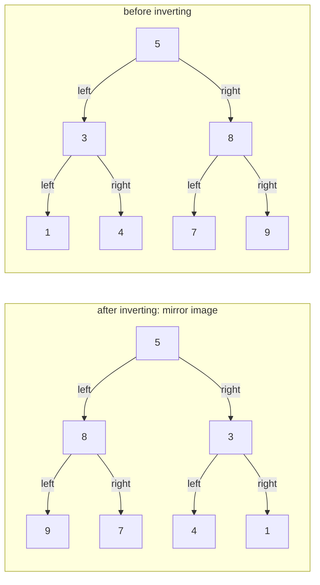
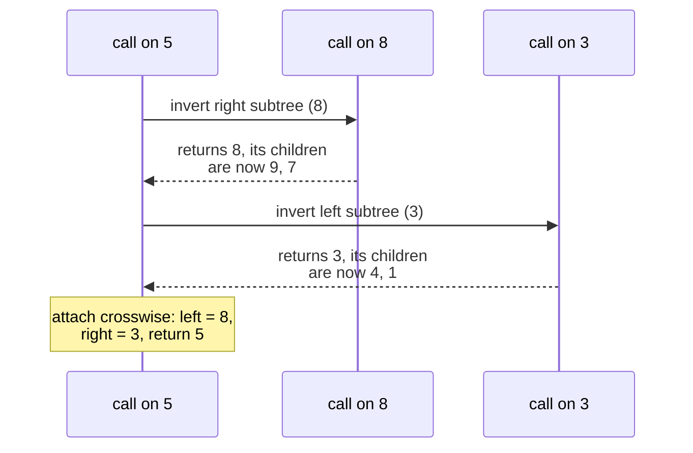

> [!tldr] Quick read
> - The problem: given the root of a [[en/concepts/binary-tree|binary tree]], turn it into its own mirror image (at every node, the left and right children trade places) and return the root. The tree has 0 to 100 nodes.
> - The solution: visit **every node exactly once** and swap its two children. Any visiting order works (recursion, stack, queue) as long as each node is swapped exactly once. O(n) time; O(h) extra memory for recursion and the stack, where h is the height of the tree.
> - The biggest trap is writing the swap as two assignments, `root.left = f(root.right); root.right = f(root.left)`: the second one reads a `root.left` that has already been overwritten, so the old left subtree is lost for good. This wrong version passes 2/8 cases, only the empty tree and the one-node tree.
> - Python, Go and JavaScript can assign several values at once (the right side is fully evaluated before anything is assigned), so one line is correct; Java needs a temporary variable. Written without semicolons, JavaScript glues the line `[a, b] = [b, a]` onto the line above and throws `ReferenceError`.
> - At the problem's limit (100 nodes), every approach takes under 0.1 ms. On a skewed chain of 10⁵ nodes, the recursive version overflows the stack in Node, Python and Java; Go does not.

> [!info] Context
> LeetCode problem 226 (Easy) of [[en/posts/2026-11-25-neetcode-tree-recursion|station 3: Tree Recursion]] on **the NeetCode Line: Linked Structures**. This is the line's first tree problem: the two earlier stations worked on linked lists, where every node has one `next` arrow; here every node has two arrows, `left` and `right`. All you need to know is what a function that calls itself is. Solutions come in TypeScript, Python, Go, Java and JavaScript. Its station neighbor [[en/problems/maximum-depth-of-binary-tree|Maximum Depth of Binary Tree]] uses the same walk over the tree but **returns** a number, while this problem only **edits** the tree in place.

> [!abstract]- Quick glossary for this post (click to open)
> - **Binary tree**: every node has a value and at most two children, `left` and `right`; the top node is the root, a node without children is a leaf. See [[en/concepts/binary-tree|Binary Tree]].
> - **Subtree**: a node together with every node below it. The root's left subtree is the whole branch starting at `root.left`.
> - **Height h**: the number of nodes on the longest path from the root down to a leaf. A balanced tree of 10⁶ nodes is about 20 tall; a tree skewed into a chain is as tall as it has nodes.
> - **Recursion**: a function calling itself on a smaller part of the problem, here on a subtree. Every unfinished call holds a frame on the call [[en/concepts/stack|stack]]; too deep and the program stops. See [[en/concepts/recursion-depth-limit|Recursion Depth Limit]].
> - **Level-order array**: how LeetCode writes a tree, read top to bottom, left to right, with `null` for an empty spot. `[2, 1, 3]` is root 2, left child 1, right child 3.
> - **BFS (level-order traversal)**: visit all of level 1, then level 2, … using a first-in, first-out queue.

## Picture it first: holding an org chart up to a mirror

A company hangs its org chart on the wall: the director at the top, each department head with at most two deputies below, one on the left and one on the right. Put a mirror beside it: in the mirror, at **every** level, whoever was on the left is now on the right and the other way around. Nobody changes level, nobody changes boss; only left and right trade places.

To redraw the mirrored chart by hand, you go box by box, and at each box you do one thing: swap its two child boxes. Top down or bottom up both work, as long as no box is skipped and no box is swapped twice.

| Everyday life | Concept |
|---|---|
| The org chart | a binary tree |
| A box and every box below it | a subtree |
| Swapping a box's two child boxes | `left, right = right, left` |
| Going through every box, each one once | a tree traversal, O(n) |
| Letting each department head mirror their own branch and report back | recursion |
| A list of boxes still to visit, kept on a sheet of paper | a hand-managed stack or queue |
| Drawing the right box, then drawing over the left box and forgetting the old left box | the two-assignments trap |



As level-order arrays: `[5, 3, 8, 1, 4, 7, 9]` becomes `[5, 8, 3, 9, 7, 4, 1]`. Every level reads backwards, just like a mirror.

## The problem

The input is the root of a binary tree with 0 to 100 nodes, each value in [−100, 100]. The output is the root of the tree after inverting, where at every node the left and right children have traded places. Editing the given tree in place is fine; there is no need to build a new one. The original problem: [LeetCode 226](https://leetcode.com/problems/invert-binary-tree/).

At first I thought I had to "flip" the whole tree in some complicated way, like swapping a node on level 3 on the left with a node on level 3 on the right. It turns out there is no need to look that far: if at **each** node the two children trade places, the whole tree becomes its mirror image by itself. Node 1 (left of left) ends up on the right of the right because it is swapped twice, on two different levels: once when 3 trades places with 8, and once when 1 trades places with 4.

## How it works

<figure class="figure-map" style="--ar: 3 / 4">
<div class="frame"><iframe data-archify="../../diagrams/neetcode-invert-binary-tree/worked-example.en.html" title="Swap left and right children at every node" loading="lazy"></iframe></div>
<figcaption><span><b>Figure 1.</b> Swap left and right children at every node.</span><a href="../diagrams/neetcode-invert-binary-tree/worked-example.en.html" target="_blank" rel="noopener">Open full screen</a></figcaption>
</figure>

<details>
<summary>Read the steps</summary>
<ol>
<li>Read the root&#x27;s two children. <code>8: left = 3; right = 9</code></li>
<li>Exchange the child positions. <code>8: left = 9; right = 3</code></li>
<li>At 3, move its left child 1 to the right. <code>3: left = null; right = 1</code></li>
<li>Keep every node value. <code>[8, 9, 3, null, null, null, 1]</code></li>
</ol>
</details>

### Approach 1: recursion

An empty tree stays empty after inverting. A non-empty tree: invert the right subtree, invert the left subtree, then attach them crosswise, the inverted right one on the left and the other way around.

```ts
// Approach 1: recursion. Invert both subtrees, then attach them crosswise. Destructuring assignment evaluates
// the whole right side before assigning, so no temporary is needed. O(n) time, O(h) call stack.
function invertRecursive(root: TreeNode | null): TreeNode | null {
  if (root === null) return null;
  [root.left, root.right] = [invertRecursive(root.right), invertRecursive(root.left)];
  return root;
}
```

This is the template of the whole station: the function takes a tree, trusts that the call on each subtree has done the subtree's work, and then only handles the work at the current node. In this version both subtrees are inverted first and the current node is swapped after, which is [[en/concepts/post-order-traversal|post-order]]. Swapping first and then inverting the two children (pre-order) is also correct.

Every node is called exactly once and does O(1) work per call, so O(n) in total. The extra memory is the depth of the chain of unfinished calls, which is the height h: about log₂ n for a balanced tree, n for a tree skewed into a chain.



### Approach 2: a hand-managed stack

Without the call stack, keep your own [[en/concepts/stack|stack]] of nodes still to process. Pop a node, swap its two children, push the children (if any). The visiting order does not matter, because the work at each node does not depend on the result at any other node.

```ts
// Approach 2: a hand-managed stack. Visiting order does not matter: each node just needs its children swapped exactly once.
function invertStack(root: TreeNode | null): TreeNode | null {
  const stack: TreeNode[] = root === null ? [] : [root];
  while (stack.length > 0) {
    const node = stack.pop()!;
    const tmp = node.left;
    node.left = node.right;
    node.right = tmp;
    if (node.left !== null) stack.push(node.left);
    if (node.right !== null) stack.push(node.right);
  }
  return root;
}
```

The stack never holds more than about h + 1 nodes at once (each level on the current path leaves at most one waiting sibling), so the memory is still O(h), but it lives on the program's heap rather than on the call stack, so it does not overflow when the tree is deeply skewed.

### Approach 3: level-order BFS

Swap the stack for a queue and the nodes are visited level by level. Same result.

```ts
// Approach 3: level-order BFS with a queue (array + head index, because shift() is O(n)).
function invertBfs(root: TreeNode | null): TreeNode | null {
  const queue: TreeNode[] = root === null ? [] : [root];
  for (let head = 0; head < queue.length; head++) {
    const node = queue[head];
    const tmp = node.left;
    node.left = node.right;
    node.right = tmp;
    if (node.left !== null) queue.push(node.left);
    if (node.right !== null) queue.push(node.right);
  }
  return root;
}
```

The queue has to hold a whole level at once. The last level of a complete tree holds about n/2 nodes, so the extra memory is O(n), not O(h). The array + head index version above also keeps every node it has passed, so the array ends up exactly n elements long.

| Approach | Time | Extra memory | Overflows on a deeply skewed tree? |
|---|---|---|---|
| Recursion | O(n) | O(h) on the call stack | yes, except in Go |
| Hand-managed stack | O(n) | O(h) on the heap | no |
| Level-order BFS | O(n) | O(n) (the widest level) | no |

### Three wrong versions

**Two assignments in a row.** The most natural way to write it before you are used to tuple assignment:

```ts
// WRONG: two assignments in a row. The second one reads root.left after it has been overwritten, so it inverts
// the right subtree again: both children point at the old right subtree, and the old left subtree is gone.
function wrongOverwrite(root: TreeNode | null): TreeNode | null {
  if (root === null) return null;
  root.left = wrongOverwrite(root.right);
  root.right = wrongOverwrite(root.left);
  return root;
}
```

Line 1 sets `root.left` to the inverted right subtree. Line 2 reads `root.left`, which by now is that same subtree, inverts it once more (back to how it was) and attaches it on the right. The result: both children point at **one** subtree, and nothing holds the old left subtree anymore. On `[2, 1, 3]` this version returns `[2, 3, 3]`; on the 7-node tree it returns `[5, 8, 8, 9, 9, 9, 9]`. It passes 2/8 cases: the empty tree and the one-node tree, exactly the two cases a hurried test usually tries. All five languages give exactly this wrong result (I ran them).

The fix: evaluate both sides before assigning. Python `root.left, root.right = f(root.right), f(root.left)`, Go `root.Left, root.Right = f(root.Right), f(root.Left)` and JavaScript `[root.left, root.right] = [f(root.right), f(root.left)]` all evaluate the entire right side before assigning. Java has no such syntax, so stash one side in a temporary first.

**Swapping in the middle (in-order).** Anyone who has seen in-order traversal (left, root, right) might write: invert the left, swap the two children, invert the right. But after the swap, "the right" is the old left subtree, which has just been inverted; it gets inverted a second time and returns to how it was, while the old right subtree is never inverted at all. The TypeScript file runs this version: 4/8 cases, correct on every tree with at most two levels and wrong on all four deeper trees, for example `[5, 3, 8, 1, 4, 7, 9]` comes out as `[5, 8, 3, 7, 9, 1, 4]`. To swap in the middle, the second call must be on `root.left` again.

**JavaScript without semicolons.** The stack version written in the semicolon-free style:

```js
const node = stack.pop()
[node.left, node.right] = [node.right, node.left]
```

JavaScript's automatic semicolon insertion (ASI) only inserts one when the next line cannot continue the line above. A line starting with `[` can continue it: the engine reads `const node = stack.pop()[node.left, node.right] = [...]`, using `node` inside its own declaration, and throws `ReferenceError: Cannot access 'node' before initialization`. It passes 1/8 cases, only the empty tree (the loop never runs). The semicolon-free style always puts a `;` at the start of lines that begin with `[` or `(`.

### Under the hood in seven languages

| | Swapping the two children | Language-specific trap |
|---|---|---|
| TypeScript / JavaScript | `[a.left, a.right] = [a.right, a.left]` | no semicolon before a `[` line → `ReferenceError`; `queue.shift()` is O(n), use a head index |
| Python | `a.left, a.right = a.right, a.left` | `list.pop(0)` is O(n), use `collections.deque`; recursion past 1,000 levels is `RecursionError` |
| Go | `a.Left, a.Right = a.Right, a.Left` | no `null`; check `root == nil` before reading `root.Left` |
| Java | a temporary variable | no tuple assignment; `ArrayDeque` rejects `null` (see [[en/problems/maximum-depth-of-binary-tree\|problem 104]]) |
| PHP | `[$a->left, $a->right] = [$a->right, $a->left]` | objects are passed by handle, so swapping in place changes the original tree; with Xdebug loaded, recursion stops at 512 levels (`-d xdebug.mode=off`) |
| Rust | `std::mem::swap(&mut b.left, &mut b.right)` | you need `borrow_mut()` on the `RefCell`; borrowing twice at once panics at run time, not at compile time |

### Measurements

The problem has only 100 nodes, so at its limit all three approaches take under 0.1 ms. To see where they differ, I measured two kinds of larger tree: a complete tree of 2²⁰ − 1 = 1,048,575 nodes (height 20) and a left-skewed chain of d nodes (height d). Median of 5 runs, in ms.

Complete tree of 10⁶ nodes:

| Language | Recursion | Stack | BFS |
|---|---|---|---|
| TypeScript | 8.45 | 6.58 | 16.81 |
| Python | 54.24 | 68.53 | 66.32 |
| Go | 3.79 | 2.92 | 27.82 |
| Java | 3.00 | 6.36 | 12.18 |

Left-skewed chain of 10⁵ nodes:

| Language | Recursion | Stack | BFS |
|---|---|---|---|
| TypeScript | `RangeError` | 0.61 | 1.55 |
| Python | `RecursionError` (from 1,000 nodes) | 6.71 | 5.50 |
| Go | 1.32 | 0.34 | 0.75 |
| Java | `StackOverflowError` | 0.61 | 0.56 |

- On a balanced tree, all three approaches are O(n) and land within 2 to 10 times of each other. BFS is the slowest in TypeScript, Go and Java because the queue has to grow to hundreds of thousands of elements (reallocating many times), while the stack never holds more than a few dozen.
- Python is the other way around: recursion is the fastest (54 ms), because every hand-written loop in Python pays for extra `append`/`pop` calls on a list.
- On the 10⁵-node chain, the recursive version dies in every language except Go. Python already dies at 1,000 nodes. The exact limit for each language is measured in [[en/problems/maximum-depth-of-binary-tree|Maximum Depth of Binary Tree]].

## Runnable example

[TypeScript](../code/neetcode-invert-binary-tree/invert-tree.ts) · [Python](../code/neetcode-invert-binary-tree/invert_tree.py) · [Go](../code/neetcode-invert-binary-tree/invert_tree.go) · [Java](../code/neetcode-invert-binary-tree/invert-tree.java) · [JavaScript](../code/neetcode-invert-binary-tree/invert-tree.js) · [PHP](../code/neetcode-invert-binary-tree/invert-tree.php) · [Rust](../code/neetcode-invert-binary-tree/invert_tree.rs)

Each file builds trees from level-order arrays, runs 8 shared cases (empty tree, one node, left child only, three nodes, a complete 3-level tree, a left chain, a tree lopsided on both sides, negative values and 0), then cross-checks 2,000 random trees (mulberry32, up to 40 nodes) against an independent "mirror": the original tree written in right, root, left order must produce exactly the same string as the inverted tree written in left, root, right order.

Recursion:

```ts
// Approach 1: recursion. Invert both subtrees, then attach them crosswise. Destructuring assignment evaluates
// the whole right side before assigning, so no temporary is needed. O(n) time, O(h) call stack.
function invertRecursive(root: TreeNode | null): TreeNode | null {
  if (root === null) return null;
  [root.left, root.right] = [invertRecursive(root.right), invertRecursive(root.left)];
  return root;
}
```

```python
# Approach 1: recursion. Tuple assignment: Python evaluates the whole right side before assigning, so no temporary is needed.
def invert_recursive(root):
    if root is None:
        return None
    root.left, root.right = invert_recursive(root.right), invert_recursive(root.left)
    return root
```

```go
// Approach 1: recursion. Multiple assignment: Go evaluates the whole right side before assigning.
func invertRecursive(root *TreeNode) *TreeNode {
	if root == nil {
		return nil
	}
	root.Left, root.Right = invertRecursive(root.Right), invertRecursive(root.Left)
	return root
}
```

```java
// Approach 1: recursion. Java has no tuple assignment, so keep one result in a temporary before assigning.
static TreeNode invertRecursive(TreeNode root) {
    if (root == null) return null;
    TreeNode left = invertRecursive(root.left);
    root.left = invertRecursive(root.right);
    root.right = left;
    return root;
}
```

```js
// Approach 1: recursion with destructuring assignment: the right side is fully evaluated before assigning.
function invertRecursive(root) {
  if (root === null) return null;
  [root.left, root.right] = [invertRecursive(root.right), invertRecursive(root.left)];
  return root;
}
```

```php
// Approach 1: recursion. Destructuring assignment: PHP builds the whole right-hand array before assigning.
function invertRecursive(?TreeNode $root): ?TreeNode
{
    if ($root === null) return null;
    [$root->left, $root->right] = [invertRecursive($root->right), invertRecursive($root->left)];
    return $root;
}
```

```rust
// Approach 1: recursion. take() moves both children out of the node (leaving None), inverts each, then attaches them crosswise.
fn invert_recursive(root: Node) -> Node {
    if let Some(n) = &root {
        let mut b = n.borrow_mut();
        let (l, r) = (b.left.take(), b.right.take());
        b.left = invert_recursive(r);
        b.right = invert_recursive(l);
    }
    root
}
```

Hand-managed stack:

```ts
// Approach 2: a hand-managed stack. Visiting order does not matter: each node just needs its children swapped exactly once.
function invertStack(root: TreeNode | null): TreeNode | null {
  const stack: TreeNode[] = root === null ? [] : [root];
  while (stack.length > 0) {
    const node = stack.pop()!;
    const tmp = node.left;
    node.left = node.right;
    node.right = tmp;
    if (node.left !== null) stack.push(node.left);
    if (node.right !== null) stack.push(node.right);
  }
  return root;
}
```

```python
# Approach 2: a hand-managed stack; visiting order does not matter.
def invert_stack(root):
    stack = [root] if root else []
    while stack:
        node = stack.pop()
        node.left, node.right = node.right, node.left
        if node.left:
            stack.append(node.left)
        if node.right:
            stack.append(node.right)
    return root
```

```go
// Approach 2: the hand-managed stack is a slice.
func invertStack(root *TreeNode) *TreeNode {
	if root == nil {
		return nil
	}
	stack := []*TreeNode{root}
	for len(stack) > 0 {
		node := stack[len(stack)-1]
		stack = stack[:len(stack)-1]
		node.Left, node.Right = node.Right, node.Left
		if node.Left != nil {
			stack = append(stack, node.Left)
		}
		if node.Right != nil {
			stack = append(stack, node.Right)
		}
	}
	return root
}
```

```java
// Approach 2: a hand-managed stack (ArrayDeque used as a stack: push/pop at the front).
static TreeNode invertStack(TreeNode root) {
    if (root == null) return null;
    Deque<TreeNode> stack = new ArrayDeque<>();
    stack.push(root);
    while (!stack.isEmpty()) {
        TreeNode node = stack.pop();
        TreeNode tmp = node.left;
        node.left = node.right;
        node.right = tmp;
        if (node.left != null) stack.push(node.left);
        if (node.right != null) stack.push(node.right);
    }
    return root;
}
```

```js
// Approach 2: a hand-managed stack.
function invertStack(root) {
  const stack = root === null ? [] : [root];
  while (stack.length > 0) {
    const node = stack.pop();
    [node.left, node.right] = [node.right, node.left];
    if (node.left !== null) stack.push(node.left);
    if (node.right !== null) stack.push(node.right);
  }
  return root;
}
```

```php
// Approach 2: a hand-managed stack; the visiting order does not matter.
function invertStack(?TreeNode $root): ?TreeNode
{
    $stack = $root === null ? [] : [$root];
    while ($stack) {
        $node = array_pop($stack);
        [$node->left, $node->right] = [$node->right, $node->left];
        if ($node->left !== null) $stack[] = $node->left;
        if ($node->right !== null) $stack[] = $node->right;
    }
    return $root;
}
```

```rust
// Approach 2: a hand-managed stack; std::mem::swap swaps the two children in place.
fn invert_stack(root: Node) -> Node {
    let mut stack: Vec<Rc<RefCell<TreeNode>>> = root.iter().cloned().collect();
    while let Some(n) = stack.pop() {
        let mut b = n.borrow_mut();
        let b = &mut *b;
        std::mem::swap(&mut b.left, &mut b.right);
        stack.extend(b.left.iter().cloned());
        stack.extend(b.right.iter().cloned());
    }
    root
}
```

Output of `node invert-tree.ts`:

```text
invertRecursive  8/8 cases passed
invertStack      8/8 cases passed
invertBfs        8/8 cases passed
wrongOverwrite   2/8 cases passed; wrong on left child only → [1], three nodes → [2,3,3], complete 3 levels → [5,8,8,9,9,9,9], left chain becomes right chain → [1], lopsided on both sides → [1,3,3,5,5,5,5], negative values and 0 → [0]
wrongInOrder     4/8 cases passed; wrong on complete 3 levels → [5,8,3,7,9,1,4], left chain becomes right chain → [1,null,2,3], lopsided on both sides → [1,3,2,null,5,null,4], negative values and 0 → [0,null,-1,-2,-3]

random: invertRecursive 2000/2000, invertStack 2000/2000, invertBfs 2000/2000

Complete tree of 1048575 nodes, median of 5 runs (ms)
invertRecursive      8.45
invertStack          6.58
invertBfs           16.81

Left-skewed chain of d nodes, median of 5 runs (ms)
d       recursion      stack        BFS
1000           0.01       0.00       0.00
10000          0.13       0.03       0.05
100000   RangeError       0.61       1.55
```

*(Output labels translated; the files themselves print Vietnamese.)*

`python3 invert_tree.py`:

```text
invert_recursive  8/8 cases passed
invert_stack      8/8 cases passed
invert_bfs        8/8 cases passed
wrong_overwrite   2/8 cases passed; wrong on left child only → [1], three nodes → [2, 3, 3], complete 3 levels → [5, 8, 8, 9, 9, 9, 9], left chain becomes right chain → [1], lopsided on both sides → [1, 3, 3, 5, 5, 5, 5], negative values and 0 → [0]

random: invert_recursive 2000/2000, invert_stack 2000/2000, invert_bfs 2000/2000

Complete tree of 1048575 nodes, median of 5 runs (ms)
invert_recursive     54.24
invert_stack         68.53
invert_bfs           66.32

Left-skewed chain of d nodes, median of 5 runs (ms)
d             recursion      stack        BFS
500                0.05           0.03           0.03
1000     RecursionError           0.08           0.06
100000   RecursionError           6.71           5.50
```

`go run invert_tree.go`:

```text
invertRecursive  8/8 cases passed
invertStack      8/8 cases passed
invertBfs        8/8 cases passed
wrongOverwrite   2/8 cases passed; wrong on left child only → [1], three nodes → [2,3,3], complete 3 levels → [5,8,8,9,9,9,9], left chain becomes right chain → [1], lopsided on both sides → [1,3,3,5,5,5,5], negative values and 0 → [0]

random: invertRecursive 2000/2000, invertStack 2000/2000, invertBfs 2000/2000

Complete tree of 1048575 nodes, median of 5 runs (ms)
invertRecursive      3.79
invertStack          2.92
invertBfs           27.82

Left-skewed chain of d nodes, median of 5 runs (ms)
d         recursion      stack        BFS
1000             0.01       0.00       0.01
100000           1.32       0.34       0.75
1000000         13.86       3.03      35.49
```

`java invert-tree.java`:

```text
invertRecursive  8/8 cases passed
invertStack      8/8 cases passed
invertBfs        8/8 cases passed
wrongOverwrite   2/8 cases passed; wrong on left child only → [1], three nodes → [2,3,3], complete 3 levels → [5,8,8,9,9,9,9], left chain becomes right chain → [1], lopsided on both sides → [1,3,3,5,5,5,5], negative values and 0 → [0]

random: invertRecursive 2000/2000, invertStack 2000/2000, invertBfs 2000/2000

Complete tree of 1048575 nodes, median of 5 runs (ms)
invertRecursive      3.00
invertStack          6.36
invertBfs           12.18

Left-skewed chain of d nodes, median of 5 runs (ms)
d             recursion      stack        BFS
1000                 0.01           0.00           0.01
10000                0.10           0.05           0.05
100000      StackOverflow           0.61           0.56
```

`node invert-tree.js`:

```text
invertRecursive  8/8 cases passed
invertStack      8/8 cases passed
invertBfs        8/8 cases passed
wrongNoSemicolon 1/8 cases passed; wrong on one node → threw ReferenceError, left child only → threw ReferenceError, three nodes → threw ReferenceError, complete 3 levels → threw ReferenceError, left chain becomes right chain → threw ReferenceError, lopsided on both sides → threw ReferenceError, negative values and 0 → threw ReferenceError

wrongNoSemicolon([1]): ReferenceError: Cannot access 'node' before initialization
```

`php -d xdebug.mode=off invert-tree.php`:

```text
invertRecursive  8/8 ca đúng
invertStack      8/8 ca đúng
invertBfs        8/8 ca đúng
wrongOverwrite   2/8 ca đúng; sai ở chỉ có con trái → [1], ba nút → [2,3,3], cây đủ 3 tầng → [5,8,8,9,9,9,9], chuỗi trái thành chuỗi phải → [1], lệch hai bên → [1,3,3,5,5,5,5], giá trị âm và 0 → [0]

ngẫu nhiên: invertRecursive 2000/2000, invertStack 2000/2000, invertBfs 2000/2000
```

`rustc --edition 2021 -O invert_tree.rs && ./invert_tree`:

```text
invert_recursive 8/8 ca đúng
invert_stack     8/8 ca đúng
invert_bfs       8/8 ca đúng
wrong_overwrite  2/8 ca đúng; sai ở chỉ có con trái → [1], ba nút → [2,3,3], cây đủ 3 tầng → [5,8,8,9,9,9,9], chuỗi trái thành chuỗi phải → [1], lệch hai bên → [1,3,3,5,5,5,5], giá trị âm và 0 → [0]

ngẫu nhiên: invert_recursive 2000/2000, invert_stack 2000/2000, invert_bfs 2000/2000
```

PHP and Rust are not timed; the two files only check correctness and run the random cross-check (each language uses its own random generator, so the random trees differ from the other four files).

## Misconceptions and common traps

- **"You have to swap the far-left node with the far-right node."** No need to look that far: swapping the two children at every node is enough, and the far positions come out right because such a node is swapped at every level it passes through.
- **Two assignments in a row.** The second one reads the value the first one just overwrote; the old left subtree is lost and both children point at the same subtree. Use tuple assignment or a temporary.
- **Swapping in the middle, in-order.** After the swap, the right side is the subtree that was just inverted; calling again on `root.right` inverts it a second time. Swapping before (pre-order) or after (post-order) is correct.
- **"You have to build a new tree."** The problem lets you edit in place and return the same root. A new tree is also correct but costs n nodes.
- **Leaving out semicolons in JavaScript.** A line starting with `[` gets glued onto the line above.
- **"Recursion on a tree is always safe because a tree is only log n deep."** Only true for a balanced tree. The problem does not promise balance; a skewed chain is as deep as it has nodes.
- **PHP: thinking `$node` is a copy.** PHP objects travel by handle: `$node = array_pop($stack)` still points at the real node, so swapping children on `$node` changes the tree. Only arrays are copied on assignment (copy-on-write).
- **Rust: holding a `borrow()` and then calling `borrow_mut()` on the same node.** The compiler cannot catch it; `RefCell` panics with `already borrowed` at run time. Move both children out with `take()` (or `mem::swap`) inside one single `borrow_mut()`.

## Self-check questions

> [!question]- Why does swapping the two children at every node give the mirror image of the whole tree?
> The mirror image of a tree is: the root stays put, the left side is the mirror image of the right subtree, and the right side is the mirror image of the left subtree. Swapping the two children at the root takes care of "the left side is the right subtree"; doing the same at every node below takes care of "the mirror image of" that subtree. That is exactly the recursive definition, and each node is handled exactly once.

> [!question]- With `root.left = f(root.right); root.right = f(root.left)`, what does the tree `[2, 1, 3]` become, and where does node 1 go?
> Line 1 sets the left side to node 3. Line 2 reads the left side (now 3), inverts it (a single node is still 3) and puts it on the right. The result is `[2, 3, 3]`, both children being one and the same node 3; nothing holds node 1 anymore, so it gets garbage-collected.

> [!question]- The stack version and the BFS version visit nodes in different orders. Why is the result the same?
> The work at each node (swapping its two children) does not depend on the work at any other node: a swap at the parent only moves the two subtrees, without changing what is inside them. So all that matters is that every node is swapped exactly once, in any order.

> [!question]- On a complete tree of 10⁶ nodes, about how many nodes does the hand-managed stack hold at most, and the BFS queue?
> The stack: roughly the height plus a few nodes, so a few dozen, because each level on the current path leaves at most one sibling waiting. The queue: the whole last level, about 5 · 10⁵ nodes. That is why BFS is slower in TypeScript, Go and Java in the measurements.

> [!question]- In Python, does `node.left, node.right = node.right, node.left` hit the same overwrite bug as two assignments?
> No. Python evaluates the whole tuple on the right side (`(node.right, node.left)`) first and only then assigns left to right, so the old values are kept before they are overwritten.

## References

- [LeetCode 226: Invert Binary Tree](https://leetcode.com/problems/invert-binary-tree/) (original problem: 0 to 100 nodes, values in [−100, 100])
- [Python: assignment statements](https://docs.python.org/3/reference/simple_stmts.html#assignment-statements) (the right side is evaluated first, then each target is assigned from left to right)
- [Go: assignment statements](https://go.dev/ref/spec#Assignment_statements) (multiple assignment happens in two phases: evaluate the operands, then assign)
- [ECMAScript: rules of automatic semicolon insertion](https://tc39.es/ecma262/#sec-rules-of-automatic-semicolon-insertion)
- [Java `ArrayDeque`](https://docs.oracle.com/en/java/javase/21/docs/api/java.base/java/util/ArrayDeque.html) ("Null elements are prohibited")
- Station neighbors: [[en/problems/maximum-depth-of-binary-tree|Maximum Depth of Binary Tree]] (measures each language's recursion limit), and [[en/problems/reverse-linked-list|Reverse Linked List]] (the same stack-overflow story on a list)
