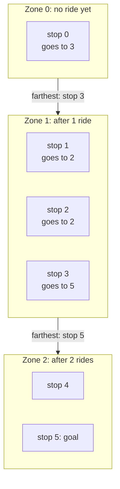
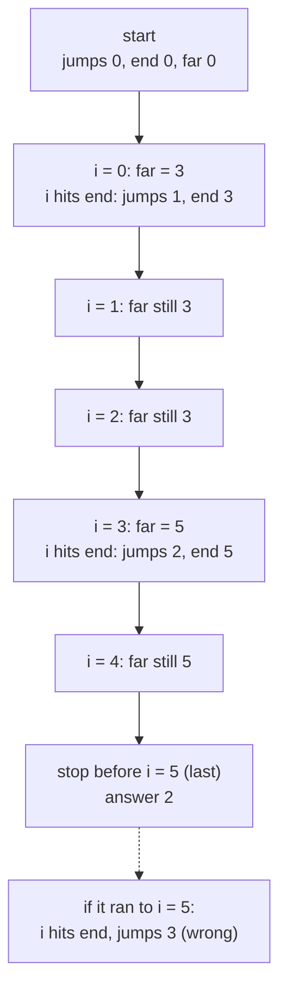

> [!tldr] Quick read
> - The indices reachable in at most k jumps always form one contiguous range `[0, r]`, because any index you can reach lets you reach every index in between. So the BFS levels on this array are consecutive windows: those are the [[en/concepts/jump-layers|jump layers]].
> - Sweep i from left to right, keeping `end` as the right edge of the current layer and `far` as the [[en/concepts/farthest-reach|farthest reach]] of the indices seen so far. When i hits `end`, the current layer is done: add one jump and set `end = far`. O(n) time, O(1) memory.
> - The loop stops at n − 2. Running it to the last index counts one extra jump whenever the last index sits exactly on a layer's edge: wrong on 1,584 of 3,056 small arrays, and `[0]` gives 1 instead of 0.
> - The greedy "always take the longest jump from where you stand" is wrong: `[2, 4, 1, 1, 1, 1]` gives 4 jumps instead of 2. The thing to be greedy about is which index *in the layer* reaches farthest, not the longest single jump.
> - On n = 10,000 with every value 1,000: the DP does 9,499,500 updates, jump layers run 9,999 iterations.

> [!info] Context
> This is LeetCode problem 45 at [[en/posts/2026-11-28-neetcode-greedy-array|station MISC-03: Greedy on Arrays]] on **the NeetCode Line: Mixed Techniques**. Its sibling [[en/problems/jump-game|Jump Game]] only asks whether the last index is reachable; this one asks for the fewest jumps to get there. You only need arrays and loops; a little [[en/concepts/breadth-first-search|breadth-first search]] makes it easier to see why the solution is correct.

> [!abstract]- Quick glossary for this post (click to open)
> - A jump: standing at index i, I may jump to any index from i + 1 to i + `nums[i]`. One jump counts as one step, long or short.
> - [[en/concepts/greedy-choice|Greedy choice]]: at each moment, pick what looks best right now and never reconsider. Greedy is only correct when you can prove that choice never loses the best answer.
> - DP (dynamic programming): record the answer for each subproblem, here "the fewest jumps to reach index j", and build the full answer from those.
> - BFS (breadth-first search): visit every vertex 1 step from the start, then every vertex 2 steps away, and so on. A vertex visited at level k has a shortest path of exactly length k.
> - Window `[l, r]`: a range of consecutive indices from l to r.

## Picture it first: hitchhiking along a highway

Along a highway there are stops numbered 0, 1, 2… At each stop there is a driver who can take you up to a few stops ahead and drop you at any stop within that range. I stand at stop 0 and want to reach the last stop with as few rides as possible. The smart move is not to hop into the farthest-going car in front of me. I look at the whole **zone** of stops already reachable with the same number of rides and ask every driver in it how far they go. The farthest point is the edge of the next zone, reachable with exactly one more ride.

| Everyday life | Concept |
|---|---|
| Stop number i along the highway | Index i |
| The driver at stop i goes at most `nums[i]` stops | A jump of at most `nums[i]` |
| One ride | One jump |
| The zone of stops reachable after exactly k rides | Layer k, window `[l, r]` |
| Ask every driver in the zone who goes farthest | `far = max(far, i + nums[i])` |
| Asked the whole zone and the goal is still ahead | `i == end`: `jumps++`, `end = far` |
| Already standing at the last stop, so no more rides | The loop stops before index n − 1 |

For the six stops `[3, 1, 0, 2, 0, 1]`, the zones look like this:



The driver at stop 2 can't take anyone (`nums[2] = 0`), but that doesn't matter: zone 1 still has stop 3, which opens the way to stop 5. The answer is 2 rides.

## The problem: the fewest jumps to the last index

Given an array `nums` of length 1 to 10,000, with each `nums[i]` between 0 and 1,000. Standing at index i you may jump to any index from i + 1 to i + `nums[i]`. Starting at index 0, return the fewest jumps needed to reach index n − 1. The last index is guaranteed to be reachable. For example, `[1, 1, 1, 1]` needs 3 jumps, while `[4, 0, 0, 0, 0]` needs only 1. [Original problem, LeetCode 45](https://leetcode.com/problems/jump-game-ii/)

My first attempt was the most obvious greedy: wherever I stand, take the longest jump available. With `[2, 4, 1, 1, 1, 1]` I jumped from index 0 to index 2, then crawled one index at a time: 4 jumps. The right path is a short jump to index 1 (value 4) and then one leap to index 5: 2 jumps. The longest jump right now is not the jump that opens up the most for the next one.

## How it works

### One small fact: the reachable indices are always one range

If index i is reachable, every index from i + 1 to i + `nums[i]` is reachable too. So the set of indices reachable in at most k jumps never has a hole: it is always `[0, r_k]`. This is where this problem differs from an arbitrary graph, and all three approaches below rely on it, the third most of all. It is also why, when the last index is guaranteed reachable, every index on the way is reachable.

### DP in O(n²): the fewest jumps to each index

Let `best[j]` be the fewest jumps to reach index j, with `best[0] = 0` and infinity everywhere else. Sweep i from left to right. By the time we reach i, every index that can jump to i lies to its left, so `best[i]` is final. Index i pushes `best[i] + 1` to every index it reaches: `best[i + k] = min(best[i + k], best[i] + 1)`.

Each index does up to `nums[i]` updates, so time is O(n · max(nums)), O(n²) in the worst case without the 1,000 limit. Memory is O(n). With n = 10,000 and every value 1,000, that is 9,499,500 updates.

### Explicit BFS over the indices

Treat each index as a vertex with edges from i to i + 1, …, i + `nums[i]`. Every edge has the same length (one jump), so BFS from vertex 0 gives the fewest jumps: the level of index n − 1 is the answer. It needs a queue and a `dist` array. The edge count is still the sum of the `nums[i]`, so 9,499,500 edges in the measurement above; but each index enters the queue only once.

### Jump layers: BFS without a queue, O(n) and O(1)

Because each BFS level is one contiguous range, I don't need a queue to know which level holds which index. Level 0 is `[0, 0]`. If level k ends at `end`, level k + 1 ends at `far`, the max of `i + nums[i]` over every i ≤ `end`. Three variables are enough:

- `end`: the right edge of the current layer;
- `far`: the farthest point reached by the indices swept so far;
- `jumps`: how many layers have been closed.

Sweep i from 0. Each index updates `far`. When `i == end`, I have swept the whole current layer, so `far` is exactly the edge of the next one. Count one more jump and set `end = far`. So `jumps` goes up exactly once each time BFS moves to a new level, which makes `jumps` the BFS level count. This is the correct [[en/concepts/greedy-choice|greedy choice]]: I never choose which index to land on in advance, I only record "how far the next layer reaches"; which index gives that reach doesn't matter.

**Why stop at n − 2.** `jumps++` at `i == end` means "the goal lies outside this layer, one more jump is needed". If i is already n − 1, I am standing on the goal and need no more jumps. Running the loop to n − 2 guarantees that whenever `i == end` happens, `end < n − 1`, so the goal really is still ahead. Running it to n − 1 counts one extra jump whenever the last index sits exactly on a layer's edge. With `[0]`, i = 0 is both the last index and `end`, so it gives 1 instead of 0. Another fix is to exit the loop as soon as `end ≥ n − 1`.

Tracing `[3, 1, 0, 2, 0, 1]`:



| Approach | Time | Extra memory | Notes |
|---|---|---|---|
| Try every jump path (recursion) | Exponential | O(n) | Referee in the runnable file, short arrays only |
| DP of jumps to each index | O(n · max(nums)), worst O(n²) | O(n) | 9,499,500 updates in the measurement |
| Explicit BFS | O(n · max(nums)) | O(n) | Queue and `dist` |
| Jump layers | O(n) | O(1) | 9,999 iterations in the measurement |
| Longest jump from where you stand | O(n) | O(1) | Wrong: 548/3,056 small arrays |

## Runnable example

[TypeScript](../code/neetcode-jump-game-ii/layers.ts) · [Python](../code/neetcode-jump-game-ii/layers.py) · [Go](../code/neetcode-jump-game-ii/layers.go) · [Java](../code/neetcode-jump-game-ii/layers.java) · [JavaScript](../code/neetcode-jump-game-ii/layers.js) · [PHP](../code/neetcode-jump-game-ii/layers.php) · [Rust](../code/neetcode-jump-game-ii/layers.rs)

```ts
// Main approach: jump layers. [.., end] is the current layer, far is how far the next layer reaches
function jump(nums: number[], counter: Counter = { ops: 0 }): number {
    let jumps = 0
    let end = 0
    let far = 0
    for (let i = 0; i < nums.length - 1; i++) { // stop before the last index
        counter.ops++
        far = Math.max(far, i + nums[i])
        if (i === end) { // finished the current layer: one more jump is needed
            jumps++
            end = far
        }
    }
    return jumps
}
```

```python
# Main approach: jump layers. [.., end] is the current layer, far is how far the next layer reaches
def jump(nums, counter=None):
    jumps = end = far = 0
    for i in range(len(nums) - 1):  # stop before the last index
        if counter is not None:
            counter["ops"] += 1
        far = max(far, i + nums[i])
        if i == end:  # finished the current layer: one more jump is needed
            jumps += 1
            end = far
    return jumps
```

```go
// Main approach: jump layers. [.., end] is the current layer, far is how far the next layer reaches
func jump(nums []int, ops *int) int {
	jumps, end, far := 0, 0, 0
	for i := 0; i < len(nums)-1; i++ { // stop before the last index
		*ops++
		far = max(far, i+nums[i])
		if i == end { // finished the current layer: one more jump is needed
			jumps++
			end = far
		}
	}
	return jumps
}
```

```java
// Main approach: jump layers. [.., end] is the current layer, far is how far the next layer reaches
static int jump(int[] nums) {
    int jumps = 0, end = 0, far = 0;
    for (int i = 0; i < nums.length - 1; i++) { // stop before the last index
        ops++;
        far = Math.max(far, i + nums[i]);
        if (i == end) { // finished the current layer: one more jump is needed
            jumps++;
            end = far;
        }
    }
    return jumps;
}
```

```js
// Main approach: jump layers. [.., end] is the current layer, far is how far the next layer reaches
function jump(nums, counter = { ops: 0 }) {
    let jumps = 0
    let end = 0
    let far = 0
    for (let i = 0; i < nums.length - 1; i++) { // stop before the last index
        counter.ops++
        far = Math.max(far, i + nums[i])
        if (i === end) { // finished the current layer: one more jump is needed
            jumps++
            end = far
        }
    }
    return jumps
}
```

```php
// Main approach: jump layers. [.., end] is the current layer, far is how far the next layer reaches
function jump(array $nums, int &$ops = 0): int {
    $jumps = 0;
    $end = 0;
    $far = 0;
    for ($i = 0; $i < count($nums) - 1; $i++) { // stop before the last index
        $ops++;
        $far = max($far, $i + $nums[$i]);
        if ($i === $end) { // finished the current layer: one more jump is needed
            $jumps++;
            $end = $far;
        }
    }
    return $jumps;
}
```

```rust
// Main approach: jump layers. [.., end] is the current layer, far is how far the next layer reaches
fn jump(nums: &[i32], ops: &mut usize) -> usize {
    let (mut jumps, mut end, mut far) = (0, 0, 0);
    for i in 0..nums.len() - 1 { // stop before the last index
        *ops += 1;
        far = far.max(i + nums[i] as usize);
        if i == end { // finished the current layer: one more jump is needed
            jumps += 1;
            end = far;
        }
    }
    jumps
}
```

The tabs show the jump-layers approach; the line that increments `ops` only counts for the measurement. The downloadable file also has the DP, the explicit BFS, the two wrong versions (running to the last index, longest jump from where you stand) and a referee that tries every jump path. The eight hand-written cases include one-element arrays (`[0]` among them), a 0 in the middle of the path and one long jump near the end. For each case, the DP, BFS, jump layers and the referee must all return the expected answer.

The second line checks the three correct approaches against the referee on every array of length 1–6 with values 0–3 whose last index is reachable: 3,056 arrays. Lines three and four count the arrays on which the two wrong versions answer wrong. The last line is the measurement on n = 10,000 with every value 1,000 (the problem's largest limit), counting operations in the inner loop.

```text
8/8 cases passed
3056/3056 cases passed (checked against trying every jump path)
Letting the loop run to the last index: wrong on 1584/3056 cases, [0] gives 1 instead of 0
Always taking the longest jump from where you stand: wrong on 548/3056 cases, [2,4,1,1,1,1] gives 4 instead of 2
n = 10000, every value 1000: 10/10/10 jumps; DP 9499500 updates, BFS 9499500 edges, jump layers 9999 iterations
```

*(Output labels translated; the files themselves print Vietnamese.)*

All seven languages print exactly these five lines. I also timed the same large array separately (average of 5 runs after one warm-up run): Node 24 took about 20 ms for the DP, 16 ms for BFS and 0.1 ms for jump layers; Python 3.12 took about 715 ms for the DP, 154 ms for BFS and 0.8 ms for jump layers. That is a ratio of roughly 200 to 900 times, matching 9.5 million against 10 thousand operations.

## Misconceptions and common traps

- Being greedy about the longest jump from where you stand. As the fourth line above shows, it is wrong on 548 of 3,056 arrays, and it can even get stuck on a 0 while the goal is reachable: `[2, 3, 0, 0]` jumps straight onto index 2 and stays there, while 0 → 1 → 3 takes only 2 jumps. The thing to be greedy about is the reach of the whole layer, not the length of one jump.
- Letting the loop run to the last index. Whenever the last index sits on a layer's edge, the result has one extra jump. The one-element array is the easiest case to forget.
- Counting a jump where `far` grows instead of at `i == end`. `far` can grow several times within one layer, but the whole layer costs only one jump.
- Thinking you need to know which index you jump to. Jump layers only count layers; if the problem asks for the path too, also record the index that gives the largest `far` in each layer.
- Java, Go: initializing the DP with `Integer.MAX_VALUE` or `math.MaxInt` and then computing `best[i] + 1` overflows to a negative number, and `min` picks that negative number right away. In this problem every index is reachable, so it never happens, but carry this DP over to a problem with unreachable indices and it bites. The Java file uses n as "infinity"; the Go file uses `math.MaxInt32` on a 64-bit `int`.
- PHP: `PHP_INT_MAX + 1` doesn't overflow but turns into the float `9.2233720368548E+18`, and then a `===` comparison with an integer is always false. The PHP file skips unreachable indices before adding.
- Rust: `usize::MAX + 1` stops the program (a panic) in a debug build and silently wraps to 0 in a `-O` build. The Rust file checks `UNREACHABLE` before adding. `nums.len() - 1` is also a `usize` subtraction; it is safe here only because the problem guarantees n ≥ 1.
- JavaScript, TypeScript: a BFS that uses `queue.shift()` pays O(queue length) per removal, because every element must move up. The file uses a `head` index that walks along the array instead of `shift`.
- Python: the DP's 9.5 million `min` calls take almost a second, which easily exceeds LeetCode's time limit. BFS is faster (about 154 ms) because it doesn't call `min`, and jump layers take under 1 ms.

## Self-check questions

> [!question]- Why are the indices reachable in at most k jumps always one contiguous range?
> Because reaching index i means reaching every index from i + 1 to i + `nums[i]`, with no index in between skipped. Starting from `[0, 0]`, each jump only extends the range to the right.

> [!question]- For `[1, 3, 0, 0, 5, 0, 0, 1]`, what are the layers and what is the answer?
> Layer 0 is `[0]`, layer 1 is `[1]`, layer 2 is `[2, 4]` (index 1 reaches index 4), layer 3 is `[5, 7]` (index 4 reaches index 9, cut at index 7). Index 7 is in layer 3, so the answer is 3.

> [!question]- If the loop runs to n − 1, what condition must be added to keep it correct?
> Exit the loop as soon as `end ≥ n − 1`, before checking `i == end` on the next iteration. Then no iteration can count an extra jump.

> [!question]- If the last index were not guaranteed reachable, what would jump layers need to change?
> When `i == end` and `far` still equals `end`, the next layer is empty: there is no way forward, so return −1. That is exactly the question of [[en/problems/jump-game|Jump Game]].

## References

- [LeetCode 45](https://leetcode.com/problems/jump-game-ii/)
- [Jeff Erickson, Algorithms, chapter 8: shortest paths, including BFS](https://jeffe.cs.illinois.edu/teaching/algorithms/book/08-sssp.pdf) · [chapter 4: greedy algorithms](https://jeffe.cs.illinois.edu/teaching/algorithms/book/04-greedy.pdf)
- [Java, integer addition overflow](https://docs.oracle.com/javase/specs/jls/se21/html/jls-15.html#jls-15.18.2) · [Go, integer overflow](https://go.dev/ref/spec#Integer_overflow) · [PHP, integer overflow](https://www.php.net/manual/en/language.types.integer.php#language.types.integer.overflow) · [MDN, Array.prototype.shift](https://developer.mozilla.org/en-US/docs/Web/JavaScript/Reference/Global_Objects/Array/shift)
