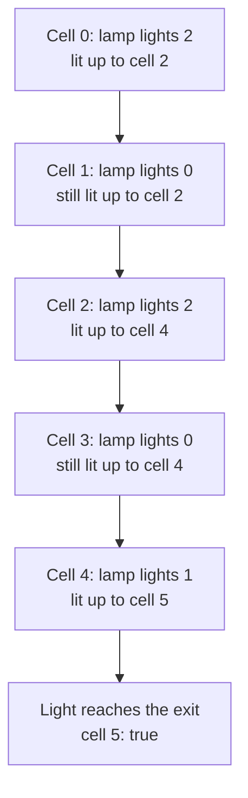
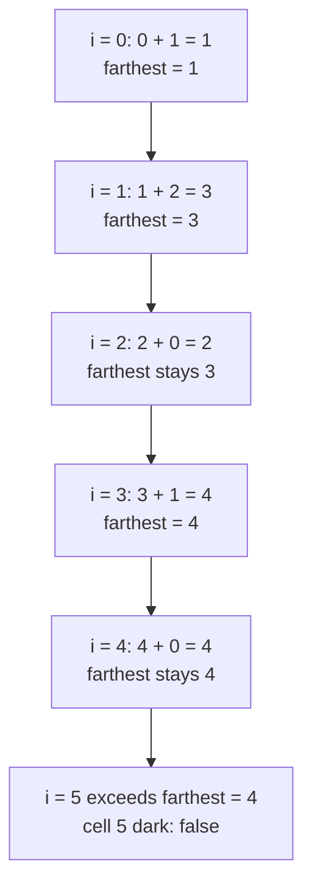

> [!tldr] Quick read
> - I used to think I had to try each jump path; it turns out one number is enough: the [[en/concepts/farthest-reach|farthest reachable index]] (`farthest`). The reachable cells always form one contiguous range from 0 to `farthest`, never with a hole.
> - Scan left to right. Meeting a cell `i > farthest` means you are stuck; otherwise widen `farthest` to `max(farthest, i + nums[i])`. O(n) time, O(1) memory.
> - The backward version is O(n) too: put the goal on the last cell, walk left, and move the goal to cell `i` whenever `i + nums[i]` reaches it.
> - Backtracking over every path explodes: 262,144 calls at n = 20. Memoization and a DP table bring it down to O(n²), but on the worst array with n = 10,000 the DP table still takes 49,985,001 steps, while the greedy takes 10,000.

> [!info] Context
> This is LeetCode problem 55 at [[en/posts/2026-11-28-neetcode-greedy-array|station MISC-03: Greedy on Arrays]] on **the NeetCode Line: Mixed Techniques**. I picture a dark tunnel with a lamp post on each cell, and ask whether the light can spread all the way to the exit. You only need arrays and loops; the backtracking and memoization parts also use recursive functions.

> [!abstract]- Quick glossary for this post (click to open)
> - Greedy means deciding from local information and never going back to fix it. The hard part is proving that the [[en/concepts/greedy-choice|greedy choice]] does not lose the answer.
> - `farthest` is the farthest index I am certain I can jump to, counted from the cells already walked over.
> - [[en/concepts/backtracking|Backtracking]] tries one choice, goes deeper, and on failure comes back to try another choice.
> - [[en/concepts/memoization|Memoization]] stores the result of a state so that asking again returns it immediately, without recomputing.
> - The [[en/concepts/dp-state|DP state]] in this problem is one index i, with the question "can cell i reach the last cell".

## Picture it first: a tunnel with lamp posts

The tunnel is split into cells, and each cell has a lamp post. When I step onto cell i, its lamp turns on and lights `nums[i]` cells ahead. I may only step on lit cells. As I keep walking, each new lamp may push the edge of the light farther. If I reach the edge of the light and the next cell is still dark, I am stuck. If the light touches the exit at the last cell, I get out.

The key point: the lit part is always one contiguous stretch from cell 0 to the edge of the light. A lamp lights the whole strip in front of it, never skipping cells, so there is never a dark cell between two lit ones.

| Everyday life | Concept |
|---|---|
| The tunnel split into cells | The array `nums` |
| The lamp on cell i lights `nums[i]` cells ahead | The longest jump from i |
| The lit stretch of tunnel | The reachable cells, always `0..farthest` |
| The farthest edge of the light | `farthest` |
| The next cell is still dark | `i > farthest`: return `false` |
| The light touches the exit | `farthest >= n − 1`: return `true` |

With the tunnel `[2, 0, 2, 0, 1, 0]`, I walk like this:



The two lamps that light 0 cells do not trap me, because the edge of the light had already passed them.

## The problem: can the first cell reach the last one

Given an array `nums` of length 1 to 10,000, where each element is an integer from 0 to 100,000. I stand on cell 0. From cell i I may jump to any cell in `i + 1 .. i + nums[i]`, that is, a jump of length 1 to `nums[i]`. Return `true` if there is a way to reach the last cell (index n − 1), otherwise `false`. For example, `[2, 3, 0, 0, 1]` gives `true` through the path 0 → 1 → 4, while `[1, 0, 1]` gives `false` because cell 1 lights 0 cells. [Original problem, LeetCode 55](https://leetcode.com/problems/jump-game/)

My first attempt was "on each turn, take the longest possible jump". With `[2, 3, 0, 0, 1]`, cell 0 jumps 2 to cell 2, which lights 0 cells, so the function returned `false`. Yet a short jump of 1 to cell 1 lets cell 1 light straight to cell 4. The longest jump is not a safe choice. What is safe to be greedy about is **the edge of the light**, not where I put my feet.

## How it works

### Backtracking: try every jump path

The function `dfs(i)` answers "can cell i reach the last cell". If i is the last cell, yes. Otherwise try each jump from `nums[i]` down to 1 and call `dfs(i + step)`; one true branch is enough. Nothing stops the same cell from being asked again and again through different paths.

The worst array I use is `[n − 2, n − 3, …, 1, 0, 0]`: every cell jumps just far enough to land on the 0 at position n − 2, so every path gets stuck and the function must try them all. Let T(i) be the number of calls starting from i; then T(i) = 1 + T(i + 1) + … + T(n − 2) with T(n − 2) = 1, so T(i) = 2^(n − 2 − i). At n = 20 that is 2¹⁸ = 262,144 calls. Time O(2ⁿ), memory O(n) for the call stack.

### Memoization: each cell computed once

Add a `memo` array: 0 means unknown, 1 means it reaches the end, 2 means stuck. The second time the same cell is asked, it returns immediately. Each cell is fully computed exactly once, and each computation scans at most n steps, so time is O(n²), memory O(n) for `memo` plus O(n) levels of recursion. On the same worst array with n = 20, the call count drops from 262,144 to 172.

### Bottom-up DP table

Drop the recursion: `good[n − 1] = true`, then walk i from n − 2 down to 0. `good[i]` is true if some j in `i + 1 .. i + nums[i]` has `good[j]` true; stop at the first such j. Still O(n²) time and O(n) memory, but no more risk of a stack overflow. On the worst array, cell i scans n − 2 − i cells without meeting a good one, (n − 1)(n − 2)/2 steps in total: 49,985,001 steps at n = 10,000.

### Forward greedy: keep the farthest edge

This is the main approach. `farthest = 0`. Walk i from 0 to the right:

1. If `i > farthest`, cell i lies outside the reachable range: return `false`.
2. Otherwise, `farthest = max(farthest, i + nums[i])`.
3. If `farthest >= n − 1`: return `true`.

Why is one number enough? I need to prove: **if cell j is reachable, every cell k < j is reachable.** Take a path to j: 0 = p₀ < p₁ < … < pₘ = j (every jump goes right). Cell k lies in some interval (pₜ, pₜ₊₁]. Cell pₜ is reachable and can jump to pₜ₊₁, which means `nums[pₜ] ≥ pₜ₊₁ − pₜ ≥ k − pₜ`. Since any jump length from 1 to `nums[pₜ]` is allowed, I can jump straight from pₜ to k. So the set of reachable cells has no holes: it is always one range `0..R`.

Once the set is known to be one range, only its right edge R matters. The loop keeps the invariant "`farthest` is the right edge of the reachable range, counted from cells 0..i − 1". Cell i is used to widen the edge only when `i ≤ farthest`, that is, when it is certainly reachable. Meeting `i > farthest` means every cell on the left has already contributed everything it can and still does not reach i, so no cell to the right can be reached either. That is why the greedy choice is safe here: I do not choose a path, I only keep a summary that loses nothing the question needs.

Running on `[1, 2, 0, 1, 0, 3]`, an array that gives `false` even though the last cell holds a 3:



The 3 in cell 5 is never added, because I can never stand on that cell.

### Backward greedy: move the goal left

This one walks from right to left. `goal = n − 1`. For i from n − 2 down to 0: if `i + nums[i] >= goal`, set `goal = i`. At the end, return `goal == 0`.

`goal` is always the leftmost cell known to reach the end, among the cells from i + 1 on. Cell i reaches the end if and only if it can jump to some good cell on its right. The nearest good cell on the right is `goal`, and every other good cell is farther. Since i can jump to every cell in `i + 1 .. i + nums[i]`, comparing with the nearest good cell is enough. This is the [[en/concepts/dp-state|DP state]] `good[i]` compressed into one number.

| i | `nums[i]` | `i + nums[i]` | `goal` after this step |
|---|---|---|---|
| start | | | 5 |
| 4 | 0 | 4 | 5 |
| 3 | 1 | 4 | 5 |
| 2 | 0 | 2 | 5 |
| 1 | 2 | 3 | 5 |
| 0 | 1 | 1 | 5 |

With `[1, 2, 0, 1, 0, 3]`, no cell reaches cell 5, `goal` stays at 5, so the result is `false`, matching the forward version.

| Approach | Time | Extra memory | Notes |
|---|---|---|---|
| Backtracking | O(2ⁿ) | O(n) stack | 262,144 calls at n = 20 |
| Top-down memoization | O(n²) | O(n) + O(n) stack | 172 calls at n = 20; recursion n levels deep |
| Bottom-up DP table | O(n²) | O(n) | 49,985,001 steps at n = 10,000 |
| Forward greedy | O(n) | O(1) | Main approach; 10,000 steps |
| Backward greedy | O(n) | O(1) | Always scans the whole array |

## Runnable example

[TypeScript](../code/neetcode-jump-game/reach.ts) · [Python](../code/neetcode-jump-game/reach.py) · [Go](../code/neetcode-jump-game/reach.go) · [Java](../code/neetcode-jump-game/reach.java) · [JavaScript](../code/neetcode-jump-game/reach.js) · [PHP](../code/neetcode-jump-game/reach.php) · [Rust](../code/neetcode-jump-game/reach.rs)

```ts
// Forward greedy: the reachable cells always form one contiguous range 0..farthest
function canJump(nums: number[], counter = { steps: 0 }): boolean {
    let farthest = 0
    for (let i = 0; i < nums.length; i++) {
        counter.steps++
        if (i > farthest) return false // cell i lies outside the reachable range: stuck
        farthest = Math.max(farthest, i + nums[i])
        if (farthest >= nums.length - 1) return true
    }
    return true
}

// Backward greedy: move the goal to the leftmost cell known to reach the end
function canJumpGoal(nums: number[]): boolean {
    let goal = nums.length - 1
    for (let i = nums.length - 2; i >= 0; i--) {
        if (i + nums[i] >= goal) goal = i // i can jump to goal, so i becomes the new goal
    }
    return goal === 0
}
```

```python
# Forward greedy: the reachable cells always form one contiguous range 0..farthest
def can_jump(nums, counter=None):
    farthest = 0
    for i in range(len(nums)):
        if counter is not None:
            counter["steps"] += 1
        if i > farthest:
            return False  # cell i lies outside the reachable range: stuck
        farthest = max(farthest, i + nums[i])
        if farthest >= len(nums) - 1:
            return True
    return True


# Backward greedy: move the goal to the leftmost cell known to reach the end
def can_jump_goal(nums):
    goal = len(nums) - 1
    for i in range(len(nums) - 2, -1, -1):
        if i + nums[i] >= goal:
            goal = i  # i can jump to goal, so i becomes the new goal
    return goal == 0
```

```go
// Forward greedy: the reachable cells always form one contiguous range 0..farthest
func canJump(nums []int, steps *int) bool {
	farthest := 0
	for i := range nums {
		*steps++
		if i > farthest {
			return false // cell i lies outside the reachable range: stuck
		}
		farthest = max(farthest, i+nums[i])
		if farthest >= len(nums)-1 {
			return true
		}
	}
	return true
}

// Backward greedy: move the goal to the leftmost cell known to reach the end
func canJumpGoal(nums []int) bool {
	goal := len(nums) - 1
	for i := len(nums) - 2; i >= 0; i-- {
		if i+nums[i] >= goal {
			goal = i // i can jump to goal, so i becomes the new goal
		}
	}
	return goal == 0
}
```

```java
// Forward greedy: the reachable cells always form one contiguous range 0..farthest
static boolean canJump(int[] nums) {
    int farthest = 0;
    for (int i = 0; i < nums.length; i++) {
        steps++;
        if (i > farthest) return false; // cell i lies outside the reachable range: stuck
        farthest = Math.max(farthest, i + nums[i]);
        if (farthest >= nums.length - 1) return true;
    }
    return true;
}

// Backward greedy: move the goal to the leftmost cell known to reach the end
static boolean canJumpGoal(int[] nums) {
    int goal = nums.length - 1;
    for (int i = nums.length - 2; i >= 0; i--) {
        if (i + nums[i] >= goal) goal = i; // i can jump to goal, so i becomes the new goal
    }
    return goal == 0;
}
```

```js
// Forward greedy: the reachable cells always form one contiguous range 0..farthest
function canJump(nums, counter = { steps: 0 }) {
    let farthest = 0
    for (let i = 0; i < nums.length; i++) {
        counter.steps++
        if (i > farthest) return false // cell i lies outside the reachable range: stuck
        farthest = Math.max(farthest, i + nums[i])
        if (farthest >= nums.length - 1) return true
    }
    return true
}

// Backward greedy: move the goal to the leftmost cell known to reach the end
function canJumpGoal(nums) {
    let goal = nums.length - 1
    for (let i = nums.length - 2; i >= 0; i--) {
        if (i + nums[i] >= goal) goal = i // i can jump to goal, so i becomes the new goal
    }
    return goal === 0
}
```

```php
// Forward greedy: the reachable cells always form one contiguous range 0..farthest
function canJump(array $nums): bool {
    global $steps;
    $farthest = 0;
    $n = count($nums);
    for ($i = 0; $i < $n; $i++) {
        $steps++;
        if ($i > $farthest) return false; // cell i lies outside the reachable range: stuck
        $farthest = max($farthest, $i + $nums[$i]);
        if ($farthest >= $n - 1) return true;
    }
    return true;
}

// Backward greedy: move the goal to the leftmost cell known to reach the end
function canJumpGoal(array $nums): bool {
    $goal = count($nums) - 1;
    for ($i = count($nums) - 2; $i >= 0; $i--) {
        if ($i + $nums[$i] >= $goal) $goal = $i; // i can jump to goal, so i becomes the new goal
    }
    return $goal === 0;
}
```

```rust
// Forward greedy: the reachable cells always form one contiguous range 0..farthest
fn can_jump(nums: &[i32], steps: &mut u64) -> bool {
    let mut farthest = 0;
    for i in 0..nums.len() {
        *steps += 1;
        if i > farthest {
            return false; // cell i lies outside the reachable range: stuck
        }
        farthest = farthest.max(i + nums[i] as usize);
        if farthest >= nums.len() - 1 {
            return true;
        }
    }
    true
}

// Backward greedy: move the goal to the leftmost cell known to reach the end
fn can_jump_goal(nums: &[i32]) -> bool {
    let mut goal = nums.len() - 1;
    for i in (0..nums.len() - 1).rev() {
        if i + nums[i] as usize >= goal {
            goal = i; // i can jump to goal, so i becomes the new goal
        }
    }
    goal == 0
}
```

The tabs show the two greedy approaches; the line that increments `steps` only counts for the measurement. The downloadable file also has backtracking, memoization, the DP table, two wrong versions and an independent referee: it spreads the set of reachable cells over and over until nothing changes, sharing no line with the other five approaches. The eleven test cases cover a one-element array, a 0 in cell 0, a 0 in the middle that has already been passed, an array that needs a short jump to get through, and the worst array with n = 10. Each case must give the same answer from all five approaches and from the referee.

The second line cross-checks every array of length 1–6 with elements from 0 to 3: 5,460 arrays. The next two lines score the two wrong versions on the eleven cases. The last three lines are measurements on the worst array.

```text
11/11 cases passed
5460/5460 cases passed (cross-check against the spreading referee)
Version that forgets to check i > farthest: 6/11 cases passed
Version that always takes the longest jump: 10/11 cases passed
n = 20, worst array: backtracking 262144 calls, memoization 172 calls
n = 10000, worst array: DP table 49985001 steps, greedy 10000 steps
Time at n = 10000: DP table 47.0 ms, greedy 0.011 ms
```

*(Output labels translated; the files themselves print Vietnamese.)*

That is the TypeScript run. The first six lines are identical in all seven languages. The timing line differs by language; here is one run on my machine (the DP table runs once, the greedy is averaged over 100 runs):

| Language | DP table O(n²) | Greedy O(n) | Ratio |
|---|---|---|---|
| TypeScript (Node 24) | 47.0 ms | 0.011 ms | about 4,300× |
| Python 3.12 | 1,102.7 ms | 1.107 ms | about 1,000× |
| Go 1.25 | 19.9 ms | 0.005 ms | about 4,000× |
| Java 21 | 20.5 ms | 0.006 ms | about 3,400× |
| JavaScript (Node 24) | 47.4 ms | 0.011 ms | about 4,300× |
| PHP 8.2 | 386.5 ms | 0.212 ms | about 1,800× |
| Rust (`rustc -O`) | 11.1 ms | 0.008 ms | about 1,400× |

The step counts differ by about 5,000× (49,985,001 versus 10,000), and the times follow roughly that size. In Python, one DP table run already takes over a second for a single array.

## Misconceptions and common traps

- Thinking a 0 means you are stuck. A 0 only traps you when `farthest` stops exactly on that cell. `[2, 0, 0]` still gives `true` because cell 0 lights straight to the last cell.
- Taking the longest jump each turn. This version passes 10/11 cases and fails only on `[2, 3, 0, 0, 1]`: the long jump from cell 0 lands on cell 2, which lights 0 cells, while the short jump to cell 1 is the way out. What I am greedy about is the edge of the light, not where I put my feet.
- Forgetting to check `i > farthest` and adding `i + nums[i]` for every cell. This version passes only 6/11 cases: `[0, 1]` gives `true` because it also adds cell 1, a cell I can never stand on.
- In the backward version, comparing `i + nums[i] >= n − 1` instead of `>= goal`. That only asks whether cell i can jump straight to the last cell, so `[1, 1, 1, 1]` becomes `false`.
- Python: the top-down memoization recurses up to n levels deep, and the default limit is 1,000. I ran `can_jump_memo([1] * 10000)` and got `RecursionError`. You can raise the limit with `sys.setrecursionlimit`, but the bottom-up DP table and the greedy do not need it.
- JavaScript, TypeScript: on the same `[1, …, 1]` of length 10,000, the memoized version on Node 24 throws `RangeError: Maximum call stack size exceeded`. In the JS version it passes or fails depending on whether the JIT has optimized the function yet (I saw it fail at 9,000 but pass at 10,000 in the same run), so do not rely on it.
- Java: an identical memoized version, run with `java` and the default stack, throws `StackOverflowError` at depth 10,000 on my machine. You can enlarge the stack with `-Xss`, but the iterative approaches are still safer.
- PHP: when Xdebug is on, it stops the program once recursion goes past `xdebug.max_nesting_level` (512 by default), so I run with `php -d xdebug.mode=off`. Go grows goroutine stacks on its own, so it does not hit this.
- Rust: `i + nums[i]` does not compile because `i` is a `usize` and `nums[i]` is an `i32`; write `i + nums[i] as usize`. Walking backward with `while i >= 0` on a `usize` breaks too: the condition is always true, and subtracting `i` below 0 panics in a debug build. Use `(0..n - 1).rev()`.

## Self-check questions

> [!question]- Why are the reachable cells always one contiguous range from 0?
> If cell j is reachable, every cell k < j is too: on the path to j some jump from pₜ passes over k, and since the jump length can be anything from 1 to `nums[pₜ]`, I can jump straight from pₜ to k.

> [!question]- Run the backward greedy on `[3, 1, 0, 0]`: where does `goal` end up?
> Start with `goal = 3`. Cell 2: 2 + 0 = 2 < 3. Cell 1: 1 + 1 = 2 < 3. Cell 0: 0 + 3 = 3 ≥ 3, so `goal = 0` and the result is `true`.

> [!question]- Memoization computes each cell only once, so why is it still O(n²)?
> Each time it computes a cell, the loop tries up to `nums[i]` jumps, which can be up to n. n cells times n jumps is O(n²). The greedy drops the inner loop because it only needs the right edge of the reachable range.

> [!question]- If the problem asked for the minimum number of jumps, would `farthest` alone be enough?
> No. You need to split the cells into layers by number of jumps, like the [[en/concepts/jump-layers|jump layers]] in [[en/problems/jump-game-ii|Jump Game II]]. This problem only asks whether you can get there, so one number is enough.

## References

- [LeetCode 55](https://leetcode.com/problems/jump-game/)
- [Jeff Erickson, Algorithms, chapter 4: greedy algorithms](https://jeffe.cs.illinois.edu/teaching/algorithms/book/04-greedy.pdf)
- [Python sys.setrecursionlimit](https://docs.python.org/3/library/sys.html#sys.setrecursionlimit) · [Java, the -Xss option](https://docs.oracle.com/en/java/javase/21/docs/specs/man/java.html) · [Xdebug max_nesting_level](https://xdebug.org/docs/develop#max_nesting_level) · [Go FAQ, goroutine stacks](https://go.dev/doc/faq#goroutines)
