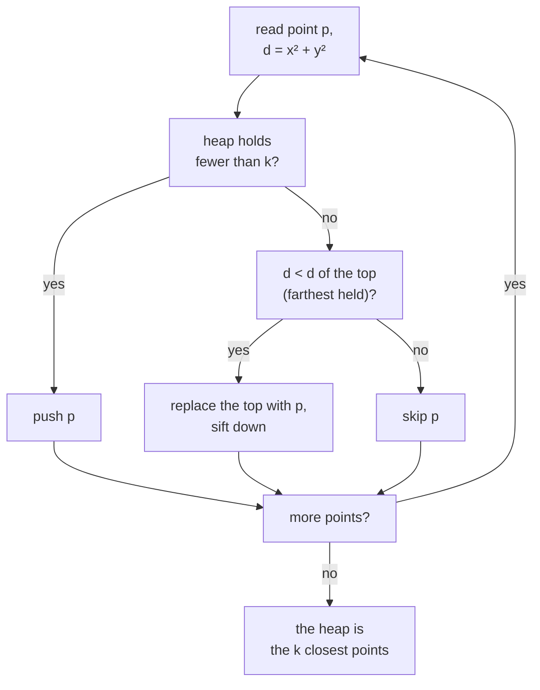

> [!tldr] Quick read
> - Problem: given n points on a plane and a number k, return the k points closest to the origin `(0, 0)`, in any order. The problem promises a unique answer (no tie at the boundary).
> - Compare `x² + y²` instead of the real distance: the square root is increasing, so it keeps the order, and dropping it keeps everything in integers. Sorting with `Math.hypot` is almost twice as slow (967 ms against 527 ms on 10⁶ points).
> - The "top k" pattern: keep a **size-k max-heap**. The top is the farthest of the k points held; a new point closer than the top replaces it. O(n log k), O(k) memory. Turned the wrong way (a size-k min-heap), it keeps the k **farthest** points: 6/8 cases fail.
> - [[en/concepts/quickselect|Quickselect]] partitions the array around a pivot until the k closest points sit at the front: O(n) on average. On 10⁶ points with k = 1000: sorting 504 ms, max-heap 67 ms, quickselect 110 ms in TypeScript; Go: sorting 179 ms, max-heap 2 ms.
> - Two arithmetic limits beyond the problem: Java `x * x + y * y` overflows `int` once coordinates pass 32 767 (`[40000, 40000]` becomes the closest point); JavaScript loses the last unit once `x² + y²` passes 2⁵³.

> [!info] Context
> LeetCode problem 973 belongs to [[en/posts/2026-11-23-neetcode-heap-top-k|station 3: Heaps and Top K]] on **The NeetCode Line: Search and Heaps**. The station's earlier problem, [[en/problems/last-stone-weight|Last Stone Weight]], used a heap to take the largest again and again. This one uses a heap differently: it keeps a group of the k best candidates, and the heap top is the **worst** candidate in that group. The solution comes in TypeScript, Python, Go, Java and JavaScript.

> [!abstract]- Quick glossary for this post (click to open)
> - **Heap, max-heap, min-heap**: a binary tree in an array with the largest (or smallest) at the top; add and take the top in O(log n). See [[en/concepts/heap|Heap]] and the [[en/problems/last-stone-weight|Last Stone Weight]] page.
> - **Top k**: pick the k best elements by some criterion without ranking all of them. Sibling problem: [[en/problems/kth-largest-element-in-an-array|Kth Largest Element in an Array]].
> - **Quickselect**: like quicksort, but recursing into only one side of the pivot. See [[en/concepts/quickselect|Quickselect]].
> - **Increasing (monotonic)**: a < b implies f(a) < f(b). The square root is increasing on non-negative numbers, so comparing `x² + y²` gives the same result as comparing distances.
> - **2⁵³**: the largest integer up to which a 64-bit float (JS's `number` type) represents every integer exactly.

## Picture it first: picking the k restaurants nearest home out of a thousand

You have a directory of a thousand restaurants with coordinates and want to write down the three nearest home. You do not rank all thousand. You hold a three-line note and always keep an eye on the **farthest** restaurant on it. Reading a new restaurant: if it is closer than the farthest one on the note, cross that one out and write the new one in; otherwise skip it. When the directory is done, the note is the answer.

| Everyday life | Concept |
|---|---|
| The restaurant directory | the array `points`, n points |
| Distance from home | `x² + y²` (no square root needed) |
| A three-line note | a size-k heap |
| Always watching the farthest restaurant on the note | max-heap: the top is the farthest point held |
| New restaurant closer than the farthest: cross out and write | replace the top, sift down, O(log k) |
| New restaurant farther: skip | the heap is untouched, O(1) |
| Ranking all thousand and taking the first three | sorting everything, O(n log n) |



## The problem

The most direct way: sort the n points by distance and take the first k. O(n log n), correct, and it passes LeetCode (n ≤ 10⁴). But it does extra work: it ranks all n − k points we are about to throw away. When k is small relative to n (the 10 nearest out of a million), most of the sorting effort is wasted.

There are two ways to do less. A size-k heap keeps order only among k candidates: O(n log k). Quickselect needs only the **boundary** between the k closest points and the rest, not the order within each side: O(n) on average.

## The mechanism

### Dropping the square root

The real distance is `√(x² + y²)`. Since the square root is increasing on non-negative numbers, `√a < √b` exactly when `a < b`. Comparing `x² + y²` gives exactly the same order, all in integers, with no square root to pay for. It is not only faster: avoiding floating point avoids the question "are these two distances really equal, or only equal after rounding". Measured in TypeScript on 10⁶ points: sorting by `x² + y²` takes 527 ms, by `Math.hypot` 967 ms.

### A size-k max-heap: the top is the worst candidate

The top-k pattern often confuses newcomers about the direction of the heap. We want the k **closest** points but use a **max**-heap. The reason: the heap is where we decide who gets dropped, and the one dropped must be the worst candidate in the group, that is, the **farthest** point. A max-heap puts that point at the top, so both the comparison and the replacement happen at the top.

```ts
// Max-heap holding the k closest points seen; the top is the FARTHEST of them, replaced when a closer point comes. O(n log k).
function maxHeapK(points: P[], k: number): P[] {
  const key = keys(points), h = new IndexHeap(key, true);
  for (let i = 0; i < points.length; i++) {
    if (h.size < k) h.push(i);
    else if (key[i] < key[h.top()]) { h.a[0] = i; h.siftDown(0); }
  }
  return h.a.map((i) => points[i]);
}
```


Each point costs at most one sift-down in a heap of size k: O(log k). O(n log k) total, O(k) memory. The heap holds only indices; distances are computed once into a `Float64Array`, so each comparison is just an array read.

**Wrong version: the heap turned the wrong way.** Write a size-k min-heap and the top is the **closest** point held. New points compare against it, and the closest point is pushed out first. The result is the k farthest points:

```ts
// WRONG: a size-k min-heap (the wrong way). The top is the CLOSEST point, so it is pushed out first; the heap keeps the k farthest points.
function wrongMinHeapK(points: P[], k: number): P[] {
  const key = keys(points), h = new IndexHeap(key, false);
  for (let i = 0; i < points.length; i++) {
    if (h.size < k) h.push(i);
    else if (key[i] > key[h.top()]) { h.a[0] = i; h.siftDown(0); }
  }
  return h.a.map((i) => points[i]);
}
```


It fails 6/8 cases; the problem's first example `[[1, 3], [-2, 2]]`, k = 1 gives `[1, 3]` instead of `[-2, 2]`. The two cases that pass are the one with k = n and the one with a single point, where the heap holds everything.

### Two other correct ways: a min-heap of everything, quickselect

**A min-heap of all n points.** Building the heap bottom-up costs O(n) (see [[en/problems/last-stone-weight|Last Stone Weight]]), then take the top k times, O(k log n). O(n + k log n) total, O(n) memory. For small k it is almost linear; for large k the size-k max-heap wins because its heap is smaller.

**Quickselect.** Pick a random pivot and split the array into three parts `< pivot`, `= pivot`, `> pivot`. If k falls in the `<` part, continue only there; if it goes past the `=` part, continue in the `>` part; if it falls in the `=` part, you are done. Each round discards one whole side, so on average the total work is n + n/2 + n/4 + … ≈ 2n.

```ts
// Quickselect: partition around a random pivot until the k closest points are at the front. O(n) on average, O(n²) worst.
function quickselect(points: P[], k: number): P[] {
  const key = keys(points), idx = points.map((_, i) => i);
  let lo = 0, hi = idx.length - 1;
  while (lo < hi) {
    const pivot = key[idx[lo + Math.floor(Math.random() * (hi - lo + 1))]];
    // three-way split: < pivot | = pivot | > pivot
    let lt = lo, i = lo, gt = hi;
    while (i <= gt) {
      const d = key[idx[i]];
      if (d < pivot) { [idx[lt], idx[i]] = [idx[i], idx[lt]]; lt++; i++; }
      else if (d > pivot) { [idx[i], idx[gt]] = [idx[gt], idx[i]]; gt--; }
      else i++;
    }
    if (k <= lt) hi = lt - 1; // the k closest points all lie in the "<" part
    else if (k > gt + 1) lo = gt + 1; // need more from the ">" part
    else break; // the k boundary falls in the "= pivot" part: done
  }
  return idx.slice(0, k).map((i) => points[i]);
}
```


The three-way split matters when many points share a distance: a two-way split with many values equal to the pivot may discard very little per round. Quickselect's worst case is still O(n²), when the pivot keeps landing at an extreme; a random pivot makes that extremely unlikely, but does not rule it out. Quickselect also reorders the array (here an index array), and the k points it returns are not in distance order.

| Approach | Time | Extra memory | When to pick it |
|---|---|---|---|
| Sorting | O(n log n) | O(n) or O(log n) | small n, or you need the k points **sorted** |
| Size-k max-heap | O(n log k) | O(k) | k ≪ n, or data arriving over time (a stream) |
| Min-heap of everything | O(n + k log n) | O(n) | `heapify` is at hand, small k |
| Quickselect | O(n) on average, O(n²) worst | O(n) for the index array | the whole array is in memory, any k |

The size-k max-heap has one advantage quickselect lacks: it never needs to see the whole array at once. Points arriving one by one (a stream of unknown length), the heap always holds exactly the k closest points seen so far. The station's [[en/problems/kth-largest-element-in-a-stream|Kth Largest Element in a Stream]] relies on exactly that.

### Arithmetic limits: Java and JavaScript

The problem keeps coordinates in `[-10⁴, 10⁴]`, so `x² + y²` is at most 2 · 10⁸, which fits a 32-bit `int`. Beyond that limit, two languages break in two different ways.

**Java: `int` overflow.** With coordinates above 32 767, `x * x + y * y` can exceed 2³¹ − 1. The Java file runs `[40000, 40000]` and `[1, 1]` with k = 1:

```text
dist2([40000, 40000]) as int = -1094967296, as long = 3200000000
maxHeapK(k = 1) returns [40000, 40000], maxHeapKLong returns [1, 1]
```

*(Output labels translated; the files themselves print Vietnamese.)*

A negative distance turns the farthest point into the closest. Note: the comparator `(a, b) -> dist2(b) - dist2(a)` is **not** what breaks; the difference of two non-negative numbers always fits in `int`. What breaks is `dist2` itself. Cast to `long` before multiplying: `(long) x * x`.

**JavaScript: past 2⁵³.** JS's `number` is a 64-bit float, exact for every integer up to 2⁵³ ≈ 9 · 10¹⁵. Coordinates around 10⁸ push `x² + y²` past that mark, and two distances that differ by 1 become equal:

```text
x = 94906266: x² + 0 = 9007199326062756, x² + 1 = 9007199326062756, equal? true
BigInt: 9007199326062756 and 9007199326062757
sortAll([[94906266,1], [94906266,0]], 1) returns [94906266,1], the farther point
```

*(Output labels translated; the files themselves print Vietnamese.)*

The sort sees a tie and keeps the original order, so it returns the farther point. To be correct at that size, compare with `BigInt`. Python has neither problem: its `int` is unbounded. Go uses a 64-bit `int`, safe up to coordinates of about 2 · 10⁹.

### Under the hood in five languages

| | Heap | Built-in top k | Own trap |
|---|---|---|---|
| TypeScript / JavaScript | write your own | none | `x² + y²` loses precision past 2⁵³; `sort` calls the comparator about 2n log n times, recomputing distances each time |
| Python | `heapq` (min-heap) | `heapq.nsmallest(k, points, key=…)` | negate for a max-heap; a tuple `(d, x, y)` compares `x`, `y` when `d` ties, so no error; `nsmallest` is as slow as `sorted` for large k |
| Go | `container/heap` | none | `heap.Fix(&h, 0)` after replacing the top, instead of Pop then Push |
| Java | `PriorityQueue<int[]>` | none | `x * x + y * y` overflows `int` when coordinates exceed 32 767; add-then-`poll()` past k makes a heap of k + 1, still O(n log k) |

### Measurements

TypeScript, n = 10⁶ points, random coordinates in `[-10⁴, 10⁴]`, median of 5 runs:

| k | Sorting | Size-k max-heap | Min-heap of everything | Quickselect |
|---|---|---|---|---|
| 10 | 527 ms | 66 ms | 85 ms | 95 ms |
| 1 000 | 504 ms | 67 ms | 85 ms | 110 ms |
| 100 000 | 506 ms | 129 ms | 122 ms | 118 ms |
| 500 000 | 510 ms | 200 ms | 270 ms | 126 ms |

Sorting does not change with k: it always does all the work. The max-heap is cheap for small k and grows with log k. The min-heap of everything jumps at k = 500 000 because it takes the top half a million times from a heap of a million. Quickselect is almost flat in k. A sizeable part of each number is computing the distance array for 10⁶ points, shared by the three heap and quickselect approaches.

Other languages, same kind of data:

| | k = 10 | k = 1 000 | k = 100 000 |
|---|---|---|---|
| Go, sorting (`slices.SortFunc`) | 180 ms | 179 ms | 179 ms |
| Go, size-k max-heap | 2 ms | 2 ms | 52 ms |
| Python, `sorted` | 287 ms | 288 ms | 316 ms |
| Python, `heapq.nsmallest` | 62 ms | 68 ms | 357 ms |
| Python, hand-written size-k heap | 66 ms | 80 ms | 356 ms |

(Python takes the median of 3 runs, Go of 5.) In Go the size-k heap is about 90 times faster than sorting for small k, because most points cost one comparison with the top and are skipped. In Python, `nsmallest` beats `sorted` for small k but loses at k = 100 000; the `heapq` documentation says exactly this: for larger k, `sorted()` is more efficient. JavaScript with k = 1 000: sorting 452 ms, quickselect 53 ms.

## Runnable example

[TypeScript](../code/neetcode-k-closest-points-to-origin/k-closest.ts) · [Python](../code/neetcode-k-closest-points-to-origin/k_closest.py) · [Go](../code/neetcode-k-closest-points-to-origin/k_closest.go) · [Java](../code/neetcode-k-closest-points-to-origin/k-closest.java) · [JavaScript](../code/neetcode-k-closest-points-to-origin/k-closest.js)

Each file runs 8 cases: the problem's two examples, a single point, two points at the same distance inside the answer, k = n, negative coordinates, coordinates at the 10⁴ edge, and a five-point case. Answers are compared after sorting, since the problem accepts any order.

```ts
// Max-heap holding the k closest points seen; the top is the FARTHEST of them, replaced when a closer point comes. O(n log k).
function maxHeapK(points: P[], k: number): P[] {
  const key = keys(points), h = new IndexHeap(key, true);
  for (let i = 0; i < points.length; i++) {
    if (h.size < k) h.push(i);
    else if (key[i] < key[h.top()]) { h.a[0] = i; h.siftDown(0); }
  }
  return h.a.map((i) => points[i]);
}
```

```python
# Size-k max-heap: heapq is a min-heap, so store -distance. The top h[0] is the FARTHEST of the k points held.
def max_heap_k(points, k):
    h = []
    for x, y in points:
        d = -(x * x + y * y)
        if len(h) < k:
            heapq.heappush(h, (d, x, y))
        elif d > h[0][0]:  # closer than the farthest point held
            heapq.heapreplace(h, (d, x, y))  # pop the top then push, a single sift-down
    return [[x, y] for _, x, y in h]

def via_nsmallest(points, k):
    return heapq.nsmallest(k, points, key=lambda p: p[0] * p[0] + p[1] * p[1])
```

```go
// farHeap: Less uses > so the top is the FARTHEST of the k points held.
type farHeap []item

func (h farHeap) Len() int           { return len(h) }
func (h farHeap) Less(i, j int) bool { return h[i].d > h[j].d }
func (h farHeap) Swap(i, j int)      { h[i], h[j] = h[j], h[i] }
func (h *farHeap) Push(x any)        { *h = append(*h, x.(item)) }
func (h *farHeap) Pop() any {
	old := *h
	x := old[len(old)-1]
	*h = old[:len(old)-1]
	return x
}

func maxHeapK(points [][]int, k int) [][]int {
	h := make(farHeap, 0, k)
	for _, p := range points {
		d := dist2(p)
		if h.Len() < k {
			heap.Push(&h, item{d, p})
		} else if d < h[0].d {
			h[0] = item{d, p} // replace the top and sift down: one O(log k) step
			heap.Fix(&h, 0)
		}
	}
	out := make([][]int, len(h))
	for i, it := range h {
		out[i] = it.p
	}
	return out
}
```

```java
// Size-k max-heap: the top is the farthest point held. Subtracting two non-negative numbers cannot overflow, so b - a is safe here.
static int[][] maxHeapK(int[][] points, int k) {
    PriorityQueue<int[]> pq = new PriorityQueue<>((a, b) -> dist2(b) - dist2(a));
    for (int[] p : points) {
        pq.add(p);
        if (pq.size() > k) pq.poll(); // past k, drop the farthest point
    }
    return pq.toArray(new int[0][]);
}
```

```js
// Quickselect with a three-way split around a random pivot, swapping in place on a copy of the point array.
function quickselect(points, k) {
  const a = [...points];
  let lo = 0, hi = a.length - 1;
  while (lo < hi) {
    const pivot = dist2(a[lo + Math.floor(Math.random() * (hi - lo + 1))]);
    let lt = lo, i = lo, gt = hi;
    while (i <= gt) {
      const d = dist2(a[i]);
      if (d < pivot) { [a[lt], a[i]] = [a[i], a[lt]]; lt++; i++; }
      else if (d > pivot) { [a[i], a[gt]] = [a[gt], a[i]]; gt--; }
      else i++;
    }
    if (k <= lt) hi = lt - 1;
    else if (k > gt + 1) lo = gt + 1;
    else break;
  }
  return a.slice(0, k);
}
```


Output of `node k-closest.ts` (the test part):

```text
sortAll       8/8 cases correct
maxHeapK      8/8 cases correct
minHeapAll    8/8 cases correct
quickselect   8/8 cases correct
wrongMinHeapK 2/8 cases correct; wrong on k=1 [[1,3],[-2,2]] → [[1,3]], k=2 [[3,3],[5,-1],[-2,4]] → [[-2,4],[5,-1]]

random (coordinates -5..5, many ties): the four approaches agree on 2000/2000 inputs
```

*(Output labels translated; the files themselves print Vietnamese.)*

The random cases use small coordinates to get many ties at the boundary; with ties, several answers are valid, so the file compares the sorted list of distances instead of the points. `python3 k_closest.py` gives 8/8 for `sort_all`, `via_nsmallest` and `max_heap_k`, and 2/8 for `forgot_negate`; Go, Java (both the `int` and `long` versions) and JavaScript give 8/8.

## Misconceptions and common traps

- **"Finding the k smallest means a min-heap."** A min-heap of **everything** works (take the top k times). A **size-k** heap must point the other way: a max-heap, because the top is the one that gets dropped.
- **"You need the square root for the real distance."** Comparing `x² + y²` gives the same order, faster and in integers.
- **"Quickselect is always O(n)."** O(n) on average; O(n²) worst. A random pivot makes the worst case very rare, not impossible.
- **"The answer must be sorted by distance."** The problem accepts any order. Heap and quickselect return the k points unordered; to order them, sort those k, adding O(k log k).
- **Java: `x * x + y * y` in an `int`.** It fits the problem's limits and overflows once coordinates exceed 32 767. The subtraction comparator is not the cause.
- **JavaScript with large numbers.** Once the squares pass 2⁵³, two different distances can compare equal.

## Self-check questions

> [!question]- Why must the size-k heap for "k closest" be a max-heap?
> The heap is where you decide who gets dropped when a new candidate arrives. The one dropped must be the farthest point in the group held, so that point must be at the top: a max-heap by distance.

> [!question]- n = 10⁶, k = 5. About how many comparisons does the size-k max-heap make inside the heap?
> Each point is compared once with the top. Only a point closer than the top makes the heap sift down, at most ⌊log₂ 5⌋ = 2 levels. On random data fewer and fewer points get through over time, so the total is only a little more than n.

> [!question]- Points arrive one by one over the network, with no known end, and you must always be able to answer "the k closest so far". Which approach?
> The size-k max-heap: it handles each point as it arrives, uses O(k) memory, and the answer is always the heap's contents. Quickselect and sorting need the whole array.

> [!question]- Java, coordinates up to 10⁵. How do you fix `dist2`?
> `(long) x * x + (long) y * y`. The cast must happen **before** the multiplication; `(long) (x * x)` has already overflowed when it casts.

## References

- [LeetCode 973: K Closest Points to Origin](https://leetcode.com/problems/k-closest-points-to-origin/) (original problem, coordinate limits, unique answer)
- [Python `heapq`](https://docs.python.org/3/library/heapq.html) (`nsmallest`, and the note to use `sorted()` for large k)
- [Go `container/heap`](https://pkg.go.dev/container/heap) (`heap.Fix` after changing one element)
- [Java `PriorityQueue`](https://docs.oracle.com/en/java/javase/21/docs/api/java.base/java/util/PriorityQueue.html)
- [ECMAScript: the Number type](https://tc39.es/ecma262/#sec-ecmascript-language-types-number-type) (IEEE 754 64-bit floats, safe integers up to 2⁵³)
- C. A. R. Hoare, "Algorithm 65: Find", *Communications of the ACM* 4(7), 1961 (quickselect)
