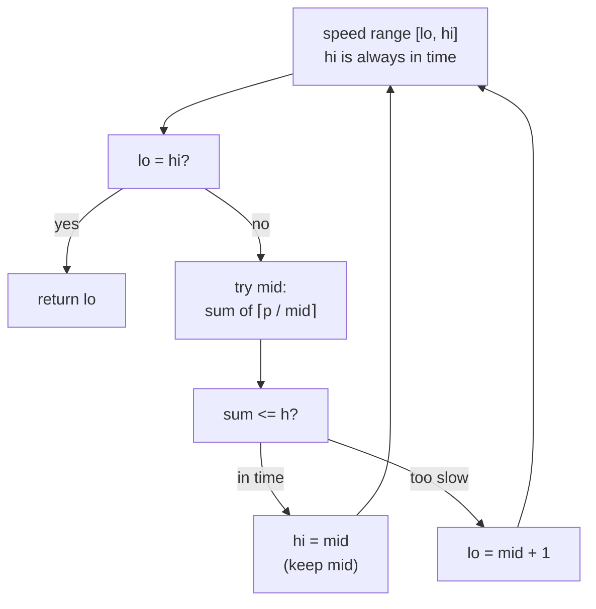

> [!tldr] Quick read
> - Problem: n piles of bananas; Koko eats k bananas per hour, from one pile per hour (if the pile has fewer than k left, she finishes it and rests for the rest of that hour). Find the **smallest** k that clears everything within h hours.
> - There is no array to search. The answer lies in `[1, max(piles)]`, and the question "is speed k in time?" flips from "too slow" to "in time" exactly once as k grows (a [[en/concepts/monotonic-predicate|monotonic predicate]]). So binary search the speed itself: [[en/concepts/search-on-the-answer|search on the answer]]. O(n log max).
> - A pile of p bananas takes ⌈p / k⌉ hours: [[en/concepts/ceiling-division|ceiling division]], written `(p + k − 1) / k` to avoid floating point.
> - Three wrong versions actually run: rounding down (5/10 cases), `hi = mid − 1` on an in-time speed (6/10), and `lo = 0` (correct in JS thanks to `Infinity`, a division-by-zero error in Python and Java).
> - Java: trying speeds from k = 1 with the hour sum in an `int` overflows to a negative number, so k = 1 looks "in time". Setting `hi = Integer.MAX_VALUE` and computing `(lo + hi) / 2` makes `mid` negative.

> [!info] Context
> LeetCode problem 875, the anchor problem of [[en/posts/2026-11-23-neetcode-binary-search-answer|station 2: Binary Search on the Answer]] on **The NeetCode Line: Search and Heaps**. [[en/posts/2026-11-23-neetcode-binary-search|Station 1]] binary searched a sorted array; here there is no array, only a range of numbers and a check. The solution comes in TypeScript, Python, Go, Java and JavaScript. You need the [[en/concepts/binary-search|binary search]] template from station 1 and nothing else.

> [!abstract]- Quick glossary for this post (click to open)
> - **⌈x⌉ (rounding up)**: the smallest integer not less than x. ⌈7 / 4⌉ = 2, ⌈8 / 4⌉ = 2. See [[en/concepts/ceiling-division|Ceiling Division]].
> - **Predicate**: a function that returns true or false, here "can speed k finish within h hours". See [[en/concepts/monotonic-predicate|Monotonic Predicate]].
> - **Lower bound**: the first position that satisfies a condition; here, the first speed that is in time. See [[en/concepts/lower-bound|Lower Bound]].
> - **Half-open range, invariant**: see [[en/concepts/half-open-interval|Half-open Interval]] and [[en/concepts/loop-invariant|Loop Invariant]].
> - **Overflow**: a result exceeds the integer type holding it and wraps around to a wrong number. See [[en/concepts/midpoint-overflow|Midpoint Overflow]].

## Picture it first: finishing a stack of library books before the due date

You borrow four books with 3, 6, 7 and 11 chapters and must return them in 8 days. Each day you read at most k chapters, all from one book; if the book has fewer than k chapters left, you finish it and stop for the day without opening another. To take it easy, you look for the smallest k that still returns them on time. Nobody tries k = 1, 2, 3… You try a moderate pace: in time, try slower; late, try faster.

| Everyday life | Concept |
|---|---|
| Each book | a pile of bananas `piles[i]` |
| Chapters read per day | the speed `k` |
| Days to finish one book: 7 chapters at 4 a day is 2 days | `⌈p / k⌉` |
| "Will this pace return the books on time?" | the predicate `feasible(k)`: total hours `<= h` |
| A faster pace is surely still on time | monotonicity |
| The fastest pace worth considering: one book a day | `hi = max(piles)` |
| The slowest pace that is still on time | the answer: a lower bound over the speed range |



## The problem

The most direct way is to try k = 1, 2, 3… and stop at the first speed that is in time. Each try reads all n piles, and the answer can reach `max(piles)` = 10⁹, so the worst case is 10⁹ · 10⁴ operations. Measured with n = 1,000 piles and h = 2,000: an answer of 333 takes 0.4 ms, an answer of 32,496 takes 35.2 ms, growing exactly with the answer (about 1.1 µs per try). With piles up to 10⁹ the answer is 330,436,692; extrapolating from these numbers, trying each speed would take about 6 minutes (not run).

There is no sorted array here, but there is an order: if speed k is in time, so is k + 1, because no pile takes more hours. Along k = 1, 2, …, max, the answers read "too slow, too slow, …, too slow, in time, in time, …, in time". Finding the first "in time" is the [[en/concepts/lower-bound|lower bound]] problem from station 1, except the "array" is now a function computed on demand.

## How it works

<figure class="figure-map" style="--ar: 3 / 4">
<div class="frame"><iframe data-archify="../../diagrams/neetcode-koko-eating-bananas/worked-example.en.html" title="Find the slowest speed that still works" loading="lazy"></iframe></div>
<figcaption><span><b>Figure 1.</b> Find the slowest speed that still works.</span><a href="../diagrams/neetcode-koko-eating-bananas/worked-example.en.html" target="_blank" rel="noopener">Open full screen</a></figcaption>
</figure>

<details>
<summary>Read the steps</summary>
<ol>
<li>Test speed 3 against a five-hour limit. <code>piles = [4, 8], 2 + 3 = 5</code></li>
<li>Speed 3 works, test a smaller speed. <code>hi = 3</code></li>
<li>Speed 2 needs six hours. <code>2 + 4 = 6, lo = 3</code></li>
<li>The first feasible speed is 3. <code>lo = hi = 3</code></li>
</ol>
</details>

### From lower bound to search on the answer

The invariant, written before the code:

> Every speed below `lo` is too slow; speed `hi` is in time.

| Question | Follows from the invariant |
|---|---|
| Initialization? | `lo = 1`: nothing is known about smaller speeds, and there are none. `hi = max(piles)`: each pile takes exactly 1 hour, n hours in total, and the problem promises `h >= n`, so it is surely in time. |
| Loop until when? | While `lo < hi`. When `lo == hi`, that speed is in time and every smaller one is too slow: it is the answer. |
| `mid` in time? | `mid` may be the answer itself, so **keep** it: `hi = mid`. |
| `mid` too slow? | Every speed `<= mid` is too slow (monotonicity): `lo = mid + 1`. |
| Sure to stop? | `mid < hi` because `mid` rounds down, so both branches shrink the range. |

The range is closed `[lo, hi]` but the loop runs while `lo < hi`, just like Find Minimum at station 1: when one branch keeps `mid`, the loop condition must be `<`. Running the problem's example `[3, 6, 7, 11]`, h = 8:

```text
k=6: 6 hours in time → k=3: 10 hours too slow → k=5: 8 hours in time → k=4: 8 hours in time → answer 4 (4 checks)
```

*(Output labels translated; the files themselves print Vietnamese.)*

A range up to 10⁹ needs only 30 tries, because 2³⁰ ≈ 1.07 · 10⁹. Each try is O(n), O(n log max) in total.

### Rounding-up division without floating point

A pile of p bananas at speed k takes ⌈p / k⌉ hours. Integer division rounds down, so it needs a trick: `(p + k − 1) / k`. Adding k − 1 pushes any nonzero remainder up by one full step, and leaves p unchanged when k divides it. Python writes `-(-p // k)`, because Python's `//` rounds down even for negative numbers, so flipping the sign twice turns it into rounding up.

Is `Math.ceil(p / k)` fine? It goes through a 64-bit float. The JavaScript file tries 10⁶ pairs with p and k up to 10⁹ (half of them with k dividing p): not a single pair differs, because the distance from p / k to the nearest integer is at least 1 / k, far larger than the float's rounding error. But past 2⁵³ it breaks: Python prints `math.ceil((2**53 + 1) / 1) = 9007199254740992`, one short. In JS, `2 ** 53 + 1` cannot even be represented. The problem caps values at 10⁹, so this never happens here, but the integer version is right at every size. See [[en/concepts/ceiling-division|Ceiling Division]].

### First wrong version: rounding down

Writing `Math.floor(p / k)` instead of rounding up counts a pile of 7 at k = 4 as 1 hour instead of 2. The hours are undercounted, a speed that is too slow also looks "in time", and the answer comes out smaller than the real one. The problem's example returns 3 instead of 4; 5/10 cases are wrong. No case returns more than the real answer: undercounting hours only makes speeds look in time sooner.

### Second wrong version: `hi = mid − 1` on an in-time speed

A habit from problem 704 ("`mid` is not the answer, so drop it"). But here an in-time `mid` **may** be the answer. Drop it, and when `mid` really is the smallest speed, only too-slow speeds remain and the loop returns one of them. 6/10 cases are wrong, for example `[30, 11, 23, 4, 20]`, h = 6 returns 22 instead of 23. The first example of the problem still passes, so running only the given examples does not reveal the bug.

### Third wrong version: `lo = 0`

Someone sets `lo = 0` "to be safe". When the answer is 1, the range shrinks to `[0, 1]`, `mid = 0`, and the hour count divides by 0. The three languages react differently:

| | `p / 0` | Result |
|---|---|---|
| TypeScript / JavaScript | `Infinity`, no error thrown | `Infinity > h`, so `lo = 1`: **correct** 10/10, by accident |
| Python | `ZeroDivisionError` | 8/10 cases, fails on `[1]` h = 1 and `[1, 1]` h = 5 |
| Java | `ArithmeticException: / by zero` | 8/10 cases, the same two |

This JS code is correct only thanks to `Infinity`; port it to Python or Java and the bug shows. A speed of 0 means nothing in this problem, so `lo = 1`.

### Does the hour sum overflow `int`?

The problem allows up to 10⁴ piles of up to 10⁹ each. At k = 1, the hour sum reaches 10¹³, past a 32-bit `int` (at most 2,147,483,647). Go and Python need not worry: Go's `int` is 64-bit on a 64-bit machine, and Python's `int` is unbounded. Java and C# have to choose.

**Trying each speed with an `int` really is wrong.** Three piles of 805,306,368, h = 10⁹, answer 3. At k = 1 the sum is 2,415,919,104, which wraps to −1,879,048,192, below h, so k = 1 looks "in time". Both Java (`int`) and Go (`int32`) print exactly that number and return 1.

**Binary search with an `int` does not overflow**, which I found quite surprising. The Java file runs the `int` version on 10⁵ random inputs close to the problem's limits: it differs from the `long` version on 0 of them. The reason: `lo >= 1` and `hi >= k*` (the answer), so `mid >= k* / 2`. The hour sum at `mid` is at most `2 · S / k* + n`, where S is the total number of bananas, and `S / k* <= h`. So the hour sum is at most `2h + n <= 2 · 10⁹ + 10⁴`, still below 2³¹ − 1. The argument holds but is fragile: change `lo` to 0, change the limits, or switch to trying each speed, and it breaks. Use a `long` for the sum and there is nothing to prove.

**`hi = Integer.MAX_VALUE` "to be safe"** is another trap: `(1 + Integer.MAX_VALUE) / 2` overflows to −1,073,741,824 (the [[en/concepts/midpoint-overflow|midpoint overflow]] from station 1). With a negative speed the hour count comes out small, `mid` looks "in time", `hi` becomes negative and the loop exits with `lo = 1`. 8/10 cases are wrong.

### Under the hood of the seven languages

| | ⌈p / k⌉ | Hour sum | Library | Specific trap |
|---|---|---|---|---|
| TypeScript / JavaScript | `Math.floor((p + k - 1) / k)` or `Math.ceil(p / k)` | `number` (double), exact up to 2⁵³ | none | dividing by 0 gives `Infinity`, no error; `Math.max(...piles)` passes every element as an argument: 10⁵ elements work, 2 · 10⁵ throw `RangeError` on Node 24 (the problem only goes to 10⁴) |
| Python | `-(-p // k)` | unbounded `int` | `bisect_left(range(1, m + 1), True, key=…)` (3.10+) | `math.ceil(p / k)` is wrong once p > 2⁵³; a `range` given to `bisect` reads elements on demand, no list is built |
| Go | `(p + k - 1) / k` | 64-bit `int` | `sort.Search(n, f)` | `sort.Search` searches `[0, n)`, so index `i` stands for speed `i + 1` |
| Java | `(p + k - 1) / k` | should be `long` | none for functions; `Arrays.binarySearch` only for arrays | `int` overflows when trying each speed; `p + k - 1` fits `int` only because p, k ≤ 10⁹; `/ 0` throws `ArithmeticException` |
| PHP | `intdiv($p + $k - 1, $k)` | 64-bit `int` | no binary search over a function | `$p / $k` returns a float; `intdiv($p, 0)` throws `DivisionByZeroError` (the `lo = 0` version fails 2/10 cases). On `int` overflow PHP silently switches to float instead of wrapping |
| Rust | `(p + k - 1) / k` or `div_ceil` | sum in `i64` | `partition_point` works on slices, not on a numeric range | summing in `i32` overflows on the three 805 306 368 piles: debug panics, `-O` wraps; division by zero always panics. `piles.iter().max()` returns an `Option` |

### Measurements

TypeScript, n = 1,000 piles, h = 2,000, median of 5 runs:

| Piles up to | Answer | Trying each speed | Binary search |
|---|---|---|---|
| 1,000 | 333 | 0.4 ms | 0.013 ms |
| 10,000 | 3,301 | 3.5 ms | 0.017 ms |
| 100,000 | 32,496 | 35.2 ms | 0.023 ms |
| 10⁹ | 330,436,692 | (not run) | 0.039 ms |

Trying each speed grows exactly with the answer, 10× per row. Binary search is nearly flat: the number of tries only grows from 10 to 30.

Python, same size with piles up to 10⁹: the hand-written loop and `bisect_left` with `key` both take 0.76 ms. Unlike problem 704, `bisect` is not faster here: the time is spent in 30 hour sums computed in Python, not in the search loop.

## Runnable example

[TypeScript](../code/neetcode-koko-eating-bananas/koko-eating.ts) · [Python](../code/neetcode-koko-eating-bananas/koko_eating.py) · [Go](../code/neetcode-koko-eating-bananas/koko_eating.go) · [Java](../code/neetcode-koko-eating-bananas/koko-eating.java) · [JavaScript](../code/neetcode-koko-eating-bananas/koko-eating.js) · [PHP](../code/neetcode-koko-eating-bananas/koko-eating.php) · [Rust](../code/neetcode-koko-eating-bananas/koko_eating.rs)

Each file runs 10 cases: the problem's three examples, a single pile, an answer of 1, a 10⁹ pile split in two, h one short of the total number of bananas (answer 2), and the three piles of 805,306,368 that overflow `int`. Python and Go also have a version built on the standard library.

```ts
// Hours to eat everything at speed k: each pile takes ⌈p / k⌉ hours. Round-up division with integers only.
function hoursNeeded(piles: number[], k: number): number {
  let hours = 0;
  for (const p of piles) hours += Math.floor((p + k - 1) / k);
  return hours;
}

// Binary search on the answer: "is speed k in time?" goes false then true exactly once as k grows.
// Invariant: hi is always in time; every speed below lo is too slow. The range [lo, hi] shrinks to one cell.
function minEatingSpeed(piles: number[], h: number): number {
  let lo = 1, hi = Math.max(...piles); // speed max(piles) eats each pile in 1 hour, always in time since h >= n
  while (lo < hi) {
    const mid = lo + Math.floor((hi - lo) / 2);
    if (hoursNeeded(piles, mid) <= h) hi = mid; // mid is in time: it may be the answer, keep it
    else lo = mid + 1; // mid is too slow: every speed <= mid is too slow
  }
  return lo;
}
```

```python
def hours_needed(piles: list[int], k: int) -> int:
    # -(-p // k) is ⌈p / k⌉ in integers: // rounds down, flipping the sign twice rounds up
    return sum(-(-p // k) for p in piles)

def min_eating_speed(piles: list[int], h: int) -> int:
    lo, hi = 1, max(piles)
    while lo < hi:  # invariant: hi is always in time, every speed < lo is too slow
        mid = (lo + hi) // 2
        if hours_needed(piles, mid) <= h:
            hi = mid  # mid is in time, it may be the answer
        else:
            lo = mid + 1
    return lo

def via_bisect(piles: list[int], h: int) -> int:
    # range(1, max+1) builds no list: bisect reads only a few elements by index.
    # key turns each speed into False (too slow) or True (in time); bisect_left finds the first True.
    speeds = range(1, max(piles) + 1)
    return speeds[bisect_left(speeds, True, key=lambda k: hours_needed(piles, k) <= h)]
```

```go
// Hours at speed k. Go's int is 64-bit on a 64-bit machine, so a sum of 10⁴ · 10⁹ does not overflow.
func hoursNeeded(piles []int, k int) int {
	hours := 0
	for _, p := range piles {
		hours += (p + k - 1) / k // ⌈p / k⌉ in integers
	}
	return hours
}

func minEatingSpeed(piles []int, h int) int {
	lo, hi := 1, slices.Max(piles)
	for lo < hi { // invariant: hi is always in time, every speed < lo is too slow
		mid := lo + (hi-lo)/2
		if hoursNeeded(piles, mid) <= h {
			hi = mid
		} else {
			lo = mid + 1
		}
	}
	return lo
}

// sort.Search(n, f) returns the smallest i in [0, n) with f(i) true; here index i stands for speed i + 1.
func viaSortSearch(piles []int, h int) int {
	return sort.Search(slices.Max(piles), func(i int) bool { return hoursNeeded(piles, i+1) <= h }) + 1
}
```

```java
// The hour sum lives in a long: up to 10⁴ piles of up to 10⁹ each, so at speed 1 the sum reaches 10¹³, past int.
static long hoursNeeded(int[] piles, int k) {
    long hours = 0;
    for (int p : piles) hours += (p + k - 1) / k; // p + k - 1 <= 2·10⁹ - 1, still fits an int
    return hours;
}

static int minEatingSpeed(int[] piles, int h) {
    int lo = 1, hi = Arrays.stream(piles).max().getAsInt();
    while (lo < hi) { // invariant: hi is always in time, every speed < lo is too slow
        int mid = lo + (hi - lo) / 2;
        if (hoursNeeded(piles, mid) <= h) hi = mid;
        else lo = mid + 1;
    }
    return lo;
}
```

```js
// Two ways to compute ⌈p / k⌉: through floating point (Math.ceil) or with integers only.
const ceilFloat = (p, k) => Math.ceil(p / k);

const ceilInt = (p, k) => Math.floor((p + k - 1) / k);

function hoursNeeded(piles, k) {
  let hours = 0;
  for (const p of piles) hours += ceilInt(p, k);
  return hours;
}

function minEatingSpeed(piles, h) {
  let lo = 1, hi = Math.max(...piles);
  while (lo < hi) { // invariant: hi is always in time, every speed < lo is too slow
    const mid = (lo + hi) >>> 1;
    if (hoursNeeded(piles, mid) <= h) hi = mid;
    else lo = mid + 1;
  }
  return lo;
}
```

```php
// Hours to finish at speed k: each pile takes ⌈p / k⌉ hours. intdiv keeps everything an int.
function hoursNeeded(array $piles, int $k): int
{
    $hours = 0;
    foreach ($piles as $p) $hours += intdiv($p + $k - 1, $k); // PHP int is 64-bit: a sum up to 10¹³ doesn't overflow
    return $hours;
}

// Binary search on the answer. Invariant: hi always makes it; every speed below lo doesn't.
function minEatingSpeed(array $piles, int $h): int
{
    $lo = 1;
    $hi = max($piles); // speed max(piles) eats each pile in 1 hour, always in time since h >= n
    while ($lo < $hi) {
        $mid = $lo + intdiv($hi - $lo, 2);
        if (hoursNeeded($piles, $mid) <= $h) $hi = $mid; // mid makes it: it may be the answer, keep it
        else $lo = $mid + 1;
    }
    return $lo;
}
```

```rust
// Hours to finish at speed k: each pile takes ⌈p / k⌉ hours. Sum in i64: the total can reach 10¹³.
fn hours_needed(piles: &[i32], k: i64) -> i64 {
    piles.iter().map(|&p| (p as i64 + k - 1) / k).sum() // i64::div_ceil works too (Rust 1.73+)
}

// Binary search on the answer. Invariant: hi always makes it; every speed below lo doesn't.
fn min_eating_speed(piles: &[i32], h: i32) -> i32 {
    let (mut lo, mut hi) = (1i64, *piles.iter().max().unwrap() as i64); // max() returns an Option: None for an empty array
    while lo < hi {
        let mid = lo + (hi - lo) / 2;
        if hours_needed(piles, mid) <= h as i64 {
            hi = mid; // mid makes it: it may be the answer, keep it
        } else {
            lo = mid + 1;
        }
    }
    lo as i32
}
```


Output of `node koko-eating.ts`, the three wrong versions included:

```text
linearScan      9/9 correct
minEatingSpeed  10/10 correct
wrongFloorDiv   5/10 correct; wrong at [3,6,7,11] h=8 → 3, [30,11,23,4,20] h=5 → 12, [30,11,23,4,20] h=6 → 11, [1000000000] h=2 → 333333334, [7] h=3 → 2
wrongDropMid    6/10 correct; wrong at [30,11,23,4,20] h=6 → 22, [1000000000] h=2 → 499999999, [312884470] h=312884469 → 1, [805306368,805306368,805306368] h=1000000000 → 2
loFromZero      10/10 correct

random: binary search matches trying each speed on 2000/2000 inputs
```

*(Output labels translated; the files themselves print Vietnamese.)*

(`linearScan` skips the cases whose answer is above 1,000, because trying up to 5 · 10⁸ takes too long.)

Java, both arithmetic bugs included:

```text
minEatingSpeed  10/10 correct
sumInInt        10/10 correct
hugeHi          2/10 correct; wrong at [3, 6, 7, 11] h=8 → 1, [30, 11, 23, 4, 20] h=5 → 1, …
loFromZero      8/10 correct; wrong at [1] h=1 → ArithmeticException, [1, 1] h=5 → ArithmeticException

[805306368 ×3], h = 10⁹: linearInt returns 1 (correct is 3)
(1 + Integer.MAX_VALUE) / 2 = -1073741824
random: int sum differs from long sum on 0/100000 inputs
```

*(Output labels translated; the files themselves print Vietnamese.)*

Python prints `ZeroDivisionError` for `lo_from_zero` and the wrong `math.ceil` pair at 2⁵³ + 1; Go prints the `int32` sum `-1879048192`; JavaScript reports that `Math.ceil(p / k)` differs from the integer version on 0 of 1,000,000 pairs.

PHP (`php koko-eating.php`) and Rust (`rustc --edition 2021 -O koko_eating.rs`) print the same counts as the TypeScript file for the first four versions, and `2000/2000` in the random check. The `lo = 0` version behaves like Java: PHP fails 2/10 cases with `DivisionByZeroError`, Rust fails 2/10 because `checked_div` reports division by zero. Rust also prints `tổng ba đống 805306368 trong i32: None` ("sum of the three 805306368 piles in i32").

## Misconceptions and common traps

- **"Binary search needs a sorted array."** It needs a yes/no question that flips once. The range `[1, max]` with the "in time" check is enough; there is no need to build an array of speeds.
- **`hi = mid − 1` on an in-time speed.** An in-time `mid` may be the answer. Keep it (`hi = mid`) and loop while `lo < hi`.
- **Rounding down.** Hours are undercounted, and the answer comes out smaller than the real one.
- **`lo = 0`.** JS hides the division by zero behind `Infinity`; Python and Java throw.
- **An oversized `hi` "to be safe".** `hi = 10⁹` is still correct (just a few extra tries), but `Integer.MAX_VALUE` with `(lo + hi) / 2` makes `mid` negative.
- **The hour sum in an `int`.** Trying each speed really overflows. Binary search does not, thanks to an argument about `mid >= k* / 2`, but a `long` is safer and costs nothing.
- **Forgetting that h can be very large.** With h ≥ the total number of bananas, the answer is 1. The range `[1, max]` handles it naturally, no special case needed.
- **PHP: `ceil($p / $k)`.** It returns a float that has to be cast back; `intdiv($p + $k - 1, $k)` keeps everything an int. The `lo = 0` version is not silent as in JS: `intdiv($p, 0)` throws `DivisionByZeroError`.
- **Rust: summing hours in `i32`.** The three 805 306 368 piles exceed `i32::MAX`: a debug build panics, a `-O` build wraps to a negative number and returns the wrong speed. Sum in `i64` as `hours_needed` does; `checked_add` shows the `i32` sum is `None`.

## Self-check questions

> [!question]- Why is `hi = max(piles)` always in time?
> At speed max, each pile takes exactly 1 hour, n hours in total. The problem promises `piles.length <= h`, so n ≤ h. A speed above max does not help further; it is still 1 hour per pile.

> [!question]- `[30, 11, 23, 4, 20]`, h = 6. How many hours does speed 23 need? And 22?
> 23: ⌈30/23⌉ + 1 + 1 + 1 + 1 = 2 + 4 = 6 hours, in time. 22: ⌈30/22⌉ + 1 + ⌈23/22⌉ + 1 + 1 = 2 + 1 + 2 + 1 + 1 = 7 hours, too slow. The answer is 23.

> [!question]- Is "is speed k in time" really monotonic? Prove it in one sentence.
> For k' > k, each pile takes ⌈p / k'⌉ ≤ ⌈p / k⌉ hours, so the total does not grow; in time at k means in time at k'.

> [!question]- New problem: find the **largest** speed at which Koko is **not** in time. How do you change the code?
> It is the speed just before the answer: `minEatingSpeed − 1`. To write it directly, look for the "last too slow" with `mid` rounded **up** (`lo + (hi − lo + 1) / 2`) and `lo = mid` when too slow, as station 1 explained.

## References

- [LeetCode 875: Koko Eating Bananas](https://leetcode.com/problems/koko-eating-bananas/) (original problem and limits)
- [Python `bisect`](https://docs.python.org/3/library/bisect.html) (the `key` parameter, since 3.10)
- [Go `sort.Search`](https://pkg.go.dev/sort#Search) (finds the smallest `i` for which `f(i)` is true)
- [Java Language Specification SE 21, §15.17.2 Division Operator](https://docs.oracle.com/javase/specs/jls/se21/html/jls-15.html#jls-15.17.2) (integer division truncates toward zero, `/ 0` throws `ArithmeticException`)
- Joshua Bloch, [Nearly All Binary Searches and Mergesorts are Broken](https://research.google/blog/extra-extra-read-all-about-it-nearly-all-binary-searches-and-mergesorts-are-broken/), Google Research blog, 2006 (`(lo + hi) / 2` overflows)
