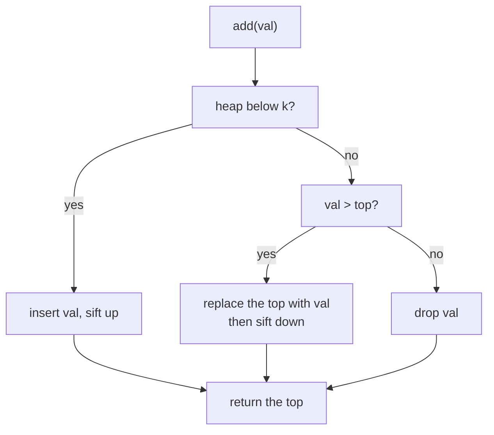

> [!tldr] Quick read
> - Problem: numbers arrive in a stream, one at a time. After each `add(val)`, return the k-th largest of all numbers seen so far.
> - Keep a **min-heap** of at most k elements: it holds the k largest numbers seen, and its top (the smallest of those k) is the k-th largest. A new number smaller than the top is dropped, O(1); a larger one replaces the top and sifts down, O(log k). See [[en/concepts/size-k-heap|Size-K Heap]].
> - Re-sorting the whole array on every insert is also correct, but measured with 10⁴ initial numbers and 10⁴ inserts: 1,562.8 ms against 0.24 ms.
> - Four wrong versions are actually run: a k-slot max-heap (1/8 cases), not trimming when the heap goes past k (0/8), calling `h.Push` instead of `heap.Push(h, …)` in Go (0/8), and `sort()` without a compare function in JS (3/7).
> - Building a heap from n existing numbers with [[en/concepts/heapify|heapify]] is only O(n): on 10⁶ descending numbers, 999,988 swaps against 17,951,445 when inserting one by one.

> [!info] Context
> LeetCode problem 703, the anchor problem of [[en/posts/2026-11-23-neetcode-heap-top-k|station 3: Heaps and Top K]] on **The NeetCode Line: Search and Heaps**. The [[en/concepts/heap|heap]] showed up once in [[en/problems/top-k-frequent-elements|Top K Frequent Elements]]; this page opens it up: how a heap sits in an array, how sifting up and down work, and why the top k **largest** needs a **min**-heap. The solution comes in TypeScript, Python, Go, Java and JavaScript. No prior knowledge of heaps is needed.

> [!abstract]- Quick glossary for this post (click to open)
> - **Stream**: data that arrives one element at a time; you don't know how many will come and can't cheaply look at all of them again.
> - **Heap**: a binary tree stored in an array where no parent is larger than its children (min-heap), so the smallest element is always in slot 0. See [[en/concepts/heap|Heap]].
> - **Top**: slot 0 of the heap. Reading it costs O(1).
> - **Sift up, sift down**: how the heap is repaired after an insert or a top replacement. See [[en/concepts/sift-up-sift-down|Sift Up and Sift Down]].
> - **Heapify**: building a heap from an existing array in O(n). See [[en/concepts/heapify|Heapify]].
> - **Comparator**: a function that takes two elements and returns a negative number, 0 or a positive number to say which comes first.

## Picture it first: a chess club's three-player team

A chess club keeps a team of exactly its three strongest players. When a newcomer asks to join, the coaches don't re-rank the whole club. They have the newcomer play **the weakest member of the team**: win and you replace them, lose and you go home. The weakest of the three is exactly "the third-strongest player" in the club, and so that everyone knows at once who that is, they always stand by the door.

| Everyday | Concept |
|---|---|
| A team of exactly three | a heap of at most k = 3 elements |
| The team's weakest member stands by the door | the top of the min-heap |
| The club's third-strongest player | the k-th largest = the top |
| The newcomer loses to the one at the door: goes home | `val <= top`: drop, O(1) |
| The newcomer wins: joins, and the team reshuffles so the weakest is at the door | replace the top, sift down, O(log k) |
| Re-ranking the whole club for every newcomer | re-sorting the whole array on every `add` |
| The team keeps its three **weakest**, with the strongest at the door | wrong version: a k-slot max-heap |



## The problem

The most direct way is to keep every number seen in an array, re-sort it on each `add`, and read the k-th slot from the end. Each insert costs O(n log n), with n the number of elements seen, even though only one number is needed. The problem allows up to 10⁴ initial numbers and 10⁴ calls to `add`; measured with k = 100, 1,000 inserts already take 105.7 ms and 10⁴ take 1,562.8 ms.

The thing to notice: the k-th largest depends only on the **k largest numbers**. A number that has fallen out of the top k can never come back (the stream only adds, never removes), so it can be thrown away. That leaves one question: which structure holds those k numbers so that each insert both sees the weakest one at once and replaces it quickly.

## How it works

<figure class="figure-map" style="--ar: 3 / 4">
<div class="frame"><iframe data-archify="../../diagrams/neetcode-kth-largest-element-in-a-stream/worked-example.en.html" title="Retain exactly the k largest values" loading="lazy"></iframe></div>
<figcaption><span><b>Figure 1.</b> Retain exactly the k largest values.</span><a href="../diagrams/neetcode-kth-largest-element-in-a-stream/worked-example.en.html" target="_blank" rel="noopener">Open full screen</a></figcaption>
</figure>

<details>
<summary>Read the steps</summary>
<ol>
<li>Start with three values in the heap. <code>k = 3; {4, 7, 9}</code></li>
<li>Insert 6 and remove the smallest value. <code>evict 4; {6, 7, 9}</code></li>
<li>Insert 2 and immediately evict it. <code>evict 2; {6, 7, 9}</code></li>
<li>The heap root is the third largest. <code>6</code></li>
</ol>
</details>

### A k-slot min-heap

The heap keeps the k largest numbers seen so far. Each new number only needs to be compared with the **weakest** of those k: if it is larger, it enters the top k and pushes the weakest out; if not, it stays out. For the weakest to sit right at the top, comparable in O(1), the heap has to be a **min**-heap. And since the heap holds exactly the k largest numbers, its smallest is the k-th largest: the answer is always the top.

Running the problem's example, k = 3, `nums = [4, 5, 8, 2]`, then adding 3, 5, 10, 9, 4:

| Step | Heap (array) | Top returned |
|---|---|---|
| load 4, 5, 8 | `[4, 5, 8]` | |
| load 2: 2 < 4, drop | `[4, 5, 8]` | |
| add 3: 3 < 4, drop | `[4, 5, 8]` | 4 |
| add 5: 5 > 4, replace the top | `[5, 5, 8]` | 5 |
| add 10: replace the top, 10 sifts down and swaps with 5 | `[5, 10, 8]` | 5 |
| add 9: replace the top, 9 sifts down and swaps with 8 | `[8, 10, 9]` | 8 |
| add 4: 4 < 8, drop | `[8, 10, 9]` | 8 |

The interactive diagram in [[en/posts/2026-11-23-neetcode-heap-top-k|the station post]] steps through exactly these moves.

### A heap lives in an array

No nodes or pointers are needed. Slot i has its parent at `(i − 1) >> 1` and its children at `2i + 1` and `2i + 2`; the heap property is that no parent is larger than its children. Two operations keep it ([[en/concepts/sift-up-sift-down|Sift Up and Sift Down]]):

- **Sift up** on insert: put the new number at the end of the array, and swap it with its parent while it is smaller.
- **Sift down** on replacing or popping the top: swap with the **smaller child** while larger than it. Swapping with the larger child would put it above the smaller one and break the heap property.

A tree of k elements is ⌊log₂ k⌋ tall, so each operation costs O(log k). Overall: O(n log k) to load, O(log k) per `add`, O(k) memory.

### First wrong version: a k-slot max-heap

"Looking for large numbers, so use a max-heap" is a natural reflex, and also a Python habit: `heapq` is min-heap only, so people negate to get a max-heap. Applied here it points the wrong way. Past k elements, a max-heap drops its **largest**, so it keeps the k **smallest** numbers, and its top is the largest of the k smallest: the k-th **smallest**. This version passes 1/8 cases (the "duplicates" case, where every number is equal); the problem's example returns `[4, 4, 4, 4, 4]` instead of `[4, 5, 5, 8, 8]`.

### Second wrong version: no trimming

Pushing every number into the min-heap without capping it at k makes the top the smallest number of the **whole stream**, not the k-th largest: 0/8 cases, and the problem's example returns `[2, 2, 2, 2, 2]`. On top of that, the heap grows to n elements and each insert costs O(log n) instead of O(log k).

### Building a heap from an existing array: O(n) heapify

The solution above loads `nums` by inserting one number at a time. There is a faster way to build a heap from n existing numbers: Floyd's [[en/concepts/heapify|heapify]] (1964). Treat the whole array as a tree, then sift down each slot from the last parent `n/2 − 1` back to slot 0. Half the slots are leaves and never move; a quarter sink at most one level; an eighth at most two… At most n/2ʰ⁺¹ slots sit at height h, so the total number of swaps is at most Σ h · n/2ʰ⁺¹ = n. Inserting one by one is the other way round: most slots are in the bottom levels, and each new number may sift up all the way to the root.

| n | n inserts | heapify (Floyd) |
|---|---|---|
| 10⁵ random numbers | 3.3 ms, 128,344 swaps | 1.9 ms, 74,416 swaps |
| 10⁶ random numbers | 41.4 ms, 1,280,862 swaps | 18.2 ms, 743,538 swaps |
| 10⁶ descending numbers (the worst case for inserting) | 17,951,445 swaps | 999,988 swaps |

With random numbers, inserting one by one costs on average only about 1.3 swaps per number (a new number usually stops early), so heapify is only about twice as fast. The descending case is what shows the O(n log n) versus O(n) gap: almost 18 times. In Python, `heapq.heapify` on 10⁶ numbers takes 25.6 ms and 10⁶ calls to `heappush` take 50.6 ms. Here `nums` has at most 10⁴ numbers, so the difference is small; the Python and Go versions still heapify and then trim down to k, because it is as short to write as inserting one by one.

### Under the hood of the five languages

| | Built-in heap | Default | Specific trap |
|---|---|---|---|
| TypeScript / JavaScript | none | write your own | `arr.sort()` without a compare function compares as **strings**: `[4, 5, 8, 2, 10].sort()` gives `[10, 2, 4, 5, 8]` |
| Python | `heapq` (functions on a `list`) | min-heap only | negate for a max-heap; `heapq.heapreplace` replaces the top in a single sift |
| Go | `container/heap` (you implement `heap.Interface`) | decided by `Less` | `Push`, `Pop` need pointer receivers; call `heap.Push(h, x)`, not `h.Push(x)` |
| Java | `PriorityQueue` | min-heap | max-heap via `Collections.reverseOrder()`; the comparator `(a, b) -> b - a` overflows `int` |

Three of these traps are actually run:

- **Go, calling `h.Push(val)` directly.** The `Push` method you write only `append`s to the end of the slice; the sifting up lives in the package function `heap.Push`. Calling it directly leaves the new element at the end without sifting up, and the top is wrong from the first insert: 0/8 cases.
- **Go, `Push` and `Pop` with value receivers.** If both take a value, the type still satisfies `heap.Interface` and compiles, but `append` only changes a copy: after `heap.Push(v, 1)` the heap is still `[2 5 8]`, and `heap.Pop(v)` returns 2 while the length stays 3. (The other way round, with `Push`, `Pop` on pointer receivers as they should be but `h` passed instead of `&h`, the compiler stops you: `IntHeap does not implement heap.Interface (method Pop has pointer receiver)`.)
- **Java, the comparator `(a, b) -> b - a`.** With `Integer.MIN_VALUE`, 5 and `Integer.MAX_VALUE`, `5 - Integer.MIN_VALUE` overflows to −2,147,483,643, and the "max-heap" returns `peek() = -2147483648`. `Integer.compare(b, a)` correctly returns 2,147,483,647. This problem keeps numbers within [−10⁴, 10⁴], so it never gets there, but it is the classic bug when a comparator is copied to another problem.

### Measurements

10⁴ initial numbers, k = 100, median of 5 runs, Node 24:

| `add` calls | Re-sort on every add | k-slot min-heap |
|---|---|---|
| 1,000 | 105.7 ms | 0.32 ms |
| 10,000 | 1,562.8 ms | 0.24 ms |

The heap column barely moves with the number of `add` calls, because with random numbers almost every new number is smaller than the top and is dropped after one comparison; the time is mostly loading the 10⁴ initial numbers. The heap's worst case is an **ascending** stream: every number is larger than the top, so every insert sifts down. 10⁴ such `add` calls take 1.29 ms with k = 100 and 1.55 ms with k = 5,000: still tiny, and growing slowly with log k.

## Runnable example

[TypeScript](../code/neetcode-kth-largest-element-in-a-stream/kth-largest-stream.ts) · [Python](../code/neetcode-kth-largest-element-in-a-stream/kth_largest_stream.py) · [Go](../code/neetcode-kth-largest-element-in-a-stream/kth_largest_stream.go) · [Java](../code/neetcode-kth-largest-element-in-a-stream/kth-largest-stream.java) · [JavaScript](../code/neetcode-kth-largest-element-in-a-stream/kth-largest-stream.js)

Each file runs 7 or 8 cases: the problem's example, a stream with many repeated 7s, empty `nums` with k = 1, `nums` shorter than k (the problem allows k = `nums.length + 1`), duplicates, negatives, and (except JS) a random stream of 200 + 500 numbers with k = 50, whose answers come from re-sorting on every insert.

```ts
// Hand-written min-heap: JS/TS have no built-in heap. Parent at i, children at 2i + 1 and 2i + 2.
class MinHeap {
  a: number[] = [];
  swaps = 0; // count swaps, to compare heapify with n pushes
  get size(): number { return this.a.length; }
  peek(): number { return this.a[0]; }
  push(x: number): void {
    const a = this.a;
    a.push(x);
    let i = a.length - 1;
    while (i > 0) { // sift up: swap with the parent while smaller than it
      const p = (i - 1) >> 1;
      if (a[p] <= a[i]) break;
      [a[p], a[i]] = [a[i], a[p]]; this.swaps++;
      i = p;
    }
  }
  pop(): number {
    const a = this.a, top = a[0], last = a.pop()!;
    if (a.length > 0) { a[0] = last; this.siftDown(0); }
    return top;
  }
  siftDown(i: number): void { // sift down: swap with the smaller child while larger than it
    const a = this.a, n = a.length;
    for (;;) {
      const l = 2 * i + 1, r = l + 1;
      let m = i;
      if (l < n && a[l] < a[m]) m = l;
      if (r < n && a[r] < a[m]) m = r;
      if (m === i) return;
      [a[m], a[i]] = [a[i], a[m]]; this.swaps++;
      i = m;
    }
  }
  // Floyd: build a heap from an existing array by sifting down from the last parent back to the root. O(n).
  static heapify(xs: number[]): MinHeap {
    const h = new MinHeap();
    h.a = xs.slice();
    for (let i = (h.a.length >> 1) - 1; i >= 0; i--) h.siftDown(i);
    return h;
  }
}

// k-slot min-heap: the heap keeps only the k largest seen; the smallest of those k (the top) is the k-th largest.
class KthLargest implements Stream {
  heap = new MinHeap();
  k: number;
  constructor(k: number, nums: number[]) {
    this.k = k;
    for (const x of nums) this.add(x);
  }
  add(val: number): number {
    if (this.heap.size < this.k) this.heap.push(val);
    else if (val > this.heap.peek()) { // stronger than the weakest candidate: replace it
      this.heap.a[0] = val;
      this.heap.siftDown(0);
    }
    return this.heap.peek();
  }
}
```

```python
class KthLargest:
    # heapq is min-heap only: the smallest element is at self.h[0]. Keep the k largest; the top is the k-th largest.
    def __init__(self, k: int, nums: list[int]):
        self.k = k
        self.h = nums[:]
        heapq.heapify(self.h)  # O(n)
        while len(self.h) > k:
            heapq.heappop(self.h)

    def add(self, val: int) -> int:
        if len(self.h) < self.k:
            heapq.heappush(self.h, val)
        elif val > self.h[0]:
            heapq.heapreplace(self.h, val)  # pop then push in a single sift
        return self.h[0]
```

```go
// IntHeap satisfies heap.Interface: Len, Less, Swap (from sort.Interface) plus Push and Pop.
type IntHeap []int

func (h IntHeap) Len() int           { return len(h) }

func (h IntHeap) Less(i, j int) bool { return h[i] < h[j] } // < makes a min-heap

func (h IntHeap) Swap(i, j int)      { h[i], h[j] = h[j], h[i] }

// Push and Pop change the slice length, so they need pointer receivers.
func (h *IntHeap) Push(x any) { *h = append(*h, x.(int)) }

func (h *IntHeap) Pop() any {
	old := *h
	n := len(old)
	x := old[n-1]
	*h = old[:n-1]
	return x
}

type KthLargest struct {
	k int
	h *IntHeap
}

func Constructor(k int, nums []int) KthLargest {
	h := IntHeap(slices.Clone(nums))
	heap.Init(&h) // O(n)
	for h.Len() > k {
		heap.Pop(&h)
	}
	return KthLargest{k, &h}
}

func (s *KthLargest) Add(val int) int {
	if s.h.Len() < s.k {
		heap.Push(s.h, val)
	} else if val > (*s.h)[0] {
		(*s.h)[0] = val
		heap.Fix(s.h, 0) // let the new top sift down
	}
	return (*s.h)[0]
}
```

```java
// PriorityQueue is a min-heap by default: peek() returns the smallest element.
static class KthLargest {
    private final int k;
    private final PriorityQueue<Integer> pq = new PriorityQueue<>();
    KthLargest(int k, int[] nums) {
        this.k = k;
        for (int x : nums) add(x);
    }
    int add(int val) {
        if (pq.size() < k) pq.offer(val);
        else if (val > pq.peek()) { pq.poll(); pq.offer(val); }
        return pq.peek();
    }
}
```

```js
// k-slot min-heap in an array: parent at i, children at 2i + 1 and 2i + 2.
class KthLargest {
  constructor(k, nums) {
    this.k = k;
    this.h = [];
    for (const x of nums) this.add(x);
  }
  add(val) {
    const h = this.h;
    if (h.length < this.k) {
      h.push(val);
      let i = h.length - 1; // sift up
      while (i > 0 && h[(i - 1) >> 1] > h[i]) {
        const p = (i - 1) >> 1;
        [h[p], h[i]] = [h[i], h[p]];
        i = p;
      }
    } else if (val > h[0]) {
      h[0] = val;
      let i = 0; // sift down
      for (;;) {
        const l = 2 * i + 1, r = l + 1;
        let m = i;
        if (l < h.length && h[l] < h[m]) m = l;
        if (r < h.length && h[r] < h[m]) m = r;
        if (m === i) break;
        [h[m], h[i]] = [h[i], h[m]];
        i = m;
      }
    }
    return h[0];
  }
}
```


Output of `node kth-largest-stream.ts`, including re-sorting on every add, two wrong versions and two measurements:

```text
SortEachAdd        8/8 cases correct
KthLargest         8/8 cases correct
NoTrimKthLargest   0/8 cases correct; wrong on: problem example → [2, 2, 2, 2, 2]; many repeated 7s → [2, 2, 2, 2]; empty nums, k = 1 → [-3, -3, -4, -4, -4]; nums one short → [-1, -1, -2, -4, -4]; duplicates → [5, 1, 1]; k equals the whole stream → [1, 0]; negatives → [-20, -30, -30]; random 200 + 500 numbers, k = 50
MaxHeapKthLargest  1/8 cases correct; wrong on: problem example → [4, 4, 4, 4, 4]; many repeated 7s → [7, 7, 7, 7]; empty nums, k = 1 → [-3, -3, -4, -4, -4]; nums one short → [0, 0, -1, -2, -2]; k equals the whole stream → [3, 2]; negatives → [-10, -20, -20]; random 200 + 500 numbers, k = 50

Measured: 10⁴ initial numbers + n adds, k = 100 (median of 5)
n adds      re-sort each add  k-slot min-heap
1000             105.7 ms          0.32 ms
10000           1562.8 ms          0.24 ms
ascending stream, 10⁴ adds: min-heap k = 100 takes 1.29 ms, k = 5,000 takes 1.55 ms

Measured: building a heap of n random elements (median of 5)
n            n pushes                heapify (Floyd)
100000         3.3 ms,   128344 swaps     1.9 ms,    74416 swaps
1000000       41.4 ms,  1280862 swaps    18.2 ms,   743538 swaps
descending sequence, n = 10⁶: push 17951445 swaps, heapify 999988 swaps
```

Python (the wrong negated version, and heapify against `heappush`):

```text
KthLargest         8/8 cases correct
NegatedKthLargest  1/8 cases correct; wrong on: problem example → [4, 4, 4, 4, 4]; many repeated 7s → [7, 7, 7, 7]; empty nums, k = 1 → [-3, -3, -4, -4, -4]; nums one short → [0, 0, -1, -2, -2]; k equals the whole stream → [3, 2]; negatives → [-10, -20, -20]; random 200 + 500 numbers, k = 50

n = 10⁶: heapify 25.6 ms, 10⁶ heappush calls 50.6 ms
nlargest(3, [4, 5, 8, 2]) = [8, 5, 4]
```

Go (calling `Push` directly, and `Push`/`Pop` with value receivers):

```text
KthLargest     8/8 cases correct
addDirectPush  0/8 cases correct; wrong on: [problem example → [3 5 5 8 4] many repeated 7s → [2 7 7 8] empty nums, k = 1 → [-3 -2 -4 0 4] nums one short → [0 -1 -2 -4 1] duplicates → [5 1 5] k equals the whole stream → [1 0] negatives → [-10 -30 -5] random 200 + 500 numbers, k = 50]

ValHeap: after Push(1): [2 5 8], length 3; Pop returns 2, heap is still [5 8 2], length 3
```

Java (`Collections.reverseOrder()` and the overflowing comparator):

```text
KthLargest         8/8 cases correct
ReverseKthLargest  1/8 cases correct; wrong on: problem example → [4, 4, 4, 4, 4]; many repeated 7s → [7, 7, 7, 7]; empty nums, k = 1 → [-3, -3, -4, -4, -4]; nums one short → [0, 0, -1, -2, -2]; k equals the whole stream → [3, 2]; negatives → [-10, -20, -20]; random 200 + 500 numbers, k = 50

max-heap via b - a, peek() = -2147483648; via Integer.compare(b, a), peek() = 2147483647
because 5 - Integer.MIN_VALUE = -2147483643
```

JavaScript (`sort()` without a compare function):

```text
KthLargest             7/7 cases correct
DefaultSortKthLargest  3/7 cases correct; wrong on: problem example → [4, 5, 5, 5, 5]; many repeated 7s → [7, 7, 7, 7]; empty nums, k = 1 → [-3, -3, -4, 0, 4]; negatives → [-20, -30, -30]

[4, 5, 8, 2, 10].sort() = [10,2,4,5,8]
```

*(Output labels translated; the files themselves print Vietnamese.)*

## Misconceptions and common traps

- **"Looking for large numbers, so use a max-heap."** True for the **largest**. For the k-th largest you need a k-slot min-heap: the top must be the weakest of the top k, because that is the one compared against and replaced.
- **Not trimming when the heap goes past k.** The top becomes the smallest number of the whole stream, and the heap keeps growing.
- **Popping the top, then inserting.** Correct, but it sifts down once and up once. Replacing the top and sifting down once (`heapreplace`, `heap.Fix(h, 0)`) walks only one path.
- **Comparing with the top using `>=` or `>`.** Both are correct: whether or not a number equal to the top goes in, the heap holds the same values. `>` saves a sift.
- **`nums` has fewer than k numbers.** The problem allows it (k up to `nums.length + 1`) and promises there are k numbers whenever an answer is needed. Loading without checking "do we have k yet" and reading the top of a short heap is wrong; all five versions take everything while the heap is short.
- **JS: the default `sort()`.** It compares as strings, so `10` comes before `2`. Always pass `(a, b) => a - b`.

## Self-check questions

> [!question]- k = 2, `nums = [5]`, then add 1, 7, 3. The heap and the result after each add?
> After loading: heap `[5]`, not 2 yet. Add 1: room left, insert and sift up: `[1, 5]`, return 1. Add 7: 7 > 1, replace the top and sift down: `[7, 5]` becomes `[5, 7]`, return 5. Add 3: 3 < 5, drop, return 5.

> [!question]- Why is heapify only O(n) when each sift down can cost O(log n)?
> Only slots near the root sink far, and there are very few of them. Half the slots are leaves (sink 0 levels), a quarter sink at most 1 level, an eighth at most 2. The sum Σ h · n/2ʰ⁺¹ converges to n.

> [!question]- For the k-th **smallest** of a stream, which heap do you use?
> A k-slot max-heap: it keeps the k smallest numbers, and its top is the largest of those, the k-th smallest. A new number smaller than the top replaces it. This is exactly the "wrong" version of this problem, right for the opposite problem.

> [!question]- If the stream also supported deleting any number, would a k-slot min-heap still work?
> No: a number dropped for falling out of the top k may need to come back when a number in the top k is deleted, and the heap has forgotten it. You need to keep every number, for example in a balanced tree with subtree counts, or two heaps with lazy deletion.

## References

- [LeetCode 703. Kth Largest Element in a Stream](https://leetcode.com/problems/kth-largest-element-in-a-stream/)
- [Python `heapq`](https://docs.python.org/3/library/heapq.html) (min-heap, `heapify`, `heapreplace`, `nlargest`)
- [Go `container/heap`](https://pkg.go.dev/container/heap) (the `IntHeap` example, `heap.Push`, `heap.Fix`)
- [Java 21 `PriorityQueue`](https://docs.oracle.com/en/java/javase/21/docs/api/java.base/java/util/PriorityQueue.html) and [`Integer.compare`](https://docs.oracle.com/en/java/javase/21/docs/api/java.base/java/lang/Integer.html#compare(int,int))
- [MDN `Array.prototype.sort`](https://developer.mozilla.org/en-US/docs/Web/JavaScript/Reference/Global_Objects/Array/sort) (compares as UTF-16 strings by default)
- Robert W. Floyd, "Algorithm 245: Treesort 3", *Communications of the ACM* 7(12), 1964 (building a heap bottom-up)
- Cormen, Leiserson, Rivest, Stein, *Introduction to Algorithms*, chapter 6 "Heapsort" (Build-Max-Heap and its O(n) proof)
