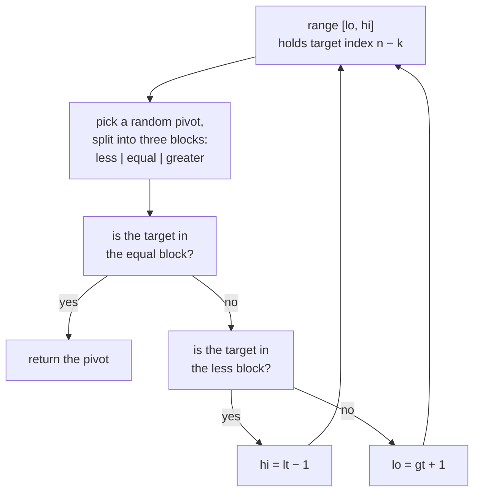

> [!tldr] Quick read
> - Problem: given an array `nums` and a number k, return the k-th largest element **in sorted order**, duplicates included. The problem hints: can you do it without sorting?
> - Three directions: keep a [[en/concepts/heap|min-heap]] of the k largest elements seen, whose top is the answer, O(n log k); [[en/concepts/quickselect|quickselect]], which partitions and continues into one side only, O(n) on average; and, since values are only in [−10⁴, 10⁴], counting by value, O(n + 20,001).
> - Measured at n = 10⁵, k = n / 2: Lomuto quickselect with a random pivot takes 1.2 ms on a random array but **2,441 ms** on an array of equal values. A random pivot does not help: no element is smaller than the pivot, so each round removes only 1 element.
> - The fix is a [[en/concepts/three-way-partition|three-way partition]] (less than, equal to, greater than the pivot): 0.5 ms on the same array. Hoare's partition is fine too: 0.4 ms.
> - Four language traps actually run: JS `sort()` compares strings (`[10, 9, 1].sort()` gives `[1, 10, 9]`), Go calling `h.Push` instead of `heap.Push`, a Java `b - a` comparator overflowing `int`, and Python's `heapq.nlargest` running 3.5× slower than `sorted` at k = n / 2.

> [!info] Context
> LeetCode problem 215, on [[en/posts/2026-11-23-neetcode-heap-top-k|station 3: Heaps and Top K]] of **The NeetCode Line: Search and Heaps**. [[en/problems/top-k-frequent-elements|Top K Frequent Elements]] on the Arrays and Strings line already used a heap and quickselect on frequencies; here they run directly on values, which makes it easy to see where quickselect breaks. The solution comes in TypeScript, Python, Go, Java and JavaScript. You only need arrays and loops.

> [!abstract]- Quick glossary for this post (click to open)
> - **Heap**: a binary tree stored in an array, parent at i, children at 2i + 1 and 2i + 2; the smallest element (in a min-heap) is always in cell 0. Inserting **sifts up**, removing the top **sifts down**, each O(log n). See [[en/concepts/heap|Heap]].
> - **Priority queue**: a data type that "takes out the highest-priority element"; a heap is the usual implementation. See [[en/concepts/heap|Heap]].
> - **Partition**: pick one element as the **pivot**, move elements smaller than it to the left and larger to the right. This is the core step of quicksort.
> - **Quickselect**: partition like quicksort but continue only into the side that holds the wanted position. See [[en/concepts/quickselect|Quickselect]].
> - **Three-way partition**: split into three blocks, less than, equal to, and greater than the pivot. See [[en/concepts/three-way-partition|Three-way Partition]].
> - **Call stack**: the memory holding function calls that are waiting; recursion that goes too deep fills it and throws `RangeError`.

## Picture it first: finding who places k-th in a contest

A contest has 10,000 entries, and the organizers need the score of the **50th place**: the cut-off for the next round. Nobody ranks all 10,000 entries just to read one number. There are two leaner ways.

The first: set out a row of **50 chairs** on stage. The chair by the door is always for the lowest scorer in the row. For each new entry, if it scores higher than whoever sits by the door, that person is asked to leave and the newcomer joins the row. Once all 10,000 entries are judged, the person by the door is 50th.

The second: pull one entry at random as a **benchmark** and split the rest into "higher than the benchmark" and "lower than the benchmark". If the higher group has exactly 49 entries, the benchmark is 50th. If it has more, 50th place is in the higher group; drop the lower group entirely and split again. If it has fewer, do the opposite.

| Everyday life | Concept |
|---|---|
| A row of 50 chairs, the door chair for the lowest scorer | a k-element min-heap, top `h[0]` |
| A newcomer who outscores the door chair takes it | `push(x)`, then `pop()` once the heap exceeds k |
| The entry pulled at random as a benchmark | the pivot |
| Splitting into higher and lower than the benchmark | partition |
| Dropping the group that cannot hold 50th place | quickselect goes into one side only |
| Many entries **tied** with the benchmark, with no group to go to | the trap of a two-way partition |
| Adding a third group, "tied with the benchmark" | three-way partition |



## The problem

The k-th largest element is the one at index `n − k` when the array is sorted ascending (counting from 0). Sorting and reading it off is correct and short: O(n log n). With n = 10⁵ that is fast enough on LeetCode. But sorting does more than needed: it puts **every** element in place, while we want just one. And comparison sorting cannot beat O(n log n) ([[en/concepts/sorting-lower-bound|the sorting lower bound]]), so going faster means doing less work.

The problem's second example shows a detail: `[3, 2, 3, 1, 2, 4, 5, 5, 6]`, k = 4, answer **4**. Sorted descending: 6, 5, 5, 4. The two 5s count as two positions. Anyone who removes duplicates first ("the 4th largest distinct value") gets 3.

## How it works

<figure class="figure-map" style="--ar: 3 / 4">
<div class="frame"><iframe data-archify="../../diagrams/neetcode-kth-largest-element-in-an-array/worked-example.en.html" title="Keep the partition with the desired rank" loading="lazy"></iframe></div>
<figcaption><span><b>Figure 1.</b> Keep the partition with the desired rank.</span><a href="../diagrams/neetcode-kth-largest-element-in-an-array/worked-example.en.html" target="_blank" rel="noopener">Open full screen</a></figcaption>
</figure>

<details>
<summary>Read the steps</summary>
<ol>
<li>Convert second largest to index 3. <code>[9, 2, 6, 6, 4], n - k = 3</code></li>
<li>Partition around pivot 6. <code>[2, 4] / [6, 6] / [9]</code></li>
<li>Index 3 is in the equal partition. <code>equal range = [2, 3]</code></li>
<li>Return pivot 6. <code>6</code></li>
</ol>
</details>

### Approach 1: a min-heap holding the k largest

Invariant: after reading i elements, the heap holds exactly the k largest of those i elements (or all of them, if i < k). The top is the **smallest** element of that group, the weakest member of the top k. A new element larger than the top replaces it; one that is not larger cannot make the top k. After the whole array, the top is the k-th largest.

Reaching for a max-heap because the problem says "largest" is an understandable reflex, and it also works: pour all n elements into a max-heap and pop k − 1 times. But the heap then holds n elements, costing O(n) memory and O(n + k log n) time. A k-slot min-heap needs only O(k) memory, and it works on a **data stream** of unknown length, which is exactly what [[en/problems/kth-largest-element-in-a-stream|Kth Largest Element in a Stream]] needs.

Each element costs one `push` and maybe one `pop`, each O(log k): O(n log k) in total. For small k that is nearly O(n). For k = n / 2, log k ≈ log n, barely better than sorting.

### Approach 2: quickselect

Hoare published this algorithm in 1961 as FIND, alongside quicksort. Partition the range `[lo, hi]` around a pivot, and the pivot lands at its correct index `p` in the sorted array. If `p` is the target index, done. If not, the target lies entirely on one side; drop the other. On average each round removes half, so the total work is n + n/2 + n/4 + … ≈ 2n: **O(n) on average**.

The worst case is O(n²): when the pivot is always the largest (or smallest) element of the range, each round removes exactly 1 element. A fixed last-element pivot does exactly that on a sorted array.

There are two classic partition schemes, and they differ precisely in how they treat values equal to the pivot:

| | Lomuto | Hoare |
|---|---|---|
| How it runs | one pointer scans left to right, moving elements `< pivot` to the front | two pointers walk in from both ends, swapping pairs on the wrong side |
| Values equal to the pivot | all go to **one** side | the pointers stop on both sides, so equal values split **evenly** |
| Result | the pivot sits at its correct index `p` | a boundary `j`: `[lo, j]` ≤ pivot ≤ `[j + 1, hi]`, the pivot is not necessarily at `j` |
| All-equal array | each round removes 1: O(n²) | each round removes half: O(n) |

```ts
// Lomuto partition with pivot a[hi]: move every element < pivot to the left, place the pivot right after them, return its index.
function lomuto(a: number[], lo: number, hi: number): number {
  const pivot = a[hi];
  let i = lo;
  for (let j = lo; j < hi; j++) {
    if (a[j] < pivot) { [a[i], a[j]] = [a[j], a[i]]; i++; }
  }
  [a[i], a[hi]] = [a[hi], a[i]];
  return i;
}

// Approach 3c: quickselect with Hoare partition. Two pointers walk in from both ends and stop at elements EQUAL to the pivot,
// so equal values are split evenly across both sides instead of piling onto one.
function quickselectHoare(nums: number[], k: number): number {
  const a = [...nums], target = a.length - k;
  let lo = 0, hi = a.length - 1;
  while (lo < hi) {
    const pivot = a[lo + Math.floor(Math.random() * (hi - lo + 1))];
    let i = lo - 1, j = hi + 1;
    for (;;) {
      do i++; while (a[i] < pivot);
      do j--; while (a[j] > pivot);
      if (i >= j) break;
      [a[i], a[j]] = [a[j], a[i]];
    }
    // After this loop: every element in [lo, j] <= pivot <= every element in [j + 1, hi].
    if (target <= j) hi = j; else lo = j + 1;
  }
  return a[lo];
}
```


### An array of equal values: a random pivot does not save you

The usual advice is "pick a random pivot to avoid O(n²)". That holds for sorted arrays, not for arrays with many duplicates. In an array of all 42s, every pivot is 42, Lomuto finds no element `< 42`, so the pivot always goes to the left edge and the range shrinks by 1. Switch `<` to `<=` and the pivot always goes to the right edge: still 1.

This case is not rare. The problem allows n up to 10⁵ but only 20,001 possible values, so an array of 10⁵ elements **must** contain duplicates (the pigeonhole principle), and an input of all-equal values is perfectly valid. Measuring `quickselectRandom` on an all-equal array, k = n / 2:

| n | Time |
|---|---|
| 10,000 | 28.2 ms |
| 20,000 | 100.3 ms |
| 40,000 | 345.0 ms |

Doubling n multiplies the time by about 3.4–3.6, close to the 4× of O(n²). At n = 10⁵ it is 2.4 seconds.

**The fix**: split into three blocks. Dijkstra's "Dutch national flag" algorithm does it in one pass with three pointers: `[lo, lt)` less than the pivot, `[lt, i)` equal to it, `(gt, hi]` greater, and `[i, gt]` not yet examined. If the target index lands in the equal block, return the pivot at once. An all-equal array takes a single pass.

```ts
// Approach 3d: quickselect with a three-way partition (Dutch flag): [lo, lt) < pivot, [lt, gt] = pivot, (gt, hi] > pivot.
// If the target index lands in the "equal to pivot" block we are done, so an all-equal array takes a single pass.
function quickselect3Way(nums: number[], k: number): number {
  const a = [...nums], target = a.length - k;
  let lo = 0, hi = a.length - 1;
  for (;;) {
    const pivot = a[lo + Math.floor(Math.random() * (hi - lo + 1))];
    let lt = lo, i = lo, gt = hi;
    while (i <= gt) {
      if (a[i] < pivot) { [a[lt], a[i]] = [a[i], a[lt]]; lt++; i++; }
      else if (a[i] > pivot) { [a[i], a[gt]] = [a[gt], a[i]]; gt--; }
      else i++;
    }
    if (target < lt) hi = lt - 1;
    else if (target > gt) lo = gt + 1;
    else return pivot;
  }
}
```


### The recursion-depth trap

Quickselect is often written recursively because it looks like quicksort. But it recurses into **one** side only, so a `while` loop replaces the recursion completely, and should. The recursive version on an all-equal array goes exactly n − k levels deep. Measured with a binary search on n (Node 24, k = 1): it runs up to **n = 4,687**, and n = 10⁵ throws `RangeError: Maximum call stack size exceeded`. That is far below the 9,765 levels measured in [[en/problems/evaluate-reverse-polish-notation|Evaluate Reverse Polish Notation]], probably because each call frame here holds more parameters and variables.

The C++ library avoids both traps: `std::nth_element` is required to run in O(n) **on average**, and common implementations use Musser's introselect (1997): ordinary quickselect, but if the recursion goes too deep it switches to an algorithm with a worst-case guarantee.

### Approach 3: counting by value

The problem gives `−10⁴ ≤ nums[i] ≤ 10⁴`. There are only 20,001 possible values, so count how often each value occurs in an array of 20,001 cells, then walk down from the largest value, subtracting from k. When k drops to ≤ 0, the current value is the answer. O(n + 20,001), no comparisons, independent of the input's shape. This is the idea behind [[en/concepts/bucket-sort|bucket sort]], and it does not break the O(n log n) lower bound because it does not sort by comparison. In exchange, it only works when the value range is small.

### Under the hood of the five languages

| | Built-in heap | Sorting | Specific trap |
|---|---|---|---|
| TypeScript / JavaScript | none, write your own | `sort()` **compares strings** without a comparison function: `[10, 9, 1].sort()` gives `[1, 10, 9]`, `[-1, -2, -3].sort()` stays as is | `Int32Array.from(nums).sort()` sorts numerically |
| Python | `heapq`, min-heap only, works on a `list` | `sorted()` compares numbers | `heapq.nlargest(k, nums)` is handy but slow when k is near n: the `heapq` docs recommend `sorted()` for large k |
| Go | `container/heap`: declare your own type satisfying `heap.Interface` | `slices.Sort` | calling the method `h.Push(x)` instead of the function `heap.Push(h, x)`: it only appends, no sift up |
| Java | `PriorityQueue`, a min-heap by default | `Arrays.sort(int[])`: Dual-Pivot Quicksort | a max-heap with `(a, b) -> b - a` overflows `int` when values spread wide; use `Collections.reverseOrder()` or `Integer.compare` |

The Go trap deserves a closer look: `container/heap` is not a heap type but a set of functions that work on your type. Your type must have a `Push` method (just append) and a `Pop` method (just cut the last element), and the **function** `heap.Push` calls that method and then sifts the new element up. Call the method directly and the heap loses its heap property without any error: the Go file runs that version, correct on 5/10 cases.

The Java trap is silent too: `(a, b) -> b - a` is right for every input the problem allows (values up to 10⁴), but with `[Integer.MIN_VALUE, 1, Integer.MAX_VALUE, -5]`, `1 - Integer.MIN_VALUE` overflows to −2,147,483,647, the comparison flips, and the "max-heap" returns `-2147483648` as the largest element.

### Measurements

TypeScript, n = 10⁵, k = n / 2 (the hardest position for the heap), values in [−10⁴, 10⁴], median of 5 runs (cells marked * ran once), milliseconds:

| Approach | Random | Sorted ascending | All equal |
|---|---|---|---|
| sort | 18.1 | 1.1 | 1.2 |
| k-element min-heap | 7.2 | 4.6 | 0.7 |
| quickselect, last pivot, Lomuto | 1.2 | 612.0* | 2,107.6* |
| quickselect, random pivot, Lomuto | 1.2 | 0.6 | 2,440.7* |
| quickselect, Hoare | 1.0 | 0.4 | 0.4 |
| quickselect, three-way | 1.5 | 2.6 | 0.5 |
| counting by value | 0.2 | 0.2 | 0.2 |

Three things worth noticing:

- Sorting an already sorted array takes only 1.1 ms, 16× faster than a random one. V8's `Array.prototype.sort` is TimSort: it detects runs that are already ordered and just merges them.
- The "sorted" array here has duplicates (10⁵ elements over 20,001 values, about 5 of each), so the last-element pivot is bad for both reasons: 612 ms.
- Counting wins everywhere, because the value range is small. Without that limit, three-way quickselect or Hoare is the safe choice.

Python, n = 10⁵, random, median of 5 runs, milliseconds:

| Approach | k = 10 | k = n / 2 |
|---|---|---|
| `sorted` | 12.0 | 14.4 |
| k-element heap (`heapreplace`) | 1.4 | 11.8 |
| `heapq.nlargest` | 0.8 | 51.0 |
| three-way quickselect | 12.3 | 20.7 |
| counting by value | 2.6 | 2.9 |

In Python, hand-written quickselect loses to `sorted`, because `sorted` runs in C while each quickselect step is a Python instruction. `heapq.nlargest` is the fastest for small k but 3.5× slower than `sorted` at k = n / 2.

## Runnable example

[TypeScript](../code/neetcode-kth-largest-element-in-an-array/kth-largest.ts) · [Python](../code/neetcode-kth-largest-element-in-an-array/kth_largest.py) · [Go](../code/neetcode-kth-largest-element-in-an-array/kth_largest.go) · [Java](../code/neetcode-kth-largest-element-in-an-array/kth-largest.java) · [JavaScript](../code/neetcode-kth-largest-element-in-an-array/kth-largest.js) · [PHP](../code/neetcode-kth-largest-element-in-an-array/kth-largest.php) · [Rust](../code/neetcode-kth-largest-element-in-an-array/kth_largest.rs)

Each of the original five files runs 10 cases: the problem's two examples, a single element, all-equal values, all negatives, the two value bounds, an ascending array, a descending array with k = n, `[10, 9, 1]` (the string-comparison trap) and `[2, -1, 10, -20]`.

The k-element min-heap. TypeScript and JavaScript have no built-in heap, so we write one; Go needs a type declared for `container/heap`:

```ts
// Min-heap on an array: parent at i, children at 2i + 1 and 2i + 2; the smallest element is always at a[0].
class MinHeap {
  a: number[] = [];
  get size(): number { return this.a.length; }
  peek(): number { return this.a[0]; }
  push(x: number): void {
    const a = this.a;
    a.push(x);
    let i = a.length - 1;
    while (i > 0) { // sift up: swap with the parent while smaller than it
      const p = (i - 1) >> 1;
      if (a[p] <= a[i]) break;
      [a[p], a[i]] = [a[i], a[p]];
      i = p;
    }
  }
  pop(): number {
    const a = this.a, top = a[0], last = a.pop()!;
    if (a.length > 0) {
      a[0] = last;
      let i = 0;
      for (;;) { // sift down: swap with the smaller child while larger than it
        const l = 2 * i + 1, r = l + 1;
        let m = i;
        if (l < a.length && a[l] < a[m]) m = l;
        if (r < a.length && a[r] < a[m]) m = r;
        if (m === i) break;
        [a[m], a[i]] = [a[i], a[m]];
        i = m;
      }
    }
    return top;
  }
}

// Approach 2: keep a min-heap of the k largest elements seen. The top is the weakest member of the top k,
// so once the scan ends, the top is the k-th largest element. O(n log k) time, O(k) memory.
function heapOfK(nums: number[], k: number): number {
  const h = new MinHeap();
  for (const x of nums) {
    h.push(x);
    if (h.size > k) h.pop(); // drop the smallest: it cannot make the top k
  }
  return h.peek();
}
```

```python
def heap_of_k(nums: list[int], k: int) -> int:
    # heapq only has a min-heap: the top h[0] is the smallest. Keep the k largest elements seen.
    h = nums[:k]
    heapq.heapify(h)  # O(k)
    for x in nums[k:]:
        if x > h[0]:
            heapq.heapreplace(h, x)  # pop the top then push x, with a single sift down
    return h[0]

def via_nlargest(nums: list[int], k: int) -> int:
    # nlargest returns the k largest elements in descending order; the last one is the k-th largest.
    return heapq.nlargest(k, nums)[-1]
```

```go
// container/heap is not a ready-made heap type: we declare our own type that satisfies heap.Interface
// (Len, Less, Swap from sort.Interface, plus Push and Pop), then call the heap package's functions on it.
type IntHeap []int

func (h IntHeap) Len() int           { return len(h) }
func (h IntHeap) Less(i, j int) bool { return h[i] < h[j] } // < makes a min-heap
func (h IntHeap) Swap(i, j int)      { h[i], h[j] = h[j], h[i] }
func (h *IntHeap) Push(x any)        { *h = append(*h, x.(int)) } // only appends, no sift up
func (h *IntHeap) Pop() any {
	old := *h
	x := old[len(old)-1]
	*h = old[:len(old)-1]
	return x
}

// Keep a min-heap of the k largest. Call the package's heap.Push / heap.Pop, not h.Push / h.Pop.
func heapOfK(nums []int, k int) int {
	h := &IntHeap{}
	for _, x := range nums {
		heap.Push(h, x) // heap.Push calls h.Push, then sifts the new element up
		if h.Len() > k {
			heap.Pop(h)
		}
	}
	return (*h)[0]
}
```

```java
// PriorityQueue is a min-heap by default: peek() is the smallest. Keep the k largest elements seen.
static int heapOfK(int[] nums, int k) {
    PriorityQueue<Integer> pq = new PriorityQueue<>(k + 1);
    for (int x : nums) {
        pq.offer(x);
        if (pq.size() > k) pq.poll();
    }
    return pq.peek();
}

// A max-heap done right: Collections.reverseOrder(), then poll k - 1 times.
static int maxHeapPoll(int[] nums, int k) {
    PriorityQueue<Integer> pq = new PriorityQueue<>(Collections.reverseOrder());
    for (int x : nums) pq.offer(x);
    for (int i = 1; i < k; i++) pq.poll();
    return pq.peek();
}
```

```js
function sortThenPick(nums, k) {
  const a = [...nums].sort((x, y) => x - y);
  return a[a.length - k];
}

// A typed array sorts numerically even without a comparison function.
function typedSort(nums, k) {
  const a = Int32Array.from(nums).sort();
  return a[a.length - k];
}
```

```php
<?php
declare(strict_types=1);

function findKthLargest(array $nums, int $k): int
{
    $top = new SplMinHeap();
    foreach ($nums as $num) {
        if ($top->count() < $k) {
            $top->insert($num);
        } elseif ($num > $top->top()) {
            $top->extract();
            $top->insert($num);
        }
    }
    return $top->top();
}
```

```rust
use std::cmp::Reverse;
use std::collections::BinaryHeap;

fn find_kth_largest(nums: &[i32], k: usize) -> i32 {
    let mut top: BinaryHeap<_> = nums[..k].iter().copied().map(Reverse).collect();
    for &num in &nums[k..] {
        let mut smallest = top.peek_mut().unwrap();
        if num > smallest.0 {
            *smallest = Reverse(num);
        }
    }
    top.peek().unwrap().0
}
```


Three-way partition quickselect, the same template in five languages:

```ts
// Approach 3d: quickselect with a three-way partition (Dutch flag): [lo, lt) < pivot, [lt, gt] = pivot, (gt, hi] > pivot.
// If the target index lands in the "equal to pivot" block we are done, so an all-equal array takes a single pass.
function quickselect3Way(nums: number[], k: number): number {
  const a = [...nums], target = a.length - k;
  let lo = 0, hi = a.length - 1;
  for (;;) {
    const pivot = a[lo + Math.floor(Math.random() * (hi - lo + 1))];
    let lt = lo, i = lo, gt = hi;
    while (i <= gt) {
      if (a[i] < pivot) { [a[lt], a[i]] = [a[i], a[lt]]; lt++; i++; }
      else if (a[i] > pivot) { [a[i], a[gt]] = [a[gt], a[i]]; gt--; }
      else i++;
    }
    if (target < lt) hi = lt - 1;
    else if (target > gt) lo = gt + 1;
    else return pivot;
  }
}
```

```python
def quickselect_3way(nums: list[int], k: int) -> int:
    # Three-way partition around a random pivot; done once the target index lands in the "equal to pivot" block.
    a, target = nums[:], len(nums) - k
    lo, hi = 0, len(a) - 1
    while True:
        pivot = a[random.randint(lo, hi)]
        lt, i, gt = lo, lo, hi
        while i <= gt:
            if a[i] < pivot:
                a[lt], a[i] = a[i], a[lt]
                lt += 1
                i += 1
            elif a[i] > pivot:
                a[i], a[gt] = a[gt], a[i]
                gt -= 1
            else:
                i += 1
        if target < lt:
            hi = lt - 1
        elif target > gt:
            lo = gt + 1
        else:
            return pivot
```

```go
func quickselect3Way(nums []int, k int) int {
	a, target := slices.Clone(nums), len(nums)-k
	lo, hi := 0, len(a)-1
	for {
		pivot := a[lo+rand.Intn(hi-lo+1)]
		lt, i, gt := lo, lo, hi
		for i <= gt {
			switch {
			case a[i] < pivot:
				a[lt], a[i] = a[i], a[lt]
				lt++
				i++
			case a[i] > pivot:
				a[i], a[gt] = a[gt], a[i]
				gt--
			default:
				i++
			}
		}
		if target < lt {
			hi = lt - 1
		} else if target > gt {
			lo = gt + 1
		} else {
			return pivot
		}
	}
}
```

```java
static int quickselect3Way(int[] nums, int k) {
    int[] a = nums.clone();
    int target = a.length - k, lo = 0, hi = a.length - 1;
    while (true) {
        int pivot = a[lo + RNG.nextInt(hi - lo + 1)];
        int lt = lo, i = lo, gt = hi;
        while (i <= gt) {
            if (a[i] < pivot) { int t = a[lt]; a[lt] = a[i]; a[i] = t; lt++; i++; }
            else if (a[i] > pivot) { int t = a[gt]; a[gt] = a[i]; a[i] = t; gt--; }
            else i++;
        }
        if (target < lt) hi = lt - 1;
        else if (target > gt) lo = gt + 1;
        else return pivot;
    }
}
```

```js
function quickselect3Way(nums, k) {
  const a = [...nums], target = a.length - k;
  let lo = 0, hi = a.length - 1;
  for (;;) {
    const pivot = a[lo + Math.floor(Math.random() * (hi - lo + 1))];
    let lt = lo, i = lo, gt = hi;
    while (i <= gt) {
      if (a[i] < pivot) { [a[lt], a[i]] = [a[i], a[lt]]; lt++; i++; }
      else if (a[i] > pivot) { [a[i], a[gt]] = [a[gt], a[i]]; gt--; }
      else i++;
    }
    if (target < lt) hi = lt - 1;
    else if (target > gt) lo = gt + 1;
    else return pivot;
  }
}
```


Output of `node kth-largest.ts` (the correctness and cross-check part; the measurements are above):

```text
sortThenPick      10/10 correct
heapOfK           10/10 correct
quickselectLast   10/10 correct
quickselectRandom 10/10 correct
quickselectHoare  10/10 correct
quickselect3Way   10/10 correct
countingPick      10/10 correct
wrongDefaultSort  6/10 correct; wrong at [-1,-2,-3] k=1 → -3, [1,2,3,4,5,6,7,8,9,10] k=3 → 7, [10,9,1] k=1 → 9, [2,-1,10,-20] k=2 → 10
wrongDistinct     8/10 correct; wrong at [3,2,3,1,2,4,5,5,6] k=4 → 3, [7,7,7,7] k=2 → undefined
[10, 9, 1].sort() = [1,10,9]

random, 20000 arrays: mismatches against sorting: heapOfK 0, quickselectLast 0, quickselectRandom 0, quickselectHoare 0, quickselect3Way 0, countingPick 0

recursive quickselect, all-equal array: runs up to n = 4687; n = 100000 → RangeError
```

*(Output labels translated; the files themselves print Vietnamese.)*

The two wrong versions: forgetting the comparison function fails 4/10 cases, including the array 1..10 (because `"10" < "2"` as strings); removing duplicates fails the problem's example 2 and returns `undefined` on an all-equal array (only one distinct value is left, so there is no 2nd). Cross-checking 20,000 random arrays (half with values in [−5, 5] to get many duplicates): the six correct approaches mismatch 0 times.

Go, the `h.Push` trap:

```text
sortThenPick     10/10 correct
heapOfK          10/10 correct
quickselect3Way  10/10 correct
countingPick     10/10 correct
wrongMethodPush  5/10 correct; wrong at [3 2 1 5 6 4] k=2 → 4, [-1 -2 -3] k=1 → -3, [10 9 8 7 6 5 4 3 2 1] k=10 → 10, [10 9 1] k=1 → 1, [2 -1 10 -20] k=2 → -20
```

*(Output labels translated; the files themselves print Vietnamese.)*

Java, the `b - a` trap:

```text
maxHeapSubtract  10/10 correct

[-2147483648, 1, 2147483647, -5], k = 1:
  maxHeapPoll     → 2147483647
  maxHeapSubtract → -2147483648
  1 - Integer.MIN_VALUE = -2147483647
```

*(Output labels translated; the files themselves print Vietnamese.)*

JavaScript prints `[10, 9, 1].sort() = [1,10,9]`, `[-1, -2, -3].sort() = [-1,-2,-3]` and `Int32Array.from([10, 9, 1]).sort() = [1,9,10]`. Python prints the measurement table above; all five approaches pass 10/10.

PHP uses `SplMinHeap`. Rust wraps each number in `Reverse` and uses `peek_mut` to replace the root and restore the heap. PHP prints `6/6 ca đúng` and Rust prints `6/6 ca đúng`.

## Misconceptions and common traps

- **"With a random pivot, quickselect is always O(n) expected."** Only when values are distinct. With many duplicates, Lomuto partition is still O(n²): 2.4 seconds at n = 10⁵. Use a three-way partition or Hoare.
- **Largest means max-heap.** It works but costs O(n) memory. A k-slot min-heap, whose top is the weakest of the top k, is the standard way.
- **Removing duplicates before picking.** The problem counts duplicates: example 2 gives 4, not 3.
- **`sort()` without a comparison function in JS.** It compares strings; wrong for negative numbers and for multi-digit numbers alike.
- **Recursive quickselect.** It recurses into one branch only, so turn it into a loop; the recursive version overflows the stack at n ≈ 4,700 on an all-equal array.
- **Quickselect modifies the input.** It swaps elements in place. The files here copy first (`[...nums]`, `clone`); if you drop the copy to save memory, the caller must know its array gets shuffled.
- **`heapq.nlargest` is always fastest.** Only for small k; at k = n / 2 it is 3.5× slower than `sorted`.

## Self-check questions

> [!question]- Why is the top-k heap a **min**-heap and not a max-heap?
> The question at each step is "does the new element make the top k?", that is, a comparison with the **weakest** member of the top k. A min-heap puts that member at the top: comparing is O(1), replacing is O(log k).

> [!question]- Run three-way quickselect on `[3, 2, 3, 1, 2, 4, 5, 5, 6]`, k = 4, with pivot 3. What are the three blocks, and what does the next round do?
> The target index is 9 − 4 = 5. The blocks: less than 3 is {2, 1, 2} (indices 0–2), equal to 3 is {3, 3} (indices 3–4), greater than 3 is {4, 5, 5, 6} (indices 5–8). Target 5 is in the greater block, so `lo = 5` and the search continues on {4, 5, 5, 6}, looking for that block's smallest element: 4.

> [!question]- Why does Hoare's partition survive an all-equal array while Lomuto collapses?
> Hoare's two pointers stop at elements **equal** to the pivot (`a[i] < pivot` and `a[j] > pivot` are both false), so they swap and meet in the middle: the range is halved. Lomuto only moves elements `< pivot`, and there are none, so the pivot goes to the edge and the range shrinks by 1.

> [!question]- Does O(n) counting by value contradict the O(n log n) lower bound for sorting?
> No. That bound applies only to algorithms that compare two elements with each other. Counting uses the value itself as an array index, an operation outside the comparison model, and works only because the value range is small.

> [!question]- New version: values span the whole `int` range, n goes up to 10⁷, and memory is tight. Which approach?
> Counting no longer works (a range of 2³² values). Sorting costs O(n log n). Three-way (or Hoare) quickselect written as a loop, in place on the input if that is allowed: O(n) on average, O(1) extra memory. If k is small, a k-slot min-heap is also good: O(n log k) time and O(k) memory.

## References

- [LeetCode 215: Kth Largest Element in an Array](https://leetcode.com/problems/kth-largest-element-in-an-array/) (original problem and limits)
- C. A. R. Hoare, "Algorithm 65: Find", *Communications of the ACM* 4(7), 1961, pp. 321–322 (the original quickselect)
- Cormen, Leiserson, Rivest, Stein, *Introduction to Algorithms*, chapter 9 "Medians and Order Statistics" (randomized quickselect in expected O(n), and a worst-case O(n) algorithm)
- David R. Musser, "Introspective Sorting and Selection Algorithms", *Software: Practice and Experience* 27(8), 1997 (introselect)
- Edsger W. Dijkstra, *A Discipline of Programming*, 1976, chapter 14 "The problem of the Dutch national flag" (three-way partition)
- [Python `heapq`](https://docs.python.org/3/library/heapq.html) (min-heap, `heapreplace`, and the advice to use `sorted()` for large k)
- [Go `container/heap`](https://pkg.go.dev/container/heap) (`heap.Interface`, the `IntHeap` example)
- [Java `PriorityQueue`](https://docs.oracle.com/en/java/javase/21/docs/api/java.base/java/util/PriorityQueue.html) (a min-heap in natural order)
- [MDN `Array.prototype.sort`](https://developer.mozilla.org/en-US/docs/Web/JavaScript/Reference/Global_Objects/Array/sort) (converts elements to strings by default)
- [cppreference `std::nth_element`](https://en.cppreference.com/w/cpp/algorithm/nth_element) (O(n) average complexity)
