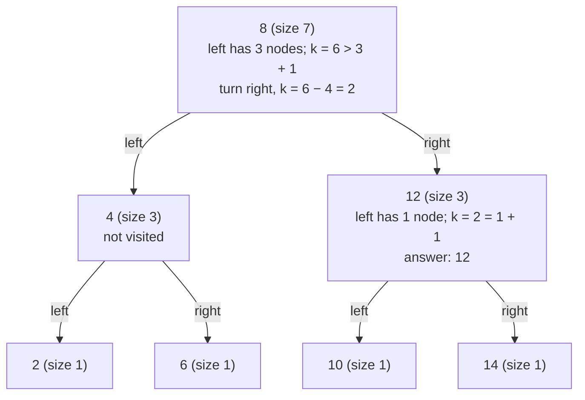
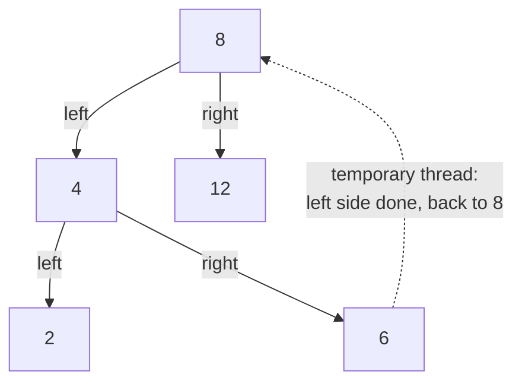
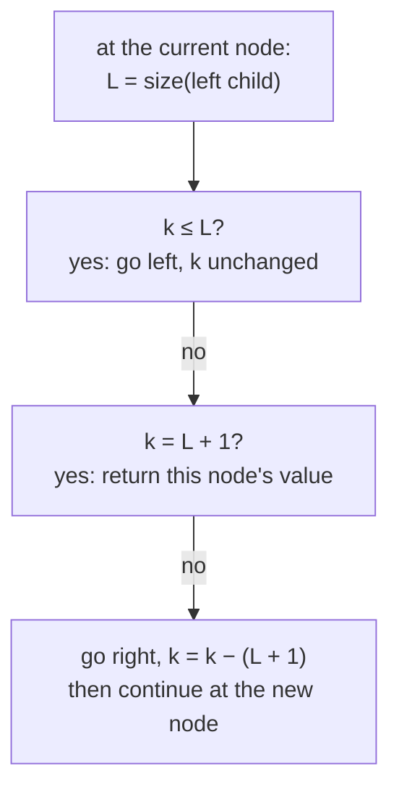

> [!tldr] Quick read
> - The problem: given the root of a [[en/concepts/binary-search-tree|binary search tree]] and a number k, return the kth smallest value (counting from 1).
> - The key idea: an [[en/concepts/in-order-traversal|in-order traversal]] (left, node, right) of a search tree visits the values **in increasing order**. The kth node visited is the answer, so there is no need to sort, and no need to walk the whole tree either.
> - Stopping at the kth node costs O(h + k): go down h levels to the smallest node, then visit k nodes. On a balanced tree of 10⁶ nodes with k = 1, the [[en/concepts/stack|stack]] version finishes in under 1 µs, while a full traversal takes about 22 ms and sorting about 115 ms.
> - Morris traverses without a stack (O(1) memory) by borrowing a right pointer as a temporary "thread" back up. The price: it has to keep going until every thread is removed, so with k = 1 it still walks about half the tree. Stop right at the kth node and the answer is correct, but the tree is left with a cycle.
> - The follow-up (the tree keeps getting insertions and deletions, and k is asked many times): every node remembers the size of its subtree, and each query walks a single path from the root, O(h). 2,000 queries on a 10⁵-node tree: about 2.4 seconds with the stack, 0.6 ms with sizes.

> [!info] Context
> LeetCode problem 230 (Medium), on [[en/posts/2026-11-25-neetcode-binary-search-tree|station 4: Binary Search Trees]] of **the NeetCode Line: Linked Structures**. The same station has [[en/problems/lowest-common-ancestor-of-a-binary-search-tree|Lowest Common Ancestor of a BST]] (which uses the "left smaller, right larger" property to pick exactly one branch) and [[en/problems/validate-binary-search-tree|Validate Binary Search Tree]] (which checks that property itself). This problem uses the property's most important consequence: reading the tree in-order is reading a sorted sequence. You only need to know what a [[en/concepts/binary-tree|binary tree]] is and be comfortable with recursion.

> [!abstract]- Quick glossary for this post (click to open)
> - **Binary search tree (BST)**: a binary tree where, at every node, every value in the left subtree is smaller than the node and every value in the right subtree is larger. See [[en/concepts/binary-search-tree|Binary Search Tree]].
> - **In-order**: visit the left subtree, then the node, then the right subtree. See [[en/concepts/in-order-traversal|In-order Traversal]].
> - **h (height)**: the number of levels of the tree. A balanced tree of n nodes is about log₂ n tall; a skewed chain of n nodes is n tall.
> - **Explicit stack**: an array you push to and pop from yourself, in place of the call stack that recursion uses. See [[en/concepts/stack|Stack]].
> - **Recursion depth limit**: every function call takes a frame on the call stack; go too deep and the program throws. See [[en/concepts/recursion-depth-limit|Recursion Depth Limit]].
> - **Morris thread**: the empty `right` pointer of a node, temporarily pointed back at an ancestor so the traversal knows the way back, then removed.
> - **size of a node**: the number of nodes in the subtree rooted at that node (including itself).

## Picture it first: finding the kth station in a cave with signposts

A cave system has many forks. Each fork is a station with a number, and the diggers followed exactly one rule: turning left always reaches a smaller number than the current station, turning right always reaches a larger one. You need the station with the kth smallest number.

- **Counting in order:** keep turning left until the passage ends; that is the smallest station. Count it, go back to the previous fork, count that fork, then visit its right branch the same way. Stop once you have counted k.
- **Keeping a notebook:** to find your way back, you write down every fork you pass; going back means crossing out the last line.
- **Tying a rope instead:** without a notebook, at the last station of each left branch you tie a rope leading back to the fork above. Following the rope takes you back, and once there you untie it. Leave while a rope is still tied and the next visitor walks in circles forever.
- **Signposts:** if every fork had a sign saying "the left branch has 37 stations", you would not need to count stations one by one: k ≤ 37 means turn left, k = 38 means this very station, otherwise turn right and subtract 38 from k.

| Everyday life | Concept |
|---|---|
| The digging rule: left smaller, right larger | the binary search tree property |
| Turn left until the passage ends | the smallest node, at the end of the left path |
| Count stations in order | in-order traversal, an increasing sequence |
| Go home after counting k | early exit, O(h + k) |
| A notebook of forks passed | a stack (explicit, or recursion's call stack) |
| Tie a rope, then untie it | a Morris thread, O(1) memory |
| Leave while a rope is still tied | Morris with an early exit: the tree is left with a cycle |
| A sign "the left branch has 37 stations" | the size field, O(h) per query |

The tree below is the 7-node tree from the test file. Each node shows its size, along with the path taken when asking for k = 6 using the signposts. The tree's in-order sequence is 2, 4, 6, 8, 10, 12, 14, so the answer is 12:



## The problem

The input is the root of a binary search tree with n nodes and an integer k, with 1 ≤ k ≤ n ≤ 10⁴ and every node value in [0, 10⁴]. Return the kth smallest value in the tree, counting from 1 (k = 1 is the smallest). Original problem: [LeetCode 230](https://leetcode.com/problems/kth-smallest-element-in-a-bst/). The problem also has a follow-up: if the tree is modified often and the kth element is asked for many times, how would you optimize?

Two small details in these limits deserve attention. A value can be **0**, which is where the "check with `if (x)`" trap below comes from. And 10⁴ nodes arranged as a skewed chain are 10⁴ levels deep: far past Python's default recursion limit, and right at the edge of Node's and Java's.

## How it works

<figure class="figure-map" style="--ar: 3 / 4">
<div class="frame"><iframe data-archify="../../diagrams/neetcode-kth-smallest-element-in-a-bst/worked-example.en.html" title="Stop at the kth node in inorder" loading="lazy"></iframe></div>
<figcaption><span><b>Figure 1.</b> Stop at the kth node in inorder.</span><a href="../diagrams/neetcode-kth-smallest-element-in-a-bst/worked-example.en.html" target="_blank" rel="noopener">Open full screen</a></figcaption>
</figure>

<details>
<summary>Read the steps</summary>
<ol>
<li>Find the leftmost node. <code>BST: root 7; left 3 → right 5; right 9</code></li>
<li>Visit 3 first. <code>count = 1</code></li>
<li>Then visit 5. <code>count = 2</code></li>
<li>For k equal to 2, return 5 immediately. <code>5</code></li>
</ol>
</details>

### Approach 1: collect everything and sort

This uses nothing about the search tree: collect every value (in any order), sort, and take element k − 1.

```ts
// Approach 1: collect every value (any order works), sort, take element k-1. O(n log n).
function kthSort(root: TreeNode | null, k: number): number {
  const vals: number[] = [];
  const stack: TreeNode[] = root ? [root] : [];
  while (stack.length > 0) {
    const node = stack.pop()!;
    vals.push(node.val);
    if (node.left !== null) stack.push(node.left);
    if (node.right !== null) stack.push(node.right);
  }
  vals.sort((a, b) => a - b);
  return vals[k - 1];
}
```

It is correct for any binary tree, even one that is not a search tree. O(n log n) time, O(n) memory. In JavaScript and TypeScript, `(a, b) => a - b` is required: `sort()` without a comparator turns the numbers into strings and compares those, so 10 comes before 2.

### Approach 2: in-order is already increasing

At every node, every value on the left is smaller than the node and every value on the right is larger. An in-order traversal visits all of the left, then the node, then all of the right, so (by induction on the height) it passes through the values in exactly increasing order. No sorting needed:

```ts
// Approach 2: the in-order sequence of a search tree is already increasing. Collect it all, then take element k-1. O(n).
function kthInorderAll(root: TreeNode | null, k: number): number {
  const out: number[] = [];
  const walk = (node: TreeNode | null): void => {
    if (node === null) return;
    walk(node.left);
    out.push(node.val);
    walk(node.right);
  };
  walk(root);
  return out[k - 1];
}
```

O(n) time, O(n) for the array and O(h) for the call stack. This version still does two needless things: it walks the whole tree even though the answer is at the kth node, and it keeps all n values when only one is needed.

### Approach 3: count and stop at the kth node (recursive)

Drop the array and keep a counter. Each time a node is "visited" (after its left side is done), increment the counter; when it reaches k, record the answer, and from then on every call returns immediately.

```ts
// Approach 3: recursive in-order, counting and stopping once k is reached. O(h + k).
function kthRecursive(root: TreeNode | null, k: number): number {
  let count = 0;
  let answer = -1;
  const walk = (node: TreeNode | null): void => {
    if (node === null || count >= k) return;
    walk(node.left);
    if (count >= k) return; // already found on the left: skip this node and the right subtree
    count++;
    if (count === k) { answer = node.val; return; }
    walk(node.right);
  };
  walk(root);
  return answer;
}
```

Why O(h + k)? Before visiting the first node, the function goes straight down to the end of the left path: at most h calls. After that, every visited node increments the counter, and the function stops after k visits. The remaining calls are calls into an empty child or calls that return immediately because `count >= k`, and each node that is visited or lies on the way down produces at most two such calls. Memory is O(h) for the call stack.

The two `count >= k` checks are the early exit. Without the second one (after `walk(node.left)`), the function still returns the right answer, but it keeps incrementing the counter and going right at every level above, so the "stop" part is lost.

### Approach 4: the same thing with an explicit stack

Replace the call stack with an array: push the whole left path onto the stack, pop one node (the smallest one not yet visited), count it, then move to its right subtree.

```ts
// Approach 4: in-order with an explicit stack, return once k nodes have been popped. O(h + k), no depth limit.
function kthIterative(root: TreeNode | null, k: number): number {
  const stack: TreeNode[] = [];
  let node = root;
  for (;;) {
    while (node !== null) { stack.push(node); node = node.left; } // go all the way left
    node = stack.pop()!;                                           // the smallest unvisited node
    if (--k === 0) return node.val;
    node = node.right;
  }
}
```

On the 7-node tree in the figure above, with k = 3:

| Step | What happens | Stack after the step (bottom → top) | k left |
|---|---|---|---|
| 1 | push 8, 4, 2; pop 2, count it | 8, 4 | 2 |
| 2 | 2 has no right child; pop 4, count it | 8 | 1 |
| 3 | go to 4's right child: push 6; pop 6, count it | 8 | 0: return 6 |

The stack never holds more than h nodes, and the loop does not need to know in advance whether k is valid, since the problem promises k ≤ n. This version also does not depend on the recursion limit, which makes it the safe choice for a 10⁴-node skewed chain in every language.

### Approach 5: Morris, no stack needed

The stack in approach 4 exists to answer one question: "once this node's left subtree is done, where do I go back to?". Morris (1979) answers it inside the tree itself. The node **just before** `cur` in in-order (the rightmost node of `cur`'s left subtree) always has an empty `right`. Morris temporarily points that `right` at `cur`: after finishing the left subtree, the traversal follows this thread back.



Every node with a left child is reached twice: the first time to find its predecessor and **tie** the thread, the second time when the thread leads back, to **remove** it and visit the node. The total number of pointer steps is O(n), with O(1) extra memory.

```ts
// Approach 5: Morris. Borrow the empty right pointer of the predecessor as a "thread" back up, so no stack is needed: O(1) memory.
// It may only stop once the answer is found AND every thread is removed (pending = 0); otherwise the tree is left wrong.
function kthMorris(root: TreeNode | null, k: number): number {
  let cur = root, count = 0, answer = -1, pending = 0;
  while (cur !== null) {
    if (cur.left === null) {
      if (++count === k) answer = cur.val;
      if (count >= k && pending === 0) break;
      cur = cur.right;
    } else {
      let pred = cur.left;
      while (pred.right !== null && pred.right !== cur) pred = pred.right;
      if (pred.right === null) {
        pred.right = cur; // tie the thread: back to cur once the left subtree is done
        pending++;
        cur = cur.left;
      } else {
        pred.right = null; // remove the thread: cur's left subtree has been visited
        pending--;
        if (++count === k) answer = cur.val;
        if (count >= k && pending === 0) break;
        cur = cur.right;
      }
    }
  }
  return answer;
}
```

What I did not expect when writing this version: Morris **cannot exit early** in the sense of approaches 3 and 4. When it reaches the kth node, every ancestor where it turned left still has a thread tied. Removing an ancestor's thread requires walking through that ancestor's whole left subtree. With k = 1 on a balanced tree, the smallest node is at the end of the left path from the root, so every node on that path (the root included) has a thread tied, and the traversal must cover the root's entire left subtree, about n/2 nodes, before all of them are removed. The `pending` variable counts the threads currently tied; the function only exits once it has the answer and `pending` is back to 0.

Drop that condition (return as soon as the count reaches k) and the answer is still correct in every case, but the tree is left with a cycle: the test file rechecks every pointer after each call and catches it in 6/10 cases, and a normal in-order traversal afterwards never terminates.

### Approach 6 (the follow-up): every node remembers its subtree size

If the tree keeps getting insertions and deletions and the kth element is asked for many times, O(h + k) per query is too expensive: with a random k, a query visits n/2 nodes on average. The fix is to add a `size` field to every node, equal to the number of nodes in its subtree. Let L be the size of the left child. At each node there are only three possibilities:



```ts
function kthBySize(root: SizedNode | null, k: number): number {
  let node = root!;
  for (;;) {
    const leftSize = sizeOf(node.left);
    if (k <= leftSize) node = node.left!;                 // the answer is in the left subtree
    else if (k === leftSize + 1) return node.val;         // exactly this node
    else { k -= leftSize + 1; node = node.right!; }       // skip the whole left side and this node
  }
}
```

Each query walks one path from the root: O(h). The price is keeping `size` correct as the tree changes. Inserting a new value increments `size` by 1 on every node along the way down; deleting recomputes `size = 1 + size(left) + size(right)` on the way back up. Both are still O(h), so insertion and deletion keep their complexity. The test file runs 5,000 random insertions, deletions and queries and checks every query against an array that is always kept sorted.

This tree is also called an **order statistic tree** (CLRS third edition, chapter 14). O(h) only becomes O(log n) when the tree is kept balanced (red-black, AVL); a plain search tree that receives values in increasing order turns into a skewed chain and h = n.

### Comparison

| Approach | Time | Extra memory | Notes |
|---|---|---|---|
| Collect everything, sort | O(n log n) | O(n) | correct even for a tree that is not a search tree |
| Full in-order traversal | O(n) | O(n) + O(h) | recursion h levels deep |
| Recursive in-order, early exit | O(h + k) | O(h) | recursion h levels deep |
| In-order with a stack | O(h + k) | O(h) | no depth limit |
| Morris | O(n) worst case | O(1) | can only stop once every thread is removed; temporarily modifies the tree |
| By size | O(h) per query | O(n) for the size field | insertions and deletions must update size |

### Measurements

TypeScript, Node 24, a balanced tree of 2²⁰ − 1 nodes (height 20, values 0 to n − 1), median of 5 runs (ms). The machine was running other work in parallel, so read the ratios, not the last digits:

| k | Sort | Full in-order | Recursive, early exit | Stack | Morris | By size |
|---|---|---|---|---|---|---|
| 1 | 119.7 | 21.7 | 0.001 | 0.000 | 3.30 | 0.000 |
| 100 | 114.2 | 21.1 | 0.004 | 0.001 | 3.83 | 0.001 |
| 524,288 (middle) | 116.1 | 22.4 | 4.87 | 3.16 | 3.34 | 0.000 |
| 1,048,575 (largest) | 114.0 | 39.0 | 15.1 | 10.5 | 11.3 | 0.000 |

- The two early-exit versions cost exactly what O(h + k) says: almost nothing for small k, about one full traversal when k = n.
- Morris with k = 1 still takes 3.3 ms: it has to walk the root's whole left subtree to remove its threads. With k in the middle of the tree, it is level with the stack.
- Sorting is about 5 times slower than the full in-order traversal: both have to collect n values, but sorting adds O(n log n) comparisons.

The follow-up: a random tree (values inserted in random order), then Q queries with random k:

| Language | Tree, queries | Stack, O(h + k) | By size, O(h) |
|---|---|---|---|
| TypeScript | 10⁵ nodes, 2,000 | 2,405 ms | 0.56 ms |
| Go | 10⁵ nodes, 2,000 | 1,170 ms | 0.28 ms |
| Java | 10⁵ nodes, 2,000 | 1,609 ms | 0.37 ms |
| Python | 2·10⁴ nodes, 500 | 311 ms | 0.46 ms |

A gap of three orders of magnitude: each stack query visits n/2 nodes on average, while the size query only walks about 2 ln n ≈ 23 levels of a random 10⁵-node search tree.

### Under the hood in five languages

| | A counter shared across recursion levels | Language-specific traps |
|---|---|---|
| TypeScript / JavaScript | a `let` variable outside the closure | `sort()` without a comparator compares strings; `if (l)` treats an answer of 0 as "not found"; a 10⁴-node skewed chain sits right at Node's stack limit |
| Python | `nonlocal count` in the nested function | without `nonlocal`, `count += 1` throws `UnboundLocalError`; `if l:` also treats 0 as false; the recursion limit is 1,000, so a 10⁴-node chain throws `RecursionError` |
| Go | a variable outside the closure; a recursive closure must be declared with `var walk func(*TreeNode)` first and assigned afterwards | passing `count int` as a parameter means each level increments its own copy; goroutine stacks grow, so a 10⁴-node chain is fine |
| Java | a small object (`Counter`) passed down, because a lambda cannot reassign a local variable | `int` is passed by value; a `static` field is not reset between calls; a 10⁴-node chain sometimes throws `StackOverflowError` |

## Runnable example

[TypeScript](../code/neetcode-kth-smallest-element-in-a-bst/kth-smallest.ts) · [Python](../code/neetcode-kth-smallest-element-in-a-bst/kth_smallest.py) · [Go](../code/neetcode-kth-smallest-element-in-a-bst/kth_smallest.go) · [Java](../code/neetcode-kth-smallest-element-in-a-bst/kth-smallest.java) · [JavaScript](../code/neetcode-kth-smallest-element-in-a-bst/kth-smallest.js) · [PHP](../code/neetcode-kth-smallest-element-in-a-bst/kth-smallest.php) · [Rust](../code/neetcode-kth-smallest-element-in-a-bst/kth_smallest.rs)

Each of the original five files builds trees from a LeetCode-style level-order array and runs 10 shared cases: a single node; the full 7-node tree with k = 1, 4 (the root) and 7; a tree containing 0 with k = 1 and 2; a tree whose answer sits in the right subtree of the left child; a 10⁴-node left-skewed chain with k = 1 and k = 5,000; a 10⁴-node right-skewed chain with k = 10⁴. After each call, the file rechecks every pointer in the tree (to catch Morris stopping early). TypeScript, Python, Go and Java also cross-check the six approaches on 2,000 random search trees and take measurements. All five files run 5,000 insertions, deletions and queries on the sized tree.

Recursive in-order, stopping at the kth node:

```ts
// Approach 3: recursive in-order, counting and stopping once k is reached. O(h + k).
function kthRecursive(root: TreeNode | null, k: number): number {
  let count = 0;
  let answer = -1;
  const walk = (node: TreeNode | null): void => {
    if (node === null || count >= k) return;
    walk(node.left);
    if (count >= k) return; // already found on the left: skip this node and the right subtree
    count++;
    if (count === k) { answer = node.val; return; }
    walk(node.right);
  };
  walk(root);
  return answer;
}
```

```python
def kth_recursive(root, k):
    """Approach 3: recursive in-order, counting and stopping once k is reached. O(h + k)."""
    count = 0
    answer = -1

    def walk(node):
        nonlocal count, answer  # without this line: UnboundLocalError
        if node is None or count >= k:
            return
        walk(node.left)
        if count >= k:
            return
        count += 1
        if count == k:
            answer = node.val
            return
        walk(node.right)

    walk(root)
    return answer
```

```go
// Approach 3: recursive in-order, counting and stopping once k is reached. O(h + k).
// count and answer live outside the closure, so every recursion level updates the same variable.
func kthRecursive(root *TreeNode, k int) int {
	count, answer := 0, -1
	var walk func(*TreeNode)
	walk = func(node *TreeNode) {
		if node == nil || count >= k {
			return
		}
		walk(node.Left)
		if count >= k {
			return
		}
		count++
		if count == k {
			answer = node.Val
			return
		}
		walk(node.Right)
	}
	walk(root)
	return answer
}
```

```java
// Approach 3: recursive in-order, counting and stopping once k is reached. O(h + k).
// A Java lambda cannot reassign a local variable, so the counter lives in a small object passed down.
static final class Counter { int count, answer = -1; final int k; Counter(int k) { this.k = k; } }

static int kthRecursive(TreeNode root, int k) {
    Counter c = new Counter(k);
    walk(root, c);
    return c.answer;
}

static void walk(TreeNode node, Counter c) {
    if (node == null || c.count >= c.k) return;
    walk(node.left, c);
    if (c.count >= c.k) return;
    if (++c.count == c.k) { c.answer = node.val; return; }
    walk(node.right, c);
}
```

```js
// Approach 3: recursive in-order, counting and stopping once k is reached. O(h + k).
function kthRecursive(root, k) {
  let count = 0, answer = -1;
  const walk = (node) => {
    if (node === null || count >= k) return;
    walk(node.left);
    if (count >= k) return;
    count++;
    if (count === k) { answer = node.val; return; }
    walk(node.right);
  };
  walk(root);
  return answer;
}
```

In-order with a stack, safe on a 10⁴-node chain in every language:

```ts
// Approach 4: in-order with an explicit stack, return once k nodes have been popped. O(h + k), no depth limit.
function kthIterative(root: TreeNode | null, k: number): number {
  const stack: TreeNode[] = [];
  let node = root;
  for (;;) {
    while (node !== null) { stack.push(node); node = node.left; } // go all the way left
    node = stack.pop()!;                                           // the smallest unvisited node
    if (--k === 0) return node.val;
    node = node.right;
  }
}
```

```python
def kth_iterative(root, k):
    """Approach 4: in-order with an explicit stack, pop k nodes. O(h + k)."""
    stack, node = [], root
    while True:
        while node:
            stack.append(node)
            node = node.left
        node = stack.pop()
        k -= 1
        if k == 0:
            return node.val
        node = node.right
```

```go
// Approach 4: in-order with an explicit stack, pop k nodes. O(h + k).
func kthIterative(root *TreeNode, k int) int {
	stack := []*TreeNode{}
	node := root
	for {
		for node != nil {
			stack = append(stack, node)
			node = node.Left
		}
		node = stack[len(stack)-1]
		stack = stack[:len(stack)-1]
		k--
		if k == 0 {
			return node.Val
		}
		node = node.Right
	}
}
```

```java
// Approach 4: in-order with an explicit stack, pop k nodes. O(h + k).
static int kthIterative(TreeNode root, int k) {
    Deque<TreeNode> stack = new ArrayDeque<>();
    TreeNode node = root;
    while (true) {
        while (node != null) { stack.push(node); node = node.left; }
        node = stack.pop();
        if (--k == 0) return node.val;
        node = node.right;
    }
}
```

```js
// Approach 4: in-order with an explicit stack, pop k nodes. O(h + k).
function kthIterative(root, k) {
  const stack = [];
  let node = root;
  for (;;) {
    while (node !== null) { stack.push(node); node = node.left; }
    node = stack.pop();
    if (--k === 0) return node.val;
    node = node.right;
  }
}
```

```php
<?php
declare(strict_types=1);

final class TreeNode {
    public function __construct(
        public int $val,
        public ?TreeNode $left = null,
        public ?TreeNode $right = null,
    ) {}
}

function kthSmallest(?TreeNode $root, int $k): int {
    $stack = [];
    while ($root !== null || $stack) {
        while ($root !== null) {
            $stack[] = $root;
            $root = $root->left;
        }
        $root = array_pop($stack);
        if (--$k === 0) return $root->val;
        $root = $root->right;
    }
    throw new InvalidArgumentException('k nằm ngoài số nút');
}
```

```rust
use std::{cell::RefCell, rc::Rc};

type Node = Option<Rc<RefCell<TreeNode>>>;

struct TreeNode {
    val: i32,
    left: Node,
    right: Node,
}

fn node(val: i32, left: Node, right: Node) -> Node {
    Some(Rc::new(RefCell::new(TreeNode { val, left, right })))
}

fn kth_smallest(root: &Node, mut k: usize) -> Option<i32> {
    let mut current = root.clone();
    let mut stack = Vec::new();
    while k > 0 {
        while let Some(node) = current {
            current = node.borrow().left.clone();
            stack.push(node);
        }
        let node = stack.pop()?;
        let node = node.borrow();
        k -= 1;
        if k == 0 {
            return Some(node.val);
        }
        current = node.right.clone();
    }
    None
}
```

Output of `node kth-smallest.ts`:

```text
kthSort                10/10 cases passed
kthInorderAll          7/10 cases passed; failed on 10⁴-node left-skewed chain, k = 1 → threw RangeError, 10⁴-node left-skewed chain, k = 5000 → threw RangeError, 10⁴-node right-skewed chain, k = 10⁴ → threw RangeError
kthRecursive           10/10 cases passed
kthIterative           10/10 cases passed
kthMorris              10/10 cases passed
kthAugmented           10/10 cases passed
wrongPreorder          5/10 cases passed; failed on full 7-node tree, k = 1 → 8, full 7-node tree, k = 4 (root) → 6, contains 0, k = 1 → 3, 10⁴-node left-skewed chain, k = 1 → 10000, 10⁴-node left-skewed chain, k = 5000 → 5001
wrongSortNoComparator  4/10 cases passed; failed on full 7-node tree, k = 1 → 10, full 7-node tree, k = 4 (root) → 2, full 7-node tree, k = 7 → 8, answer in the right subtree of the left child, k = 3 → 20, 10⁴-node left-skewed chain, k = 5000 → 5498, 10⁴-node right-skewed chain, k = 10⁴ → 9999
wrongFalsyZero         6/10 cases passed; failed on contains 0, k = 1 → null, 10⁴-node left-skewed chain, k = 1 → threw RangeError, 10⁴-node left-skewed chain, k = 5000 → threw RangeError, 10⁴-node right-skewed chain, k = 10⁴ → threw RangeError
wrongMorrisEarlyReturn 4/10 cases passed; failed on full 7-node tree, k = 1 → 2 but the tree was changed, contains 0, k = 1 → 0 but the tree was changed, contains 0, k = 2 → 1 but the tree was changed, answer in the right subtree of the left child, k = 3 → 7 but the tree was changed, 10⁴-node left-skewed chain, k = 1 → 1 but the tree was changed, 10⁴-node left-skewed chain, k = 5000 → 5000 but the tree was changed

after wrongMorrisEarlyReturn(k = 1) on the 7-node tree: in-order traversal still running after 1000 steps (the tree has a cycle)

cross-check on 2000 random search trees of 1..30 nodes: six approaches match the sorted array 2000/2000
sized tree: 5000 random insert/delete/query operations, 1490/1490 queries match the sorted array

balanced tree of 1048575 nodes (height 20), median time of 5 runs (ms)
k             sort  full in-order  recursive early exit     stack   Morris   by size
1        119.685            21.704            0.001     0.000    3.298       0.000
100      114.202            21.115            0.004     0.001    3.830       0.001
524288   116.119            22.449            4.870     3.164    3.343       0.000
1048575  113.995            39.034           15.092    10.532   11.339       0.000

random tree of 100000 nodes, 2000 queries with random k: stack 2404.7 ms, by size 0.56 ms
```

*(Output labels translated; the files themselves print Vietnamese.)*

The `RangeError` lines deserve a careful read. `kthInorderAll` and `kthRecursive` both recurse 10⁴ levels deep on the skewed chain, yet only the collect-everything version overflowed the stack in this run. Node's limit is a number of bytes (about 984 KB by default), not a number of levels, and the size of each frame depends on whether the JIT has compiled the function yet. 10⁴ levels sits right at that limit: across three runs, `kthInorderAll` passed 7 or 8 of the 10 cases. In Node, do not rely on recursion when the tree may be a 10⁴-node chain.

`wrongMorrisEarlyReturn` does not fail on the right-skewed chain: that chain has no left children, so no thread is ever tied. It also passes on the single node and on k = 4 and k = 7 of the full tree, because by then every thread has been removed.

`python3 kth_smallest.py`:

```text
kth_sort          10/10 cases passed
kth_inorder_all   7/10 cases passed; failed on 10⁴-node left-skewed chain, k = 1 → threw RecursionError, 10⁴-node left-skewed chain, k = 5000 → threw RecursionError, 10⁴-node right-skewed chain, k = 10⁴ → threw RecursionError
kth_recursive     7/10 cases passed; failed on 10⁴-node left-skewed chain, k = 1 → threw RecursionError, 10⁴-node left-skewed chain, k = 5000 → threw RecursionError, 10⁴-node right-skewed chain, k = 10⁴ → threw RecursionError
kth_iterative     10/10 cases passed
kth_morris        10/10 cases passed
kth_augmented     10/10 cases passed
wrong_no_nonlocal 0/10 cases passed; failed on single node, k = 1 → threw UnboundLocalError, full 7-node tree, k = 1 → threw UnboundLocalError, full 7-node tree, k = 4 (root) → threw UnboundLocalError, full 7-node tree, k = 7 → threw UnboundLocalError, contains 0, k = 1 → threw UnboundLocalError, contains 0, k = 2 → threw UnboundLocalError, answer in the right subtree of the left child, k = 3 → threw UnboundLocalError, 10⁴-node left-skewed chain, k = 1 → threw RecursionError, 10⁴-node left-skewed chain, k = 5000 → threw RecursionError, 10⁴-node right-skewed chain, k = 10⁴ → threw UnboundLocalError
wrong_falsy_zero  6/10 cases passed; failed on contains 0, k = 1 → None, 10⁴-node left-skewed chain, k = 1 → threw RecursionError, 10⁴-node left-skewed chain, k = 5000 → threw RecursionError, 10⁴-node right-skewed chain, k = 10⁴ → threw RecursionError

cross-check on 2000 random search trees of 1..30 nodes: six approaches match the sorted array 2000/2000
sized tree: 5000 random insert/delete/query operations, 1454/1454 queries match the sorted array

balanced tree of 131071 nodes (height 17), median time of 5 runs (ms)
k           sort  full in-order  recursive early exit     stack   Morris   by size
1         8.557             7.071            0.001     0.001    6.795       0.001
100      11.916             7.690            0.008     0.005    6.615       0.001
65536     8.855             7.208            4.849     3.295    5.945       0.000
131071    8.517             7.081            9.884     6.617   11.914       0.001

random tree of 20000 nodes, 500 queries with random k: stack 310.5 ms, by size 0.46 ms
```

In Python, sorting is almost level with the full in-order traversal: `list.sort` runs in C, and the time goes into the Python loop over n nodes, which both approaches share. The recursive early-exit version also throws `RecursionError` on the left-skewed chain with k = 1, because to reach the smallest node it still has to descend all 10⁴ levels.

`go run kth_smallest.go`:

```text
kthSort                10/10 cases passed
kthInorderAll          10/10 cases passed
kthRecursive           10/10 cases passed
kthIterative           10/10 cases passed
kthMorris              10/10 cases passed
kthAugmented           10/10 cases passed
wrongCountByValue      5/10 cases passed; failed on full 7-node tree, k = 4 (root) → 0, full 7-node tree, k = 7 → 0, contains 0, k = 2 → 2, answer in the right subtree of the left child, k = 3 → 8, 10⁴-node left-skewed chain, k = 5000 → 0
wrongMorrisEarlyReturn 4/10 cases passed; failed on full 7-node tree, k = 1 → 2 but the tree was changed, contains 0, k = 1 → 0 but the tree was changed, contains 0, k = 2 → 1 but the tree was changed, answer in the right subtree of the left child, k = 3 → 7 but the tree was changed, 10⁴-node left-skewed chain, k = 1 → 1 but the tree was changed, 10⁴-node left-skewed chain, k = 5000 → 5000 but the tree was changed

cross-check on 2000 random search trees of 1..30 nodes: six approaches match the sorted array 2000/2000
sized tree: 5000 random insert/delete/query operations, 1561/1561 queries match the sorted array

balanced tree of 1048575 nodes (height 20), median time of 5 runs (ms)
k             sort  full in-order  recursive early exit     stack   Morris   by size
1         38.347            20.278            0.000     0.000    2.735       0.000
100       36.256            16.134            0.001     0.005    4.624       0.000
524288    39.167             8.373            1.772     1.288    2.166       0.000
1048575   38.987            10.034            5.164     5.341    4.686       0.000

random tree of 100000 nodes, 2000 queries with random k: stack 1170.1 ms, by size 0.28 ms
```

`wrongCountByValue` passes `count` as a parameter. Each level increments its own copy, so when control returns from the left subtree to the parent, the parent's count is still the old number: the parent counts itself as the first node. The function is only correct when the count never has to travel back up from a child to its parent: k = 1, or the right-skewed chain, where the count only travels down.

`java kth-smallest.java`:

```text
kthSort              10/10 cases passed
kthInorderAll        8/10 cases passed; failed on 10⁴-node left-skewed chain, k = 1 → threw StackOverflowError, 10⁴-node right-skewed chain, k = 10⁴ → threw StackOverflowError
kthRecursive         10/10 cases passed
kthIterative         10/10 cases passed
kthMorris            10/10 cases passed
kthAugmented         10/10 cases passed
wrongCountByValue    3/10 cases passed; failed on full 7-node tree, k = 4 (root) → -1, full 7-node tree, k = 7 → -1, contains 0, k = 2 → 2, answer in the right subtree of the left child, k = 3 → 8, 10⁴-node left-skewed chain, k = 1 → threw StackOverflowError, 10⁴-node left-skewed chain, k = 5000 → -1, 10⁴-node right-skewed chain, k = 10⁴ → threw StackOverflowError
wrongStaticNotReset  1/10 cases passed; failed on full 7-node tree, k = 1 → 9, full 7-node tree, k = 4 (root) → 9, full 7-node tree, k = 7 → 9, contains 0, k = 1 → 9, contains 0, k = 2 → 9, answer in the right subtree of the left child, k = 3 → 9, 10⁴-node left-skewed chain, k = 1 → threw StackOverflowError, 10⁴-node left-skewed chain, k = 5000 → 4957, 10⁴-node right-skewed chain, k = 10⁴ → 4957

cross-check on 2000 random search trees of 1..30 nodes: six approaches match the sorted array 2000/2000
sized tree: 5000 random insert/delete/query operations, 1477/1477 queries match the sorted array

balanced tree of 1048575 nodes (height 20), median time of 5 runs (ms)
k             sort  full in-order  recursive early exit     stack   Morris   by size
1         52.790            19.094            0.000     0.000    2.410       0.000
100       29.032             7.450            0.000     0.001    2.848       0.000
524288    29.962             6.877            1.346     1.578    2.482       0.000
1048575   26.983             7.553            2.889     3.316    4.956       0.000

random tree of 100000 nodes, 2000 queries with random k: stack 1608.9 ms, by size 0.37 ms
```

Java also sits at the edge: a thread's default stack is 1,024 KB (`ThreadStackSize`), and across runs `kthInorderAll` failed 1 or 2 of the chain cases, and once `kthRecursive` failed one too. `wrongStaticNotReset` only passes the first case: from the second case on, the `static` counter is already past k, so it never records a new answer and keeps returning the 9 from the single-node case. The last two cases return 4957 because the counter, still accumulating from earlier cases, happens to pass k exactly in the middle of the chain.

`node kth-smallest.js`:

```text
kthSort               10/10 cases passed
kthInorderAll         8/10 cases passed; failed on 10⁴-node left-skewed chain, k = 1 → threw RangeError, 10⁴-node left-skewed chain, k = 5000 → threw RangeError
kthRecursive          10/10 cases passed
kthIterative          10/10 cases passed
kthMorris             10/10 cases passed
kthAugmented          10/10 cases passed
wrongSortNoComparator 4/10 cases passed; failed on full 7-node tree, k = 1 → 10, full 7-node tree, k = 4 (root) → 2, full 7-node tree, k = 7 → 8, answer in the right subtree of the left child, k = 3 → 20, 10⁴-node left-skewed chain, k = 5000 → 5498, 10⁴-node right-skewed chain, k = 10⁴ → 9999
wrongFalsyZero        7/10 cases passed; failed on contains 0, k = 1 → null, 10⁴-node left-skewed chain, k = 1 → threw RangeError, 10⁴-node left-skewed chain, k = 5000 → threw RangeError

sized tree: 5000 random insert/delete/query operations, 1491/1491 queries match the sorted array
```

The added versions use a stack for inorder traversal and stop at the kth node. PHP `5/5 ca đúng` · Rust `6/6 ca đúng`.

## Misconceptions and common traps

- **"You have to sort."** The search tree already keeps the order; in-order reads it out in increasing order without a single comparison.
- **"Any traversal works, as long as you count to k."** Only in-order produces an increasing sequence. Pre-order (node, left, right) passed 5/10 cases, and only by luck.
- **"An early exit is all it takes."** In the recursive version you must check `count >= k` **after** the left call returns as well; without it the answer is still right, but the function keeps going right at every level above.
- **"With Morris, just stop at the kth node."** Stopping while threads are still tied leaves the tree with a cycle: the answer is correct, but the next traversal runs forever. You have to continue until every thread is removed, so Morris cannot exit early the way the stack version does.
- **Checking "found yet?" by the value itself.** `if (l)` in JavaScript and `if l:` in Python treat 0 as "not found", and the problem allows the value 0. Compare with `null` / `None`, or use a separate flag.
- **Passing the counter by value.** In Go, Java (and every other language here) an `int` parameter is a copy; an increment at a child level never reaches the parent. The counter must be a shared variable: a closure, `nonlocal`, or an object.
- **A `static` field that is never reset.** In Java, a `static` counter lives across every call in the same process. If the judge runs many cases in a row in one JVM, results are wrong from the second case on.
- **`sort()` without a comparator in JavaScript.** It compares strings: `[10, 2, 8].sort()` gives `[10, 2, 8]`.
- **Recursion on a 10⁴-node chain.** Python always throws `RecursionError` (1,000-level limit); Node and Java sit at their limits and the outcome changes between runs; Go is fine. The stack version is safe in all five languages.
- **"By size is O(log n)."** Only when the tree is kept balanced. A plain search tree can become a chain, and then both insertion and queries are O(n).

## Self-check questions

> [!question]- Why is the in-order sequence of a search tree always increasing?
> Induction on the height. An empty tree gives an empty sequence. For a node, the in-order sequence is (the left subtree's sequence), then the node, then (the right subtree's sequence). By the induction hypothesis both subsequences are increasing; every element on the left is smaller than the node and every element on the right is larger, by the search tree property, so the concatenation is still increasing.

> [!question]- How many steps does the stack version take for k = 1 on a 10⁴-node left-skewed chain? And on a right-skewed chain?
> Left-skewed chain: the smallest node is at the bottom, so all 10⁴ nodes are pushed before the first pop: h = n. Right-skewed chain: the root is the smallest node, so one push and an immediate pop. O(h + k) says exactly that: the cost lies in the height of the left path, not in n.

> [!question]- How far does Morris have to go for k = 1 on a balanced tree of n nodes, and why?
> About half the tree. The smallest node is at the end of the left path from the root, so every node on that path (the root included) has a thread tied by the time it is reached. The root's thread is only removed when the traversal returns to the root, that is, after walking the root's whole left subtree, about n/2 nodes.

> [!question]- In a sized tree, you are at a node whose left child has size 5, and k = 9. Where next?
> k = 9 > 5 + 1, so the answer is not on the left and not this node. Go right with k = 9 − 6 = 3: look for the 3rd smallest element in the right subtree.

> [!question]- When a value is inserted into a sized tree, which nodes must update their size?
> Exactly the nodes on the path from the root to the insertion point: each of them gains one node in its subtree, so its size goes up by 1. Every other node is unchanged. That is why insertion stays O(h).

## References

- [LeetCode 230: Kth Smallest Element in a BST](https://leetcode.com/problems/kth-smallest-element-in-a-bst/) (original problem: 1 ≤ k ≤ n ≤ 10⁴, values in [0, 10⁴])
- Joseph M. Morris, "Traversing binary trees simply and cheaply", *Information Processing Letters* 9(5), 1979: in-order traversal without a stack using temporary threads
- Cormen, Leiserson, Rivest, Stein, *Introduction to Algorithms* (third edition), chapter 12 (binary search trees, in-order traversal) and chapter 14 (order statistic trees, the size field)
- [Python: the `nonlocal` statement](https://docs.python.org/3/reference/simple_stmts.html#the-nonlocal-statement)
- [MDN: `Array.prototype.sort`](https://developer.mozilla.org/en-US/docs/Web/JavaScript/Reference/Global_Objects/Array/sort) (without a comparator it compares UTF-16 strings)
