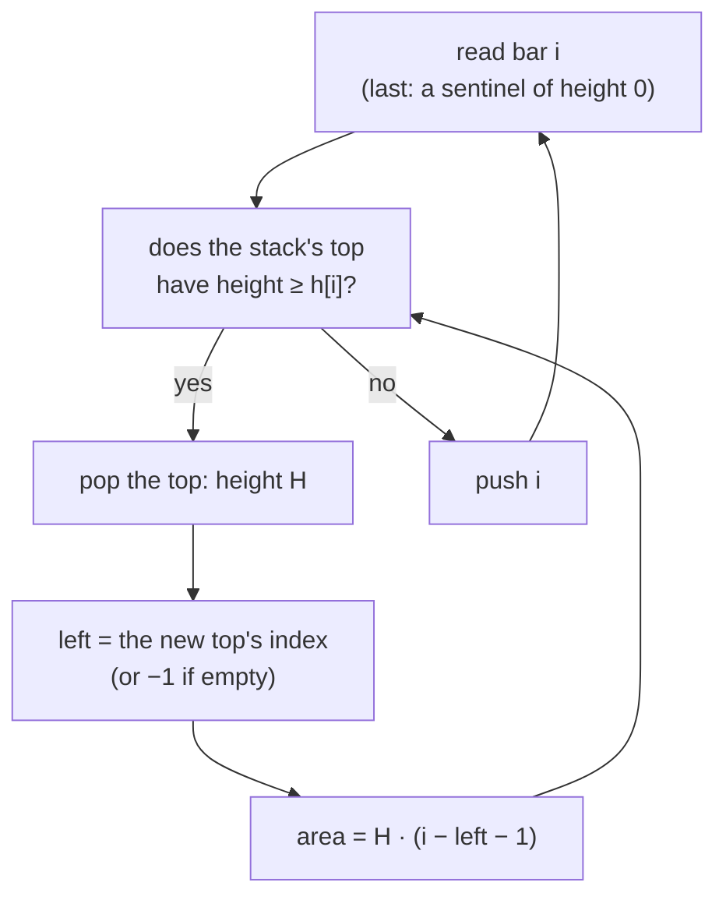

> [!tldr] Quick read
> - The problem: bars of width 1 and height `heights[i]` stand side by side. Find the area of the largest rectangle that fits entirely inside the chart.
> - The key: the largest rectangle is as tall as **some bar**, and stretches sideways until it meets a **lower** bar. For bar i: area = `h[i] · (right − left − 1)`, where left and right are the indices of the nearest lower bars on each side.
> - A [[en/concepts/monotonic-stack|monotonic stack]] of indices with **increasing** heights finds both sides in one pass: when a new bar is lower than the top, the top is popped; the new bar is its "right", and the entry below the top is its "left".
> - Each index is pushed once and popped once, so even with a `while` inside a `for`, the total is O(n) ([[en/concepts/aggregate-analysis|aggregate analysis]]). A **sentinel** bar of height 0 at the end pushes out every bar left over.
> - Measured: brute force takes 176 ms at n = 16 000, the stack 0.17 ms. Divide and conquer is fast on random data but O(n²) on increasing bars, and it overflows the call stack: JS at 8 000 bars, Python at 2 000.

> [!info] Context
> LeetCode problem 84 (Hard), part of [[en/posts/2026-11-23-neetcode-monotonic-stack|station 7: Monotonic Stack]] on **the NeetCode line: Arrays and Strings**. The solutions come in TypeScript, Python, Go, Java and JavaScript. It helps to read [[en/problems/trapping-rain-water|Trapping Rain Water]] first: the two problems look alike but look for opposite things.

> [!abstract]- Quick glossary for this post (click to open)
> - **Histogram**: a row of width-1 bars standing side by side on one baseline.
> - **Nearest smaller**: for bar i, the index j closest to i on one side with `h[j] < h[i]`.
> - **Monotonic stack**: a stack whose entries always increase (or decrease) from bottom to top; an entry that breaks the order pushes the old ones out. See [[en/concepts/monotonic-stack|Monotonic Stack]].
> - **Sentinel**: a fake element added at the start or end so the loop handles an edge case like any other case.
> - **Call stack**: the memory holding unfinished function calls. Recursion that goes too deep overflows it.

## Picture it first: a paper banner on a row of buildings

Look at a row of buildings standing side by side. You want to stick the biggest possible rectangular paper banner on their fronts, without poking above any roof. How tall the banner can be is limited by the **lowest** building it covers. So try each building in turn as "the lowest building", and stretch the banner sideways until it hits an even lower building.

| Everyday life | Concept |
|---|---|
| Pick building i as the lowest building the banner covers | rectangle height = `h[i]` |
| Stretch the banner left until it hits a lower building | the nearest lower bar on the left |
| Do the same to the right | the nearest lower bar on the right |
| Walk down the street listing ever taller buildings; at a lower building, cross out the taller ones | the monotonic stack, popping when the new bar is lower |
| A wall of height 0 built at the end of the street | the sentinel bar |



## The problem

**The problem (in my own words):** given an array `heights` (1 ≤ n ≤ 10⁵, `0 ≤ heights[i] ≤ 10⁴`), each element the height of a width-1 bar, return the area of the largest rectangle inside the chart. Original: [LeetCode 84](https://leetcode.com/problems/largest-rectangle-in-histogram/).

| Input | Output | Why |
|---|---|---|
| `[2, 1, 5, 6, 2, 3]` | 10 | height 5, width 2 (bars 5 and 6) |
| `[2, 4]` | 4 | one bar of height 4 |
| `[2, 2, 2, 2]` | 8 | height 2, width 4 |
| `[6, 2, 5, 4, 5, 1, 6]` | 12 | height 4, width 3 (bars 5, 4, 5) |

The largest possible area is 10⁴ · 10⁵ = 10⁹, which still fits a 32-bit `int`.

I used to think you had to try every (left, right) pair. It turns out you only need to try n heights: the best rectangle is always "capped" by some bar, and at that height, stretching as wide as possible is always better.

## How it works

### Approach 1, brute force: O(n²)

Fix the left bar i, move the right bar j from i to the right, and keep the minimum height of the range: the area is `min · (j − i + 1)`. Keeping a running minimum makes each pair O(1), O(n²) in total.

### Approach 2, divide and conquer

In the range `[lo, hi]`, let m be the lowest bar. The largest rectangle either spans m (then it is the full range wide and `h[m]` tall), or lies entirely left of m, or entirely right of m. Recurse on both halves. On random data, m is usually near the middle and the recursion is about log n deep. But on **increasing** bars, m is always at the left edge and each level removes just one bar: O(n²) time and **n levels of recursion**.

### Approach 3, monotonic stack

Keep a stack of **indices** whose heights increase from bottom to top. Read bar i:
- while the top's height is **≥** `h[i]`: pop the top, and call its height H. Bar i is its nearest lower bar **on the right** (every bar between them is taller than H, or it would have popped H earlier). The new top is its nearest lower bar **on the left** (or −1 if the stack is empty). The area is `H · (i − left − 1)`;
- push i.

After the last bar, the bars still on the stack have met no lower bar on their right. Instead of writing an extra cleanup loop, let i run to n with a **sentinel** height of 0: it is lower than every bar, so it pushes them all out.

| Step | i, h[i] | pop (H, left) → area | stack after the step (indices) |
|---|---|---|---|
| 1 | 0, 2 | | [0] |
| 2 | 1, 1 | (2, −1) → 2·1 = 2 | [1] |
| 3 | 2, 5 | | [1, 2] |
| 4 | 3, 6 | | [1, 2, 3] |
| 5 | 4, 2 | (6, 2) → 6·1 = 6; (5, 1) → 5·2 = **10** | [1, 4] |
| 6 | 5, 3 | | [1, 4, 5] |
| 7 | 6, 0 (sentinel) | (3, 4) → 3; (2, 1) → 2·4 = 8; (1, −1) → 1·6 = 6 | [6] |

### Why a `while` inside a `for` is still O(n)

Count with [[en/concepts/aggregate-analysis|aggregate analysis]]: each index is pushed **exactly once** and popped **at most once**. The total number of pops over the whole algorithm is at most n, even if one step pops many. The TypeScript file counts them: 100 000 pops for 100 000 bars, on both random and increasing data.

### How it differs from Trapping Rain Water

Both ask "what is on either side of bar i". [[en/problems/trapping-rain-water|Trapping Rain Water]] looks for the **tallest** bar on each side ([[en/concepts/prefix-maximum|prefix maximum]]), because water rises to the lower of the two tallest walls. This problem looks for the **nearest lower** bar on each side, because that is where a rectangle of height `h[i]` has to stop. "Tallest in the whole range" can be kept in one running variable; "nearest lower" can't, which is why a stack is needed.

### Measured

TypeScript, median, random heights 0..10⁴:

| n | brute force | divide and conquer | stack |
|---|---|---|---|
| 2 000 | 2.9 ms | 0.09 ms | 0.04 ms |
| 4 000 | 10.8 ms | 0.14 ms | 0.07 ms |
| 8 000 | 44.1 ms | 0.28 ms | 0.09 ms |
| 16 000 | 175.5 ms | 0.69 ms | 0.17 ms |
| 10⁵ | (not run) | 4.86 ms | 1.19 ms |
| 10⁶ | (not run) | 88.76 ms | 12.15 ms |

Divide and conquer on **increasing** bars `1, 2, …, n`:

| n | 1 000 | 2 000 | 4 000 | 8 000 |
|---|---|---|---|---|
| ms | 0.6 | 2.1 | 8.1 | `RangeError: Maximum call stack size exceeded` |

On random data, divide and conquer is only a few times slower than the stack. On increasing bars it follows the n² shape (double n, 4 times the time) and overflows Node's call stack from 8 000 bars, before reaching the problem's limit of 10⁵.

### Under the hood of the five languages

| | Stack | Deep recursion (divide and conquer, increasing bars) |
|---|---|---|
| TypeScript / JavaScript | an array, `push`/`pop` | `RangeError` at 8 000 bars |
| Python | a list, `append`/`pop`; the sentinel written as `h + [0]` | default limit of 1 000 levels: `RecursionError` at 2 000 bars |
| Go | a slice, `append` and slicing `st[:len(st)-1]` | goroutine stacks grow on demand: 10⁵ bars still finishes (slowly, because it is O(n²)) |
| Java | an `int[]` plus a `top` variable, avoiding `Deque<Integer>` boxing | `StackOverflowError` with 10⁵ equal bars |

## Runnable example

[TypeScript](../code/neetcode-largest-rectangle-in-histogram/largest-rectangle.ts) · [Python](../code/neetcode-largest-rectangle-in-histogram/largest_rectangle.py) · [Go](../code/neetcode-largest-rectangle-in-histogram/largest_rectangle.go) · [Java](../code/neetcode-largest-rectangle-in-histogram/largest-rectangle.java) · [JavaScript](../code/neetcode-largest-rectangle-in-histogram/largest-rectangle.js)

Each file has brute force, divide and conquer and the stack, and runs 9 cases (including increasing, decreasing and equal bars, and bars of height 0). Below are divide and conquer and the stack.

```ts
// Divide and conquer: the largest rectangle either spans the lowest bar (the full range wide), or lies entirely to its left/right.
function divideConquer(h: number[], lo = 0, hi = h.length - 1): number {
  if (lo > hi) return 0;
  let m = lo;
  for (let i = lo + 1; i <= hi; i++) if (h[i] < h[m]) m = i;
  return Math.max(h[m] * (hi - lo + 1), divideConquer(h, lo, m - 1), divideConquer(h, m + 1, hi));
}

// One pass, a stack of indices with INCREASING heights. A sentinel bar of height 0 at the end pushes out everything left.
function monotonicStack(h: number[]): number {
  const st: number[] = [];
  let best = 0;
  for (let i = 0; i <= h.length; i++) {
    const cur = i === h.length ? 0 : h[i]; // sentinel
    while (st.length && h[st[st.length - 1]] >= cur) {
      const height = h[st.pop()!];
      const left = st.length ? st[st.length - 1] : -1; // nearest lower bar on the left, after the pop
      best = Math.max(best, height * (i - left - 1));
    }
    st.push(i);
  }
  return best;
}
```

```python
def divide_conquer(h: list[int], lo: int = 0, hi: int | None = None) -> int:
    if hi is None:
        hi = len(h) - 1
    if lo > hi:
        return 0
    m = min(range(lo, hi + 1), key=h.__getitem__)  # index of the lowest bar in the range
    return max(h[m] * (hi - lo + 1), divide_conquer(h, lo, m - 1), divide_conquer(h, m + 1, hi))

def monotonic_stack(h: list[int]) -> int:
    st: list[int] = []
    best = 0
    for i, cur in enumerate(h + [0]):  # h + [0]: a sentinel bar of height 0 at the end
        while st and h[st[-1]] >= cur:
            height = h[st.pop()]
            left = st[-1] if st else -1
            best = max(best, height * (i - left - 1))
        st.append(i)
    return best
```

```go
func divideConquer(h []int, lo, hi int) int {
	if lo > hi {
		return 0
	}
	m := lo
	for i := lo + 1; i <= hi; i++ {
		if h[i] < h[m] {
			m = i
		}
	}
	return max(h[m]*(hi-lo+1), divideConquer(h, lo, m-1), divideConquer(h, m+1, hi))
}

func monotonicStack(h []int) int {
	st := []int{}
	best := 0
	for i := 0; i <= len(h); i++ {
		cur := 0 // sentinel when i == len(h)
		if i < len(h) {
			cur = h[i]
		}
		for len(st) > 0 && h[st[len(st)-1]] >= cur {
			height := h[st[len(st)-1]]
			st = st[:len(st)-1]
			left := -1
			if len(st) > 0 {
				left = st[len(st)-1]
			}
			best = max(best, height*(i-left-1))
		}
		st = append(st, i)
	}
	return best
}
```

```java
static int divideConquer(int[] h, int lo, int hi) {
    if (lo > hi) return 0;
    int m = lo;
    for (int i = lo + 1; i <= hi; i++) if (h[i] < h[m]) m = i;
    return Math.max(h[m] * (hi - lo + 1), Math.max(divideConquer(h, lo, m - 1), divideConquer(h, m + 1, hi)));
}

static int monotonicStack(int[] h) {
    int[] st = new int[h.length + 1]; // an int array as the stack: no boxing as with Deque<Integer>
    int top = 0, best = 0;
    for (int i = 0; i <= h.length; i++) {
        int cur = i == h.length ? 0 : h[i]; // sentinel
        while (top > 0 && h[st[top - 1]] >= cur) {
            int height = h[st[--top]];
            int left = top > 0 ? st[top - 1] : -1;
            best = Math.max(best, height * (i - left - 1));
        }
        st[top++] = i;
    }
    return best;
}
```

```js
function divideConquer(h, lo = 0, hi = h.length - 1) {
  if (lo > hi) return 0;
  let m = lo;
  for (let i = lo + 1; i <= hi; i++) if (h[i] < h[m]) m = i;
  return Math.max(h[m] * (hi - lo + 1), divideConquer(h, lo, m - 1), divideConquer(h, m + 1, hi));
}

function monotonicStack(h) {
  const st = [];
  let best = 0;
  for (let i = 0; i <= h.length; i++) {
    const cur = i === h.length ? 0 : h[i]; // sentinel
    while (st.length && h[st[st.length - 1]] >= cur) {
      const height = h[st.pop()];
      const left = st.length ? st[st.length - 1] : -1;
      best = Math.max(best, height * (i - left - 1));
    }
    st.push(i);
  }
  return best;
}
```


The TypeScript file also runs the two-array approach (`prevNextSmaller`: one pass finds the left side, one the right) and two wrong versions, then measures:

```text
$ node largest-rectangle.ts
bruteForce       9/9 cases passed
divideConquer    9/9 cases passed
prevNextSmaller  9/9 cases passed
monotonicStack   9/9 cases passed
noSentinel       4/9 cases passed; wrong on [2,4] → 0 [1] → 0 [1,2,3,4,5] → 0 [2,2,2,2] → 6 [4,2,0,3,2,5] → 4
widthFromPopped  5/9 cases passed; wrong on [5,4,3,2,1] → 5 [2,2,2,2] → 2 [4,2,0,3,2,5] → 5 [6,2,5,4,5,1,6] → 8

n = 100 000 random: 100000 pops; n = 100 000 increasing: 100000 pops

n          brute     divide&conq   stack      (ms, median; random heights)
2000           2.9          0.09       0.04
4000          10.8          0.14       0.07
8000          44.1          0.28       0.09
16000        175.5          0.69       0.17
100000           —          4.86       1.19
1000000          —         88.76      12.15

divide and conquer on INCREASING bars (lowest bar always at the edge, recursion n levels deep)
n = 1000        0.6 ms
n = 2000        2.1 ms
n = 4000        8.1 ms
n = 8000    RangeError: Maximum call stack size exceeded
n = 100000  RangeError: Maximum call stack size exceeded
```

*(Output labels translated; the files themselves print Vietnamese.)*

`noSentinel` drops the sentinel bar: on increasing bars `[1, 2, 3, 4, 5]` nothing is ever popped inside the loop, so it returns 0. `widthFromPopped` takes the width as `i − (the popped index)`, counting only the part right of the popped bar and forgetting that the rectangle also stretches left to the nearest lower bar: on `[2, 2, 2, 2]` it gives 2 instead of 8. The other languages show how far deep recursion gets:

```text
$ python3 largest_rectangle.py
brute_force      9/9 cases passed
divide_conquer   9/9 cases passed
monotonic_stack  9/9 cases passed

sys.getrecursionlimit() = 1000
divide and conquer, 500 increasing bars: finished
divide and conquer, 2000 increasing bars: RecursionError: maximum recursion depth exceeded

$ go run largest_rectangle.go
bruteForce      9/9 cases passed
divideConquer   9/9 cases passed
monotonicStack  9/9 cases passed

divide and conquer, 100 000 increasing bars: 2500050000

$ java largest-rectangle.java
bruteForce      9/9 cases passed
divideConquer   9/9 cases passed
monotonicStack  9/9 cases passed

divide and conquer, 100 000 equal bars: StackOverflowError
monotonicStack on the same data: 100000
```

Go finishes 10⁵ levels of recursion (about 2.9 seconds including compilation, because it is still O(n²)). The Java line uses 10⁵ **equal** bars: the comparison `h[i] < h[m]` is strict, so m is always the first bar of the range and the recursion goes n levels deep, just as with increasing bars. JavaScript prints `9/9 ca đúng` ("9/9 cases passed") for all three approaches.

## Misconceptions and common traps

- **"You have to try every left, right pair."** You only need to try n heights: the best rectangle is always as tall as some bar, and at that height, stretching to the nearest lower bar is best.
- **Forgetting the bars left on the stack.** Without a sentinel or a cleanup loop, every chart ending in an increasing run gets undercounted.
- **The wrong width.** The width is `i − left − 1` where left is the **new** top after the pop, not `i − (the popped index)`. When the stack is empty, left is −1: the rectangle reaches the left edge.
- **Popping on `>` instead of `≥`.** The answer is still right: equal bars get counted when the last bar of the group is popped. But the stack holds more entries; `≥` is tidier.
- **Trusting divide and conquer to be O(n log n).** Only when the lowest bar lands near the middle. Increasing, decreasing or equal bars push it to O(n²) and n levels of recursion.
- **Confusing it with Trapping Rain Water.** That problem looks for the tallest bar on each side; this one looks for the nearest lower bar on each side.

## Self-check questions

> [!question]- For `[3, 1, 3, 2, 2]`, what is the answer and which bar does that rectangle belong to?
> 6: height 2, width 3 (the last three bars 3, 2, 2); height 1 across all five gives only 5. The largest is 6, belonging to either of the two bars of height 2.

> [!question]- When a bar is popped, why is the new top exactly its nearest lower bar on the left?
> The stack increases, so the entry below is lower than (or equal to) the popped bar. Every bar between the two was popped earlier, meaning it was taller than or equal to the popped bar, so no bar between them is lower.

> [!question]- How many pops are there in total on an array of n bars, counting the sentinel?
> Exactly n: each real bar is popped exactly once (the sentinel pushes out every bar left over), and the sentinel is pushed but never popped.

> [!question]- To keep divide and conquer but avoid O(n²), what must change?
> Find the lowest bar of a range faster than O(length of the range), for example with a segment tree or a sparse table for range-minimum queries (O(log n) or O(1)). Time becomes O(n log n), but the recursion can still be n levels deep, so you still need to turn the recursion into a loop or raise the stack limit.

## References

- [LeetCode 84: Largest Rectangle in Histogram](https://leetcode.com/problems/largest-rectangle-in-histogram/) (the original problem)
- [Python: `sys.setrecursionlimit`](https://docs.python.org/3/library/sys.html#sys.setrecursionlimit) (the recursion depth limit, 1 000 by default)
- [Java 21: `StackOverflowError`](https://docs.oracle.com/en/java/javase/21/docs/api/java.base/java/lang/StackOverflowError.html) (thrown when recursion goes too deep)
- [Go FAQ: Why goroutines instead of threads?](https://go.dev/doc/faq#goroutines) (goroutine stacks start small and grow as needed)
- Cormen, Leiserson, Rivest, Stein, *Introduction to Algorithms*, chapter "Amortized Analysis", the stack with a multipop operation (the same aggregate-analysis argument)
