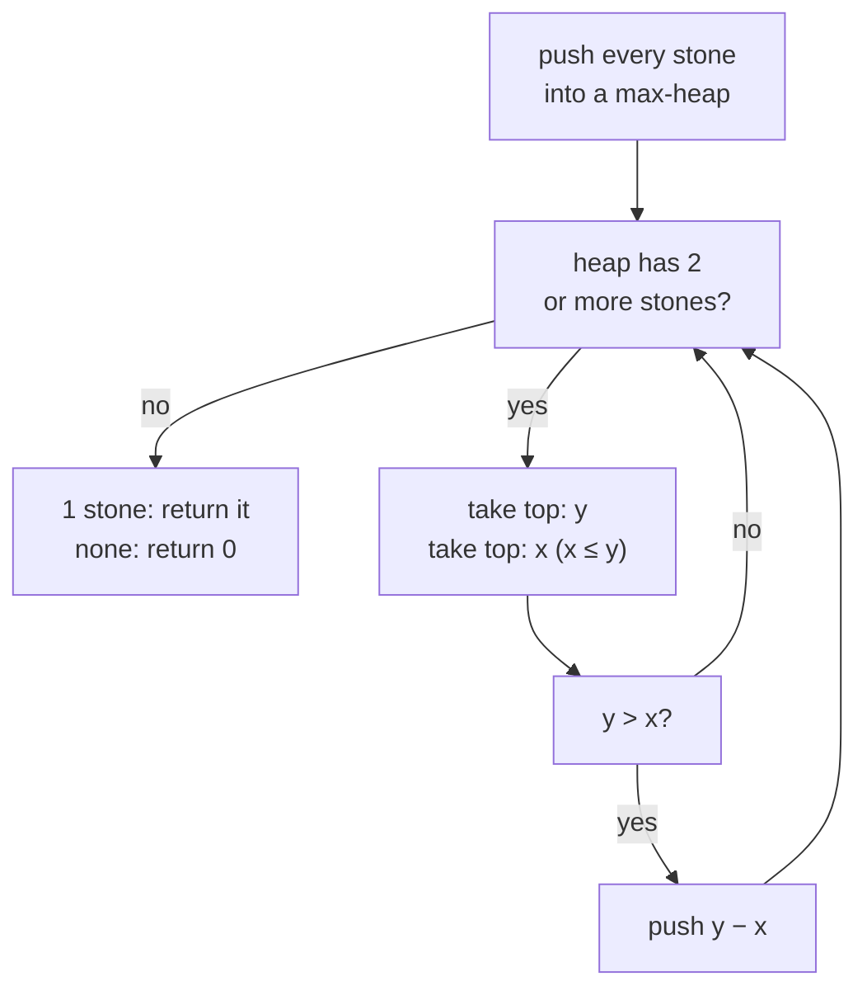

> [!tldr] Quick read
> - Problem: each round, take the two heaviest stones y ≥ x and smash them; if equal, both break; otherwise one stone of weight y − x remains. Return the weight of the last stone (0 if none is left).
> - Every round needs "the largest element" of a changing set: that is the job of a [[en/concepts/heap|heap]]. A max-heap takes the top and adds an element in O(log n) each, O(n log n) for the whole problem.
> - Re-sorting the whole array every round is also correct but O(n² log n): 10⁴ stones take 215.9 ms, the heap 1.26 ms.
> - The problem caps weights at 1000, so there is a third way: count stones per weight. Two stones of equal weight cancel, so each slot only needs its parity.
> - Three traps actually run: JS `sort()` without a comparator orders `[10, 2, 9]` as strings (7/9 cases); `heapq` without negation smashes the two lightest stones (5/9); Go calling `h.Pop()` instead of `heap.Pop(&h)` takes the last array element, not the top (5/9).

> [!info] Context
> LeetCode problem 1046, the easy problem of [[en/posts/2026-11-23-neetcode-heap-top-k|station 3: Heaps and Top K]] on **The NeetCode Line: Search and Heaps**. This is "use a heap, literally": no trick, just taking the largest again and again. The solution comes in TypeScript, Python, Go, Java and JavaScript. You need arrays and loops; the heap is explained right here.

> [!abstract]- Quick glossary for this post (click to open)
> - **Heap**: a binary tree stored in an array, with the largest (max-heap) or smallest (min-heap) element always at the top `a[0]`. See [[en/concepts/heap|Heap]].
> - **Priority queue**: a data type that "takes out the highest-priority element"; a heap is the most common implementation. See [[en/concepts/heap|Heap]].
> - **Sift up, sift down**: swap an element with its parent (or child) until heap order holds; each walk is at most the tree height, O(log n).
> - **Comparator**: a function that takes a, b and returns a negative number, 0 or a positive number to say a comes before, ties with, or comes after b.
> - **Counting by value**: an array `cnt[w]` counting elements equal to w, as in [[en/concepts/counting-array|Counting Array]].

## Picture it first: a wrestling club where the two heaviest always fight

A wrestling club has an odd rule: in each bout, the two heaviest members fight. If they weigh the same, both are out; otherwise the lighter one is out and the heavier one stays, losing exactly the opponent's weight. The referee does not want to weigh the whole club before every bout. They keep a queue where "the heaviest always stands at the front", and when someone rejoins, they just slot into the right place.

| Everyday life | Concept |
|---|---|
| Each wrestler and their weight | each stone and its weight |
| The two heaviest step on the mat | take the max-heap top twice |
| Same weight: both are out | `y == x`: push nothing back |
| Different weight: the heavier stays at `y − x` | push `y − x` into the heap |
| Weighing the whole club every bout | re-sorting every round, O(n log n) per round |
| A queue with the heaviest at the front | max-heap: take the top, add an element in O(log n) |
| The last one standing | the answer; 0 if nobody is left |



## The problem

The first idea everyone has: sort the array every round and take the last two elements. Correct, but each round re-sorts in O(n log n), and there are up to n − 1 rounds. O(n² log n) in total. The problem allows at most 30 stones, so this passes LeetCode, but with 10⁴ stones it measures 215.9 ms, almost 170 times the heap.

The waste: after each round only two stones vanish and at most one new stone appears, yet we re-sort everything. We do not need the full order; we only need to know **the heaviest stone**, again and again, on a set that changes a little at a time. That is exactly the contract of a priority queue.

## The mechanism

<figure class="figure-map" style="--ar: 3 / 4">
<div class="frame"><iframe data-archify="../../diagrams/neetcode-last-stone-weight/worked-example.en.html" title="Always remove the two heaviest stones" loading="lazy"></iframe></div>
<figcaption><span><b>Figure 1.</b> Always remove the two heaviest stones.</span><a href="../diagrams/neetcode-last-stone-weight/worked-example.en.html" target="_blank" rel="noopener">Open full screen</a></figcaption>
</figure>

<details>
<summary>Read the steps</summary>
<ol>
<li>Load four stone weights. <code>{10, 7, 4, 3}</code></li>
<li>Smash 10 against 7 and return 3. <code>{4, 3, 3}</code></li>
<li>Smash 4 against 3 and return 1. <code>{3, 1}</code></li>
<li>The last stone weighs 2. <code>3 - 1 = 2</code></li>
</ol>
</details>

### A max-heap in an array

A heap is an almost-complete binary tree stored in an array with no pointers: the element at index i has its parent at `(i − 1) / 2` (integer division) and its two children at `2i + 1`, `2i + 2`. The only rule: **a parent is not smaller than its children**. From that rule the largest element sits at the root `a[0]`, but the rest of the array is **not** sorted. `[8, 7, 4, 1, 2, 1]` is a valid max-heap; it is neither increasing nor decreasing.

| Operation | How | Cost |
|---|---|---|
| peek at the top | read `a[0]` | O(1) |
| add x | put x at the end, **sift up**: swap with the parent while larger | O(log n) |
| take the top | move the last element to the root, **sift down**: swap with the larger child while smaller | O(log n) |
| build from n elements | sift down each node, from the last parent back to the root | O(n) |

A tree of n elements has height ⌊log₂ n⌋, so each sift walks at most that many steps. Building by sifting down from the bottom costs only O(n), not O(n log n), because half the nodes are leaves and never move, a quarter move at most one step, and so on; the total converges to about 2n. Python's `heapq.heapify` and Go's `heap.Init` do exactly this.

This problem needs a max-heap. JavaScript has no built-in heap, so the TypeScript file writes one:

```ts
// Max-heap in an array: parent at i, two children at 2i+1 and 2i+2; the largest element is always at the top a[0].
class MaxHeap {
  a: number[] = [];
  get size(): number { return this.a.length; }
  push(x: number): void {
    const a = this.a;
    a.push(x);
    let i = a.length - 1;
    while (i > 0) { // sift up: swap with the parent while larger than it
      const p = (i - 1) >> 1;
      if (a[p] >= a[i]) break;
      [a[p], a[i]] = [a[i], a[p]];
      i = p;
    }
  }
  pop(): number {
    const a = this.a, top = a[0], last = a.pop()!;
    if (a.length > 0) {
      a[0] = last;
      let i = 0;
      for (;;) { // sift down: swap with the larger child while smaller than it
        const l = 2 * i + 1, r = l + 1;
        let m = i;
        if (l < a.length && a[l] > a[m]) m = l;
        if (r < a.length && a[r] > a[m]) m = r;
        if (m === i) break;
        [a[m], a[i]] = [a[i], a[m]];
        i = m;
      }
    }
    return top;
  }
}

// Max-heap: take the two heaviest stones, push the remainder (if any) back. O(n log n).
function heapSim(stones: number[]): number {
  const h = new MaxHeap();
  for (const s of stones) h.push(s);
  while (h.size > 1) {
    const y = h.pop(), x = h.pop(); // y >= x
    if (y > x) h.push(y - x);
  }
  return h.size === 1 ? h.pop() : 0;
}
```


Each round takes the top twice and pushes at most once: three O(log n) operations. There are at most n − 1 rounds because each round removes at least one stone. O(n log n) total, O(n) memory.

Running the problem's example `[2, 7, 4, 1, 8, 1]` by hand:

| Round | Heap before (top first) | y, x | Pushed back |
|---|---|---|---|
| 1 | 8, 7, 4, 2, 1, 1 | 8, 7 | 1 |
| 2 | 4, 2, 1, 1, 1 | 4, 2 | 2 |
| 3 | 2, 1, 1, 1 | 2, 1 | 1 |
| 4 | 1, 1, 1 | 1, 1 | nothing |
| 5 | 1 | | one stone left: answer 1 |

(The heap column is listed in decreasing order for readability; in the heap array they are not laid out like that.)

### A third way: counting by weight

The problem gives each stone a weight from 1 to 1000. When values lie in a small range, we count instead of comparing, as in [[en/concepts/bucket-sort|Bucket Sort]]: `cnt[w]` is the number of stones of weight w. Walking down from the largest weight:

- Two stones of the same weight smash each other and both break, so a slot holding c stones leaves only `c % 2`.
- If the highest slot keeps 1 stone (weight i), find the next non-empty slot below it (j) and smash them: one fewer at i and at j, one more at `i − j`.
- Every slot between j and i is empty except the slot `i − j` just added, so the pointer jumps straight to `max(j, i − j)`.

```ts
// Count by weight (the problem caps weights at 1000): cnt[w] is the number of stones of weight w.
// Two stones of the same weight destroy each other, so only cnt[w] % 2 matters.
function countingBuckets(stones: number[], maxW = 1000): number {
  const cnt = new Array(maxW + 1).fill(0);
  for (const s of stones) cnt[s]++;
  let i = maxW;
  for (;;) {
    while (i > 0 && cnt[i] === 0) i--;
    if (i === 0) return 0;
    cnt[i] %= 2; // equal pairs cancel out
    if (cnt[i] === 0) continue;
    let j = i - 1; // the second heaviest stone
    while (j > 0 && cnt[j] === 0) j--;
    if (j === 0) return i; // only one stone left
    cnt[i] = 0; cnt[j]--; cnt[i - j]++;
    i = Math.max(j, i - j); // every slot in (j, i) is empty, except slot i - j just added
  }
}
```


No comparisons between stones, no heap. On each smash, the downward scan for j may revisit a stretch already scanned, so the simplest upper bound is O(n + W · number of smashes), with W = 1000. On random data it is 100 to 160 times faster than the heap, mostly because pairs of equal weight cancel right away (10⁶ stones have only 1000 distinct weights). This only works because the problem caps the weight; with weights up to 10⁹ a counting array is not feasible.

### Trap 1 (JavaScript): `sort()` without a comparator

The ECMAScript specification says: `Array.prototype.sort` without a comparator converts each element to a string and compares strings. `"10" < "2"` because the character `'1'` comes before `'2'`, so `[10, 2, 9].sort()` gives `[10, 2, 9]`. The "sort every round" version using `s.sort()` takes the last two elements as 9 and 2 instead of 10 and 9:

```ts
// WRONG: sort() without a comparator makes JS compare strings: [10, 2, 9] keeps its order, "10" < "2".
function wrongDefaultSort(stones: number[]): number {
  const s = [...stones];
  while (s.length > 1) {
    s.sort();
    const y = s.pop()!, x = s.pop()!;
    if (y !== x) s.push(Math.abs(y - x));
  }
  return s.length === 1 ? s[0] : 0;
}
```


It fails 2/9 cases: `[10, 2, 9]` gives 3 instead of 1, `[31, 26, 33, 21, 40]` gives 19 instead of 9. Every case with only one-digit numbers passes, so the problem's example does not catch this bug. Always write `sort((a, b) => a - b)` for numbers.

### Trap 2 (Python): `heapq` is only a min-heap

`heapq` implements a min-heap on a plain list: `h[0]` is the **smallest** element. The usual way to get a max-heap is to store the negation `-s`: the smallest of the negations is the negation of the largest.

```python
# heapq only has a min-heap: store -s and the heaviest stone sits at the top.
def last_stone_weight(stones):
    h = [-s for s in stones]
    heapq.heapify(h)  # O(n), not O(n log n)
    while len(h) > 1:
        y = -heapq.heappop(h)
        x = -heapq.heappop(h)
        if y > x:
            heapq.heappush(h, -(y - x))
    return -h[0] if h else 0
```


Forget to negate and the code still runs without error, but each round smashes the two **lightest** stones: 5/9 cases fail, and the problem's example gives 3 instead of 1. Python 3.14 adds public max-heap functions (`heapq.heappush_max`, `heapq.heappop_max`, `heapq.heapify_max`…); my machine runs Python 3.12, so the file still uses the negation trick, which works on every version.

### Trap 3 (Go): `h.Pop()` is not `heap.Pop(&h)`

The `container/heap` package does not ship a heap type. You declare your own type and implement five methods `Len`, `Less`, `Swap`, `Push`, `Pop`; then you call the package **functions** `heap.Init`, `heap.Push`, `heap.Pop`. With `Less(i, j)` returning `h[i] > h[j]` it becomes a max-heap.

```go
// maxHeap implements heap.Interface: sort.Interface (Len, Less, Swap) plus Push and Pop.
// Less(i, j) returns a[i] > a[j], so the top is the LARGEST element.
type maxHeap []int

func (h maxHeap) Len() int           { return len(h) }
func (h maxHeap) Less(i, j int) bool { return h[i] > h[j] }
func (h maxHeap) Swap(i, j int)      { h[i], h[j] = h[j], h[i] }

// Push and Pop only add and remove at the END of the slice; heap.Push and heap.Pop do the sifting.
func (h *maxHeap) Push(x any) { *h = append(*h, x.(int)) }
func (h *maxHeap) Pop() any {
	old := *h
	x := old[len(old)-1]
	*h = old[:len(old)-1]
	return x
}

func lastStoneWeight(stones []int) int {
	h := maxHeap(append([]int(nil), stones...))
	heap.Init(&h) // O(n)
	for h.Len() > 1 {
		y := heap.Pop(&h).(int)
		x := heap.Pop(&h).(int)
		if y > x {
			heap.Push(&h, y-x)
		}
	}
	if h.Len() == 1 {
		return h[0]
	}
	return 0
}
```


The easy mistake: the `Pop` method you wrote only cuts the **last** element of the slice. The function `heap.Pop(&h)` first swaps the top to the end and sifts down, then calls your `Pop` method. Calling `h.Pop()` by mistake takes out whatever element happens to be last, not the largest:

```text
after heap.Init: [8 7 4 1 2 1]
h.Pop() returns 1 (the last element), then heap.Pop(&h) returns 8 (the top)
```

*(Output labels translated; the files themselves print Vietnamese.)*

The version using `h.Pop()` fails 5/9 cases. The package documentation is explicit: `Push` and `Pop` in the interface are for the package to call; users call `heap.Push` and `heap.Pop`.

### Trap 4 (Java): a comparator built on subtraction

Java's `PriorityQueue` is a min-heap. Two common ways to turn it into a max-heap: `Collections.reverseOrder()` and the lambda `(a, b) -> b - a`. In this problem both are correct (9/9 cases), because weights are positive and the difference of two positive numbers does not overflow `int`. But subtraction is not comparison: with large values of opposite sign, `b − a` overflows and flips the order. The Java file pushes `1, Integer.MIN_VALUE, 5` into two queues:

```text
b - a:                takes out [-2147483648, 5, 1]
Integer.compare(b, a): takes out [5, 1, -2147483648]
because Integer.MIN_VALUE - 1 = 2147483647
```

*(Output labels translated; the files themselves print Vietnamese.)*

The subtraction queue treats `Integer.MIN_VALUE` as the largest. Write `Integer.compare(b, a)` or `Collections.reverseOrder()` and you never have to think about when subtraction is safe.

### Under the hood in five languages

| | Built-in heap | Default | Max-heap | Own trap |
|---|---|---|---|---|
| TypeScript / JavaScript | none | | write one (about 30 lines) or a sorted array | `sort()` without a comparator compares strings |
| Python | `heapq` (functions on a list) | min-heap | store `-s`; from 3.14 `heappush_max`… | forgetting to negate still runs, wrongly; `heapify` is O(n) |
| Go | `container/heap` (you implement the interface) | whatever your `Less` says | `Less` returns `h[i] > h[j]` | calling `h.Pop()` instead of `heap.Pop(&h)`; `Pop` returns `any`, needs a type assertion |
| Java | `PriorityQueue<Integer>` | min-heap | `Collections.reverseOrder()` | `(a, b) -> b - a` overflows on large values of opposite sign; boxed `Integer` costs memory |

### Measurements

TypeScript, random weights 1..1000, median of 5 runs:

| n | Re-sort every round | Max-heap | Count by weight |
|---|---|---|---|
| 1 000 | 3.13 ms | 0.11 ms | 0.01 ms |
| 3 000 | 22.5 ms | 0.31 ms | 0.01 ms |
| 10 000 | 215.9 ms | 1.26 ms | 0.02 ms |
| 100 000 | (not run) | 13.8 ms | 0.11 ms |
| 1 000 000 | (not run) | 165.0 ms | 1.03 ms |

Re-sorting grows about 7 times when n triples, and about 10 times again from 3 000 to 10 000: the shape of n² log n. The heap grows almost linearly in n.

A middle way: keep the array sorted ascending, take the last two elements, and insert the difference in place with [[en/concepts/binary-search|binary search]]. Finding the spot is O(log n), but `splice` must shift the elements after it. The JavaScript file measures with weights up to 10⁹:

| n | Max-heap | Sorted array |
|---|---|---|
| 10 000 | 2.1 ms | 5.2 ms |
| 30 000 | 6.7 ms | 46.2 ms |
| 100 000 | 21.9 ms | 446.1 ms |
| 300 000 | 72.0 ms | 6 343.2 ms |

At 10⁴ elements, shifting the array with one memory copy is still cheap; by 3 · 10⁵ the O(n) cost per insert shows, almost 90 times slower than the heap.

Python, 10⁵ stones: `heapq` 30.2 ms, counting by weight 2.0 ms.

## Runnable example

[TypeScript](../code/neetcode-last-stone-weight/last-stone.ts) · [Python](../code/neetcode-last-stone-weight/last_stone.py) · [Go](../code/neetcode-last-stone-weight/last_stone.go) · [Java](../code/neetcode-last-stone-weight/last-stone.java) · [JavaScript](../code/neetcode-last-stone-weight/last-stone.js) · [PHP](../code/neetcode-last-stone-weight/last-stone.php) · [Rust](../code/neetcode-last-stone-weight/last_stone.rs)

Each of the original five files runs 9 cases: the problem's example, one stone, two equal stones (answer 0), three equal stones, two cancelling pairs, `[10, 2, 9]` to catch string comparison, a large gap `[1000, 1]`, and two many-round cases.

```ts
// Max-heap: take the two heaviest stones, push the remainder (if any) back. O(n log n).
function heapSim(stones: number[]): number {
  const h = new MaxHeap();
  for (const s of stones) h.push(s);
  while (h.size > 1) {
    const y = h.pop(), x = h.pop(); // y >= x
    if (y > x) h.push(y - x);
  }
  return h.size === 1 ? h.pop() : 0;
}
```

```python
# heapq only has a min-heap: store -s and the heaviest stone sits at the top.
def last_stone_weight(stones):
    h = [-s for s in stones]
    heapq.heapify(h)  # O(n), not O(n log n)
    while len(h) > 1:
        y = -heapq.heappop(h)
        x = -heapq.heappop(h)
        if y > x:
            heapq.heappush(h, -(y - x))
    return -h[0] if h else 0
```

```go
func lastStoneWeight(stones []int) int {
	h := maxHeap(append([]int(nil), stones...))
	heap.Init(&h) // O(n)
	for h.Len() > 1 {
		y := heap.Pop(&h).(int)
		x := heap.Pop(&h).(int)
		if y > x {
			heap.Push(&h, y-x)
		}
	}
	if h.Len() == 1 {
		return h[0]
	}
	return 0
}
```

```java
// PriorityQueue is a min-heap; pass Collections.reverseOrder() so the top is the largest element.
static int lastStoneWeight(int[] stones) {
    PriorityQueue<Integer> pq = new PriorityQueue<>(Collections.reverseOrder());
    for (int s : stones) pq.add(s);
    while (pq.size() > 1) {
        int y = pq.poll(), x = pq.poll(); // poll() returns Integer, auto-unboxed to int
        if (y > x) pq.add(y - x);
    }
    return pq.isEmpty() ? 0 : pq.peek();
}
```

```js
function heapSim(stones) {
  const h = new MaxHeap();
  for (const s of stones) h.push(s);
  while (h.size > 1) {
    const y = h.pop(), x = h.pop();
    if (y > x) h.push(y - x);
  }
  return h.size === 1 ? h.pop() : 0;
}
```

```php
<?php
declare(strict_types=1);

function lastStoneWeight(array $stones): int
{
    $heap = new SplMaxHeap();
    foreach ($stones as $stone) {
        $heap->insert($stone);
    }

    while ($heap->count() > 1) {
        $heavier = $heap->extract();
        $lighter = $heap->extract();
        if ($heavier > $lighter) {
            $heap->insert($heavier - $lighter);
        }
    }

    return $heap->isEmpty() ? 0 : $heap->extract();
}
```

```rust
use std::collections::BinaryHeap;

fn last_stone_weight(stones: Vec<i32>) -> i32 {
    let mut heap = BinaryHeap::from(stones);
    while heap.len() > 1 {
        let heavier = heap.pop().unwrap();
        let lighter = heap.pop().unwrap();
        if heavier > lighter {
            heap.push(heavier - lighter);
        }
    }
    heap.pop().unwrap_or(0)
}
```


Output of `node last-stone.ts`:

```text
sortEachRound    9/9 cases correct
heapSim          9/9 cases correct
countingBuckets  9/9 cases correct
wrongDefaultSort 7/9 cases correct; wrong on [10,2,9] → 3, [31,26,33,21,40] → 19

random: the three approaches agree on 2000/2000 inputs
```

`python3 last_stone.py`:

```text
last_stone_weight  9/9 cases correct
sort_each_round    9/9 cases correct
counting           9/9 cases correct
forgot_negate      5/9 cases correct; wrong on [2, 7, 4, 1, 8, 1] → 3, [10, 2, 9] → 3, [7, 6, 7, 6, 9] → 9, [31, 26, 33, 21, 40] → 33
```

`go run last_stone.go`:

```text
lastStoneWeight  9/9 cases correct
sortEachRound    9/9 cases correct
wrongDirectPop   5/9 cases correct; wrong on [2 7 4 1 8 1] → 5, [10 2 9] → 3, [7 6 7 6 9] → 9, [31 26 33 21 40] → 37
```

*(Output labels translated; the files themselves print Vietnamese.)*

`java last-stone.java` gives 9/9 for `lastStoneWeight`, `subtractComparator` and `counting`; `node last-stone.js` gives 9/9 for `heapSim` and `sortedInsert`.

Both versions use a standard-library max-heap (`SplMaxHeap` and `BinaryHeap`). PHP prints `7/7 ca đúng` and Rust prints `7/7 ca đúng`.

## Misconceptions and common traps

- **"A heap is a sorted array."** Only the top is in place; the rest only satisfies "a parent is not smaller than its children". Walking a heap array from start to end does not give decreasing order.
- **"Building a heap from n elements costs O(n log n)."** Pushing one by one does, but `heapify` sifting down from the bottom costs only O(n).
- **`sort()` in JS without a comparator.** It compares strings; `[10, 2, 9]` keeps its order.
- **`heapq` is a min-heap.** To get the largest on top, store negations.
- **Go: calling your own `Pop` method.** Call the function `heap.Pop(&h)`.
- **Java: `(a, b) -> b - a`.** Safe when every value is non-negative (the difference of two non-negative numbers always fits in `int`), overflows on large values of opposite sign.
- **Forgetting the no-stones case.** If the last two stones are equal the heap is empty; return 0 and do not read `a[0]` of an empty array (JS returns `undefined`, Java's `peek()` returns `null` and unboxing throws `NullPointerException`).

## Self-check questions

> [!question]- Why are there at most n − 1 smashing rounds?
> Each round takes out two stones and pushes back at most one, so the number of stones drops by at least 1. Starting from n stones and stopping at 0 or 1: at most n − 1 rounds.

> [!question]- Is `[8, 7, 4, 1, 2, 1]` a valid max-heap? And `[8, 1, 7, 2, 4, 1]`?
> The first is valid: 8 ≥ 7, 4; 7 ≥ 1, 2; 4 ≥ 1. The second is not: the node at index 1 holds 1, and its children at indices 3 and 4 hold 2 and 4, both larger.

> [!question]- Do you need a heap if the question is only "how heavy is the heaviest stone at the start"?
> No. One O(n) pass is enough. A heap pays off when you must take the largest **repeatedly** from a set that both loses and gains elements.

> [!question]- In the counting approach, why can the pointer jump to `max(j, i − j)` after a smash without missing anything?
> Every slot between j and i is empty (we just scanned them to find j), slot i is back to 0, and only slot `i − j` gained a stone. So the largest remaining stone is at j or at `i − j`, never above `max(j, i − j)`.

## References

- [LeetCode 1046: Last Stone Weight](https://leetcode.com/problems/last-stone-weight/) (original problem and constraints)
- [Python `heapq`](https://docs.python.org/3/library/heapq.html) (min-heap on a list, linear `heapify`, `_max` functions from 3.14)
- [Go `container/heap`](https://pkg.go.dev/container/heap) (heap.Interface; call `heap.Push` and `heap.Pop`, not the methods directly)
- [Java `PriorityQueue`](https://docs.oracle.com/en/java/javase/21/docs/api/java.base/java/util/PriorityQueue.html) (min-heap by natural order or by comparator)
- [ECMAScript: `Array.prototype.sort`](https://tc39.es/ecma262/#sec-array.prototype.sort) (without a comparator it compares strings)
- Cormen, Leiserson, Rivest, Stein, *Introduction to Algorithms*, chapter 6 Heapsort (building a heap in O(n))
