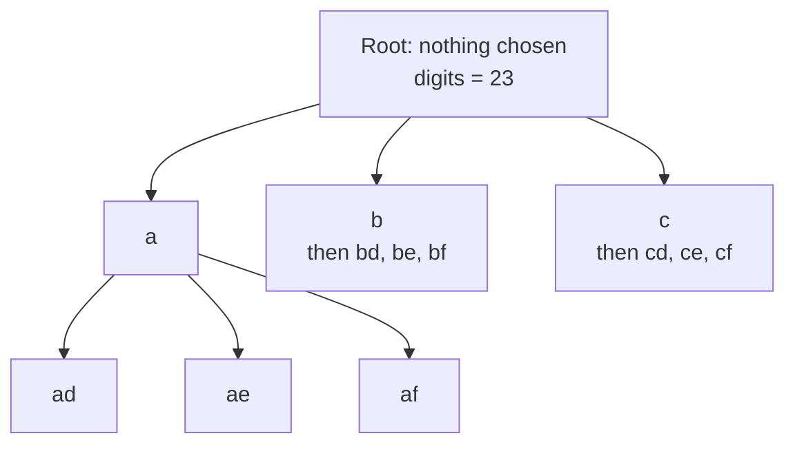
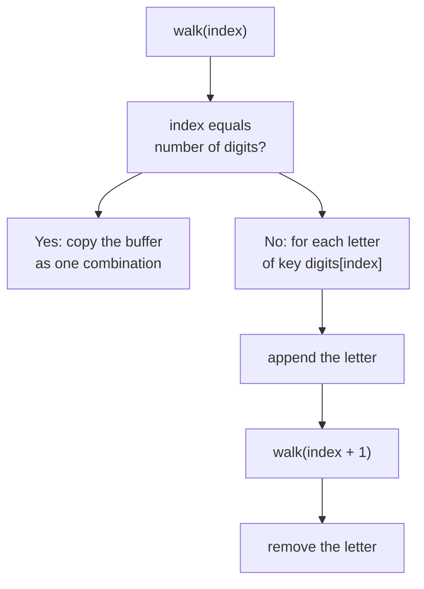

> [!tldr] Quick read
> - Each digit is one level of a [[en/concepts/choice-tree|choice tree]], and each letter on its key is one branch. Each leaf is one combination.
> - [[en/concepts/backtracking|Backtracking]] walks down the tree with one buffer: add a letter, go deeper, then remove that letter to try the next one.
> - The tree has exactly the product of the keys' letter counts as leaves, at most 4⁴ = 256. The output is already that large, so nothing beats O(4ⁿ·n).
> - Two common traps: empty input must return `[]`, not `[""]`, and keys 7 and 9 have four letters, not three.

> [!info] Context
> This is LeetCode problem 17 at [[en/posts/2026-11-28-neetcode-subsets-combinations|station MISC-01: Backtracking: Subsets and Combinations]] on **the NeetCode Line: Mixed Techniques**. I picture a suitcase combination lock whose wheels carry letters instead of numbers. You only need strings, arrays and recursive functions.

> [!abstract]- Quick glossary for this post (click to open)
> - A phone keypad puts letters on keys 2 to 9: `2` is abc, `3` is def, …, `7` is pqrs, `8` is tuv, `9` is wxyz. Keys 0 and 1 have no letters.
> - A [[en/concepts/choice-tree|choice tree]] draws each decision as one level; a path from the root to a leaf is one solution.
> - [[en/concepts/backtracking|Backtracking]] tries one branch, and when it reaches the end it steps back one level and tries the next branch.
> - A buffer is one character array shared by the whole walk. Each level appends one character and later removes it.
> - The cartesian product of several letter sets is every way to pick one letter from each set.
> - A mixed-radix counter counts with a different base at each position, like an odometer whose wheels have different numbers of notches.

## Picture it first: a suitcase lock with letters

The lock has one wheel for each key pressed. The wheel for key `5` carries the three letters `j k l`; the wheel for key `7` carries the four letters `p q r s`. I hold the first wheel on `j`, turn the second wheel all the way round and read `jp jq jr js`. Then I move the first wheel to `k` and turn the second wheel from the start again. When the first wheel has gone all the way round, I have read all 3 × 4 = 12 strings.

| Everyday life | Concept |
|---|---|
| One wheel | One digit in `digits`, one level of the [[en/concepts/choice-tree\|choice tree]] |
| A letter on the wheel | A letter of the key, one branch |
| The string you read once every wheel is set | One leaf, one combination |
| Releasing the last wheel to try the next letter | Removing a character from the buffer (`pop`) |
| Counting through every position like an odometer | Mixed-radix counter |
| How many strings you can read | The product of the keys' letter counts |



## The problem: which letters can a key sequence type?

Given a string `digits` of length 0 to 4, where each character is a digit from `2` to `9`, return every letter string that this key sequence could type on a phone keypad, in any order. For example, `57` gives 12 strings: `jp jq jr js kp kq kr ks lp lq lr ls`. If `digits` is empty, the answer is an empty list. [Original problem: LeetCode 17](https://leetcode.com/problems/letter-combinations-of-a-phone-number/)

I used to think there must be some trick to "generate combinations fast". It turns out there is no room to be faster here: the output itself can hold 256 strings, so the job is to walk the choice tree cleanly, missing nothing and repeating nothing.

## How it works

### The choice tree and its leaves

Let n be the number of digits. Level i of the tree decides the i-th letter, with 3 or 4 branches. The number of leaves is the product of the keys' letter counts, at most 4ⁿ. Each leaf builds a string of length n, so the total time is O(4ⁿ·n). Extra memory beyond the result is O(n) for the buffer and the recursion stack. The output itself takes O(4ⁿ·n), so this is a lower bound: no algorithm can avoid writing out every string.

The number of function calls is the number of nodes in the tree. For `7999` the tree has 1 + 4 + 16 + 64 + 256 = 341 nodes, exactly the count the program prints below.

### Backtracking with one buffer

The function `walk(index)` stands on level `index`. If `index` equals the length of `digits`, the buffer holds all n letters: copy it into a string and store it. Otherwise, append each letter of key `digits[index]` to the end of the buffer in turn, call `walk(index + 1)`, then remove that letter. Removing it puts the buffer back exactly as it was before the branch, so the next branch starts clean.

The alternative is to pass the string `prefix + letter` down on each call. That is also correct and has the same complexity, but every node of the tree creates a new string. The shared buffer copies only at the leaves.



### Building layer by layer

Start with a layer that holds only the empty string. For each digit, the new layer is every prefix of the old layer joined with every letter of that key. After n digits, the last layer is the answer. The order comes out exactly as in backtracking. This approach uses no recursion but keeps the whole previous layer in memory, so its extra memory grows with the output. The program uses it as the reference for checking the other two.

### The mixed-radix counter

Each position holds the index of the letter it currently picks, like one wheel of an odometer. Read off the current combination, then advance the last wheel. A wheel that passes the key's last letter goes back to 0 and carries into the wheel on its left. When even the first wheel overflows, the count is done. This kind of counting also lets you compute the k-th combination directly: write k in the bases given by each key's letter count.

## Runnable example

[TypeScript](../code/neetcode-letter-combinations-of-a-phone-number/keypad.ts) · [Python](../code/neetcode-letter-combinations-of-a-phone-number/keypad.py) · [Go](../code/neetcode-letter-combinations-of-a-phone-number/keypad.go) · [Java](../code/neetcode-letter-combinations-of-a-phone-number/keypad.java) · [JavaScript](../code/neetcode-letter-combinations-of-a-phone-number/keypad.js) · [PHP](../code/neetcode-letter-combinations-of-a-phone-number/keypad.php) · [Rust](../code/neetcode-letter-combinations-of-a-phone-number/phone_keypad.rs)

```ts
function combineBacktrack(digits: string): string[] {
    const result: string[] = []
    if (digits.length === 0) return result // empty input gives [], not [""]
    const buffer: string[] = []
    function walk(index: number): void {
        calls++
        if (index === digits.length) {
            result.push(buffer.join(""))
            return
        }
        for (const letter of KEYS[digits[index]]) {
            buffer.push(letter)
            walk(index + 1)
            buffer.pop()
        }
    }
    walk(0)
    return result
}
```

```python
def combine_backtrack(digits):
    result = []
    if not digits:
        return result  # empty input gives [], not [""]
    buffer = []

    def walk(index):
        global calls
        calls += 1
        if index == len(digits):
            result.append("".join(buffer))
            return
        for letter in KEYS[digits[index]]:
            buffer.append(letter)
            walk(index + 1)
            buffer.pop()

    walk(0)
    return result
```

```go
func combineBacktrack(digits string) []string {
	result := []string{}
	if len(digits) == 0 {
		return result // empty input gives [], not [""]
	}
	buffer := make([]byte, 0, len(digits))
	var walk func(index int)
	walk = func(index int) {
		calls++
		if index == len(digits) {
			result = append(result, string(buffer))
			return
		}
		letters := keys[digits[index]]
		for i := 0; i < len(letters); i++ {
			buffer = append(buffer, letters[i])
			walk(index + 1)
			buffer = buffer[:len(buffer)-1]
		}
	}
	walk(0)
	return result
}
```

```java
static List<String> combineBacktrack(String digits) {
    List<String> result = new ArrayList<>();
    if (digits.isEmpty()) return result; // empty input gives [], not [""]
    walk(digits, 0, new StringBuilder(), result);
    return result;
}

static void walk(String digits, int index, StringBuilder buffer, List<String> result) {
    calls++;
    if (index == digits.length()) {
        result.add(buffer.toString());
        return;
    }
    for (char letter : KEYS[digits.charAt(index) - '0'].toCharArray()) {
        buffer.append(letter);
        walk(digits, index + 1, buffer, result);
        buffer.deleteCharAt(buffer.length() - 1);
    }
}
```

```js
function combineBacktrack(digits) {
    const result = []
    if (digits.length === 0) return result // empty input gives [], not [""]
    const buffer = []
    function walk(index) {
        calls++
        if (index === digits.length) {
            result.push(buffer.join(""))
            return
        }
        for (const letter of KEYS[digits[index]]) {
            buffer.push(letter)
            walk(index + 1)
            buffer.pop()
        }
    }
    walk(0)
    return result
}
```

```php
function combineBacktrack(string $digits): array {
    $result = [];
    if ($digits === '') return $result; // empty input gives [], not [""]
    $buffer = [];
    walk($digits, 0, $buffer, $result);
    return $result;
}

function walk(string $digits, int $index, array &$buffer, array &$result): void {
    global $calls;
    $calls++;
    if ($index === strlen($digits)) {
        $result[] = implode('', $buffer);
        return;
    }
    foreach (str_split(KEYS[$digits[$index]]) as $letter) {
        $buffer[] = $letter;
        walk($digits, $index + 1, $buffer, $result);
        array_pop($buffer);
    }
}
```

```rust
fn combine_backtrack(digits: &str) -> Vec<String> {
    let mut result = Vec::new();
    if digits.is_empty() {
        return result; // empty input gives [], not [""]
    }
    let mut buffer = Vec::with_capacity(digits.len());
    walk(digits.as_bytes(), 0, &mut buffer, &mut result);
    result
}

fn walk(digits: &[u8], index: usize, buffer: &mut Vec<u8>, result: &mut Vec<String>) {
    CALLS.with(|c| c.set(c.get() + 1));
    if index == digits.len() {
        result.push(String::from_utf8(buffer.clone()).unwrap());
        return;
    }
    for &letter in keys(digits[index]) {
        buffer.push(letter);
        walk(digits, index + 1, buffer, result);
        buffer.pop();
    }
}
```

The tabs show the backtracking approach. The `calls` line only counts calls for the measurement. The downloadable files also contain the layer-by-layer build and the mixed-radix counter. The 11 cases check all three approaches: empty input, a three-letter key, the four-letter keys 7 and 9, the repeated key `22`, and `7999` with its 256 combinations. The second line checks backtracking and the counter against the layer-by-layer build on every digit string over 2–9 of length 0–4, 4,681 strings in total.

```text
11/11 cases passed
4681/4681 cases passed (checked against the iterative cartesian product)
7999: 256 combinations, 341 backtracking calls
```

*(Output labels translated; the files themselves print Vietnamese.)*

Run with `node keypad.ts`, `python3 keypad.py`, `go run keypad.go`, `java keypad.java`, `node keypad.js`, `php -d xdebug.mode=off keypad.php` or `rustc --edition 2021 -O phone_keypad.rs -o /tmp/phone_keypad && /tmp/phone_keypad`. All seven languages print the same three lines.

## Misconceptions and common traps

- Returning `[""]` for empty input. Without a separate guard, both approaches fall into this: backtracking is already at a leaf when `index = 0 = n` and stores an empty string, and the layer build returns its starting layer `[""]` untouched. The problem wants an empty list.
- Assuming every key has three letters, or computing the letter as `'a' + 3·(d − 2)`. The formula holds up to key 6 and then drifts from key 7 on, because `7` adds `s` and `9` adds `z`. Use a lookup table.
- Forgetting to remove the letter after going down. The buffer keeps growing and every later combination is wrong.
- Storing the buffer itself instead of a copy. Python `result.append(buffer)` and JS `result.push(buffer)` store the same array each time; at the end every element is an empty array. Store `"".join(buffer)` or `buffer.join("")`. In Go, `string(buffer)` already copies, but storing the slice `buffer` itself would make every element share one block of memory.
- Java: concatenating `prefix + letter` in a loop creates a new `String` each time. The version above uses a `StringBuilder` with `append` and `deleteCharAt`.
- PHP: arrays are passed by value. Without the `&` in `array &$result`, each call writes into its own copy and the result comes back empty. PHP strings cannot be changed in place, so the buffer here is an array of characters.
- Rust: the buffer is a `Vec<u8>` because every letter is ASCII; `String::from_utf8` turns it into a string at the leaf. The recursive function takes `&mut` so it never copies the buffer.
- Recursion depth only reaches n + 1 ≤ 5 levels, far from any stack limit.

## Self-check questions

> [!question]- How many combinations does `7999` give, and how many nodes does the backtracking tree have?
> 4 · 4 · 4 · 4 = 256 leaves. Adding the levels above: 1 + 4 + 16 + 64 + 256 = 341 nodes, which is also 341 calls to `walk`.

> [!question]- Why can no algorithm beat O(4ⁿ·n) on this problem?
> Because the result can hold 4ⁿ strings, each of length n. Just writing the result out costs that much.

> [!question]- For `234`, which combination does the mixed-radix counter give at position 9 (counting from 0)?
> All three keys have three letters. Writing 9 in bases 3, 3, 3 gives (1, 0, 0): the second letter of `2` and the first letter of `3` and of `4`, so `bdg`.

> [!question]- If you drop the step that removes the letter, what happens with `23`?
> The buffer never returns to its earlier state, so after `ad` it becomes `ade`, `adef`, … Only the first combination is right.

## References

- [LeetCode 17](https://leetcode.com/problems/letter-combinations-of-a-phone-number/)
- [Jeff Erickson, Algorithms, chapter 2: backtracking](https://jeffe.cs.illinois.edu/teaching/algorithms/book/02-backtracking.pdf)
- [ITU-T E.161, assigning letters to the digit keys](https://www.itu.int/rec/T-REC-E.161)
- [Mixed radix (Wikipedia)](https://en.wikipedia.org/wiki/Mixed_radix)
- [Java StringBuilder](https://docs.oracle.com/en/java/javase/21/docs/api/java.base/java/lang/StringBuilder.html) · [PHP passing by reference](https://www.php.net/manual/en/language.references.pass.php)
