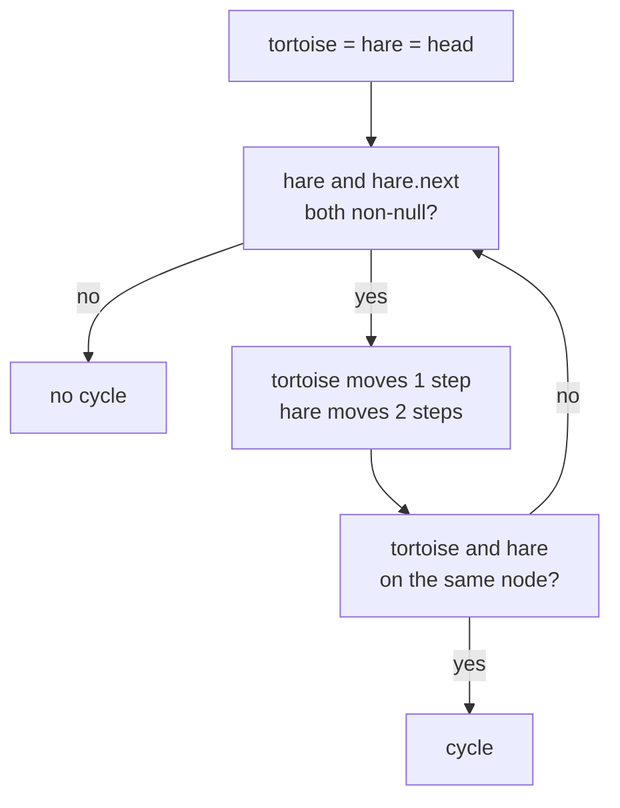

> [!tldr] Quick read
> - The problem: given the head of a [[en/concepts/linked-list|linked list]], is there a node that, following `next` forever, comes back to itself? In other words, does the list have a **cycle**?
> - The obvious way: remember every node you pass in a [[en/concepts/hash-set|Set]]; seeing an old node again means a cycle. O(n) time, O(n) memory. The Set must remember **the node itself**, not its value: remembering values reports a cycle in `[1, 1, 1]`, which has none.
> - [[en/concepts/fast-slow-pointers|Tortoise and hare]] (Floyd): the tortoise moves 1 step, the hare 2. Without a cycle the hare hits `null`; with one, the hare catches the tortoise. O(1) memory. This page proves the two meet after exactly the smallest multiple of λ that is at least μ, so within μ + λ steps, and checks it on 40,200 pairs (μ, λ).
> - Measured at 10⁶ nodes: the Set takes 58–63 ms and 21 MB, Floyd takes 2.6 ms and allocates nothing.
> - Three wrong versions that actually run: comparing before stepping (7/10), forgetting to check `fast.next` (throws on every acyclic list with an odd node count), remembering values instead of nodes (9/10).

> [!info] Context
> LeetCode problem 141 of [[en/posts/2026-11-24-neetcode-linked-list|station 1: Linked List Pointers]] on **the NeetCode Line: Linked Structures**. This station practises walking a list with pointers: [[en/problems/reverse-linked-list|Reverse Linked List]] flips the arrows, [[en/problems/merge-two-sorted-lists|Merge Two Sorted Lists]] stitches two lists, and this problem runs two pointers at different speeds. The same technique finds the middle in [[en/problems/reorder-list|Reorder List]] and keeps a fixed gap in [[en/problems/remove-nth-node-from-end-of-list|Remove Nth Node From End of List]]. Solutions come in TypeScript, Python, Go, Java and JavaScript. You only need loops and objects.

> [!abstract]- Quick glossary for this post (click to open)
> - **Linked list**: a chain of nodes, each holding a value and a `next` arrow to the following node; the last node points to `null`. See [[en/concepts/linked-list|Linked List]].
> - **Cycle**: some node points back to a node earlier in the chain, so following `next` never reaches `null`.
> - **Identity vs value**: two different nodes can both hold 7. "The same node" means the same object in memory (`===`, `is`, `==` on pointers), not the same value.
> - **Set**: a collection that answers "is it already in?" in O(1) on average. See [[en/concepts/hash-set|Hash Set]].
> - **μ and λ**: μ is the number of nodes **before** the cycle (the tail), λ the number of nodes **in** the cycle. A list with a cycle has μ + λ nodes.
> - **Tortoise and hare**: two pointers that start together, one moving 1 step and the other 2 steps per round. See [[en/concepts/fast-slow-pointers|Fast and Slow Pointers]].

## Picture it first: two runners on a trail that may lead into a stadium

Two runners start at the beginning of a trail. The tortoise covers 1 marker per minute, the hare 2. There are two possibilities. The trail is a dead end: the hare reaches it first and knows right away there is no loop. Or the trail leads into a round stadium and never leaves it: the hare enters first, runs laps, and since it gains one marker every minute it sooner or later catches the tortoise from behind. Nobody needs a notebook of the markers they passed.

| Everyday | Concept |
|---|---|
| A marker on the trail | a node |
| The sign pointing to the next marker | the `next` pointer |
| A dead end | `next` is `null`, no cycle |
| The round stadium | the cycle, λ nodes long |
| The stretch before the stadium | the tail, μ nodes long |
| A notebook of every marker passed | a Set of visited nodes, O(n) memory |
| The hare catching the tortoise from behind | `slow === fast`, a cycle |
| The hare reaching the dead end | `fast` or `fast.next` is `null`, no cycle |



## The problem

Without a cycle, following `next` reaches `null` after n steps. With a cycle it goes on forever, and from inside the loop we cannot tell whether we are going round a cycle or just walking a very long list. To conclude "there is a cycle" we must **recognise that we have been at this node before**. Two ways: remember (costs memory), or let two pointers run at different speeds so the cycle reveals itself (costs nothing).

## How it works

<figure class="figure-map" style="--ar: 3 / 4">
<div class="frame"><iframe data-archify="../../diagrams/neetcode-linked-list-cycle/worked-example.en.html" title="The two pointers meet inside the cycle" loading="lazy"></iframe></div>
<figcaption><span><b>Figure 1.</b> The two pointers meet inside the cycle.</span><a href="../diagrams/neetcode-linked-list-cycle/worked-example.en.html" target="_blank" rel="noopener">Open full screen</a></figcaption>
</figure>

<details>
<summary>Read the steps</summary>
<ol>
<li>Close the cycle from D to B. <code>A → B → C → D → B</code></li>
<li>Move one and two steps. <code>slow = B; fast = C</code></li>
<li>The fast pointer wraps back to B. <code>slow = C; fast = B</code></li>
<li>Both pointers meet at D. <code>slow = fast = D → true</code></li>
</ol>
</details>

### Approach 1: remember the visited nodes

Walk from the head and check each node against a Set. Already there means a cycle; reaching `null` means none. Each node enters the Set once, so O(n) time and O(n) memory.

```ts
// Approach 1: remember every node passed. A Set compares objects by identity, not by value.
function hasCycleSet(head: ListNode | null): boolean {
  const seen = new Set<ListNode>();
  for (let cur = head; cur !== null; cur = cur.next) {
    if (seen.has(cur)) return true;
    seen.add(cur);
  }
  return false;
}
```


The key word is **node**. A JavaScript Set compares objects by identity, so `seen.has(cur)` asks "has this very object been added". Write `seen.add(cur.val)` and the Set remembers values, and two different nodes holding 1 count as one:

```ts
// WRONG: remembers values instead of nodes. Two different nodes with the same value count as "visited".
function wrongValueSet(head: ListNode | null): boolean {
  const seen = new Set<number>();
  for (let cur = head; cur !== null; cur = cur.next) {
    if (seen.has(cur.val)) return true;
    seen.add(cur.val);
  }
  return false;
}
```


This version is wrong on `[1, 1, 1]` without a cycle: at the second node it already reports a cycle. It still passes 9/10 test cases because the other cases have distinct values, so a small test set easily misses it.

### Approach 2: the tortoise and the hare

Both pointers start at `head`. Each round the tortoise moves 1 step and the hare 2. The hare is always ahead, so if there is a `null` the hare hits it first; the loop condition checks both `fast` and `fast.next` because the hare must cross two arrows.

```ts
// Approach 2: the tortoise moves 1 step, the hare 2. With a cycle the hare catches the tortoise; without one the hare hits null.
function hasCycleFloyd(head: ListNode | null): boolean {
  let slow = head, fast = head;
  while (fast !== null && fast.next !== null) {
    slow = slow!.next;
    fast = fast.next.next;
    if (slow === fast) return true;
  }
  return false;
}
```


No Set, no array: O(1) extra memory. What remains is why the two are sure to **meet** rather than the hare jumping over the tortoise forever, and how long it takes.

### Why the hare cannot jump over the tortoise, and when they meet

Number the nodes by their distance from `head`: the tail is nodes 0..μ − 1, the cycle is nodes μ..μ + λ − 1, and the last node points back to node μ. After t rounds the tortoise has made t steps and the hare 2t.

- Once t ≥ μ, both are in the cycle. The tortoise's position in the cycle is (t − μ) mod λ, the hare's is (2t − μ) mod λ.
- The positions are equal if and only if their difference, (2t − μ) − (t − μ) = t, is divisible by λ.
- So they first meet at **the smallest t that is a multiple of λ and not less than μ** (and t ≥ 1, since at t = 0 they have not moved yet).

The smallest multiple of λ that is at least μ lies in [μ, μ + λ − 1] when μ ≥ 1, and equals λ when μ = 0. In every case t ≤ μ + λ = the number of nodes. Each round costs constant work, so Floyd runs in O(n).

Another way to see the same thing: once both are in the cycle, each round the hare closes the gap to the tortoise (measured in the running direction) by exactly **1** node. The gap shrinks one node at a time, so it must hit 0; it cannot jump from 1 to −1.

The TypeScript file checks this exhaustively: for every 0 ≤ μ ≤ 200 and 1 ≤ λ ≤ 200 it builds the list, counts the rounds until the meeting and compares with the formula. They agree on 40,200/40,200 pairs, and the largest t/(μ + λ) is exactly 1 (reached when μ = 0).

### Extension: finding the node where the cycle starts (LC 142)

LC 142 Linked List Cycle II also asks: at which node does the cycle start? Floyd answers that too without extra memory: when they meet, move one pointer back to `head`, keep the other at the meeting point, and let **both move 1 step** per round. Where they meet again is the start of the cycle.

```ts
// LC 142: find the node where the cycle starts. After they meet, move one pointer back to head; both move 1 step, and where they meet again is the cycle start.
function detectCycle(head: ListNode | null): ListNode | null {
  let slow = head, fast = head;
  while (fast !== null && fast.next !== null) {
    slow = slow!.next;
    fast = fast.next.next;
    if (slow === fast) {
      let a = head;
      while (a !== slow) { a = a!.next; slow = slow!.next; }
      return a;
    }
  }
  return null;
}
```


Why: at the meeting the tortoise has made t steps with t divisible by λ. After μ more steps it is at position t + μ, which is (t + μ − μ) mod λ = 0 in the cycle: exactly the start. The pointer from `head` also needs exactly μ steps to reach the start. Both arrive there on round μ, and they do not meet earlier because one is still in the tail while the other is already in the cycle. The file checks this on 10 fixed cases and 2,000 random lists: `detectCycle` returns the right node on both.

The same idea solves LC 287 Find the Duplicate Number on the next station: treat the array as a linked list with `i → nums[i]`, and the duplicate is where the cycle starts.

### Brent's algorithm

Floyd follows `next` 3 times per round (tortoise 1, hare 2). Richard Brent (1980) proposed a cheaper scheme: the tortoise **stays put** at a marker while the hare moves one step at a time; after 1, 2, 4, 8… steps without a meeting, the tortoise jumps to the hare and the power doubles. The hare coming back to where the tortoise stands means a cycle.

```ts
// Approach 3: Brent. The tortoise stays at a marker, the hare moves one step at a time; after each power of 2 steps the tortoise jumps to the hare.
function hasCycleBrent(head: ListNode | null): boolean {
  if (head === null) return false;
  let power = 1, steps = 1;
  let tortoise: ListNode = head, hare = head.next;
  while (hare !== null && hare !== tortoise) {
    if (steps === power) { tortoise = hare; power *= 2; steps = 0; }
    hare = hare.next;
    steps++;
  }
  return hare !== null;
}
```


Number of `next` moves until the cycle is detected:

| μ (tail) | λ (cycle) | Floyd | Brent |
|---|---|---|---|
| 0 | 1,000 | 3,000 | 2,023 |
| 1,000 | 1 | 3,000 | 1,024 |
| 1,000 | 1,000 | 3,000 | 2,023 |
| 100,000 | 3 | 300,006 | 131,074 |
| 3 | 100,000 | 300,000 | 231,071 |
| 50,000 | 50,000 | 150,000 | 115,535 |

Brent moves less in every shape, most of all when the cycle is short. In this problem each move is a cheap memory read, so the time difference is small (see the measurements below); Brent pays off more when each "step" is an expensive computation, as in the Pollard rho factorisation algorithm that Brent was improving.

### Three wrong versions

Comparing before stepping. In the first round the tortoise and the hare both stand on `head`, so the condition is true at once:

```ts
// WRONG: compares before stepping. At the start both are on head, so it returns true at once.
function wrongCompareFirst(head: ListNode | null): boolean {
  let slow = head, fast = head;
  while (fast !== null && fast.next !== null) {
    if (slow === fast) return true;
    slow = slow!.next;
    fast = fast.next.next;
  }
  return false;
}
```


This version reports a cycle for every acyclic list of 2 nodes or more: 7/10 cases. Step first, then compare.

Forgetting to check `fast.next`:

```ts
// WRONG: checks only fast, forgets fast.next. On an acyclic list with an odd node count the hare stops on the last node, fast.next is null and fast.next.next throws.
function wrongNoNextCheck(head: ListNode | null): boolean {
  let slow = head, fast = head;
  while (fast !== null) {
    slow = slow!.next;
    fast = (fast.next as ListNode).next;
    if (slow === fast) return true;
  }
  return false;
}
```


With an even node count the hare goes `head → 3 → 5 → null` and stops cleanly. With an odd count the hare stops on **the last node**, `fast.next` is `null`, and `fast.next.next` throws `TypeError`. Result: 7/10 cases, failing even on example 3 of the problem (one node).

The third version is remembering values instead of nodes, already run under Approach 1.

### Under the five languages

| | Set of nodes | Comparing two pointers | Language-specific trap |
|---|---|---|---|
| TypeScript / JavaScript | `Set<ListNode>`, compares objects by identity | `===` | a plain object `{}` as the set: keys are converted to the string `"[object Object]"`, every node collides, wrong on 3/10 |
| Python | `set()`, plain objects hash by `id` | `is` | `@dataclass` defaults to `eq=True`: unhashable (`TypeError` on 9/10 cases), and `slow == fast` compares `(val, next)` so it recurses forever in an all-zero cycle (`RecursionError`) |
| Go | `map[*ListNode]bool`, the key is the address | `==` on pointers | forgetting `fast.Next != nil` panics with a nil pointer on odd lists |
| Java | `HashSet<ListNode>`, default `Object.equals` is `==` | `==` | a node class overriding `equals`/`hashCode` by `val` turns the HashSet into a set of values: wrong on `[1, 1, 1]`; Floyd uses `==` and stays correct |

The Python trap deserves a closer look, because many people write `ListNode` as a `@dataclass` to save lines. A dataclass by default generates an `__eq__` that compares each field and sets `__hash__ = None`. The consequences, run in the [Python file](../code/neetcode-linked-list-cycle/list_cycle.py): `set().add(node)` throws `TypeError: unhashable type`, and Floyd written as `slow == fast`, faced with two different nodes holding the same value, makes Python compare their `next`, then the `next` of the `next`… the cycle has no end, so it throws `RecursionError`. Writing `slow is fast` gets all 10/10 cases right even with dataclass nodes.

### Measurements

TypeScript, a list of zeros, median of 5 runs; memory is the heap growth while the Set is alive (after running GC):

| n nodes | Shape | Set | Floyd | Brent | Set memory |
|---|---|---|---|---|---|
| 10⁵ | no cycle | 4.56 ms | 0.14 ms | 0.13 ms | 2.6 MB |
| 10⁵ | mid-list cycle | 4.69 ms | 0.13 ms | 0.17 ms | 2.6 MB |
| 10⁶ | no cycle | 62.57 ms | 2.65 ms | 2.33 ms | 21.0 MB |
| 10⁶ | mid-list cycle | 57.64 ms | 2.63 ms | 2.21 ms | 21.0 MB |

- Floyd is about 20–30 times faster than the Set even though both are O(n): the Set hashes and allocates for every node, Floyd only reads pointers.
- The Set costs about 21 bytes per node in V8. Floyd allocates nothing.
- Brent edges out Floyd slightly at 10⁶ nodes, as its lower `next` count predicts, but the gap is a few tenths of a millisecond.

The other languages at 10⁶ nodes (no cycle / mid-list cycle): Python set 46.2 / 48.1 ms and 50.3 MB peak, Floyd 13.4 / 13.4 ms; Go map 77.5 / 70.6 ms and 75.6 MB allocated, Floyd 2.2 / 1.9 ms; Java HashSet 72.4 / 71.8 ms, Floyd 1.6 / 1.6 ms. The problem caps the list at 10⁴ nodes, so every approach runs under 1 ms on LeetCode; the memory difference is the real reason the problem asks "can you do it with O(1) memory".

## Runnable example

[TypeScript](../code/neetcode-linked-list-cycle/list-cycle.ts) · [Python](../code/neetcode-linked-list-cycle/list_cycle.py) · [Go](../code/neetcode-linked-list-cycle/list_cycle.go) · [Java](../code/neetcode-linked-list-cycle/list-cycle.java) · [JavaScript](../code/neetcode-linked-list-cycle/list-cycle.js)

Each file runs 10 shared cases: the three examples of the problem, an empty list, one node pointing to itself, `[1, 1, 1]` without a cycle (catches remembering values), even and odd acyclic lists (catch the missing `fast.next` check), the last node pointing to itself, and `[0, 0, 0, 0, 0]` with a cycle (catches the dataclass `==`). LeetCode gives `pos` to describe the cycle but does not pass it to the function; the files use `pos` only to build the list.

Set of visited nodes:

```ts
// Approach 1: remember every node passed. A Set compares objects by identity, not by value.
function hasCycleSet(head: ListNode | null): boolean {
  const seen = new Set<ListNode>();
  for (let cur = head; cur !== null; cur = cur.next) {
    if (seen.has(cur)) return true;
    seen.add(cur);
  }
  return false;
}
```

```python
# Approach 1: a set of visited nodes. Plain objects hash by id, so the set remembers node identity.
def has_cycle_set(head):
    seen = set()
    cur = head
    while cur:
        if cur in seen:
            return True
        seen.add(cur)
        cur = cur.next
    return False
```

```go
// Approach 1: a map keyed by *ListNode pointers, i.e. node addresses, not values.
func hasCycleSet(head *ListNode) bool {
	seen := map[*ListNode]bool{}
	for cur := head; cur != nil; cur = cur.Next {
		if seen[cur] {
			return true
		}
		seen[cur] = true
	}
	return false
}
```

```java
// Approach 1: a HashSet of nodes. The default Object.equals compares identity (==), so the set remembers the node itself.
static boolean hasCycleSet(ListNode head) {
    Set<ListNode> seen = new HashSet<>();
    for (ListNode cur = head; cur != null; cur = cur.next) {
        if (!seen.add(cur)) return true;
    }
    return false;
}
```

```js
// Approach 1: a Set remembers objects by identity.
function hasCycleSet(head) {
  const seen = new Set();
  for (let cur = head; cur !== null; cur = cur.next) {
    if (seen.has(cur)) return true;
    seen.add(cur);
  }
  return false;
}
```


Tortoise and hare:

```ts
// Approach 2: the tortoise moves 1 step, the hare 2. With a cycle the hare catches the tortoise; without one the hare hits null.
function hasCycleFloyd(head: ListNode | null): boolean {
  let slow = head, fast = head;
  while (fast !== null && fast.next !== null) {
    slow = slow!.next;
    fast = fast.next.next;
    if (slow === fast) return true;
  }
  return false;
}
```

```python
# Approach 2: tortoise and hare. Compare with `is` (the same node), not `==`.
def has_cycle_floyd(head):
    slow = fast = head
    while fast and fast.next:
        slow = slow.next
        fast = fast.next.next
        if slow is fast:
            return True
    return False
```

```go
// Approach 2: tortoise and hare. Check both fast and fast.Next before jumping two steps.
func hasCycleFloyd(head *ListNode) bool {
	slow, fast := head, head
	for fast != nil && fast.Next != nil {
		slow = slow.Next
		fast = fast.Next.Next
		if slow == fast {
			return true
		}
	}
	return false
}
```

```java
// Approach 2: tortoise and hare, compared with == (the same object).
static boolean hasCycleFloyd(ListNode head) {
    ListNode slow = head, fast = head;
    while (fast != null && fast.next != null) {
        slow = slow.next;
        fast = fast.next.next;
        if (slow == fast) return true;
    }
    return false;
}
```

```js
// Approach 2: tortoise and hare.
function hasCycleFloyd(head) {
  let slow = head, fast = head;
  while (fast !== null && fast.next !== null) {
    slow = slow.next;
    fast = fast.next.next;
    if (slow === fast) return true;
  }
  return false;
}
```


Finding the cycle start (LC 142):

```ts
// LC 142: find the node where the cycle starts. After they meet, move one pointer back to head; both move 1 step, and where they meet again is the cycle start.
function detectCycle(head: ListNode | null): ListNode | null {
  let slow = head, fast = head;
  while (fast !== null && fast.next !== null) {
    slow = slow!.next;
    fast = fast.next.next;
    if (slow === fast) {
      let a = head;
      while (a !== slow) { a = a!.next; slow = slow!.next; }
      return a;
    }
  }
  return null;
}
```

```python
# LC 142: after they meet, move one pointer back to head; both move 1 step, and where they meet again is the cycle start.
def detect_cycle(head):
    slow = fast = head
    while fast and fast.next:
        slow = slow.next
        fast = fast.next.next
        if slow is fast:
            a = head
            while a is not slow:
                a = a.next
                slow = slow.next
            return a
    return None
```

```go
// LC 142: after they meet, move one pointer back to head; both move 1 step, and where they meet again is the cycle start.
func detectCycle(head *ListNode) *ListNode {
	slow, fast := head, head
	for fast != nil && fast.Next != nil {
		slow = slow.Next
		fast = fast.Next.Next
		if slow == fast {
			a := head
			for a != slow {
				a = a.Next
				slow = slow.Next
			}
			return a
		}
	}
	return nil
}
```

```java
// LC 142: after they meet, move one pointer back to head; both move 1 step, and where they meet again is the cycle start.
static ListNode detectCycle(ListNode head) {
    ListNode slow = head, fast = head;
    while (fast != null && fast.next != null) {
        slow = slow.next;
        fast = fast.next.next;
        if (slow == fast) {
            ListNode a = head;
            while (a != slow) { a = a.next; slow = slow.next; }
            return a;
        }
    }
    return null;
}
```

```js
// LC 142: after they meet, move one pointer back to head; both move 1 step, and where they meet again is the cycle start.
function detectCycle(head) {
  let slow = head, fast = head;
  while (fast !== null && fast.next !== null) {
    slow = slow.next;
    fast = fast.next.next;
    if (slow === fast) {
      let a = head;
      while (a !== slow) { a = a.next; slow = slow.next; }
      return a;
    }
  }
  return null;
}
```


Output of `node list-cycle.ts`:

```text
hasCycleSet       10/10 cases correct
hasCycleFloyd     10/10 cases correct
hasCycleBrent     10/10 cases correct
wrongValueSet     9/10 cases correct; wrong on repeated values, no cycle → true
wrongCompareFirst 7/10 cases correct; wrong on repeated values, no cycle → true, even, no cycle → true, odd, no cycle → true
wrongNoNextCheck  7/10 cases correct; wrong on example 3 of the problem → throws TypeError, repeated values, no cycle → throws TypeError, odd, no cycle → throws TypeError
detectCycle       10/10 cases correct (LC 142: returns the cycle start node)

random: Set, Floyd, Brent agree with each other and with the answer on 2000/2000 lists; detectCycle right on 2000/2000
proof: every (μ, λ) with 0 ≤ μ ≤ 200, 1 ≤ λ ≤ 200: rounds until the meeting equal the smallest multiple of λ not less than max(μ, 1) on 40200/40200 pairs; largest t/(μ + λ) 1.000

next moves until the cycle is detected:
μ (tail)   λ (cycle)   Floyd      Brent
0          1000           3000       2023
1000       1              3000       1024
1000       1000           3000       2023
100000     3            300006     131074
3          100000       300000     231071
50000      50000        150000     115535

n nodes    shape           Set         Floyd       Brent       Set memory
100000     no cycle            4.56 ms     0.14 ms     0.13 ms      2.6 MB
100000     mid-list cycle      4.69 ms     0.13 ms     0.17 ms      2.6 MB
1000000    no cycle           62.57 ms     2.65 ms     2.33 ms     21.0 MB
1000000    mid-list cycle     57.64 ms     2.63 ms     2.21 ms     21.0 MB
```

`python3 list_cycle.py`:

```text
has_cycle_set              10/10 cases correct
has_cycle_floyd            10/10 cases correct
has_cycle_set (DataNode)   1/10 cases correct; wrong on 9 cases, all → throws TypeError
floyd_eq (DataNode)        9/10 cases correct; wrong on all zeros, cycle → throws RecursionError
has_cycle_floyd (DataNode) 10/10 cases correct
detect_cycle               10/10 cases correct (LC 142)

n nodes    shape           set          Floyd        set memory (peak)
100000     no cycle            3.15 ms      1.22 ms       6.3 MB
100000     mid-list cycle      3.07 ms      1.27 ms       6.3 MB
1000000    no cycle           46.16 ms     13.44 ms      50.3 MB
1000000    mid-list cycle     48.10 ms     13.43 ms      50.3 MB
```

`go run list_cycle.go`:

```text
hasCycleSet       10/10 cases correct
hasCycleFloyd     10/10 cases correct
wrongNoNextCheck  7/10 cases correct; wrong on example 3 of the problem → panic, repeated values, no cycle → panic, odd, no cycle → panic
detectCycle       10/10 cases correct (LC 142)

n nodes    shape           map          Floyd        map memory
100000     no cycle            5.52 ms      0.09 ms       4.7 MB allocated
100000     mid-list cycle      5.17 ms      0.18 ms       4.7 MB allocated
1000000    no cycle           77.53 ms      2.15 ms      75.6 MB allocated
1000000    mid-list cycle     70.64 ms      1.87 ms      75.6 MB allocated
```

`java list-cycle.java`:

```text
hasCycleSet                10/10 cases correct
hasCycleFloyd              10/10 cases correct
hasCycleSet (ValueNode)    9/10 cases correct; wrong on repeated values, no cycle → true
hasCycleFloyd (ValueNode)  10/10 cases correct
wrongNoNextCheck           7/10 cases correct; wrong on example 3 of the problem → throws NullPointerException, repeated values, no cycle → throws NullPointerException, odd, no cycle → throws NullPointerException
detectCycle                10/10 cases correct (LC 142)

n nodes    shape           HashSet      Floyd
100000     no cycle            5.60 ms      0.19 ms
100000     mid-list cycle      7.04 ms      0.27 ms
1000000    no cycle           72.41 ms      1.59 ms
1000000    mid-list cycle     71.75 ms      1.61 ms
```

`node list-cycle.js`:

```text
hasCycleSet     10/10 cases correct
hasCycleFloyd   10/10 cases correct
wrongObjectSet  7/10 cases correct; wrong on repeated values, no cycle, even, no cycle, odd, no cycle
detectCycle     10/10 cases correct (LC 142)
object key of one node: ["[object Object]"]
```

*(Output labels translated; the files themselves print Vietnamese.)*

## Misconceptions and common traps

- **"Seeing a value again means a cycle."** Values may repeat. A cycle means meeting **the same node** again.
- **"The hare can jump over the tortoise forever without meeting it."** Inside the cycle the gap shrinks by exactly 1 node per round, so it must reach 0. A hare moving 3 steps per round closes the gap by 2 and can jump over; speeds 1 and 2 are the simplest choice that guarantees a meeting.
- **"Floyd is slow because it has to run many laps."** The tortoise is caught before it finishes one lap: the total number of rounds is at most μ + λ, that is, at most the number of nodes.
- **Comparing before stepping.** In the first round both stand on the same node; comparing first always reports a cycle.
- **Checking only `fast`.** The hare crosses two arrows at once, so `fast.next` must be checked too; without it, odd lists throw.
- **Equality overridden by value.** A Python dataclass, a hand-written `equals` in Java: the Set and `==` then compare values, not identity.
- **Mutating the list to mark nodes** (for example setting `val` to a sentinel value). It works with O(1) memory, but it destroys the caller's data, and it is wrong if that sentinel value happens to be in the list.

## Self-check questions

> [!question]- A list has a tail of μ = 5 and a cycle of λ = 3. After how many rounds do the tortoise and the hare meet?
> The smallest multiple of 3 that is at least 5 is 6. So 6 rounds, less than μ + λ = 8.

> [!question]- Why must Floyd's loop condition be `fast && fast.next` and not just `fast`?
> Each round the hare reads `fast.next.next`. If `fast` is the last node of an acyclic list, `fast.next` is `null` and reading its `.next` throws. Checking `fast.next` first guarantees both arrows exist.

> [!question]- In LC 142, why does moving one pointer back to `head` and stepping both by 1 meet exactly at the cycle start?
> At the meeting the tortoise has made t steps with t divisible by λ. After μ more steps it is at (t + μ − μ) mod λ = 0 in the cycle, the start. The pointer from `head` also needs exactly μ steps to reach the start. Before round μ one is still in the tail and the other is in the cycle, so their first meeting is at the start.

> [!question]- In Python `ListNode` is a `@dataclass`. Why does `set().add(node)` fail?
> A dataclass with `eq=True` (the default) that is not `frozen` sets `__hash__ = None`, because the object could change its fields after entering a set. An unhashable object cannot go into a set: `TypeError: unhashable type`.

> [!question]- When should you use a Set instead of Floyd?
> When you need something Floyd does not give directly, such as counting the distinct nodes visited, or when the "node" is a complex state that you must store anyway for other work. Just to answer whether there is a cycle, Floyd is both faster and memory-free.

## References

- [LeetCode 141: Linked List Cycle](https://leetcode.com/problems/linked-list-cycle/) (original problem: 0 ≤ node count ≤ 10⁴, `pos` is −1 or a valid index) and [LeetCode 142: Linked List Cycle II](https://leetcode.com/problems/linked-list-cycle-ii/)
- Donald E. Knuth, *The Art of Computer Programming*, volume 2, section 3.1, exercise 6 (the two-pointer cycle-finding algorithm, credited by Knuth to R. W. Floyd)
- Richard P. Brent, "An improved Monte Carlo factorization algorithm", *BIT Numerical Mathematics* 20 (1980) (cycle finding with powers of 2)
- [Python `dataclasses`](https://docs.python.org/3/library/dataclasses.html) (the default `eq=True` and the rules for setting `__hash__`)
- [Java `Object.equals`](https://docs.oracle.com/en/java/javase/21/docs/api/java.base/java/lang/Object.html#equals(java.lang.Object)) (identity by default)
- [Go: Comparison operators](https://go.dev/ref/spec#Comparison_operators) (two pointers are equal when they point to the same variable)
