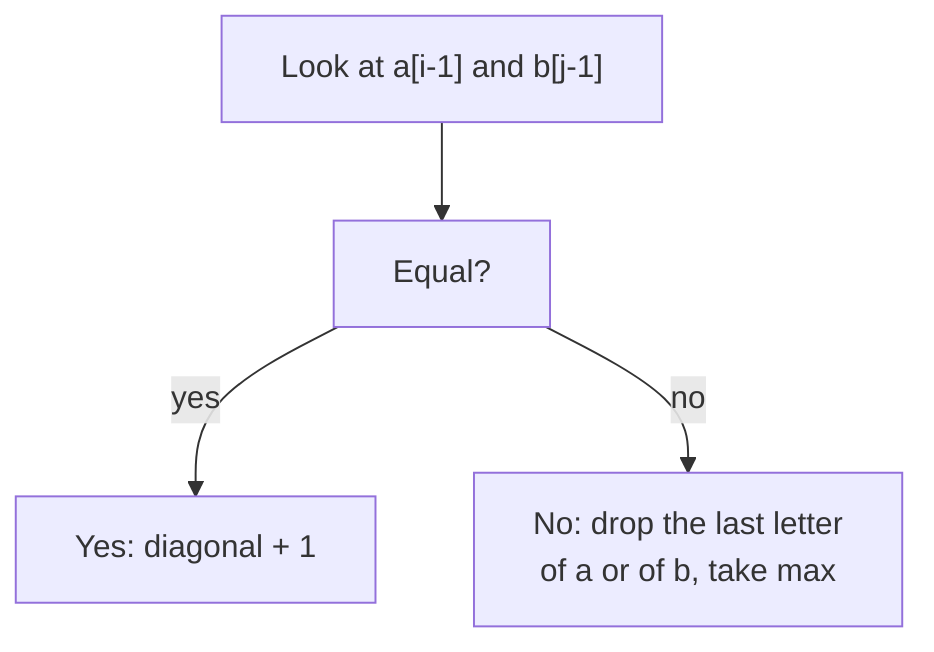
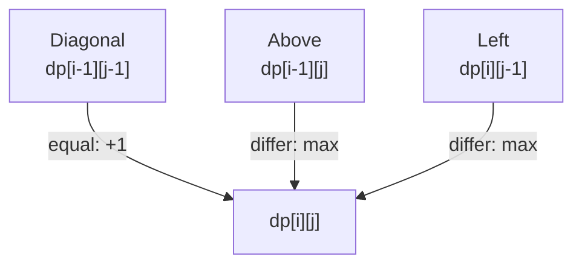

> [!tldr] Quick read
> - The state is a pair of prefixes: `dp[i][j]` is the LCS length of `a[:i]` and `b[:j]`. The table has (n + 1) × (m + 1) cells; row 0 and column 0 are the empty prefix.
> - If the two last characters are equal, pair them: `dp[i][j] = dp[i-1][j-1] + 1`. If they differ, at least one of them is surely dropped: `max(dp[i-1][j], dp[i][j-1])`.
> - Time O(n·m). For the length alone, one row plus a variable holding the diagonal cell is enough. To print the subsequence, keep the whole table and trace back from the bottom-right corner.
> - This is the leanest form of [[en/concepts/two-sequence-dp|Two-Sequence DP]]. Interleaving String, Distinct Subsequences and Edit Distance all change the formula on this same table.

> [!info] Context
> This is LeetCode 1143 at [[en/posts/2026-11-27-neetcode-grid-two-strings|station DP-05: Grids and Two Strings]] on **the NeetCode Line: Dynamic Programming**. I picture two drafts of the same paragraph and want to know how many letters of the earlier draft survive in the later one, in order. All you need is strings, 2-D arrays and nested loops.

> [!abstract]- Quick glossary for this post (click to open)
> - A subsequence takes some characters in their original order and may skip characters in between. A substring must be contiguous.
> - The prefix `a[:i]` is the first i characters of `a`. The empty prefix has i = 0.
> - The [[en/concepts/lcs-table|LCS Table]] is the table `dp[i][j]` over every pair of prefixes of the two strings.
> - A [[en/concepts/dp-state|DP state]] specifies what one cell of the table stores.
> - [[en/concepts/memoization|Memoization]] saves the answer the first time a state is queried.
> - [[en/concepts/rolling-state|Rolling State]] reuses the storage of rows that no longer need to be read.

## Picture it first: comparing two drafts

I have an old draft `bread` and a new draft `boardgame`. I want to highlight the letters of the old draft that survive in the new one, in order, as many as possible. I read from the end of both drafts. If the two last letters match, I highlight both and step back one letter in each. If they differ, at least one of the two is not highlighted, so I try dropping the last letter of one draft or the other and keep the better result.

| Everyday life | Concept |
|---|---|
| Having read the first i letters of the old draft and the first j of the new one | State `(i, j)`, cell `dp[i][j]` |
| The two letters match, highlight both | Go diagonal: `dp[i-1][j-1] + 1` |
| The letters differ, drop one from the old draft | The cell above `dp[i-1][j]` |
| The letters differ, drop one from the new draft | The cell on the left `dp[i][j-1]` |
| One draft is still empty | Row 0 or column 0, value 0 |
| Rereading the highlighted letters from the end | Tracing back through the table to rebuild the subsequence |



## The problem: the longest common subsequence

Given two strings `a` and `b`, each 1 to 1,000 characters long and made of lowercase English letters, return the length of the longest subsequence that appears in both. With no common character, return 0. For example, `bread` and `boardgame` share a subsequence of length 3, such as `bre` or `brd`. [Original LeetCode 1143 problem](https://leetcode.com/problems/longest-common-subsequence/)

At first I planned to walk through `a` and, for each letter, find it in `b` after the last matched position. That greedy approach already fails on `cab` and `abc`: it matches `c` with the last letter of `abc` and runs out of room, returning 1, while `ab` has length 2.

## How it works

### Brute force: two ways

The crudest way lists every subset of the characters of `a`, 2ⁿ subsets, and checks whether each is a subsequence of `b`. Time O(2ⁿ·m), unusable at n = 1,000. The runnable file uses it as the reference on short strings.

The second way recurses on a pair of positions `solve(i, j)`: if `a[i] == b[j]`, take both and continue with `solve(i+1, j+1)`; otherwise take the max of `solve(i+1, j)` and `solve(i, j+1)`. When the strings share no letter, every call splits in two and the call tree has 2·C(n + m, n) − 1 nodes. Two 10-character strings already cost 369,511 calls.

### Memoizing by pair of positions

There are only (n + 1)·(m + 1) distinct pairs `(i, j)`, and `solve(i, j)` depends only on the two suffixes `a[i:]` and `b[j:]`. Storing it per pair computes each pair once. Time and memory O(n·m). The same two 10-character strings need only 201 calls. But the recursion can go n + m = 2,000 levels deep.

### Filling the table by prefixes

Switching to prefixes removes the recursion. `dp[i][j]` is the LCS length of `a[:i]` and `b[:j]`. Row 0 and column 0 are 0 because one side is empty.

- **The last two characters are equal** (`a[i-1] == b[j-1]`): some optimal LCS always uses this pair. Take any optimal LCS. If it does not use the last character of both strings, its final matched pair sits earlier, and I swap that pair for the pair of last characters without changing the length. What remains is an LCS of the two shorter prefixes, so `dp[i][j] = dp[i-1][j-1] + 1`.
- **The last two characters differ**: an LCS cannot pair them with each other, so at least one of them goes unused. Dropping the last character of `a` gives `dp[i-1][j]`, dropping the last character of `b` gives `dp[i][j-1]`. Take the max.

Sweeping i upward, and j upward within each i, guarantees that the cells above, to the left and on the diagonal come first. Time O(n·m), memory O(n·m). At n = m = 1,000 that is a million cells.



### One row and the diagonal cell

Each cell reads only the row above and the cell on the left, as in [[en/problems/unique-paths|Unique Paths]], plus the diagonal cell. One array `row` of length m + 1 can hold the row above. Overwriting `row[j]` loses `dp[i-1][j]`, and the next cell `j + 1` needs exactly that value as its diagonal. So before writing, I save `row[j]` into `above`, and after writing I move it into `diagonal`. Swapping so that the shorter string is the array's dimension brings memory down to O(min(n, m)).

### Rebuilding the subsequence

The full table also tells **which subsequence** reaches that length. Walk back from `dp[n][m]`: if the two characters are equal, record that character and go diagonal; if they differ, move toward the larger neighbor (on a tie, choose the cell above). Read the recorded characters in reverse. For `bread` and `boardgame`, this rule yields `bre`. The one-row version cannot do this step, because it has already erased the old rows.

| Approach | Time | Extra memory |
|---|---|---|
| Listing subsets | O(2ⁿ·m) | O(n) |
| Recursion on (i, j) | O(C(n + m, n)), exponential | O(n + m) stack |
| Memoization | O(n·m) | O(n·m) + O(n + m) stack |
| Prefix table | O(n·m) | O(n·m) |
| One row | O(n·m) | O(min(n, m)) |

## Runnable example

[TypeScript](../code/neetcode-longest-common-subsequence/common.ts) · [Python](../code/neetcode-longest-common-subsequence/common.py) · [Go](../code/neetcode-longest-common-subsequence/common.go) · [Java](../code/neetcode-longest-common-subsequence/common.java) · [JavaScript](../code/neetcode-longest-common-subsequence/common.js) · [PHP](../code/neetcode-longest-common-subsequence/common.php) · [Rust](../code/neetcode-longest-common-subsequence/common.rs)

```ts
function lcsTable(a: string, b: string): number[][] {
    // dp[i][j]: LCS of a[:i] and b[:j]; row 0 and column 0 are the empty prefix
    const dp = Array.from({ length: a.length + 1 }, () => Array(b.length + 1).fill(0))
    for (let i = 1; i <= a.length; i++) {
        for (let j = 1; j <= b.length; j++) {
            dp[i][j] = a[i - 1] === b[j - 1]
                ? dp[i - 1][j - 1] + 1
                : Math.max(dp[i - 1][j], dp[i][j - 1])
        }
    }
    return dp
}
```

```python
def lcs_table(a, b):
    # dp[i][j]: LCS of a[:i] and b[:j]; row 0 and column 0 are the empty prefix
    dp = [[0] * (len(b) + 1) for _ in range(len(a) + 1)]
    for i in range(1, len(a) + 1):
        for j in range(1, len(b) + 1):
            if a[i - 1] == b[j - 1]:
                dp[i][j] = dp[i - 1][j - 1] + 1
            else:
                dp[i][j] = max(dp[i - 1][j], dp[i][j - 1])
    return dp
```

```go
func lcsTable(a, b string) [][]int {
	// dp[i][j]: LCS of a[:i] and b[:j]; row 0 and column 0 are the empty prefix
	dp := make([][]int, len(a)+1)
	for i := range dp {
		dp[i] = make([]int, len(b)+1)
	}
	for i := 1; i <= len(a); i++ {
		for j := 1; j <= len(b); j++ {
			if a[i-1] == b[j-1] {
				dp[i][j] = dp[i-1][j-1] + 1
			} else {
				dp[i][j] = max(dp[i-1][j], dp[i][j-1])
			}
		}
	}
	return dp
}
```

```java
static int[][] lcsTable(String a, String b) {
    // dp[i][j]: LCS of a[:i] and b[:j]; row 0 and column 0 are the empty prefix
    int[][] dp = new int[a.length() + 1][b.length() + 1];
    for (int i = 1; i <= a.length(); i++) {
        for (int j = 1; j <= b.length(); j++) {
            dp[i][j] = a.charAt(i - 1) == b.charAt(j - 1)
                ? dp[i - 1][j - 1] + 1
                : Math.max(dp[i - 1][j], dp[i][j - 1]);
        }
    }
    return dp;
}
```

```js
function lcsTable(a, b) {
    // dp[i][j]: LCS of a[:i] and b[:j]; row 0 and column 0 are the empty prefix
    const dp = Array.from({ length: a.length + 1 }, () => Array(b.length + 1).fill(0))
    for (let i = 1; i <= a.length; i++) {
        for (let j = 1; j <= b.length; j++) {
            dp[i][j] = a[i - 1] === b[j - 1]
                ? dp[i - 1][j - 1] + 1
                : Math.max(dp[i - 1][j], dp[i][j - 1])
        }
    }
    return dp
}
```

```php
function lcsTable(string $a, string $b): array {
    // dp[i][j]: LCS of a[:i] and b[:j]; row 0 and column 0 are the empty prefix
    $n = strlen($a);
    $m = strlen($b);
    $dp = array_fill(0, $n + 1, array_fill(0, $m + 1, 0));
    for ($i = 1; $i <= $n; $i++) {
        for ($j = 1; $j <= $m; $j++) {
            $dp[$i][$j] = $a[$i - 1] === $b[$j - 1]
                ? $dp[$i - 1][$j - 1] + 1
                : max($dp[$i - 1][$j], $dp[$i][$j - 1]);
        }
    }
    return $dp;
}
```

```rust
fn lcs_table(a: &[u8], b: &[u8]) -> Vec<Vec<usize>> {
    // dp[i][j]: LCS of a[:i] and b[:j]; row 0 and column 0 are the empty prefix
    let mut dp = vec![vec![0usize; b.len() + 1]; a.len() + 1];
    for i in 1..=a.len() {
        for j in 1..=b.len() {
            dp[i][j] = if a[i - 1] == b[j - 1] {
                dp[i - 1][j - 1] + 1
            } else {
                dp[i - 1][j].max(dp[i][j - 1])
            };
        }
    }
    dp
}
```

The tabs excerpt the table-filling function; the answer is `dp[n][m]`. The downloadable files also contain the brute force, the memoized version, the one-row version and the function that rebuilds the subsequence. The first line is 9 cases, including two identical strings, two strings with no common letter and two pairs of strings exactly 1,000 long. Each case also checks that the rebuilt subsequence has the right length and really is a subsequence of both strings. The second line compares every pair of `a/b` strings of length 1–5 against the subset listing. The memoized version runs only on short strings to stay within recursion limits. The calls line counts how many times the function is entered, not running time.

```text
9/9 cases passed
3844/3844 cases passed (checked against every subset, a/b strings of length 1–5)
Two 10-character strings with no common letter: brute force 369511 calls, memo 201 calls
One LCS of bread and boardgame: bre
```

*(Output labels translated; the files themselves print Vietnamese.)*

## Misconceptions and common traps

- Confusing subsequence with substring. `bre` is not contiguous in `boardgame` but is still a subsequence. The longest common substring problem uses a different formula: on a mismatch the cell drops to 0.
- Greedily matching the first character you can find. On `cab` and `abc` it returns 1; the answer is 2.
- Taking the diagonal cell on a mismatch. The diagonal drops both characters, so it is never larger than the cell above or the cell on the left. Using it instead of the max loses the case where only one of the two characters is dropped.
- A table of size n × m instead of (n + 1) × (m + 1). Then there is no room for the empty prefix and you need extra boundary branches.
- Forgetting to save the diagonal in the one-row version. By then `row[j-1]` already holds the new row's value, so it is no longer `dp[i-1][j-1]`.
- Python: memoized recursion on two 1,000-character strings needs up to 2,000 levels, beyond the default limit of about 1,000 from `sys.getrecursionlimit()`. Use the table, or raise the limit on purpose. PHP with Xdebug also stops deep recursion, so run the file with `php -d xdebug.mode=off`.
- Rust: you cannot index directly into a `&str`. Convert with `as_bytes()`. The problem uses only lowercase English letters, so each character is exactly one byte. Go also indexes by byte, for the same reason.
- Java: compare characters with `charAt(i) == charAt(j)`. Comparing one-character substrings with `==` compares references.

## Self-check questions

> [!question]- When the last two characters are equal, why is there no need to look at the cells above and to the left?
> Some optimal LCS always uses this pair: swapping the final matched pair of any optimal solution for this pair does not shorten it. So `dp[i-1][j-1] + 1` is already the largest.

> [!question]- For `abc` and `ac`, what is the bottom-right value of the table, and where does the traceback go?
> It is 2. From (3, 2): `c` matches `c`, go diagonal to (2, 1). `b` differs from `a`; the cell above (1, 1) is 1 and the cell on the left (2, 0) is 0, so go up to (1, 1). `a` matches `a`. The subsequence is `ac`.

> [!question]- How many old values does the one-row version need to save, and why?
> One: the diagonal cell `dp[i-1][j-1]`. The cell above is still in `row[j]` before the write, and the cell on the left is `row[j-1]`, just written. Only the diagonal was overwritten in the previous step.

> [!question]- How can LCS tell how many letters the new draft must delete and insert to become the old one?
> If only deletions and insertions are allowed, the number of operations is (n − L) + (m − L), where L is the LCS length. With substitutions too, you need [[en/problems/edit-distance|Edit Distance]].

## References

- [LeetCode 1143](https://leetcode.com/problems/longest-common-subsequence/)
- [Longest common subsequence (Wikipedia)](https://en.wikipedia.org/wiki/Longest_common_subsequence)
- [MIT 6.006, DP on two strings and edit distance](https://ocw.mit.edu/courses/6-006-introduction-to-algorithms-fall-2011/3484e876d81aba07911a1109f5b5e81e_MIT6_006F11_lec21.pdf)
- [Python sys.setrecursionlimit](https://docs.python.org/3/library/sys.html#sys.setrecursionlimit) · [Rust Book, no indexing into String](https://doc.rust-lang.org/book/ch08-02-strings.html#indexing-into-strings)
