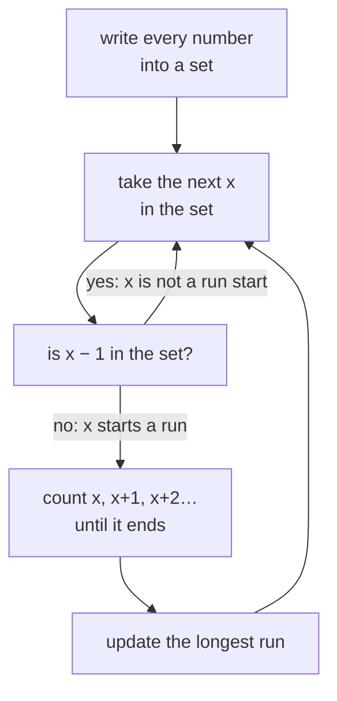

> [!tldr] Quick read
> - The problem: given an unsorted array of integers, return the length of the longest run of consecutive **values** (`[100, 4, 200, 1, 3, 2]` → 4, because 1, 2, 3, 4 are there). The problem demands O(n).
> - [[en/concepts/brute-force|Brute force]] looks for `x + 1, x + 2…` by rescanning the whole array: O(n³) in the worst case; 2 000 numbers already take 1.5 seconds.
> - [[en/concepts/sort-then-scan|Sort then scan]]: O(n log n), but **duplicates** must be skipped rather than breaking the run, and JS needs a comparator.
> - [[en/concepts/hash-set|Hash set]] + **run starts**: count from x only when `x − 1` is not in the set. Each value is stepped over once, so the total is O(n) even with a `while` nested inside a `for` ([[en/concepts/aggregate-analysis|aggregate analysis]]).
> - Real measurements: with 10⁶ numbers, the hash set beats sorting by only 1.4–1.5 times in TypeScript and 1.3–2.7 times in Python. O(n) wins, but not by far.

> [!info] Context
> LeetCode problem 128, part of [[en/posts/2026-11-22-neetcode-hash-lookup|station 1: Hash Lookup]] on **the NeetCode line: Arrays and Strings**. The station post introduced the "write everything into a set, then ask about `x − 1`" template; this page digs into why that template is O(n) and compares it with the other two approaches. The solutions come in TypeScript, Python, Go, Java and JavaScript. All you need to know is loops, arrays and functions.

> [!abstract]- Quick glossary for this post (click to open)
> - **Consecutive run**: **values** that follow one another (5, 6, 7); they do not need to sit next to each other in the array.
> - **Run start**: a value x such that `x − 1` is not in the data. Each run has exactly one start.
> - **Set**: a structure that answers "is x here?" in O(1) on average. See [[en/problems/contains-duplicate|Contains Duplicate]].
> - **Aggregate analysis**: counting the total steps of the whole algorithm, instead of multiplying the number of loop iterations by each loop's worst case. See [[en/concepts/aggregate-analysis|Aggregate Analysis]].
> - **Boxing**: Java wraps an `int` into an `Integer` object so it can go into a `List` or a `Set`.

## Picture it first: lining up by roll number

A class hands out roll-number cards, but many students are absent and a few hold two cards with the same number. The teacher wants the longest group of students whose numbers are **consecutive**.

| Everyday life | Concept |
|---|---|
| For each student, call out "who has the next number?" and wait for the whole class to answer | Brute force: find `x + 1` by rescanning the array |
| Have the whole class line up by number, then walk down the line counting | Sort then scan, O(n log n) |
| Two students holding the same number stand next to each other in line | Duplicates: skip them, they don't break the run |
| Pin the class list on the board and look up any number in a second | A set, O(1) lookups |
| Only a student **without** a classmate holding the previous number starts counting a group | Run start: `x − 1` is not in the set |
| Every student is counted once, however long the group | Aggregate analysis: O(n) in total |



## The problem

**The problem (in my own words):** given an unsorted integer array `nums`, return the length of the longest run of consecutive integer values present in the array. Order in the array does not matter; a repeated value counts once. The problem asks for an **O(n)** algorithm. Original: [LeetCode 128](https://leetcode.com/problems/longest-consecutive-sequence/).

| Input | Output | Why |
|---|---|---|
| `[100, 4, 200, 1, 3, 2]` | `4` | 1, 2, 3, 4 are there |
| `[0, 3, 7, 2, 5, 8, 4, 6, 0, 1]` | `9` | 0 through 8; the repeated 0 does not make the run longer |
| `[1, 0, 1, 2]` | `3` | 0, 1, 2; the second 1 does not break the run |
| `[]` | `0` | empty array |

Limits: up to **100 000** elements, each within **±10⁹**. The wide value range rules out the "marker array indexed by value" trick (it would need 2·10⁹ slots).

I used to think "demanding O(n) for consecutive runs makes no sense, you have to sort". It turns out you don't need the order of the whole array: you only need to answer "is x + 1 here?" quickly, and that is a set's job.

## How it works

<figure class="figure-map" style="--ar: 3 / 4">
<div class="frame"><iframe data-archify="../../diagrams/neetcode-longest-consecutive-sequence/worked-example.en.html" title="Count from the start of a run" loading="lazy"></iframe></div>
<figcaption><span><b>Figure 1.</b> Count from the start of a run.</span><a href="../diagrams/neetcode-longest-consecutive-sequence/worked-example.en.html" target="_blank" rel="noopener">Open full screen</a></figcaption>
</figure>

<details>
<summary>Read the steps</summary>
<ol>
<li>Add the numbers to a set. <code>{8, 4, 6, 5, 9}</code></li>
<li>Check whether 8 has a predecessor. <code>7 ∉ set</code></li>
<li>Count from 8 through 9. <code>[8, 9] → 2</code></li>
<li>Count from 4 through 6. <code>[4, 5, 6] → 3</code></li>
<li>The longest run has 3 values. <code>max(2, 3) = 3</code></li>
</ol>
</details>

### Approach 1, brute force: O(n³) in the worst case

For each x, ask "is `x + 1` in the array?" by scanning the whole array (`includes`, `in` on a list, `slices.Contains`), then `x + 2`, … Each question is O(n), a run can be up to n steps long, and there are n starting points: O(n³). Measured on a shuffled run `0..n−1`:

| n | 250 | 500 | 1 000 | 2 000 |
|---|---|---|---|---|
| ms (TypeScript) | 3.5 | 24.6 | 182.3 | 1 425.4 |

Doubling n multiplies the time by about 7–8, approaching 8: exactly the shape of n³.

### Approach 2, sort then scan: O(n log n)

After sorting, consecutive values sit next to each other. Walk once: an element equal to the previous one is **skipped**; one exactly 1 larger extends the run; anything else starts a new run at 1.

Two easy mistakes:
- **Treating a duplicate as a break.** `[0, 1, 1, 2]` gives 2 instead of 3. This wrong version passes 6/7 test cases and only fails on `[1, 0, 1, 2]`.
- **JS: `sort()` without a comparator** compares numbers **as strings**. `[100, 4, 200, 1, 3, 2]` becomes `[1, 100, 2, 200, 3, 4]`, and every run gets chopped up. This version passes only 4/7 cases.

### Approach 3, hash set and run starts: O(n)

Write every number into a set. Walk each value x **in the set**:
- if `x − 1` is in the set, x sits in the middle of a run: skip it, that run will be counted from its start;
- otherwise x is a **run start**: count `x + 1, x + 2, …` until the run ends.

### Why the nested `while` is still O(n)

Counting "outer loop n times × inner loop up to n steps" gives O(n²), but that bound is too coarse. Count with [[en/concepts/aggregate-analysis|aggregate analysis]] instead: each `while` step moves from one value to the next **within the same run**, and the `while` loop only runs from a run start. Each run has one start, so each value is stepped over **exactly once** across the whole algorithm. Total `while` steps ≤ number of distinct values ≤ n. Add the n checks of `x − 1`, and the total is O(n).

The argument needs two conditions. Drop either one and it collapses:
- **Iterate over the set, not the array.** If a run start repeats k times in the array, that run is walked k times. The station post measures exactly this case: 2.7 ms becomes almost 4 seconds.
- **Check `x − 1` before counting.** Drop that line and every value counts the rest of its run: O(n²) on one long run.

### Measured: does O(n) always beat O(n log n) by far?

Two kinds of data: 10⁶ **random** numbers within ±10⁹ (almost no long runs), and **one long run** `0..n−1`, shuffled. Median of 5 runs, in ms:

| n = 10⁶ | sorting | hash set | hash set faster by |
|---|---|---|---|
| TypeScript, random | 225.38 | 150.48 | 1.5 times |
| TypeScript, one long run | 229.15 | 162.41 | 1.4 times |
| Python, random | 370.71 | 279.47 | 1.3 times |
| Python, one long run | 352.89 | 128.51 | 2.7 times |

The hash set wins every cell, but the gap depends heavily on the language and the data. Python's `sorted` is written in C and runs entirely in C; the hash-set loop executes one Python statement per step. Big-O says which curve gets steeper as n grows, not how far apart they are at n = 10⁶.

An earlier version of this page gave 14 times for TypeScript on random data. That number was wrong because of the data: the old random generator (`seed * 1103515245` computed in floating point) lost precision and repeated after about 10 thousand values, so "10⁶ random numbers" really held only about 10 thousand distinct values, and a small set is fast. The file now uses the mulberry32 generator (every multiplication goes through `Math.imul`), which gives 10⁶ almost entirely distinct values.

### Under the hood of the seven languages

| | Asking "is x here?" | Language-specific trap |
|---|---|---|
| TypeScript / JavaScript | `Set.has` | `sort()` without a comparator compares as strings |
| Python | `x in s` with `s` a set: O(1) on average | `x in nums` with `nums` a **list** works too, but is O(n) |
| Go | `_, ok := m[x]` on a `map[int]struct{}` | `slices.Sort` sorts in place; map iteration order is random (does not affect the result) |
| Java | `HashSet<Integer>.contains` | `Integer == Integer` compares **references**; right for −128..127, wrong from 128 up |
| PHP | `isset($all[$x])` with the numbers as array **keys** | `in_array` scans the whole array: O(n) per lookup |
| Rust | `HashSet::contains(&x)` | `x + len` overflowing `i32` panics in a debug build and wraps with `-O` |

## Runnable example

[TypeScript](../code/neetcode-longest-consecutive-sequence/longest-consecutive.ts) · [Python](../code/neetcode-longest-consecutive-sequence/longest_consecutive.py) · [Go](../code/neetcode-longest-consecutive-sequence/longest_consecutive.go) · [Java](../code/neetcode-longest-consecutive-sequence/longest-consecutive.java) · [JavaScript](../code/neetcode-longest-consecutive-sequence/longest-consecutive.js) · [PHP](../code/neetcode-longest-consecutive-sequence/longest-consecutive.php) · [Rust](../code/neetcode-longest-consecutive-sequence/longest_consecutive.rs)

Each file has all three approaches and runs its own test cases. Below are the sorting and hash set approaches.

```ts
function sortScan(nums: number[]): number {
  if (nums.length === 0) return 0;
  const a = [...nums].sort((p, q) => p - q); // copy: don't modify the caller's array; a comparator is REQUIRED
  let best = 1, len = 1;
  for (let i = 1; i < a.length; i++) {
    if (a[i] === a[i - 1]) continue; // duplicate: skip it, it does NOT break the run
    len = a[i] === a[i - 1] + 1 ? len + 1 : 1;
    best = Math.max(best, len);
  }
  return best;
}

function hashSet(nums: number[]): number {
  const all = new Set(nums);
  let best = 0;
  for (const x of all) {
    if (all.has(x - 1)) continue;
    let len = 1;
    while (all.has(x + len)) len++;
    best = Math.max(best, len);
  }
  return best;
}
```

```python
def sort_scan(nums: list[int]) -> int:
    if not nums:
        return 0
    a = sorted(nums)  # sorted returns a new list; nums.sort() would modify the caller's array
    best = length = 1
    for prev, cur in zip(a, a[1:]):
        if cur == prev:
            continue  # duplicate: skip it, it does not break the run
        length = length + 1 if cur == prev + 1 else 1
        best = max(best, length)
    return best


def hash_set(nums: list[int]) -> int:
    all_ = set(nums)
    best = 0
    for x in all_:
        if x - 1 in all_:  # "in" on a SET: O(1) on average
            continue
        length = 1
        while x + length in all_:
            length += 1
        best = max(best, length)
    return best
```

```go
func sortScan(nums []int) int {
	if len(nums) == 0 {
		return 0
	}
	a := slices.Clone(nums) // slices.Sort sorts in place; copy so the caller's slice is untouched
	slices.Sort(a)
	best, length := 1, 1
	for i := 1; i < len(a); i++ {
		if a[i] == a[i-1] {
			continue // duplicate: skip it, it does not break the run
		}
		if a[i] == a[i-1]+1 {
			length++
		} else {
			length = 1
		}
		best = max(best, length)
	}
	return best
}

func hashSet(nums []int) int {
	all := make(map[int]struct{}, len(nums))
	for _, x := range nums {
		all[x] = struct{}{}
	}
	best := 0
	for x := range all { // map iteration order is random on every run; the result does not depend on it
		if _, ok := all[x-1]; ok {
			continue
		}
		length := 1
		for {
			if _, ok := all[x+length]; !ok {
				break
			}
			length++
		}
		best = max(best, length)
	}
	return best
}
```

```java
static int sortScan(int[] nums) {
    if (nums.length == 0) return 0;
    int[] a = nums.clone(); // Arrays.sort sorts in place
    Arrays.sort(a); // primitive int array: Dual-Pivot Quicksort, no boxing
    int best = 1, len = 1;
    for (int i = 1; i < a.length; i++) {
        if (a[i] == a[i - 1]) continue; // duplicate: skip it, it does not break the run
        len = a[i] == a[i - 1] + 1 ? len + 1 : 1;
        best = Math.max(best, len);
    }
    return best;
}

static int hashSet(int[] nums) {
    Set<Integer> all = new HashSet<>();
    for (int x : nums) all.add(x); // every int is boxed into an Integer
    int best = 0;
    for (int x : all) {
        if (all.contains(x - 1)) continue;
        int len = 1;
        while (all.contains(x + len)) len++;
        best = Math.max(best, len);
    }
    return best;
}
```

```js
function sortScan(nums) {
  if (nums.length === 0) return 0;
  const a = [...nums].sort((p, q) => p - q); // without a comparator, sort compares as strings: [1, 100, 2, 200, 3, 4]
  let best = 1, len = 1;
  for (let i = 1; i < a.length; i++) {
    if (a[i] === a[i - 1]) continue;
    len = a[i] === a[i - 1] + 1 ? len + 1 : 1;
    best = Math.max(best, len);
  }
  return best;
}

function hashSet(nums) {
  const all = new Set(nums);
  let best = 0;
  for (const x of all) {
    if (all.has(x - 1)) continue;
    let len = 1;
    while (all.has(x + len)) len++;
    best = Math.max(best, len);
  }
  return best;
}
```

```php
// PHP: arrays are passed by value, so sort() only changes the copy
function sortScan(array $nums): int {
    if (count($nums) === 0) return 0;
    sort($nums, SORT_NUMERIC);
    $best = 1; $len = 1;
    for ($i = 1, $n = count($nums); $i < $n; $i++) {
        if ($nums[$i] === $nums[$i - 1]) continue; // duplicate: skip it, the run does NOT break
        $len = $nums[$i] === $nums[$i - 1] + 1 ? $len + 1 : 1;
        $best = max($best, $len);
    }
    return $best;
}
function hashSet(array $nums): int {
    $all = array_fill_keys($nums, true);
    $best = 0;
    foreach ($all as $x => $_) {            // iterate the KEYS; the values are just true
        if (isset($all[$x - 1])) continue;
        $len = 1;
        while (isset($all[$x + $len])) $len++;
        $best = max($best, $len);
    }
    return $best;
}
```

```rust
// Rust: dedup() drops equal neighbours after sorting
fn sort_scan(nums: &[i32]) -> i32 {
    if nums.is_empty() {
        return 0;
    }
    let mut a = nums.to_vec();
    a.sort_unstable();
    a.dedup();
    let (mut best, mut len) = (1, 1);
    for w in a.windows(2) {
        len = if w[1] == w[0] + 1 { len + 1 } else { 1 };
        best = best.max(len);
    }
    best
}
fn hash_set(nums: &[i32]) -> i32 {
    let all: HashSet<i32> = nums.iter().copied().collect();
    let mut best = 0;
    for &x in &all {
        if all.contains(&(x - 1)) {
            continue;
        }
        let mut len = 1;
        while all.contains(&(x + len)) {
            len += 1;
        }
        best = best.max(len);
    }
    best
}
```

The TypeScript file also runs two wrong versions so the tests point at what breaks, then measures:

```text
$ node longest-consecutive.ts
bruteForce                7/7 cases passed
sortScan                  7/7 cases passed
hashSet                   7/7 cases passed
sortScanResetOnDuplicate  6/7 cases passed; wrong on [1,0,1,2]
sortScanNoComparator      4/7 cases passed; wrong on [100,4,200,1,3,2] [-3,-1,-2,5] [9,10,8]

brute force, one shuffled long run (ms, single run)
n = 250         3.5
n = 500        24.6
n = 1000      182.3
n = 2000     1425.4

n          data              sorting  hash set   (ms, median of 5 runs)
10000      random ±10⁹           1.59      0.97
10000      one long run          1.28      0.63
100000     random ±10⁹          19.03      8.91
100000     one long run         18.29      8.37
1000000    random ±10⁹         225.38    150.48
1000000    one long run        229.15    162.41
```

*(Output labels translated; the files themselves print Vietnamese.)*

The Java file adds a version that sorts a `List<Integer>` and compares duplicates with `==`:

```text
$ java longest-consecutive.java
bruteForce     8/8 cases passed
sortScan       8/8 cases passed
hashSet        8/8 cases passed
sortScanBoxed  7/8 cases passed; wrong on [1000, 1001, 1001, 1002] → 2
```

The two `1001`s are two different `Integer` objects, so `==` treats them as different, and the run gets cut in the middle. With small numbers such as `[1, 0, 1, 2]` this version is right, because Java shares the object for −128..127. Python, Go and JavaScript print `7/7 ca đúng` ("7/7 cases passed") for all three approaches. PHP and Rust also print `7/7 ca đúng` for the three approaches, and the version that treats a duplicate as a break prints `6/7 ca đúng; sai ở [1,0,1,2]` ("6/7 cases passed; wrong on [1,0,1,2]"), like TypeScript.

## Misconceptions and common traps

- **"A nested loop means O(n²)."** Count the total work. Here the `while` loop only runs from run starts, so each value is stepped over once: O(n).
- **Iterating over the original array instead of the set.** The result is correct but the O(n) bound is gone when a run start repeats; see the measurement in [[en/posts/2026-11-22-neetcode-hash-lookup|the station post]].
- **Treating a duplicate as a break when sorting.** `[1, 0, 1, 2]` gives 2 instead of 3.
- **JS: forgetting the comparator in `sort()`.** Negative and multi-digit numbers land in the wrong order; the wrong version passes only 4/7 cases.
- **Java: comparing `Integer`s with `==`.** Right for small numbers, wrong from 128 up, so tests with small numbers don't catch it. Use `equals`, or sort an `int[]` instead of a `List<Integer>`.
- **Python: writing `x + 1 in nums` with `nums` a list.** It runs correctly, but each lookup is O(n), and the solution silently becomes O(n²) or worse.
- **PHP: building the set with `array_flip` and iterating the values.** `array_flip($nums)` makes the numbers keys, but the values are the old **indices**; `foreach ($all as $x)` then walks indices, not numbers. Write `foreach ($all as $x => $_)`. The file uses `array_fill_keys($nums, true)` so the values can't be mistaken.
- **Rust: forgetting `dedup()` after sorting.** Without it, two equal neighbours break the run, exactly the `6/7` wrong version. Also, `x + len` on an `i32` near `i32::MAX` panics in a debug build; the problem's ±10⁹ limit keeps the addition safe.
- **"O(n) is surely much faster than O(n log n)."** On random data at 10⁶ elements, the hash set beats sorting by only 1.5 times in TypeScript and 1.3 times in Python. Both pass LeetCode's limits; only the problem statement forces O(n).

## Self-check questions

> [!question]- Why is it enough to start counting only from values x where `x − 1` is not in the set?
> Because such an x starts the run that contains it. Every other value in the run has `x − 1` in the set, and its run gets counted in full when counting starts from the run start. Counting from the middle only finds a shorter run.

> [!question]- What bounds the total number of steps of all the `while` loops, and why?
> The number of distinct values. Each `while` step moves to the next value within the same run, the `while` loop only runs from a run start, and each run has one start, so each value is stepped over exactly once.

> [!question]- With the sorting approach, `[1, 0, 1, 2]` gives 2. Where is the bug?
> The two 1s sit next to each other after sorting, and the loop treats "equal" as "not consecutive", so it resets the length to 1. An element equal to the previous one must be skipped.

> [!question]- In Java, `sortScanBoxed` is right for `[1, 0, 1, 2]` but wrong for `[1000, 1001, 1001, 1002]`. Why?
> `==` between two `Integer`s compares references. Java must share the object for boxed values in −128..127, so the two 1s are the same object; the two 1001s are two different objects.

> [!question]- The problem changes: the array has 10⁹ elements and there is not enough RAM for a set. Which approach do you pick?
> Sort in place (or an external sort, on disk) and then scan: O(n log n) time but almost no extra memory. A hash set needs memory proportional to the number of distinct values.

## References

- [LeetCode 128: Longest Consecutive Sequence](https://leetcode.com/problems/longest-consecutive-sequence/) (the original problem)
- Cormen, Leiserson, Rivest, Stein, *Introduction to Algorithms*, chapter "Amortized Analysis", the aggregate method
- [Java Language Specification SE 21, §5.1.7 Boxing Conversion](https://docs.oracle.com/javase/specs/jls/se21/html/jls-5.html#jls-5.1.7) (boxed values in −128..127 must be the same object)
- [ECMAScript 2025](https://tc39.es/ecma262/2025/) (`Array.prototype.sort` compares as strings without a comparator)
- [Go: package slices](https://pkg.go.dev/slices) (`slices.Sort` sorts in place, `slices.Clone`, `slices.Contains`)
- [Python: Set types](https://docs.python.org/3/library/stdtypes.html#set-types-set-frozenset) and [Time complexity (Python wiki)](https://wiki.python.org/moin/TimeComplexity) (`x in list` is O(n), `x in set` is O(1) on average)
