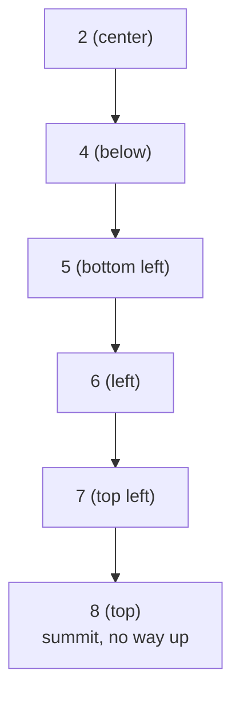
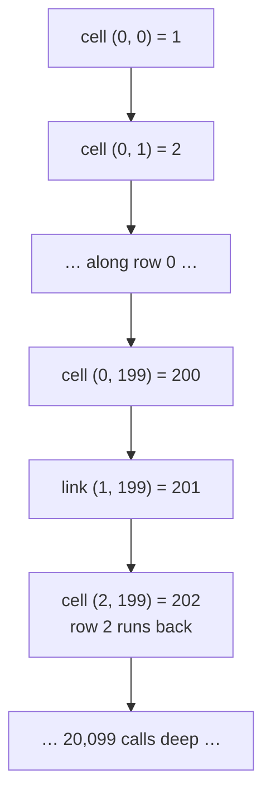
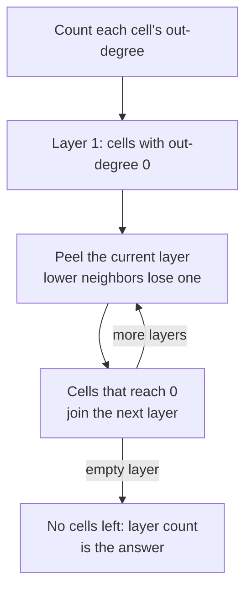

> [!tldr] Quick read
> - Each cell is a vertex, with an edge to every neighboring cell whose value is **strictly larger**. Values rise along every edge, so the graph has no cycles: it is a [[en/concepts/directed-acyclic-graph|DAG]].
> - With no cycles, [[en/concepts/memoized-dfs|memoized DFS]] needs no "visiting" set. `memo[cell]` = the length of the longest increasing path starting at that cell, computed once and reused.
> - The second approach has no recursion: peel off the "summits" (cells with no larger neighbor left) layer by layer, [[en/concepts/topological-sort|Kahn]]-style. The number of layers equals the length of the longest path.
> - Both take O(m·n) time and memory. The difference is the stack: a 200×200 grid can force DFS more than 20,000 calls deep, enough to overflow the stack in Node.js, Python and Java with their default settings.

> [!info] Context
> This is LeetCode 329 at [[en/posts/2026-11-27-neetcode-state-machine-dp|station DP-06: State Machines and Memoized Search]] on **the NeetCode Line: Dynamic Programming**. I picture a topographic map divided into cells, each marked with its altitude, and a hiker who only steps onto higher ground. All you need is 2D arrays, loops and recursive functions.

> [!abstract]- Quick glossary for this post (click to open)
> - A neighboring cell is one of the four cells above, below, left and right. No diagonals, no wrapping around to the opposite edge.
> - A [[en/concepts/grid-graph|grid graph]] treats each cell as a vertex and each pair of neighboring cells as a possible edge.
> - A [[en/concepts/directed-acyclic-graph|DAG]] is a directed graph with no cycles.
> - A [[en/concepts/dp-state|DP state]] specifies what one cell of the memo table stores.
> - [[en/concepts/memoization|Memoization]] saves a state's answer the first time it is computed.
> - Here, a cell's out-degree is the number of neighbors higher than it, that is, how many ways up it still has.
> - A stack overflow happens when function calls nest too deep and exceed the space the system gives the thread.

## Picture it first: hiking uphill on a topographic map

The map is divided into cells, each marked with an altitude. The hiker may start on any cell, and each step goes to a neighboring cell that is strictly higher. I want the hike that crosses the most cells. The trick of whoever went first: on every cell already surveyed, write down "from here you can climb at most this many cells". The next hiker who reaches that cell just reads the number instead of trying the climb again.

| Everyday life | Concept |
|---|---|
| A map cell marked with an altitude | Cell `grid[r][c]` |
| Only step onto strictly higher ground | Directed edge to a larger neighbor |
| No way to climb in a loop back to where you were | The graph has no cycles (DAG) |
| The number written on a surveyed cell | `memo[cell]`, the DP state |
| A small summit, everything around it lower | A cell with out-degree 0, the first layer peeled |
| Peeling from the summits down to the foothills | Topological order, Kahn-style |
| The longest hike | The answer |

The 3×3 grid below is the running example:

```text
7 8 1
6 2 3
5 4 9
```

The longest hike covers 6 cells: 2 → 4 → 5 → 6 → 7 → 8.



## The problem: the longest climb on a grid of numbers

You get an m × n grid of integers, 1 ≤ m, n ≤ 200, each value from 0 to 2³¹ − 1. From a cell, each step moves to one of the four neighbors with a strictly larger value. Return the number of cells on the longest such path, starting from any cell. A single cell on its own is a path of length 1, so the answer is always at least 1. [Original problem, LeetCode 329](https://leetcode.com/problems/longest-increasing-path-in-a-matrix/)

I used to think this was a "find a path on a grid" problem like [[en/problems/number-of-islands|Number of Islands]], so I planned to carry a `visited` array to avoid going in circles. It turns out you don't need one: values strictly increase along the path, so you can never come back to a cell you already walked. What you need to remember is each cell's **answer**, not which cells you have visited.

## How it works

### Brute force: DFS from every cell

Let `climb(r, c)` be the length of the longest increasing path starting at cell (r, c). The cell on its own is a path of length 1. For each larger neighbor you can continue, giving `1 + climb(neighbor)`. Take the largest, then the largest over every starting cell.

The formula is right, but increasing paths overlap heavily. On a 10×10 grid with values `r + c`, there are C(18, 9) = 48,620 paths from the top-left corner to the bottom-right one. Brute force walks every one of them again: 705,310 calls for 100 cells. In the worst case, the number of increasing paths grows exponentially with the grid size.

### Memoized DFS: each cell computed exactly once

`climb(r, c)` depends only on (r, c): the path onward from here does not care how you got here. So this is a complete [[en/concepts/dp-state|DP state]], stored in `memo` by cell. The next time you reach that cell, return the stored number.

Two facts make this correct without a "visiting" set:

| Question | Answer |
|---|---|
| Can DFS loop around and call back into the very cell it is still computing? | No. A cycle would need a < b < … < a, which is impossible. |
| When you read `memo[neighbor]`, is that value complete? | Yes. The larger neighbor finishes before its call returns. |

Each cell is computed once, and each time it looks at 4 neighbors, so time is O(m·n) and the `memo` takes O(m·n) memory. On the 10×10 grid above, calls drop from 705,310 to 280: 100 from the outer loop and 180 along edges (each increasing edge calls once, and most of those return straight from `memo`). I use 0 to mean "not computed yet", which is safe because every cell's answer is at least 1.

The remaining cost is **recursion depth**. The stack can get as many calls deep as the increasing path is long, up to m·n = 40,000. The test file uses a 200×200 "corridor" grid: even rows are a zigzag aisle numbered in increasing order, odd rows are walls with value 0 except for one connecting cell at the end. From cell (0, 0) there is exactly one larger neighbor, so DFS runs straight through 20,099 calls deep.



### Peeling in topological order: no recursion

Flip the point of view: instead of climbing up, peel from the top down. For each cell, count the neighbors larger than it, its out-degree. A cell with out-degree 0 is a small summit: every increasing path through it ends there. These cells are layer 1.

Peel layer 1 away. Each smaller cell next to a peeled cell loses one way up. A cell with no ways up left has had every higher neighbor peeled, so it becomes a summit of what remains and goes into layer 2. Repeat until no cells are left. This is [[en/concepts/topological-sort|Kahn's algorithm]] run on out-degree instead of in-degree.

| Layer | Cells peeled (example grid) | Why |
|---|---|---|
| 1 | 8, 9 | No neighbor is higher |
| 2 | 7, 3 | Their only way up (8, 9) is gone |
| 3 | 6, 1 | 6's way up is 7, 1's are 8 and 3, all gone |
| 4 | 5 | Its only way up is 6 |
| 5 | 4 | Its ways up are 5 and 9, both gone |
| 6 | 2 | All four neighbors 8, 4, 6, 3 are gone |

Six layers, exactly the answer. The reason: a cell is in layer k exactly when the longest increasing path starting at it has k cells. A cell in layer 1 cannot move on. A cell in layer k waits until its last higher neighbor is peeled in layer k − 1, so its longest path is 1 + (k − 1). Time and memory are still O(m·n), but it only uses loops and two arrays, never the call stack.



## Runnable example

[TypeScript](../code/neetcode-longest-increasing-path-in-a-matrix/climb.ts) · [Python](../code/neetcode-longest-increasing-path-in-a-matrix/climb.py) · [Go](../code/neetcode-longest-increasing-path-in-a-matrix/climb.go) · [Java](../code/neetcode-longest-increasing-path-in-a-matrix/climb.java) · [JavaScript](../code/neetcode-longest-increasing-path-in-a-matrix/climb.js) · [PHP](../code/neetcode-longest-increasing-path-in-a-matrix/climb.php) · [Rust](../code/neetcode-longest-increasing-path-in-a-matrix/climb.rs)

```ts
const DIRS = [[1, 0], [-1, 0], [0, 1], [0, -1]]

// Memoized DFS: memo[cell] = length of the longest increasing path starting at that cell.
// No "visiting" set needed: edges only go to larger values, so there are no cycles.
function longestPathMemo(grid: number[][], counter = { calls: 0 }): number {
    const rows = grid.length, cols = grid[0].length
    const memo = new Array(rows * cols).fill(0) // 0 = not computed yet, every answer is ≥ 1
    const climb = (r: number, c: number): number => {
        counter.calls++
        const key = r * cols + c
        if (memo[key] !== 0) return memo[key]
        let best = 1
        for (const [dr, dc] of DIRS) {
            const nr = r + dr, nc = c + dc
            if (nr >= 0 && nr < rows && nc >= 0 && nc < cols && grid[nr][nc] > grid[r][c]) {
                best = Math.max(best, 1 + climb(nr, nc))
            }
        }
        memo[key] = best
        return best
    }
    let answer = 0
    for (let r = 0; r < rows; r++) for (let c = 0; c < cols; c++) answer = Math.max(answer, climb(r, c))
    return answer
}
```

```python
DIRS = ((1, 0), (-1, 0), (0, 1), (0, -1))


def longest_path_memo(grid, counter=None):
    """Memoized DFS: memo[cell] = length of the longest increasing path starting at that cell.
    No "visiting" set needed: edges only go to larger values, so there are no cycles."""
    rows, cols = len(grid), len(grid[0])
    memo = [0] * (rows * cols)  # 0 = not computed yet, every answer is ≥ 1

    def climb(r, c):
        if counter is not None:
            counter[0] += 1
        key = r * cols + c
        if memo[key]:
            return memo[key]
        best = 1
        for dr, dc in DIRS:
            nr, nc = r + dr, c + dc
            if 0 <= nr < rows and 0 <= nc < cols and grid[nr][nc] > grid[r][c]:
                best = max(best, 1 + climb(nr, nc))
        memo[key] = best
        return best

    return max(climb(r, c) for r in range(rows) for c in range(cols))
```

```go
var dirs = [4][2]int{{1, 0}, {-1, 0}, {0, 1}, {0, -1}}

// Memoized DFS: memo[cell] = length of the longest increasing path starting at that cell.
// No "visiting" set needed: edges only go to larger values, so there are no cycles.
func longestPathMemo(grid [][]int, calls *int) int {
	rows, cols := len(grid), len(grid[0])
	memo := make([]int, rows*cols) // 0 = not computed yet, every answer is ≥ 1
	var climb func(r, c int) int
	climb = func(r, c int) int {
		*calls++
		key := r*cols + c
		if memo[key] != 0 {
			return memo[key]
		}
		best := 1
		for _, d := range dirs {
			nr, nc := r+d[0], c+d[1]
			if nr >= 0 && nr < rows && nc >= 0 && nc < cols && grid[nr][nc] > grid[r][c] {
				best = max(best, 1+climb(nr, nc))
			}
		}
		memo[key] = best
		return best
	}
	answer := 0
	for r := 0; r < rows; r++ {
		for c := 0; c < cols; c++ {
			answer = max(answer, climb(r, c))
		}
	}
	return answer
}
```

```java
static final int[][] DIRS = {{1, 0}, {-1, 0}, {0, 1}, {0, -1}};

// Memoized DFS: memo[r][c] = length of the longest increasing path starting at that cell.
// No "visiting" set needed: edges only go to larger values, so there are no cycles.
static int longestPathMemo(int[][] grid) {
    int[][] memo = new int[grid.length][grid[0].length]; // 0 = not computed yet, every answer is ≥ 1
    int answer = 0;
    for (int r = 0; r < grid.length; r++)
        for (int c = 0; c < grid[0].length; c++) answer = Math.max(answer, memoClimb(grid, memo, r, c));
    return answer;
}

static int memoClimb(int[][] grid, int[][] memo, int r, int c) {
    calls++;
    if (memo[r][c] != 0) return memo[r][c];
    int best = 1;
    for (int[] d : DIRS) {
        int nr = r + d[0], nc = c + d[1];
        if (nr >= 0 && nr < grid.length && nc >= 0 && nc < grid[0].length && grid[nr][nc] > grid[r][c]) {
            best = Math.max(best, 1 + memoClimb(grid, memo, nr, nc));
        }
    }
    return memo[r][c] = best;
}
```

```js
const DIRS = [[1, 0], [-1, 0], [0, 1], [0, -1]]

// Memoized DFS: memo[cell] = length of the longest increasing path starting at that cell.
// No "visiting" set needed: edges only go to larger values, so there are no cycles.
function longestPathMemo(grid, counter = { calls: 0 }) {
    const rows = grid.length, cols = grid[0].length
    const memo = new Array(rows * cols).fill(0) // 0 = not computed yet, every answer is ≥ 1
    const climb = (r, c) => {
        counter.calls++
        const key = r * cols + c
        if (memo[key] !== 0) return memo[key]
        let best = 1
        for (const [dr, dc] of DIRS) {
            const nr = r + dr, nc = c + dc
            if (nr >= 0 && nr < rows && nc >= 0 && nc < cols && grid[nr][nc] > grid[r][c]) {
                best = Math.max(best, 1 + climb(nr, nc))
            }
        }
        memo[key] = best
        return best
    }
    let answer = 0
    for (let r = 0; r < rows; r++) for (let c = 0; c < cols; c++) answer = Math.max(answer, climb(r, c))
    return answer
}
```

```php
const DIRS = [[1, 0], [-1, 0], [0, 1], [0, -1]];

// Memoized DFS: $memo[cell] = length of the longest increasing path starting at that cell.
// No "visiting" set needed: edges only go to larger values, so there are no cycles.
function memoClimb(array $grid, array &$memo, int $r, int $c): int {
    global $calls;
    $calls++;
    $key = $r * count($grid[0]) + $c;
    if ($memo[$key] !== 0) return $memo[$key];
    $best = 1;
    foreach (DIRS as [$dr, $dc]) {
        $nr = $r + $dr; $nc = $c + $dc;
        if (isset($grid[$nr][$nc]) && $grid[$nr][$nc] > $grid[$r][$c]) {
            $best = max($best, 1 + memoClimb($grid, $memo, $nr, $nc));
        }
    }
    return $memo[$key] = $best;
}

function longestPathMemo(array $grid): int {
    $memo = array_fill(0, count($grid) * count($grid[0]), 0); // 0 = not computed yet, every answer is ≥ 1
    $answer = 0;
    foreach ($grid as $r => $row) {
        foreach ($row as $c => $_) $answer = max($answer, memoClimb($grid, $memo, $r, $c));
    }
    return $answer;
}
```

```rust
const DIRS: [(i32, i32); 4] = [(1, 0), (-1, 0), (0, 1), (0, -1)];

fn larger_neighbors(grid: &[Vec<i32>], r: usize, c: usize) -> impl Iterator<Item = (usize, usize)> + '_ {
    DIRS.iter().filter_map(move |&(dr, dc)| {
        let nr = r as i32 + dr;
        let nc = c as i32 + dc;
        if nr < 0 || nc < 0 || nr as usize >= grid.len() || nc as usize >= grid[0].len() {
            return None;
        }
        let (nr, nc) = (nr as usize, nc as usize);
        (grid[nr][nc] > grid[r][c]).then_some((nr, nc))
    })
}

// Memoized DFS: memo[cell] = length of the longest increasing path starting at that cell.
// No "visiting" set needed: edges only go to larger values, so there are no cycles.
fn memo_climb(grid: &[Vec<i32>], memo: &mut Vec<i32>, r: usize, c: usize, calls: &Cell<u64>) -> i32 {
    calls.set(calls.get() + 1);
    let key = r * grid[0].len() + c;
    if memo[key] != 0 {
        return memo[key];
    }
    let mut best = 1;
    for (nr, nc) in larger_neighbors(grid, r, c) {
        best = best.max(1 + memo_climb(grid, memo, nr, nc, calls));
    }
    memo[key] = best;
    best
}

fn longest_path_memo(grid: &[Vec<i32>], calls: &Cell<u64>) -> i32 {
    let mut memo = vec![0; grid.len() * grid[0].len()]; // 0 = not computed yet, every answer is ≥ 1
    let mut answer = 0;
    for r in 0..grid.len() {
        for c in 0..grid[0].len() {
            answer = answer.max(memo_climb(grid, &mut memo, r, c, calls));
        }
    }
    answer
}
```

The tabs show the memoized DFS; the `calls` counter is only there to measure calls. The downloadable files also have brute force and the non-recursive peeling version. The 11 cases cover a 1-cell grid, a grid of equal values, a single row, a single column, the values 0 and 2³¹ − 1, the example grid above, and three 200×200 grids: all 5s (answer 1), a snake numbered 0..39,999 (answer 40,000) and the corridor (answer 20,100). The three large grids are checked with the peeling version.

The second line checks all three approaches against each other on every grid with at most 6 cells and values 0..2 (3,720 grids), plus every 2×3 and 3×2 grid laid out from a permutation of 1..6 (1,440 grids, with paths up to 6 long). The third line counts function entries, not time. The last line runs memoized DFS on the corridor grid with each language's default settings. The TypeScript output:

```text
11/11 cases passed
5160/5160 cases passed (checked against brute force)
10×10 grid with values i+j: brute force 705310 calls, memo 280 calls
200×200 corridor grid: peeling 20100, recursive memo stack overflow (RangeError)
```

*(Output labels translated; the files themselves print Vietnamese.)*

The first three lines are identical in all seven languages. The last one differs:

| Language | Recursive memo on the corridor grid |
|---|---|
| TypeScript, JavaScript (Node.js 24) | stack overflow (`RangeError`) |
| Python 3.12 | stack overflow (`RecursionError`), then `20100` after raising the limit to 50,000 and running on a thread with a 256 MB stack |
| Java 21 | stack overflow (`StackOverflowError`), then `20100` on a thread created with a 256 MB stack |
| Go 1.25 | `20100` |
| PHP 8.2 (Xdebug off) | `20100` |
| Rust 1.99 (`-O` and the debug build) | `20100` |

Python and Java print one more line for the run on a separate thread:

```text
Limit raised to 50000 on a 256 MB stack thread: recursive memo 20100
256 MB stack thread: recursive memo 20100
```

## Misconceptions and common traps

- Carrying a `visited` array like other grid traversals. It is unnecessary, and wrong if you forget to unmark it when backtracking: a cell visited from one branch can still lie on another branch's longest path. What you store is the cell's answer, not whether it was visited.
- Comparing with `>=` instead of `>`. The problem requires a strictly increasing path. Allowing equal values creates a cycle between two cells with the same value, and memoized DFS recurses forever.
- Starting only from the smallest cell. A grid can have several separate "valleys", each with its own path. Try every starting cell and let `memo` avoid repeated work.
- Thinking O(m·n) is safe enough. Time is fine; the stack is not. Recursion depth equals the length of the path being walked, which can reach m·n.
- Node.js: the default stack is about 1 MB, and the 200×200 corridor grid makes it throw `RangeError`. To keep the recursion, run with `node --stack-size=…` (a V8 flag with no stability guarantee) or use the peeling version.
- Python: the default limit is 1,000 calls (`sys.setrecursionlimit`). On Python 3.12, just raising the limit to 50,000 is enough for the corridor grid, because since 3.11 a call from one Python function to another uses almost no C stack. On older versions, raising the limit without a bigger stack can crash the whole process, so the file runs on a thread with `threading.stack_size(256 MB)` to be safe.
- Java: the default thread stack is usually 512 KB–1 MB, adjustable with `-Xss` or with the `stackSize` argument when creating a `Thread`. You can catch `StackOverflowError`, but you should not rely on it.
- Go: goroutine stacks grow as needed, by default up to 1 GB on 64-bit machines (`debug.SetMaxStack`), so 20,000 calls deep is no problem.
- PHP: PHP 8.2 itself sets no depth limit, but Xdebug stops at 512 calls (`xdebug.max_nesting_level`). Run the file with `php -d xdebug.mode=off`.
- Rust: the main thread gets its stack from the operating system's `ulimit -s` (8 MB on the test machine), while a thread made with `std::thread::spawn` gets only 2 MiB by default. Convert `usize` indexes to `i32` before adding a negative direction, or `0 - 1` panics in a debug build.

## Self-check questions

> [!question]- Why does memoized DFS need no "visiting" set here?
> Every edge goes from a smaller value to a strictly larger one, so there are no cycles. A call never comes back to a cell of its own that is still being computed.

> [!question]- If the problem allowed stepping onto an equal value, would memoization still work?
> No. Two equal neighbors form a cycle, and each one's answer depends on the other's. "The longest path from this cell" can no longer be defined by a recurrence over a DAG.

> [!question]- Why does the number of peeled layers equal the length of the longest path?
> The longest path starting at a cell in layer k has exactly k cells. The last layer holds the start of the longest path in the whole grid.

> [!question]- A 200×200 grid has only 40,000 cells. Why can the stack still overflow?
> Recursion depth equals the length of the path being walked, which can reach tens of thousands of calls. Many environments give only about 1 MB of stack or 1,000 calls by default.

## References

- [LeetCode 329](https://leetcode.com/problems/longest-increasing-path-in-a-matrix/)
- [Jeff Erickson, Algorithms, chapter 6: DFS and dynamic programming on DAGs](https://jeffe.cs.illinois.edu/teaching/algorithms/book/06-dfs.pdf)
- [A. B. Kahn, Topological sorting of large networks (1962)](https://dl.acm.org/doi/10.1145/368996.369025)
- [Python sys.setrecursionlimit](https://docs.python.org/3/library/sys.html#sys.setrecursionlimit) · [Python threading.stack_size](https://docs.python.org/3/library/threading.html#threading.stack_size) · [Python 3.11, inlined Python function calls](https://docs.python.org/3/whatsnew/3.11.html#inlined-python-function-calls) · [Java Thread(…, stackSize)](https://docs.oracle.com/en/java/javase/21/docs/api/java.base/java/lang/Thread.html#%3Cinit%3E(java.lang.ThreadGroup,java.lang.Runnable,java.lang.String,long)) · [Go debug.SetMaxStack](https://pkg.go.dev/runtime/debug#SetMaxStack) · [Xdebug max_nesting_level](https://xdebug.org/docs/all_settings#max_nesting_level) · [Rust std::thread, stack size](https://doc.rust-lang.org/std/thread/index.html#stack-size)
