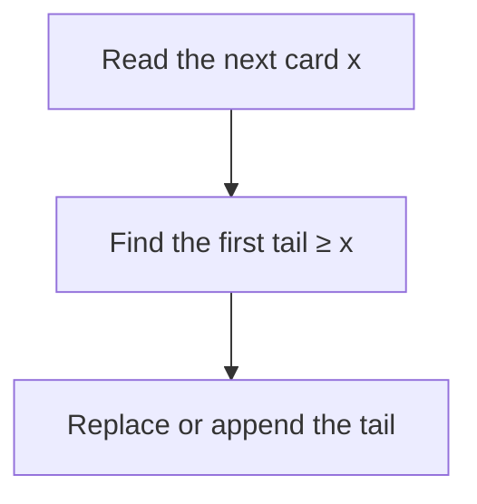

> [!tldr] Quick read
> - A subsequence preserves index order and may skip elements. Strict increase requires `<`, so equal values cannot extend one another.
> - Endpoint DP stores the best length ending exactly at i. Try every earlier j with a smaller value and take the maximum across all i.
> - The `tails` array keeps the smallest ending value for each length. Replace the first entry ≥ x, or append x if all tails are smaller.
> - The size of `tails` is the answer. Each entry may come from a different subsequence.

> [!info] Context
> This is LeetCode 300, part of [[en/posts/2026-11-27-neetcode-word-break-lis|station DP-04: Word Break and Increasing Subsequences]] on **the NeetCode Line: Dynamic Programming**. I have a stack of score cards in draw order and want to keep as many as possible with strictly rising scores. All you need is arrays and binary search.

> [!abstract]- Quick glossary for this post (click to open)
> - An [[en/concepts/increasing-subsequence|increasing subsequence]] has increasing indices and strictly increasing values.
> - A [[en/concepts/dp-state|DP state]] assigns a precise question to each cell.
> - The [[en/concepts/lis-minimum-tail|minimum tail]] is the smallest final value among increasing subsequences of a given length.
> - A [[en/concepts/lower-bound|lower bound]] finds the first index whose value is greater than or equal to a threshold.

## Picture it first: pick cards by score

I reveal cards in order. Two selections both contain three cards. One ends at score 8 and the other ends at 5. A new card with score 7 can follow the selection that ends at 5. At equal lengths, keeping the smallest last score preserves every extension the larger score would permit.

| Everyday life | Concept |
|---|---|
| Cards arrive in draw order | Input indices |
| Skip cards and preserve their order | Subsequence |
| Smallest last score among groups of k cards | `tails[k-1]` |
| Find the first slot whose score is ≥ x | Lower bound |



## The problem: find the longest strictly increasing subsequence length

The input contains 1 to 2,500 integers in the range [−10,000, 10,000]. Choose positions in their original order so each value is greater than the previous one. Return the largest number of positions that can be chosen. From `[4,8,1,6,9,2]`, I can keep `[1,6,9]`, so the answer is at least 3. The endpoint table below shows that 4 is impossible. [Original LeetCode 300 problem](https://leetcode.com/problems/longest-increasing-subsequence/)

## How it works

### Try both choices

I can always skip position i. I can take it when I have chosen nothing or when the value at i exceeds my last choice. Try both legal branches and keep the greater length. In an increasing array, every ordered selection of positions is valid and the tree has 2ⁿ leaves. It takes O(2ⁿ) time and O(n) stack space. I use this version as a reference on small cases.

### Dynamic programming by endpoint

Let `end[i]` be the best length ending **exactly at i**. The one-element subsequence gives an initial value of 1. When `j < i` and `nums[j] < nums[i]`, extending the best subsequence at j gives candidate `end[j]+1`. Every longer subsequence ending at i has one such predecessor, so take the maximum candidate. Return the maximum across all cells because the final input position may not end the longest subsequence.

| i | 0 | 1 | 2 | 3 | 4 | 5 |
|---|---:|---:|---:|---:|---:|---:|
| Value | 4 | 8 | 1 | 6 | 9 | 2 |
| `end[i]` | 1 | 2 | 1 | 2 | 3 | 2 |

The loop checks exactly n(n−1)/2 index pairs. It takes O(n²) time and O(n) space.

### Minimum tails and binary search

After each prefix, `tails[k-1]` is the smallest final value among all increasing subsequences of length k. For equal lengths, a smaller tail can be extended by every future value that could extend a larger one. Minimum tails increase strictly with length. Take a subsequence that achieves the smallest tail for length k+1 and remove the final element. Its new last value is smaller than the removed one, and the minimum tail for length k can be even smaller.

When reading x, let p be the first index with `tails[p] ≥ x`, or the array length if every tail is smaller. If p > 0, `tails[p-1] < x`, so a length-p subsequence can be extended by x. If p = 0, start with a single element. All earlier cells are already smaller than x and cannot improve. A longer subsequence ending at x would need a previous subsequence of length at least p+1 with a tail smaller than x. When cell p exists, even its minimum tail fails that test. When p is beyond the last cell, length p+1 was unreachable in the old prefix. Only cell p needs to change.

| New value | 4 | 8 | 1 | 6 | 9 | 2 |
|---|---|---|---|---|---|---|
| `tails` after the step | `[4]` | `[4,8]` | `[1,8]` | `[1,6]` | `[1,6,9]` | `[1,2,9]` |

`[1,2,9]` is ordered by **the length each tail represents**. Value 2 follows 9 in the input, so those three saved values cannot form a subsequence in that order. The subsequence `[1,6,9]` still witnesses length 3.

Let L be the answer length. Binary search on the increasing tails takes O(n log(L+1)) time, or O(n log n) in the worst case. Implementations that grow the array with the number of tails store O(L) cells. Java allocates n cells up front and searches only the occupied prefix, so it uses O(n) space.

## Runnable example

[TypeScript](../code/neetcode-longest-increasing-subsequence/lis.ts) · [Python](../code/neetcode-longest-increasing-subsequence/lis.py) · [Go](../code/neetcode-longest-increasing-subsequence/lis.go) · [Java](../code/neetcode-longest-increasing-subsequence/lis.java) · [JavaScript](../code/neetcode-longest-increasing-subsequence/lis.js) · [PHP](../code/neetcode-longest-increasing-subsequence/lis.php) · [Rust](../code/neetcode-longest-increasing-subsequence/lis.rs)

```ts
function lisByTails(nums: number[], work: {comparisons:number} = {comparisons:0}) {
    const tails: number[] = []
    for (const x of nums) {
        let lo=0, hi=tails.length
        while (lo < hi) {
            const mid=lo+Math.floor((hi-lo)/2)
            work.comparisons++
            if (tails[mid] < x) lo=mid+1
            else hi=mid
        }
        tails[lo]=x
    }
    return tails.length
}
```

```python
def lis_by_tails(nums):
    tails = []
    for x in nums:
        lo, hi = 0, len(tails)
        while lo < hi:
            mid = lo + (hi - lo) // 2
            if tails[mid] < x:
                lo = mid + 1
            else:
                hi = mid
        if lo == len(tails):
            tails.append(x)
        else:
            tails[lo] = x
    return len(tails)
```

```go
func lisByTails(nums []int) int {
	var tails []int
	for _, x := range nums {
		lo, hi := 0, len(tails)
		for lo < hi {
			mid := lo + (hi-lo)/2
			if tails[mid] < x {
				lo = mid + 1
			} else {
				hi = mid
			}
		}
		if lo == len(tails) {
			tails = append(tails, x)
		} else {
			tails[lo] = x
		}
	}
	return len(tails)
}
```

```java
static int lisByTails(int[] nums) {
    int[] tails = new int[nums.length];
    int size = 0;
    for (int x : nums) {
        int lo = 0, hi = size;
        while (lo < hi) {
            int mid = lo + (hi - lo) / 2;
            if (tails[mid] < x) lo = mid + 1;
            else hi = mid;
        }
        tails[lo] = x;
        if (lo == size) size++;
    }
    return size;
}
```

```js
function lisByTails(nums, work = {comparisons:0}) {
    const tails = []
    for (const x of nums) {
        let lo=0, hi=tails.length
        while (lo < hi) {
            const mid=lo+Math.floor((hi-lo)/2)
            work.comparisons++
            if (tails[mid] < x) lo=mid+1
            else hi=mid
        }
        tails[lo]=x
    }
    return tails.length
}
```

```php
function lisByTails(array $nums): int {
    $tails = [];
    foreach ($nums as $x) {
        $lo = 0;
        $hi = count($tails);
        while ($lo < $hi) {
            $mid = $lo + intdiv($hi - $lo,2);
            if ($tails[$mid] < $x) $lo = $mid+1;
            else $hi = $mid;
        }
        $tails[$lo] = $x;
    }
    return count($tails);
}
```

```rust
fn lis_by_tails(nums: &[i32]) -> usize {
    let mut tails = Vec::new();
    for &x in nums {
        let (mut lo, mut hi) = (0, tails.len());
        while lo < hi {
            let mid = lo + (hi - lo) / 2;
            if tails[mid] < x {
                lo = mid + 1;
            } else {
                hi = mid;
            }
        }
        if lo == tails.len() {
            tails.push(x);
        } else {
            tails[lo] = x;
        }
    }
    tails.len()
}
```

The tabs show the tails implementation. The downloads also contain brute force and endpoint DP. Each file checks 12 cases, including the negative bound, duplicate values, an answer ending before the last element, and two arrays of length 2,500 in opposite orders. The empty case checks a convention outside the judge limits. Brute force runs only on arrays of length at most 10. Both Node.js files also compare 5,460 arrays against brute force by enumerating every array of length 1 through 6 over `[-2,-1,0,1]`.

```text
12/12 cases passed
5460 small arrays compared with brute force
n=2500, increasing: DP 3123750, tails 23417 value comparisons
```

*(Output labels translated; the files themselves print Vietnamese.)*

The Node.js measurement counts each comparison between two input values in the DP, or between a tail and the new element in binary search. It excludes loop boundary checks and allocation costs. The counts do not establish a fixed wall-clock ratio.

## Misconceptions and common traps

- Changing the search condition to `tails[mid] <= x` skips entries equal to x. Strict increase requires replacing an equal entry without extending the length.
- Returning `end[n-1]` misses a subsequence that ends early. For `[1,4,9,-1]`, the final cell is 1 and the answer is 3.
- Sorting the input removes the order constraint between indices. A decreasing array can become increasing after sorting, changing the answer.
- Python needs `append` when the insertion position equals the current length. PHP can assign the next integer key. Java must put the search upper bound at `size` to avoid reading unused zero cells.

## Self-check questions

> [!question]- What happens if I read another 3 when tails is [1,3]?
> Lower bound returns index 1. Replacing 3 with 3 keeps the length at 2.

> [!question]- Why can I discard tail 8 when tail 6 is available at the same length?
> Every future value above 8 is also above 6. Tail 6 can also accept a value between 6 and 8.

> [!question]- Does [1,2,9] prove we found the actual increasing subsequence?
> Each slot stores its own representative for a length. Value 2 arrives after 9 in the input. One actual subsequence of length 3 is [1,6,9].

## References

- [LeetCode 300 and input limits](https://leetcode.com/problems/longest-increasing-subsequence/)
- [Aldous and Diaconis, section 1.2 on patience sorting](https://www.stat.berkeley.edu/~aldous/Papers/me86.pdf)
