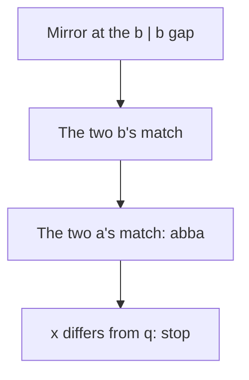

> [!tldr] Quick read
> - A palindrome has one [[en/concepts/palindrome-center|center]], located at a character or at a gap between characters.
> - Expand both ends from every center and keep the longest span. This costs O(n²) time and O(1) auxiliary space.
> - Manacher initializes a [[en/concepts/palindrome-radius|radius]] from its mirror to reach O(n) time with O(n) space.

> [!info] Context
> LeetCode 5 belongs to [[en/posts/2026-11-27-neetcode-palindrome-centers|station 2: Expanding Palindromes]] on the NeetCode Dynamic Programming line. You need array indexing and integer division. The first example uses a mirror to choose where to start probing.

> [!abstract]- Quick glossary for this post (click to open)
> - A **substring** is a contiguous range of characters picked by its endpoints.
> - A **palindrome** reads the same forward and backward.
> - A **virtual radius** is the distance from the center to its boundary in the gapped sequence. After maximal expansion it equals the length of the original span.

## Picture it first: put a mirror between two buttons

The string `xabbaq` looks like six pinned buttons. Put a mirror in the gap between the two b's. The b pair matches, then the a pair matches, and finally x and q differ, so stop. The answer is `abba`.

| Everyday life | Concept |
|---|---|
| Put a mirror on a button | Odd center |
| Put a mirror in a gap | Even center |
| Compare opposite buttons | Expand the range by one pair |
| The two buttons differ | Stop at the maximal palindrome for that center |



## The problem: return a longest substring

The input contains 1 to 1,000 English letters and digits. Return a longest palindromic substring. Ties allow either answer. For `abab`, both `aba` and `bab` qualify. The files return the earlier span on ties for deterministic output.

## How it works

### From checking both ends to expanding from the center

Enumerating endpoints yields O(n²) candidates. Comparing each candidate with its reverse leads to O(n³) work in the all-equal worst case. A dynamic programming table can remember the inner palindrome using `P[l,r] = s[l] == s[r] and (r-l < 2 or P[l+1,r-1])`. This uses O(n²) time and space. Reversing the direction of the checks removes the table when only a longest substring is needed.

Place a center on each character and in each interior gap. Expand from the inside out. A mismatching pair rules out every larger span at that center because each would include the same pair. Keep the largest span per center and then the global maximum. Center expansion holds only a few indices, taking O(n²) time and O(1) auxiliary space.

### One coordinate system for odd and even centers

The virtual sequence puts real characters at odd positions `2k+1` and gaps at even positions. The outer gaps form boundaries 0 and 2n. Both positions in a symmetric comparison have the same parity. Two gaps always match. Two characters need a comparison using the indices divided by two and rounded down. When expansion finishes, radius `r` around `i` gives a substring of length `r` starting at `(i-r)/2` in the original string. The demo uses virtual indices without constructing a transformed string.

### Manacher reuses mirrored work

Keep the center `C` with the farthest right edge `R`. If `i < R`, its mirror is `2C-i`. Seed its radius with `min(radius[2C-i], R-i)`. The part inside the edge is already known to match. Anything outside has to be probed. When the mirrored radius is smaller than the remaining distance, the next probe encounters a mirrored mismatch. If it reaches the edge, each successful probe outside the old window extends the right edge. Allowing one failure per center gives O(n) probes and an O(n) radius table.

With a [string of 1,000 a's](../code/neetcode-palindrome-centers/compare.ts), independent expansion takes 1,000,000 probes and Manacher takes 1,999, including comparisons of the gaps that always match. Both return length 1,000. These are loop counts rather than wall-clock times.

## Runnable example

Each file checks both independent expansion and mirror reuse. The eight cases include even and odd centers, a tie, a long repeated string, and an empty input outside the problem constraints.

[TypeScript](../code/neetcode-longest-palindromic-substring/centers.ts) · [Python](../code/neetcode-longest-palindromic-substring/centers.py) · [Go](../code/neetcode-longest-palindromic-substring/centers.go) · [Java](../code/neetcode-longest-palindromic-substring/centers.java) · [JavaScript](../code/neetcode-longest-palindromic-substring/centers.js) · [PHP](../code/neetcode-longest-palindromic-substring/centers.php) · [Rust](../code/neetcode-longest-palindromic-substring/centers.rs)

```typescript
type Stats = { start: number; length: number; count: number };

function palindromes(text: string, reuseMirror: boolean): Stats {
  const last = 2 * text.length;
  const radius = reuseMirror ? Array<number>(last + 1).fill(0) : [];
  let center = 0, right = 0;
  const answer: Stats = { start: 0, length: 0, count: 0 };

  for (let i = 0; i <= last; i++) {
    let length = reuseMirror && i < right ? Math.min(radius[2 * center - i], right - i) : 0;
    while (i - length > 0 && i + length < last) {
      const left = i - length - 1;
      const next = i + length + 1;
      if (left % 2 && text[(left - 1) / 2] !== text[(next - 1) / 2]) break;
      length++;
    }
    if (reuseMirror) {
      radius[i] = length;
      if (i + length > right) {
        center = i;
        right = i + length;
      }
    }
    if (length > answer.length) {
      answer.start = (i - length) / 2;
      answer.length = length;
    }
    answer.count += Math.floor((length + 1) / 2);
  }
  return answer;
}

function longestPalindrome(text: string, reuseMirror = false): string {
  const { start, length } = palindromes(text, reuseMirror);
  return text.slice(start, start + length);
}
```

```python
def palindromes(text, reuse_mirror):
    last = 2 * len(text)
    radius = [0] * (last + 1) if reuse_mirror else []
    center = right = start = best = count = 0

    for i in range(last + 1):
        length = min(radius[2 * center - i], right - i) if reuse_mirror and i < right else 0
        while i - length > 0 and i + length < last:
            left, next_pos = i - length - 1, i + length + 1
            if left % 2 and text[left // 2] != text[next_pos // 2]:
                break
            length += 1
        if reuse_mirror:
            radius[i] = length
            if i + length > right:
                center, right = i, i + length
        if length > best:
            start, best = (i - length) // 2, length
        count += (length + 1) // 2
    return start, best, count


def longest_palindrome(text, reuse_mirror=False):
    start, length, _ = palindromes(text, reuse_mirror)
    return text[start:start + length]
```

```go
package main

import (
	"fmt"
	"strings"
)

type stats struct{ start, length, count int }

func palindromes(text string, reuseMirror bool) stats {
	last := 2 * len(text)
	var radius []int
	if reuseMirror {
		radius = make([]int, last+1)
	}
	center, right := 0, 0
	answer := stats{}

	for i := 0; i <= last; i++ {
		length := 0
		if reuseMirror && i < right {
			length = min(radius[2*center-i], right-i)
		}
		for i-length > 0 && i+length < last {
			left, next := i-length-1, i+length+1
			if left%2 != 0 && text[left/2] != text[next/2] {
				break
			}
			length++
		}
		if reuseMirror {
			radius[i] = length
			if i+length > right {
				center, right = i, i+length
			}
		}
		if length > answer.length {
			answer.start, answer.length = (i-length)/2, length
		}
		answer.count += (length + 1) / 2
	}
	return answer
}

func longestPalindrome(text string, reuseMirror bool) string {
	result := palindromes(text, reuseMirror)
	return text[result.start : result.start+result.length]
}
```

```java
class Centers {
    record Stats(int start, int length, int count) {}

    static Stats palindromes(String text, boolean reuseMirror) {
        int last = 2 * text.length();
        int[] radius = reuseMirror ? new int[last + 1] : new int[0];
        int center = 0, right = 0, start = 0, best = 0, count = 0;

        for (int i = 0; i <= last; i++) {
            int length = reuseMirror && i < right ? Math.min(radius[2 * center - i], right - i) : 0;
            while (i - length > 0 && i + length < last) {
                int left = i - length - 1, next = i + length + 1;
                if (left % 2 != 0 && text.charAt(left / 2) != text.charAt(next / 2)) break;
                length++;
            }
            if (reuseMirror) {
                radius[i] = length;
                if (i + length > right) {
                    center = i;
                    right = i + length;
                }
            }
            if (length > best) {
                start = (i - length) / 2;
                best = length;
            }
            count += (length + 1) / 2;
        }
        return new Stats(start, best, count);
    }

    static String longestPalindrome(String text, boolean reuseMirror) {
        Stats result = palindromes(text, reuseMirror);
        return text.substring(result.start(), result.start() + result.length());
    }
}
```

```javascript
function palindromes(text, reuseMirror) {
    const last = 2 * text.length;
    const radius = reuseMirror ? Array(last + 1).fill(0) : [];
    let center = 0, right = 0;
    const answer = {
        start: 0,
        length: 0,
        count: 0
    };
    for(let i = 0; i <= last; i++){
        let length = reuseMirror && i < right ? Math.min(radius[2 * center - i], right - i) : 0;
        while(i - length > 0 && i + length < last){
            const left = i - length - 1;
            const next = i + length + 1;
            if (left % 2 && text[(left - 1) / 2] !== text[(next - 1) / 2]) break;
            length++;
        }
        if (reuseMirror) {
            radius[i] = length;
            if (i + length > right) {
                center = i;
                right = i + length;
            }
        }
        if (length > answer.length) {
            answer.start = (i - length) / 2;
            answer.length = length;
        }
        answer.count += Math.floor((length + 1) / 2);
    }
    return answer;
}
function longestPalindrome(text, reuseMirror = false) {
    const { start, length } = palindromes(text, reuseMirror);
    return text.slice(start, start + length);
}
const cases = [
    [
        "",
        ""
    ],
    [
        "c",
        "c"
    ],
    [
        "xabbaq",
        "abba"
    ],
    [
        "tacocatx",
        "tacocat"
    ],
    [
        "abab",
        "aba"
    ],
    [
        "zzzz",
        "zzzz"
    ],
    [
        "xyz",
        "x"
    ],
    [
        "a".repeat(1000),
        "a".repeat(1000)
    ]
];
for (const [text, expected] of cases){
    if (longestPalindrome(text) !== expected || longestPalindrome(text, true) !== expected) {
        throw new Error("Sai đoạn đối xứng");
    }
}
console.log(`${cases.length}/${cases.length} ca đúng`);
```

```php
<?php
declare(strict_types=1);

function palindromes(string $text, bool $reuseMirror): array
{
    $last = 2 * strlen($text);
    $radius = $reuseMirror ? array_fill(0, $last + 1, 0) : [];
    $center = $right = $start = $best = $count = 0;

    for ($i = 0; $i <= $last; $i++) {
        $length = $reuseMirror && $i < $right ? min($radius[2 * $center - $i], $right - $i) : 0;
        while ($i - $length > 0 && $i + $length < $last) {
            $left = $i - $length - 1;
            $next = $i + $length + 1;
            if ($left % 2 && $text[intdiv($left, 2)] !== $text[intdiv($next, 2)]) {
                break;
            }
            $length++;
        }
        if ($reuseMirror) {
            $radius[$i] = $length;
            if ($i + $length > $right) {
                [$center, $right] = [$i, $i + $length];
            }
        }
        if ($length > $best) {
            [$start, $best] = [intdiv($i - $length, 2), $length];
        }
        $count += intdiv($length + 1, 2);
    }
    return [$start, $best, $count];
}

function longestPalindrome(string $text, bool $reuseMirror = false): string
{
    [$start, $length] = palindromes($text, $reuseMirror);
    return substr($text, $start, $length);
}
```

```rust
#[derive(Default)]
struct Stats {
    start: usize,
    length: usize,
    count: usize,
}

fn palindromes(text: &str, reuse_mirror: bool) -> Stats {
    let bytes = text.as_bytes();
    let last = 2 * bytes.len();
    let mut radius = if reuse_mirror {
        vec![0; last + 1]
    } else {
        Vec::new()
    };
    let (mut center, mut right) = (0, 0);
    let mut answer = Stats::default();

    for i in 0..=last {
        let mut length = if reuse_mirror && i < right {
            radius[2 * center - i].min(right - i)
        } else {
            0
        };
        while i > length && i + length < last {
            let (left, next) = (i - length - 1, i + length + 1);
            if left % 2 != 0 && bytes[left / 2] != bytes[next / 2] {
                break;
            }
            length += 1;
        }
        if reuse_mirror {
            radius[i] = length;
            if i + length > right {
                (center, right) = (i, i + length);
            }
        }
        if length > answer.length {
            (answer.start, answer.length) = ((i - length) / 2, length);
        }
        answer.count += (length + 1) / 2;
    }
    answer
}

fn longest_palindrome(text: &str, reuse_mirror: bool) -> &str {
    let result = palindromes(text, reuse_mirror);
    &text[result.start..result.start + result.length]
}
```

```text
8/8 cases passed
```

*(Output labels translated; the files themselves print Vietnamese.)*

## Misconceptions and common traps

- Considering only character centers misses `abba`.
- Joining arbitrary matching characters can produce a subsequence instead of a substring. The result must come from one interval.
- Copying the full mirrored radius past `R` treats untested territory as a match. Cap it at `R-i` first.
- JavaScript and Java use UTF-16 indices. Go, Rust, and PHP index bytes in these examples. The problem's ASCII alphabet works in all versions. With arbitrary UTF-8, decide the comparison unit before slicing in Rust because slicing inside a UTF-8 code point can panic.

## Self-check questions

> [!question]- Which answer does the implementation choose when two longest palindromes tie?
> The strict `length > best` test keeps the first maximum. Centers are scanned from left to right, so of two equal-length spans the earlier center starts earlier.

> [!question]- Why can't we use the entire mirrored radius?
> The larger palindrome guarantees symmetry only up to the current right edge. Anything past it needs a comparison.

## References

- [LC-0005 problem](https://leetcode.com/problems/longest-palindromic-substring/)
- [Princeton Algorithms, Manacher](https://algs4.cs.princeton.edu/53substring/Manacher.java.html)
- [Manacher's original paper](https://doi.org/10.1145/321892.321896)
