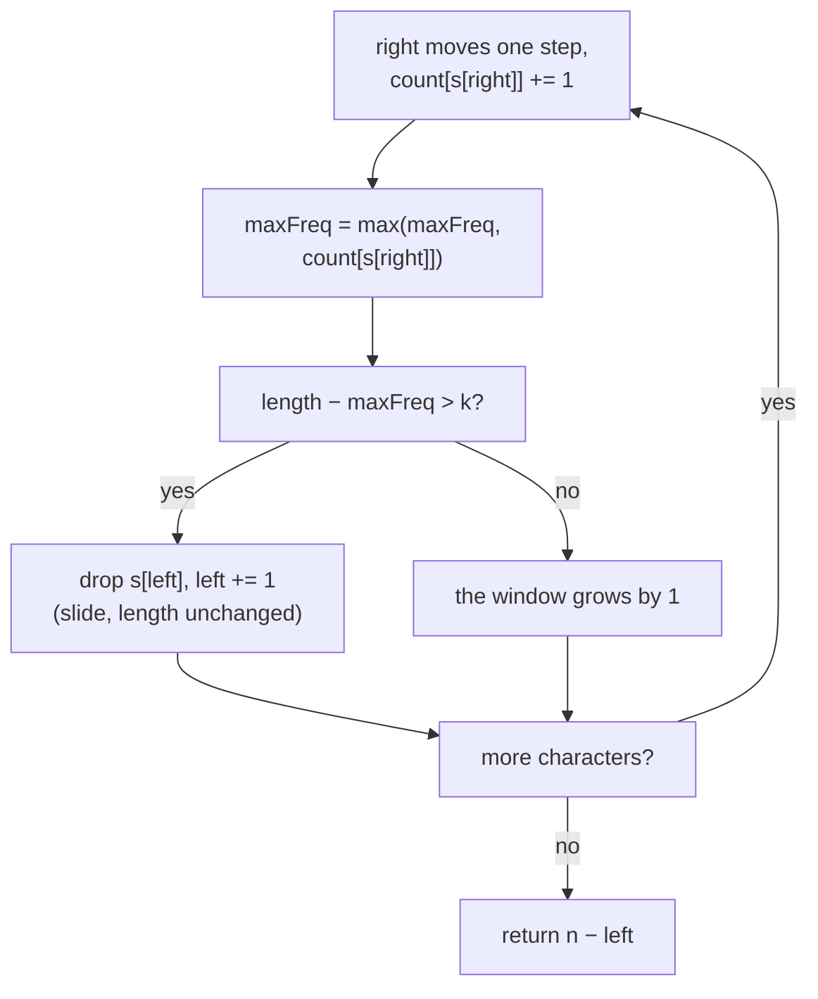

> [!tldr] Quick read
> - The problem: an uppercase string `s` and a number k. You may change at most k characters; return the length of the longest substring that can become **a single letter** (`"AABABBA"`, k = 1 → 4).
> - A window works when `length − maxFreq ≤ k`, where `maxFreq` is the count of the most frequent letter in the window: keep that letter, change the rest. This is the [[en/concepts/window-invariant|invariant]] of the [[en/concepts/sliding-window|sliding window]].
> - The neatest approach is a [[en/concepts/non-shrinking-window|non-shrinking window]]: each step the window grows by 1 or slides as a whole, and `maxFreq` **never drops** even after the left character leaves. The answer is the window's final length.
> - In the measurement, the stale `maxFreq` is larger than the true value at 99 973 of 100 000 steps, yet the answer is still right. The reason: the window only grows when a letter reaches a **new record** frequency, and at that moment the frequency is real.
> - Trap: keeping the letter at the **left end** instead of the most frequent one (`"BAAAB"`, k = 2 gives 4 instead of 5).

> [!info] Context
> LeetCode problem 424, part of [[en/posts/2026-11-23-neetcode-sliding-window|station 5: Sliding Window]] on **the NeetCode line: Arrays and Strings**. It reuses the 26-cell count table of [[en/posts/2026-11-22-neetcode-counting-keys|station 2]] inside a variable-size window like [[en/problems/longest-substring-without-repeating-characters|Longest Substring Without Repeating Characters]]. The solutions come in TypeScript, Python, Go, Java, JavaScript, PHP and Rust. You need loops, strings and count arrays.

> [!abstract]- Quick glossary for this post (click to open)
> - **Substring**: characters next to each other in a string.
> - **Frequency**: how many times a letter appears. `maxFreq` is the highest frequency in the window.
> - **26-cell count array**: `count[c − 'A']` instead of a Map when there are only uppercase letters. See [[en/concepts/counting-array|Counting Array]].
> - **Non-shrinking window**: a window that, each step, only grows or slides, so its length never decreases. See [[en/concepts/non-shrinking-window|Non-shrinking Window]].

## Picture it first: repainting a row of chairs

A row of chairs is painted in many colors. The painter only has paint left for k chairs. You want to mark the longest stretch of adjacent chairs that can end up all one color after repainting. The cheapest plan: keep the color that is **most common** in the stretch and paint over the rest.

| Everyday life | Concept |
|---|---|
| The stretch of chairs marked off | the window `[left, right]` |
| The most common color in the stretch | `maxFreq` |
| The number of chairs to repaint | `length − maxFreq` |
| Enough paint left | `length − maxFreq ≤ k` |
| Out of paint: shift the whole frame one chair right instead of shrinking it | the window slides as a whole, never shrinks |
| A "most common color ever seen" record on the board, never erased | `maxFreq` never drops |



## The problem

**The problem (in my own words):** given a string `s` of uppercase A–Z only (1 ≤ length ≤ 10⁵) and an integer `0 ≤ k ≤ length`. Each operation changes one character into any uppercase letter; you may do at most k operations. Return the length of the longest substring that can become all one letter. Original: [LeetCode 424](https://leetcode.com/problems/longest-repeating-character-replacement/).

| Input | Output | Why |
|---|---|---|
| `"ABAB"`, k = 2 | 4 | change both A to B (or the reverse) |
| `"AABABBA"`, k = 1 | 4 | change the middle A in `"ABBB"`: the run `"BBBB"` |
| `"BAAAB"`, k = 2 | 5 | keep A (3 times), change both B |

I used to think you had to try each letter A..Z as "the letter to keep". It turns out you don't have to pick in advance: keep whichever letter is most common in the window, and one number, `maxFreq`, is enough.

## How it works

<figure class="figure-map" style="--ar: 3 / 4">
<div class="frame"><iframe data-archify="../../diagrams/neetcode-longest-repeating-character-replacement/worked-example.en.html" title="Count the replacements a window needs" loading="lazy"></iframe></div>
<figcaption><span><b>Figure 1.</b> Count the replacements a window needs.</span><a href="../diagrams/neetcode-longest-repeating-character-replacement/worked-example.en.html" target="_blank" rel="noopener">Open full screen</a></figcaption>
</figure>

<details>
<summary>Read the steps</summary>
<ol>
<li>Grow the window to ABBA. <code>A = 2, B = 2, k = 1</code></li>
<li>Two replacements exceed one, so shrink. <code>4 - 2 = 2</code></li>
<li>BBA needs one replacement. <code>3 - 2 = 1</code></li>
<li>Keep the valid length of 3. <code>&quot;BBA&quot; → &quot;BBB&quot;</code></li>
</ol>
</details>

### Approach 1, brute force: O(n²)

From each start i, extend j and update the count table; the substring `[i, j]` works when `j − i + 1 − maxFreq ≤ k`. Two nested loops; the measurement below follows the n² shape.

### Approach 2, a window shrunk with while, recounting maxFreq

Add `s[right]`. While `length − max(count) > k`, drop `s[left]` and advance `left` until valid, recomputing `max(count)` from 26 cells each time. Correct, O(26·n).

### Approach 3, a non-shrinking window

Two small changes from approach 2:
1. `maxFreq` is only ever **raised** when a character is added, never recomputed when a left character is dropped.
2. Use `if` instead of `while`: when the window breaks, drop just **one** character on the left. The window has just gained a character on the right, so its length is unchanged: it slides rather than shrinks.

The answer is `n − left`, the window's length at the end, because the length never decreases.

### Why a stale maxFreq still gives the right answer

Let L be the window's length. At first the window grows every step and nothing is dropped, so every count is real. From the first slide on, `L − maxFreq = k` after every step: breaking means `L + 1 − maxFreq = k + 1`, and dropping one character brings it back to `k`. From this:

- **The window grows only when maxFreq goes up.** Adding a character without changing `maxFreq` gives `L + 1 − maxFreq = k + 1 > k`, so it must slide. `maxFreq` going up means the character **just added** appears exactly `maxFreq` times in the **current** window, and those counts are real. So every length the window reaches belongs to a substring that really works: the answer is never too large.
- **The answer is never too small.** To find a substring longer than L, it must contain a letter at least `L + 1 − k = maxFreq + 1` times, more than any frequency seen so far. When the window (length L, sliding across that substring) meets that many occurrences, `maxFreq` goes up and the window grows. A `maxFreq` lower than the record helps with nothing, so there is no need to lower it.

In short: `maxFreq` doesn't need to be right for the current window; it only needs to be the **record**, because only a new record can raise the answer. The TypeScript file counts it: on 100 000 random characters, the stale `maxFreq` is above the true value at 99 973 steps, the result still matches the recounting version, and 5 000 random strings checked against brute force show no mismatch.

### Measured

TypeScript, random letters, k = 2, median:

| n | letters | brute force | shrink + recount | non-shrinking |
|---|---|---|---|---|
| 2 000 | 26 | 5.0 ms | 0.42 ms | 0.01 ms |
| 4 000 | 26 | 19.8 ms | 0.86 ms | 0.01 ms |
| 8 000 | 26 | 77.7 ms | 1.70 ms | 0.03 ms |
| 10⁶ | 26 | (not run) | 212.22 ms | 3.30 ms |
| 10⁶ | 2 | (not run) | 136.31 ms | 3.20 ms |

At 10⁶ characters, dropping the recount is about 60 times faster: `Math.max(...count)` scans 26 cells and spreads the array into 26 arguments on every call.

### Under the hood of the seven languages

| | Counting | Language-specific trap |
|---|---|---|
| TypeScript / JavaScript | `count[s.charCodeAt(i) − 65]` | `Math.max(...count)` spreads the array on every call: correct but slow |
| Python | `count[ord(ch) − 65]` | `max(count)` scans 26 cells; `Counter` is handier but slower than a list |
| Go | `var count [26]int`, `s[i] − 'A'` | `s[i]` is a byte: fine because the input is ASCII uppercase only |
| Java | `int[26]`, `s.charAt(i) − 'A'` | `char − char` gives an `int`; there is no max for arrays, you write your own |
| PHP | `array_fill(0, 26, 0)`, `ord($s[$i]) − 65` | `max($count)` works on arrays out of the box; `$s[$i]` is a byte, fine because the input is uppercase ASCII |
| Rust | `[0usize; 26]`, `b[i] − b'A'` | `count.iter().max()` returns an `Option`; a `usize` subtraction that goes negative panics |

## Runnable example

[TypeScript](../code/neetcode-longest-repeating-character-replacement/character-replacement.ts) · [Python](../code/neetcode-longest-repeating-character-replacement/character_replacement.py) · [Go](../code/neetcode-longest-repeating-character-replacement/character_replacement.go) · [Java](../code/neetcode-longest-repeating-character-replacement/character-replacement.java) · [JavaScript](../code/neetcode-longest-repeating-character-replacement/character-replacement.js) · [PHP](../code/neetcode-longest-repeating-character-replacement/character-replacement.php) · [Rust](../code/neetcode-longest-repeating-character-replacement/character_replacement.rs)

Each file has the brute force, the recounting window and the non-shrinking window, and runs 8 cases. Below are the two window approaches.

```ts
// Approach 2, a window shrunk with while, recomputing the exact maxFreq from 26 cells on every shrink. O(26·n).
function windowRecount(s: string, k: number): number {
  const count = new Array(26).fill(0);
  let left = 0, best = 0;
  for (let right = 0; right < s.length; right++) {
    count[idx(s, right)]++;
    while (right - left + 1 - Math.max(...count) > k) count[idx(s, left++)]--;
    best = Math.max(best, right - left + 1);
  }
  return best;
}

// Approach 3, a window that never shrinks: maxFreq only goes up, never down when a left character leaves. O(n).
function windowStaleMax(s: string, k: number): number {
  const count = new Array(26).fill(0);
  let left = 0, maxFreq = 0;
  for (let right = 0; right < s.length; right++) {
    maxFreq = Math.max(maxFreq, ++count[idx(s, right)]);
    if (right - left + 1 - maxFreq > k) count[idx(s, left++)]--; // "if", not "while": the window slides as a whole
  }
  return s.length - left; // the window never shrinks, so its final length is the largest it ever reached
}
```

```python
def window_recount(s: str, k: int) -> int:
    count = [0] * 26
    left = best = 0
    for right, ch in enumerate(s):
        count[ord(ch) - 65] += 1
        while right - left + 1 - max(count) > k:  # max(count) scans 26 cells every time
            count[ord(s[left]) - 65] -= 1
            left += 1
        best = max(best, right - left + 1)
    return best

def window_stale_max(s: str, k: int) -> int:
    count = [0] * 26
    left = max_freq = 0
    for right, ch in enumerate(s):
        count[ord(ch) - 65] += 1
        max_freq = max(max_freq, count[ord(ch) - 65])
        if right - left + 1 - max_freq > k:  # "if": the window slides as a whole, it never shrinks
            count[ord(s[left]) - 65] -= 1
            left += 1
    return len(s) - left
```

```go
func windowRecount(s string, k int) int {
	var count [26]int // fixed-size array: no allocation, zero-filled
	left, best := 0, 0
	for right := 0; right < len(s); right++ {
		count[s[right]-'A']++
		for right-left+1-slices.Max(count[:]) > k {
			count[s[left]-'A']--
			left++
		}
		best = max(best, right-left+1)
	}
	return best
}

func windowStaleMax(s string, k int) int {
	var count [26]int
	left, maxFreq := 0, 0
	for right := 0; right < len(s); right++ { // s[right] is a byte: fine because the input is ASCII uppercase only
		count[s[right]-'A']++
		maxFreq = max(maxFreq, count[s[right]-'A'])
		if right-left+1-maxFreq > k {
			count[s[left]-'A']--
			left++
		}
	}
	return len(s) - left
}
```

```java
static int windowRecount(String s, int k) {
    int[] count = new int[26];
    int left = 0, best = 0;
    for (int right = 0; right < s.length(); right++) {
        count[s.charAt(right) - 'A']++;
        while (right - left + 1 - max(count) > k) count[s.charAt(left++) - 'A']--;
        best = Math.max(best, right - left + 1);
    }
    return best;
}

static int max(int[] a) {
    int m = 0;
    for (int x : a) m = Math.max(m, x);
    return m;
}

static int windowStaleMax(String s, int k) {
    int[] count = new int[26];
    int left = 0, maxFreq = 0;
    for (int right = 0; right < s.length(); right++) {
        maxFreq = Math.max(maxFreq, ++count[s.charAt(right) - 'A']); // char − 'A' gives an int 0..25
        if (right - left + 1 - maxFreq > k) count[s.charAt(left++) - 'A']--;
    }
    return s.length() - left;
}
```

```js
function windowRecount(s, k) {
  const count = new Array(26).fill(0);
  let left = 0, best = 0;
  for (let right = 0; right < s.length; right++) {
    count[s.charCodeAt(right) - 65]++;
    while (right - left + 1 - Math.max(...count) > k) count[s.charCodeAt(left++) - 65]--;
    best = Math.max(best, right - left + 1);
  }
  return best;
}

function windowStaleMax(s, k) {
  const count = new Array(26).fill(0);
  let left = 0, maxFreq = 0;
  for (let right = 0; right < s.length; right++) {
    maxFreq = Math.max(maxFreq, ++count[s.charCodeAt(right) - 65]);
    if (right - left + 1 - maxFreq > k) count[s.charCodeAt(left++) - 65]--;
  }
  return s.length - left;
}
```

```php
function windowRecount(string $s, int $k): int {
    $count = array_fill(0, 26, 0);
    $left = 0;
    $best = 0;
    for ($right = 0; $right < strlen($s); $right++) {
        $count[ord($s[$right]) - 65]++;
        while ($right - $left + 1 - max($count) > $k) $count[ord($s[$left++]) - 65]--;
        $best = max($best, $right - $left + 1);
    }
    return $best;
}

function windowStaleMax(string $s, int $k): int {
    $count = array_fill(0, 26, 0);
    $left = 0;
    $maxFreq = 0;
    for ($right = 0; $right < strlen($s); $right++) {
        $maxFreq = max($maxFreq, ++$count[ord($s[$right]) - 65]);
        if ($right - $left + 1 - $maxFreq > $k) $count[ord($s[$left++]) - 65]--; // "if", not "while"
    }
    return strlen($s) - $left;
}
```

```rust
fn window_recount(s: &str, k: usize) -> usize {
    let b = s.as_bytes();
    let mut count = [0usize; 26];
    let (mut left, mut best) = (0, 0);
    for right in 0..b.len() {
        count[idx(b[right])] += 1;
        while right - left + 1 - count.iter().max().unwrap() > k {
            count[idx(b[left])] -= 1;
            left += 1;
        }
        best = best.max(right - left + 1);
    }
    best
}

fn window_stale_max(s: &str, k: usize) -> usize {
    let b = s.as_bytes();
    let mut count = [0usize; 26];
    let (mut left, mut max_freq) = (0, 0);
    for right in 0..b.len() {
        count[idx(b[right])] += 1;
        max_freq = max_freq.max(count[idx(b[right])]);
        if right - left + 1 - max_freq > k { // "if", not "while": the window slides as a block
            count[idx(b[left])] -= 1;
            left += 1;
        }
    }
    b.len() - left
}
```


The TypeScript file also runs the wrong version that keeps the left-end letter, then counts the stale-maxFreq steps, checks against brute force and measures:

```text
$ node character-replacement.ts
bruteForce        8/8 cases passed
windowRecount     8/8 cases passed
windowStaleMax    8/8 cases passed
wrongKeepLeftChar 6/8 cases passed; wrong on BAAAB k=2 → 4, ABBB k=2 → 3

n = 100000, 4 letters, k = 3: stale maxFreq above the true max at 99973 steps; windowStaleMax = 15, windowRecount = 15
checked 5000 random strings against brute force: 0 mismatches

n          letters  brute   shrink + recount  non-shrinking  (ms, median)
2000        26       5.0           0.42       0.01
4000        26      19.8           0.86       0.01
8000        26      77.7           1.70       0.03
1000000     26         —         212.22       3.30
1000000      2         —         136.31       3.20
```

*(Output labels translated; the files themselves print Vietnamese.)*

The left-end version breaks on `"BAAAB"`: the window starts with B, so it counts three A's to change, while keeping A only needs the two B's changed. Python, Go, Java, JavaScript, PHP and Rust print `8/8 ca đúng` ("8/8 cases passed") for all three approaches.

## Misconceptions and common traps

- **"You have to try all 26 letters as the one to keep."** It works, O(26·n), but it isn't needed: the most frequent letter in the window is always the cheapest choice.
- **Keeping the left-end letter (or the letter just added).** It isn't necessarily the most frequent; the wrong version scores 6/8.
- **"maxFreq must drop when a left character leaves."** Not needed, because only a record frequency can raise the answer. Lowering it correctly means rescanning 26 cells, 60 times slower in the measurement.
- **Using `while` with a stale maxFreq and taking `best = max(best, length)`.** Still correct, but redundant: with a maxFreq that never drops, the window is never broken by more than one character, so `if` is enough and the answer is simply `n − left`.
- **Counting with a Map when the input is uppercase only.** Correct but slower than a 26-cell array; a Map is only needed for a large or unknown alphabet.
- **PHP: passing an array to a function copies it.** PHP arrays are values (copy-on-write): if you move the shrinking step into a helper that takes `$count`, the helper edits a copy, not your count table. Pass `&$count`.
- **Rust: `right - left + 1 - max_freq` on `usize`.** If the order of operations makes an intermediate result negative (say `right - max_freq + 1 - left`), a debug build panics on underflow. Keep `right - left + 1` first, since the window length is always ≥ `max_freq`.

## Self-check questions

> [!question]- Run the non-shrinking approach on `"AABABBA"`, k = 1, writing down `left`, the length and `maxFreq` after each step.
> right 0..2: length 1, 2, 3, maxFreq 1, 2, 2 (`"AAB"`: 3 − 2 = 1 ≤ 1). right 3 (A): maxFreq 3, length 4. right 4 (B): 5 − 3 = 2 > 1, slide: left = 1, length 4. right 5 (B): maxFreq still 3, 5 − 3 > 1, slide: left = 2. right 6 (A): slide: left = 3. Answer 7 − 3 = 4.

> [!question]- Why does the window grow only at steps where maxFreq goes up?
> After the first slide, `length − maxFreq = k` always holds. Adding a character without changing maxFreq makes the difference k + 1, so the window must slide and its length stays the same.

> [!question]- Can a stale maxFreq make the current window **invalid**? Does it make the answer wrong?
> Yes, a sliding window may need more than k changes. But the answer isn't wrong, because its length was already reached by a truly valid window, and it only grows on a new record frequency, which is real at that moment.

> [!question]- If the input allowed lowercase letters and digits too, what would change?
> A bigger count table (62 cells, 128 ASCII cells, or a Map). The maxFreq argument stays the same.

## References

- [LeetCode 424: Longest Repeating Character Replacement](https://leetcode.com/problems/longest-repeating-character-replacement/) (the original problem)
- [MDN: Spread syntax](https://developer.mozilla.org/en-US/docs/Web/JavaScript/Reference/Operators/Spread_syntax) (`Math.max(...arr)` spreads the array into arguments on every call)
- [Python: Built-in `max`](https://docs.python.org/3/library/functions.html#max) and [`collections.Counter`](https://docs.python.org/3/library/collections.html#collections.Counter)
- [Java 21 `String.charAt`](https://docs.oracle.com/en/java/javase/21/docs/api/java.base/java/lang/String.html#charAt(int)) (returns a `char`; subtracting two `char`s gives an `int`)
