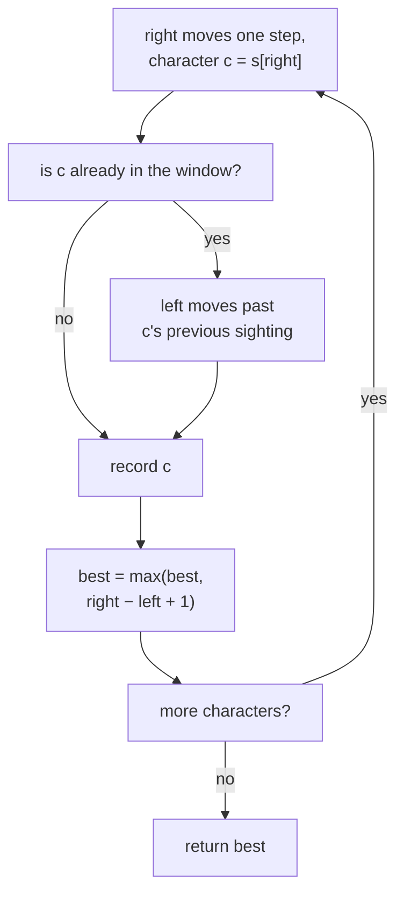

> [!tldr] Quick read
> - The problem: the length of the longest **contiguous** substring with no repeated character (`"pwwkew"` → 3, the substring `"wke"`).
> - The [[en/concepts/sliding-window|sliding window]] template: keep a window `[left, right]` that always satisfies the [[en/concepts/window-invariant|invariant]] "no character repeats". The right end adds one character; if that breaks the invariant, the left end moves forward until it holds again.
> - Shrinking with a Set: drop left characters one by one. Each character enters and leaves the Set at most once: O(n).
> - Shrinking with a [[en/concepts/last-seen-index|last-seen book]]: jump `left` straight past the previous sighting. About 3 times faster than the Set when measured, but you must check that the previous sighting is still **inside** the window, or `"abba"` gives 3 instead of 2.
> - Brute force here is O(n·k), with k the number of distinct characters, so with a small alphabet it is only a few times slower, not thousands of times.

> [!info] Context
> LeetCode problem 3, the anchor problem of [[en/posts/2026-11-23-neetcode-sliding-window|station 5: Sliding Window]] on **the NeetCode line: Arrays and Strings**. The station post uses this problem to build the variable-size window template; this page digs into the two ways of shrinking and measures them. The solutions come in TypeScript, Python, Go, Java and JavaScript. You need loops, strings and Sets ([[en/problems/contains-duplicate|Contains Duplicate]]).

> [!abstract]- Quick glossary for this post (click to open)
> - **Substring**: characters that sit **next to each other** in the string. `"wke"` is a substring of `"pwwkew"`; `"pwke"` is not (that is a subsequence).
> - **Window**: the current substring, marked by two indices `left` and `right`.
> - **Invariant**: something that is always true at the end of each loop step. Here: the window has no repeated character. See [[en/concepts/window-invariant|Window Invariant]].
> - **Last-seen book**: a table from character → index where that character was last seen. See [[en/concepts/last-seen-index|Last-seen Index]].

## Picture it first: a photo line with no matching shirts

A line of people walks through a gate one at a time. You want the longest photo frame with no two people in the same shirt colour. The frame can only be dragged one way: add new people on the right, drop people on the left.

| Everyday life | Concept |
|---|---|
| The frame being photographed | the window `[left, right]` |
| The rule "no matching shirt colour in the frame" | the invariant |
| A new person steps in on the right | `right++`, add `s[right]` |
| The newcomer matches someone in the frame: ask people on the left to leave one by one until no match | shrinking with a Set |
| Already know where the same-colour person stands: drag the left edge past them once | jumping with the last-seen book |
| The same-colour person already left the frame earlier: do nothing | check `prev ≥ left` |



## The problem

**The problem (in my own words):** given a string `s` (0 ≤ length ≤ 5·10⁴) of letters, digits, symbols and spaces, return the length of the longest contiguous substring with no repeated character. Original: [LeetCode 3](https://leetcode.com/problems/longest-substring-without-repeating-characters/).

| Input | Output | Longest substring |
|---|---|---|
| `"abcabcbb"` | `3` | `"abc"` |
| `"bbbbb"` | `1` | `"b"` |
| `"pwwkew"` | `3` | `"wke"` |
| `""` | `0` | |
| `"abba"` | `2` | `"ab"` or `"ba"` |

I used to think you have to try every substring. It turns out that once a substring has a repeated character, every **longer** substring containing it has one too, so the right end never needs to go back.

## How it works

### Approach 1, brute force

From each start i, extend until a repeated character appears. Each extension stops after at most k + 1 steps (k is the number of distinct characters, here ≤ 95), so the total is O(n·k), not O(n²) as the two loops suggest. With a large alphabet (Unicode), k can equal n.

### Approach 2, sliding window with a Set

The Set holds exactly the characters in the window. Add `s[right]`: if it's already there, delete `s[left]` and increase `left` until the repeat is gone. The `while` sits inside the `for`, but each character is added once and deleted at most once, so the total is O(n) ([[en/concepts/aggregate-analysis|aggregate analysis]]).

### Approach 3, the last-seen book

Instead of deleting characters one by one, remember where each character was last seen. When `s[right]` was seen at `prev`, the new window starts at `prev + 1`, in one jump.

The key condition: **only jump when `prev ≥ left`**. The book never deletes, so it still remembers characters that have left the window. With `"abba"`:

| right | character | `prev` | correct `left` | `left` when jumping without the check |
|---|---|---|---|---|
| 0 | a | (none) | 0 | 0 |
| 1 | b | (none) | 0 | 0 |
| 2 | b | 1 | 2 | 2 |
| 3 | a | 0 | 2 (0 < 2, no jump) | 1 (moves back) |

The wrong version gets window `[1, 3] = "bba"`, length 3, with a repeat. Go and Java write it compactly as `left = max(left, last[c])`, where `last[c]` stores position + 1.

### Measured

TypeScript, random strings over an alphabet of 26 or 95 ASCII characters, median of 5 runs:

| n | alphabet | brute force | Set | last-seen book |
|---|---|---|---|---|
| 10⁵ | 26 | 17.5 ms | 6.3 ms | 2.0 ms |
| 10⁵ | 95 | 38.7 ms | 7.1 ms | 1.9 ms |
| 10⁶ | 26 | 175.6 ms | 61.2 ms | 19.6 ms |
| 10⁶ | 95 | 392.6 ms | 61.9 ms | 20.8 ms |

Brute force grows with k (26 → 95 doubles the time); the two window approaches don't. The last-seen book is about 3 times faster than the Set: one lookup and one write per character, instead of an add and then a delete.

### Under the hood of the five languages

| | Last-seen book | Language-specific trap |
|---|---|---|
| TypeScript / JavaScript | `Map<string, number>` | `s[i]` is one UTF-16 unit: `"a😀😀"` gives 3 instead of 2 |
| Python | `dict` | `str` iterates by code point, so emoji are handled correctly |
| Go | array `[128]int` | `s[i]` is a **byte**; strings beyond ASCII must be walked with `range` to get runes |
| Java | array `int[128]` | `charAt` is a UTF-16 unit too, like JS |

The problem has only ASCII, so all five languages are correct on LeetCode. A 128-slot array instead of a Map is faster, but only correct when the input is guaranteed ASCII.

## Runnable example

[TypeScript](../code/neetcode-longest-substring-without-repeating-characters/longest-substring.ts) · [Python](../code/neetcode-longest-substring-without-repeating-characters/longest_substring.py) · [Go](../code/neetcode-longest-substring-without-repeating-characters/longest_substring.go) · [Java](../code/neetcode-longest-substring-without-repeating-characters/longest-substring.java) · [JavaScript](../code/neetcode-longest-substring-without-repeating-characters/longest-substring.js)

Each file has brute force and both window approaches, and runs 8 cases including `""`, `" "`, `"abba"` and `"tmmzuxt"`. Below are the two window approaches.

```ts
// Approach 2, sliding window with a Set: add s[right]; on a repeat, drop from the left until it's gone.
function windowSet(s: string): number {
  const inWindow = new Set<string>();
  let left = 0, best = 0;
  for (let right = 0; right < s.length; right++) {
    while (inWindow.has(s[right])) inWindow.delete(s[left++]); // shrink the window: each character is deleted at most once
    inWindow.add(s[right]);
    best = Math.max(best, right - left + 1);
  }
  return best;
}

// Approach 3, sliding window with the last-seen position: jump left straight past the repeat.
function windowLastSeen(s: string): number {
  const last = new Map<string, number>();
  let left = 0, best = 0;
  for (let right = 0; right < s.length; right++) {
    const prev = last.get(s[right]);
    if (prev !== undefined && prev >= left) left = prev + 1; // only jump when the previous sighting is INSIDE the window
    last.set(s[right], right);
    best = Math.max(best, right - left + 1);
  }
  return best;
}
```

```python
def window_set(s: str) -> int:
    in_window, left, best = set(), 0, 0
    for right, ch in enumerate(s):
        while ch in in_window:
            in_window.remove(s[left])
            left += 1
        in_window.add(ch)
        best = max(best, right - left + 1)
    return best

def window_last_seen(s: str) -> int:
    last: dict[str, int] = {}
    left = best = 0
    for right, ch in enumerate(s):
        if last.get(ch, -1) >= left:  # only jump when the previous sighting is inside the window
            left = last[ch] + 1
        last[ch] = right
        best = max(best, right - left + 1)
    return best
```

```go
func windowSet(s string) int {
	var inWindow [128]bool // the problem is ASCII only: a 128-slot array instead of a map
	left, best := 0, 0
	for right := 0; right < len(s); right++ {
		for inWindow[s[right]] {
			inWindow[s[left]] = false
			left++
		}
		inWindow[s[right]] = true
		best = max(best, right-left+1)
	}
	return best
}

func windowLastSeen(s string) int {
	var last [128]int // store position + 1, so 0 means "not seen"
	left, best := 0, 0
	for right := 0; right < len(s); right++ { // s[right] is a BYTE; beyond ASCII, walk with range to get runes
		c := s[right]
		left = max(left, last[c]) // last[c] = previous position + 1; max keeps left from moving back
		last[c] = right + 1
		best = max(best, right-left+1)
	}
	return best
}
```

```java
static int windowSet(String s) {
    Set<Character> inWindow = new HashSet<>();
    int left = 0, best = 0;
    for (int right = 0; right < s.length(); right++) {
        while (!inWindow.add(s.charAt(right))) inWindow.remove(s.charAt(left++));
        best = Math.max(best, right - left + 1);
    }
    return best;
}

static int windowLastSeen(String s) {
    int[] last = new int[128]; // position + 1; a new int array is all 0, meaning "not seen"
    int left = 0, best = 0;
    for (int right = 0; right < s.length(); right++) {
        char c = s.charAt(right);
        left = Math.max(left, last[c]);
        last[c] = right + 1;
        best = Math.max(best, right - left + 1);
    }
    return best;
}
```

```js
function windowSet(s) {
  const inWindow = new Set();
  let left = 0, best = 0;
  for (let right = 0; right < s.length; right++) {
    while (inWindow.has(s[right])) inWindow.delete(s[left++]);
    inWindow.add(s[right]);
    best = Math.max(best, right - left + 1);
  }
  return best;
}

function windowLastSeen(s) {
  const last = new Map();
  let left = 0, best = 0;
  for (let right = 0; right < s.length; right++) { // s[right] is one UTF-16 unit, not a whole emoji
    const prev = last.get(s[right]);
    if (prev !== undefined && prev >= left) left = prev + 1;
    last.set(s[right], right);
    best = Math.max(best, right - left + 1);
  }
  return best;
}
```


```text
$ node longest-substring.ts
bruteForce      8/8 cases passed
windowSet       8/8 cases passed
windowLastSeen  8/8 cases passed
windowJumpBack  6/8 cases passed; wrong on "abba" → 3 "tmmzuxt" → 6

"a😀😀".length = 5; windowLastSeen("a😀😀") = 3 (should be 2)

n          alphabet   brute force   Set   last-seen book   (ms, median of 5 runs)
100000           26      17.5   6.3               2.0
100000           95      38.7   7.1               1.9
1000000          26     175.6  61.2              19.6
1000000          95     392.6  61.9              20.8
```

*(Output labels translated; the files themselves print Vietnamese.)*

`windowJumpBack` is the version that jumps without checking `prev ≥ left`. On `"tmmzuxt"`, at the final `t`, `left` moves back from 2 to 1 and window `"mmzuxt"` is counted as length 6. The emoji line: each `😀` is two UTF-16 units, and the second half of the first emoji plus the first half of the second form a "repeat-free substring" of length 3. Python iterates by code point, so it is correct:

```text
$ python3 longest_substring.py
brute_force      8/8 cases passed
window_set       8/8 cases passed
window_last_seen 8/8 cases passed

window_last_seen("a😀😀") = 2
```

Go, Java and JavaScript print `8/8 ca đúng` ("8/8 cases passed") for all three approaches.

## Misconceptions and common traps

- **Confusing substring with subsequence.** `"pwke"` is not contiguous in `"pwwkew"`, so it doesn't count.
- **Jumping `left` without checking `prev ≥ left`.** `left` moves back and the window contains a repeat; wrong on `"abba"` and `"tmmzuxt"`.
- **Resetting the window to empty on a repeat.** `"dvdf"`: at the second `d`, the correct window is `"vd"`, not `"d"`; the answer is 3 (`"vdf"`).
- **"Two nested loops mean O(n²)."** The Set approach has a `while` inside a `for` but is O(n); brute force has two loops but is really O(n·k).
- **Using `s[i]` on Unicode strings.** JS and Java split emoji in half, Go splits accented letters into several bytes. Iterate by code point (`for…of` in JS, `range` in Go) if the input is not just ASCII.

## Self-check questions

> [!question]- Run the last-seen approach on `"dvdf"`; write `left` and `best` after each step.
> d: (0, 1); v: (0, 2); d: previous at 0 ≥ 0 so `left` = 1, (1, 2); f: (1, 3). The answer is 3.

> [!question]- In the Set approach, why doesn't the `while` loop that deletes characters make the total O(n²)?
> Each character is added to the Set exactly once (when `right` passes it) and deleted at most once (when `left` passes it). `left` never passes `right`, so the total number of deletions is ≤ n.

> [!question]- Why, once window `[left, right]` has a repeat, is there no need to try windows `[left, right']` with `right' > right`?
> They contain window `[left, right]`, so they contain that repeat too. Only increasing `left` can make the window valid again.

> [!question]- Go and Java write `left = max(left, last[c])` with `last[c]` storing position + 1. Which condition does the `max` replace?
> It replaces `if (prev >= left) left = prev + 1`. If the previous sighting is outside the window, then `last[c] ≤ left`, and `max` keeps `left` unchanged.

## References

- [LeetCode 3: Longest Substring Without Repeating Characters](https://leetcode.com/problems/longest-substring-without-repeating-characters/) (the original problem)
- [The Go Blog: Strings, bytes, runes and characters in Go](https://go.dev/blog/strings) (string indices are bytes, `range` yields runes)
- [MDN: `String` UTF-16 characters, Unicode code points](https://developer.mozilla.org/en-US/docs/Web/JavaScript/Reference/Global_Objects/String#utf-16_characters_unicode_code_points_and_grapheme_clusters) (`s[i]` is a UTF-16 unit)
