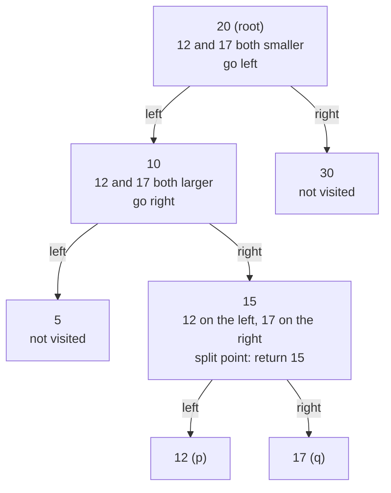
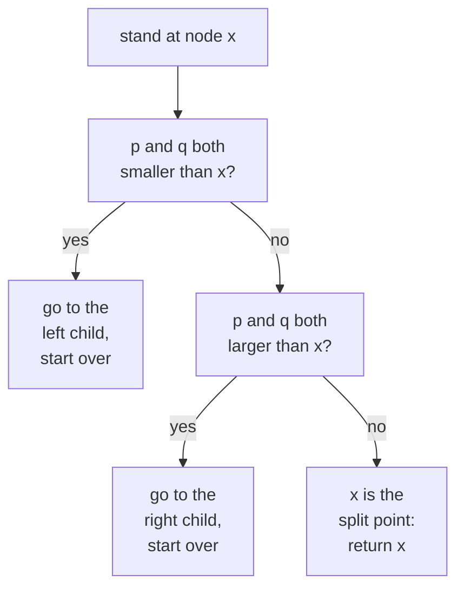

> [!tldr] Quick read
> - The problem: given a [[en/concepts/binary-search-tree|binary search tree (BST)]] and two nodes p and q that are in it, find their [[en/concepts/lowest-common-ancestor|lowest common ancestor]]: the deepest node that has both p and q as descendants, where a node counts as a descendant of itself.
> - The key idea: walk down from the root. If p and q are **both smaller** than the current node, go left; if **both larger**, go right. The first time they are not on the same side (or the current node is p or q itself) is the **split point**, and that is the answer. O(h) time, O(1) memory with a loop.
> - The general solution for an ordinary binary tree (LC 236) is also correct here, but it visits almost the whole tree: on a balanced 10⁶-node BST each query visits 1,048,566 nodes (8.3 ms in Node) against an average of 2 nodes (0.07 µs).
> - Three wrong versions that actually run: assuming the problem gives p < q (wrong on 4/10 cases), using `<=` instead of `<` and so walking past p itself (wrong on 6/10), and the "multiply the two differences, same sign means same side" trick in a 32-bit `int`: Java returns node 0 instead of 50000 because 50000 · 50001 overflows into a negative number.
> - The problem allows up to 10⁵ nodes and does not promise a balanced tree. An increasing chain of 10⁵ nodes makes the recursive versions throw `RangeError`, `RecursionError` and `StackOverflowError` in TS, Python and Java; the loop finishes in 0.19 ms.

> [!info] Context
> LeetCode problem 235 (Medium), on [[en/posts/2026-11-25-neetcode-binary-search-tree|station 4: Binary Search Trees]] of **the NeetCode Line: Linked Structures**. At [[en/posts/2026-11-25-neetcode-tree-recursion|station 3]], every problem had to visit every node because the tree says nothing about where the values are. This is the first problem that uses the **order** of a BST to walk a single path down from the root, just like [[en/concepts/binary-search|binary search]] on an array. The two other problems on this station, [[en/problems/validate-binary-search-tree|Validate BST]] and [[en/problems/kth-smallest-element-in-a-bst|Kth Smallest in a BST]], use the same property in two other ways. You need nothing beyond binary trees and recursion.

> [!abstract]- Quick glossary for this post (click to open)
> - **Binary tree**: every node has at most two children, left and right. See [[en/concepts/binary-tree|Binary Tree]].
> - **Binary search tree (BST)**: a binary tree where, at every node, every value in the left subtree is smaller than the node and every value in the right subtree is larger. See [[en/concepts/binary-search-tree|Binary Search Tree]].
> - **Ancestor**: a node on the path from the root down to a node. This problem counts a node as its own ancestor. See [[en/concepts/lowest-common-ancestor|Lowest Common Ancestor]].
> - **Split point** (this page's term): the first node on the path down from the root where p and q are no longer on the same side.
> - **h**: the height of the tree. A balanced tree with n nodes is about log₂ n tall; a skewed chain of n nodes is n tall.
> - **Post-order**: handle both subtrees first, then the node. See [[en/concepts/post-order-traversal|Post-order Traversal]].
> - **Call stack** and the depth limit: see [[en/concepts/recursion-depth-limit|Recursion Depth Limit]].
> - **Overflow**: a result too large for the type's bits, so only the low bits are kept and the sign can flip.

## Picture it first: two friends walking in from the village gate

A village has roads that branch like a tree: from the gate, every fork splits into two roads. At each fork stands a sign with a house number: **smaller house numbers turn left, larger ones turn right**. Two friends walk in through the gate together, each heading home. They walk together until the fork where one has to turn left and the other right. That fork is where they part.

Nobody needs to walk the whole village. Both just read the signs, and the parting point shows up as soon as the two house numbers fall on either side of the number on a sign. There is one special case: one friend's house sits right on the shared road, so that friend gets home before they would have to part. Then the parting point is that friend's house.

| Everyday life | Concept |
|---|---|
| The village gate | the root |
| The sign at each fork: smaller turns left, larger turns right | the BST property |
| The two friends' houses | the nodes p and q |
| The fork where the two must turn different ways | the split point, i.e. the lowest common ancestor |
| One friend gets home before they would part | p is an ancestor of q, the answer is p |
| A village with no signs, where you ask your way everywhere | LCA on an ordinary tree (LC 236), O(n) |
| The two walk together, reading only the signs | walking down by order, O(h) |

The tree below is the one in the test files, with p = 12 and q = 17. Each box says what the walk does at that node:



(Node 30 also has children 25 and 35, not drawn because they are never visited.)

## The problem

The input is the root of a BST with 2 to 10⁵ nodes, pairwise distinct values in [−10⁹, 10⁹], and two nodes p ≠ q that are guaranteed to be in the tree. Return their lowest common ancestor, with the convention that a node is a descendant of itself. Original problem: [LeetCode 235](https://leetcode.com/problems/lowest-common-ancestor-of-a-binary-search-tree/).

I used to solve this with exactly the solution of its sibling, [LeetCode 236](https://leetcode.com/problems/lowest-common-ancestor-of-a-binary-tree/) (an ordinary binary tree), and it was accepted. But that solution never uses the word "search" in the tree's name. The question of this page is: what does the BST's order buy us?

Three details of the problem shape the code:
- p and q are **not** promised to satisfy p < q. The problem just hands over two nodes.
- A node can be its own ancestor, so if p lies on the path from the root to q, the answer is p.
- The tree is not promised to be balanced. Inserting 10⁵ values in increasing order into a plain BST gives a chain 10⁵ tall.

## How it works

<figure class="figure-map" style="--ar: 3 / 4">
<div class="frame"><iframe data-archify="../../diagrams/neetcode-lowest-common-ancestor-of-a-binary-search-tree/worked-example.en.html" title="Descend until the two targets split" loading="lazy"></iframe></div>
<figcaption><span><b>Figure 1.</b> Descend until the two targets split.</span><a href="../diagrams/neetcode-lowest-common-ancestor-of-a-binary-search-tree/worked-example.en.html" target="_blank" rel="noopener">Open full screen</a></figcaption>
</figure>

<details>
<summary>Read the steps</summary>
<ol>
<li>Compare both targets with root 12. <code>targets = 3, 8</code></li>
<li>Both are below 12, so go left. <code>current = 6</code></li>
<li>The targets lie on opposite sides of 6. <code>3 &lt; 6 &lt; 8</code></li>
<li>Node 6 is the lowest common ancestor. <code>LCA = 6</code></li>
</ol>
</details>

### Why the split point is the answer

Stand at a node x on the path down from the root:
- If p and q are **both smaller** than x, both are in x's left subtree (the BST property). Every common ancestor deeper than x is on the left, so going left misses nothing.
- If both are **larger**, the same holds for the right.
- Otherwise: either one is smaller and the other larger, or x equals p or q. Then x is an ancestor of both (both lie in the subtree rooted at x), while every node deeper than x lies in only **one** of x's subtrees and cannot contain both. x is the lowest common ancestor.

So a single path down from the root is enough, stopping at the first node that falls into the third case. It is the same idea as [[en/concepts/binary-search|binary search]]: every comparison discards a whole half (here, a whole subtree).



Note that both comparisons are **strict**. The case x = p falls through "no", "no" and returns x, exactly as the convention that a node is its own ancestor requires.

### Approach 1: the ordinary-tree solution (LC 236)

It ignores the order. A [[en/concepts/post-order-traversal|post-order]] pass: each call returns p or q if it found one of them in its subtree, or the node itself if both sides found something.

```ts
// Approach 1: LCA of any binary tree (LC 236), ignoring the order. Post-order, visits up to O(n) nodes.
function lcaGeneral(root: TreeNode | null, p: TreeNode, q: TreeNode): TreeNode | null {
  if (root === null || root === p || root === q) return root;
  const l = lcaGeneral(root.left, p, q);
  const r = lcaGeneral(root.right, p, q);
  if (l !== null && r !== null) return root; // p on one side, q on the other
  return l !== null ? l : r;
}
```

Correct, but it has to visit every node except those below p and q: O(n) time, O(h) stack. The `root === p` line hides an assumption: it stops as soon as it meets p without looking for q below, which is only right because the problem promises q is in the tree.

### Approach 2: compare two paths

The first idea once you know the tree is ordered: search for p as you would search for a value in a BST, recording the path; do the same for q; the last node the two paths share is the answer.

```ts
// Approach 2: record the path from the root to p and to q (BST search); the last shared node is the answer. O(h) time and memory.
function pathTo(root: TreeNode | null, target: TreeNode): TreeNode[] {
  const path: TreeNode[] = [];
  let node = root;
  while (node !== null) {
    path.push(node);
    if (node === target) break;
    node = target.val < node.val ? node.left : node.right;
  }
  return path;
}
function lcaPaths(root: TreeNode | null, p: TreeNode, q: TreeNode): TreeNode | null {
  const a = pathTo(root, p), b = pathTo(root, q);
  let i = 0;
  while (i < a.length && i < b.length && a[i] === b[i]) i++;
  return a[i - 1];
}
```

O(h) time, O(h) memory for the two arrays. It is already as fast as the optimal approach; only the two arrays are extra. Look closer and the two paths coincide up to the split point and then turn different ways, so there is no need to record them: walking both paths at once is enough.

### Approach 3: walk down by order, recursively

```ts
// Approach 3: walk down by order, recursively. Both smaller: go left; both larger: go right; otherwise it is the split point.
function lcaRecursive(node: TreeNode | null, p: TreeNode, q: TreeNode): TreeNode | null {
  if (node === null) return null;
  if (p.val < node.val && q.val < node.val) return lcaRecursive(node.left, p, q);
  if (p.val > node.val && q.val > node.val) return lcaRecursive(node.right, p, q);
  return node;
}
```

O(h) time. The recursive call is the last statement (tail recursion), but V8, CPython, the JVM and Go all **keep** the old frame, so the stack still grows h levels deep. On a 10⁵-node chain this version throws in TS, JS, Python and Java.

### Approach 4: a loop, O(1) memory

Each step goes down to exactly one child and never comes back, so the recursion turns straight into a loop:

```ts
// Approach 4: the same walk as a loop. O(h) time, O(1) memory.
function lcaIterative(root: TreeNode | null, p: TreeNode, q: TreeNode): TreeNode | null {
  let node = root;
  while (node !== null) {
    if (p.val < node.val && q.val < node.val) node = node.left;
    else if (p.val > node.val && q.val > node.val) node = node.right;
    else return node;
  }
  return null;
}
```

| Approach | Time | Extra memory | Uses the BST order |
|---|---|---|---|
| 1. General (LC 236) | O(n) | O(h) stack | no |
| 2. Compare two paths | O(h) | O(h) two arrays | yes |
| 3. Walk down, recursive | O(h) | O(h) stack | yes |
| 4. Walk down, loop | O(h) | O(1) | yes |

h is log₂ n for a balanced tree, but n for a skewed chain. On a chain, approach 4 is still O(n) time; it just does not overflow the stack.

### A variant: multiply the two differences

A compact version you often see: p and q are on the same side of x when `(x − p)·(x − q) > 0`, i.e. the two differences have the same sign. A product ≤ 0 means x is the split point.

The math is right, but the product can reach (2·10⁹)² = 4·10¹⁸, far beyond 32 bits. Java multiplies two `int`s in 32 bits and, per the specification, keeps only the low bits, so **the result's sign can differ from the sign of the true product**. It doesn't take large values: in the tree `[0, null, 50000, null, 50001]`, at the root 0 we get (0 − 50000)·(0 − 50001) = 2,500,050,000, larger than 2³¹ − 1, which becomes −1,794,917,296 in an `int`, and the function returns node 0 instead of 50000. Casting one factor to `long` fixes it. Go is only safe because `int` is 64 bits wide on a 64-bit machine: running the same file with `GOARCH=386` (32-bit int) reproduces Java's bug exactly.

### How LC 235 and LC 236 differ

| | LC 236 (ordinary tree) | LC 235 (BST) |
|---|---|---|
| Do we know which side p is on? | no, we must search both sides | yes, compare values with the node |
| Nodes visited | up to n | h + 1 |
| Shape of the code | post-order, results flow up | walk down, stop at the split point |
| Needs recursion or a stack? | yes | no |

### Measurements

Each file builds a balanced BST from 0…n − 1 (the middle element as root) and asks 2,000 random pairs. TypeScript, Node 24:

| n | General: nodes visited | General: µs/query | Walk: nodes visited (average) | Walk: deepest pair | Walk: µs/query |
|---|---|---|---|---|---|
| 1,023 | 1,009 | 5.8 | 2.0 | 9 | 0.064 |
| 131,071 | 131,050 | 792 | 2.0 | 16 | 0.172 |
| 1,048,575 | 1,048,566 | 8,324 | 2.0 | 19 | 0.073 |

- The general approach visits nearly all n nodes at every size: the only part it skips is what lies below p and q.
- For random pairs the walk visits only **2 nodes** on average: about half the pairs have p and q on opposite sides of the root, so it stops right at the root. The worst pair is two adjacent leaves at the bottom (0 and 2), which takes h − 1 steps: 19 steps with 10⁶ nodes.
- The walk takes under 0.2 µs per query at every size; the variation between rows is measurement noise, not a trend.

The other three languages, per query: Python (2¹⁷ − 1 nodes) general 8,578 µs, walk 0.28 µs; Go (2²⁰ − 1 nodes) 4,597 µs and 0.008 µs; Java (2²⁰ − 1 nodes) 3,048 µs and 0.007 µs.

On an increasing chain of 10⁵ nodes (a valid tree under the problem's limits), with p = 99998 and q = 99999: the loop walks all 99,999 steps in 0.19 ms; the recursive version throws `RangeError` in Node.

### Under the hood in seven languages

| | Comparing nodes | Language-specific trap |
|---|---|---|
| TypeScript / JavaScript | `===` compares object references | 10⁵-node chain: both recursive versions throw `RangeError`. The multiplication trick is safe: 64-bit floating-point numbers lose the last digits at 4·10¹⁸ but keep the sign right |
| Python | `is` compares identity | `int` never overflows, so the multiplication trick is safe; the 10⁵-node chain exceeds the 1,000-frame limit and throws `RecursionError` |
| Go | `==` on pointers | goroutine stacks grow on their own, so 10⁵ levels of recursion run fine; the 32-bit `int` on `GOARCH=386` makes the multiplication trick wrong on 2/10 cases |
| Java | `==` compares references | `int * int` overflows silently: the multiplication trick is wrong on 2/10 cases, fixed with `(long)`. `StackOverflowError` is an `Error`, not an `Exception`, so `catch (Exception e)` does not catch it |
| PHP | `===` on objects compares identity (the same object) | `int` is 64-bit, so the multiplication trick is safe; 10⁵ levels of recursion run fine (call frames live on the heap), but letting a 10⁵-node chain destroy itself makes PHP free it recursively in C and die with a segfault, so the file takes the tree apart with a loop |
| Rust | `Rc::ptr_eq` on `Rc<RefCell<TreeNode>>` | LeetCode's `i32`: `10⁹ − (−10⁹)` already overflows, so cast to `i64` before subtracting. A stack overflow kills the process and cannot be caught, so the file runs on a thread with a 256 MB stack; even `Drop` on a long chain recurses |

## Runnable example

[TypeScript](../code/neetcode-lowest-common-ancestor-of-a-binary-search-tree/lca.ts) · [Python](../code/neetcode-lowest-common-ancestor-of-a-binary-search-tree/lca.py) · [Go](../code/neetcode-lowest-common-ancestor-of-a-binary-search-tree/lca.go) · [Java](../code/neetcode-lowest-common-ancestor-of-a-binary-search-tree/lca.java) · [JavaScript](../code/neetcode-lowest-common-ancestor-of-a-binary-search-tree/lca.js) · [PHP](../code/neetcode-lowest-common-ancestor-of-a-binary-search-tree/lca.php) · [Rust](../code/neetcode-lowest-common-ancestor-of-a-binary-search-tree/lca.rs)

Each file builds trees from LeetCode-style level-order arrays and runs 10 shared cases on the tree `[20, 10, 30, 5, 15, 25, 35, null, null, 12, 17]` plus a few trees of their own: p and q on opposite sides of the root, both on the left, both on the right, p an ancestor of q, p larger than q, the root is p, a 2-node tree (the problem's smallest size), values at ±10⁹, two values around 5·10⁴ on the same side (to catch overflow), and an increasing chain of 10⁵ nodes (the problem's largest size). The TypeScript file also cross-checks five approaches on 3,000 random BSTs.

Walking down by order, as a loop:

```ts
function lcaIterative(root: TreeNode | null, p: TreeNode, q: TreeNode): TreeNode | null {
  let node = root;
  while (node !== null) {
    if (p.val < node.val && q.val < node.val) node = node.left;
    else if (p.val > node.val && q.val > node.val) node = node.right;
    else return node;
  }
  return null;
}
```

```python
def lca_iterative(root, p, q):
    """Approach 4: the same walk as a loop. O(h) time, O(1) memory."""
    node = root
    while node is not None:
        if p.val < node.val and q.val < node.val:
            node = node.left
        elif p.val > node.val and q.val > node.val:
            node = node.right
        else:
            return node
    return None
```

```go
// Approach 4: a loop, O(1) memory.
func lcaIterative(root, p, q *TreeNode) *TreeNode {
	node := root
	for node != nil {
		if p.Val < node.Val && q.Val < node.Val {
			node = node.Left
		} else if p.Val > node.Val && q.Val > node.Val {
			node = node.Right
		} else {
			return node
		}
	}
	return nil
}
```

```java
// Approach 4: a loop, O(1) memory.
static TreeNode lcaIterative(TreeNode root, TreeNode p, TreeNode q) {
    TreeNode node = root;
    while (node != null) {
        if (p.val < node.val && q.val < node.val) node = node.left;
        else if (p.val > node.val && q.val > node.val) node = node.right;
        else return node;
    }
    return null;
}
```

```js
// Approach 4: a loop, O(1) memory.
function lcaIterative(root, p, q) {
  let node = root;
  while (node !== null) {
    if (p.val < node.val && q.val < node.val) node = node.left;
    else if (p.val > node.val && q.val > node.val) node = node.right;
    else return node;
  }
  return null;
}
```

```php
// Approach 4: a loop, O(1) memory.
function lcaIterative(?TreeNode $root, TreeNode $p, TreeNode $q): ?TreeNode {
    $node = $root;
    while ($node !== null) {
        if ($p->val < $node->val && $q->val < $node->val) $node = $node->left;
        elseif ($p->val > $node->val && $q->val > $node->val) $node = $node->right;
        else return $node;
    }
    return null;
}
```

```rust
// Approach 4: a loop, O(1) memory.
fn lca_iterative(root: &Node, p: &R, q: &R) -> Node {
    let (pv, qv) = (p.borrow().val, q.borrow().val);
    let mut node = root.clone();
    while let Some(n) = node {
        let v = n.borrow().val;
        if pv < v && qv < v { node = n.borrow().left.clone(); }
        else if pv > v && qv > v { node = n.borrow().right.clone(); }
        else { return Some(n); }
    }
    None
}
```

The general LC 236 solution, for comparison:

```ts
function lcaGeneral(root: TreeNode | null, p: TreeNode, q: TreeNode): TreeNode | null {
  if (root === null || root === p || root === q) return root;
  const l = lcaGeneral(root.left, p, q);
  const r = lcaGeneral(root.right, p, q);
  if (l !== null && r !== null) return root; // p on one side, q on the other
  return l !== null ? l : r;
}
```

```python
def lca_general(root, p, q):
    """Approach 1: LCA of any binary tree (LC 236), post-order, O(n)."""
    if root is None or root is p or root is q:
        return root
    l = lca_general(root.left, p, q)
    r = lca_general(root.right, p, q)
    if l and r:
        return root
    return l or r
```

```go
// Approach 1: LCA of any binary tree (LC 236), post-order, O(n).
func lcaGeneral(root, p, q *TreeNode) *TreeNode {
	if root == nil || root == p || root == q {
		return root
	}
	l := lcaGeneral(root.Left, p, q)
	r := lcaGeneral(root.Right, p, q)
	if l != nil && r != nil {
		return root
	}
	if l != nil {
		return l
	}
	return r
}
```

```java
// Approach 1: LCA of any binary tree (LC 236), post-order, O(n).
static TreeNode lcaGeneral(TreeNode root, TreeNode p, TreeNode q) {
    if (root == null || root == p || root == q) return root;
    TreeNode l = lcaGeneral(root.left, p, q);
    TreeNode r = lcaGeneral(root.right, p, q);
    if (l != null && r != null) return root;
    return l != null ? l : r;
}
```

```js
// Approach 1: LCA of any binary tree (LC 236), post-order, O(n).
function lcaGeneral(root, p, q) {
  if (root === null || root === p || root === q) return root;
  const l = lcaGeneral(root.left, p, q);
  const r = lcaGeneral(root.right, p, q);
  if (l !== null && r !== null) return root;
  return l !== null ? l : r;
}
```

```php
// Approach 1: LCA of any binary tree (LC 236), post-order, O(n).
function lcaGeneral(?TreeNode $root, TreeNode $p, TreeNode $q): ?TreeNode {
    if ($root === null || $root === $p || $root === $q) return $root; // === on objects: the same object
    $l = lcaGeneral($root->left, $p, $q);
    $r = lcaGeneral($root->right, $p, $q);
    if ($l !== null && $r !== null) return $root;
    return $l ?? $r;
}
```

```rust
// Approach 1: LCA of any binary tree (LC 236), post-order, O(n). Identity is compared with Rc::ptr_eq.
fn lca_general(root: &Node, p: &R, q: &R) -> Node {
    let n = root.as_ref()?;
    if Rc::ptr_eq(n, p) || Rc::ptr_eq(n, q) { return Some(n.clone()); }
    let l = lca_general(&n.borrow().left, p, q);
    let r = lca_general(&n.borrow().right, p, q);
    match (l, r) {
        (Some(_), Some(_)) => Some(n.clone()),
        (l, r) => l.or(r),
    }
}
```

Output of `node lca.ts`:

```text
lcaGeneral         9/10 cases passed; wrong on increasing chain of 10⁵ nodes (99998, 99999) → throws RangeError
lcaPaths           10/10 cases passed
lcaRecursive       9/10 cases passed; wrong on increasing chain of 10⁵ nodes (99998, 99999) → throws RangeError
lcaIterative       10/10 cases passed
lcaProduct         10/10 cases passed
wrongAssumeOrdered 6/10 cases passed; wrong on p larger than q (17, 12) → null, root is p (20, 17) → null, 2-node tree (2, 1) → null, values at ±10⁹ (10⁹, 10⁹ − 1) → null
wrongNonStrict     4/10 cases passed; wrong on p is an ancestor of q (10, 12) → null, root is p (20, 17) → null, 2-node tree (2, 1) → null, values at ±10⁹ (10⁹, 10⁹ − 1) → null, same side, differences around 5·10⁴ (50000, 50001) → null, increasing chain of 10⁵ nodes (99998, 99999) → null

cross-check on 3000 random BSTs of 2..31 nodes: the five approaches agree 3000/3000

balanced BST, random (p, q) pairs: average nodes visited and time per query (µs)
n          general: visited      µs   walk by order: visited   deepest pair      µs
1023                 1009       5.8                  2.0              9   0.064
131071             131050     791.8                  2.0             16   0.172
1048575           1048566    8324.2                  2.0             19   0.073

increasing chain of 10⁵ nodes, (99998, 99999): loop → 99998 (0.19 ms), recursive → throws RangeError
```

*(Output labels translated; the files themselves print Vietnamese.)*

`python3 lca.py`:

```text
lca_general          9/10 cases passed; wrong on increasing chain of 10⁵ nodes (99998, 99999) → throws RecursionError
lca_paths            10/10 cases passed
lca_recursive        9/10 cases passed; wrong on increasing chain of 10⁵ nodes (99998, 99999) → throws RecursionError
lca_iterative        10/10 cases passed
lca_product          10/10 cases passed
wrong_assume_ordered 6/10 cases passed; wrong on p larger than q (17, 12) → None, root is p (20, 17) → None, 2-node tree (2, 1) → None, values at ±10⁹ (10⁹, 10⁹ − 1) → None

balanced BST of 131071 nodes, random pairs, per query: general 8,578 µs, walk by order 0.28 µs
```

`go run lca.go`:

```text
lcaGeneral          10/10 cases passed
lcaPaths            10/10 cases passed
lcaRecursive        10/10 cases passed
lcaIterative        10/10 cases passed
lcaProduct          10/10 cases passed
wrongAssumeOrdered  6/10 cases passed; wrong on p larger than q (17, 12) → nil, root is p (20, 17) → nil, 2-node tree (2, 1) → nil, values at ±10⁹ (10⁹, 10⁹ − 1) → nil

balanced BST of 1048575 nodes, random pairs, per query: general 4597 µs, walk by order 0.008 µs
```

The same file with `GOARCH=386 go run lca.go` (32-bit int); two lines change:

```text
lcaProduct          8/10 cases passed; wrong on same side, differences around 5·10⁴ (50000, 50001) → 0, increasing chain of 10⁵ nodes (99998, 99999) → 7317
wrongAssumeOrdered  6/10 cases passed; wrong on p larger than q (17, 12) → nil, root is p (20, 17) → nil, 2-node tree (2, 1) → nil, values at ±10⁹ (10⁹, 10⁹ − 1) → nil
```

`java lca.java`:

```text
lcaGeneral         9/10 cases passed; wrong on increasing chain of 10⁵ nodes (99998, 99999) → throws StackOverflowError
lcaPaths           10/10 cases passed
lcaRecursive       9/10 cases passed; wrong on increasing chain of 10⁵ nodes (99998, 99999) → throws StackOverflowError
lcaIterative       10/10 cases passed
lcaProductLong     10/10 cases passed
wrongProductInt    8/10 cases passed; wrong on same side, differences around 5·10⁴ (50000, 50001) → 0, increasing chain of 10⁵ nodes (99998, 99999) → 7317

balanced BST of 1048575 nodes, random pairs, per query: general 3048 µs, walk by order 0.007 µs
```

`node lca.js`:

```text
lcaGeneral         9/10 cases passed; wrong on increasing chain of 10⁵ nodes (99998, 99999) → throws RangeError
lcaPaths           10/10 cases passed
lcaRecursive       9/10 cases passed; wrong on increasing chain of 10⁵ nodes (99998, 99999) → throws RangeError
lcaIterative       10/10 cases passed
lcaProduct         10/10 cases passed
wrongNonStrict     4/10 cases passed; wrong on p is an ancestor of q (10, 12) → null, root is p (20, 17) → null, 2-node tree (2, 1) → null, values at ±10⁹ (10⁹, 10⁹ − 1) → null, same side, differences around 5·10⁴ (50000, 50001) → null, increasing chain of 10⁵ nodes (99998, 99999) → null
```

`php lca.php` (on a machine with Xdebug, add `-d xdebug.mode=off`):

```text
lcaGeneral         10/10 cases passed
lcaPaths           10/10 cases passed
lcaRecursive       10/10 cases passed
lcaIterative       10/10 cases passed
lcaProduct         10/10 cases passed
wrongAssumeOrdered 6/10 cases passed; wrong on p greater than q (17, 12) → null, root is p (20, 17) → null, 2-node tree (2, 1) → null, values at ±10⁹ (10⁹, 10⁹ − 1) → null
wrongNonStrict     4/10 cases passed; wrong on p is an ancestor of q (10, 12) → null, root is p (20, 17) → null, 2-node tree (2, 1) → null, values at ±10⁹ (10⁹, 10⁹ − 1) → null, same side, differences around 5·10⁴ (50000, 50001) → null, increasing chain of 10⁵ nodes (99998, 99999) → null

cross-check on 3000 random BSTs of 2..31 nodes: the five approaches agree 3000/3000
```

`rustc --edition 2021 -O lca.rs && ./lca` (run on a thread with a 256 MB stack):

```text
lca_general          10/10 cases passed
lca_paths            10/10 cases passed
lca_recursive        10/10 cases passed
lca_iterative        10/10 cases passed
lca_product          10/10 cases passed
wrong_assume_ordered 6/10 cases passed; wrong on p greater than q (17, 12) → None, root is p (20, 17) → None, 2-node tree (2, 1) → None, values at ±10⁹ (10⁹, 10⁹ − 1) → None
wrong_non_strict     4/10 cases passed; wrong on p is an ancestor of q (10, 12) → None, root is p (20, 17) → None, 2-node tree (2, 1) → None, values at ±10⁹ (10⁹, 10⁹ − 1) → None, same side, differences around 5·10⁴ (50000, 50001) → None, increasing chain of 10⁵ nodes (99998, 99999) → None

cross-check on 3000 random BSTs of 2..31 nodes: the five approaches agree 3000/3000
```

The PHP and Rust files do not time anything; they only check correctness and run the random cross-check.

On the increasing chain, the 32-bit `int` version stops wrongly at node 7317: from there on, (7317 − 99998)·(7317 − 99999) ≈ 8.6·10⁹ has already overflowed into a number ≤ 0 in 32 bits.

## Misconceptions and common traps

- **"The problem gives p smaller than q."** It does not. Code that compares only `q` when turning left and only `p` when turning right is right only when p < q, and returns `null` on 4/10 cases when p > q. If you want that assumption, swap p and q at the top of the function.
- **Using `<=` and `>=`.** It sounds "more careful", but when the current node is p, `p.val <= node.val` still holds, so the loop keeps going below p, walks past the answer and ends in `null`. Wrong on 6/10 cases. Both comparisons must be strict so that the "the node is p or q" case falls into the return branch.
- **The multiply-the-differences trick in a 32-bit `int`.** The product reaches 4·10¹⁸; Java's `int` and Go's `int` on a 32-bit machine overflow and can flip the sign. 50000 · 50001 alone is enough. Use `long`, or replace the multiplication with two comparisons.
- **"It's a tree problem, so it needs recursion."** Each step goes down to one child and never comes back, so no stack is needed. Tail recursion is not optimized in V8, CPython, the JVM or Go, so the recursive version wastes O(h) stack and throws on a 10⁵-node chain.
- **"O(h) means O(log n)."** Only for a balanced tree. The problem does not promise one; an increasing chain of 10⁵ nodes is a valid BST and the walk takes 10⁵ steps.
- **Using the walk when p or q may be missing from the tree.** It still returns a split point even if q does not exist. This problem promises both are present; a variant that does not (LeetCode 1644, for ordinary trees) must confirm each node first.
- **Comparing values or comparing nodes.** Here the values are distinct, so both work, but the general solution compares **references** (`root === p`), because in an ordinary tree two nodes can share a value.
- **PHP: a long chain dies at cleanup, not during the work.** The function finishes and returns the right node, then the process segfaults when the variable holding the root goes out of scope, because PHP frees 10⁵ nested objects recursively in C. Take the tree apart with a loop (`teardown`) before dropping it. A machine with Xdebug also stops recursion at 512 levels.
- **Rust: `i32` overflows before the multiplication.** With values at ±10⁹, the difference `node.val - p.val` already exceeds `i32`. A debug build panics, a `-O` build wraps silently and can flip the sign. Cast both operands to `i64` before subtracting.

## Self-check questions

> [!question]- Why is the first node where p and q are no longer on the same side the **lowest** common ancestor, and not just some common ancestor?
> It is a common ancestor because every node above it sends both p and q into the same subtree, so both lie in the subtree rooted at this node. It is the lowest because p and q are in different subtrees of it (or one of them is the node itself), while every deeper node lies in only one subtree and cannot contain both.

> [!question]- For randomly chosen p and q on a balanced BST with 10⁶ nodes, why does the walk visit only about 2 nodes on average?
> The root splits the values into two nearly equal halves, so about half the pairs have p and q on opposite sides of the root and stop at the first step. Of the rest, about half stop at the second step, and so on. The expectation is 1 + 1/2 + 1/4 + … ≈ 2. Only pairs that sit next to each other at the bottom take the full h − 1 steps.

> [!question]- Among the nodes whose values lie between min(p, q) and max(p, q) (both ends included), which one is the lowest common ancestor?
> The one **closest to the root**. On the way down, every node before the split point lies outside the range (p and q are both on the same side of it), and the split point is the first node inside the range. In other words, the walk is a search for the first node on the path whose value lies in [min, max].

> [!question]- In Java, does `(node.val - p.val) * (node.val - q.val)` overflow in the subtraction, or only in the multiplication?
> Only in the multiplication. Values lie in [−10⁹, 10⁹], so each difference lies in [−2·10⁹, 2·10⁹], which still fits an `int` (limit about 2.147·10⁹). That is why `(long) (node.val - p.val) * (node.val - q.val)` is enough: casting one factor to `long` makes the multiplication run in 64 bits.

> [!question]- If you move the problem to an ordinary binary tree (LC 236), which part of the solution has to go, and what does it cost?
> The value comparison that picks a side has to go, because an ordinary tree has no order: without knowing which side p is on, you must search both sides. The solution becomes the O(n) post-order pass with an O(h) stack, as in approach 1. On 10⁶ nodes, that is the difference between a few hundredths of a microsecond and a few milliseconds per query.

## References

- [LeetCode 235: Lowest Common Ancestor of a Binary Search Tree](https://leetcode.com/problems/lowest-common-ancestor-of-a-binary-search-tree/) (original problem: 2 to 10⁵ nodes, distinct values in [−10⁹, 10⁹], p and q are in the tree)
- [LeetCode 236: Lowest Common Ancestor of a Binary Tree](https://leetcode.com/problems/lowest-common-ancestor-of-a-binary-tree/)
- [Java Language Specification §15.17.1: Multiplication Operator](https://docs.oracle.com/javase/specs/jls/se21/html/jls-15.html#jls-15.17.1) (on overflow only the low bits are kept, and the result's sign may differ from the true product's)
- [The Go Programming Language Specification: Numeric types](https://go.dev/ref/spec#Numeric_types) (`int` is 32 or 64 bits wide depending on the platform)
- Cormen, Leiserson, Rivest, Stein, *Introduction to Algorithms*, chapter 12 (binary search trees: a search follows one path from the root in O(h))
