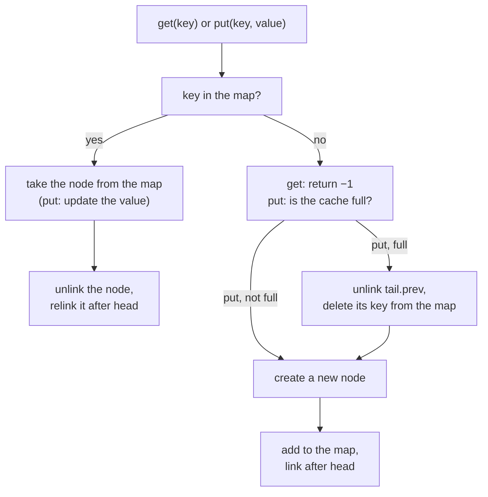

> [!tldr] Quick read
> - The problem: a cache with a fixed capacity; `get(key)` returns the value or −1, `put(key, value)` adds or updates; when full, evict the key **unused for the longest time**. Both operations O(1).
> - The solution: a [[en/concepts/hash-map|hash map]] from key to **node**, and a [[en/concepts/doubly-linked-list|doubly linked list]] with two [[en/concepts/dummy-node|dummy nodes]] `head` and `tail` ordering the nodes from newest to oldest. Using a key unlinks its node and relinks it after `head`; when full, unlink `tail.prev` and delete its key from the map.
> - Every language ships a structure that can do this: JavaScript's `Map`, Python's `OrderedDict`, Java's `LinkedHashMap`, Go's `container/list`. Measured over 10⁶ operations: JavaScript's `Map` reaches 13.5 M ops/s at capacity 100 but drops to 1.4 M at capacity 10⁴; the hand-written list holds 14.6 M.
> - Three wrong versions, each missing exactly one step, run on 8 cases: `get` not moving to the front (4/8), forgetting to delete the key from the map on eviction (1/8, the map grows to 993 keys at capacity 50), updating an existing key without moving it (4/8). Java without `accessOrder = true` becomes FIFO (passes 3/8).

> [!info] Context
> LeetCode problem 146, the anchor problem of [[en/posts/2026-11-24-neetcode-advanced-linked-list|station 2: Advanced Linked Lists]] on **the NeetCode Line: Linked Structures**. The same station has [[en/problems/copy-list-with-random-pointer|Copy List with Random Pointer]], [[en/problems/add-two-numbers|Add Two Numbers]], [[en/problems/find-the-duplicate-number|Find the Duplicate Number]], [[en/problems/merge-k-sorted-lists|Merge k Sorted Lists]] and [[en/problems/reverse-nodes-in-k-group|Reverse Nodes in k-Group]]. This problem needs the dummy node from [[en/posts/2026-11-24-neetcode-linked-list|station 1]] and the hash map from [[en/series/neetcode-arr|the Arrays and Strings line]]. You need no knowledge of Redis or any caching system; the solution comes in TypeScript, Python, Go, Java and JavaScript.

> [!abstract]- Quick glossary for this post (click to open)
> - **Cache**: a place that keeps a little frequently used data so the next read is faster. Space is limited, so when it is full something has to go.
> - **Evict**: drop a key from the cache to make room for a new one. How that key is chosen is the [[en/concepts/eviction-policy|eviction policy]].
> - **LRU (Least Recently Used)**: evict the key unused for the longest time. "Used" covers both reads (`get`) and writes (`put`). See [[en/concepts/lru-va-lfu|LRU and LFU]].
> - **Doubly linked list**: each node has `prev` and `next`, so holding a node is enough to unlink it. See [[en/concepts/doubly-linked-list|Doubly Linked List]].
> - **Sentinel**: a fake node at each end of the list, carrying no data, so the list is never truly empty. See [[en/concepts/dummy-node|Dummy Node]].
> - **O(1) on average**: time that does not depend on the number of keys, averaged over many operations (a hash map sometimes has to rebuild its table).

## Picture it first: a desk with room for a few folders

Your desk only has room for a few folders, kept in one stack. The folder you just used goes on top. When the desk is full and you need a new folder from storage, you send the folder **at the bottom** back, because it is the one you have not touched for the longest time. To avoid digging through the stack every time, an index sheet on the wall says where folder 7 is.

| Everyday life | Concept |
|---|---|
| The desk only holds a few folders | capacity |
| The index sheet on the wall: which folder is where | hash map from key to node |
| The stack of folders, the one just used on top | doubly linked list, newest right after `head` |
| Each folder is clipped to the one above and the one below, so pulling one from the middle does not topple the stack | `prev` and `next` |
| A stiff board on the top and bottom of the stack | the two sentinels `head`, `tail` |
| Using a folder: pull it out, put it back on top | unlink the node, link it after `head` |
| Desk full: send the bottom folder back to storage, cross its line off the index | unlink `tail.prev`, delete its key from the map |



## The problem

Design a class `LRUCache(capacity)` with `get(key)` and `put(key, value)`, both O(1) on average. `put` on an existing key updates its value; `put` of a new key when `capacity` keys are already stored evicts the least recently used key first. The constraints: 1 ≤ capacity ≤ 3,000, keys 0..10⁴, values 0..10⁵, and at most 2 · 10⁵ calls.

The problem's example with capacity 2: `put(1,1)`, `put(2,2)`, `get(1)` → 1, `put(3,3)` evicts key 2 (because 1 was just read), `get(2)` → −1, `put(4,4)` evicts key 1, `get(1)` → −1, `get(3)` → 3, `get(4)` → 4.

The first two ideas both get stuck at the same spot:

- **An array of keys in usage order**: the oldest key is right there (the front), but using a key means finding it and moving it to the end, O(capacity). This page uses exactly that as the slow reference version to check the fast ones.
- **A hash map + a "last used time" per key**: `get` and `put` are fast, but when full, finding the key with the smallest time means scanning the whole map, O(capacity).

You need a structure that finds by key in O(1), moves any element to the front in O(1), and knows the last element in O(1). No single structure does all three.

## How it works

### Approach 1: hash map + doubly linked list with two sentinels

Pair two structures, each covering the other's weak spot:

- The **[[en/concepts/doubly-linked-list|doubly linked list]]** keeps the order: the node right after `head` is the most recently used, the node right before `tail` the least. Holding a node, `n.prev` and `n.next` name both neighbors, so unlinking it changes 2 pointers and linking it after `head` changes 4. A singly linked list cannot do this: unlinking a node needs the node before it, and finding that costs O(n).
- The **hash map** points from key to **node**, not to the value. That is how you find the node in O(1).
- The **two sentinels** `head` and `tail` carry no data. Thanks to them, every real node always has a node before and after it, so `unlink` and `pushFront` need no `if` for an empty list or a node at the edge.

```ts
class DNode {
  key: number; val: number;
  prev: DNode | null = null; next: DNode | null = null;
  constructor(key: number, val: number) { this.key = key; this.val = val; }
}

// Approach 1: a Map maps key → node; a doubly linked list with two sentinels. Right after head is the most recently used, right before tail the least.
class LRUList implements Cache {
  map = new Map<number, DNode>();
  head = new DNode(0, 0);
  tail = new DNode(0, 0);
  capacity: number;
  constructor(capacity: number) { this.capacity = capacity; this.head.next = this.tail; this.tail.prev = this.head; }
  unlink(n: DNode) { n.prev!.next = n.next; n.next!.prev = n.prev; }
  pushFront(n: DNode) { n.next = this.head.next; n.prev = this.head; this.head.next!.prev = n; this.head.next = n; }
  get(key: number): number {
    const n = this.map.get(key);
    if (n === undefined) return -1;
    this.unlink(n); this.pushFront(n); // just used: move to the front
    return n.val;
  }
  put(key: number, val: number): void {
    const n = this.map.get(key);
    if (n !== undefined) { n.val = val; this.unlink(n); this.pushFront(n); return; }
    if (this.map.size === this.capacity) {
      const old = this.tail.prev!; // the oldest sits right before the tail sentinel
      this.unlink(old);
      this.map.delete(old.key);
    }
    const m = new DNode(key, val);
    this.map.set(key, m); this.pushFront(m);
  }
}
```


Every node also stores its `key`: when `tail.prev` is evicted, you need its key to delete it from the map. Tracing the problem's example:

| Operation | Map | List (head → tail) | Returns |
|---|---|---|---|
| `put(1, 1)` | {1} | 1 | |
| `put(2, 2)` | {1, 2} | 2, 1 | |
| `get(1)` | {1, 2} | 1, 2 | 1 |
| `put(3, 3)`: full, evict `tail.prev` = 2 | {1, 3} | 3, 1 | |
| `get(2)` | {1, 3} | 3, 1 | −1 |
| `put(4, 4)`: full, evict 1 | {3, 4} | 4, 3 | |
| `get(1)`, `get(3)`, `get(4)` | {3, 4} | 4, 3 then 3, 4 then 4, 3 | −1, 3, 4 |

Every operation: one map lookup and a few pointer writes. O(1) average time, O(capacity) memory.

### Approach 2: each language's built-in structure

Four of the five languages ship an order-aware hash map, or a doubly linked list:

- **JavaScript `Map`** remembers insertion order. `delete` then `set` on a key moves it to the **end**; the first key (`keys().next().value`) is the oldest. The order is the reverse of approach 1 (the end is newest), but the idea is the same.
- **Python `OrderedDict`**: `move_to_end(key)` moves a key to the end, `popitem(last=False)` pops the first key.
- **Java `LinkedHashMap`**: created with `accessOrder = true`, every `get` or `put` moves the key to the end on its own; override `removeEldestEntry` to return `true` when `size() > capacity`, and the map removes the first key after each `put`.
- **Go `container/list`**: a ready-made doubly linked list with `MoveToFront`, `Back`, `Remove`; you still keep your own `map[int]*list.Element`.

```ts
// Approach 2: a JavaScript Map remembers insertion order. Delete then re-insert moves a key to the end; the first key is the oldest.
class LRUMap implements Cache {
  map = new Map<number, number>();
  capacity: number;
  constructor(capacity: number) { this.capacity = capacity; }
  get(key: number): number {
    const v = this.map.get(key);
    if (v === undefined) return -1;
    this.map.delete(key); this.map.set(key, v);
    return v;
  }
  put(key: number, val: number): void {
    if (this.map.has(key)) this.map.delete(key);
    else if (this.map.size === this.capacity) this.map.delete(this.map.keys().next().value!);
    this.map.set(key, val);
  }
}
```


### JavaScript's Map slows down as capacity grows

I used to think the `Map` approach was a "free" solution: less code, and a structure written in C++ inside the engine. Measuring 10⁶ operations (half `get`, half `put`, random keys in 0..2 · capacity − 1, mulberry32, median of 5):

| Capacity | Hand-written list | `Map` delete + set |
|---|---|---|
| 100 | 17.9 M ops/s | 13.5 M ops/s |
| 10,000 | 14.6 M ops/s | **1.4 M ops/s** |

With 100 times the capacity, the `Map` version gets about 10 times slower, while the hand-written one barely moves. The file separates the two things the `Map` version does:

```text
capacity   10⁶ delete + re-insert of a random key     10⁵ take first key, delete, insert new key
100            60.4 ms                               9.4 ms
10000          81.6 ms                             479.8 ms
```

*(Output labels translated; the files themselves print Vietnamese.)*

Moving a key to the end costs about the same either way. The slow part is **taking the first key** with `keys().next()`: about 4.8 µs each time at capacity 10⁴, against 0.09 µs at 100. The explanation that fits the numbers (I have not read the V8 source to confirm it): `Map`'s ordered table only marks deleted entries as empty slots and cleans them up when the table is rebuilt, so after many deletions at the front, a new iterator has to step over a run of empty slots before it reaches a real key. The problem caps capacity at 3,000, so the `Map` version still passes on LeetCode; but for a real cache with tens of thousands of keys, the hand-written list is the safer choice.

### Three wrong versions, each missing one step

The correct version has three "move to front" spots and one "delete from the map" spot. Drop them one at a time:

```ts
// WRONG 1: get does not move the node to the front. A key just read still counts as old and is evicted first.
class WrongNoMoveOnGet extends LRUList {
  get(key: number): number { const n = this.map.get(key); return n === undefined ? -1 : n.val; }
}
```

With the problem's example: `get(1)` does not move 1 to the front, so `put(3,3)` evicts 1 instead of 2, and `get(2)` returns 2 instead of −1. Fails 4/8 cases: the problem's example and all three random cases.

```ts
// WRONG 2: evicts the last node from the list but forgets to delete it from the Map.
class WrongKeepInMap extends LRUList {
  put(key: number, val: number): void {
    const n = this.map.get(key);
    if (n !== undefined) { n.val = val; this.unlink(n); this.pushFront(n); return; }
    if (this.map.size === this.capacity) this.unlink(this.tail.prev!); // missing this.map.delete(old.key)
    const m = new DNode(key, val);
    this.map.set(key, m); this.pushFront(m);
  }
}
```


The node leaves the list but its key stays in the map. Two consequences: `get` on an evicted key still finds the old node and returns the old value; and `map.size` goes past capacity, so `map.size === capacity` is never true again and the cache stops evicting at all. After 10⁴ random operations with capacity 50, the map holds 993 keys and the list has 993 nodes. Fails 7/8 cases; only "get missing key" (which never fills up) passes.

```ts
// WRONG 3: put on an existing key only updates the value and does not move it to the front.
class WrongUpdateNoMove extends LRUList {
  put(key: number, val: number): void {
    const n = this.map.get(key);
    if (n !== undefined) { n.val = val; return; }
    super.put(key, val);
  }
}
```


Updating an existing key is also "using" it. The problem's "update existing key" case: `put(2,1)`, `put(1,1)`, `put(2,3)`, `put(4,1)`. The correct version moves 2 to the front on `put(2,3)`, so `put(4,1)` evicts 1. The wrong one leaves 2 at the back and evicts 2: `get(1)` returns 1 instead of −1, `get(2)` returns −1 instead of 3. Fails 4/8 cases.

Java has a trap of its own: `new LinkedHashMap<>()` defaults to `accessOrder = false`, meaning **insertion** order. `get` does not change the order, and `put` on an existing key does not either (the Java docs say re-inserting a key does not affect the order). The result is a FIFO cache, not LRU: fails 5/8 cases.

### Python's functools.lru_cache

Python ships LRU as a decorator on a function: the results of the most recent calls are kept, and when full the least recently used result is dropped.

```python
# functools.lru_cache: the same idea, attached to a function. maxsize=2, so calling an evicted argument again recomputes it.
calls = []


@lru_cache(maxsize=2)
def slow_square(x):
    calls.append(x)
    return x * x


for x in [1, 2, 1, 3, 2, 1]:
    slow_square(x)
print(f"\nlru_cache(maxsize=2), gọi 1 2 1 3 2 1: hàm thật chạy cho {calls}; {slow_square.cache_info()}")
```


Calling `1 2 1 3 2 1` with `maxsize=2`: the second call with `1` is a hit; `3` evicts `2` (because `1` was just used); `2` has to be recomputed and evicts `1`; so the final `1` is recomputed too. The real function runs 5 times, `hits=1, misses=5`. This is a tool for memoizing function results, not a solution to the problem: the problem asks for a class with `get` and `put` by key.

### Under the hood in five languages

| | Built-in structure | Make a key the newest | Take the oldest key | Language-specific trap |
|---|---|---|---|---|
| TypeScript / JavaScript | `Map` (remembers insertion order) | `delete` then `set` | `keys().next().value` | slows down as capacity grows: 1.4 M ops/s at 10⁴ |
| Python | `OrderedDict` | `move_to_end(key)` | `popitem(last=False)` | a plain `dict` also remembers insertion order but has no `move_to_end`: you must `pop` and reassign, and take the first key with `next(iter(d))` |
| Go | `container/list` + `map[int]*list.Element` | `MoveToFront(e)` | `Back()` | `e.Value` has type `any`, so reads need `e.Value.(*entry)` |
| Java | `LinkedHashMap(cap, 0.75f, true)` | automatic on `get`/`put` | `removeEldestEntry` | without `accessOrder = true` it is FIFO; `getOrDefault` also counts as an access |

### Measurements

10⁶ operations, half `get` and half `put`, random keys (mulberry32) in 0..2 · capacity − 1, so about half of the `get` calls miss. Median of 5; Java runs 3 warm-up rounds first.

| Language | Hand-written, capacity 100 | Hand-written, 10⁴ | Built-in, 100 | Built-in, 10⁴ |
|---|---|---|---|---|
| TypeScript (`Map`) | 17.9 M/s | 14.6 M/s | 13.5 M/s | 1.4 M/s |
| Python (`OrderedDict`) | 5.06 M/s | 4.16 M/s | 8.52 M/s | 6.29 M/s |
| Go (`container/list`) | 29.9 M/s | 20.6 M/s | 26.2 M/s | 18.5 M/s |
| Java (`LinkedHashMap`) | 42.3 M/s | 25.6 M/s | 35.0 M/s | 34.9 M/s |

- Python is the reverse of TypeScript: `OrderedDict` is about 1.5 to 1.7 times faster than the hand-written version, because its list operations run in C, while the hand-written version pays for every attribute assignment in bytecode.
- Java's `LinkedHashMap` keeps its speed as capacity grows, while the hand-written version (`HashMap` plus a separate node per key) gets about 40% slower. I have not measured enough to pin down why.
- The problem allows at most 2 · 10⁵ calls, so every version finishes in under 0.2 s, Python included.

### In real systems: Redis does not run exact LRU

Redis has an `allkeys-lru` policy, but [its eviction docs](https://redis.io/docs/latest/develop/reference/eviction/) say plainly that it is an **approximated** LRU: each time it needs to evict, Redis samples a few random keys (`maxmemory-samples`, default 5) and evicts the one unused the longest within the sample; since Redis 3.0 it also keeps a pool of good candidates. The reason for not using true LRU is the extra memory, exactly the two `prev`/`next` pointers per key that the solution above needs. The docs also note that with a power-law access pattern, the difference between true LRU and the approximation is minimal or non-existent. See also [[en/concepts/lru-va-lfu|LRU and LFU]] and [[en/concepts/eviction-policy|eviction policy]].

## Runnable example

[TypeScript](../code/neetcode-lru-cache/lru-cache.ts) · [Python](../code/neetcode-lru-cache/lru_cache.py) · [Go](../code/neetcode-lru-cache/lru_cache.go) · [Java](../code/neetcode-lru-cache/lru-cache.java) · [JavaScript](../code/neetcode-lru-cache/lru-cache.js)

Each file runs 8 cases and compares the results with the slow reference version (an array of keys in usage order): the problem's example, updating an existing key, capacity 1, `get` on a missing key, evict then re-add, and three runs of 2,000 random operations (mulberry32) with capacities 3, 10 and 50.

Approach 1, hand-written list:

```ts
class DNode {
  key: number; val: number;
  prev: DNode | null = null; next: DNode | null = null;
  constructor(key: number, val: number) { this.key = key; this.val = val; }
}

// Approach 1: a Map maps key → node; a doubly linked list with two sentinels. Right after head is the most recently used, right before tail the least.
class LRUList implements Cache {
  map = new Map<number, DNode>();
  head = new DNode(0, 0);
  tail = new DNode(0, 0);
  capacity: number;
  constructor(capacity: number) { this.capacity = capacity; this.head.next = this.tail; this.tail.prev = this.head; }
  unlink(n: DNode) { n.prev!.next = n.next; n.next!.prev = n.prev; }
  pushFront(n: DNode) { n.next = this.head.next; n.prev = this.head; this.head.next!.prev = n; this.head.next = n; }
  get(key: number): number {
    const n = this.map.get(key);
    if (n === undefined) return -1;
    this.unlink(n); this.pushFront(n); // just used: move to the front
    return n.val;
  }
  put(key: number, val: number): void {
    const n = this.map.get(key);
    if (n !== undefined) { n.val = val; this.unlink(n); this.pushFront(n); return; }
    if (this.map.size === this.capacity) {
      const old = this.tail.prev!; // the oldest sits right before the tail sentinel
      this.unlink(old);
      this.map.delete(old.key);
    }
    const m = new DNode(key, val);
    this.map.set(key, m); this.pushFront(m);
  }
}
```

```python
class DNode:
    __slots__ = ("key", "val", "prev", "next")

    def __init__(self, key=0, val=0):
        self.key, self.val, self.prev, self.next = key, val, None, None

# Approach 1: a dict maps key → node; a doubly linked list with two sentinels. Right after head is the most recently used.
class LRUList:
    def __init__(self, capacity):
        self.cap, self.map = capacity, {}
        self.head, self.tail = DNode(), DNode()
        self.head.next, self.tail.prev = self.tail, self.head

    def _unlink(self, n):
        n.prev.next, n.next.prev = n.next, n.prev

    def _push_front(self, n):
        n.prev, n.next = self.head, self.head.next
        self.head.next.prev = n
        self.head.next = n

    def get(self, key):
        n = self.map.get(key)
        if n is None:
            return -1
        self._unlink(n)
        self._push_front(n)
        return n.val

    def put(self, key, val):
        n = self.map.get(key)
        if n is not None:
            n.val = val
            self._unlink(n)
            self._push_front(n)
            return
        if len(self.map) == self.cap:
            old = self.tail.prev
            self._unlink(old)
            del self.map[old.key]
        n = DNode(key, val)
        self.map[key] = n
        self._push_front(n)
```

```go
type dnode struct {
	key, val   int
	prev, next *dnode
}

// Approach 1: a map maps key → node; a doubly linked list with two sentinels. Right after head is the most recently used.
type LRUList struct {
	cap        int
	m          map[int]*dnode
	head, tail *dnode
}

func NewLRUList(capacity int) *LRUList {
	c := &LRUList{cap: capacity, m: make(map[int]*dnode, capacity), head: &dnode{}, tail: &dnode{}}
	c.head.next, c.tail.prev = c.tail, c.head
	return c
}

func (c *LRUList) unlink(n *dnode) { n.prev.next, n.next.prev = n.next, n.prev }

func (c *LRUList) pushFront(n *dnode) {
	n.prev, n.next = c.head, c.head.next
	c.head.next.prev = n
	c.head.next = n
}

func (c *LRUList) Get(key int) int {
	n, ok := c.m[key]
	if !ok {
		return -1
	}
	c.unlink(n)
	c.pushFront(n)
	return n.val
}

func (c *LRUList) Put(key, val int) {
	if n, ok := c.m[key]; ok {
		n.val = val
		c.unlink(n)
		c.pushFront(n)
		return
	}
	if len(c.m) == c.cap {
		old := c.tail.prev
		c.unlink(old)
		delete(c.m, old.key)
	}
	n := &dnode{key: key, val: val}
	c.m[key] = n
	c.pushFront(n)
}
```

```java
// Approach 1: a HashMap maps key → node; a doubly linked list with two sentinels. Right after head is the most recently used.
static class LRUList implements Cache {
    static class DNode { int key, val; DNode prev, next; DNode(int k, int v) { key = k; val = v; } }
    final int cap;
    final Map<Integer, DNode> map = new HashMap<>();
    final DNode head = new DNode(0, 0), tail = new DNode(0, 0);
    LRUList(int capacity) { cap = capacity; head.next = tail; tail.prev = head; }
    void unlink(DNode n) { n.prev.next = n.next; n.next.prev = n.prev; }
    void pushFront(DNode n) { n.next = head.next; n.prev = head; head.next.prev = n; head.next = n; }
    public int get(int key) {
        DNode n = map.get(key);
        if (n == null) return -1;
        unlink(n); pushFront(n);
        return n.val;
    }
    public void put(int key, int val) {
        DNode n = map.get(key);
        if (n != null) { n.val = val; unlink(n); pushFront(n); return; }
        if (map.size() == cap) { DNode old = tail.prev; unlink(old); map.remove(old.key); }
        DNode m = new DNode(key, val);
        map.put(key, m); pushFront(m);
    }
}
```

```js
class DNode {
  constructor(key, val) { this.key = key; this.val = val; this.prev = null; this.next = null; }
}

// Approach 1: a Map maps key → node; a doubly linked list with two sentinels. Right after head is the most recently used, right before tail the least.
class LRUList {
  constructor(capacity) {
    this.capacity = capacity;
    this.map = new Map();
    this.head = new DNode(0, 0);
    this.tail = new DNode(0, 0);
    this.head.next = this.tail; this.tail.prev = this.head;
  }
  unlink(n) { n.prev.next = n.next; n.next.prev = n.prev; }
  pushFront(n) { n.next = this.head.next; n.prev = this.head; this.head.next.prev = n; this.head.next = n; }
  get(key) {
    const n = this.map.get(key);
    if (n === undefined) return -1;
    this.unlink(n); this.pushFront(n); // just used: move to the front
    return n.val;
  }
  put(key, val) {
    const n = this.map.get(key);
    if (n !== undefined) { n.val = val; this.unlink(n); this.pushFront(n); return; }
    if (this.map.size === this.capacity) {
      const old = this.tail.prev; // the oldest sits right before the tail sentinel
      this.unlink(old);
      this.map.delete(old.key);
    }
    const m = new DNode(key, val);
    this.map.set(key, m); this.pushFront(m);
  }
}
```


Approach 2, built-in structures:

```ts
// Approach 2: a JavaScript Map remembers insertion order. Delete then re-insert moves a key to the end; the first key is the oldest.
class LRUMap implements Cache {
  map = new Map<number, number>();
  capacity: number;
  constructor(capacity: number) { this.capacity = capacity; }
  get(key: number): number {
    const v = this.map.get(key);
    if (v === undefined) return -1;
    this.map.delete(key); this.map.set(key, v);
    return v;
  }
  put(key: number, val: number): void {
    if (this.map.has(key)) this.map.delete(key);
    else if (this.map.size === this.capacity) this.map.delete(this.map.keys().next().value!);
    this.map.set(key, val);
  }
}
```

```python
# Approach 2: OrderedDict keeps order; move_to_end moves a key to the end, popitem(last=False) pops the first (oldest) key.
class LRUOrdered:
    def __init__(self, capacity):
        self.cap, self.d = capacity, OrderedDict()

    def get(self, key):
        if key not in self.d:
            return -1
        self.d.move_to_end(key)
        return self.d[key]

    def put(self, key, val):
        if key in self.d:
            self.d.move_to_end(key)
        elif len(self.d) == self.cap:
            self.d.popitem(last=False)
        self.d[key] = val
```

```go
// Approach 2: container/list is a ready-made doubly linked list; Value is an interface, so reads need a type assertion.
type entry struct{ key, val int }

type LRUContainer struct {
	cap int
	m   map[int]*list.Element
	l   *list.List
}

func NewLRUContainer(capacity int) *LRUContainer {
	return &LRUContainer{cap: capacity, m: make(map[int]*list.Element, capacity), l: list.New()}
}

func (c *LRUContainer) Get(key int) int {
	e, ok := c.m[key]
	if !ok {
		return -1
	}
	c.l.MoveToFront(e)
	return e.Value.(*entry).val
}

func (c *LRUContainer) Put(key, val int) {
	if e, ok := c.m[key]; ok {
		e.Value.(*entry).val = val
		c.l.MoveToFront(e)
		return
	}
	if c.l.Len() == c.cap {
		old := c.l.Back()
		c.l.Remove(old)
		delete(c.m, old.Value.(*entry).key)
	}
	c.m[key] = c.l.PushFront(&entry{key, val})
}
```

```java
// Approach 2: a LinkedHashMap with accessOrder = true moves each key it gets or puts to the end;
// removeEldestEntry runs after every put; returning true removes the first (oldest) key.
static class LRULinked extends LinkedHashMap<Integer, Integer> implements Cache {
    final int cap;
    LRULinked(int capacity) { this(capacity, true); }
    LRULinked(int capacity, boolean accessOrder) { super(16, 0.75f, accessOrder); cap = capacity; }
    @Override protected boolean removeEldestEntry(Map.Entry<Integer, Integer> eldest) { return size() > cap; }
    public int get(int key) { return getOrDefault(key, -1); }
    public void put(int key, int val) { super.put(key, val); }
}
```

```js
// Approach 2: a JavaScript Map remembers insertion order. Delete then re-insert moves a key to the end; the first key is the oldest.
class LRUMap {
  constructor(capacity) { this.capacity = capacity; this.map = new Map(); }
  get(key) {
    const v = this.map.get(key);
    if (v === undefined) return -1;
    this.map.delete(key); this.map.set(key, v);
    return v;
  }
  put(key, val) {
    if (this.map.has(key)) this.map.delete(key);
    else if (this.map.size === this.capacity) this.map.delete(this.map.keys().next().value);
    this.map.set(key, val);
  }
}
```


Output of `node lru-cache.ts`:

```text
LRUList            8/8 cases passed
LRUMap             8/8 cases passed
WrongNoMoveOnGet   4/8 cases passed; failed on problem example, random 1 (cap 3), random 2 (cap 10), random 3 (cap 50)
WrongKeepInMap     1/8 cases passed; failed on problem example, update existing key, capacity 1, evict then re-add, random 1 (cap 3), random 2 (cap 10), random 3 (cap 50)
WrongUpdateNoMove  4/8 cases passed; failed on update existing key, random 1 (cap 3), random 2 (cap 10), random 3 (cap 50)

after 10⁴ operations, capacity 50: LRUList holds 50 keys; WrongKeepInMap has 993 keys in the Map, 993 nodes in the list

capacity   LRUList (hand-written list)    LRUMap (Map delete + set)
100           55.9 ms   17.9 M ops/s               73.9 ms   13.5 M ops/s
10000         68.3 ms   14.6 M ops/s              710.3 ms    1.4 M ops/s

capacity   10⁶ delete + re-insert of a random key     10⁵ take first key, delete, insert new key
100            60.4 ms                               9.4 ms
10000          81.6 ms                             479.8 ms
```

`python3 lru_cache.py`:

```text
LRUList            8/8 cases passed
LRUOrdered         8/8 cases passed
WrongNoMoveOnGet   4/8 cases passed; failed on problem example, random 1 (cap 3), random 2 (cap 10), random 3 (cap 50)
WrongKeepInMap     1/8 cases passed; failed on problem example, update existing key, capacity 1, evict then re-add, random 1 (cap 3), random 2 (cap 10), random 3 (cap 50)
WrongUpdateNoMove  4/8 cases passed; failed on update existing key, random 1 (cap 3), random 2 (cap 10), random 3 (cap 50)

lru_cache(maxsize=2), calls 1 2 1 3 2 1: the real function ran for [1, 2, 3, 2, 1]; CacheInfo(hits=1, misses=5, maxsize=2, currsize=2)

capacity   LRUList (hand-written)     LRUOrdered (OrderedDict)
100          197.5 ms  5.06 M/s           117.4 ms  8.52 M/s
10000        240.3 ms  4.16 M/s           159.1 ms  6.29 M/s
```

`go run lru_cache.go`:

```text
LRUList         8/8 cases passed
LRUContainer    8/8 cases passed
WrongKeepInMap  1/8 cases passed; failed on problem example, update existing key, capacity 1, evict then re-add, random 1 (cap 3), random 2 (cap 10), random 3 (cap 50)

capacity   LRUList (hand-written)     LRUContainer (container/list)
100           33.4 ms   29.9 M/s            38.1 ms   26.2 M/s
10000         48.6 ms   20.6 M/s            54.1 ms   18.5 M/s
```

`java lru-cache.java`:

```text
LRUList              8/8 cases passed
LRULinked            8/8 cases passed
wrongInsertionOrder  3/8 cases passed; failed on problem example, update existing key, random 1 (cap 3), random 2 (cap 10), random 3 (cap 50)

capacity   LRUList (hand-written)     LRULinked (LinkedHashMap)
100           23.6 ms   42.3 M/s            28.6 ms   35.0 M/s
10000         39.1 ms   25.6 M/s            28.7 ms   34.9 M/s
```

`node lru-cache.js`:

```text
LRUList            8/8 cases passed
LRUMap             8/8 cases passed
WrongNoMoveOnGet   4/8 cases passed; failed on problem example, random 1 (cap 3), random 2 (cap 10), random 3 (cap 50)
WrongKeepInMap     1/8 cases passed; failed on problem example, update existing key, capacity 1, evict then re-add, random 1 (cap 3), random 2 (cap 10), random 3 (cap 50)
WrongUpdateNoMove  4/8 cases passed; failed on update existing key, random 1 (cap 3), random 2 (cap 10), random 3 (cap 50)

after 10⁴ operations, capacity 50: LRUList holds 50 keys; WrongKeepInMap has 993 keys in the Map, 993 nodes in the list

capacity   LRUList (hand-written list)    LRUMap (Map delete + set)
100           58.7 ms   17.0 M ops/s               77.7 ms   12.9 M ops/s
10000         70.0 ms   14.3 M ops/s              731.9 ms    1.4 M ops/s

capacity   10⁶ delete + re-insert of a random key     10⁵ take first key, delete, insert new key
100            60.3 ms                               9.6 ms
10000          82.3 ms                             485.5 ms
```

## Misconceptions and common traps

- **"A map from key to value is enough."** It must map key to node. Only with the node can you unlink it from the list in O(1).
- **"A singly linked list works too."** Unlinking a node needs the node before it; a singly linked list has to walk from the head to find it.
- **Nodes that do not store the key.** When you evict `tail.prev`, you cannot tell which key to delete from the map.
- **Forgetting one of the three "move to front" spots.** A `get` hit, a `put` of a new key, a `put` of an existing key: all three make the key the newest.
- **Evicting without deleting from the map.** The map grows, the cache stops evicting, and `get` returns values that were evicted.
- **Java `LinkedHashMap` without `accessOrder = true`.** It becomes FIFO.
- **"JavaScript's `Map` is always O(1)."** Taking the first key after many deletions at the front slows down with capacity: 1.4 M ops/s at 10⁴.

## Self-check questions

> [!question]- Why do you need the two sentinels `head` and `tail`?
> So that every real node always has a node before and after it. Then `unlink` is always `n.prev.next = n.next; n.next.prev = n.prev`, and `pushFront` always inserts between `head` and `head.next`, even when the list is empty or has one node. Without sentinels you need `if`s for the head, the tail and the empty list.

> [!question]- Capacity 2: `put(1,1)`, `put(2,2)`, `put(1,10)`, `put(3,3)`. Which key is evicted, and what does `get(1)` return?
> `put(1,10)` updates the value and moves 1 to the front, so the order is 1, 2. `put(3,3)` evicts 2. `get(1)` returns 10.

> [!question]- In the version that forgets to delete the key from the map, why does the cache stop evicting altogether instead of being wrong once?
> The "full" check is `map.size === capacity`. The first eviction unlinks the node but keeps the key, then adds the new key, so `map.size` becomes capacity + 1. From then on `map.size` only grows and never equals capacity again.

> [!question]- With JavaScript's `Map`, is the end of the `Map` the newest key or the oldest? Why?
> The newest. `Map` iterates in insertion order, and `delete` then `set` puts a key at the end. The first key in iteration is the one inserted (or re-inserted) longest ago, that is, the oldest.

> [!question]- Redis has an `allkeys-lru` policy. Does it use a hash map + doubly linked list like this problem?
> No. Redis samples a few random keys (5 by default) and evicts the one unused the longest within the sample, because keeping a doubly linked list over every key costs extra memory. The result is an approximated LRU.

## References

- [LeetCode 146: LRU Cache](https://leetcode.com/problems/lru-cache/) (original problem: 1 ≤ capacity ≤ 3,000, at most 2 · 10⁵ calls)
- [Redis: Key eviction](https://redis.io/docs/latest/develop/reference/eviction/) (approximated LRU, `maxmemory-samples`, candidate pool since Redis 3.0)
- [Python `collections.OrderedDict`](https://docs.python.org/3/library/collections.html#collections.OrderedDict) (`move_to_end`, `popitem(last=False)`)
- [Python `functools.lru_cache`](https://docs.python.org/3/library/functools.html#functools.lru_cache)
- [Java `LinkedHashMap`](https://docs.oracle.com/en/java/javase/21/docs/api/java.base/java/util/LinkedHashMap.html) (`accessOrder`, `removeEldestEntry`; re-inserting a key does not change insertion order)
- [Go `container/list`](https://pkg.go.dev/container/list)
- [MDN: `Map`](https://developer.mozilla.org/en-US/docs/Web/JavaScript/Reference/Global_Objects/Map) (iterates in insertion order)
- Cormen, Leiserson, Rivest, Stein, *Introduction to Algorithms*, section 10.2 (doubly linked lists with sentinels)
