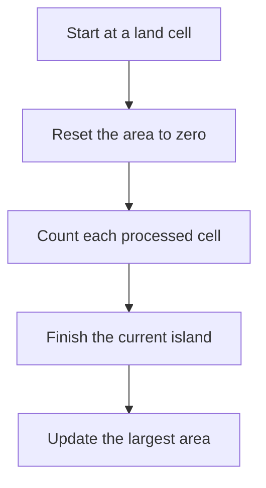

> [!tldr] Quick read
> - [[en/concepts/flood-fill|Flood-fill]] from unmarked land and count each processed cell to get the island's area.
> - Start a separate area counter for each traversal. Compare its result with the largest area seen so far.
> - [[en/concepts/mark-on-enqueue|Mark cells when they enter the worklist]] to keep the area count accurate when several paths lead to the same cell.
> - BFS preserves the grid. Iterative DFS marks cells in the grid itself. Both take `O(mn)`.

> [!info] Context
> LeetCode 695 belongs to [[en/posts/2026-11-26-neetcode-grid-traversal|station 1: Grid Traversal]] on **the NeetCode Line: Graphs**. I reuse the map from [[en/problems/number-of-islands|LC-0200]]. Once I can traverse an entire island, I can count the cells on each traversal to find the largest one. You only need queues, stacks, and cell coordinates.

> [!abstract]- Quick glossary for this post (click to open)
> - [[en/concepts/grid-graph|Grid graph]]: land cells connect when they share a horizontal or vertical side.
> - A [[en/concepts/connected-component|connected component]] is a maximal set of cells that can reach each other through paths of land.
> - **Area** is the number of cells in a component. The **maximum** is the largest area across all components.
> - A **worklist** holds discovered cells waiting to be processed.

## Picture it first: taking inventory across connected rooms

I enter a group of rooms with a handheld counter. Each time I inspect a room, I press the counter once. When I run out of rooms in the group, I compare that count with the record in my notebook. Before starting another group, I reset the handheld counter to zero.

| Everyday life | Concept |
|---|---|
| A door between rooms sharing a wall | An edge between two land cells |
| A group of connected rooms | One component, corresponding to an island |
| The handheld counter | The area of the current traversal |
| The record in the notebook | The largest area found so far |



## The problem: measure each island and take the largest

An `m × n` grid contains the integer `1` for land and `0` for water. Each dimension ranges from 1 to 50. Land cells connect along horizontal or vertical sides, and the space outside the grid counts as water. Return the cell count of the largest island, or zero when there is no land. [Problem LC-0695](https://leetcode.com/problems/max-area-of-island/)

```text
1 0 0 1 1
0 0 0 1 1
0 1 0 1 0
1 1 0 0 0
```

With zero-based coordinates, the traversals start at `(0,0)`, `(0,3)`, and `(2,1)` and count 1, 5, and 3 cells, respectively. There are 9 land cells altogether. The record after each traversal is 1, 5, and 5, so the answer is **5**.

## How it works

<figure class="figure-map" style="--ar: 3 / 4">
<div class="frame"><iframe data-archify="../../diagrams/neetcode-max-area-of-island/worked-example.en.html" title="Count the area of each island separately" loading="lazy"></iframe></div>
<figcaption><span><b>Figure 1.</b> Count the area of each island separately.</span><a href="../diagrams/neetcode-max-area-of-island/worked-example.en.html" target="_blank" rel="noopener">Open full screen</a></figcaption>
</figure>

<details>
<summary>Read the steps</summary>
<ol>
<li>Start at (0,0) for a one-cell island. <code>area = 1; best = 1</code></li>
<li>Reset the counter at (0,3). <code>area = 0</code></li>
<li>The second fill visits five cells. <code>area = 5; best = 5</code></li>
<li>The last island at (2,1) has three cells. <code>area = 3</code></li>
<li>Keep the largest area seen. <code>max(1, 5, 3) = 5</code></li>
</ol>
</details>

### Keep a local count and a record for the entire grid

Scan the whole grid. Move past water or marked cells. Begin a traversal at unmarked land. Each addition follows an edge between land cells, so every added cell belongs to the seed's island. If a cell on that island remained missing when the worklist emptied, a path from the seed to it would include a step from a processed cell to an undiscovered one. The neighbor check would have added that next cell. The traversal therefore covers the entire island.

Mark on discovery to give each cell exactly one processing step. Start each island's count at zero, add one for every processed cell, and then update `best = max(best, area)`. The local count has done its job after that comparison.

### Approach 1 — BFS that preserves the grid

Use a `seen` array indexed by `id = r*n+c`. Mark on enqueue, then process from the front. With neighbors checked up, down, left, and right, the island starting at `(0,3)` yields the removal order `(0,3)`, `(1,3)`, `(0,4)`, `(2,3)`, `(1,4)`. When `(0,4)` checks `(1,4)`, `(1,3)` has already added it. The area settles at 5.

Python and Java dequeue entries from a deque and increment `area` for each removal. The TypeScript, JavaScript, and Go versions keep a head index. Processed elements remain in the array, so its final length equals the island size. With a deque that removes entries as it goes, the queue ends empty and needs a separate area variable.

### Approach 2 — Iterative DFS that turns land into water

Push the seed onto a stack and change it to `0`. Each pop adds one to the area and checks all four neighbors. When a neighbor remains `1`, replace it with `0` just before pushing it. Once the island is water, the outer scan resumes. DFS can process `(0,4)` before `(1,3)` and still count five cells on the middle island. In-place traversal needs permission to mutate the input. Use a mark array or copy each row if you need to keep the map.

### Cost and measured pending entries

Let `L` be the cell count of the largest island. The scan and traversals together take `O(mn)` because each land cell is added once and each processing step checks four directions. BFS stores `O(mn)` marks and its queue holds at most `O(L)` entries. In-place DFS uses a stack with an `O(L)` upper bound, which is still `O(mn)` in the worst case. The iterative version keeps a long DFS path off the call stack. [Python's recursion limit](https://docs.python.org/3/library/sys.html#sys.getrecursionlimit)

On an all-land `50 × 50` grid, both traversals remove exactly 2,500 cells. Counting live pending work under the same neighbor order and early marking rule gives these results.

| Removal order | Total processed cells | Maximum pending entries |
|---|---:|---:|
| BFS, remove from the front | 2,500 | 50 |
| DFS, remove from the top | 2,500 | 1,226 |

These figures count pending entries and depend on the island shape and neighbor order. The head-index implementations still keep all 2,500 entries in the array for this BFS traversal. The table makes no claim about allocated bytes or which search always needs more memory.

## Runnable example

The five files run the same six cases: the grid above, corner-touching cells, all water, a single row, a square island with a cycle, and an all-land `50 × 50` grid. Each check also compares the grid after BFS with the input and confirms that in-place DFS removes all land.

[TypeScript](../code/neetcode-max-area-of-island/max-area.ts) · [Python](../code/neetcode-max-area-of-island/max_area.py) · [Go](../code/neetcode-max-area-of-island/max_area.go) · [Java](../code/neetcode-max-area-of-island/max-area.java) · [JavaScript](../code/neetcode-max-area-of-island/max-area.js) · [PHP](../code/neetcode-max-area-of-island/max-area.php) · [Rust](../code/neetcode-max-area-of-island/max_area.rs)

```ts
const directions = [[-1, 0], [1, 0], [0, -1], [0, 1]]

function floodBfs(grid: number[][]): number {
  const rows = grid.length, cols = grid[0].length
  const seen = new Uint8Array(rows * cols)
  let result = 0

  for (let start = 0; start < seen.length; start++) {
    if (grid[Math.floor(start / cols)][start % cols] !== 1 || seen[start]) continue

    const queue = [start]
    seen[start] = 1
    for (let head = 0; head < queue.length; head++) {
      const cell = queue[head]
      const row = Math.floor(cell / cols), col = cell % cols
      for (const [dr, dc] of directions) {
        const r = row + dr, c = col + dc
        if (r < 0 || r >= rows || c < 0 || c >= cols || grid[r][c] !== 1) continue
        const next = r * cols + c
        if (seen[next]) continue
        seen[next] = 1
        queue.push(next)
      }
    }
    result = Math.max(result, queue.length)
  }
  return result
}

function floodDfsInPlace(grid: number[][]): number {
  const rows = grid.length, cols = grid[0].length
  let result = 0

  for (let start = 0; start < rows * cols; start++) {
    const row = Math.floor(start / cols), col = start % cols
    if (grid[row][col] !== 1) continue

    const stack = [start]
    grid[row][col] = 0
    let area = 0
    while (stack.length > 0) {
      const cell = stack.pop()!
      area++
      const cr = Math.floor(cell / cols), cc = cell % cols
      for (const [dr, dc] of directions) {
        const r = cr + dr, c = cc + dc
        if (r < 0 || r >= rows || c < 0 || c >= cols || grid[r][c] !== 1) continue
        grid[r][c] = 0
        stack.push(r * cols + c)
      }
    }
    result = Math.max(result, area)
  }
  return result
}

const cases = [
  {grid: ["10011", "00011", "01010", "11000"], want: 5},
  {grid: ["100", "010", "001"], want: 1},
  {grid: ["000", "000"], want: 0},
  {grid: ["11111"], want: 5},
  {grid: ["11", "11"], want: 4},
  {grid: Array.from({length: 50}, () => "1".repeat(50)), want: 2500},
]
for (const {grid, want} of cases) {
  const cells = grid.map(row => Array.from(row, Number))
  if (floodBfs(cells) !== want || cells.some((row, i) => row.join("") !== grid[i])) {
    throw new Error("BFS sai")
  }
  if (floodDfsInPlace(cells) !== want || cells.some(row => row.some(value => value !== 0))) {
    throw new Error("DFS sai")
  }
}
console.log(`${cases.length}/${cases.length} ca đúng`)
```
```python
from collections import deque

DIRECTIONS = ((-1, 0), (1, 0), (0, -1), (0, 1))


def flood_bfs(grid):
    rows, cols = len(grid), len(grid[0])
    seen = bytearray(rows * cols)
    result = 0
    for start in range(len(seen)):
        row, col = divmod(start, cols)
        if grid[row][col] != 1 or seen[start]:
            continue
        queue = deque([start])
        seen[start] = 1
        area = 0
        while queue:
            row, col = divmod(queue.popleft(), cols)
            area += 1
            for dr, dc in DIRECTIONS:
                r, c = row + dr, col + dc
                if not (0 <= r < rows and 0 <= c < cols) or grid[r][c] != 1:
                    continue
                index = r * cols + c
                if seen[index]:
                    continue
                seen[index] = 1
                queue.append(index)
        result = max(result, area)
    return result


def flood_dfs_in_place(grid):
    rows, cols = len(grid), len(grid[0])
    result = 0
    for start in range(rows * cols):
        row, col = divmod(start, cols)
        if grid[row][col] != 1:
            continue
        stack = [start]
        grid[row][col] = 0
        area = 0
        while stack:
            row, col = divmod(stack.pop(), cols)
            area += 1
            for dr, dc in DIRECTIONS:
                r, c = row + dr, col + dc
                if not (0 <= r < rows and 0 <= c < cols) or grid[r][c] != 1:
                    continue
                grid[r][c] = 0
                stack.append(r * cols + c)
        result = max(result, area)
    return result


cases = [
    (["10011", "00011", "01010", "11000"], 5),
    (["100", "010", "001"], 1),
    (["000", "000"], 0),
    (["11111"], 5),
    (["11", "11"], 4),
    (["1" * 50] * 50, 2500),
]
for grid, want in cases:
    cells = [list(map(int, row)) for row in grid]
    assert flood_bfs(cells) == want and ["".join(map(str, row)) for row in cells] == grid
    assert flood_dfs_in_place(cells) == want and not any(map(any, cells))
print(f"{len(cases)}/{len(cases)} ca đúng")
```
```go
package main

import (
	"fmt"
	"strings"
)

var directions = [][2]int{{-1, 0}, {1, 0}, {0, -1}, {0, 1}}

func floodBFS(grid [][]int) int {
	rows, cols := len(grid), len(grid[0])
	seen := make([]bool, rows*cols)
	result := 0
	for start := range seen {
		row, col := start/cols, start%cols
		if grid[row][col] != 1 || seen[start] {
			continue
		}

		queue := []int{start}
		seen[start] = true
		for head := 0; head < len(queue); head++ {
			cell := queue[head]
			row, col := cell/cols, cell%cols
			for _, d := range directions {
				r, c := row+d[0], col+d[1]
				if r < 0 || r >= rows || c < 0 || c >= cols || grid[r][c] != 1 {
					continue
				}
				next := r*cols + c
				if seen[next] {
					continue
				}
				seen[next] = true
				queue = append(queue, next)
			}
		}
		result = max(result, len(queue))
	}
	return result
}

func floodDFSInPlace(grid [][]int) int {
	rows, cols := len(grid), len(grid[0])
	result := 0
	for start := 0; start < rows*cols; start++ {
		row, col := start/cols, start%cols
		if grid[row][col] != 1 {
			continue
		}

		stack := []int{start}
		grid[row][col] = 0
		area := 0
		for len(stack) > 0 {
			top := len(stack) - 1
			cell := stack[top]
			stack = stack[:top]
			area++
			row, col := cell/cols, cell%cols
			for _, d := range directions {
				r, c := row+d[0], col+d[1]
				if r < 0 || r >= rows || c < 0 || c >= cols || grid[r][c] != 1 {
					continue
				}
				grid[r][c] = 0
				stack = append(stack, r*cols+c)
			}
		}
		result = max(result, area)
	}
	return result
}

func main() {
	full := make([]string, 50)
	for i := range full {
		full[i] = strings.Repeat("1", 50)
	}
	cases := []struct {
		grid []string
		want int
	}{
		{[]string{"10011", "00011", "01010", "11000"}, 5},
		{[]string{"100", "010", "001"}, 1},
		{[]string{"000", "000"}, 0},
		{[]string{"11111"}, 5},
		{[]string{"11", "11"}, 4},
		{full, 2500},
	}
	for _, example := range cases {
		cells := make([][]int, len(example.grid))
		for r, row := range example.grid {
			cells[r] = make([]int, len(row))
			for c := range row {
				cells[r][c] = int(row[c] - '0')
			}
		}
		if floodBFS(cells) != example.want {
			panic("BFS sai")
		}
		for r, row := range cells {
			for c, value := range row {
				if value != int(example.grid[r][c]-'0') {
					panic("BFS sai")
				}
			}
		}
		if floodDFSInPlace(cells) != example.want {
			panic("DFS sai")
		}
		for _, row := range cells {
			for _, value := range row {
				if value != 0 {
					panic("DFS sai")
				}
			}
		}
	}
	fmt.Printf("%d/%d ca đúng\n", len(cases), len(cases))
}
```
```java
import java.util.ArrayDeque;
import java.util.Arrays;

class MaxArea {
    static final int[][] DIRECTIONS = {{-1, 0}, {1, 0}, {0, -1}, {0, 1}};

    static int floodBfs(int[][] grid) {
        int rows = grid.length, cols = grid[0].length;
        boolean[] seen = new boolean[rows * cols];
        int result = 0;
        for (int start = 0; start < seen.length; start++) {
            int row = start / cols, col = start % cols;
            if (grid[row][col] != 1 || seen[start]) continue;

            var queue = new ArrayDeque<Integer>();
            seen[start] = true;
            queue.addLast(start);
            int area = 0;
            while (!queue.isEmpty()) {
                int cell = queue.removeFirst();
                area++;
                for (int[] d : DIRECTIONS) {
                    int r = cell / cols + d[0], c = cell % cols + d[1];
                    if (r < 0 || r >= rows || c < 0 || c >= cols || grid[r][c] != 1) continue;
                    int next = r * cols + c;
                    if (seen[next]) continue;
                    seen[next] = true;
                    queue.addLast(next);
                }
            }
            result = Math.max(result, area);
        }
        return result;
    }

    static int floodDfsInPlace(int[][] grid) {
        int rows = grid.length, cols = grid[0].length;
        int result = 0;
        for (int start = 0; start < rows * cols; start++) {
            int row = start / cols, col = start % cols;
            if (grid[row][col] != 1) continue;

            var stack = new ArrayDeque<Integer>();
            grid[row][col] = 0;
            stack.addLast(start);
            int area = 0;
            while (!stack.isEmpty()) {
                int cell = stack.removeLast();
                area++;
                for (int[] d : DIRECTIONS) {
                    int r = cell / cols + d[0], c = cell % cols + d[1];
                    if (r < 0 || r >= rows || c < 0 || c >= cols || grid[r][c] != 1) continue;
                    grid[r][c] = 0;
                    stack.addLast(r * cols + c);
                }
            }
            result = Math.max(result, area);
        }
        return result;
    }

    record Case(String[] grid, int want) {}

    public static void main(String[] args) {
        String[] full = new String[50];
        Arrays.fill(full, "1".repeat(50));
        Case[] cases = {
            new Case(new String[]{"10011", "00011", "01010", "11000"}, 5),
            new Case(new String[]{"100", "010", "001"}, 1),
            new Case(new String[]{"000", "000"}, 0),
            new Case(new String[]{"11111"}, 5),
            new Case(new String[]{"11", "11"}, 4),
            new Case(full, 2500),
        };
        for (Case example : cases) {
            int[][] cells = Arrays.stream(example.grid)
                .map(row -> row.chars().map(ch -> ch - '0').toArray()).toArray(int[][]::new);
            if (floodBfs(cells) != example.want) throw new AssertionError("BFS sai");
            for (int r = 0; r < cells.length; r++) {
                for (int c = 0; c < cells[r].length; c++) {
                    if (cells[r][c] != example.grid[r].charAt(c) - '0') throw new AssertionError("BFS sai");
                }
            }
            if (floodDfsInPlace(cells) != example.want) throw new AssertionError("DFS sai");
            for (int[] row : cells) {
                for (int cell : row) {
                    if (cell != 0) throw new AssertionError("DFS sai");
                }
            }
        }
        System.out.printf("%d/%d ca đúng%n", cases.length, cases.length);
    }
}
```
```js
const directions = [[-1, 0], [1, 0], [0, -1], [0, 1]]

function floodBfs(grid) {
  const rows = grid.length, cols = grid[0].length
  const seen = new Uint8Array(rows * cols)
  let result = 0

  for (let start = 0; start < seen.length; start++) {
    if (grid[Math.floor(start / cols)][start % cols] !== 1 || seen[start]) continue

    const queue = [start]
    seen[start] = 1
    for (let head = 0; head < queue.length; head++) {
      const cell = queue[head]
      const row = Math.floor(cell / cols), col = cell % cols
      for (const [dr, dc] of directions) {
        const r = row + dr, c = col + dc
        if (r < 0 || r >= rows || c < 0 || c >= cols || grid[r][c] !== 1) continue
        const next = r * cols + c
        if (seen[next]) continue
        seen[next] = 1
        queue.push(next)
      }
    }
    result = Math.max(result, queue.length)
  }
  return result
}

function floodDfsInPlace(grid) {
  const rows = grid.length, cols = grid[0].length
  let result = 0

  for (let start = 0; start < rows * cols; start++) {
    const row = Math.floor(start / cols), col = start % cols
    if (grid[row][col] !== 1) continue

    const stack = [start]
    grid[row][col] = 0
    let area = 0
    while (stack.length > 0) {
      const cell = stack.pop()
      area++
      const cr = Math.floor(cell / cols), cc = cell % cols
      for (const [dr, dc] of directions) {
        const r = cr + dr, c = cc + dc
        if (r < 0 || r >= rows || c < 0 || c >= cols || grid[r][c] !== 1) continue
        grid[r][c] = 0
        stack.push(r * cols + c)
      }
    }
    result = Math.max(result, area)
  }
  return result
}

const cases = [
  {grid: ["10011", "00011", "01010", "11000"], want: 5},
  {grid: ["100", "010", "001"], want: 1},
  {grid: ["000", "000"], want: 0},
  {grid: ["11111"], want: 5},
  {grid: ["11", "11"], want: 4},
  {grid: Array.from({length: 50}, () => "1".repeat(50)), want: 2500},
]
for (const {grid, want} of cases) {
  const cells = grid.map(row => Array.from(row, Number))
  if (floodBfs(cells) !== want || cells.some((row, i) => row.join("") !== grid[i])) {
    throw new Error("BFS sai")
  }
  if (floodDfsInPlace(cells) !== want || cells.some(row => row.some(value => value !== 0))) {
    throw new Error("DFS sai")
  }
}
console.log(`${cases.length}/${cases.length} ca đúng`)
```

```php
<?php
declare(strict_types=1);

const DIRECTIONS = [[-1, 0], [1, 0], [0, -1], [0, 1]];

function floodBfs(array $grid): int
{
    $rows = count($grid);
    $cols = count($grid[0]);
    $seen = array_fill(0, $rows * $cols, false);
    $result = 0;

    for ($start = 0; $start < $rows * $cols; $start++) {
        if ($grid[intdiv($start, $cols)][$start % $cols] !== 1 || $seen[$start]) {
            continue;
        }

        $queue = [$start];
        $seen[$start] = true;
        for ($head = 0; $head < count($queue); $head++) {
            $cell = $queue[$head];
            $row = intdiv($cell, $cols);
            $col = $cell % $cols;
            foreach (DIRECTIONS as [$dr, $dc]) {
                $r = $row + $dr;
                $c = $col + $dc;
                if ($r < 0 || $r >= $rows || $c < 0 || $c >= $cols || $grid[$r][$c] !== 1) {
                    continue;
                }
                $next = $r * $cols + $c;
                if ($seen[$next]) {
                    continue;
                }
                $seen[$next] = true;
                $queue[] = $next;
            }
        }
        $result = max($result, count($queue));
    }
    return $result;
}

function floodDfsInPlace(array &$grid): int
{
    $rows = count($grid);
    $cols = count($grid[0]);
    $result = 0;

    for ($start = 0; $start < $rows * $cols; $start++) {
        $row = intdiv($start, $cols);
        $col = $start % $cols;
        if ($grid[$row][$col] !== 1) {
            continue;
        }

        $stack = [$start];
        $grid[$row][$col] = 0;
        $area = 0;
        while ($stack) {
            $cell = array_pop($stack);
            $area++;
            $cr = intdiv($cell, $cols);
            $cc = $cell % $cols;
            foreach (DIRECTIONS as [$dr, $dc]) {
                $r = $cr + $dr;
                $c = $cc + $dc;
                if ($r < 0 || $r >= $rows || $c < 0 || $c >= $cols || $grid[$r][$c] !== 1) {
                    continue;
                }
                $grid[$r][$c] = 0;
                $stack[] = $r * $cols + $c;
            }
        }
        $result = max($result, $area);
    }
    return $result;
}

$cases = [
    [["10011", "00011", "01010", "11000"], 5],
    [["100", "010", "001"], 1],
    [["000", "000"], 0],
    [["11111"], 5],
    [["11", "11"], 4],
    [array_fill(0, 50, str_repeat("1", 50)), 2500],
];
foreach ($cases as [$rows, $want]) {
    $cells = array_map(fn(string $row): array => array_map('intval', str_split($row)), $rows);
    $before = $cells;
    if (floodBfs($cells) !== $want || $cells !== $before) {
        throw new RuntimeException("BFS sai");
    }
    if (floodDfsInPlace($cells) !== $want) {
        throw new RuntimeException("DFS sai");
    }
    foreach ($cells as $row) {
        if (array_sum($row) !== 0) {
            throw new RuntimeException("DFS sai");
        }
    }
}
$n = count($cases);
echo "{$n}/{$n} ca đúng\n";
```

```rust
const DIRECTIONS: [(i32, i32); 4] = [(-1, 0), (1, 0), (0, -1), (0, 1)];

fn flood_bfs(grid: &[Vec<u8>]) -> usize {
    let (rows, cols) = (grid.len(), grid[0].len());
    let mut seen = vec![false; rows * cols];
    let mut result = 0;

    for start in 0..rows * cols {
        if grid[start / cols][start % cols] != 1 || seen[start] {
            continue;
        }

        let mut queue = vec![start];
        seen[start] = true;
        let mut head = 0;
        while head < queue.len() {
            let cell = queue[head];
            head += 1;
            let (row, col) = ((cell / cols) as i32, (cell % cols) as i32);
            for (dr, dc) in DIRECTIONS {
                let (r, c) = (row + dr, col + dc);
                if r < 0 || r >= rows as i32 || c < 0 || c >= cols as i32 {
                    continue;
                }
                let (r, c) = (r as usize, c as usize);
                let next = r * cols + c;
                if grid[r][c] != 1 || seen[next] {
                    continue;
                }
                seen[next] = true;
                queue.push(next);
            }
        }
        result = result.max(queue.len());
    }
    result
}

fn flood_dfs_in_place(grid: &mut [Vec<u8>]) -> usize {
    let (rows, cols) = (grid.len(), grid[0].len());
    let mut result = 0;

    for start in 0..rows * cols {
        let (row, col) = (start / cols, start % cols);
        if grid[row][col] != 1 {
            continue;
        }

        let mut stack = vec![start];
        grid[row][col] = 0;
        let mut area = 0;
        while let Some(cell) = stack.pop() {
            area += 1;
            let (cr, cc) = ((cell / cols) as i32, (cell % cols) as i32);
            for (dr, dc) in DIRECTIONS {
                let (r, c) = (cr + dr, cc + dc);
                if r < 0 || r >= rows as i32 || c < 0 || c >= cols as i32 {
                    continue;
                }
                let (r, c) = (r as usize, c as usize);
                if grid[r][c] != 1 {
                    continue;
                }
                grid[r][c] = 0;
                stack.push(r * cols + c);
            }
        }
        result = result.max(area);
    }
    result
}

fn main() {
    let big = vec!["1".repeat(50); 50];
    let mut cases: Vec<(Vec<String>, usize)> = vec![
        (vec!["10011", "00011", "01010", "11000"].into_iter().map(String::from).collect(), 5),
        (vec!["100", "010", "001"].into_iter().map(String::from).collect(), 1),
        (vec!["000", "000"].into_iter().map(String::from).collect(), 0),
        (vec!["11111".to_string()], 5),
        (vec!["11".to_string(), "11".to_string()], 4),
    ];
    cases.push((big, 2500));

    for (rows, want) in &cases {
        let mut cells: Vec<Vec<u8>> = rows.iter().map(|row| row.bytes().map(|b| b - b'0').collect()).collect();
        let before = cells.clone();
        if flood_bfs(&cells) != *want || cells != before {
            panic!("BFS sai");
        }
        if flood_dfs_in_place(&mut cells) != *want || cells.iter().flatten().any(|&v| v != 0) {
            panic!("DFS sai");
        }
    }
    println!("{}/{} ca đúng", cases.len(), cases.len());
}
```

```text
6/6 cases passed
```

*(Output labels translated; the files themselves print Vietnamese.)*

## Misconceptions and common traps

- **Carry the count over from the previous island.** Each seed starts a fresh area counter. The record survives across the outer scan.
- **Use the peak queue size as the area.** The pending count only describes the work frontier. Area counts processed items, or reads the final length of an array that retains every item.
- **Count both discovery and removal.** Pick one point to count each cell. Marking on insertion ensures one worklist entry per cell.
- **Assume in-place means `O(1)` auxiliary space.** The stack still holds pending cells.
- **Replace the queue with `shift()` or `pop(0)`.** These operations can move many elements. Keep a head index or use a deque as the runnable versions do.
- **PHP: when to read `count($queue)`.** The island area is the number of cells that ever entered the queue, so read `count($queue)` after the traversal ends. The PHP version never removes from the front (`array_shift` reindexes every element, O(n)); it keeps a `$head` index instead, so the array length is exactly the area.
- **Rust: taking `max` across two types.** `result.max(queue.len())` only compiles when `result` is also a `usize`. Declare `let mut result = 0` and let Rust infer `usize` from the first comparison, instead of forcing `i32` and converting back and forth.

## Self-check questions

> [!question]- If islands have 2 and 7 cells and I visit the 7-cell island first, how does the record change?
> It becomes 7 and then stays 7. The second traversal counts 2 and leaves the record at 7.

> [!question]- Why does early marking keep the area of a 2 × 2 square island at 4?
> Both neighbors of the seed can discover the opposite corner. The first discovery marks it, so that corner is added and counted once.

> [!question]- After Python's BFS finishes an island, can I return `len(queue)` as the area?
> No. `popleft()` has removed every entry. The counter incremented during removals holds the area.

## References

- [LeetCode · Max Area of Island](https://leetcode.com/problems/max-area-of-island/) — area, adjacency, and grid limits.
- [Princeton · Connected components](https://github.com/kevin-wayne/algs4/blob/master/src/main/java/edu/princeton/cs/algs4/CC.java) — store the size of each component during DFS.
- [Princeton · Breadth-first paths](https://github.com/kevin-wayne/algs4/blob/master/src/main/java/edu/princeton/cs/algs4/BreadthFirstPaths.java) — queue and early marking in BFS.
- [Python · Recursion limit](https://docs.python.org/3/library/sys.html#sys.getrecursionlimit) and [Java · ArrayDeque](https://docs.oracle.com/en/java/javase/21/docs/api/java.base/java/util/ArrayDeque.html).
