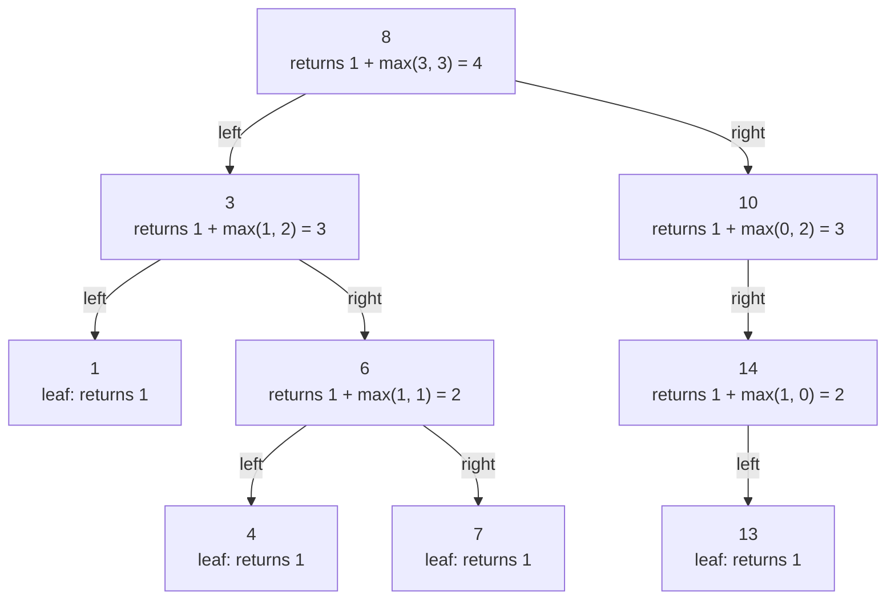
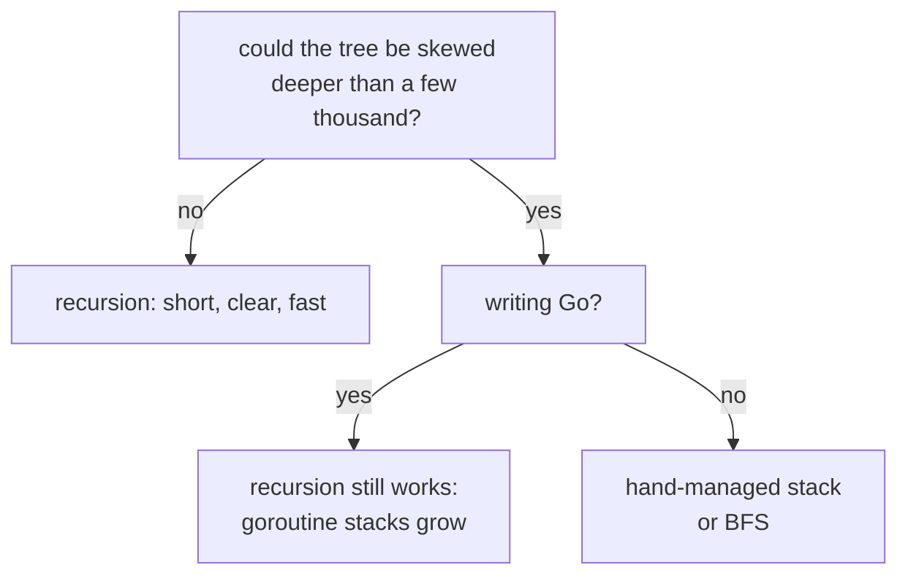

> [!tldr] Quick read
> - The problem: given the root of a [[en/concepts/binary-tree|binary tree]], return the number of nodes on the longest path from the root down to a leaf. An empty tree has depth 0. The tree has 0 to 10⁴ nodes.
> - The shortest solution is one line of recursion: depth = 1 + the larger depth of the two subtrees. Every node **returns** a number to its parent, which is a [[en/concepts/post-order-traversal|post-order]] traversal. O(n) time, O(h) stack where h is the height.
> - Two non-recursive approaches: DFS with a hand-managed stack, where each entry carries its node's depth; and level-order BFS, counting the levels. Both are O(n) too.
> - The real limits, measured on a skewed chain: Python stops at 998 levels, Node at 7,827 levels while the function is not yet optimized and 13,909 once it is, Java at 39,299, and Go runs 10⁷ levels. With the problem's 10⁴ nodes, Python and (sometimes) Node can overflow if the tree is skewed into a chain.
> - Five wrong versions, actually run: BFS increasing the depth per node instead of per level (5/8), `best=[0]` as a default value in Python (6/8, correct on the first call), Go forgetting `root == nil` (panic on the empty tree), Java `ArrayDeque.offer(null)` (1/8), JavaScript `root && …` returning `null` for the empty tree (7/8).

> [!info] Context
> LeetCode problem 104 (Easy) of [[en/posts/2026-11-25-neetcode-tree-recursion|station 3: Tree Recursion]] on **the NeetCode Line: Linked Structures**. This is the problem that shows the station's template most plainly: each node asks its two subtrees for a number, combines them, and passes the result up. The previous problem on the station, [[en/problems/invert-binary-tree|Invert Binary Tree]], walks the whole tree to **edit** it; this one walks the whole tree to **compute** a number. All you need to know is what a function that calls itself is. Solutions come in TypeScript, Python, Go, Java and JavaScript.

> [!abstract]- Quick glossary for this post (click to open)
> - **Binary tree**: every node has a value and at most two children, `left` and `right`. See [[en/concepts/binary-tree|Binary Tree]].
> - **Maximum depth (height)**: the number of nodes on the longest path from the root down to a leaf. Some texts count **edges** instead of nodes (a leaf has height 0); this problem counts nodes (a single node has depth 1).
> - **Post-order**: handle both subtrees first, the current node after. A good fit when the parent needs its children's results. See [[en/concepts/post-order-traversal|Post-order Traversal]].
> - **Call stack**: every unfinished function call holds a frame on the stack; recursion h levels deep holds h frames at once. See [[en/concepts/stack|Stack]] and [[en/concepts/recursion-depth-limit|Recursion Depth Limit]].
> - **Skewed chain**: a tree where every node has only one child, so it looks like a linked list; its height equals its number of nodes. This is the worst case for recursion.
> - **JIT**: the runtime compiler in Node and Java. A function that runs many times gets recompiled into optimized machine code, usually with smaller frames, so it survives deeper recursion.

## Picture it first: asking how many generations a family tree spans

A family wants to know how many generations its longest line spans. Nobody can see the whole tree, so the ancestor asks their two children: "how many generations does your branch span?". Each child asks their own children in turn, all the way down to the people who have no children, who answer "one generation: just me". The answers travel back up: each person takes the larger of their two children's answers, adds one (themselves), and reports to their parent.

Another way is a roll call by generation: call the first generation out to the yard, then the second, … and count how many calls it takes until nobody is left.

| Everyday life | Concept |
|---|---|
| A person together with their descendants | a subtree |
| "How many generations does your branch span?" | a recursive call on a subtree |
| A person with no children answers "one generation" | a leaf returns 1 (because an empty subtree returns 0) |
| Take the larger of the two children's answers, add one | `1 + max(left, right)` |
| The answers travel back up | post-order: children finish before the parent |
| Whoever is waiting for a child's answer | a frame on the call stack |
| A roll call by generation, counting the calls | level-order BFS |
| A line of only children, 10,000 generations long | a skewed chain: the call stack has to hold 10,000 people waiting |



Each box can only be computed after its child boxes have answered. Both branches of the root 8 return 3 (the path 3, 6, 4 and the path 10, 14, 13), so the root returns 1 + 3 = 4.

## The problem

The input is the root of a binary tree with 0 to 10⁴ nodes, values in [−100, 100]. The output is the maximum depth: the number of nodes on the longest path from the root down to a leaf. An empty tree returns 0, a one-node tree returns 1. The original problem: [LeetCode 104](https://leetcode.com/problems/maximum-depth-of-binary-tree/).

This problem is so easy that the recursive solution is a single line. What is worth learning sits in two questions behind it: why that one line is correct (each node trusts its children's answers), and when it does **not** run (when the tree is deeper than the language's call stack). The second question has a different number in each language, so I measured.

## How it works

<figure class="figure-map" style="--ar: 3 / 4">
<div class="frame"><iframe data-archify="../../diagrams/neetcode-maximum-depth-of-binary-tree/worked-example.en.html" title="Depth comes from the longer branch" loading="lazy"></iframe></div>
<figcaption><span><b>Figure 1.</b> Depth comes from the longer branch.</span><a href="../diagrams/neetcode-maximum-depth-of-binary-tree/worked-example.en.html" target="_blank" rel="noopener">Open full screen</a></figcaption>
</figure>

<details>
<summary>Read the steps</summary>
<ol>
<li>An empty tree has depth 0. <code>null → 0</code></li>
<li>A leaf has two empty branches. <code>leaf → 1 + max(0, 0) = 1</code></li>
<li>The root receives subtree depths 2 and 1. <code>left = 2; right = 1</code></li>
<li>Count the root as one more level. <code>1 + max(2, 1) = 3</code></li>
</ol>
</details>

### Approach 1: post-order recursion

```ts
// Approach 1: recursion. Depth = 1 + the larger depth of the two subtrees; an empty tree has depth 0. O(n) time, O(h) stack.
function maxDepthRecursive(root: TreeNode | null): number {
  if (root === null) return 0;
  return 1 + Math.max(maxDepthRecursive(root.left), maxDepthRecursive(root.right));
}
```

The base case is the empty tree returning 0, not a leaf returning 1. That way a node with one child needs no special handling: the empty side returns 0, and `max` picks the other side by itself. Each node is called once (plus one call on every `null` spot, n + 1 of them in total), so O(n). The extra memory is the number of frames waiting, which equals the height h.

### Approach 2: DFS with a hand-managed stack

Without recursion, a node can no longer "wait for its children to answer". Instead, every node on the stack carries its own depth (its parent's depth plus one), and we keep a running record.

```ts
// Approach 2: DFS with a hand-managed stack; each node comes with its depth. No call stack involved.
function maxDepthStack(root: TreeNode | null): number {
  if (root === null) return 0;
  const nodes: TreeNode[] = [root];
  const depths: number[] = [1];
  let best = 0;
  while (nodes.length > 0) {
    const node = nodes.pop()!;
    const d = depths.pop()!;
    if (d > best) best = d;
    if (node.left !== null) { nodes.push(node.left); depths.push(d + 1); }
    if (node.right !== null) { nodes.push(node.right); depths.push(d + 1); }
  }
  return best;
}
```

Notice the information has changed direction: the recursive version passes it **up** (children report to the parent), this one passes it **down** (the parent tells each child which level it is on). This problem allows both directions because a node's depth depends only on the path from the root to it. Later problems on the station, like [[en/problems/diameter-of-binary-tree|Diameter of Binary Tree]] or [[en/problems/balanced-binary-tree|Balanced Binary Tree]], need information from **below**, and then the non-recursive version gets much harder to write.

### Approach 3: level-counting BFS

```ts
// Approach 3: level-order BFS. Each outer round handles one whole level, so the number of rounds is the depth.
function maxDepthBfs(root: TreeNode | null): number {
  if (root === null) return 0;
  let level: TreeNode[] = [root];
  let depth = 0;
  while (level.length > 0) {
    depth++;
    const next: TreeNode[] = [];
    for (const node of level) {
      if (node.left !== null) next.push(node.left);
      if (node.right !== null) next.push(node.right);
    }
    level = next;
  }
  return depth;
}
```

The key point is that the outer loop goes **level by level**, not node by node. The Python and Java versions do it by reading the queue's size at the start of each round (`for _ in range(len(queue))`) and taking out exactly that many nodes.

| Approach | Time | Extra memory | Direction of information |
|---|---|---|---|
| Recursion | O(n) | O(h) on the call stack | up: children report to the parent |
| Hand-managed stack | O(n) | O(h) on the heap | down: the parent tells the children |
| Level-order BFS | O(n) | O(width), up to n/2 | counting levels |

Which one to pick:



### Five wrong versions

**BFS counting nodes instead of levels** (TypeScript). Forget the per-level inner loop and increase `depth` every time a node is taken out: the result is the number of nodes. It passes 5/8 cases, because for the empty tree, the one-node tree and every chain (one node per level), the number of nodes equals the number of levels. The complete 3-level tree comes out as 7.

**`best=[0]` as a default value** (Python). Wanting a record shared by every recursive call, some people write:

```python
# WRONG: keeps the record in a list used as a default value. Python creates that list ONCE, when the function is defined,
# so the record from the previous call is still there on the next call. The first call is correct.
def wrong_mutable_default(root, depth=1, best=[0]):
    if root is None:
        return best[0]
    best[0] = max(best[0], depth)
    wrong_mutable_default(root.left, depth + 1, best)
    wrong_mutable_default(root.right, depth + 1, best)
    return best[0]
```

The default value is evaluated **once**, when the `def` statement runs, and every call that does not pass `best` shares that list. Running the 8 cases in a row: the first six have increasing depths (0, 1, 2, 3, 4, 6), so they still pass; the seventh is 5 deep but the old record is 6, so it returns 6. It passes 6/8, and a test that runs each case on its own will never see the bug. Any judge that runs several cases in the same process will.

**Go forgetting the nil check at the root.** This version checks `root.Left != nil` before recursing, but never checks `root`. On an empty tree, `root.Left` dereferences a nil pointer: panic `invalid memory address or nil pointer dereference`. It passes 7/8.

**Java's `ArrayDeque` rejects null.** This BFS pushes both children into the queue and plans to skip `null` when taking them out. But `ArrayDeque.offer(null)` throws `NullPointerException` right away, so every tree with at least one node missing a child fails: 1/8, only the empty tree passes. `LinkedList` accepts `null`, so this version would run with a `LinkedList`, but checking for `null` before pushing is still cleaner.

**JavaScript `root && …`** (the JS version). `const f = (root) => root && 1 + Math.max(f(root.left), f(root.right))` looks neat, but for an empty tree it returns `null`, not `0`: the `&&` operator returns the left side itself when the left side is "falsy". Inside the tree it still works, because `Math.max(null, null)` turns `null` into 0. It passes 7/8.

### Recursion limits, actually measured

The problem allows up to 10⁴ nodes and does not promise a balanced tree. A skewed chain of 10⁴ nodes needs 10⁴ call frames at once. I built a left-skewed chain and searched (by bisection) for the largest depth the recursive version survives, on Node 24, Python 3.12, Go 1.25 and Java 21, everything left at its defaults:

| Language | Largest depth measured | Past it | The problem's 10⁴-node chain |
|---|---|---|---|
| Python | 998 | `RecursionError` (catchable) | overflows |
| Node (function not yet optimized, fresh run) | 7,827 | `RangeError: Maximum call stack size exceeded` | overflows |
| Node (after JIT optimization) | 13,909 | same as above | passes |
| Java (main thread) | 39,299 | `StackOverflowError` (an `Error`, not an `Exception`) | passes |
| Go | no limit hit at 10⁷ | past 1 GB the whole program dies, not catchable | passes |

- **Python** counts frames, not memory: the default limit is 1,000, minus a few frames for the calling code, which leaves 998. `sys.setrecursionlimit(200_000)` lets a 10⁵-node chain run in about 20 ms. Since Python 3.11, a Python function calling a Python function uses almost no C stack, so raising the limit is fairly safe; on older versions, raising it too far can crash the whole process.
- **Node** has a fixed stack (about 1 MB by default), and the number of levels depends on the frame size. On the first run the function is still interpreted, frames are large, and it only gets 7,827 levels; the JavaScript file calls it straight on a 10⁴-node chain and gets `RangeError`. The TypeScript file runs the function many times before measuring, the frames shrink, and it gets 13,909 levels. Same function, same machine, two numbers.
- **Java** depends on the JIT too; compiled frames are small, so the main thread survives 39,299 levels. The fix when you must recurse: run inside a `Thread` with a stack size of your choice. With 512 MB, a 10⁶-node chain runs.
- **Go** gives each goroutine a small initial stack and copies it to a larger region when needed, up to 1 GB on a 64-bit machine. A 10⁷-node chain runs recursively, about 5 times slower than the hand-managed stack, partly because the stack has to be copied to a larger region many times.

The [[en/problems/reverse-linked-list|Reverse Linked List]] page measures the same thing on a linked list and gets slightly different numbers (Node about 15,650, Java 29,470), because every function has its own frame size.

### Measuring speed

On a complete tree of 2²⁰ − 1 = 1,048,575 nodes (height 20, no risk of overflow), median of 5 runs, in ms:

| Language | Recursion | Stack | BFS |
|---|---|---|---|
| TypeScript | 9.13 | 6.63 | 17.67 |
| Python | 129.14 | 149.71 | 51.19 |
| Go | 3.31 | 5.61 | 8.28 |
| Java | 4.10 | 8.85 | 8.53 |

All O(n), within 3 times of each other. The most interesting one is Python: BFS is more than 2 times faster than recursion, because the inner loop `for _ in range(len(queue))` with a `deque` costs fewer Python operations per node than a Python function call. In Go and Java, recursion is the fastest because function calls are cheap and nothing is allocated. These numbers come from a personal machine with other work running in parallel, so read the ordering, not the decimals.

## Runnable example

[TypeScript](../code/neetcode-maximum-depth-of-binary-tree/max-depth.ts) · [Python](../code/neetcode-maximum-depth-of-binary-tree/max_depth.py) · [Go](../code/neetcode-maximum-depth-of-binary-tree/max_depth.go) · [Java](../code/neetcode-maximum-depth-of-binary-tree/max-depth.java) · [JavaScript](../code/neetcode-maximum-depth-of-binary-tree/max-depth.js)

Each file builds trees from level-order arrays and runs 8 shared cases: empty tree, one node, right child only, a complete 3-level tree, a deep right branch, a 6-node left chain, a 5-level zigzag, negative values and 0. The TypeScript, Python, Go and Java files also cross-check 2,000 random trees (mulberry32, up to 40 nodes), with the correct depth recorded while each tree is built.

Recursion:

```ts
// Approach 1: recursion. Depth = 1 + the larger depth of the two subtrees; an empty tree has depth 0. O(n) time, O(h) stack.
function maxDepthRecursive(root: TreeNode | null): number {
  if (root === null) return 0;
  return 1 + Math.max(maxDepthRecursive(root.left), maxDepthRecursive(root.right));
}
```

```python
# Approach 1: recursion. Depth = 1 + the larger depth of the two subtrees; an empty tree has depth 0.
def max_depth_recursive(root):
    if root is None:
        return 0
    return 1 + max(max_depth_recursive(root.left), max_depth_recursive(root.right))
```

```go
// Approach 1: recursion. Depth = 1 + the larger depth of the two subtrees; an empty tree (nil) has depth 0.
func maxDepthRecursive(root *TreeNode) int {
	if root == nil {
		return 0
	}
	return 1 + max(maxDepthRecursive(root.Left), maxDepthRecursive(root.Right))
}
```

```java
// Approach 1: recursion. Depth = 1 + the larger depth of the two subtrees; an empty tree has depth 0.
static int maxDepthRecursive(TreeNode root) {
    if (root == null) return 0;
    return 1 + Math.max(maxDepthRecursive(root.left), maxDepthRecursive(root.right));
}
```

```js
// Approach 1: recursion. Depth = 1 + the larger depth of the two subtrees; an empty tree has depth 0.
function maxDepthRecursive(root) {
  if (root === null) return 0;
  return 1 + Math.max(maxDepthRecursive(root.left), maxDepthRecursive(root.right));
}
```

Level-counting BFS:

```ts
// Approach 3: level-order BFS. Each outer round handles one whole level, so the number of rounds is the depth.
function maxDepthBfs(root: TreeNode | null): number {
  if (root === null) return 0;
  let level: TreeNode[] = [root];
  let depth = 0;
  while (level.length > 0) {
    depth++;
    const next: TreeNode[] = [];
    for (const node of level) {
      if (node.left !== null) next.push(node.left);
      if (node.right !== null) next.push(node.right);
    }
    level = next;
  }
  return depth;
}
```

```python
# Approach 3: level-order BFS; each outer round takes out exactly the nodes of one level.
def max_depth_bfs(root):
    if root is None:
        return 0
    queue, depth = deque([root]), 0
    while queue:
        depth += 1
        for _ in range(len(queue)):
            node = queue.popleft()
            if node.left:
                queue.append(node.left)
            if node.right:
                queue.append(node.right)
    return depth
```

```go
// Approach 3: level-order BFS; the number of outer rounds is the depth.
func maxDepthBfs(root *TreeNode) int {
	if root == nil {
		return 0
	}
	level, depth := []*TreeNode{root}, 0
	for len(level) > 0 {
		depth++
		var next []*TreeNode
		for _, node := range level {
			if node.Left != nil {
				next = append(next, node.Left)
			}
			if node.Right != nil {
				next = append(next, node.Right)
			}
		}
		level = next
	}
	return depth
}
```

```java
// Approach 3: level-order BFS; each outer round takes out exactly the nodes of one level.
static int maxDepthBfs(TreeNode root) {
    if (root == null) return 0;
    Deque<TreeNode> queue = new ArrayDeque<>();
    queue.offer(root);
    int depth = 0;
    while (!queue.isEmpty()) {
        depth++;
        for (int k = queue.size(); k > 0; k--) {
            TreeNode node = queue.poll();
            if (node.left != null) queue.offer(node.left);
            if (node.right != null) queue.offer(node.right);
        }
    }
    return depth;
}
```

```js
// Approach 3: level-order BFS; the number of outer rounds is the depth.
function maxDepthBfs(root) {
  if (root === null) return 0;
  let level = [root], depth = 0;
  while (level.length > 0) {
    depth++;
    const next = [];
    for (const node of level) {
      if (node.left !== null) next.push(node.left);
      if (node.right !== null) next.push(node.right);
    }
    level = next;
  }
  return depth;
}
```

The hand-managed stack version in all five languages is in the files above.

Output of `node max-depth.ts`:

```text
maxDepthRecursive  8/8 cases passed
maxDepthStack      8/8 cases passed
maxDepthBfs        8/8 cases passed
wrongBfsPerNode    5/8 cases passed; wrong on complete 3 levels → 7 (correct is 3), deep right branch → 9 (correct is 4), negative values and 0 → 4 (correct is 3)

random: maxDepthRecursive 2000/2000, maxDepthStack 2000/2000, maxDepthBfs 2000/2000

Left-skewed chain of d nodes, median of 5 runs (ms)
d       recursion      stack        BFS
1000           0.02       0.00       0.05
10000          0.18       0.04       0.26
100000   RangeError       0.42       3.28
1000000  RangeError       6.67      25.20
recursion survives at most 13909 levels (Node's default stack)

Complete tree of 1048575 nodes, median of 5 runs (ms)
maxDepthRecursive      9.13
maxDepthStack          6.63
maxDepthBfs           17.67
```

*(Output labels translated; the files themselves print Vietnamese.)*

`python3 max_depth.py`:

```text
max_depth_recursive    8/8 cases passed
max_depth_stack        8/8 cases passed
max_depth_bfs          8/8 cases passed
wrong_mutable_default  6/8 cases passed; wrong on 5-level zigzag → 6 (correct is 5), negative values and 0 → 6 (correct is 3)

random: max_depth_recursive 2000/2000, max_depth_stack 2000/2000, max_depth_bfs 2000/2000

Left-skewed chain of d nodes, median of 5 runs (ms), recursion limit 1000
d             recursion      stack        BFS
500                0.10           0.07           0.05
1000     RecursionError           0.14           0.10
10000    RecursionError           1.46           1.01
100000   RecursionError          15.10          10.88
after setrecursionlimit(200000): chain of 100000 nodes, recursion 21.49 ms

Complete tree of 1048575 nodes, median of 5 runs (ms)
max_depth_recursive      129.14
max_depth_stack          149.71
max_depth_bfs             51.19
```

`go run max_depth.go`:

```text
maxDepthRecursive  8/8 cases passed
maxDepthStack      8/8 cases passed
maxDepthBfs        8/8 cases passed
wrongNoRootCheck   7/8 cases passed; wrong on empty tree → panic

random: maxDepthRecursive 2000/2000, maxDepthStack 2000/2000, maxDepthBfs 2000/2000

Left-skewed chain of d nodes, median of 5 runs (ms)
d         recursion      stack        BFS
1000             0.01       0.00       0.03
100000           1.25       0.28       2.14
1000000         17.68       3.42      21.82
10000000       184.28      38.03     199.44

Complete tree of 1048575 nodes, median of 5 runs (ms)
maxDepthRecursive      3.31
maxDepthStack          5.61
maxDepthBfs            8.28
```

`java max-depth.java`:

```text
maxDepthRecursive  8/8 cases passed
maxDepthStack      8/8 cases passed
maxDepthBfs        8/8 cases passed
wrongOfferNull     1/8 cases passed; wrong on one node → threw NullPointerException, right child only → threw NullPointerException, complete 3 levels → threw NullPointerException, deep right branch → threw NullPointerException, 6-node left chain → threw NullPointerException, 5-level zigzag → threw NullPointerException, negative values and 0 → threw NullPointerException

random: maxDepthRecursive 2000/2000, maxDepthStack 2000/2000, maxDepthBfs 2000/2000

Left-skewed chain of d nodes, median of 5 runs (ms), main thread
d             recursion      stack        BFS
1000                 0.01           0.02           0.01
10000                0.08           0.25           0.15
100000      StackOverflow           0.53           0.60
1000000     StackOverflow           9.65           6.11
recursion survives at most 39299 levels (the main thread's default stack)
own thread with a 512 MB stack: chain of 1000000 nodes, recursion 14.06 ms

Complete tree of 1048575 nodes, median of 5 runs (ms)
maxDepthRecursive      4.10
maxDepthStack          8.85
maxDepthBfs            8.53
```

`node max-depth.js`:

```text
maxDepthRecursive  8/8 cases passed
maxDepthStack      8/8 cases passed
maxDepthBfs        8/8 cases passed
wrongShortCircuit  7/8 cases passed; wrong on empty tree → null (correct is 0)

chain of 10000 nodes, maxDepthRecursive: threw RangeError: Maximum call stack size exceeded
chain of 10000 nodes, maxDepthStack: 10000
chain of 100000 nodes, maxDepthRecursive: threw RangeError: Maximum call stack size exceeded
chain of 100000 nodes, maxDepthStack: 100000
```

## Misconceptions and common traps

- **"The base case is a leaf returning 1."** Choosing the empty tree returning 0 is cleaner: no special case for one-child nodes, and an empty input tree is handled for free.
- **Counting edges instead of nodes.** Some books define a leaf's height as 0. This problem counts nodes: a single node has depth 1.
- **BFS increasing the depth per node.** It has to increase per level: read the queue's size at the start of the round, or keep arrays for the current level and the next.
- **"Recursion on a tree never overflows."** Only true when the tree is balanced. On the problem's 10⁴-node skewed chain, Python overflows at 998 levels and Node can overflow at 7,827 levels.
- **"Node survives N levels" is a fixed number.** The same function gives 7,827 before optimization and 13,909 after the JIT optimizes it.
- **`catch (Exception e)` in Java catches a stack overflow.** It does not: `StackOverflowError` is an `Error`.
- **A list as a default value in Python.** It is created once and shared between calls; use `None` and create a fresh list in the body, or pass the result through the return value like the standard recursive version.

## Self-check questions

> [!question]- Why does `1 + max(left, right)` need no special handling for a node with only one child?
> Because an empty subtree returns 0. A one-child node gets 0 from the empty side and k from the other, `max` picks k, and the result k + 1 is correct. With "a leaf returns 1" as the base case, you would have to check each child for `null` separately.

> [!question]- The recursive version passes information up, the stack version passes it down. Why does this problem allow both, while the diameter problem is not as easy?
> A node's depth depends only on the path from the root to it, so the parent can pass it down. A diameter through a node needs the heights of **both** subtrees, which are only known after everything below has been visited; that is bottom-up information, a natural fit for post-order recursion.

> [!question]- Is a complete tree of 10⁶ nodes at risk of overflowing the stack? And a chain of 10⁴ nodes?
> A complete tree of 10⁶ nodes is only 20 tall, so recursion holds at most about 21 frames: safe in every language. A 10⁴-node chain is 10⁴ tall: Python overflows by default (998), Node overflows before optimization (7,827), Java and Go pass.

> [!question]- `wrong_mutable_default` is correct on the first case. Why are later cases wrong, and how do you fix it while keeping the "shared record" style?
> The list `[0]` is created once when `def` runs and is shared by every call that does not pass `best`, so the old record stays. Fix: `def f(root, depth=1, best=None)` then `if best is None: best = [0]` on the outermost call, or wrap it in an outer function with a local variable and use `nonlocal`.

> [!question]- In BFS, how many nodes does the queue hold at most for a complete tree of 10⁶ nodes, and for a chain of 10⁶ nodes?
> Complete tree: the whole last level, about 5 · 10⁵ nodes. Chain: one node per level, so just 1. BFS costs memory by width, while recursion and the hand-managed stack cost memory by height; their worst-case trees are opposite.

## References

- [LeetCode 104: Maximum Depth of Binary Tree](https://leetcode.com/problems/maximum-depth-of-binary-tree/) (original problem: 0 to 10⁴ nodes, values in [−100, 100])
- [Python `sys.setrecursionlimit`](https://docs.python.org/3/library/sys.html#sys.setrecursionlimit)
- [Python tutorial: default argument values](https://docs.python.org/3/tutorial/controlflow.html#default-argument-values) ("The default value is evaluated only once")
- [What's New in Python 3.11: inlined Python function calls](https://docs.python.org/3/whatsnew/3.11.html#inlined-python-function-calls)
- [Go FAQ: goroutines and growable stacks](https://go.dev/doc/faq#goroutines)
- [Go `runtime/debug.SetMaxStack`](https://pkg.go.dev/runtime/debug#SetMaxStack) (1 GB by default on 64-bit systems; a goroutine past the limit crashes the program)
- [Java `ArrayDeque`](https://docs.oracle.com/en/java/javase/21/docs/api/java.base/java/util/ArrayDeque.html) ("Null elements are prohibited")
- [Java `Thread(ThreadGroup, Runnable, String, long stackSize)`](https://docs.oracle.com/en/java/javase/21/docs/api/java.base/java/lang/Thread.html)
- Station neighbor: [[en/problems/invert-binary-tree|Invert Binary Tree]]; the same stack-overflow story on a list: [[en/problems/reverse-linked-list|Reverse Linked List]]
