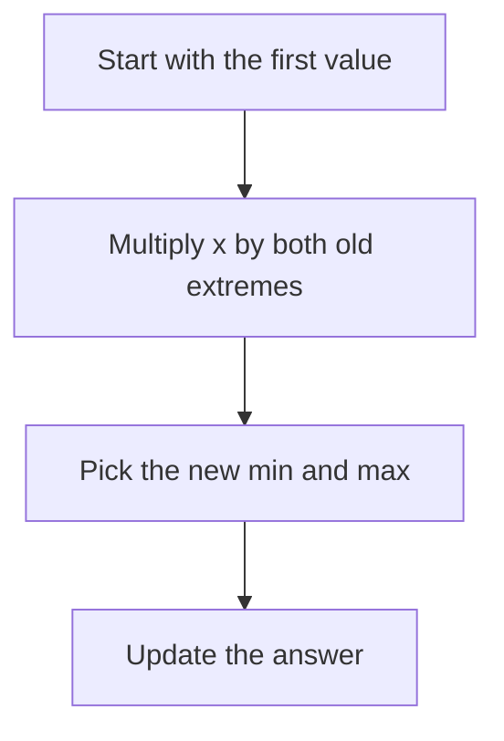

> [!tldr] Quick read
> - A negative number can turn the previous minimum product into the next maximum.
> - Each step compares `x`, `x × high`, and `x × low` using the two old values.
> - Take the largest of all the `high` values, including ones that end before the last index.

> [!info] Context
> LeetCode 152, at [[en/posts/2026-11-27-neetcode-linear-dp|station 1: One-Dimensional Recurrences]] on the NeetCode Dynamic Programming line. Loops and arrays are enough to get started.

> [!abstract]- Quick glossary for this post (click to open)
> - A subarray is contiguous and nonempty.
> - `high` and `low` are the maximum and minimum products of subarrays ending at the current index.
> - A negative factor reverses order. Multiplying by zero collapses both extremes to zero.

## Picture it first: cut a strip of printed factors

From the strip `[-2, 3, -4]`, I cut a contiguous piece and multiply its factors. After two positions, the piece with the lowest product is `[-2, 3]` at −6. Including `−4` brings that same piece up to 24.

| Everyday life | Concept |
| --- | --- |
| Last position of a strip | Subarray endpoint |
| Lowest value still held | low |
| Add a negative factor | The two extremes swap roles |
| Highest value ever seen | Answer |



## The problem: the largest product over contiguous intervals

An array has 1 to 20,000 values from −10 through 10. Return the largest product of a nonempty contiguous subarray. The problem guarantees that every subarray product fits in a signed 32-bit integer.

## How it works

### Enumerate intervals by left endpoint

For each left endpoint, start a product at 1 and advance the right endpoint, updating the product with one multiplication per index. This takes O(n²) time and O(1) space.

### Hold the two extremes of the product set

Every subarray ending at `i` consists of `x = nums[i]` alone or an old subarray ending at `i−1` followed by x. Multiplying the old set by x reaches its extremes at one of the old extremes. Positive x preserves order, negative x reverses it, and zero collapses it.

Update `high ← max(x, x × old_high, x × old_low)` and `low ← min(...)`. In the example, the extremes go from `(−2, −2)` to `(3, −6)` and then `(24, −12)`. We take the highest value across **all** positions because the best subarray may end early.

The two extremes and the answer use O(1) space, and the loop takes O(n) time. The intermediate products all correspond to contiguous subarrays and fit the stated range. For 1,000 alternating `1` and `−1` factors, the TypeScript exhaustive scan counts 500,500 multiplications versus 1,998 for DP.

## Runnable example

[TypeScript](../code/neetcode-maximum-product-subarray/maximum-product.ts) · [Python](../code/neetcode-maximum-product-subarray/maximum_product.py) · [Go](../code/neetcode-maximum-product-subarray/maximum_product.go) · [Java](../code/neetcode-maximum-product-subarray/maximum-product.java) · [JavaScript](../code/neetcode-maximum-product-subarray/maximum-product.js) · [PHP](../code/neetcode-maximum-product-subarray/maximum-product.php) · [Rust](../code/neetcode-maximum-product-subarray/maximum_product.rs)

The tabs show the central function. The standalone files also run the comparison methods on the small cases. The TypeScript file adds randomized comparisons.

```ts
function maximumProduct(values: number[]): number {
  let high = values[0]
  let low = values[0]
  let best = values[0]
  for (let i = 1; i < values.length; i++) {
    const x = values[i]
    const extendHigh = high * x
    const extendLow = low * x
    high = Math.max(x, extendHigh, extendLow)
    low = Math.min(x, extendHigh, extendLow)
    best = Math.max(best, high)
  }
  return best
}
```

```python
def maximum_product(values):
    high = low = best = values[0]
    for index in range(1, len(values)):
        x = values[index]
        extend_high, extend_low = high * x, low * x
        high = max(x, extend_high, extend_low)
        low = min(x, extend_high, extend_low)
        best = max(best, high)
    return best
```

```go
func maximumProduct(values []int) int {
	high, low, best := values[0], values[0], values[0]
	for _, x := range values[1:] {
		extendHigh, extendLow := high*x, low*x
		high = max(x, extendHigh, extendLow)
		low = min(x, extendHigh, extendLow)
		best = max(best, high)
	}
	return best
}
```

```java
static int maximumProduct(int[] values) {
    int high = values[0], low = values[0], best = values[0];
    for (int index = 1; index < values.length; index++) {
        int x = values[index];
        int extendHigh = high * x, extendLow = low * x;
        high = Math.max(x, Math.max(extendHigh, extendLow));
        low = Math.min(x, Math.min(extendHigh, extendLow));
        best = Math.max(best, high);
    }
    return best;
}
```

```js
function maximumProduct(values) {
  let high = values[0]
  let low = values[0]
  let best = values[0]
  for (let i = 1; i < values.length; i++) {
    const x = values[i]
    const extendHigh = high * x
    const extendLow = low * x
    high = Math.max(x, extendHigh, extendLow)
    low = Math.min(x, extendHigh, extendLow)
    best = Math.max(best, high)
  }
  return best
}
```

```php
function maximumProduct(array $values): int {
    $high = $low = $best = $values[0];
    for ($i = 1; $i < count($values); $i++) {
        $x = $values[$i];
        $extendHigh = $high * $x;
        $extendLow = $low * $x;
        $high = max($x, $extendHigh, $extendLow);
        $low = min($x, $extendHigh, $extendLow);
        $best = max($best, $high);
    }
    return $best;
}
```

```rust
fn maximum_product(values: &[i32]) -> i32 {
    let (mut high, mut low, mut best) = (values[0], values[0], values[0]);
    for &x in &values[1..] {
        let (extend_high, extend_low) = (high * x, low * x);
        high = x.max(extend_high).max(extend_low);
        low = x.min(extend_high).min(extend_low);
        best = best.max(high);
    }
    best
}
```

```text
7/7 cases passed
201/201 cross-checks passed; 1,000-element array: exhaustive scan 500500 multiplications, DP 1998
```

*(Output labels translated; the files themselves print Vietnamese.)*

## Misconceptions and common traps

- **Keep only `high`.** After two positions in the example, `high = 3` loses the route to 24.
- **Update `high` before using it for `low`.** Both have to read old products to extend by exactly one position.
- **Initialize the answer to zero.** The answer for `[-3]` is −3 because the subarray is nonempty.
- **Stop the loop at zero.** A later subarray can have a higher product.

## Self-check questions

> [!question]- What happens to the extremes at zero?
> Both become zero. Every extended product becomes zero and a singleton zero does too.

> [!question]- Why not return `high` at the final position?
> It only represents subarrays touching the end. The optimum can be before a zero.

## References

- [LeetCode 152 · Maximum Product Subarray](https://leetcode.com/problems/maximum-product-subarray/)
- [MIT 6.006 · Dynamic Programming](https://ocw.mit.edu/courses/6-006-introduction-to-algorithms-spring-2020/resources/lecture-notes/)
