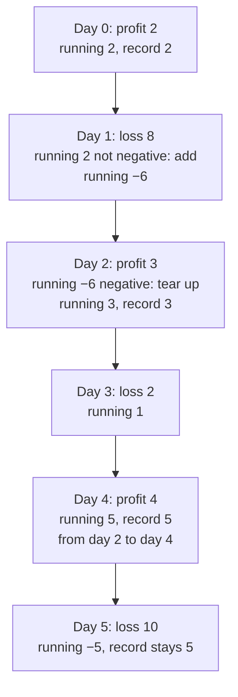
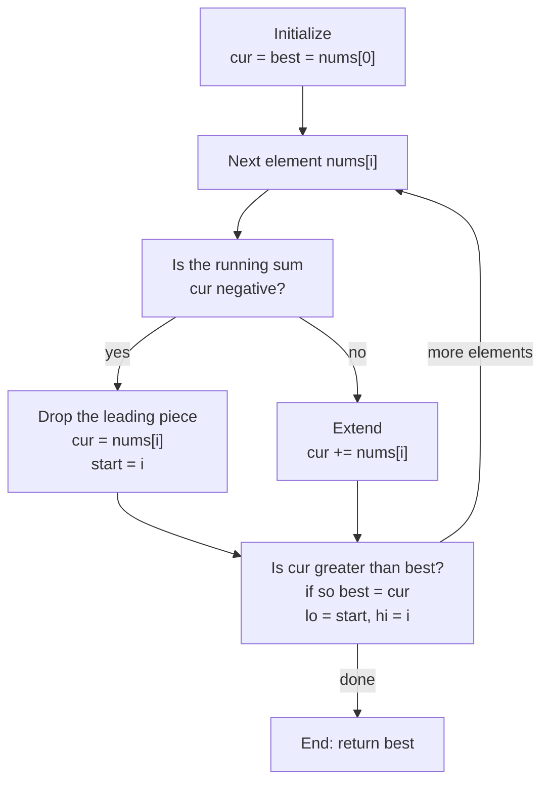

> [!tldr] Quick read
> - The best subarray ending at position i has only two options: just `nums[i]`, or `nums[i]` appended to the best subarray ending at i − 1. Picking the larger one is one whole step.
> - Stated as a [[en/concepts/greedy-choice|greedy choice]]: if the running sum is negative, drop it and start again at the current element. That is [[en/concepts/kadane-algorithm|Kadane's algorithm]]: one pass, O(n) time, O(1) memory.
> - To know which subarray it is, remember where you last restarted, and copy the bounds every time the record is broken.
> - Initializing the record to 0 is the classic trap: an all-negative array then returns 0, while the problem requires at least one element.
> - At n = 10,000 the O(n²) brute force does 50,005,000 additions; Kadane does 10,000. On my machine Python takes about 1.8 seconds versus 0.23 milliseconds.

> [!info] Context
> This is LeetCode problem 53, the anchor problem of [[en/posts/2026-11-28-neetcode-greedy-array|station MISC-03: Greedy on Arrays]] on **the NeetCode Line: Mixed Techniques**. I picture a shop's daily profit-and-loss ledger and look for the run of consecutive days that did best. You only need arrays and loops; the divide-and-conquer part uses recursion.

> [!abstract]- Quick glossary for this post (click to open)
> - A subarray is a contiguous piece of the array with at least one element. `[3, -2, 4]` is a subarray of `[2, -8, 3, -2, 4, -10]`; `[2, 3]` is not, because it skips elements.
> - Greedy means taking whatever looks best at each step and never going back to reconsider. It is only correct when you can prove the choice never loses the answer.
> - `cur` is the sum of the best subarray **ending at** the current position; `best` is the record so far.
> - A [[en/concepts/prefix-sum|prefix sum]] P[k] is the sum of the first k elements, so the sum of i..j is P[j + 1] − P[i].
> - Divide and conquer cuts the problem in half, solves each half, then combines the results.

## Picture it first: a shop's profit-and-loss ledger

I have a ledger of a shop's daily profit (positive) or loss (negative), and I want to show off the run of consecutive days with the highest total profit. I turn the pages from the first day, holding a "running sheet" that adds up everything since the day I started counting. Each morning I look at the running sheet: if it is negative, the last few days add up to a loss, and carrying that loss into today only lowers the total. I tear up the sheet and start counting again from today. Beside me, a board holds the highest record seen so far, with its first and last day.

| Everyday life | Concept |
|---|---|
| Each day's profit or loss | `nums[i]` |
| A run of consecutive days | The subarray `nums[lo..hi]` |
| The running sheet, summed since counting started | `cur` |
| Running sheet negative: tear it up, count from today | `cur < 0` then `cur = nums[i]`, `start = i` |
| Running sheet not negative: add today | `cur += nums[i]` |
| The record board with its first and last day | `best`, `lo`, `hi` |

With the ledger `[2, -8, 3, -2, 4, -10]`, I go day by day like this:



## The problem: the contiguous piece with the largest sum

Given an integer array `nums` of length 1 to 100,000, each element between −10,000 and 10,000, pick one contiguous, **non-empty** subarray whose elements have the largest sum, and return that sum. For example, in `[3, -2, 5, -1]` the subarray `[3, -2, 5]` sums to 6. LeetCode also suggests trying divide and conquer once you have the O(n) solution. [Original problem, LeetCode 53](https://leetcode.com/problems/maximum-subarray/)

The limits say two things. First, n goes up to 100,000, so O(n²) means 5·10⁹ additions, far too slow. Second, the largest possible sum is 100,000 × 10,000 = 10⁹, which still fits a 32-bit integer (limit about 2.147·10⁹), so no `long` is needed.

My first thought was "skip the negative numbers". But `[3, -2, 5]` shows that a negative number between two large positives is still worth keeping, because dropping it breaks the run. What needs dropping is not each negative number but a whole **leading piece** whose sum is negative.

## How it works

### Brute force: O(n³), then O(n²)

The crudest way looks at every pair (i, j) with i ≤ j and adds up `nums[i..j]` from scratch. There are about n²/2 pairs, each summing up to n numbers: O(n³) time. I keep this as the referee in the runnable file, because it shares no line with the other approaches.

One loop level can go: fix the start i, then move j from i to the right and accumulate `sum += nums[j]`. The sum of `nums[i..j]` comes straight from the sum of `nums[i..j-1]`. That leaves n(n + 1)/2 additions: O(n²) time, O(1) memory.

### Prefix sums

The sum of i..j is P[j + 1] − P[i]. For each end j, the best subarray ending at j is P[j + 1] minus the **smallest** prefix before it (including P[0] = 0, the empty prefix). One pass with a running `minPrefix`: O(n) time, O(1) memory. It is also [[en/problems/best-time-to-buy-and-sell-stock|Best Time to Buy and Sell Stock]] in disguise: buy at the lowest prefix, sell at the current one.

### Divide and conquer: O(n log n)

Cut the array at the middle `mid`. The best subarray lies entirely on the left, entirely on the right, or straddles `mid`. The first two cases are solved recursively. A straddling subarray must contain both `nums[mid]` and `nums[mid + 1]`, so it equals the largest sum of a subarray **ending at** `mid` (walking left from `mid`) plus the largest sum of a subarray **starting at** `mid + 1` (walking right). Combining costs O(n) per level, and there are log n levels: T(n) = 2T(n/2) + O(n) = O(n log n). The call stack is O(log n) deep, about 17 levels at n = 100,000.

### Kadane: O(n), O(1)

Let `cur` be the sum of the best subarray **ending at** i. That subarray is either just `nums[i]` or the best subarray ending at i − 1 extended by `nums[i]`. So `cur = max(nums[i], cur + nums[i])`. The answer is the largest `cur` ever seen. This is a [[en/concepts/rolling-state|rolling state]]: each step only reads the previous step's `cur`.

`max(nums[i], cur + nums[i])` picks `nums[i]` exactly when `cur < 0`. So I rewrite it greedily: look at the running sum before adding; if it is negative, drop it and start again at i. Why can it be dropped without losing the answer? That is the [[en/concepts/restart-argument|restart argument]]: a leading piece with a negative sum, attached in front of any later subarray, only makes that subarray smaller. Start points **inside** the dropped piece do not help either: when the piece starting at `start` has just turned negative, every shorter leading part of it was non-negative (otherwise the restart would have happened earlier), so the tail from any middle point up to i has an even more negative sum and is also worth dropping.



**Getting the bounds too.** Add a variable `start`: every restart sets `start = i`. Every time `cur` breaks the record, copy `lo = start`, `hi = i`. Copy the bounds only when the record breaks, not on restart, because the new run may never beat the old record.

**How it differs from Maximum Product Subarray.** In [[en/problems/maximum-product-subarray|Maximum Product Subarray]], a negative number times a negative product turns into a large positive one, so "drop the running product when it looks bad" is no longer right: today's most negative product can become tomorrow's largest. That problem has to keep **two** states, the largest and the smallest product ending at i. With sums, adding a number never flips the order, so one state is enough.

| Approach | Time | Extra memory | Notes |
|---|---|---|---|
| Re-add every subarray | O(n³) | O(1) | Referee in the runnable file |
| Fix the start, accumulate | O(n²) | O(1) | 5·10⁹ additions at n = 100,000 |
| Divide and conquer | O(n log n) | O(log n) | Call stack; LeetCode suggests it |
| Prefix sum minus the smallest prefix | O(n) | O(1) | Same idea as the stock problem |
| Kadane | O(n) | O(1) | Main approach; add `start` for the bounds |

### A real measurement: O(n²) versus O(n)

I generate an array of 10,000 numbers in −10,000..10,000 with the MINSTD generator and a fixed seed, so all seven languages get the same array and the same sum, 352094. The O(n²) version counts 50,005,000 additions, exactly n(n + 1)/2; Kadane adds 10,000 times. Running `kadane.<ext> bench` makes the file also print the time per run. The fast approaches run many times and report the average, because a single Kadane run is shorter than the clock's resolution. On my machine (Intel i7-12700H; Node 24, Python 3.12, Go 1.25, Java 21, PHP 8.2, Rust 1.99):

| Language | O(n²) | Divide and conquer | Kadane |
|---|---|---|---|
| TypeScript, JavaScript | 54 ms | 0.34 ms | 0.013 ms |
| Python | 1,770 ms | 16 ms | 0.23 ms |
| Go | 22 ms | 0.093 ms | 0.008 ms |
| Java | 11 ms | 0.15 ms | 0.004 ms |
| PHP | 415 ms | 3.5 ms | 0.097 ms |
| Rust | 22 ms | 0.091 ms | 0.004 ms |

The gap between O(n²) and Kadane is three to four orders of magnitude in every language, close to the 5,000× ratio in addition counts. At n = 100,000 the O(n²) addition count grows 100 times; I did not measure that size, but scaling straight up, Python would take about three minutes while Kadane stays under 3 milliseconds. Timings vary by machine and by run; the addition counts do not.

## Runnable example

[TypeScript](../code/neetcode-maximum-subarray/kadane.ts) · [Python](../code/neetcode-maximum-subarray/kadane.py) · [Go](../code/neetcode-maximum-subarray/kadane.go) · [Java](../code/neetcode-maximum-subarray/kadane.java) · [JavaScript](../code/neetcode-maximum-subarray/kadane.js) · [PHP](../code/neetcode-maximum-subarray/kadane.php) · [Rust](../code/neetcode-maximum-subarray/kadane.rs)

```ts
// Main approach: Kadane. If the running sum is negative, drop it and start again at the current element
function maxSubArray(nums: number[]): number {
    let cur = nums[0] // best sum of a subarray ending at i
    let best = nums[0]
    for (let i = 1; i < nums.length; i++) {
        cur = cur < 0 ? nums[i] : cur + nums[i] // a negative leading piece only drags the sum down
        if (cur > best) best = cur
    }
    return best
}

// Kadane with bounds: remember the restart point, copy the bounds whenever the record breaks
function maxSubArrayBounds(nums: number[]): [number, number, number] {
    let cur = nums[0]
    let best = nums[0]
    let start = 0
    let lo = 0
    let hi = 0
    for (let i = 1; i < nums.length; i++) {
        if (cur < 0) {
            cur = nums[i]
            start = i // a new subarray starts at i
        } else {
            cur += nums[i]
        }
        if (cur > best) {
            best = cur
            lo = start
            hi = i
        }
    }
    return [best, lo, hi]
}
```

```python
# Main approach: Kadane. If the running sum is negative, drop it and start again at the current element
def max_sub_array(nums):
    cur = nums[0]  # best sum of a subarray ending at i
    best = nums[0]
    for x in nums[1:]:
        cur = x if cur < 0 else cur + x  # a negative leading piece only drags the sum down
        if cur > best:
            best = cur
    return best


# Kadane with bounds: remember the restart point, copy the bounds whenever the record breaks
def max_sub_array_bounds(nums):
    cur = best = nums[0]
    start = lo = hi = 0
    for i in range(1, len(nums)):
        if cur < 0:
            cur = nums[i]
            start = i  # a new subarray starts at i
        else:
            cur += nums[i]
        if cur > best:
            best, lo, hi = cur, start, i
    return best, lo, hi
```

```go
// Main approach: Kadane. If the running sum is negative, drop it and start again at the current element
func maxSubArray(nums []int) int {
	cur := nums[0] // best sum of a subarray ending at i
	best := nums[0]
	for _, x := range nums[1:] {
		if cur < 0 {
			cur = x // a negative leading piece only drags the sum down
		} else {
			cur += x
		}
		if cur > best {
			best = cur
		}
	}
	return best
}

// Kadane with bounds: remember the restart point, copy the bounds whenever the record breaks
func maxSubArrayBounds(nums []int) (best, lo, hi int) {
	cur := nums[0]
	best = nums[0]
	start := 0
	for i := 1; i < len(nums); i++ {
		if cur < 0 {
			cur = nums[i]
			start = i // a new subarray starts at i
		} else {
			cur += nums[i]
		}
		if cur > best {
			best, lo, hi = cur, start, i
		}
	}
	return best, lo, hi
}
```

```java
// Main approach: Kadane. If the running sum is negative, drop it and start again at the current element
static int maxSubArray(int[] nums) {
    int cur = nums[0]; // best sum of a subarray ending at i
    int best = nums[0];
    for (int i = 1; i < nums.length; i++) {
        cur = cur < 0 ? nums[i] : cur + nums[i]; // a negative leading piece only drags the sum down
        if (cur > best) best = cur;
    }
    return best;
}

// Kadane with bounds: remember the restart point, copy the bounds whenever the record breaks
static int[] maxSubArrayBounds(int[] nums) {
    int cur = nums[0], best = nums[0];
    int start = 0, lo = 0, hi = 0;
    for (int i = 1; i < nums.length; i++) {
        if (cur < 0) {
            cur = nums[i];
            start = i; // a new subarray starts at i
        } else {
            cur += nums[i];
        }
        if (cur > best) {
            best = cur;
            lo = start;
            hi = i;
        }
    }
    return new int[]{best, lo, hi};
}
```

```js
// Main approach: Kadane. If the running sum is negative, drop it and start again at the current element
function maxSubArray(nums) {
    let cur = nums[0] // best sum of a subarray ending at i
    let best = nums[0]
    for (let i = 1; i < nums.length; i++) {
        cur = cur < 0 ? nums[i] : cur + nums[i] // a negative leading piece only drags the sum down
        if (cur > best) best = cur
    }
    return best
}

// Kadane with bounds: remember the restart point, copy the bounds whenever the record breaks
function maxSubArrayBounds(nums) {
    let cur = nums[0]
    let best = nums[0]
    let start = 0
    let lo = 0
    let hi = 0
    for (let i = 1; i < nums.length; i++) {
        if (cur < 0) {
            cur = nums[i]
            start = i // a new subarray starts at i
        } else {
            cur += nums[i]
        }
        if (cur > best) {
            best = cur
            lo = start
            hi = i
        }
    }
    return [best, lo, hi]
}
```

```php
// Main approach: Kadane. If the running sum is negative, drop it and start again at the current element
function maxSubArray(array $nums): int {
    $cur = $nums[0]; // best sum of a subarray ending at i
    $best = $nums[0];
    for ($i = 1, $n = count($nums); $i < $n; $i++) {
        $cur = $cur < 0 ? $nums[$i] : $cur + $nums[$i]; // a negative leading piece only drags the sum down
        if ($cur > $best) $best = $cur;
    }
    return $best;
}

// Kadane with bounds: remember the restart point, copy the bounds whenever the record breaks
function maxSubArrayBounds(array $nums): array {
    $cur = $best = $nums[0];
    $start = $lo = $hi = 0;
    for ($i = 1, $n = count($nums); $i < $n; $i++) {
        if ($cur < 0) {
            $cur = $nums[$i];
            $start = $i; // a new subarray starts at i
        } else {
            $cur += $nums[$i];
        }
        if ($cur > $best) {
            [$best, $lo, $hi] = [$cur, $start, $i];
        }
    }
    return [$best, $lo, $hi];
}
```

```rust
// Main approach: Kadane. If the running sum is negative, drop it and start again at the current element
fn max_sub_array(nums: &[i32]) -> i32 {
    let mut cur = nums[0]; // best sum of a subarray ending at i
    let mut best = nums[0];
    for &x in &nums[1..] {
        cur = if cur < 0 { x } else { cur + x }; // a negative leading piece only drags the sum down
        best = best.max(cur);
    }
    best
}

// Kadane with bounds: remember the restart point, copy the bounds whenever the record breaks
fn max_sub_array_bounds(nums: &[i32]) -> (i32, usize, usize) {
    let (mut cur, mut best) = (nums[0], nums[0]);
    let (mut start, mut lo, mut hi) = (0, 0, 0);
    for i in 1..nums.len() {
        if cur < 0 {
            cur = nums[i];
            start = i; // a new subarray starts at i
        } else {
            cur += nums[i];
        }
        if cur > best {
            (best, lo, hi) = (cur, start, i);
        }
    }
    (best, lo, hi)
}
```

The tabs show Kadane and the version with bounds. The downloadable file also has the prefix-sum version, divide and conquer, the O(n²) brute force, the O(n³) referee, and the wrong version that initializes `best = 0`. The nine test cases cover a single positive element, a single negative element, all negatives, all zeros, a record in the middle, a record at the end, and values at the ±10,000 limits. For each case, all five approaches must return the expected sum, and Kadane's bounds `lo..hi` must add up to exactly that sum.

The second line cross-checks 3,000 random arrays of length 1–12 with values −10..10 against the O(n³) referee. The last two lines are the zero-initialization trap on an all-negative array, and the addition count at n = 10,000.

```text
9/9 cases passed
3000/3000 cases passed (cross-check against O(n³) brute force)
Initializing best = 0 with [-3,-1,-2]: gives 0, correct is -1
n = 10000: O(n²) adds 50005000 times, Kadane 10000 times, both give 352094
```

*(Output labels translated; the files themselves print Vietnamese.)*

All seven languages print exactly these four lines; the timing line only appears with the `bench` argument.

## Misconceptions and common traps

- Initializing `best = 0` (or writing `cur = max(0, cur + x)`). This silently allows the empty subarray, so `[-3, -1, -2]` gives 0 instead of −1, as the third line above shows. Initialize with `nums[0]`.
- Returning `cur` at the end instead of `best`. `cur` is only the best subarray **ending at** the last element: for `[2, -8, 3, -2, 4, -10]` it is −5, while the answer is 5.
- Skipping each negative number. A negative number between two large positive runs is still worth keeping: `[3, -2, 5]` gives 6, and dropping −2 leaves only 5. What gets dropped is a leading piece with a negative sum.
- Copying `lo = start` at the moment of restart. With `[5, -10, 1]`, restarting at index 2 would set `lo = 2` while `hi` is still the old record's 0. Copy both bounds only when the record breaks.
- Carrying Kadane over to products. With `[-2, 3, -4]`, "drop a negative product" gives 3, while the product of the whole array is 24. That problem also needs the smallest product, as on the [[en/problems/maximum-product-subarray|Maximum Product Subarray]] page.
- Java, Go, Rust: initializing `cur` to the type's smallest value (`Integer.MIN_VALUE`, `math.MinInt`, `i32::MIN`) and then writing `cur + x`. Adding a negative number overflows. Java and Go wrap around silently: `Integer.MIN_VALUE + (-3)` gives `2147483645`, a fake "record". Rust panics with `attempt to add with overflow` in a debug build, but with `-O` it also wraps silently. Initializing with `nums[0]` avoids all three. In divide and conquer, `leftBest + rightBest` is safe because each half has at least one element, so neither variable still holds the minimum value.
- Python: `for x in nums[1:]` copies the whole array, using O(n) extra memory. At n = 100,000 that is fine, but for true O(1) walk by index or use `itertools.islice`.
- PHP: `($lo + $hi) / 2` returns a float (`1.5`), not an integer. I use `intdiv($lo + $hi, 2)`.
- JavaScript, TypeScript: `-Infinity` is a number and compares normally with integers, so it works as a starting value. But if the function gets an empty array, Kadane initialized with `nums[0]` returns `undefined` instead of throwing. The problem promises n ≥ 1; code reused elsewhere should check.

## Self-check questions

> [!question]- Why is the restart condition `cur < 0` and not `nums[i] < 0`?
> What drags the sum down is the leading piece being carried, not the current element. A negative element should still be appended if the piece before it is positive enough to make up for it, like −2 in `[3, -2, 5]`.

> [!question]- For `[-5, -1, -8]`, which values do Kadane's `cur` and `best` go through?
> Start with `cur = best = −5`. At −1: `cur` is negative, so restart, `cur = −1`, `best = −1`. At −8: `cur` is negative, so `cur = −8`, `best` stays −1. The answer is −1, the subarray holding only the element at index 1.

> [!question]- In divide and conquer, why is the straddling subarray computed with two separate scans, one in each direction?
> A straddling subarray contains both `nums[mid]` and `nums[mid + 1]`, so it splits into a piece ending at `mid` and a piece starting at `mid + 1`. The two pieces are chosen independently, so take the best piece on each side and add them.

> [!question]- How do the prefix-sum approach and Kadane relate?
> Kadane's `cur` at j equals P[j + 1] minus the smallest prefix before it. Restarting when `cur < 0` is exactly the moment the current prefix drops below the old smallest prefix, so the subtraction point moves here.

## References

- [LeetCode 53](https://leetcode.com/problems/maximum-subarray/)
- [Wikipedia, Maximum subarray problem](https://en.wikipedia.org/wiki/Maximum_subarray_problem)
- [Java JLS 15.18.2, overflow in addition](https://docs.oracle.com/javase/specs/jls/se21/html/jls-15.html#jls-15.18.2) · [Rust Book, integer overflow](https://doc.rust-lang.org/book/ch03-02-data-types.html#integer-overflow) · [Go spec, integer overflow](https://go.dev/ref/spec#Integer_overflow) · [PHP intdiv](https://www.php.net/manual/en/function.intdiv.php)
