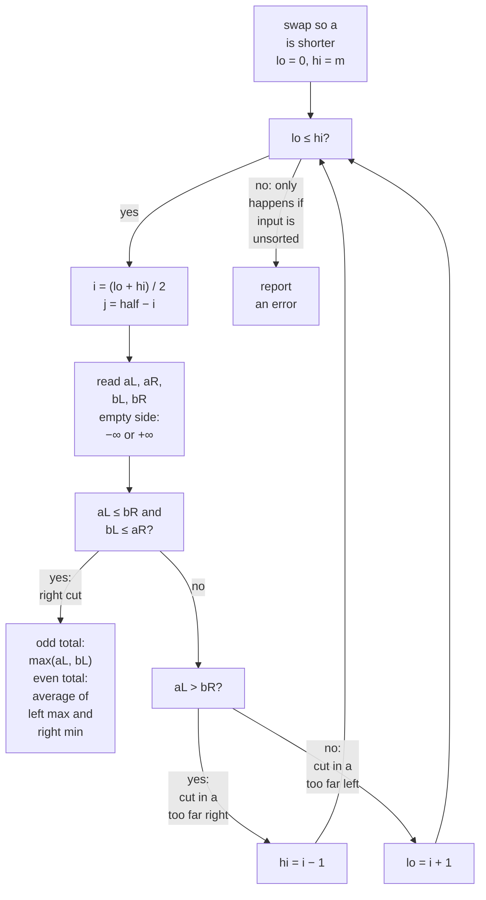

> [!tldr] Quick read
> - The problem: two increasing arrays `a` (m elements) and `b` (n elements). Return the **median** of both together, in O(log(m + n)).
> - The key idea: no merging. Cut `a` at position `i` and `b` at `j = half − i` so the left half holds exactly `half = ⌈(m + n) / 2⌉` elements. The cut is right when `aL ≤ bR` and `bL ≤ aR`. The question "`aL > bR`?" flips from "no" to "yes" exactly once as `i` grows, so [[en/concepts/binary-search|binary search]] works on `i`.
> - Search the **shorter** array: otherwise `j` leaves `[0, n]`. The version without the swap throws `ArrayIndexOutOfBoundsException` in Java and gets 13 477 of 100 000 random pairs wrong.
> - Empty sides use [[en/concepts/sentinel-value|sentinels]] `−∞`/`+∞`. Using 0 instead gets 9 800 pairs wrong. Integer division on an even total (`/` between two `int`s in Java and Go; `//` in Python) gets about a quarter of the pairs wrong.
> - Measured at m = n = 10⁶: merge 36.8 ms, two pointers 5.2 ms, k-th element elimination 0.12 µs, cut 0.07 µs. With m = 10, n = 10⁶, the cut takes only 1 iteration (at most 4, since there are only 11 cut positions).

> [!info] Context
> LeetCode problem 4, the hardest problem of [[en/posts/2026-11-23-neetcode-binary-search-answer|station 2: Binary Search on the Answer]] on **the NeetCode Line: Search and Heaps**. In [[en/posts/2026-11-23-neetcode-binary-search|station 1]] we binary searched the cells of one array; here we binary search **the possible cut positions**, that is, the space of answers, which is the spirit of station 2. The solutions come in TypeScript, Python, Go, Java and JavaScript. You need loops and arrays, and to have read [[en/problems/binary-search|Binary Search]].

> [!abstract]- Quick glossary for this post (click to open)
> - **Median**: the element in the middle once everything is sorted. Odd count: exactly one middle cell. Even count: the average of the two middle cells, so it can be a fraction like 2.5.
> - **Binary search**: each step looks at the middle of the suspect range, then drops one half entirely. See [[en/concepts/binary-search|Binary Search]].
> - **Loop invariant**: what holds at the start of every iteration. Here: "the right cut lies in `[lo, hi]`". See [[en/concepts/loop-invariant|Loop Invariant]].
> - **Sentinel**: a fake value placed at the edge so you need no special branch for the empty case. Here it is `−∞` on the left and `+∞` on the right. See [[en/concepts/sentinel-value|Sentinel Value]].
> - **K-th smallest element**: the element at position k once both arrays are merged and sorted. The median is element `⌈t/2⌉` (t odd), or the average of elements `t/2` and `t/2 + 1` (t even).
> - **O(log min(m, n))**: the step count grows with the log of the length of the **shorter** array. See [[en/concepts/big-o-notation|Big-O]].

## Picture it first: two lines of students sorted by height

Two classes stand in two lines, each already sorted from shortest to tallest. The teacher needs the "middle" height of both classes together, but does not want to merge the two lines into one. So she does this: she stretches a rope across the shorter line, then a second rope across the other line so that **the number of students left of both ropes is exactly half**. If the tallest student left of each rope is no taller than the shortest student right of the other rope, the left side is the "short half" of both classes.

| Everyday | Concept |
|---|---|
| Two lines of students, each sorted from shortest to tallest | two sorted arrays `a`, `b` |
| A rope across the shorter line at `i`, another across the long line at `j` | cut positions `i` and `j = half − i` |
| Both left sides together hold exactly half the students | `i + j = half` |
| The tallest student left of rope one is no taller than the shortest right of rope two, and vice versa | `aL ≤ bR` and `bL ≤ aR` |
| A student left of rope one is too tall: move rope one left | `aL > bR` then `hi = i − 1` |
| One side of a rope has nobody: pretend there is an "infinitely short" or "infinitely tall" student | sentinels `−∞`, `+∞` |
| The middle height: the tallest on the left (odd), or the average of that student and the shortest on the right (even) | `max(aL, bL)` or `(max(aL, bL) + min(aR, bR)) / 2` |



## The problem

**The problem (in my own words):** given two increasing arrays `nums1` (m elements) and `nums2` (n elements), 0 ≤ m, n ≤ 1 000, m + n ≥ 1, each number in `[−10⁶, 10⁶]`. Return the median of both arrays together. The complexity must be O(log(m + n)). Original: [LeetCode 4](https://leetcode.com/problems/median-of-two-sorted-arrays/).

| Input | Output | Why |
|---|---|---|
| `[1, 3]`, `[2]` | `2.0` | merged `[1, 2, 3]`, the middle cell is 2 |
| `[1, 2]`, `[3, 4]` | `2.5` | merged `[1, 2, 3, 4]`, the average of 2 and 3 |
| `[]`, `[1]` | `1.0` | an empty array is allowed |
| `[-2, -1]`, `[3]` | `-1.0` | negative numbers |

I used to think binary search only finds **one value** in **one array**. In this problem there is no value to find, and there are two arrays. It turns out what gets halved is the **cut position** `i` in the short array: there are `m + 1` positions, and the question "`a[i − 1] > b[j]`?" answers "no" at positions left of the right cut and "yes" right of it. A yes/no question that flips exactly once is enough for binary search.

## How it works

<figure class="figure-map" style="--ar: 3 / 4">
<div class="frame"><iframe data-archify="../../diagrams/neetcode-median-of-two-sorted-arrays/worked-example.en.html" title="Partition so left values precede right values" loading="lazy"></iframe></div>
<figcaption><span><b>Figure 1.</b> Partition so left values precede right values.</span><a href="../diagrams/neetcode-median-of-two-sorted-arrays/worked-example.en.html" target="_blank" rel="noopener">Open full screen</a></figcaption>
</figure>

<details>
<summary>Read the steps</summary>
<ol>
<li>Choose the required size of the left half. <code>A = [2, 8], B = [1, 4, 9, 12]; left = 3</code></li>
<li>Take two from A and one from B. <code>left max = 8, right min = 4</code></li>
<li>Move the cut in A to the left. <code>left = [2] + [1, 4]</code></li>
<li>The boundaries are now ordered. <code>left max = 4, right min = 8</code></li>
<li>Average the middle two values. <code>(4 + 8) / 2 = 6</code></li>
</ol>
</details>

### The median through one cut

Let `t = m + n` and `half = ⌈t / 2⌉ = (t + 1) / 2` (integer division). If we know the "left half" of the merged array, made of the `half` smallest elements, then:

- `t` odd: the median is the **largest** element of the left half (the left half has one element more than the right).
- `t` even: the median is the average of the largest element on the left and the smallest on the right.

The left half of the merged array is always "the first `i` elements of `a`" plus "the first `j` elements of `b`" with `i + j = half`, because each array is already increasing. So the problem shrinks to: find `i`.

### Approach 1, merge then pick the middle: O(m + n)

Merge as in the last step of merge sort, then read the middle cell. Easy to get right, costs O(m + n) extra memory. It misses the problem's O(log) requirement, but it is a good reference.

### Approach 2, two pointers: O(m + n) time, O(1) memory

Still merging, but without storing: walk `⌊t/2⌋ + 1` steps and remember only the last two values (`prev`, `cur`). In the measurements it is about 6 to 20 times faster than approach 1 because it allocates no array and only walks to the middle, but it is still linear.

### Approach 3, elimination to find the k-th element: O(log(m + n))

Write a function that finds the `k`-th element (counting from 1) of two arrays. Each step, take `h = ⌊k/2⌋` and compare the `h`-th remaining element of each array: `a[ni]` with `ni = i + h − 1`, `b[nj]` with `nj = j + h − 1` (clipped if the array is too short). If `a[ni] ≤ b[nj]`, then **every element from `a[i]` to `a[ni]` comes before the k-th element**, so drop them all and reduce k accordingly.

Why may we drop them? Let `p = ni − i + 1` and `q = nj − j + 1` (both ≤ h). The elements that can come before `a[ni]` in the merged array are only the `p − 1` elements `a[i..ni−1]` and at most `q − 1` elements `b[j..nj−1]` (because `b[nj] ≥ a[ni]`). So the rank of `a[ni]` is at most `p + q − 1 ≤ 2h − 1 ≤ k − 1`: it and every element before it in `a` come **before** the k-th element. Each step nearly halves k, so there are O(log k) steps. With an even t it must be called twice (elements `t/2` and `t/2 + 1`): 42 iterations at m = n = 10⁶.

### Approach 4, binary search on the cut position: O(log min(m, n))

Let `a` be the shorter array. For each `i ∈ [0, m]`, set `j = half − i` and read four values around the two cuts:

| Name | Value | When that side is empty |
|---|---|---|
| `aL` | `a[i − 1]` | `i = 0`: `−∞` |
| `aR` | `a[i]` | `i = m`: `+∞` |
| `bL` | `b[j − 1]` | `j = 0`: `−∞` |
| `bR` | `b[j]` | `j = n`: `+∞` |

`aL ≤ aR` and `bL ≤ bR` always hold because each array is sorted. The cut is right when two cross conditions also hold: `aL ≤ bR` and `bL ≤ aR`. When a cross condition fails:

| Observation | Meaning | Step |
|---|---|---|
| `aL > bR` | took too many from `a`: the last left element of `a` is larger than an element on the right | `hi = i − 1` |
| `bL > aR` | took too few from `a` | `lo = i + 1` |

Both cannot fail at once: `aL > bR ≥ bL > aR` contradicts `aL ≤ aR`. As `i` grows, `aL` only rises and `bR` only falls, so "`aL > bR`?" answers "no… no, yes… yes": the monotone question binary search needs. [[en/concepts/loop-invariant|Invariant]]: the right cut lies in `[lo, hi]`. It always exists for sorted input, so the `throw` at the end runs only on bad input.

The **sentinels** `−∞`/`+∞` make an empty side never block: `−∞ ≤` everything, and everything `≤ +∞`. So there is no special branch for `i = 0`, `i = m`, `j = 0`, `j = n`, and none for an empty array either.

### Why you must search the shorter array

`i` runs over `[0, m]`, so `j = half − i` runs over `[half − m, half]`. We need `0 ≤ j ≤ n`:

- If `m ≤ n`: `half − m = ⌈(m + n)/2⌉ − m ≥ 0` because n ≥ m, and `half ≤ n` also because n ≥ m. `j` is always valid.
- If `m > n`: with `a = [1, 2, 3, 4, 5, 6]`, `b = [7]`, `half = 4`, at `i = 5` we get `j = −1`; with `a = [2]`, `b = []`, `i = 0` gives `j = 1 > n`.

The TypeScript file runs the version without the swap and prints exactly those two cases: `j = -1 ra ngoài b` ("j = -1 is outside b"). Java throws `ArrayIndexOutOfBoundsException`. On 100 000 random pairs this version gets 13 477 pairs wrong (TS) and 13 357 (Java, a different random generator). A second benefit: the iteration count depends only on the short array. With m = 10, n = 10⁶, the cut takes 1 iteration (at most 4); k-th element elimination takes 40.

### Odd total, even total, and integer division

The median of an even total can end in `.5`. Four of the seven languages do integer division when both operands are integers:

| | `(2 + 3) / 2` | Negative numbers | The right way |
|---|---|---|---|
| Java | `2` (`int / int`, truncates toward 0) | `-3 / 2 = -1` | divide by `2.0`, add in `long` |
| Go | `2` | `-3 / 2 = -1` | `float64(x + y) / 2` |
| Python | `/` gives `2.5`; `//` gives `2` (rounds down) | `-3 // 2 = -2` | use `/` |
| TS, JS | `2.5` (every number is a double) | `-1.5` | nothing needed |
| Rust | `2` (`i32 / i32`, truncates toward 0) | `-3 / 2 = -1`; `div_euclid` gives `-2` | convert to `f64`, then divide by `2.0` |
| PHP | `2.5`; `intdiv` gives `2` | `intdiv(-3, 2) = -1`, `-3 / 2 = -1.5` | use `/`, but `(2 + 4) / 2` gives the **int** `3`, not a float |

The integer-division version passes 8/10 test cases and gets about a quarter of the random pairs wrong: 24 681 (TS), 24 994 (Python), 24 791 (Go), 25 047 (Java), 24 999 (PHP), 24 856 (Rust). A quarter makes sense: it is wrong only when the total is even **and** the two middle cells have an odd sum.

Java has one more trap: `(x + y) / 2.0` adds **first**, in `int`, and only then converts to double. With `x = y = 2 000 000 000`, the Java file prints `-1.47483648E8`; `((long) x + y) / 2.0` prints `2.0E9`. The problem's bound `|x| ≤ 10⁶` keeps this bug hidden on LeetCode, but not in code reused elsewhere.

### Sentinels: picking the wrong value

The version using `0` instead of `−∞` is right when all numbers are positive, and wrong when one array contributes nothing to the left half while the other array's part is all negative: with `[-2, -1]`, `[3]`, the right cut is `i = 0` on `[3]`, so `aL` is the sentinel 0 and beats `bL = -1`, giving `0` instead of `-1`. On 100 000 random pairs (values in `[-50, 50]`) it gets 9 800 pairs wrong.

In Java and Go the sentinels are `Integer.MIN_VALUE`/`MAX_VALUE` and `math.MinInt`/`math.MaxInt`. They are safe because they are only **compared**, never **added**: when the total is even and t ≥ 2, `max(aL, bL)` and `min(aR, bR)` are always real elements (neither half is empty). If you change the formula, for example compute `aL + bR` to compare, the sentinels will overflow.

### Measurements

TypeScript, two random sorted integer arrays, median of 7 runs, µs per call; the last two columns are loop iterations:

| m | n | merge | two pointers | k-th | cut | k-th iterations | cut iterations |
|---|---|---|---|---|---|---|---|
| 1 000 | 1 000 | 12.3 | 1.3 | 0.059 | 0.033 | 22 | 9 |
| 100 000 | 100 000 | 3 183.4 | 518.4 | 0.103 | 0.064 | 36 | 16 |
| 1 000 000 | 1 000 000 | 36 810.2 | 5 192.1 | 0.121 | 0.069 | 42 | 19 |
| 10 | 1 000 000 | 11 479.5 | 547.8 | 0.103 | 0.009 | 40 | 1 |

The two linear approaches grow about 10 times when n grows 10 times. The two logarithmic ones barely move, and on the last row the cut is about 11 times faster than the k-th approach because it only binary searches the 11 cut positions of a 10-element array. On the last row two pointers is also about 21 times faster than merging: it only walks to the middle and allocates no 10⁶-element array.

Besides the 10 test cases, each file cross-checks the four approaches against "concatenate then sort" on 100 000 random pairs (each array 0 to 20 elements, values in `[-50, 50]`, so plenty of duplicates and empty arrays). All four approaches get 0 pairs wrong in all seven languages.

### Under the hood in seven languages

| | Sentinels | Dividing on an even total | Specific traps |
|---|---|---|---|
| TypeScript / JavaScript | `-Infinity`, `Infinity` | `/ 2` always gives a real number | `[...a, ...b].sort()` without a compare function compares as **strings**: `[10, 9, 1].sort()` gives `[1, 10, 9]`. The reference version must write `sort((x, y) => x - y)` |
| Python | `float("-inf")`, `float("inf")`, comparable with `int` | `/` | `//` rounds down: `-3 // 2 = -2`. `heapq.merge` merges two sorted sequences without re-sorting |
| Go | `math.MinInt`, `math.MaxInt` | `float64(x+y) / 2` | `float64((x+y)/2)` divides as integers first, then converts. `min` and `max` are built in since Go 1.21 |
| Java | `Integer.MIN_VALUE`, `Integer.MAX_VALUE` | `((long) x + y) / 2.0` | `(x + y) / 2` loses `.5`; `(x + y) / 2.0` still overflows because the addition happens in `int`. Without the swap, `b[j]` with `j = −1` throws `ArrayIndexOutOfBoundsException` |
| PHP | `PHP_INT_MIN`, `PHP_INT_MAX` | `/` gives a float when the division is not exact | `/` between two ints that divide exactly returns an **int**: `(2 + 4) / 2` is `3`, so comparing `===` with `3.0` fails unless the function declares a `float` return type. Arrays are copied on assignment, so `[$a, $b] = [$b, $a]` leaves the caller's arrays alone |
| Rust | `i64::MIN`, `i64::MAX` (widen the `i32` elements to `i64`) | `as f64`, then `/ 2.0` | indices are `usize` and cannot be negative: without the swap, `j = half − i` underflows; a debug build panics with `attempt to subtract with overflow`, a `-O` build wraps around and then panics on an out-of-bounds index |

## Runnable example

[TypeScript](../code/neetcode-median-of-two-sorted-arrays/median-two-arrays.ts) · [Python](../code/neetcode-median-of-two-sorted-arrays/median_two_arrays.py) · [Go](../code/neetcode-median-of-two-sorted-arrays/median_two_arrays.go) · [Java](../code/neetcode-median-of-two-sorted-arrays/median-two-arrays.java) · [JavaScript](../code/neetcode-median-of-two-sorted-arrays/median-two-arrays.js) · [PHP](../code/neetcode-median-of-two-sorted-arrays/median-two-arrays.php) · [Rust](../code/neetcode-median-of-two-sorted-arrays/median_two_arrays.rs)

Each file has the four approaches, runs 10 test cases and cross-checks 100 000 random pairs. The TypeScript file also has three wrong versions and the measurements; Python, Go, Java, PHP and Rust have the integer-division version; Java also has the no-swap version. The main approach, binary search on the cut position:

```ts
// Approach 4, binary search on the cut position in the shorter array: O(log min(m, n)).
// Cut a at i and b at j = half − i so the left half has half elements; the cut is right when aL ≤ bR and bL ≤ aR.
function partition(a: number[], b: number[]): number {
  if (a.length > b.length) [a, b] = [b, a]; // always search the shorter array, so j = half − i stays within [0, n]
  const m = a.length, n = b.length, half = (m + n + 1) >> 1;
  let lo = 0, hi = m;
  while (lo <= hi) {
    steps++;
    const i = (lo + hi) >> 1, j = half - i;
    const aL = i > 0 ? a[i - 1] : -Infinity, aR = i < m ? a[i] : Infinity; // sentinels: an empty side never blocks
    const bL = j > 0 ? b[j - 1] : -Infinity, bR = j < n ? b[j] : Infinity;
    if (aL <= bR && bL <= aR) {
      return (m + n) % 2 ? Math.max(aL, bL) : (Math.max(aL, bL) + Math.min(aR, bR)) / 2;
    }
    if (aL > bR) hi = i - 1; // cut in a is too far right
    else lo = i + 1; // cut in a is too far left
  }
  throw new Error("mảng chưa sắp xếp");
}
```

```python
# Approach 4, binary search on the cut position in the shorter array. float("inf") is the sentinel; it compares fine with int.
def partition(a: list[int], b: list[int]) -> float:
    if len(a) > len(b):
        a, b = b, a
    m, n = len(a), len(b)
    half = (m + n + 1) // 2
    lo, hi = 0, m
    while lo <= hi:
        i = (lo + hi) // 2
        j = half - i
        a_l = a[i - 1] if i > 0 else float("-inf")
        a_r = a[i] if i < m else float("inf")
        b_l = b[j - 1] if j > 0 else float("-inf")
        b_r = b[j] if j < n else float("inf")
        if a_l <= b_r and b_l <= a_r:
            if (m + n) % 2:
                return max(a_l, b_l)
            return (max(a_l, b_l) + min(a_r, b_r)) / 2
        if a_l > b_r:
            hi = i - 1
        else:
            lo = i + 1
    raise ValueError("mảng chưa sắp xếp")
```

```go
// Approach 4, binary search on the cut position in the shorter array. math.MinInt and math.MaxInt are the sentinels:
// they are only compared, never added (an even total ≥ 2 has real elements on both sides), so nothing overflows.
func partition(a, b []int) float64 {
	if len(a) > len(b) {
		a, b = b, a
	}
	m, n := len(a), len(b)
	half := (m + n + 1) / 2
	lo, hi := 0, m
	for lo <= hi {
		i := (lo + hi) / 2
		j := half - i
		aL, aR, bL, bR := math.MinInt, math.MaxInt, math.MinInt, math.MaxInt
		if i > 0 {
			aL = a[i-1]
		}
		if i < m {
			aR = a[i]
		}
		if j > 0 {
			bL = b[j-1]
		}
		if j < n {
			bR = b[j]
		}
		if aL <= bR && bL <= aR {
			if (m+n)%2 == 1 {
				return float64(max(aL, bL))
			}
			return float64(max(aL, bL)+min(aR, bR)) / 2
		}
		if aL > bR {
			hi = i - 1
		} else {
			lo = i + 1
		}
	}
	panic("mảng chưa sắp xếp")
}
```

```java
// Approach 4, binary search on the cut position in the shorter array. Integer.MIN_VALUE/MAX_VALUE are the sentinels:
// they are only compared; with an even total, the two numbers added are always real elements.
static double partition(int[] a, int[] b) {
    if (a.length > b.length) { int[] tmp = a; a = b; b = tmp; }
    int m = a.length, n = b.length, half = (m + n + 1) / 2, lo = 0, hi = m;
    while (lo <= hi) {
        int i = (lo + hi) >>> 1, j = half - i;
        int aL = i > 0 ? a[i - 1] : Integer.MIN_VALUE, aR = i < m ? a[i] : Integer.MAX_VALUE;
        int bL = j > 0 ? b[j - 1] : Integer.MIN_VALUE, bR = j < n ? b[j] : Integer.MAX_VALUE;
        if (aL <= bR && bL <= aR) {
            if ((m + n) % 2 == 1) return Math.max(aL, bL);
            return ((long) Math.max(aL, bL) + Math.min(aR, bR)) / 2.0; // add in long: no overflow even near 2³¹
        }
        if (aL > bR) hi = i - 1;
        else lo = i + 1;
    }
    throw new IllegalArgumentException("mảng chưa sắp xếp");
}
```

```js
// Approach 4, binary search on the cut position in the shorter array. -Infinity and Infinity are the sentinels.
function partition(a, b) {
  if (a.length > b.length) [a, b] = [b, a];
  const m = a.length, n = b.length, half = (m + n + 1) >> 1;
  let lo = 0, hi = m;
  while (lo <= hi) {
    const i = (lo + hi) >> 1, j = half - i;
    const aL = i > 0 ? a[i - 1] : -Infinity, aR = i < m ? a[i] : Infinity;
    const bL = j > 0 ? b[j - 1] : -Infinity, bR = j < n ? b[j] : Infinity;
    if (aL <= bR && bL <= aR) {
      return (m + n) % 2 ? Math.max(aL, bL) : (Math.max(aL, bL) + Math.min(aR, bR)) / 2;
    }
    if (aL > bR) hi = i - 1;
    else lo = i + 1;
  }
  throw new Error("mảng chưa sắp xếp");
}
```

```php
// Approach 4, binary search on the cut position in the shorter array: O(log min(m, n)).
// Cut a at i and b at j = half − i; the cut is right when aL ≤ bR and bL ≤ aR. Sentinels are PHP_INT_MIN / PHP_INT_MAX.
function partition(array $a, array $b): float
{
    if (count($a) > count($b)) [$a, $b] = [$b, $a]; // PHP arrays are copied on assignment: the swap does not touch the caller's arrays
    $m = count($a);
    $n = count($b);
    $half = ($m + $n + 1) >> 1;
    $lo = 0;
    $hi = $m;
    while ($lo <= $hi) {
        $i = ($lo + $hi) >> 1;
        $j = $half - $i;
        $aL = $i > 0 ? $a[$i - 1] : PHP_INT_MIN;
        $aR = $i < $m ? $a[$i] : PHP_INT_MAX;
        $bL = $j > 0 ? $b[$j - 1] : PHP_INT_MIN;
        $bR = $j < $n ? $b[$j] : PHP_INT_MAX;
        if ($aL <= $bR && $bL <= $aR) {
            return ($m + $n) % 2 ? (float) max($aL, $bL) : (max($aL, $bL) + min($aR, $bR)) / 2; // / gives a float when the sum is odd
        }
        if ($aL > $bR) $hi = $i - 1;
        else $lo = $i + 1;
    }
    throw new RuntimeException("mảng chưa sắp xếp");
}
```

```rust
// Approach 4, binary search on the cut position in the shorter array: O(log min(m, n)).
// Cut a at i and b at j = half − i; the cut is right when aL ≤ bR and bL ≤ aR. Sentinels are i64::MIN / i64::MAX.
fn partition(a: &[i32], b: &[i32]) -> f64 {
    let (a, b) = if a.len() > b.len() { (b, a) } else { (a, b) }; // swap the two references, no array copy
    let (m, n) = (a.len(), b.len());
    let half = (m + n + 1) / 2;
    let (mut lo, mut hi) = (0, m);
    loop {
        let i = (lo + hi) / 2;
        let j = half - i; // usize: cannot go negative because m ≤ n guarantees half ≥ i
        let a_l = if i > 0 { a[i - 1] as i64 } else { i64::MIN };
        let a_r = if i < m { a[i] as i64 } else { i64::MAX };
        let b_l = if j > 0 { b[j - 1] as i64 } else { i64::MIN };
        let b_r = if j < n { b[j] as i64 } else { i64::MAX };
        if a_l <= b_r && b_l <= a_r {
            let left = a_l.max(b_l) as f64;
            return if (m + n) % 2 == 1 { left } else { (left + a_r.min(b_r) as f64) / 2.0 };
        }
        if a_l > b_r { hi = i - 1 } else { lo = i + 1 }
    }
}
```


Elimination to find the k-th element:

```ts
// Approach 3, elimination to find the k-th element: each step drops k/2 elements that surely come before the k-th. O(log(m + n)).
function kth(a: number[], b: number[], k: number): number {
  let i = 0, j = 0; // a[i..] and b[j..] are what is left; k counts from 1
  while (true) {
    steps++;
    if (i === a.length) return b[j + k - 1];
    if (j === b.length) return a[i + k - 1];
    if (k === 1) return Math.min(a[i], b[j]);
    const h = k >> 1;
    const ni = Math.min(i + h, a.length) - 1, nj = Math.min(j + h, b.length) - 1;
    if (a[ni] <= b[nj]) { k -= ni - i + 1; i = ni + 1; } // a[i..ni] all come before the k-th element: drop them
    else { k -= nj - j + 1; j = nj + 1; }
  }
}

function kthElimination(a: number[], b: number[]): number {
  const t = a.length + b.length;
  return t % 2 ? kth(a, b, (t >> 1) + 1) : (kth(a, b, t / 2) + kth(a, b, t / 2 + 1)) / 2;
}
```

```python
# Approach 3, elimination to find the k-th element (k counts from 1): each step drops about k/2 elements.
def kth(a: list[int], b: list[int], k: int) -> int:
    i = j = 0
    while True:
        if i == len(a):
            return b[j + k - 1]
        if j == len(b):
            return a[i + k - 1]
        if k == 1:
            return min(a[i], b[j])
        h = k // 2
        ni, nj = min(i + h, len(a)) - 1, min(j + h, len(b)) - 1
        if a[ni] <= b[nj]:
            k -= ni - i + 1; i = ni + 1
        else:
            k -= nj - j + 1; j = nj + 1

def kth_elimination(a: list[int], b: list[int]) -> float:
    t = len(a) + len(b)
    return kth(a, b, t // 2 + 1) if t % 2 else (kth(a, b, t // 2) + kth(a, b, t // 2 + 1)) / 2
```

```go
// Approach 3, elimination to find the k-th element (k counts from 1).
func kth(a, b []int, k int) int {
	i, j := 0, 0
	for {
		if i == len(a) {
			return b[j+k-1]
		}
		if j == len(b) {
			return a[i+k-1]
		}
		if k == 1 {
			return min(a[i], b[j])
		}
		h := k / 2
		ni, nj := min(i+h, len(a))-1, min(j+h, len(b))-1
		if a[ni] <= b[nj] {
			k -= ni - i + 1
			i = ni + 1
		} else {
			k -= nj - j + 1
			j = nj + 1
		}
	}
}

func kthElimination(a, b []int) float64 {
	t := len(a) + len(b)
	if t%2 == 1 {
		return float64(kth(a, b, t/2+1))
	}
	return float64(kth(a, b, t/2)+kth(a, b, t/2+1)) / 2
}
```

```java
// Approach 3, elimination to find the k-th element (k counts from 1).
static int kth(int[] a, int[] b, int k) {
    int i = 0, j = 0;
    while (true) {
        if (i == a.length) return b[j + k - 1];
        if (j == b.length) return a[i + k - 1];
        if (k == 1) return Math.min(a[i], b[j]);
        int h = k / 2;
        int ni = Math.min(i + h, a.length) - 1, nj = Math.min(j + h, b.length) - 1;
        if (a[ni] <= b[nj]) { k -= ni - i + 1; i = ni + 1; }
        else { k -= nj - j + 1; j = nj + 1; }
    }
}

static double kthElimination(int[] a, int[] b) {
    int t = a.length + b.length;
    return t % 2 == 1 ? kth(a, b, t / 2 + 1) : (kth(a, b, t / 2) + kth(a, b, t / 2 + 1)) / 2.0;
}
```

```js
// Approach 3, elimination to find the k-th element (k counts from 1).
function kth(a, b, k) {
  let i = 0, j = 0;
  while (true) {
    if (i === a.length) return b[j + k - 1];
    if (j === b.length) return a[i + k - 1];
    if (k === 1) return Math.min(a[i], b[j]);
    const h = k >> 1;
    const ni = Math.min(i + h, a.length) - 1, nj = Math.min(j + h, b.length) - 1;
    if (a[ni] <= b[nj]) { k -= ni - i + 1; i = ni + 1; }
    else { k -= nj - j + 1; j = nj + 1; }
  }
}

function kthElimination(a, b) {
  const t = a.length + b.length;
  return t % 2 ? kth(a, b, (t >> 1) + 1) : (kth(a, b, t / 2) + kth(a, b, t / 2 + 1)) / 2;
}
```

```php
// Approach 3, elimination to find the k-th element (k counts from 1): each step drops k/2 elements that surely come before. O(log(m + n)).
function kth(array $a, array $b, int $k): int
{
    $i = $j = 0;
    while (true) {
        if ($i === count($a)) return $b[$j + $k - 1];
        if ($j === count($b)) return $a[$i + $k - 1];
        if ($k === 1) return min($a[$i], $b[$j]);
        $h = $k >> 1;
        $ni = min($i + $h, count($a)) - 1;
        $nj = min($j + $h, count($b)) - 1;
        if ($a[$ni] <= $b[$nj]) { $k -= $ni - $i + 1; $i = $ni + 1; } // a[i..ni] all come before the k-th element: drop them
        else { $k -= $nj - $j + 1; $j = $nj + 1; }
    }
}

function kthElimination(array $a, array $b): float
{
    $t = count($a) + count($b);
    return $t % 2 ? (float) kth($a, $b, ($t >> 1) + 1) : (kth($a, $b, intdiv($t, 2)) + kth($a, $b, intdiv($t, 2) + 1)) / 2;
}
```

```rust
// Approach 3, elimination to find the k-th element (k counts from 1). O(log(m + n)).
// Slices make this tidy: drop the front by reslicing a = &a[h..], no i, j indices to keep.
fn kth(mut a: &[i32], mut b: &[i32], mut k: usize) -> i32 {
    loop {
        if a.is_empty() {
            return b[k - 1];
        }
        if b.is_empty() {
            return a[k - 1];
        }
        if k == 1 {
            return a[0].min(b[0]);
        }
        let (ha, hb) = ((k / 2).min(a.len()), (k / 2).min(b.len()));
        if a[ha - 1] <= b[hb - 1] {
            k -= ha; // a[..ha] all come before the k-th element: drop them
            a = &a[ha..];
        } else {
            k -= hb;
            b = &b[hb..];
        }
    }
}

fn kth_elimination(a: &[i32], b: &[i32]) -> f64 {
    let t = a.len() + b.len();
    if t % 2 == 1 { kth(a, b, t / 2 + 1) as f64 } else { (kth(a, b, t / 2) as f64 + kth(a, b, t / 2 + 1) as f64) / 2.0 }
}
```


Output of the TypeScript file:

```text
mergeThenPick         10/10 cases passed
twoPointer            10/10 cases passed
kthElimination        10/10 cases passed
partition             10/10 cases passed
partitionNoSwap       8/10 cases passed; wrong on [2] [] → j = 1 is outside b, [1,2,3,4,5,6] [7] → j = -1 is outside b
partitionZeroSentinel 9/10 cases passed; wrong on [-2,-1] [3] → 0
partitionIntMedian    8/10 cases passed; wrong on [1,2] [3,4] → 2, [] [2,3] → 2

Cross-check against concatenate-then-sort, 100000 random pairs:
mergeThenPick         0 pairs wrong
twoPointer            0 pairs wrong
kthElimination        0 pairs wrong
partition             0 pairs wrong
partitionNoSwap       13477 pairs wrong
partitionZeroSentinel 9800 pairs wrong
partitionIntMedian    24681 pairs wrong

m          n         merge (µs)  two ptrs (µs)     k-th (µs)   cut (µs)  k-th iters  cut iters
1000       1000            12.3               1.3       0.059     0.033          22         9
100000     100000        3183.4             518.4       0.103     0.064          36        16
1000000    1000000      36810.2            5192.1       0.121     0.069          42        19
10         1000000      11479.5             547.8       0.103     0.009          40         1
```

*(Output labels translated; the files themselves print Vietnamese.)*

The Java file also prints the overflowing addition:

```text
mergeThenPick    10/10 cases passed
twoPointer       10/10 cases passed
kthElimination   10/10 cases passed
partition        10/10 cases passed
partitionNoSwap  8/10 cases passed; wrong on [2] [] → ArrayIndexOutOfBoundsException, [1, 2, 3, 4, 5, 6] [7] → ArrayIndexOutOfBoundsException
wrongIntDivision 8/10 cases passed; wrong on [1, 2] [3, 4] → 2.0, [] [2, 3] → 2.0

Cross-check against concatenate-then-sort, 100000 random pairs:
mergeThenPick    0 pairs wrong
twoPointer       0 pairs wrong
kthElimination   0 pairs wrong
partition        0 pairs wrong
partitionNoSwap  13357 pairs wrong
wrongIntDivision 25047 pairs wrong

(x + y) / 2.0 = -1.47483648E8, ((long) x + y) / 2.0 = 2.0E9
```

Python prints `wrong_floor_div 8/10 ca đúng` ("8/10 cases passed") and `sai 24994 cặp` ("24994 pairs wrong"), then `-3 // 2 = -2   -3 / 2 = -1.5`. Go prints `wrongIntDivision sai 24791 cặp` and `chia nguyên trong Go: -3 / 2 = -1` ("integer division in Go"). JavaScript prints `10/10 ca đúng` and `sai 0 cặp` for all four approaches, then `[10, 9, 1].sort() = [1,10,9]`.

PHP (`php median-two-arrays.php`) and Rust (`rustc --edition 2021 -O median_two_arrays.rs`) print `10/10 ca đúng` and `sai 0 cặp` for all four approaches. The integer-division version passes 8/10 cases in both, with `sai 24999 cặp` (PHP) and `sai 24856 cặp` (Rust); the last line is `intdiv(-3, 2) = -1   -3 / 2 = -1.5` (PHP) and `(-3) / 2 = -1   (-3).div_euclid(2) = -2` (Rust).

## Misconceptions and common traps

- **"Binary search needs a value to find."** Here no value is given. What gets halved is the cut position, and "`aL > bR`?" is the monotone question.
- **Searching the longer array.** `j` leaves `[0, n]`: Java throws an index error, while TS and JS silently read `undefined` (the TS file checks `j` and reports an error right there). Always swap so `a` is the shorter one before you start.
- **A sentinel of 0 or −1.** Wrong with negative numbers. Use `±Infinity` or the type's minimum and maximum.
- **Integer division on an even total.** `(x + y) / 2` with two `int`s in Java or Go, `//` in Python: the `.5` is lost. With negative numbers Python also rounds **down** (`-3 // 2 = -2`) while Java and Go truncate **toward 0** (`-1`).
- **`half = (m + n) / 2` instead of `(m + n + 1) / 2`.** It can work, but then for an odd total the median sits on the **right** (`min(aR, bR)`), so the formula must change too. Mixing the two conventions is an off-by-one bug.
- **Thinking two pointers is already O(log).** It saves memory, not time: it still walks `(m + n) / 2` steps.
- **PHP: assuming `/` always gives a float.** `(2 + 4) / 2` returns the int `3`; only an inexact division gives a float. A function declared `: float` converts it for you, but comparing directly with `=== 3.0` fails. For integer division call `intdiv`, which truncates toward 0 like Java.
- **Rust: forgetting the swap when indices are `usize`.** Starting with `a = [1..6]`, `b = [7]` makes `j = half − i` negative: a debug build panics with `attempt to subtract with overflow`, a `-O` build wraps to 18 446 744 073 709 551 614 and then panics on an out-of-bounds index. Swapping first is enough to keep `half ≥ i`.

## Self-check questions

> [!question]- Run the cut approach on `a = [1, 3, 8, 9, 15]`, `b = [7, 11, 18, 19, 21, 25]`. Write down `i`, `j`, the four values and the move each iteration.
> m = 5, n = 6, half = 6. Iteration 1: lo = 0, hi = 5, i = 2, j = 4: aL = 3, aR = 8, bL = 19, bR = 21. `bL = 19 > aR = 8`: took too few from a, `lo = 3`. Iteration 2: i = 4, j = 2: aL = 9, aR = 15, bL = 11, bR = 18. `9 ≤ 18` and `11 ≤ 15`: right cut. The total 11 is odd, median `max(9, 11) = 11`. Merged `[1, 3, 7, 8, 9, 11, 15, 18, 19, 21, 25]`, the 6th cell is indeed 11.

> [!question]- Why is `half` equal to `(m + n + 1) / 2` and not `(m + n) / 2`?
> So that with an odd total the left half has one element more and the median is `max(aL, bL)`. With an even total both formulas give the same result. `(m + n) / 2` also works if the odd-case median becomes `min(aR, bR)`.

> [!question]- In the elimination approach, why compare `a[ni]` with `b[nj]` and drop the **smaller** side, not the larger one?
> The smaller side has rank at most `k − 1`, so it surely comes before the k-th element. The larger side may contain the k-th element itself (for example when the k-th element is `b[nj]`), so dropping it could lose the answer.

> [!question]- Change the problem: find the k-th element of two sorted arrays for any k. Does the cut approach work?
> Yes: replace `half` with `k` and binary search `i` in `[max(0, k − n), min(k, m)]` so `j = k − i` is always valid. The answer is `max(aL, bL)`. The `kth` function of approach 3 does the same job by elimination.

## References

- [LeetCode 4: Median of Two Sorted Arrays](https://leetcode.com/problems/median-of-two-sorted-arrays/) (the original problem, its bounds and the O(log(m + n)) requirement)
- [Java Language Specification SE 21, §15.17.2 Division Operator](https://docs.oracle.com/javase/specs/jls/se21/html/jls-15.html#jls-15.17.2) (integer division rounds toward 0)
- [The Go Programming Language Specification: Arithmetic operators](https://go.dev/ref/spec#Arithmetic_operators) (integer division truncates toward 0)
- [Python Language Reference: Binary arithmetic operations](https://docs.python.org/3/reference/expressions.html#binary-arithmetic-operations) (`//` is floor division) and [`heapq.merge`](https://docs.python.org/3/library/heapq.html#heapq.merge)
- [MDN: Array.prototype.sort()](https://developer.mozilla.org/en-US/docs/Web/JavaScript/Reference/Global_Objects/Array/sort) (compares as strings by default)
- Cormen, Leiserson, Rivest, Stein, *Introduction to Algorithms*, chapter 9 "Medians and Order Statistics" (the k-th element and the median)
