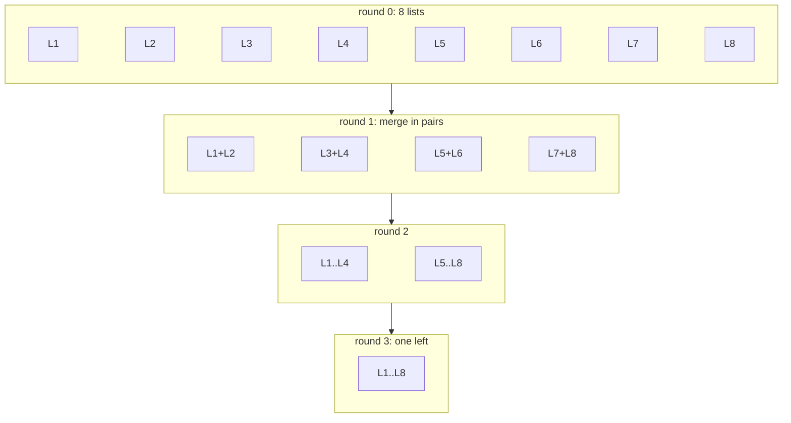

> [!tldr] Quick read
> - The problem: k linked lists, each sorted ascending; merge them into **one** ascending list. N is the total number of nodes.
> - Two O(N log k) approaches are both correct and both worth knowing: a **heap** holding the head of every list (take the smallest, push its successor), and **divide and conquer**: merge in pairs, k lists become k/2, then k/4, … and after log₂ k rounds one remains.
> - The most obvious approach, **merging one by one** into a result, is O(kN): the result keeps growing and keeps being walked again. With N = 10⁵ nodes it takes 1.9 ms at k = 10 but 3.85 seconds at k = 10⁴.
> - Measured, divide and conquer beats the heap at most sizes (15 ms against 66 ms at N = 10⁶, k = 10). When k is huge and every list is tiny, collecting all values into an array and sorting is fastest.
> - Traps that actually run: pushing empty lists into the heap (TypeScript `TypeError`, Go panic, Java `NullPointerException`); a Python heap of `(val, node)` tuples throws `TypeError` when two values tie; JavaScript's default `sort()` sorts as strings.

> [!info] Context
> LeetCode problem 23 (Hard) of [[en/posts/2026-11-24-neetcode-advanced-linked-list|station 2: Advanced Linked Lists]] on **the NeetCode Line: Linked Structures**. This problem is [[en/problems/merge-two-sorted-lists|Merge Two Sorted Lists]] grown from 2 to k lists, and it is where two lines meet: the heap from [[en/posts/2026-11-23-neetcode-heap-top-k|the Search and Heaps line]], and the k-way merge already used in [[en/problems/design-twitter|Design Twitter]]. Solutions come in TypeScript, Python, Go, Java and JavaScript. You need linked lists and to have seen a heap once. Its station neighbour [[en/problems/reverse-nodes-in-k-group|Reverse Nodes in k-Group]] also works chunk by chunk, but rewires pointers instead of comparing values.

> [!abstract]- Quick glossary for this post (click to open)
> - **Linked list**: a chain of nodes, each with a value and a `next` arrow. See [[en/concepts/linked-list|Linked List]].
> - **Dummy node**: a node without data placed before the head of the result, so every attachment is `tail.next = …`. See [[en/concepts/dummy-node|Dummy Node]].
> - **Heap (min-heap)**: a binary tree stored in an array with the smallest element always on top; push and pop are O(log k). See [[en/concepts/heap|Heap]]. Unlike the [[en/concepts/size-k-heap|Size-k Heap]] of the top-K problems (keep the k best, evict when over k), here the heap holds one head per list.
> - **K-way merge**: merging k sorted sequences by repeatedly taking the smallest of the k front elements. See [[en/concepts/k-way-merge|K-way Merge]].
> - **Divide and conquer**: split the problem in half, solve each half, then combine. Here "combine" means merging two lists. See [[en/concepts/divide-and-conquer-merge|Divide and Conquer Merge]].
> - **N, k**: N is the total number of nodes across all lists, k is the number of lists.

## Picture it first: merging k stacks of receipts sorted by date

At the end of the month, k employees each hand in a stack of receipts sorted by date, oldest on top. The accountant needs a single stack by date.

- **One by one**: the accountant merges stack 1 with stack 2, then merges that result with stack 3, … The stack in hand keeps growing, and every merge flips through that whole thick stack again.
- **Heap**: lay the k stacks out on the desk, look only at the top receipt of each, move the oldest one to the result, and the receipt below it shows up. A tray that always knows the oldest of the k visible receipts is the heap.
- **Divide and conquer**: pair the employees up, each pair merges its two stacks. Then the doubled stacks pair up again, like a knockout tournament. In each round every receipt is flipped only once.

| Everyday | Concept |
|---|---|
| A sorted stack of receipts | a sorted list |
| The top receipt of each stack | the current head of each list |
| Merging two stacks | `mergeTwo` (problem 21) |
| The stack in hand keeps growing and gets flipped again | merging one by one, O(kN) |
| A tray that knows the oldest of the k visible receipts | a k-element min-heap |
| A knockout tournament | divide and conquer, log₂ k rounds |
| The empty stack of someone on leave | a `null` list in the input array |



In each round every node takes part in exactly one merge, so a round costs O(N). There are log₂ k rounds (8 lists need 3). Total O(N log k).

## The problem

With two lists, problem 21 already solved it: two pointers, each step attaches the smaller node. With k lists, each step needs the smallest of **k** head nodes. Comparing all k every step is O(k) per step, O(kN) total. The question is how to find the smallest faster than O(k), or how to organize the work so each node is touched fewer times.

## How it works

<figure class="figure-map" style="--ar: 3 / 4">
<div class="frame"><iframe data-archify="../../diagrams/neetcode-merge-k-sorted-lists/worked-example.en.html" title="The heap holds one head per list" loading="lazy"></iframe></div>
<figcaption><span><b>Figure 1.</b> The heap holds one head per list.</span><a href="../diagrams/neetcode-merge-k-sorted-lists/worked-example.en.html" target="_blank" rel="noopener">Open full screen</a></figcaption>
</figure>

<details>
<summary>Read the steps</summary>
<ol>
<li>Load the first item of three lists. <code>[1, 6], [3, 4], [2, 9]</code></li>
<li>Pop 1 and push 6. <code>heap = {2, 3, 6}</code></li>
<li>Pop 2 and push 9. <code>heap = {3, 6, 9}</code></li>
<li>Keep popping the root to merge. <code>[1, 2, 3, 4, 6, 9]</code></li>
</ol>
</details>

### Approach 1: collect and sort

Read every value into an array, sort it, build a new list. O(N log N) time, O(N) extra memory, and it creates N new nodes instead of relinking the old ones. It ignores that the lists are already sorted, but it is short and hard to get wrong, and as the measurements show, not as slow as one might think.

```ts
// Approach 1: collect every value, sort, build a new list. O(N log N), creates N new nodes.
function mergeCollectSort(lists: (ListNode | null)[]): ListNode | null {
  const vals: number[] = [];
  for (const l of lists) for (let cur = l; cur !== null; cur = cur.next) vals.push(cur.val);
  vals.sort((x, y) => x - y);
  return build(vals);
}
```


### Approach 2: merge one by one

```ts
// Approach 2: merge one by one into a result list. The result keeps growing, so O(kN).
function mergeOneByOne(lists: (ListNode | null)[]): ListNode | null {
  let acc: ListNode | null = null;
  for (const l of lists) acc = mergeTwo(acc, l);
  return acc;
}
```


Each call `mergeTwo(acc, l)` walks all of `acc` plus `l`. If each list has N/k nodes, call i walks about i · N/k nodes, for a total of N/k · (1 + 2 + … + k) ≈ kN/2. For a fixed N, time grows **linearly in k**: k ten times larger is about ten times slower (measured 1.9 → 12.7 → 257 → 3,852 ms; the last step is 15 times because the list no longer fits in cache).

### Approach 3: a heap of k list heads

Put every non-`null` head into a min-heap ordered by `val`. Each step pops the top (the smallest node), attaches it to the result, and pushes `node.next` (if any). The heap never holds more than k nodes, so each step is O(log k), O(N log k) in total.

```ts
// Approach 3: a heap holding at most k nodes (the current head of each list). O(N log k).
function mergeHeap(lists: (ListNode | null)[]): ListNode | null {
  const heap = new NodeHeap();
  for (const l of lists) if (l !== null) heap.push(l);
  const dummy = new ListNode(0);
  let tail = dummy;
  while (heap.size > 0) {
    const node = heap.pop();
    tail.next = node;
    tail = node;
    if (node.next !== null) heap.push(node.next);
  }
  return dummy.next;
}
```


The invariant: the heap always holds exactly the first unused node of every list that is not exhausted. The smallest remaining node across all k lists must be the head of some list (each list is sorted), so it is in the heap, and the top of the heap is that node.

### Approach 4: pairwise divide and conquer

```ts
// Approach 4: divide and conquer, merge in pairs by rounds: k → k/2 → … → 1 list. O(N log k), no heap needed.
function mergeDivide(lists: (ListNode | null)[]): ListNode | null {
  if (lists.length === 0) return null;
  let cur = lists.slice();
  while (cur.length > 1) {
    const next: (ListNode | null)[] = [];
    for (let i = 0; i < cur.length; i += 2) next.push(i + 1 < cur.length ? mergeTwo(cur[i], cur[i + 1]) : cur[i]);
    cur = next;
  }
  return cur[0];
}
```


No heap needed, only `mergeTwo` from problem 21. Each round halves the number of lists, each node goes through exactly one merge per round, so the total is O(N log k), same as the heap. A recursive version (split the array of lists in half) works too: its depth is only about log₂ k, 14 levels for k = 10⁴, with none of the stack-overflow risk of problems that recurse once per node.

| Approach | Time | Extra memory | Note |
|---|---|---|---|
| Collect and sort | O(N log N) | O(N) | creates new nodes |
| One by one | O(kN) | O(1) | slows down as k grows |
| Heap | O(N log k) | O(k) | needs a heap; JS/TS must write one |
| Divide and conquer | O(N log k) | O(1) iterative, O(log k) recursive | needs only `mergeTwo` |

### Four traps

**Empty lists in the array.** The input `[[], [1], [], [0, 2]]` is valid. Skip the `null` filter when building the heap and the heap compares `null.val`: TypeScript throws `TypeError`, Go panics in `Less`, and Java throws `NullPointerException` right at `offer(null)` because `PriorityQueue` refuses `null`. All three wrong versions pass 7/9 cases and fail only the two with empty lists, exactly the kind of bug that slips past the problem's examples.

**Python and `(val, node)` tuples.** `heapq` compares elements with `<`. The tuple `(1, nodeA)` against `(1, nodeB)`: the first items tie, so Python goes on to compare `nodeA < nodeB`, and `ListNode` defines no `<`, so it throws `TypeError`. The wrong version passes 7/9: the problem's example has two 1s and breaks immediately. The fix from the `heapq` docs is a tie-breaker in the middle: `(val, i, node)`, where i is the list index and never repeats.

```python
# WRONG: heap elements are (val, node). When two vals tie, Python goes on to compare two ListNodes and throws TypeError.
def merge_heap_no_index(lists):
    heap = [(node.val, node) for node in lists if node]
    heapq.heapify(heap)
    dummy = tail = ListNode()
    while heap:
        _, node = heapq.heappop(heap)
        tail.next = tail = node
        if node.next:
            heapq.heappush(heap, (node.next.val, node.next))
    return dummy.next
```


**JavaScript's default `sort()`.** Collect the values and call `vals.sort()` without a comparator, and JavaScript turns every number into a string and compares UTF-16 order: `[-10, -3, -5, 0, 10]` (because "-3" < "-5") and `[10, 2, 9]`. It passes 6/9 cases.

**A subtracting comparator in Java.** `(a, b) -> a.val - b.val` is safe here because values lie in [−10⁴, 10⁴] and the difference never overflows `int`. But `Integer.compare(a.val, b.val)` never overflows at all, so it is the better habit ([[en/problems/kth-largest-element-in-an-array|Kth Largest Element in an Array]] runs a real overflow case).

### Under the five languages

| | Heap | Specific trap |
|---|---|---|
| TypeScript / JavaScript | none built in: write a binary array heap | pushing `null` into the heap: `TypeError`; default `sort()` compares strings |
| Python | `heapq` on a list, elements are tuples | `(val, node)` throws `TypeError` when two `val`s tie: use `(val, i, node)` |
| Go | `container/heap` with a type implementing `heap.Interface` | `Push`, `Pop` need pointer receivers; a `nil` in the heap makes `Less` panic |
| Java | `PriorityQueue<ListNode>` with a `Comparator` | `offer(null)` throws `NullPointerException`; prefer `Integer.compare` to subtraction |

### Measurements

TypeScript, N nodes split evenly across k lists, random values (mulberry32), median of 5 runs; each run rebuilds the lists and the build is not timed:

| N | k | Collect and sort | One by one | Heap | Divide and conquer |
|---|---|---|---|---|---|
| 10⁵ | 10 | 9.9 ms | 1.9 ms | 6.1 ms | 1.8 ms |
| 10⁵ | 100 | 10.5 ms | 12.7 ms | 13.5 ms | 3.8 ms |
| 10⁵ | 1,000 | 13.9 ms | 257 ms | 12.5 ms | 6.6 ms |
| 10⁵ | 10,000 | 19.6 ms | 3,852 ms | 18.2 ms | 10.0 ms |
| 10⁶ | 10 | 107 ms | | 66 ms | 15 ms |
| 10⁶ | 1,000 | 160 ms | | 147 ms | 105 ms |
| 10⁶ | 100,000 | 257 ms | | 369 ms | 276 ms |

- One by one has the O(kN) shape: k ten times larger, time 7 to 20 times larger.
- Divide and conquer beats the heap on every row but the last. Both are O(N log k), but each step of divide and conquer is one comparison and one link, while the heap swaps several array elements.
- On the last row (10⁵ lists of 10 nodes each), collect and sort wins: sorting one contiguous array of numbers is cheaper than 17 merge rounds chasing pointers all over memory.

Other languages at N = 10⁶: Go heap 28.4 / 136.6 / 297.6 ms and divide and conquer 9.3 / 67.1 / 236.2 ms at k = 10 / 1,000 / 10⁵; Java heap 17.2 / 125.5 / 272.6 ms and divide and conquer 10.4 / 83.3 / 245.0 ms. Python at N = 10⁵ flips the ranking for large k: `sorted` is written in C, so collect and sort takes 46 ms at k = 10⁴ while the heap takes 66 ms and divide and conquer 90 ms (a Python loop is many times slower than C). The problem caps k ≤ 10⁴ and N ≤ 10⁴, so on LeetCode all four approaches except one by one run under 1 ms.

## Runnable example

[TypeScript](../code/neetcode-merge-k-sorted-lists/merge-k-lists.ts) · [Python](../code/neetcode-merge-k-sorted-lists/merge_k_lists.py) · [Go](../code/neetcode-merge-k-sorted-lists/merge_k_lists.go) · [Java](../code/neetcode-merge-k-sorted-lists/merge-k-lists.java) · [JavaScript](../code/neetcode-merge-k-sorted-lists/merge-k-lists.js)

Every file runs the same 9 cases: the problem's example, an empty array, one empty list, empty lists interleaved, a single list, negative numbers, `9` with `10` (the string-sort trap), 20 single-element lists, and all-equal values. The TypeScript file also cross-checks 2,000 random inputs.

A heap of k list heads:

```ts
// Approach 3: a heap holding at most k nodes (the current head of each list). O(N log k).
function mergeHeap(lists: (ListNode | null)[]): ListNode | null {
  const heap = new NodeHeap();
  for (const l of lists) if (l !== null) heap.push(l);
  const dummy = new ListNode(0);
  let tail = dummy;
  while (heap.size > 0) {
    const node = heap.pop();
    tail.next = node;
    tail = node;
    if (node.next !== null) heap.push(node.next);
  }
  return dummy.next;
}
```

```python
# Heap of k list heads. Heap elements are (val, i, node): i breaks ties when two vals are equal,
# so Python never has to compare two ListNodes.
def merge_heap(lists):
    heap = [(node.val, i, node) for i, node in enumerate(lists) if node]
    heapq.heapify(heap)
    dummy = tail = ListNode()
    while heap:
        _, i, node = heapq.heappop(heap)
        tail.next = tail = node
        if node.next:
            heapq.heappush(heap, (node.next.val, i, node.next))
    return dummy.next
```

```go
// nodeHeap implements heap.Interface; Push and Pop need pointer receivers because they change the slice length.
type nodeHeap []*ListNode

func (h nodeHeap) Len() int           { return len(h) }

func (h nodeHeap) Less(i, j int) bool { return h[i].Val < h[j].Val }

func (h nodeHeap) Swap(i, j int)      { h[i], h[j] = h[j], h[i] }

func (h *nodeHeap) Push(x any)        { *h = append(*h, x.(*ListNode)) }

func (h *nodeHeap) Pop() any {
	old := *h
	n := old[len(old)-1]
	*h = old[:len(old)-1]
	return n
}

// Heap of k list heads: skip empty lists (nil) when building the heap.
func mergeHeap(lists []*ListNode) *ListNode {
	h := nodeHeap{}
	for _, l := range lists {
		if l != nil {
			h = append(h, l)
		}
	}
	heap.Init(&h)
	dummy := &ListNode{}
	tail := dummy
	for h.Len() > 0 {
		node := heap.Pop(&h).(*ListNode)
		tail.Next = node
		tail = node
		if node.Next != nil {
			heap.Push(&h, node.Next)
		}
	}
	return dummy.Next
}
```

```java
// Heap of k list heads. Integer.compare does not overflow, unlike a.val - b.val.
static ListNode mergeHeap(ListNode[] lists) {
    PriorityQueue<ListNode> pq = new PriorityQueue<>((x, y) -> Integer.compare(x.val, y.val));
    for (ListNode l : lists) if (l != null) pq.offer(l);
    ListNode dummy = new ListNode(0, null), tail = dummy;
    while (!pq.isEmpty()) {
        ListNode node = pq.poll();
        tail.next = node;
        tail = node;
        if (node.next != null) pq.offer(node.next);
    }
    return dummy.next;
}
```

```js
// Heap of k list heads, a hand-written binary array.
function mergeHeap(lists) {
  const h = lists.filter((l) => l !== null);
  const less = (i, j) => h[i].val < h[j].val;
  const swap = (i, j) => { const t = h[i]; h[i] = h[j]; h[j] = t; };
  const down = (i) => {
    for (;;) {
      const l = 2 * i + 1, r = l + 1;
      let m = i;
      if (l < h.length && less(l, m)) m = l;
      if (r < h.length && less(r, m)) m = r;
      if (m === i) return;
      swap(m, i);
      i = m;
    }
  };
  for (let i = (h.length >> 1) - 1; i >= 0; i--) down(i);
  const dummy = new ListNode(0);
  let tail = dummy;
  while (h.length > 0) {
    const node = h[0];
    tail.next = node;
    tail = node;
    // replace the top with the next node of that same list; if the list is done, move the last element up
    if (node.next !== null) h[0] = node.next;
    else { const last = h.pop(); if (h.length > 0) h[0] = last; }
    if (h.length > 0) down(0);
  }
  return dummy.next;
}
```


Pairwise divide and conquer:

```ts
// Approach 4: divide and conquer, merge in pairs by rounds: k → k/2 → … → 1 list. O(N log k), no heap needed.
function mergeDivide(lists: (ListNode | null)[]): ListNode | null {
  if (lists.length === 0) return null;
  let cur = lists.slice();
  while (cur.length > 1) {
    const next: (ListNode | null)[] = [];
    for (let i = 0; i < cur.length; i += 2) next.push(i + 1 < cur.length ? mergeTwo(cur[i], cur[i + 1]) : cur[i]);
    cur = next;
  }
  return cur[0];
}
```

```python
# Divide and conquer: merge in pairs, each round halves the number of lists.
def merge_divide(lists):
    if not lists:
        return None
    cur = list(lists)
    while len(cur) > 1:
        cur = [merge_two(cur[i], cur[i + 1]) if i + 1 < len(cur) else cur[i] for i in range(0, len(cur), 2)]
    return cur[0]
```

```go
// Divide and conquer: merge in pairs until one list is left.
func mergeDivide(lists []*ListNode) *ListNode {
	if len(lists) == 0 {
		return nil
	}
	cur := slices.Clone(lists)
	for len(cur) > 1 {
		next := []*ListNode{}
		for i := 0; i < len(cur); i += 2 {
			if i+1 < len(cur) {
				next = append(next, mergeTwo(cur[i], cur[i+1]))
			} else {
				next = append(next, cur[i])
			}
		}
		cur = next
	}
	return cur[0]
}
```

```java
// Divide and conquer: merge in pairs with a doubling step, in place on the lists array.
static ListNode mergeDivide(ListNode[] lists) {
    if (lists.length == 0) return null;
    for (int step = 1; step < lists.length; step *= 2)
        for (int i = 0; i + step < lists.length; i += 2 * step)
            lists[i] = mergeTwo(lists[i], lists[i + step]);
    return lists[0];
}
```

```js
// Divide and conquer: merge in pairs until one list is left.
function mergeDivide(lists) {
  if (lists.length === 0) return null;
  let cur = lists.slice();
  while (cur.length > 1) {
    const next = [];
    for (let i = 0; i < cur.length; i += 2) next.push(i + 1 < cur.length ? mergeTwo(cur[i], cur[i + 1]) : cur[i]);
    cur = next;
  }
  return cur[0];
}
```


Merging two lists (problem 21), shared by divide and conquer and one by one:

```ts
// Merge two sorted lists with a dummy node (problem 21).
function mergeTwo(a: ListNode | null, b: ListNode | null): ListNode | null {
  const dummy = new ListNode(0);
  let tail = dummy;
  while (a !== null && b !== null) {
    if (a.val <= b.val) { tail.next = a; a = a.next; } else { tail.next = b; b = b.next; }
    tail = tail.next;
  }
  tail.next = a !== null ? a : b;
  return dummy.next;
}
```

```python
def merge_two(a, b):
    dummy = tail = ListNode()
    while a and b:
        if a.val <= b.val:
            tail.next, a = a, a.next
        else:
            tail.next, b = b, b.next
        tail = tail.next
    tail.next = a or b
    return dummy.next
```

```go
func mergeTwo(a, b *ListNode) *ListNode {
	dummy := &ListNode{}
	tail := dummy
	for a != nil && b != nil {
		if a.Val <= b.Val {
			tail.Next, a = a, a.Next
		} else {
			tail.Next, b = b, b.Next
		}
		tail = tail.Next
	}
	if a != nil {
		tail.Next = a
	} else {
		tail.Next = b
	}
	return dummy.Next
}
```

```java
static ListNode mergeTwo(ListNode a, ListNode b) {
    ListNode dummy = new ListNode(0, null), tail = dummy;
    while (a != null && b != null) {
        if (a.val <= b.val) { tail.next = a; a = a.next; } else { tail.next = b; b = b.next; }
        tail = tail.next;
    }
    tail.next = a != null ? a : b;
    return dummy.next;
}
```

```js
function mergeTwo(a, b) {
  const dummy = new ListNode(0);
  let tail = dummy;
  while (a !== null && b !== null) {
    if (a.val <= b.val) { tail.next = a; a = a.next; } else { tail.next = b; b = b.next; }
    tail = tail.next;
  }
  tail.next = a !== null ? a : b;
  return dummy.next;
}
```


Output of `node merge-k-lists.ts`:

```text
mergeCollectSort     9/9 cases correct
mergeOneByOne        9/9 cases correct
mergeHeap            9/9 cases correct
mergeDivide          9/9 cases correct
mergeDivideRecursive 9/9 cases correct
wrongPushNull        7/9 cases correct; wrong on one empty list → throws TypeError, interleaved empties → throws TypeError
wrongDefaultSort     6/9 cases correct; wrong on negative numbers → [-10,-3,-5,0,10], 9 and 10 → [10,2,9], 20 one-element lists → [0,1,10,11,12,13,14,15,16,17,18,19,2,3,4,5,6,7,8,9]

random: mergeCollectSort 2000/2000, mergeOneByOne 2000/2000, mergeHeap 2000/2000, mergeDivide 2000/2000, mergeDivideRecursive 2000/2000

N = 100000 nodes, median of 5 runs (ms)
k          collect  one-by-one    heap      halves
10            9.86      1.91      6.10      1.80
100          10.54     12.74     13.54      3.75
1000         13.89    256.97     12.46      6.63
10000        19.64   3851.57     18.16      9.97

N = 1000000 nodes, median of 5 runs (ms)
k          collect     heap     halves
10          107.13     65.90     15.11
1000        160.23    146.70    104.78
100000      256.98    369.36    276.37
```

`python3 merge_k_lists.py`:

```text
merge_heap           9/9 cases correct
merge_divide         9/9 cases correct
merge_collect_sort   9/9 cases correct
merge_heap_no_index  7/9 cases correct; wrong on the problem's example → throws TypeError, all equal → throws TypeError

N = 100000 nodes, median of 5 runs (ms)
k          collect     heap     halves
10           33.29     18.90     16.55
1000         38.21     41.02     75.59
10000        46.17     66.23     90.05
```

`go run merge_k_lists.go`:

```text
mergeHeap       9/9 cases correct
mergeDivide     9/9 cases correct
wrongNilInHeap  7/9 cases correct; wrong on one empty list → panic, interleaved empties → panic

N = 1000000 nodes, median of 5 runs (ms)
k           heap     halves
10           28.37      9.27
1000        136.61     67.09
100000      297.63    236.21
```

`java merge-k-lists.java`:

```text
mergeHeap       9/9 cases correct
mergeDivide     9/9 cases correct
wrongOfferNull  7/9 cases correct; wrong on one empty list → throws NullPointerException, interleaved empties → throws NullPointerException

N = 1000000 nodes, median of 5 runs (ms)
k           heap     halves
10           17.17     10.44
1000        125.46     83.34
100000      272.56    244.98
```

`node merge-k-lists.js`:

```text
mergeHeap         9/9 cases correct
mergeDivide       9/9 cases correct
wrongDefaultSort  6/9 cases correct; wrong on negative numbers → [-10,-3,-5,0,10], 9 and 10 → [10,2,9], 20 one-element lists → [0,1,10,11,12,13,14,15,16,17,18,19,2,3,4,5,6,7,8,9]
```

*(Output labels translated; the files themselves print Vietnamese.)*

## Misconceptions and common traps

- **"Merging one by one is still merging two lists, so it is O(N)."** Each merge walks the whole growing result again; the total is O(kN).
- **"The heap is always fastest because it is O(N log k)."** Divide and conquer has the same complexity and is faster at most measured sizes; when k is huge and the lists are tiny, sorting one array of numbers wins.
- **Forgetting empty lists.** The input array may contain empty lists or be empty itself. Filter `null` before pushing into the heap.
- **`(val, node)` tuples in `heapq`.** Two equal values make Python compare two nodes. Add an index as tie-breaker.
- **`sort()` without a comparator in JavaScript.** It sorts as strings; always pass `(a, b) => a - b`.
- **Fearing stack overflow in recursive divide and conquer.** The depth is log₂ k, not k or N.

## Self-check questions

> [!question]- With k lists of N/k nodes each, how many nodes does merging one by one walk in total?
> Merge i walks about i · N/k nodes (the result already holds (i − 1) · N/k nodes, plus the new list). The total is N/k · (1 + 2 + … + k) = N(k + 1)/2, so O(kN).

> [!question]- Why does the heap only need k elements and not N?
> The smallest remaining node is always the head of some list, because every list is sorted. So only the heads need comparing, one per list. When a node is popped, the next node of that same list becomes its new head and is pushed.

> [!question]- Divide and conquer and the heap are both O(N log k). Why does divide and conquer not need a tie-breaker like Python's `(val, i, node)`?
> Divide and conquer only compares two `val`s with `<=` inside `mergeTwo` and never compares two nodes. Python's heap compares whole tuples, so when the `val`s tie it moves on to the second item.

> [!question]- What does each approach return for `[[], [], []]`, and which one easily throws?
> The correct result is an empty list. Collect and sort, one by one and divide and conquer all return `null` naturally. The heap is only right if it filters `null` before pushing; without the filter the heap holds three `null`s, and the first comparison or the first read of `node.next` throws.

> [!question]- When should you choose collect and sort even though it is O(N log N)?
> When the code needs to be short and surely correct, when creating new nodes is allowed, or when k is huge and every list is tiny (the measurement with 10⁵ lists of 10 nodes). In Python, `sorted` is written in C and usually beats a heap loop written in Python.

## References

- [LeetCode 23: Merge k Sorted Lists](https://leetcode.com/problems/merge-k-sorted-lists/) (original problem: k ≤ 10⁴, each list ≤ 500 nodes, total nodes ≤ 10⁴, values in [−10⁴, 10⁴])
- [Python `heapq`](https://docs.python.org/3/library/heapq.html) (section "Priority Queue Implementation Notes": add a count to the tuple to break ties between equal priorities)
- [Java `PriorityQueue`](https://docs.oracle.com/en/java/javase/21/docs/api/java.base/java/util/PriorityQueue.html) ("A priority queue does not permit null elements")
- [Go `container/heap`](https://pkg.go.dev/container/heap)
- [ECMAScript: `Array.prototype.sort`](https://tc39.es/ecma262/#sec-array.prototype.sort) (without a comparator, elements compare as strings)
- Cormen, Leiserson, Rivest, Stein, *Introduction to Algorithms*, 3rd edition, exercise 6.5-9 (merging k sorted lists in O(n lg k) with a min-heap)
- Donald Knuth, *The Art of Computer Programming*, volume 3, §5.4.1 (multiway merging, using a selection tree to find the smallest element)
