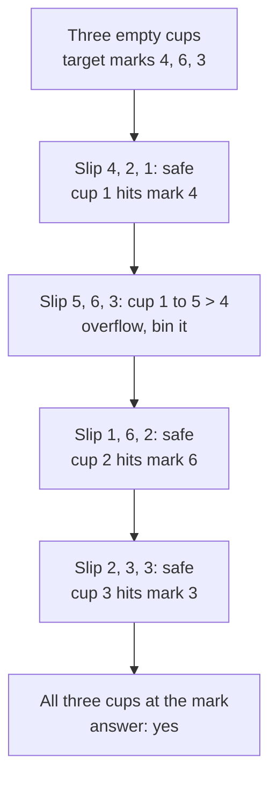
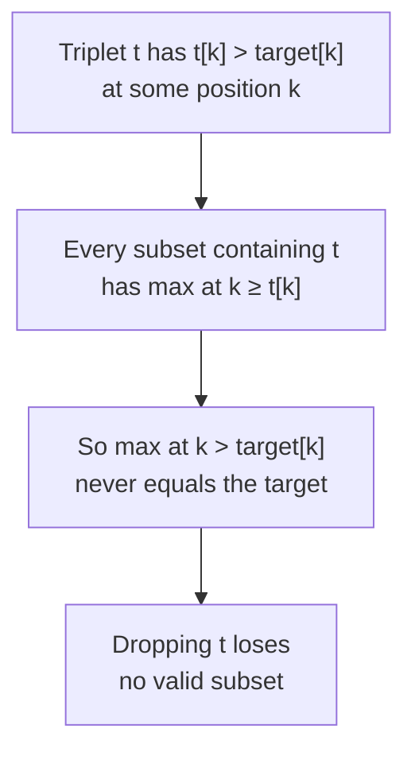
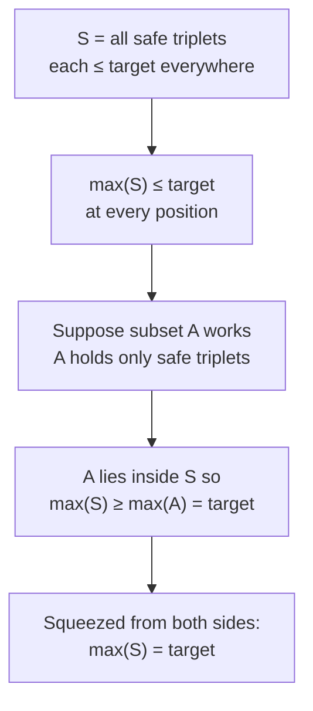

> [!tldr] Quick read
> - Merging two triplets takes the max of each component. However many merges you do, in whatever order, the result is still just the max of some subset of the original triplets. The question becomes: is there a nonempty subset whose max is exactly `target`?
> - A triplet with any component above the target is **unsafe**: using it pushes that position past the target forever, because a max never goes down. Drop all of them.
> - The remaining triplets sit at or below the target in every position, so merging **all** of them can only help. The answer is "yes" exactly when, for each position k, some safe triplet carries exactly `target[k]`. This is the [[en/concepts/safe-candidate-filter|safe candidate filter]].
> - One pass, O(n) time, O(1) memory. Brute force tries 2ⁿ − 1 subsets: at n = 18 that is already 4,718,574 steps, while one filtering pass needs 18.

> [!info] Context
> This is LeetCode problem 1899 at [[en/posts/2026-11-28-neetcode-greedy-grouping|station MISC-04: Greedy Grouping]] on **the NeetCode Line: Mixed Techniques**. I picture three cups that you can only pour more into, never pour out of. You only need arrays, loops and a `max` function; there is nothing else to read first.

> [!abstract]- Quick glossary for this post (click to open)
> - Triplet: an array of exactly three integers, such as `[4, 2, 1]`. Its k-th component is `t[k]`, for k = 0, 1, 2.
> - Component-wise max: merging `[4, 2, 1]` with `[1, 6, 2]` gives `[max(4, 1), max(2, 6), max(1, 2)] = [4, 6, 2]`.
> - Subset: any choice of elements from the list, order ignored. A list of n elements has 2ⁿ − 1 nonempty subsets.
> - [[en/concepts/brute-force|Brute force]]: try every possibility. Here that means every subset, used as the referee in the runnable file.
> - [[en/concepts/greedy-choice|Greedy choice]]: decide on each element right away (keep it or drop it) without coming back, then prove that the decision never loses the answer.

## Picture it first: three cups you can only top up

There are three cups on the table, each with a target mark. I have a stack of pour slips; each slip lists three marks, one per cup. Using a slip means topping each cup up to the mark on the slip, if the cup is below it; a cup already higher stays as it is. Water poured in can't be scooped out. The question: can I pick some slips so that all three cups stop **exactly** at their target marks?

I don't try every way of picking slips. I go through them one by one: any slip with a mark above the target for its cup goes straight in the bin, because pouring it overflows that cup and nothing can fix it. Every safe slip I use, because it never pushes any cup past its mark. At the end I only check whether each cup has reached its mark.

| Everyday life | Concept |
|---|---|
| Water level in the three cups | the triplet being built `[a, b, c]` |
| One pour slip | one triplet `t` |
| Top each cup up to the slip's mark | merge by component-wise max |
| Target marks on the three cups | `target = [x, y, z]` |
| Water can't be scooped back out | a max never goes down |
| A slip with a mark above target | an unsafe triplet: some k with `t[k] > target[k]` |
| A safe slip hitting cup k's mark exactly | `t[k] == target[k]`, set `found[k]` |
| All three cups at their marks | `found` set for all three |

With `target = [4, 6, 3]` and four slips `[4, 2, 1]`, `[5, 6, 3]`, `[1, 6, 2]`, `[2, 3, 3]`:



The slip `[5, 6, 3]` looks tempting: it hits both marks 6 and 3 at once. But it raises cup 1 to 5, past mark 4, and nothing can bring it back down.

## The problem: can max-merging produce the target?

You get a list of n integer triplets and a target triplet `target = [x, y, z]`. In each step you pick two different positions i and j and replace the triplet at j with the component-wise max of triplets i and j. You may do any number of steps, including none. Return `true` if you can make `target` appear as an element of the list, `false` otherwise. Limits: 1 ≤ n ≤ 10⁵, every value from 1 to 1000. My example: `[[3, 1, 1], [1, 4, 1], [1, 1, 6]]` with target `[3, 4, 6]` gives `true`, by merging all three triplets into one. [Original problem, LeetCode 1899](https://leetcode.com/problems/merge-triplets-to-form-target-triplet/)

At first I thought I had to find exactly **one pair** that merges into the target, and I also worried about the order of merges. The example in Picture it first rules out both: no pair of the three safe slips gives `[4, 6, 3]` (`[4, 6, 2]`, `[4, 3, 3]`, `[2, 6, 3]`), so all three are needed. And order doesn't matter, because max is commutative and associative, and taking the max with yourself changes nothing. However you merge, every element of the list is always the max of some subset of the original triplets (a subset that contains itself). Conversely, to get the max of any subset, merge the subset's triplets one by one into one of them. So the problem is just: **is there a nonempty subset whose component-wise max equals `target` exactly?**

## How it works

### Brute force: try every subset

Loop over every mask from 1 to 2ⁿ − 1; each mask is a subset. For each mask, walk the n bits, merge by max the triplets whose bit is set, and compare with the target. Time O(2ⁿ · n), memory O(1). At n = 18 that is already (2¹⁸ − 1) · 18 = 4,718,574 steps; at n = 10⁵ the number of subsets is 2¹⁰⁰⁰⁰⁰, about 10³⁰¹⁰³, which never finishes. I keep this approach as the referee on small lists.

What brute force wastes: it tries subsets that contain a triplet above the target, even though one look at that triplet tells you every subset containing it is ruined.

### Filtering safe triplets: one pass

Call a triplet `t` **safe** when `t[0] ≤ x`, `t[1] ≤ y` and `t[2] ≤ z`. The algorithm: make one pass and skip every unsafe triplet; for each safe triplet, set `found[k]` at every position k where `t[k] == target[k]`. At the end, return `true` when all three flags are set. Time O(n), memory O(1).

It takes two arguments, and both rest on one property: adding an element to a subset makes the max **go up or stay the same**, never down.





The first diagram says an unsafe triplet can never be used: it ruins every subset that contains it. The second says merging **every** safe triplet never hurts: if some subset works, it contains only safe triplets (by the first diagram), and adding the other safe triplets only raises the max up to the target at most. So you only need to try one subset: S. In cup terms: safe slips never overflow however many you pour, so use them all.

One last step: when does max(S) at position k equal `target[k]`? Every triplet in S has `t[k] ≤ target[k]`, so the max at k reaches `target[k]` exactly when at least one safe triplet carries that value. That is why setting `found[k]` is enough, and also why the three flags may come from three different triplets.

Two ways of writing it give the same result: set the `found` flags, or compute the max of every safe triplet directly and compare it with the target. The runnable file keeps both and checks that they always agree.

Tracing the example from Picture it first, target `[4, 6, 3]`:

| Triplet | Safe? | `found` after the step | max of safe triplets |
|---|---|---|---|
| `[4, 2, 1]` | yes | ✓ · · | `[4, 2, 1]` |
| `[5, 6, 3]` | no, 5 > 4 | ✓ · · | `[4, 2, 1]` |
| `[1, 6, 2]` | yes | ✓ ✓ · | `[4, 6, 2]` |
| `[2, 3, 3]` | yes | ✓ ✓ ✓ | `[4, 6, 3]` |

This is a [[en/concepts/greedy-choice|greedy choice]] in its tidiest form: each triplet gets one decision, keep or drop, and that decision only needs the triplet itself and the target.

| Approach | Time | Auxiliary space | Notes |
|---|---|---|---|
| Brute force over all subsets | O(2ⁿ · n) | O(1) | Referee; only runs for small n |
| Safe filter, set `found` | O(n) | O(1) | Main approach |
| Safe filter, max then compare | O(n) | O(1) | Same result, seen as water levels |

### Measurement: brute force vs the safe filter

I built 18 safe triplets with target `[1000, 1000, 1000]`: triplet i is `[i + 1, i + 1, i + 1]`, except that triplet 0 has its first component set to 1000 and triplet 1 has its middle component set to 1000. No triplet has a last component of 1000, so the answer is `false` and brute force has to try all 2¹⁸ − 1 subsets, that is 4,718,574 steps. The safe filter takes 18 steps. Then I ran the filter alone at the problem's limit, n = 100,000, with triplet i equal to `[(7i mod 1000) + 1, (13i mod 1000) + 1, (31i mod 1000) + 1]` and target `[700, 800, 900]` (answer `true`). Each language was measured once on my machine:

| Language | Brute force, n = 18 | Filter, n = 18 | Filter, n = 100,000 |
|---|---|---|---|
| TypeScript (Node) | 18.1 ms | 0.001 ms | 0.48 ms |
| Python | 683.5 ms | 0.008 ms | 8.87 ms |
| Go | 17.7 ms | under 0.001 ms | 0.23 ms |
| Java | 11.8 ms | under 0.001 ms | 0.16 ms |
| JavaScript (Node) | 18.7 ms | 0.001 ms | 0.38 ms |
| PHP | 163.4 ms | 0.004 ms | 11.09 ms |
| Rust | 8.8 ms | under 0.001 ms | 0.08 ms |

Each extra triplet doubles the number of subsets. Estimate (not measured): at n = 30, brute force needs about 3.2·10¹⁰ steps, which at the Node speed above is roughly two minutes. At n = 10⁵ no machine can run it. The filter at n = 10⁵ stays under 12 ms even in the slowest language.

## Runnable example

[TypeScript](../code/neetcode-merge-triplets-to-form-target-triplet/triplets.ts) · [Python](../code/neetcode-merge-triplets-to-form-target-triplet/triplets.py) · [Go](../code/neetcode-merge-triplets-to-form-target-triplet/triplets.go) · [Java](../code/neetcode-merge-triplets-to-form-target-triplet/triplets.java) · [JavaScript](../code/neetcode-merge-triplets-to-form-target-triplet/triplets.js) · [PHP](../code/neetcode-merge-triplets-to-form-target-triplet/triplets.php) · [Rust](../code/neetcode-merge-triplets-to-form-target-triplet/triplets.rs)

```ts
// Main approach: drop every triplet with a component above target, and among the rest mark which components match exactly
function mergeTriplets(triplets: number[][], target: number[], counter = { steps: 0 }): boolean {
    const [x, y, z] = target
    const found = [false, false, false]
    for (const t of triplets) {
        counter.steps++
        if (t[0] > x || t[1] > y || t[2] > z) continue // unsafe triplet: merging it overshoots, and that cannot be undone
        for (let k = 0; k < 3; k++) {
            if (t[k] === target[k]) found[k] = true // this safe triplet carries exactly the value needed at position k
        }
    }
    return found[0] && found[1] && found[2]
}
```

```python
# Main approach: drop every triplet with a component above target, and among the rest mark which components match exactly
def merge_triplets(triplets, target, counter=None):
    x, y, z = target
    found = [False, False, False]
    for t in triplets:
        if counter is not None:
            counter["steps"] += 1
        if t[0] > x or t[1] > y or t[2] > z:
            continue  # unsafe triplet: merging it overshoots, and that cannot be undone
        for k in range(3):
            if t[k] == target[k]:
                found[k] = True  # this safe triplet carries exactly the value needed at position k
    return all(found)
```

```go
// Main approach: drop every triplet with a component above target, and among the rest mark which components match exactly
func mergeTriplets(triplets [][]int, target []int, steps *int64) bool {
	x, y, z := target[0], target[1], target[2]
	var found [3]bool
	for _, t := range triplets {
		*steps++
		if t[0] > x || t[1] > y || t[2] > z {
			continue // unsafe triplet: merging it overshoots, and that cannot be undone
		}
		for k := 0; k < 3; k++ {
			if t[k] == target[k] {
				found[k] = true // this safe triplet carries exactly the value needed at position k
			}
		}
	}
	return found[0] && found[1] && found[2]
}
```

```java
    // Main approach: drop every triplet with a component above target, and among the rest mark which components match exactly
    static boolean mergeTriplets(int[][] triplets, int[] target) {
        int x = target[0], y = target[1], z = target[2];
        boolean[] found = new boolean[3];
        for (int[] t : triplets) {
            steps++;
            if (t[0] > x || t[1] > y || t[2] > z) continue; // unsafe triplet: merging it overshoots, and that cannot be undone
            for (int k = 0; k < 3; k++) {
                if (t[k] == target[k]) found[k] = true; // this safe triplet carries exactly the value needed at position k
            }
        }
        return found[0] && found[1] && found[2];
    }
```

```js
// Main approach: drop every triplet with a component above target, and among the rest mark which components match exactly
function mergeTriplets(triplets, target, counter = { steps: 0 }) {
    const [x, y, z] = target
    const found = [false, false, false]
    for (const t of triplets) {
        counter.steps++
        if (t[0] > x || t[1] > y || t[2] > z) continue // unsafe triplet: merging it overshoots, and that cannot be undone
        for (let k = 0; k < 3; k++) {
            if (t[k] === target[k]) found[k] = true // this safe triplet carries exactly the value needed at position k
        }
    }
    return found[0] && found[1] && found[2]
}
```

```php
// Main approach: drop every triplet with a component above target, and among the rest mark which components match exactly
function mergeTriplets(array $triplets, array $target): bool {
    global $steps;
    [$x, $y, $z] = $target;
    $found = [false, false, false];
    foreach ($triplets as $t) {
        $steps++;
        if ($t[0] > $x || $t[1] > $y || $t[2] > $z) continue; // unsafe triplet: merging it overshoots, and that cannot be undone
        for ($k = 0; $k < 3; $k++) {
            if ($t[$k] === $target[$k]) $found[$k] = true; // this safe triplet carries exactly the value needed at position k
        }
    }
    return $found[0] && $found[1] && $found[2];
}
```

```rust
// Main approach: drop every triplet with a component above target, and among the rest mark which components match exactly
fn merge_triplets(triplets: &[[i32; 3]], target: &[i32; 3], steps: &mut u64) -> bool {
    let [x, y, z] = *target;
    let mut found = [false; 3];
    for t in triplets {
        *steps += 1;
        if t[0] > x || t[1] > y || t[2] > z {
            continue; // unsafe triplet: merging it overshoots, and that cannot be undone
        }
        for k in 0..3 {
            if t[k] == target[k] {
                found[k] = true; // this safe triplet carries exactly the value needed at position k
            }
        }
    }
    found.iter().all(|&f| f)
}
```

The tabs show the main approach; the line that increments `steps` only counts for the measurement. The downloadable files also contain brute force over all subsets, the max-of-all-safe-triplets version and a buggy version that skips the filter. The Rust version uses `[i32; 3]` instead of the `Vec<Vec<i32>>` in the LeetCode signature, to make comparing and destructuring shorter; the function body is the same. The seven hand-built cases are: one triplet already equal to the target, a triplet that hits two marks but overshoots the third, three triplets that each supply one position, an unsafe triplet next to the correct one, a target above every triplet, and two identical triplets missing one position. In each case, all three approaches must return the expected answer.

The second line cross-checks every list of 1–4 triplets with each component drawn from {1, 2, 3} and target `[2, 2, 2]`: 27 + 27² + 27³ + 27⁴ = 551,880 lists. With the target in the middle like that, each component can be below, equal to or above the target, so every kind of safe and unsafe triplet shows up. A list counts as correct when both the flag version and the max version agree with brute force. The third line runs the buggy version on the same lists. The last two lines are the measurement above (these are the TypeScript numbers).

```text
7/7 cases passed
551880/551880 cases passed (cross-check against brute force)
Skipping the filter: wrong on 163218/551880 cases
n = 18, answer false/false: brute force 4718574 steps (18.1 ms), greedy 18 steps (0.001 ms)
n = 100000, answer true: greedy 100000 steps (0.48 ms)
```

*(Output labels translated; the files themselves print Vietnamese.)*

All seven languages print the same first three lines, and the same answers and step counts on the last two; only the timings differ, as in the table under How it works.

## Misconceptions and common traps

- Looking only for one triplet already equal to the target, or for one pair that merges into it. The example `[4, 2, 1]`, `[1, 6, 2]`, `[2, 3, 3]` with target `[4, 6, 3]` needs all three triplets.
- Skipping the filter: flagging any component equal to the target. With `[[2, 9, 5], [1, 7, 1]]` and target `[2, 7, 5]`, the buggy version sees 2 and 5 in the first triplet and 7 in the second, so it returns `true`; but the first triplet has 9 > 7 and cannot be used, so the answer is `false`. Over the 551,880 cross-check lists, the buggy version is wrong 163,218 times.
- Filtering with `>=` instead of `>`. That throws away a triplet carrying the target value, which is exactly the one you need to keep: `[[1, 2, 3]]` with target `[1, 2, 3]` would give `false`.
- Checking only the position you are looking at. The triplet `[5, 6, 3]` with target `[4, 6, 3]` matches positions 1 and 2 but is still unsafe because of position 0. Safe is a condition on **all three** positions, checked before setting any flag.
- Worrying about merge order or about which position the target must end up at. Max is commutative and associative, and the problem only asks whether the target appears somewhere in the list.
- TypeScript, JavaScript: `1 << n` is a 32-bit integer shift. On my machine Node prints −2147483648 for `1 << 31` and 1 for `1 << 32`. The brute force loop `mask < 1 << n` then never runs and the referee silently returns `false`. Here n only goes up to 18, so it is safe, but don't take this referee to n ≥ 31.
- Java: the same `1 << 31` issue with `int` (I ran it and got −2147483648 and 1, as in Node). The step counter is a `long`, because at n = 27 brute force already needs about 3.6·10⁹ steps, more than `Integer.MAX_VALUE`.
- Python: comparing a list with a tuple is always `False`, even with the same elements: `[4, 6, 3] == (4, 6, 3)` is `False`. If the target arrives as a tuple, the max version must compare `m == list(target)`, as the runnable file does.
- PHP: `===` on arrays also compares the type of each element, so `[4, 6, 3] === [4, 6, "3"]` is `false` while `==` is `true`. The file uses `===` because every value is an integer; if the target is parsed from strings, cast it to `int` first.
- Go: the built-in `max` exists only from Go 1.21. The file runs on my machine with Go 1.25; on older versions you have to write your own max function.
- Rust: the LeetCode signature takes `Vec<Vec<i32>>`, so `let [x, y, z] = *target` does not compile with a `Vec`; you have to write `target[0]`, `target[1]`, `target[2]`. The file uses the fixed-size array `[i32; 3]` so it can be written that way.

## Self-check questions

> [!question]- Why can an unsafe triplet never be part of a valid subset?
> If `t[k] > target[k]`, then the max at position k of every subset containing t is at least `t[k]`, which is above the target. A max never goes down, so merging in more triplets cannot fix it.

> [!question]- Why does merging **every** safe triplet never ruin a valid subset?
> Each safe triplet is ≤ the target at every position, so the max of all of them is still ≤ the target. The valid subset lies inside the set of safe triplets, so the max of all of them is ≥ the target. Squeezed from both sides, it equals the target.

> [!question]- With target `[3, 5, 2]` and triplets `[3, 1, 2]`, `[2, 5, 3]`, `[1, 5, 1]`, what is the answer?
> `true`. `[2, 5, 3]` is unsafe because 3 > 2. That leaves `[3, 1, 2]` (hits positions 0 and 2) and `[1, 5, 1]` (hits position 1). The max of those two is `[3, 5, 2]`.

> [!question]- Do the three `found` flags have to come from the same triplet?
> No. Each flag only needs one safe triplet carrying the right value at that position; merging those triplets gives the target, because none of them exceeds the target at any position.

## References

- [LeetCode 1899](https://leetcode.com/problems/merge-triplets-to-form-target-triplet/)
- [Go 1.21 release notes: built-in min and max](https://go.dev/doc/go1.21)
- [Rust error codes: E0005 (refutable pattern)](https://doc.rust-lang.org/error_codes/E0005.html)
