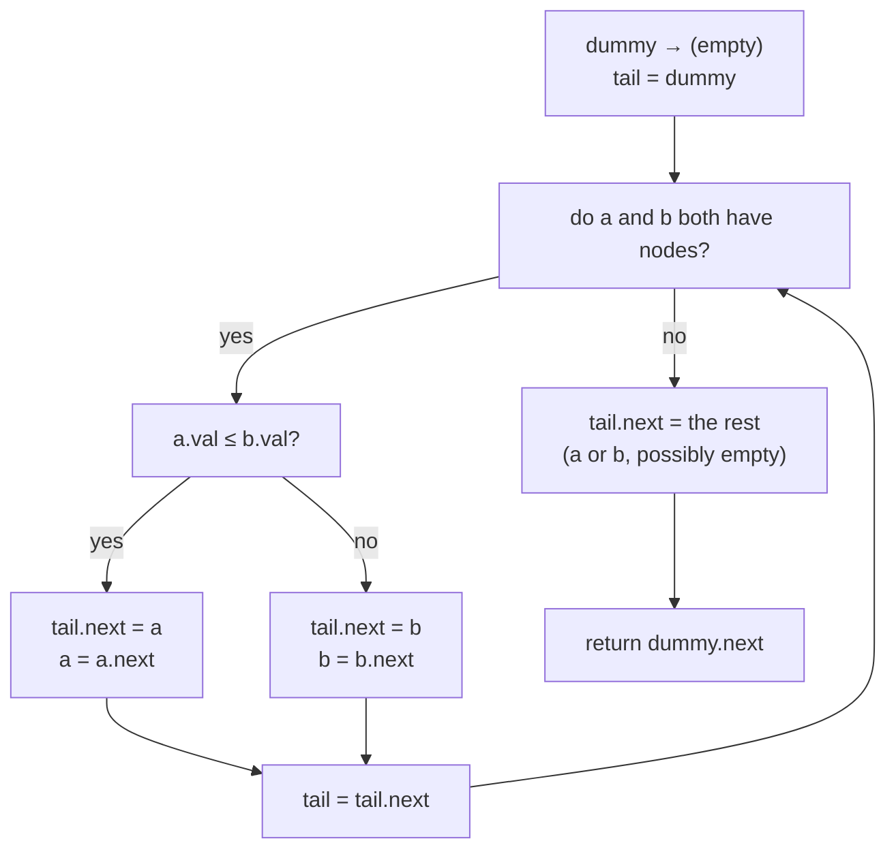

> [!tldr] Quick read
> - Problem: two [[en/concepts/linked-list|linked lists]] sorted in ascending order; merge them into one sorted list **using the nodes of the two lists themselves**, and return its head.
> - The standard way: a [[en/concepts/dummy-node|dummy node]] stands before the head of the result, and a `tail` pointer marks the last node. Each step compares the two heads and links the smaller node after `tail`. When one list runs out, attach **the whole rest** of the other list at once. O(m + n) time, O(1) extra memory.
> - Recursion is shorter but as deep as the total node count: Node 24 breaks at **12,289** nodes, Python at **1,000**, Java 21 at about 18,000 (first run) to 29,475 (after JIT). Go runs 2·10⁶ nodes without trouble.
> - Four wrong versions actually run: dropping the dummy node and forgetting empty lists (5/8, `TypeError`), forgetting to attach the rest (1/8), forgetting to advance `tail` (3/8), collecting then calling `sort()` without a comparator in JS (7/8).

> [!info] Context
> LeetCode problem 21 on [[en/posts/2026-11-24-neetcode-linked-list|station 1: Linked List Pointers]] of **The NeetCode Line: Linked Structures**. It is the smallest "merge" problem: [[en/problems/reorder-list|Reorder List]] reuses exactly this merge loop in its last step, and LeetCode 23 (Merge k Sorted Lists, station 2) extends it into a [[en/concepts/k-way-merge|k-way merge]] with a heap. Solutions come in TypeScript, Python, Go, Java and JavaScript. You only need loops and the idea of a pointer (a reference to an object).

> [!abstract]- Quick glossary for this post (click to open)
> - **Singly linked list**: a chain of nodes; each node holds a value and a `next` pointer to the following node; the last node has `next = null`. See [[en/concepts/linked-list|Linked List]].
> - **Dummy node**: a node with no data placed before the head, so working on the head looks exactly like working in the middle. See [[en/concepts/dummy-node|Dummy Node]] and the close idea [[en/concepts/sentinel-value|Sentinel Value]].
> - **Splice**: change the `next` pointer of an existing node instead of creating a new one.
> - **Stable**: when two values are equal, the element from the first list still comes first.
> - **Stack frame**: the memory for one pending function call; recursion n levels deep holds n frames at once.

## Picture it first: two lines of kids sorted by height merging into one

Two classes are already lined up from shortest to tallest. The teacher wants one line, still shortest to tallest. She plants a marker post at the front of the yard (the dummy node), then each time looks at the two kids at the front of the two lines and calls the shorter one to stand behind the last kid of the new line. When one class runs out, she stops calling the other class kid by kid: the rest of that line is already in order, so she just tells its first kid to hold hands with the last kid of the new line.

| Everyday | Concept |
|---|---|
| Two lines already sorted shortest to tallest | two sorted linked lists |
| Each kid holds the shoulder of the kid behind | the `next` pointer |
| Marker post at the front of the yard | dummy node `dummy` |
| Last kid of the new line | the `tail` pointer |
| Call the shorter kid to stand behind the last one | `tail.next = smaller node`, then advance `tail` |
| Two kids of equal height, call the class-1 kid first | compare with `<=` to stay stable |
| One class runs out, attach the whole rest | `tail.next = a ?? b`, O(1) |
| Nobody switches class, nobody gets "cloned" | relink old nodes, create no new ones |



## The problem

Merging two sorted **arrays** is familiar: two indexes, and each step copies the smaller element into a new array. With linked lists we need no new array: the nodes already exist, and we only **change pointers** so they form one chain. The difficulty is not the comparison but two places where it is easy to slip: the **first node** of the result (before any node exists, what do you link to?) and the **tail** (when one list runs out first, where does the rest of the other go?).

## How it works

### A dummy node removes the special case for the head

Without a dummy node, the first node of the result must be chosen **before** the loop, which means checking for both empty lists first:

```ts
// No dummy node: the head of the result must be picked before the loop, and both empty lists must be handled.
function mergeNoDummy(a: ListNode | null, b: ListNode | null): ListNode | null {
  if (!a) return b;
  if (!b) return a;
  let head: ListNode;
  if (a.val <= b.val) { head = a; a = a.next; } else { head = b; b = b.next; }
  let tail = head;
  while (a && b) {
    if (a.val <= b.val) { tail.next = a; a = a.next; } else { tail.next = b; b = b.next; }
    tail = tail.next;
  }
  tail.next = a ?? b;
  return head;
}
```


With a dummy node, every real node is "a node linked after `tail`", the first one included; at the end, return `dummy.next`:

```ts
// A dummy node stands before the head of the result: every real node is linked "after some node",
// so the head of the list needs no special case.
function mergeDummy(a: ListNode | null, b: ListNode | null): ListNode | null {
  const dummy = new ListNode(0);
  let tail = dummy;
  while (a && b) {
    if (a.val <= b.val) { tail.next = a; a = a.next; } // <= keeps a's node first on a tie
    else { tail.next = b; b = b.next; }
    tail = tail.next;
  }
  tail.next = a ?? b; // the rest is already sorted: attach the whole tail, O(1)
  return dummy.next;
}
```


Both versions pass 8/8 cases. The difference is that the version without a dummy node has **two** places to remember (the empty checks, choosing the head), and forgetting one is a bug. The wrong version below drops the two lines `if (!a) return b; if (!b) return a;`:

```ts
// WRONG: drops the dummy node but forgets an empty list: reads .val of null.
function wrongNoDummy(a: ListNode | null, b: ListNode | null): ListNode | null {
  let head: ListNode;
  if (a!.val <= b!.val) { head = a!; a = a!.next; } else { head = b!; b = b!.next; }
  let tail = head;
  while (a && b) {
    if (a.val <= b.val) { tail.next = a; a = a.next; } else { tail.next = b; b = b.next; }
    tail = tail.next;
  }
  tail.next = a ?? b;
  return head;
}
```


It passes 5/8 cases and throws `TypeError` on exactly the three cases with an empty list, including examples 2 and 3 of the problem.

### The rest is attached once, O(1)

When the `while (a && b)` loop stops, at least one list is empty. The other list is sorted, and every value in it is ≥ the node just linked (it lost every earlier comparison or was never compared). So there is no need to keep walking: `tail.next = a ?? b` attaches the whole stretch with one assignment. The wrong version `wrongForgetTail` drops that line and passes only 1/8 cases (both lists empty), because almost every case has a leftover tail.

The loop invariant: **`dummy.next … tail` is a sorted list holding exactly the nodes taken so far, and every node left in `a` and `b` is ≥ `tail.val`**. The wrong version `wrongNoAdvance` forgets `tail = tail.next`: each link overwrites `dummy.next`, so the result keeps only the last node linked plus the tail, passing 3/8 cases.

### `<=` or `<`: a question of stability

On LeetCode, `<` and `<=` both pass, because only values are compared. But when nodes carry extra data (like records in a merge sort), the order between two equal nodes means something. Tag the nodes with `a` and `b` and merge `[1,2,2]` with `[2,3]`:

```text
stability, [1,2,2] (a) with [2,3] (b):
  <= : 1a 2a 2a 2b 3b
  <  : 1a 2b 2a 2a 3b
```

`<=` keeps both 2s from `a` ahead of the 2 from `b`, so it is stable; `<` moves the 2 from `b` to the front. Merge sort is stable precisely because of the `<=` in this merge step.

### Recursion: short, but as deep as the total node count

```ts
// Recursive: the smaller head goes first, followed by the merge of the rest. As deep as the total node count.
function mergeRecursive(a: ListNode | null, b: ListNode | null): ListNode | null {
  if (!a) return b;
  if (!b) return a;
  if (a.val <= b.val) { a.next = mergeRecursive(a.next, b); return a; }
  b.next = mergeRecursive(a, b.next);
  return b;
}
```


Each call takes exactly one node, so merging m + n nodes needs m + n stack frames at once. The problem caps each list at 50 nodes, 100 levels in total, and every language passes. For longer lists I measured the maximum depth with a binary search on the total node count (two lists interleaving even and odd values):

| Language | Runs up to | Error past that |
|---|---|---|
| Node 24 (TS, JS) | 12,288 nodes (all three runs) | `RangeError: Maximum call stack size exceeded` |
| Python 3.12 | 999 nodes (default limit 1,000 frames) | `RecursionError` |
| Java 21 | 18,432 nodes on the first measurement, 29,475 after JIT compilation | `StackOverflowError` |
| Go 1.25 | 2·10⁶ nodes still run | (a goroutine's stack grows as needed) |

Java's number changes between the first measurement and the later ones because while the code still runs in the interpreter each frame is larger; once the JIT compiles it, frames shrink and the same stack holds more levels. Python stops at 999 rather than 1,000 because the program itself already uses a few frames before it calls the merge.

### Under the hood in five languages

| | Dummy node | Attach the rest | Specific trap |
|---|---|---|---|
| TypeScript / JavaScript | `new ListNode(0)` | `tail.next = a ?? b` | recursion breaks at 12,289 nodes; collecting into an array and calling `sort()` without a comparator puts `10` before `2` (7/8 cases) |
| Python | `dummy = tail = ListNode()` | `tail.next = l1 or l2` | recursion breaks at 1,000 nodes; the tuple assignment `tail.next, l1 = l1, l1.next` is safe because the right side is evaluated in full before assigning |
| Go | `dummy := ListNode{}` is a **value**, `tail := &dummy` | `if a != nil { tail.Next = a } else { tail.Next = b }` | declaring `var dummy *ListNode` (a nil pointer) makes writing `tail.Next` panic: *nil pointer dereference* |
| Java | `new ListNode(0, null)` | `tail.next = (a != null) ? a : b` | recursion throws `StackOverflowError`; the threshold depends on JIT and the thread's stack size (`-Xss`) |

### Measurements

TypeScript, random sorted values (mulberry32 generator), two lists of m = n nodes each, median of 5 runs:

| m = n | Dummy node (relink) | Recursive | New nodes | Collect then sort |
|---|---|---|---|---|
| 1,000 | 0.04 ms | 0.02 ms | 0.06 ms | 0.08 ms |
| 4,000 | 0.05 ms | 0.12 ms | 0.08 ms | 0.28 ms |
| 100,000 | 1.64 ms | `RangeError` | 2.61 ms | 8.84 ms |
| 1,000,000 | 18.33 ms | `RangeError` | 79.22 ms | 201.34 ms |

- Relinking old nodes is fastest at large sizes: creating 2·10⁶ new nodes is about 4 times slower because of the allocation.
- Collect-then-sort wastes the fact that both lists are already sorted: O((m + n) log(m + n)) and about 11 times slower at 10⁶.
- At 1,000 nodes every approach is under 0.1 ms; numbers that small swing with the JIT, so don't read a ranking from them.

The other languages, dummy-node approach: Go 9.87 ms, Java 10.35 ms at m = n = 10⁶. Go's recursion runs but is about 8 times slower (75.48 ms), because each level is a real function call and the stack has to grow. Python takes 237.94 ms; `heapq.merge` and rebuilding the list take 2,005 ms, about 8 times slower, because it creates 2·10⁶ new nodes and goes through an iterator layer.

## Runnable example

[TypeScript](../code/neetcode-merge-two-sorted-lists/merge-two-lists.ts) · [Python](../code/neetcode-merge-two-sorted-lists/merge_two_lists.py) · [Go](../code/neetcode-merge-two-sorted-lists/merge_two_lists.go) · [Java](../code/neetcode-merge-two-sorted-lists/merge-two-lists.java) · [JavaScript](../code/neetcode-merge-two-sorted-lists/merge-two-lists.js)

Each file runs 8 shared cases: the problem's three examples, an empty list on each side, negative numbers, all-equal values, and two interleaving lists of different lengths.

The iterative version with a dummy node:

```ts
// A dummy node stands before the head of the result: every real node is linked "after some node",
// so the head of the list needs no special case.
function mergeDummy(a: ListNode | null, b: ListNode | null): ListNode | null {
  const dummy = new ListNode(0);
  let tail = dummy;
  while (a && b) {
    if (a.val <= b.val) { tail.next = a; a = a.next; } // <= keeps a's node first on a tie
    else { tail.next = b; b = b.next; }
    tail = tail.next;
  }
  tail.next = a ?? b; // the rest is already sorted: attach the whole tail, O(1)
  return dummy.next;
}
```

```python
# A dummy node stands before the head of the result; "l1 or l2" attaches the whole rest.
def merge_dummy(l1: Optional[ListNode], l2: Optional[ListNode]) -> Optional[ListNode]:
    dummy = tail = ListNode()
    while l1 and l2:
        if l1.val <= l2.val:
            tail.next, l1 = l1, l1.next
        else:
            tail.next, l2 = l2, l2.next
        tail = tail.next
    tail.next = l1 or l2
    return dummy.next
```

```go
// The dummy node is a value on the stack; tail is a pointer to it.
func mergeDummy(a, b *ListNode) *ListNode {
	dummy := ListNode{}
	tail := &dummy
	for a != nil && b != nil {
		if a.Val <= b.Val {
			tail.Next, a = a, a.Next
		} else {
			tail.Next, b = b, b.Next
		}
		tail = tail.Next
	}
	if a != nil {
		tail.Next = a
	} else {
		tail.Next = b
	}
	return dummy.Next
}
```

```java
// A dummy node stands before the head of the result; after the loop, attach the whole rest.
static ListNode mergeDummy(ListNode a, ListNode b) {
    ListNode dummy = new ListNode(0, null), tail = dummy;
    while (a != null && b != null) {
        if (a.val <= b.val) { tail.next = a; a = a.next; }
        else { tail.next = b; b = b.next; }
        tail = tail.next;
    }
    tail.next = (a != null) ? a : b;
    return dummy.next;
}
```

```js
// A dummy node stands before the head of the result; "a ?? b" attaches the whole rest.
function mergeDummy(a, b) {
  const dummy = new ListNode(0);
  let tail = dummy;
  while (a && b) {
    if (a.val <= b.val) { tail.next = a; a = a.next; }
    else { tail.next = b; b = b.next; }
    tail = tail.next;
  }
  tail.next = a ?? b;
  return dummy.next;
}
```


The recursive version:

```ts
// Recursive: the smaller head goes first, followed by the merge of the rest. As deep as the total node count.
function mergeRecursive(a: ListNode | null, b: ListNode | null): ListNode | null {
  if (!a) return b;
  if (!b) return a;
  if (a.val <= b.val) { a.next = mergeRecursive(a.next, b); return a; }
  b.next = mergeRecursive(a, b.next);
  return b;
}
```

```python
# Recursive: each node costs one stack frame; Python's default limit is 1000 frames.
def merge_recursive(l1, l2):
    if not l1:
        return l2
    if not l2:
        return l1
    if l1.val <= l2.val:
        l1.next = merge_recursive(l1.next, l2)
        return l1
    l2.next = merge_recursive(l1, l2.next)
    return l2
```

```go
// Recursive: a goroutine's stack grows on its own, so Go doesn't hit a depth limit like JS or Python.
func mergeRecursive(a, b *ListNode) *ListNode {
	if a == nil {
		return b
	}
	if b == nil {
		return a
	}
	if a.Val <= b.Val {
		a.Next = mergeRecursive(a.Next, b)
		return a
	}
	b.Next = mergeRecursive(a, b.Next)
	return b
}
```

```java
// Recursive: one frame per node on the thread's stack; long lists throw StackOverflowError.
static ListNode mergeRecursive(ListNode a, ListNode b) {
    if (a == null) return b;
    if (b == null) return a;
    if (a.val <= b.val) { a.next = mergeRecursive(a.next, b); return a; }
    b.next = mergeRecursive(a, b.next);
    return b;
}
```

```js
function mergeRecursive(a, b) {
  if (!a) return b;
  if (!b) return a;
  if (a.val <= b.val) { a.next = mergeRecursive(a.next, b); return a; }
  b.next = mergeRecursive(a, b.next);
  return b;
}
```


Output of `node merge-two-lists.ts`:

```text
mergeDummy      8/8 cases correct
mergeNoDummy    8/8 cases correct
mergeRecursive  8/8 cases correct
mergeCopy       8/8 cases correct
concatSort      8/8 cases correct
wrongNoDummy    5/8 cases correct; wrong on []+[] → TypeError, []+[0] → TypeError, [1,2,3]+[] → TypeError
wrongForgetTail 1/8 cases correct; wrong on [1,2,4]+[1,3,4] → [1,1,2,3,4], []+[0] → [], [5]+[1,2,3] → [1,2,3], [1,2,3]+[] → [], [-100,0,100]+[-100,-50] → [-100,-100,-50], [2,2,2]+[2,2] → [2,2,2], [1,5,9]+[2,3,4,6,7,8,10] → [1,2,3,4,5,6,7,8,9]
wrongNoAdvance  3/8 cases correct; wrong on [1,2,4]+[1,3,4] → [4], [5]+[1,2,3] → [5], [-100,0,100]+[-100,-50] → [0,100], [2,2,2]+[2,2] → [2,2], [1,5,9]+[2,3,4,6,7,8,10] → [10]

stability, [1,2,2] (a) with [2,3] (b):
  <= : 1a 2a 2a 2b 3b
  <  : 1a 2b 2a 2a 3b

recursion runs up to a total of 12288 nodes; 12289 nodes throws RangeError

m = n      dummy     recursive new nodes    collect+sort
1000        0.04 ms    0.02 ms      0.06 ms      0.08 ms
4000        0.05 ms    0.12 ms      0.08 ms      0.28 ms
100000      1.64 ms RangeError      2.61 ms      8.84 ms
1000000    18.33 ms RangeError     79.22 ms    201.34 ms
```

`python3 merge_two_lists.py`:

```text
merge_dummy      8/8 cases correct
merge_recursive  8/8 cases correct
merge_heapq      8/8 cases correct

recursion runs up to a total of 999 nodes (limit 1000); 1000 nodes throws RecursionError

m = n      dummy      heapq.merge
10000        0.72 ms      4.98 ms
100000       9.37 ms     89.32 ms
1000000    237.94 ms   2005.42 ms
```

`go run merge_two_lists.go`:

```text
mergeDummy      8/8 cases correct
mergeRecursive  8/8 cases correct
wrongNilDummy    runtime error: invalid memory address or nil pointer dereference

m = n      dummy      recursive
10000        0.11 ms     0.29 ms
100000       0.92 ms     9.26 ms
1000000      9.87 ms    75.48 ms
```

`java merge-two-lists.java`:

```text
mergeDummy      8/8 cases correct
mergeRecursive  8/8 cases correct
recursion runs up to a total of 18432 nodes (measurement 1)
recursion runs up to a total of 29475 nodes (measurement 2)
recursion runs up to a total of 29475 nodes (measurement 3)

m = n      dummy
10000        0.40 ms
100000       1.13 ms
1000000     10.35 ms
```

`node merge-two-lists.js`:

```text
mergeDummy             8/8 cases correct
mergeRecursive         8/8 cases correct
wrongConcatDefaultSort 7/8 cases correct; wrong on [1,5,9]+[2,3,4,6,7,8,10] → [1,10,2,3,4,5,6,7,8,9]
```

*(Output labels translated; the files themselves print Vietnamese.)*

## Misconceptions and common traps

- **"Merging means building a new list."** The problem wants the existing nodes relinked. Creating new nodes still gives the right values but costs m + n allocations, about 4 times slower at 10⁶ nodes.
- **"When the loop ends, we're done."** The rest of the list that did not run out must be attached; without that line only 1/8 cases pass.
- **"The rest must be walked node by node to attach it."** It is already sorted and already linked together; one assignment is enough.
- **Dropping the dummy node "to save a node".** One dummy node is O(1) memory; in exchange you have two places to remember empty checks. Forgetting them is a `TypeError` on examples 2 and 3 of the problem.
- **"Recursion is also O(m + n), so it's equivalent."** In time, yes; in memory, no: O(m + n) stack frames. Within the problem's limits (100 nodes) it passes; with lists of tens of thousands of nodes, JS, Python and Java all blow the stack.
- **Returning `dummy` instead of `dummy.next`.** The result gets an extra 0 at the front.
- **Go: `var dummy *ListNode`.** That is a nil pointer, not a node; you need `dummy := ListNode{}` or `&ListNode{}`.

## Self-check questions

> [!question]- Why can the rest be attached after the loop without any more comparisons?
> The loop stops when one list runs out. The other list is sorted, and its head is ≥ every node already linked (otherwise it would have been picked earlier). So attaching the whole remaining stretch at the end keeps the order.

> [!question]- What exactly does the dummy node buy you?
> It gives the first node of the result a "node before it", so the line `tail.next = …` works for every node, the first one included. No need to pick the head before the loop and no special check for two empty lists: returning `dummy.next` gives `null` on its own.

> [!question]- If you change `<=` to `<`, will LeetCode report a failure? Where does it matter?
> No, because only values are compared. It matters when nodes are equal in value but different in identity (records with extra fields): `<=` keeps the original order, that is, it is stable. Merge sort relies on this.

> [!question]- Does recursively merging two lists of 10,000 nodes each run in Node?
> No. 20,000 nodes in total need 20,000 levels, past the 12,288 threshold measured on Node 24, so it throws `RangeError`. The iterative version handles any length.

> [!question]- How much extra memory does the iterative version use?
> O(1): one dummy node and a few pointers. The result reuses exactly the nodes of the two input lists.

## References

- [LeetCode 21: Merge Two Sorted Lists](https://leetcode.com/problems/merge-two-sorted-lists/) (original problem: each list has 0 to 50 nodes, values in [−100, 100], both sorted ascending)
- [Python `heapq.merge`](https://docs.python.org/3/library/heapq.html#heapq.merge) (merges several sorted inputs into one iterator) and [`sys.getrecursionlimit`](https://docs.python.org/3/library/sys.html#sys.getrecursionlimit) (the depth limit, 1,000 by default)
- [Go FAQ: goroutines](https://go.dev/doc/faq#goroutines) (a goroutine's stack starts small and grows as needed)
- [JVM Specification SE 21, §2.5.2 Java Virtual Machine Stacks](https://docs.oracle.com/javase/specs/jvms/se21/html/jvms-2.html#jvms-2.5.2) (a thread's stack is bounded; exceeding it throws `StackOverflowError`)
- [ECMAScript: `Array.prototype.sort`](https://tc39.es/ecma262/#sec-array.prototype.sort) (without a comparator, values are compared as strings)
- Knuth, *The Art of Computer Programming*, volume 3, section 5.2.4 (sorting by merging) and Cormen et al., *Introduction to Algorithms*, 3rd edition, section 2.3.1 (the MERGE procedure)
